# 10. 统计计算

Excel 提供了多种用于执行统计分析的内置工具。本章重点介绍其中一些工具，包括基本图表绘制和 Excel 分析工具库。讨论了描述性统计和推断性统计之间的区别，并介绍了 Excel 的统计函数。

## 2013 年推荐的分析工具

`Excel 2013` 试图通过推荐条件格式、图表、工具、汇总和数据透视表来预测你的需求。当高亮显示数据，或按下 `Ctrl+Q` 且选中数据范围内的任意单元格时，会显示一个包含多种格式选项的弹出窗口，如图 10-1 所示。将鼠标悬停在条件格式选项上，会预览该条件格式应用于数据后的效果。

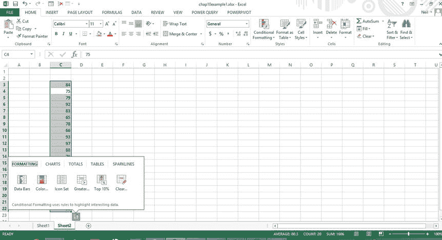
图 10-1. 推荐的格式和分析选项

在弹出窗口中点击 `汇总`，将显示 `汇总` 菜单，如图 10-2 所示。

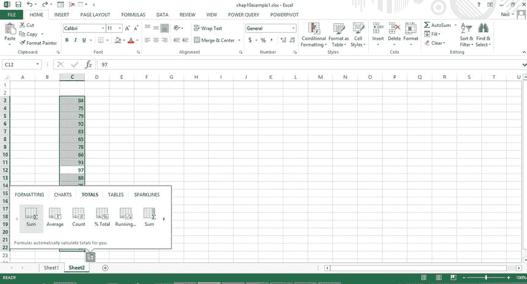
图 10-2. 汇总和统计选项

向右滚动以高亮显示 `占总计的百分比`，将产生如图 10-3 所示的结果，其中每个项目右侧显示了其占总计的百分比。

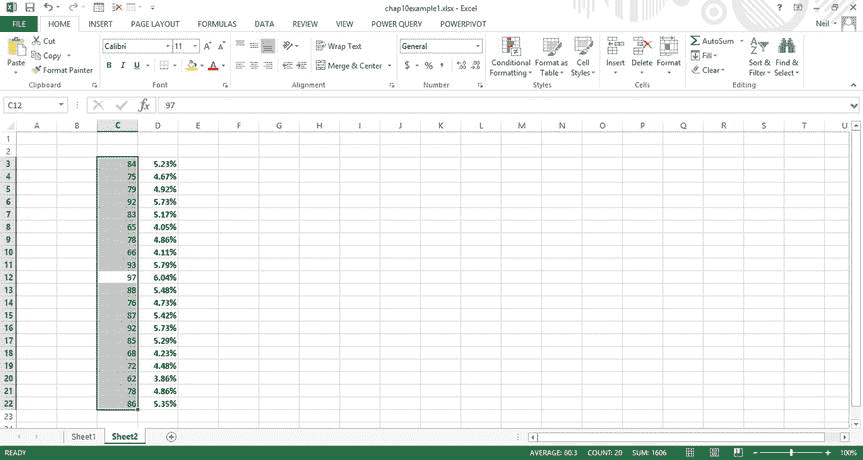
图 10-3. 百分比汇总

### 自定义状态栏

请注意，`Excel` 窗口底部的状态栏会显示与高亮数据相关的统计数据，例如平均值、计数和总和。你可以通过右键单击状态栏并选择要显示的项目来自定义显示的值，如图 10-4 所示。

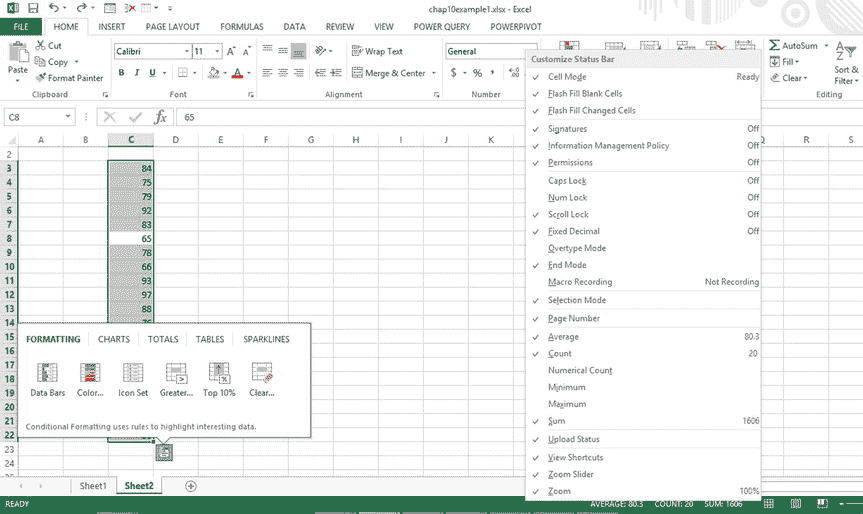
图 10-4. 自定义状态栏菜单

例如，如果在 `自定义状态栏` 菜单中选中了 `最小值` 和 `最大值`，这些值将被添加到状态栏中，如图 10-5 所示。

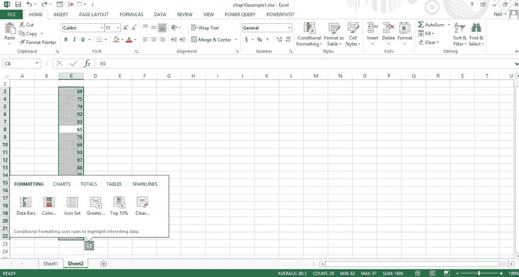
图 10-5. 添加了最小值和最大值后的状态栏

### 推断统计

抽样涉及检查一个大群体中的一小部分，以便得出关于整个群体的结论。这被称为推断统计。要使样本能够代表更大的群体，样本的成员必须随机选择，这意味着群体中的每个成员被选中的机会与其他成员相同。目标是从样本中得出关于群体的可靠结论。确定样本量至关重要。样本的误差幅度计算为 1 除以样本量的平方根。因此，随着样本量的增加，误差幅度会减小。

通常，之所以使用样本，是因为调查整个群体在经济上不可行。大数据的承诺之一是，如果有可用的数据，则可以处理整个群体以获得更准确的结果。

### 描述性统计回顾

描述性统计通过几个关键的计算值来汇总数据。图 10-6 显示了一个正态分布，或钟形曲线。任何值出现的频率由曲线的高度表示。例如，如果在多次试验中抛硬币十次，正面的平均次数将是五次。这是最常出现的结果，由曲线的最高点表示。次常见的结果是六次正面和四次反面，或六次反面和四次正面。出现九次正面和一次反面的情况则很少见。

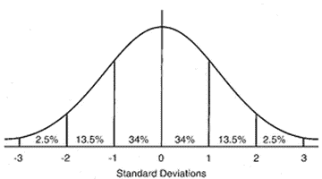
图 10-6. 钟形曲线

#### 计算描述性统计

最常见的计算统计值是平均数、中位数和众数。

- **平均数**，即平均值或算术平均数，通过将所有值相加并除以值的数量来计算。
- 中间值称为 **中位数**——即 50% 的值高于它、50% 的值低于它的那个数据点。
- 出现频率最高的值称为 **众数**。在钟形曲线中，中位数、众数和平均数相等。

#### 离散程度度量

然而，许多分布并不完全符合钟形曲线，因此我们需要离散程度的度量。**方差** 衡量一组数值的分散程度。小方差表示数据点往往非常接近平均值，因此彼此也很接近，而大方差则表示数据点围绕平均值并彼此之间都非常分散。

离散程度的一种度量是 **标准差**，其计算方法是计算每个值与算术平均值的偏差，然后将其平方。计算这些平方值的算术平均值，然后取平方根来计算标准差，标准差用希腊字母 sigma 表示。

**68-95-99 规则** 用于记忆正态分布平均值周围范围内值的百分比。换句话说，68.27% 的值落在平均值加减一个标准差的范围内；95.45% 的值落在平均值加减两个标准差的范围内；99.73% 的值落在平均值加减三个标准差的范围内。这有时被称为 **三西格玛经验法则**。请记住，此规则仅适用于正态分布。注意图 10-6 图示中显示与该规则相对应的百分比。

例如，在房屋价值分析中，如果所有房屋的售价都在一个相当狭窄的范围内，比如 40 万到 60 万美元，那么方差和标准差就会相对较小。但是，如果有几栋高端房屋的售价超过 100 万美元，那么方差和标准差就会较大。这就是为什么本章剩余部分描述的图形方法对于显示数值之间的关系非常有用。

#### Excel 统计函数

`Excel` 提供了大量函数来计算统计值。以下是一些较常用的函数。

- `Average(范围)`：计算一个数据范围或离散值列表的算术平均数。它会忽略空单元格或包含文本的单元格。
- `Averagea(范围)`：与 `Average` 相同，不同之处在于它将包含文本的单元格的值视为零。
- `Averageif(范围, 条件)`：根据用引号括起来的条件语句返回算术平均数。计算时不包含空单元格或包含文本的单元格。
- `Averageifs(范围, 条件 1, 条件 2)`：根据多个条件语句返回算术平均数。计算时不包含空单元格或包含文本的单元格。
- `Median(范围)`：计算中位数或中间值。
- `Mode(范围)`：计算出现频率最高的值，排除空单元格和未计数的包含文本的单元格。

### 数据图表化

`Excel` 提供了多种以图形方式查看数据的方法。选择合适的图形工具来准确描绘数据非常重要，如下列表所述。

- 柱形图和条形图：在一个轴上绘制类别变量，在另一个轴上绘制数值变量。
- XY 散点图：显示两个数值之间的关系。
- 频率分布：仅涉及一个变量——它显示每个值有多少实例。它将各个测量值分组到类别或箱子中。在其最常见的形式中，变量的值位于水平（x）轴上，实例的频率位于垂直（y）轴上。
- 直方图：是数值数据分布的图形表示。

### Excel 分析工具库

本节将介绍如何使用 `Excel` 附带的 `Excel 分析工具库`。`分析工具库` 可用于执行复杂的统计计算，手动编程这些计算将非常耗时。

#### 启用 Excel 分析工具库

在使用前，必须将其激活。

要启用 Excel 分析工具库，请按照以下步骤操作：

点击 `文件` 选项卡，进入 Backstage 视图。在左侧窗格底部点击 `选项`。在左侧窗格中选择 `加载项`。在窗口底部，选择 `Excel 加载项` 并点击 `转到`，如图 10-7 所示。

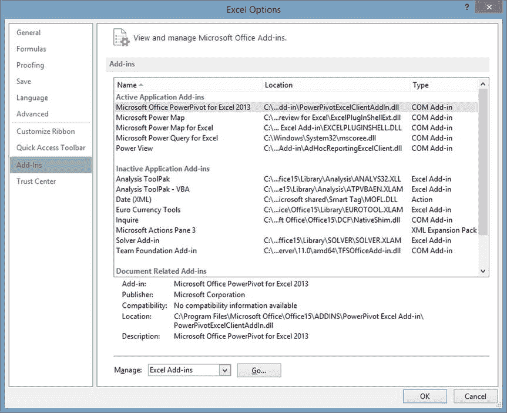
图 10-7. Excel 加载项界面

选择 `分析工具库`，如图 10-8 所示，然后点击 `确定`。

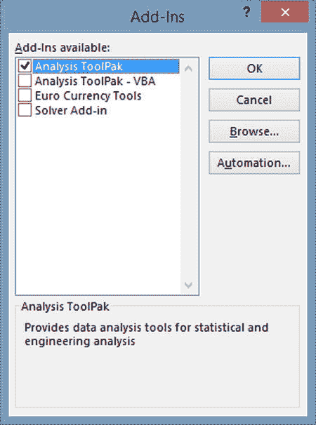
图 10-8. 加载项弹出窗口

激活后，现在可以通过点击 Excel 中 `数据` 选项卡右侧的 `数据分析` 来访问分析工具库。

#### 一个简单的示例

以下示例将演示如何使用 Excel 分析工具库分析一些示例测试分数。

**练习 10-1.** 使用分析工具库

按照以下步骤分析测试分数：

点击 `数据` 选项卡右侧的 `数据分析`。当 `数据分析` 窗口出现时，选择 `描述统计`，如图 10-9 所示。

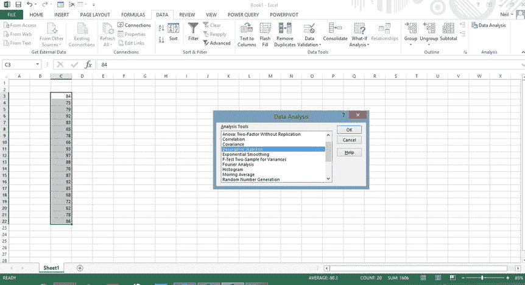
图 10-9. 数据分析工具

点击 `确定`。在 `描述统计` 对话框中，指定输入区域和输出区域，选择 `汇总统计`，如图 10-10 所示，然后点击 `确定`。

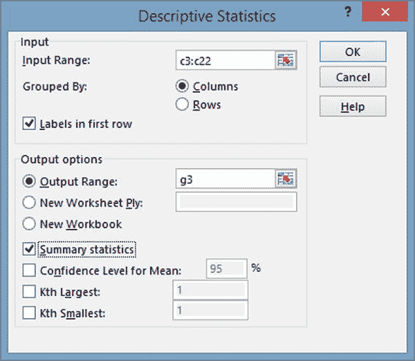
图 10-10. 描述统计对话框

结果如图 10-11 所示。

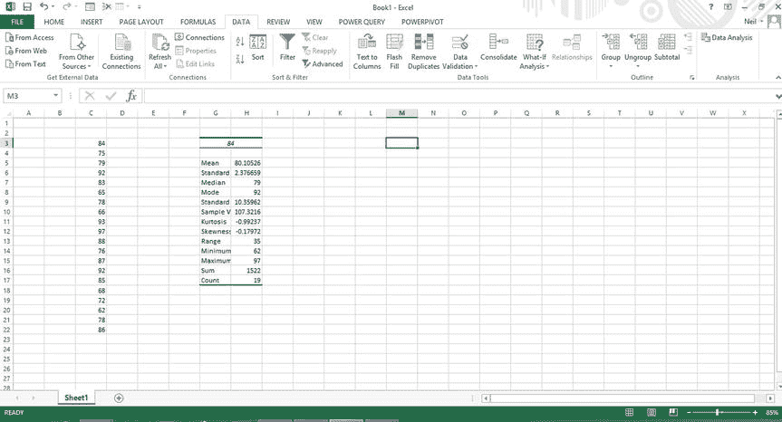
图 10-11. 描述统计输出

要使用数据分析工具库绘制直方图，请转到 `数据` 选项卡并点击 `数据分析`。选择 `直方图`，如图 10-12 所示。

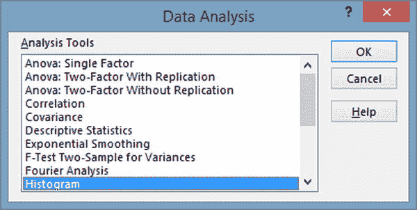
图 10-12. 从数据分析对话框中选择直方图

定义区域并选择图表输出，如图 10-13 所示，然后点击 `确定`。

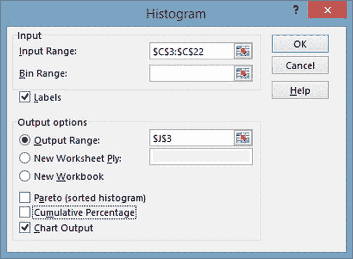
图 10-13. 直方图对话框

结果如图 10-14 所示。此操作设置了用于对数据进行分类的组距（即类别），这些类别将用于绘制直方图。

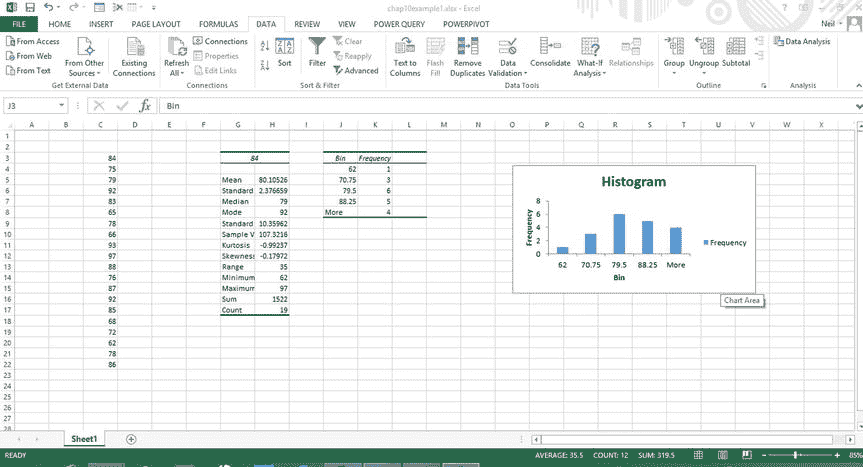
图 10-14. 直方图

#### 分析工具库的其他功能

分析工具库还包含其他功能。以下列出了一些最常用的功能：

*   方差分析工具提供不同类型的方差分析。它们用于检验两个样本选择的随机性。
*   相关系数是介于 -1 和 +1 之间的一个值，用于衡量两个变量之间的相关强度。+1 表示完全正相关，意味着两个变量同步变动。-1 表示完全负相关，意味着两个变量反向变动。正相关并不能证明因果关系。Excel 的 `CORREL` 函数也可用于计算相关系数。
*   协方差衡量的是两个随机变量共同变化的程度。
*   指数平滑类似于移动平均，用于预测时间序列中的下一个值。

### 使用数据透视表创建直方图

数据透视表也可用于创建更定制化的直方图。

**练习 10-2.** 一个定制化的测试分数直方图示例

按照以下步骤创建一个显示测试分数分布的直方图：

突出显示要绘制图表的数据。选择 `插入` 选项卡并点击 `数据透视表`。确认区域并将数据透视表放置在同一工作表的 F3 位置，如图 10-15 所示。

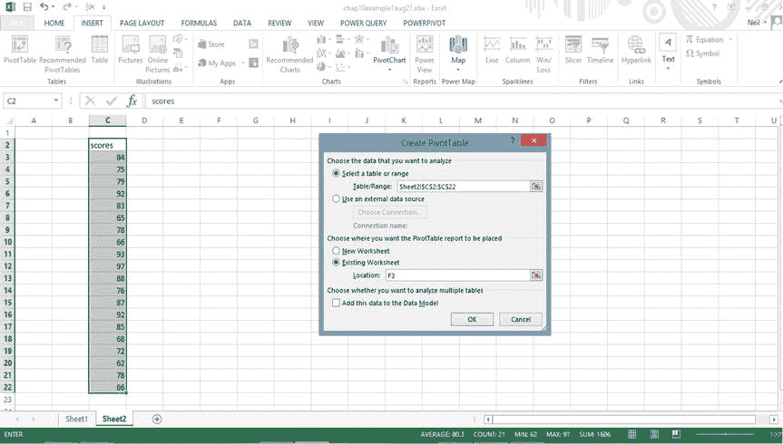
图 10-15. 创建数据透视表对话框

将分数拖到 `行` 框中，如图 10-16 所示。

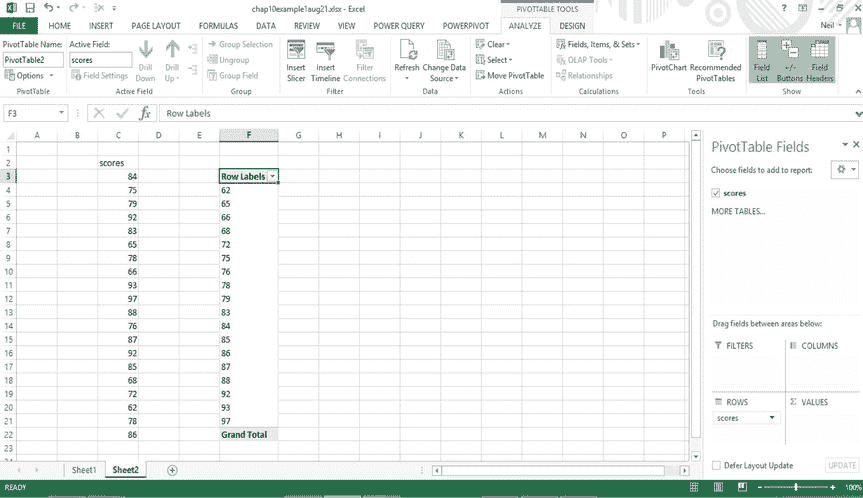
图 10-16. 测试分数作为行

右键单击数据透视表列并选择 `组合`，如图 10-17 所示。

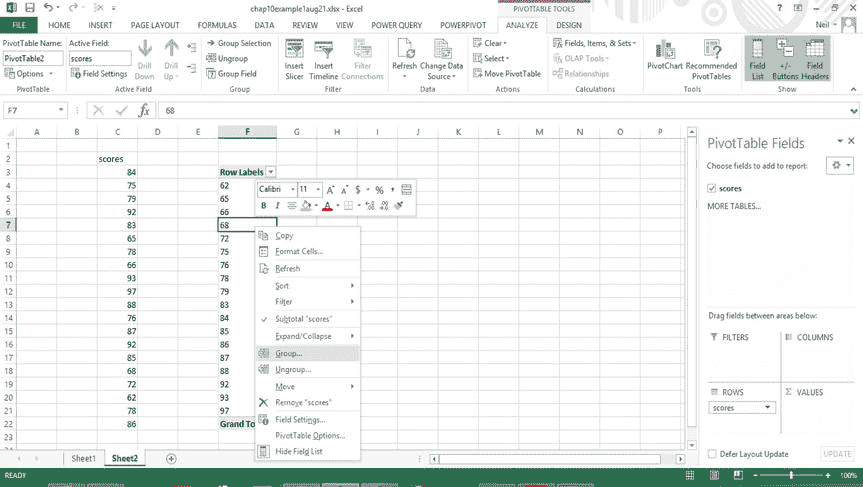
图 10-17. 从上下文菜单中选择组合

默认情况下，`组合` 对话框将起始值设为最低分数，终止值设为最高分数，默认间隔为 10，如图 10-18 所示。点击 `确定`。

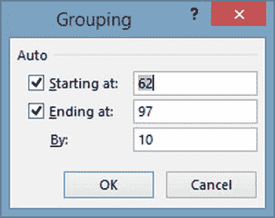
图 10-18. 组合对话框

将分数拖到 `值` 框中。显示每个分组类别频数的结果如图 10-19 所示。请注意，这些类别大致相当于评分等级：92 到 100 为 A，82 到 91 为 B，依此类推。

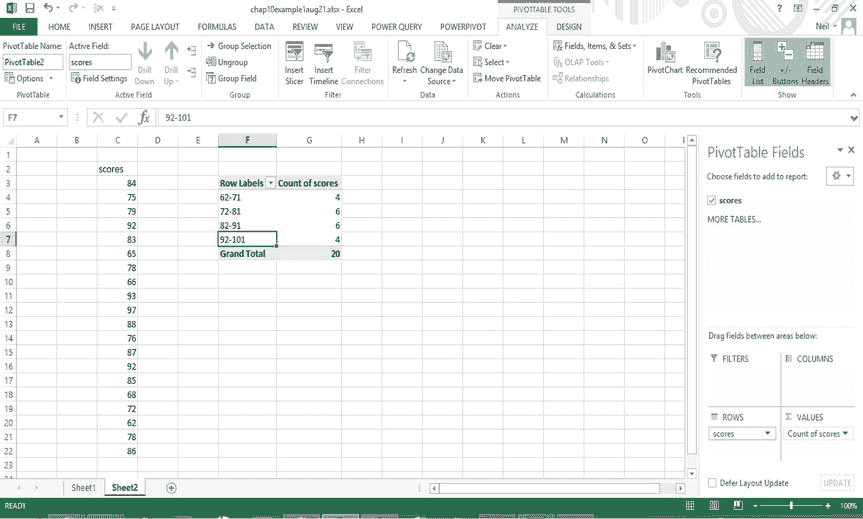
图 10-19. 分组类别

要绘制直方图，请点击 `插入` 选项卡并选择 `柱形图`，`二维柱形图`。显示每个类别频数的结果如图 10-20 所示。

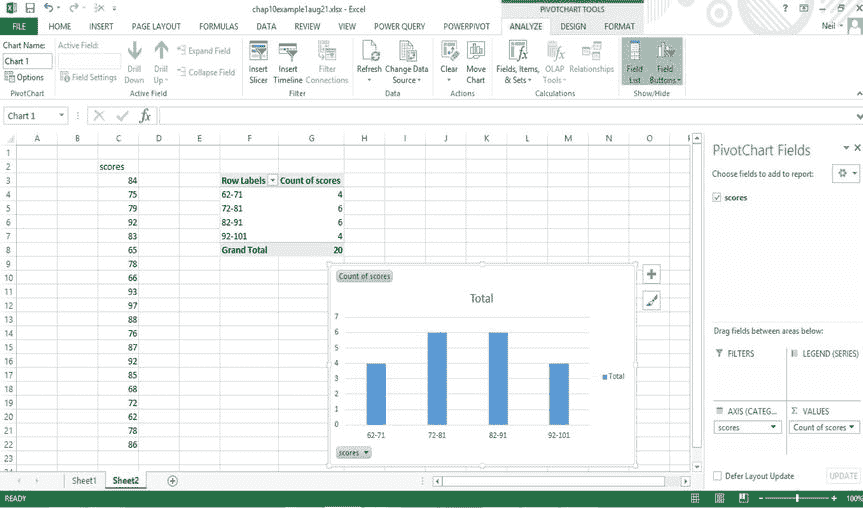
图 10-20. 直方图

可以通过点击一个柱形并按 `Ctrl+1` 来调整图表，这会在屏幕右侧打开 `设置数据系列格式` 窗格。将 `间隙宽度` 滑块调整为零，以移除柱形之间的间距。

可以通过点击标题（当前显示为“总计”）并将其更改为“测试分数频数分布”来修改标题，如图 10-21 所示。

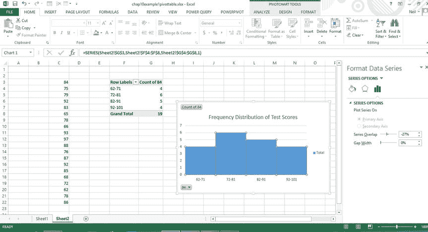
图 10-21. 带有标题的直方图

## 散点图

通过绘制散点图并让程序计算 `R-squared` 值，可以直观地观察两个变量之间的关系。`R-squared` 是一种统计指标，用于衡量数据点与拟合回归线（即穿过数据点的最佳拟合直线）的接近程度，也称为决定系数。其取值范围为 0 到 100。若 `R-squared` 值为 100，则表示一个变量的所有变动完全由另一个变量的变动所解释。`X` 为自变量，`y` 为因变量。

### 练习 10-3 成绩与缺勤关系散点图示例

本示例探讨课堂缺勤次数与数字成绩之间是否存在关系，其中 1 为最低分，4 为最高分。成绩数据如图 10-22 所示。

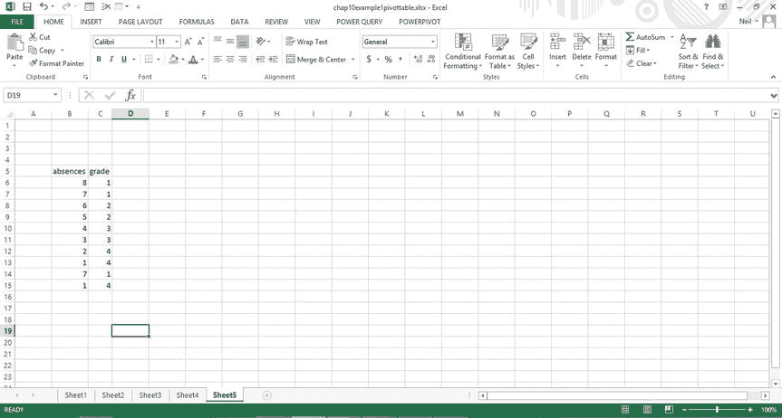
图 10-22 成绩与缺勤数据

请按以下步骤操作：

选中数据，点击 `插入` 选项卡，然后选择 `散点图（X，Y）`，如图 10-23 所示。

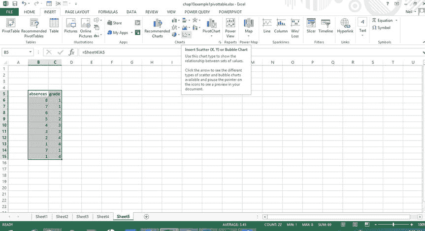
图 10-23 插入散点图（X，Y）或气泡图选项

选择 `散点图` 选项，如图 10-24 所示。

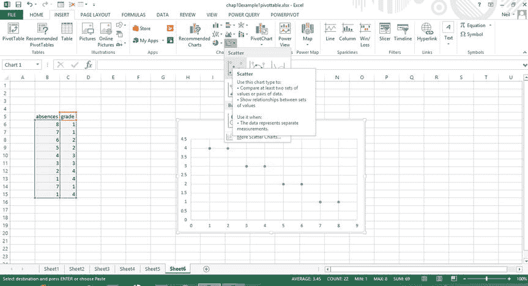
图 10-24 选择散点图选项

点击图表右上角的 `+` 号，然后选择 `坐标轴标题`，如图 10-25 所示。

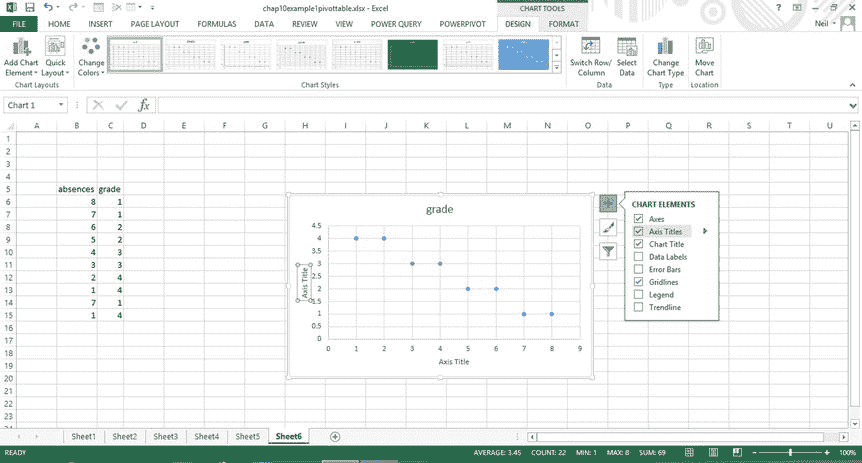
图 10-25 选择坐标轴标题

点击水平或 `x` 轴上的 `坐标轴标题`，并将其更改为 `缺勤次数`。将垂直轴（即 `y` 轴）上的标签更改为 `成绩`，并将图表标题更改为 `“成绩与缺勤次数之间的关系”`，如图 10-26 所示。

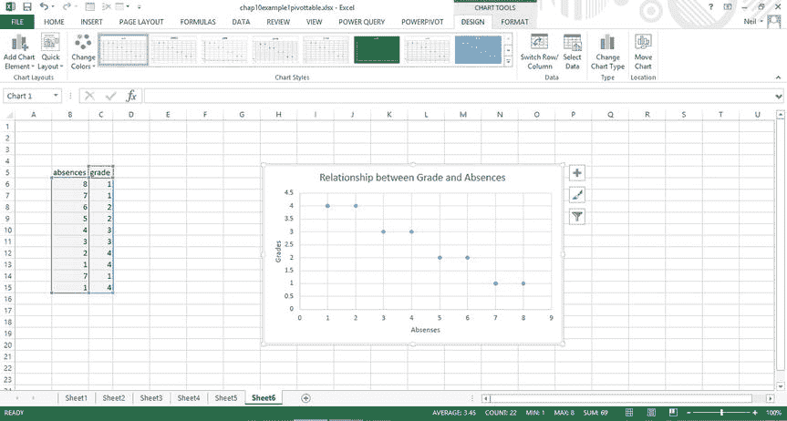
图 10-26 带有标题的图表

右键单击绘图区域，然后选择 `添加趋势线...`，如图 10-27 所示。

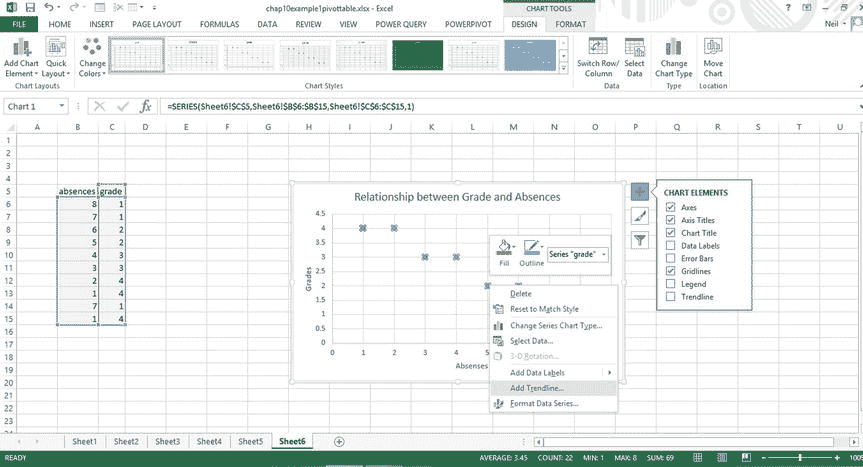
图 10-27 选择添加趋势线...

在右侧的 `设置趋势线格式` 窗格中，向下滚动并勾选 `显示公式` 和 `显示 R 平方值`，如图 10-28 所示。其中显示了线的公式（包含斜率和 `y` 截距）。请注意，`R-squared` 值为 `0.9603`（以小数形式显示），表明存在高度相关性。这是一种反向关系，意味着缺勤次数越多，成绩越低。

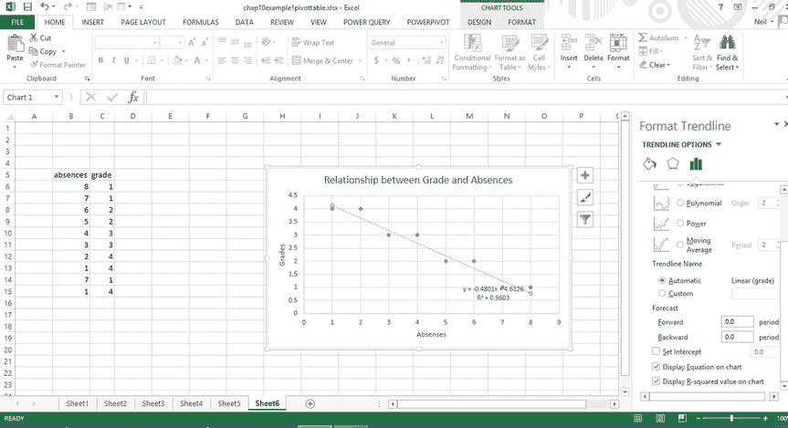
图 10-28 显示公式和 R 平方值的图表

## 本章小结

本章仅是初步探讨了 Excel 利用其分析工具库计算统计值的能力。本章介绍了如何使用内置图表工具创建数据的可视化展示，以及如何判断两个数值之间是否存在关系。这些主题足以写成一本专著。