# 9. Power Map

Power Map 是一个强大的可视化工具，能够利用必应地图技术将 Excel 中的地理空间数据绘制在地图上，从而创建二维和三维可视化效果。本章将演示如何通过 Power Query 导入数据，然后使用 Power Map 进行绘图。

## 安装 Power Map

Power Map 可通过 Excel `插入`选项卡上的图标访问。如果未显示该图标，则可能意味着您未安装当前版本的 Power Map。如果遇到这种情况，请搜索“下载 Power Map”，然后从 Microsoft 下载最新版本。接着，按照以下步骤启用 Power Map：

点击`文件`选项卡以显示 Backstage 视图。点击左窗格底部的`选项`。在左窗格中选择`加载项`。在窗口底部，点击`管理`后的下拉箭头，选择`COM 加载项`，然后点击`转到`。勾选`Microsoft Office PowerPivot for Excel 2013`、`Microsoft Power Map for Excel and Power View`，然后点击`确定`。

## 绘制地图

绘制地图的步骤包括：

- 打开数据源，可以是电子表格或包含地理描述信息（如城市、州或地理坐标）的数据模型。
- 选择`插入`选项卡，点击`地图`和`加载 Power Map`。
- 在屏幕右侧的`字段`列表窗格中，选择要映射的地理字段，例如城市和州或地理坐标，然后选择一个数据指标，例如人口。Power Map 会调用必应地图服务在地图上定位地理位置，然后绘制指标值。
- 默认会显示柱状图。可以通过点击相应的图标将其更改为气泡图或热力图。

Power Map 视频导览是一种动画功能，通过链接单个地图来讲述数据故事。可以根据数据创建视频来讲述故事。一个视频由多个导览组成，一个导览由多个场景组成。

## Power Map 功能区主要选项

本节将重点介绍 Power Map 功能区中的一些关键选项，如图 9-1 所示。

- **导览部分**
  - `播放导览`。播放已创建的导览。
  - `添加场景`。向导览添加一个场景。
  - `创建视频`。从导览创建视频。
- **地图部分**
  - `主题`。更改地图样式。
  - `地图标签`。添加国家或城市名称。
  - `平面地图`。在二维和三维视图之间切换。
- **图层部分**
  - `添加图层`。添加新图层。
  - `刷新数据`。从数据源刷新数据。
  - `形状`。选择柱状图的形状。
- **插入部分**
  - `二维图表`。添加二维图表。
  - `文本框`。在地图上添加文本框。
  - `图例`。为地图添加图例。
- **时间部分**
  - `时间线`。在时间动画中显示或隐藏时间线。
  - `日期与时间`。在时间动画中显示或添加日期和时间。
- **视图部分**
  - `导览编辑器`。显示或隐藏导览编辑器窗格（屏幕左侧）。
  - `图层窗格`。显示或隐藏图层窗格（屏幕右侧）。

图 9-1. Power Map 功能区

## 故障排除

Power Map 对数据类型非常敏感。如果你要绘制的数值数据未被识别为数值数据（仅显示计数聚合），或时间数据未被识别，请按以下步骤操作：

检查列中是否包含多余的字符串数据，并删除包含字符串数据的行。确保数值数据列的格式为数字，日期列的格式为日期。更改格式后，单击 Power Map 功能区上的`刷新数据`。

### 练习 9-1. 绘制加利福尼亚州犯罪统计数据示例

本示例演示如何使用 Power Query 按城市导入加利福尼亚州犯罪统计数据，以及如何使用 Power Map 绘制数据。

进入 Power Query，在数据目录中搜索 "California Cities by Population and Crime Rate"。将鼠标悬停在 "Cities—California locations by crime rate" 上，选择`编辑`以加载到查询编辑器中。将显示如图 9-2 所示的屏幕。

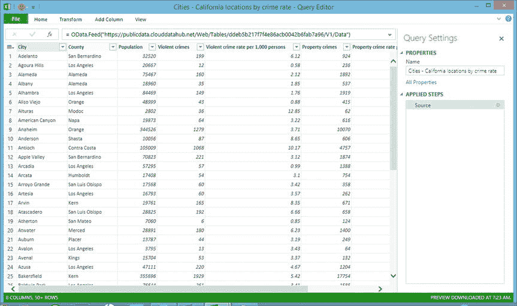
图 9-2. 查询编辑器中的犯罪统计

在查询编辑器中，单击`添加列`选项卡。在该选项卡的左端，单击`添加自定义列`。为州创建一个新列。将内容设置为`="CA"`，如图 9-3 所示。

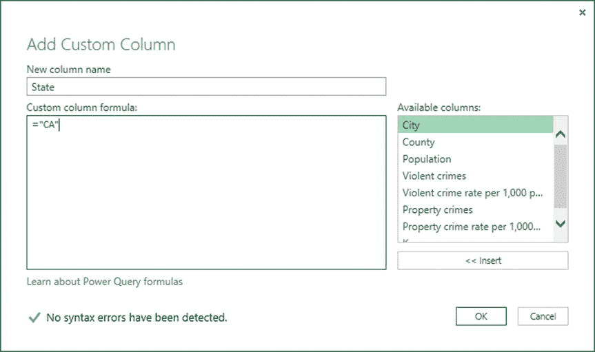
图 9-3. 添加州列

通过右键单击列标题，选择`更改类型`，然后选择`十进制数`，检查所有数值列的数据类型是否为十进制数。同时，检查数值列中是否没有非数值。当数据符合要求后，单击功能区上的`关闭并加载`，将其加载到电子表格中。电子表格应如图 9-4 所示。

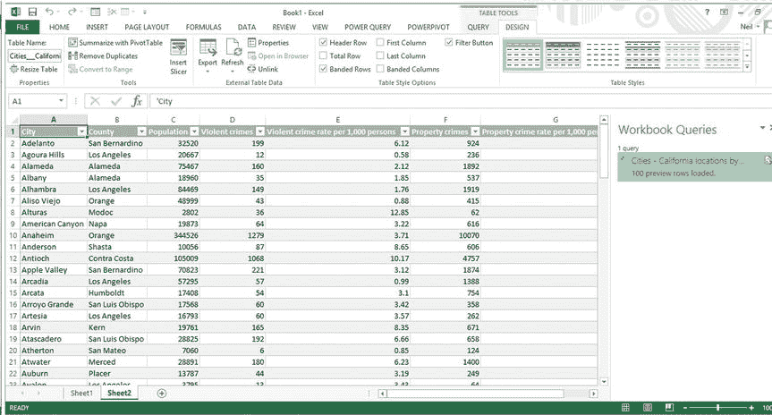
图 9-4. 加载到电子表格中的犯罪数据

再次检查数字字段中是否存在非数值，这些值可能会阻止 Power Map 正确解释内容。由于并非所有行都显示在查询编辑器中，对于较大的数据集，必须在将数据加载到 Excel 后进行检查。如图 9-5 所示，数据的最后一行可能包含省略号。如果是这种情况，请右键单击该行并选择`删除表行`来删除最后一行。

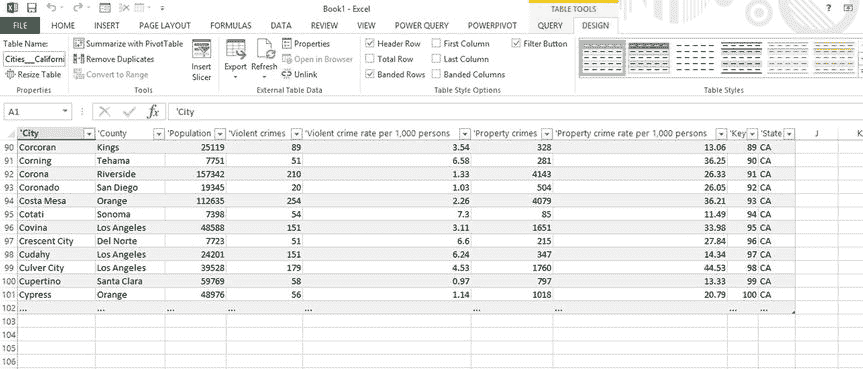
图 9-5. 需要删除的包含省略号的最后一行

通过单击列顶部的字母突出显示该列，检查每列的格式。右键单击选中的列，从上下文菜单中选择`设置单元格格式`。对于人口、暴力犯罪和财产犯罪列，将格式设置为`数值`，小数位数为 0，如图 9-6 所示。对于每千人暴力犯罪和财产犯罪，将格式设置为`数值`，小数位数为 2。

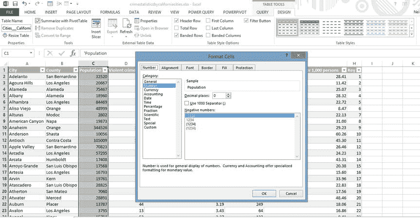
图 9-6. 将列格式化为数字

单击`插入`选项卡，在`地图`下选择`启动 Power Map`。如果您之前创建过地图，可能会提示您创建一个`新导览`。接受`城市`、`县`和`州`的默认设置作为地理字段，如图 9-7 所示。单击`下一步`。

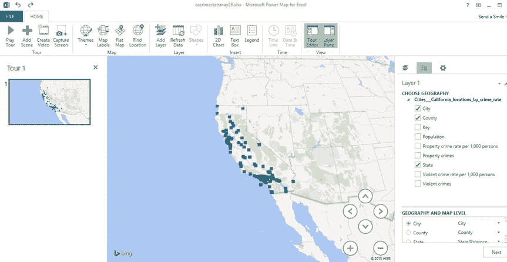
图 9-7. 设置地理字段

单击功能区上的`地图标签`以显示城市名称。在图层窗格中，右键单击`每千人财产犯罪`，然后单击`添加到高度`，如图 9-8 所示。请注意，必应地图服务在右上角显示地理映射的确定性为 94%。如果您想返回编辑地理字段，请单击 94% 上方的图标。

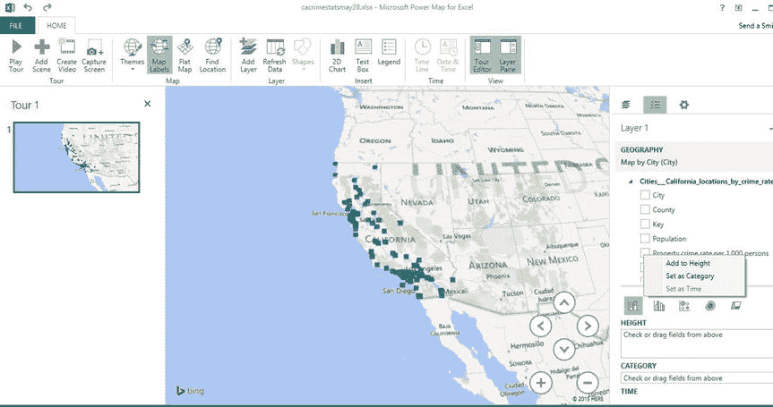
图 9-8. 设置绘图高度字段

单击图例框并将其调整到更小，然后将其拖到地图的左上部分。多次单击地图右下角的大`+`号以放大。结果如图 9-9 所示。请注意，可以将鼠标指向任何图形以查看该城市犯罪率的详细信息。还可以双击任何位置以放大。

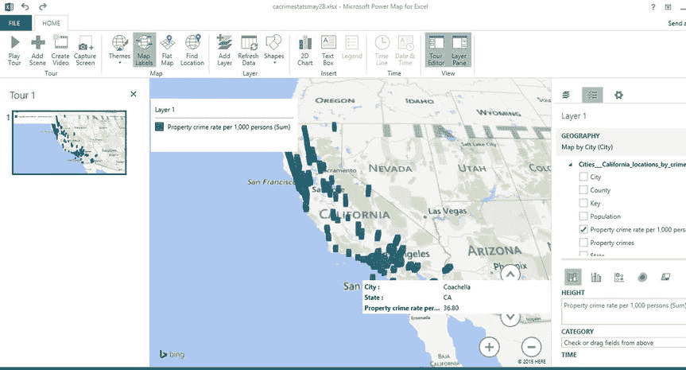
图 9-9. 带有图例和详细犯罪统计的地图

#### 绘制多项统计

可以绘制多个指标——财产犯罪和暴力犯罪统计。为此，我们继续使用上一节中的示例。

### 练习 9-2. 绘制加利福尼亚州犯罪统计数据，第二部分

您可以通过以下步骤绘制财产犯罪和暴力犯罪统计：

在图层窗格中，右键单击`每千人财产犯罪率`并选择`添加到高度`，如图 9-10 所示。

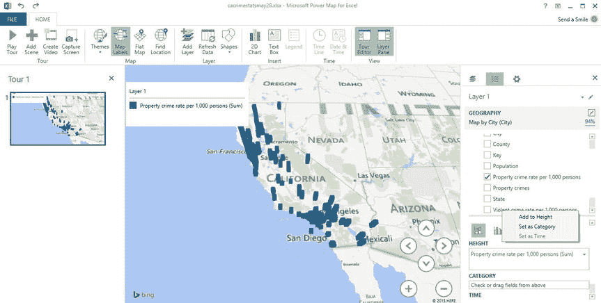
图 9-10. 添加暴力犯罪指标

请注意，默认视图为堆积柱形图。可以通过单击堆积柱形图右侧的图标将其更改为簇状柱形图，如图 9-11 所示。财产犯罪率以蓝色显示，暴力犯罪率以橙色显示。

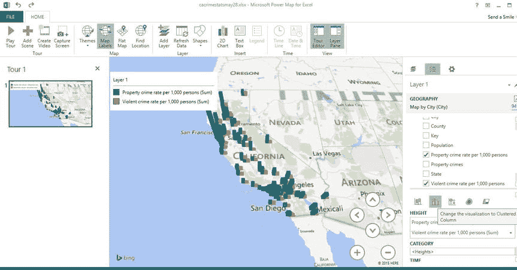
图 9-11. 财产犯罪和暴力犯罪指标的显示

单击功能区左端的`添加场景`。单击功能区上的`文本框`图标，并添加标题“加利福尼亚城市犯罪率”，如图 9-12 所示。

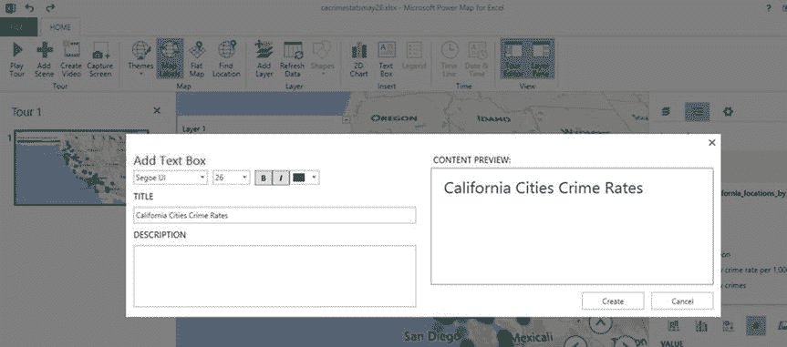
图 9-12. 为地图添加标题

将视图更改为气泡视图，类似于饼图。可以调整文本框大小并将其拖到地图上的适当位置，如图 9-13 所示。

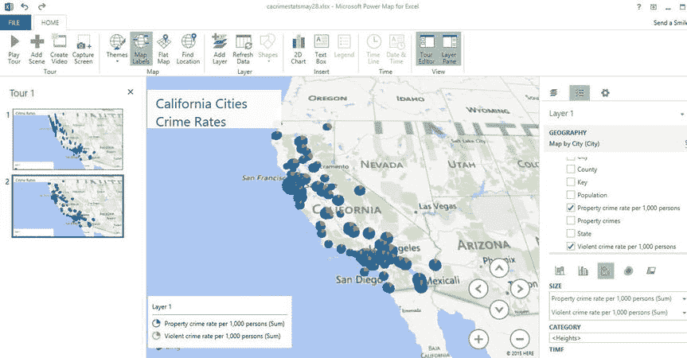
图 9-13. 数据的气泡视图

可以通过单击图层窗格右上角的齿轮图标，选择`图层选项`，然后调整大小滑块来调整气泡的大小，如图 9-14 所示。

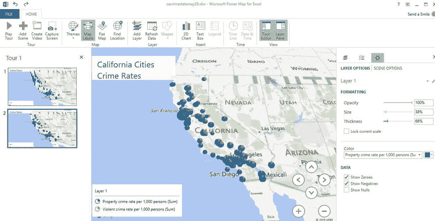
图 9-14. 调整气泡大小

单击功能区左端的`添加场景`。另一个视图是热力图视图，如图 9-15 所示。请注意，加利福尼亚州最大的两个城市旧金山和洛杉矶的犯罪率最高。

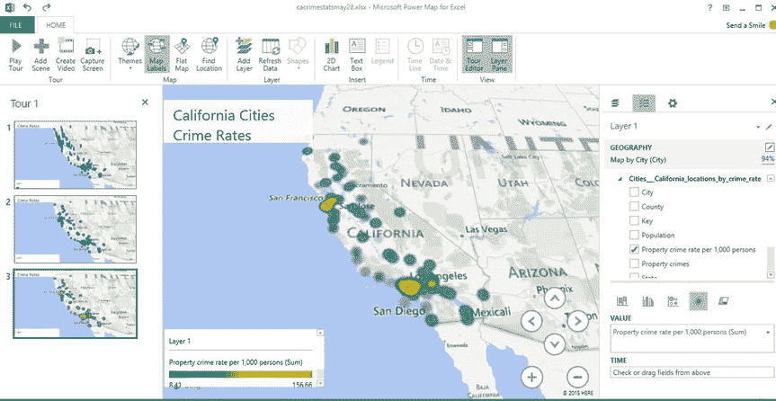
图 9-15. 数据的热力图视图

#### 添加二维图表

通过单击功能区上的`二维图表`，可以添加每千人财产犯罪率的二维图表。结果如图 9-16 所示。

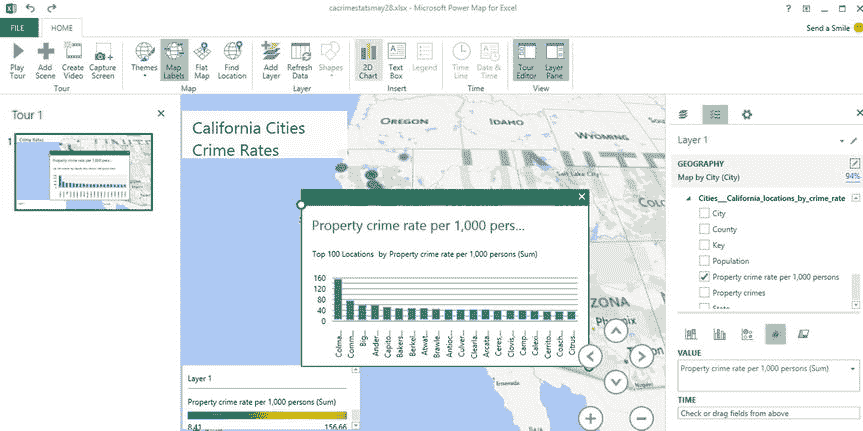
图 9-16.

#### 二维图表练习 9-3：绘制欧洲失业率示例

本示例将展示如何将欧洲失业率数据加载到 Power Query 中，以及如何使用 Power Map 进行绘制。同时，还将展示如何取消数据透视，以便添加时间动画。请按照以下步骤操作：

单击`Power Query`选项卡，选择`数据目录搜索`。在搜索框中输入“European Unemployment”。将鼠标悬停在每个搜索结果上，预览数据，如图 9-17 所示。

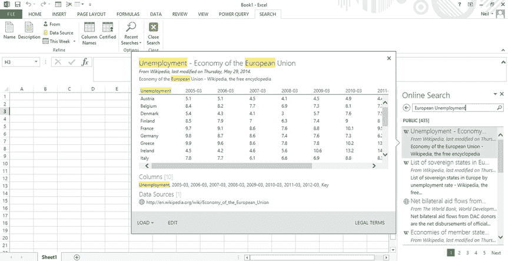
图 9-17. 欧洲失业数据预览

在预览屏幕底部选择`编辑`，将数据加载到`查询编辑器`中，如图 9-18 所示。

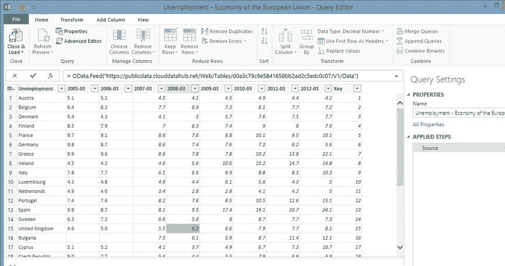
图 9-18. `查询编辑器`中的失业数据

检查数据形状，查看是否有无关列。在此例中，列包括国家名称、按年份划分的失业率以及一个使用顺序编号的关键列。同时，检查各行。请注意，其中包含美国、日本以及欧洲的失业数据行。

另外，检查每列的数据类型是否正确。要检查数据类型，请单击列标题选中该列，并注意功能区右上角显示的数据类型。要更改数据类型，请选中一列，单击功能区上`数据类型`后的箭头，然后选择正确的数据类型。请注意，`2005`和`2006`的数据类型是文本，而其他年份的数据类型是`小数`。使用此方法将所有数值列的类型更改为`小数`。

检查列标题。请注意，包含国家名称的列标题是`失业率`，这描述性不强。要更改列名，请右键单击列标题并选择`重命名`。将其重命名为`country`，如图 9-19 所示。请注意，列重命名操作会列在屏幕右侧`查询设置`窗格的`应用的步骤`下。

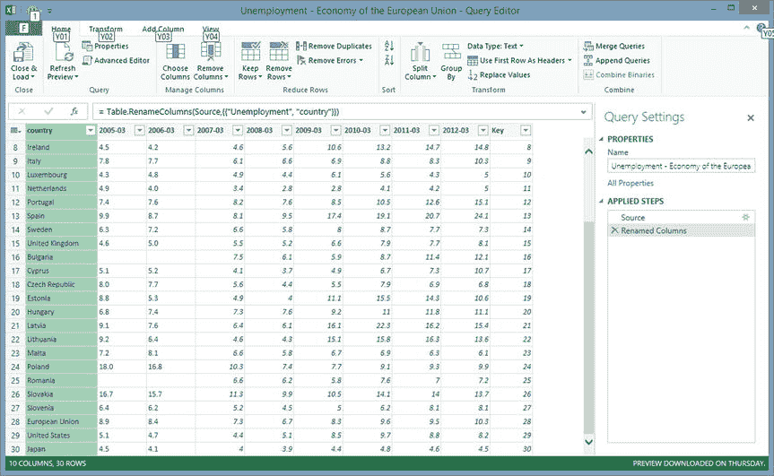
图 9-19. 重命名国家列后的`查询编辑器`

当数据按照您的要求调整好形状后，选择`查询编辑器`功能区最左侧的`关闭并加载`，将数据加载到电子表格中。请注意，数据也可以加载到数据模型中，但本示例将使用电子表格。

此时是保存电子表格并将其命名为“European Unemployment”的好时机。

要开始创建地图，请选择`插入`选项卡，然后依次点击`地图`和`启动 Power Map`。

将出现如图 9-20 所示的屏幕。请注意，在屏幕右侧的`图层`窗格中，`country`被选为地理字段。单击`下一步`。

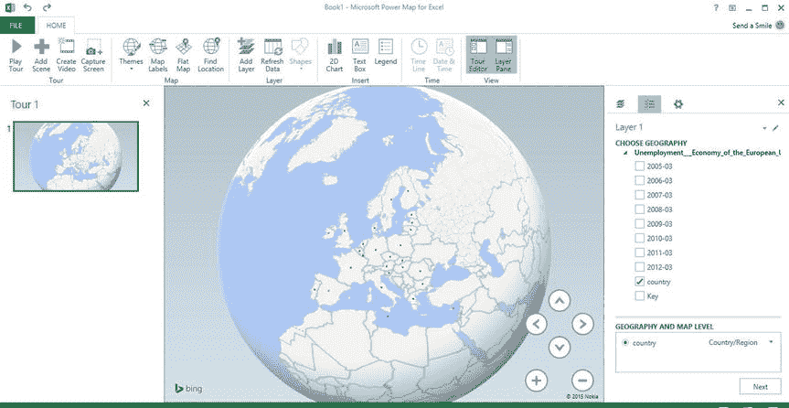
图 9-20. 选择国家作为地理字段

请注意，每个有数据的国家都会出现圆点。单击功能区上的`地图标签`以显示国家名称，并选择要绘制的数值字段。在此例中，将勾选`2012`年的失业率以便进行绘制，如图 9-21 所示。请注意，勾选该字段后，它将被添加到`高度`框中。默认格式为堆积柱形图，数值的默认聚合方式是求和。将鼠标指向地图上的柱子，将显示该国`2012`年的失业率。

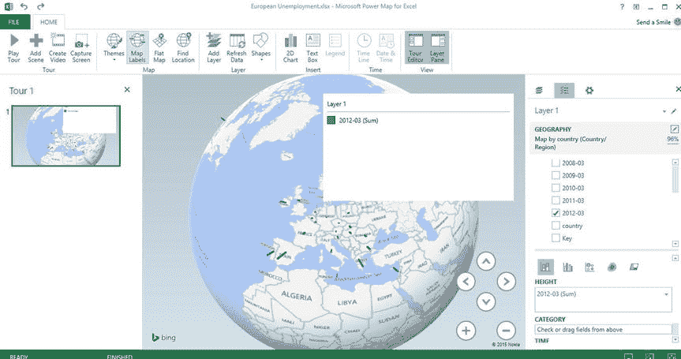
图 9-21. 以柱形图显示的`2012`年失业率

通过单击`高度`框右侧的箭头并选择`不聚合`，将聚合方式更改为“无”。单击图例框并使用控制点调整其大小，然后将其拖拽到地图左侧重新定位，如图 9-22 所示。

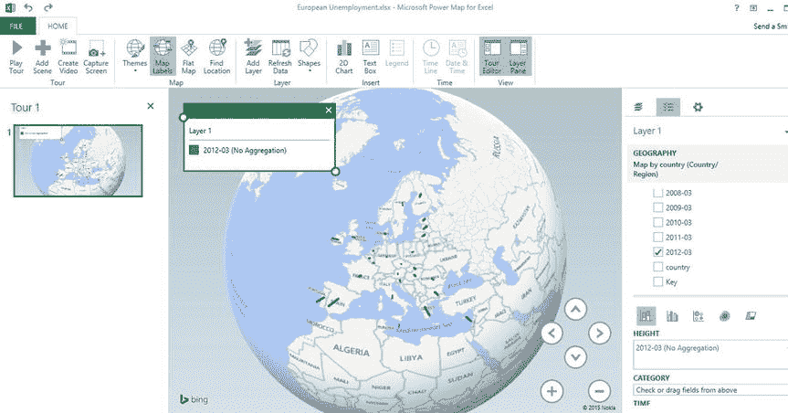
图 9-22. 移动图例框并将聚合方式更改为“无”后的地图

通过单击`图层`窗格中`高度`字样上方的图标，尝试不同的可视化格式，以查看聚类柱形图、气泡图、热力图和区域图。请注意，由于只显示一组数据，聚类柱形图和堆积柱形图格式是相同的。气泡图视图如图 9-23 所示。

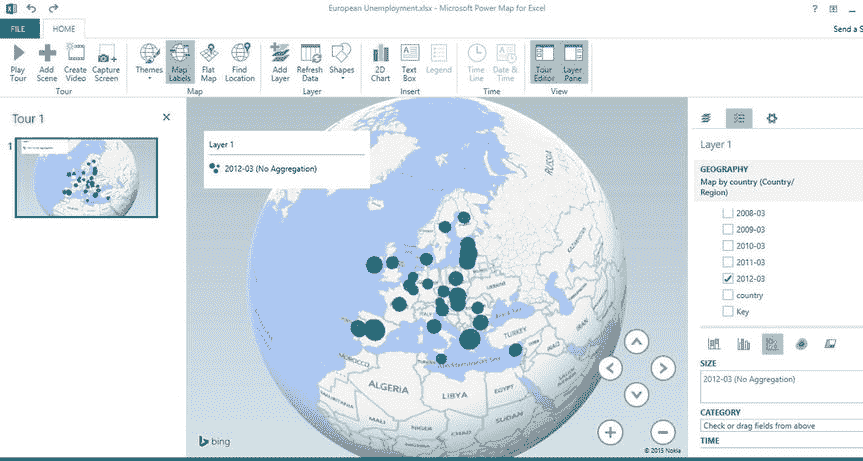
图 9-23. 气泡图视图

要放大地图，请单击地图右下角的大`+`号，或双击地图上的某个区域进行放大。

要更改气泡的不透明度、大小或粗细，请单击`图层`窗格顶部右侧的齿轮图标。图 9-24 显示了一个热力图视图，其中颜色标度设置为`180%`，热力图半径设置为`191%`，不透明度设置为`99%`。 `图层 1`的图例框显示了基于失业率的颜色键。请注意，您还可以通过勾选或取消勾选复选框来决定是否显示零值、负值和空值。

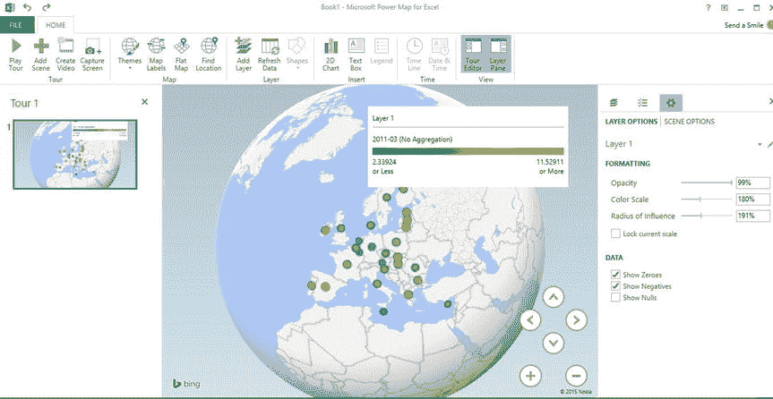
图 9-24. 热力图视图

#### 显示两个或多个数值

可以显示两个或多个数值，例如显示两个不同年份的失业率。使用上一节中的示例，图 9-25 以气泡形式显示了`2011`年（橙色）和`2012`年（蓝色）的失业率。将鼠标指向气泡上的颜色将显示该年份的失业率。

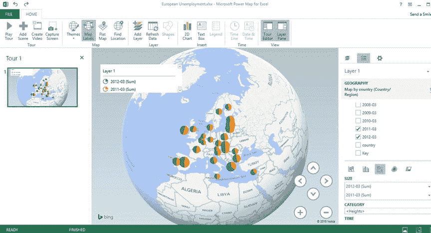
图 9-25. 气泡图视图

图 9-26 以堆积柱形图显示了`2010`年（橙色）和`2011`年（蓝色）的失业率。将鼠标指向堆积柱形图上的颜色将显示该年份的失业率。

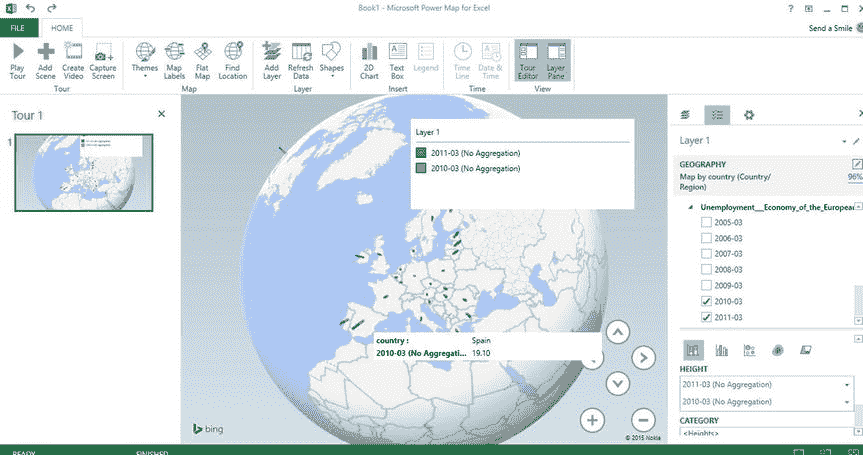
图 9-26. 堆积柱形图视图

相同的数据以聚类柱形图显示（柱形并排排列），如图 9-27 所示。

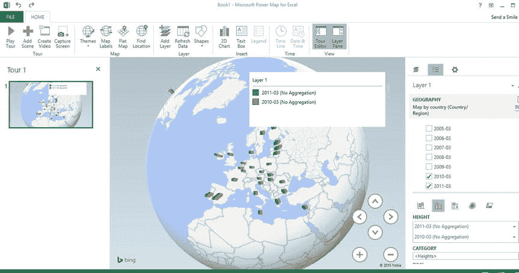
图 9-27. 聚类柱形图视图

#### 创建二维图表

通过选中一系列年份，然后点击功能区上的`二维图表`，即可绘制出显示随时间变化趋势的二维图表。结果如图 9-28 所示。将鼠标悬停在二维图表上，会在标题后显示一个带有向下箭头的框，可用于更改图表类型。

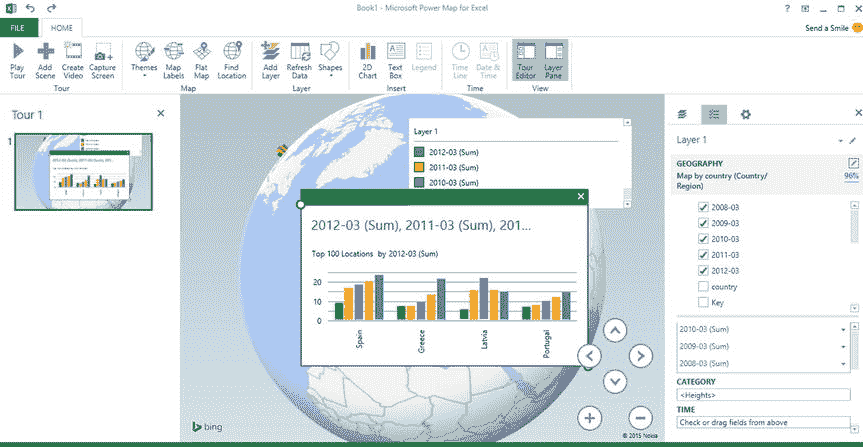

图 9-28.

#### 二维图表 练习 9-4. 构建时间动画练习

可以对演示文稿进行动画处理，以显示不同时间点的地图数值。为此，需要取消数据透视，以指示每个国家每年的一个数值。若要从头开始，请返回“练习 9-3. 绘制欧洲失业率示例”开头的步骤 1-3，将数据加载到查询编辑器中，或点击 PowerPivot 选项卡上的`最近使用的源`，然后选择其中的数据。

在查询编辑器中，点击第一个年份列的标题以选中该列。然后按住`Ctrl`键点击其他年份列的标题以选中所有年份列，或者在选中第一个年份列后，按住`Shift`键并点击最后一个年份列以选中所有年份列。右键点击其中一个选中的列标题，然后选择`取消透视列`，如图 9-29 所示。

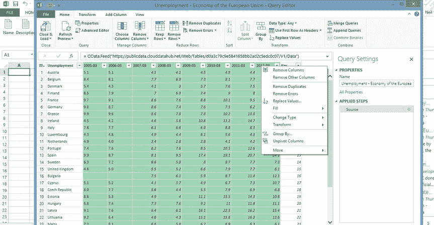

图 9-29.

显示`取消透视列`选项的上下文菜单

结果如图 9-30 所示。为每个国家和年份创建了一行。

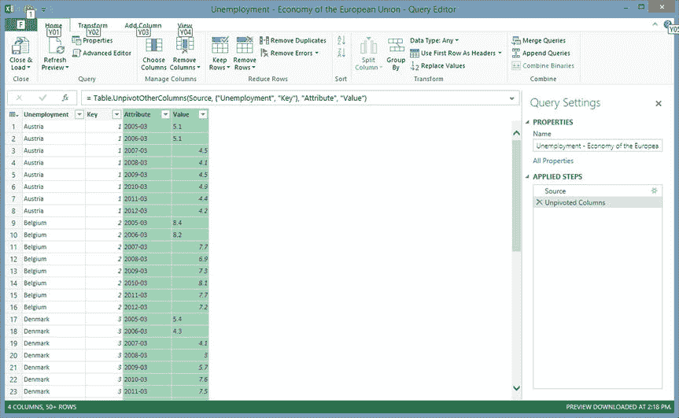

图 9-30.

已取消透视的数据

请注意，包含年份的列被标记为`属性`，这不够直观。右键点击该列标题并选择`重命名`，将其名称更改为`year`。确保仅选中`属性`列。然后通过选中该列并点击功能区右上角`数据类型`后的向下箭头，选择`date`，将数据类型更改为日期。将失业率列的名称更改为`country`，将数值列的名称更改为`unemployment`，并将该列的类型更改为十进制数字。将失业率列的类型更改为十进制数字后，所有数据将右对齐。数据应如图 9-31 所示。请注意，已应用的步骤显示在屏幕右侧的“查询设置”窗格中。

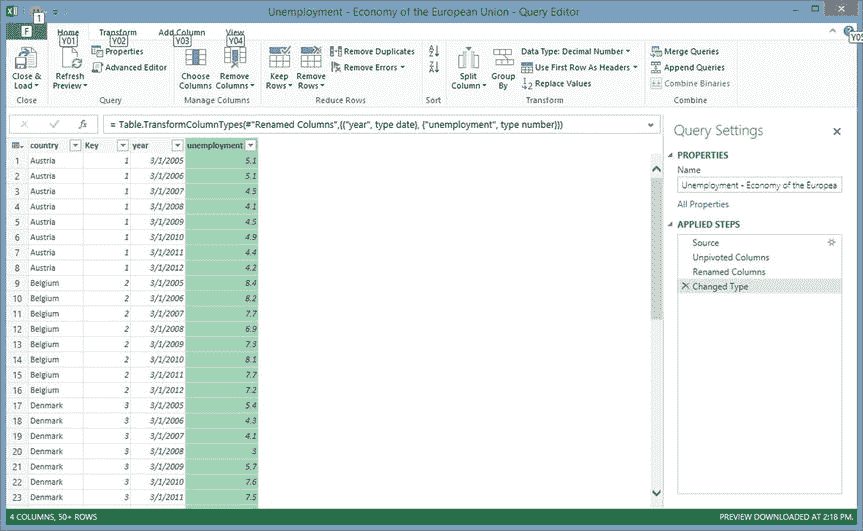

图 9-31.

重命名列后的电子表格

选择`关闭并加载`以保存到电子表格。

此时，检查各列是否存在任何无关的数据类型非常重要。例如，如果日期列包含非日期值，则无法正确映射。最好的检查方法是，通过下拉每个数字和日期列顶部的箭头，将列按从低到高和从高到低排序。此过程可能会发现包含仅有点号的行，如图 9-32 所示。如果是这种情况，请通过高亮该行、右键点击并选择`删除`和`表格行`来删除此行。

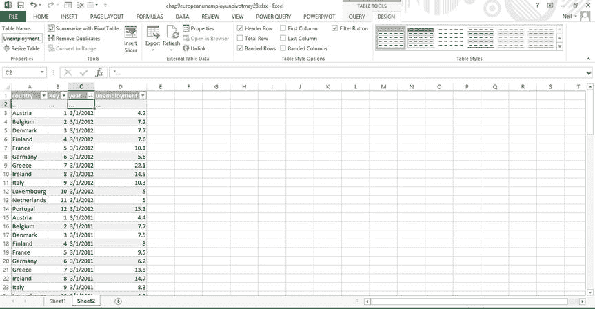

图 9-32.

顶部包含省略号的多余行

通过选中年份列并右键点击，确保选择了日期格式，如图 9-33 所示，来检查年份列的格式。

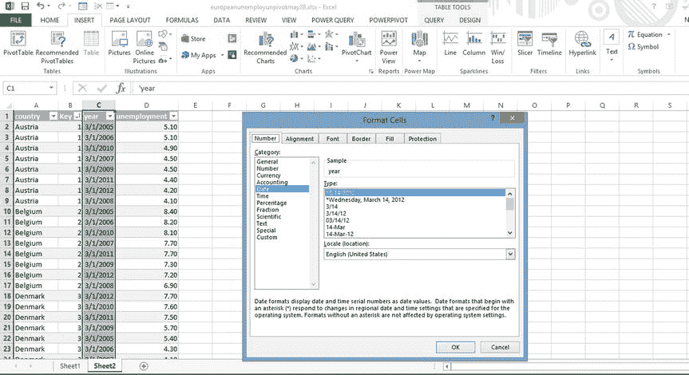

图 9-33.

对年份列应用日期格式

此外，检查失业率列的格式，确保其具有小数点后两位的数字格式，如图 9-34 所示。

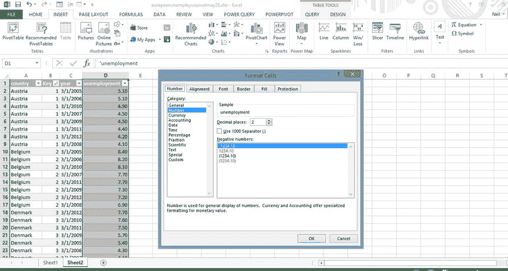

图 9-34.

对失业率列应用数字格式

然后选择`插入`选项卡，点击`地图`和`启动 Power Map`。

点击功能区上的`刷新数据`图标。这对于应用格式更改非常重要。

通过点击`下一步`，确认`country`是地理字段，如图 9-35 所示。

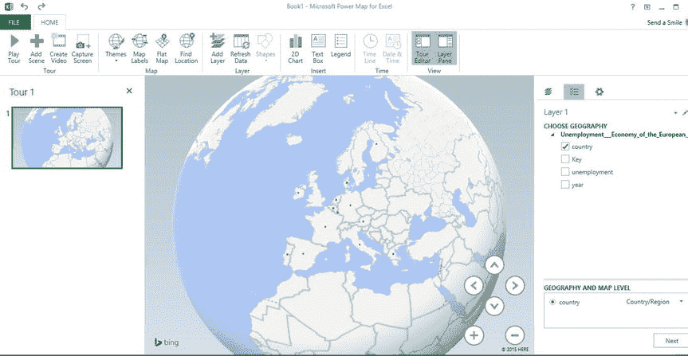

图 9-35.

定义地理字段

点击功能区上的`地图标签`，然后点击`unemployment`字段以选择要绘制的指标，并将图例框拖到左侧，如图 9-36 所示。

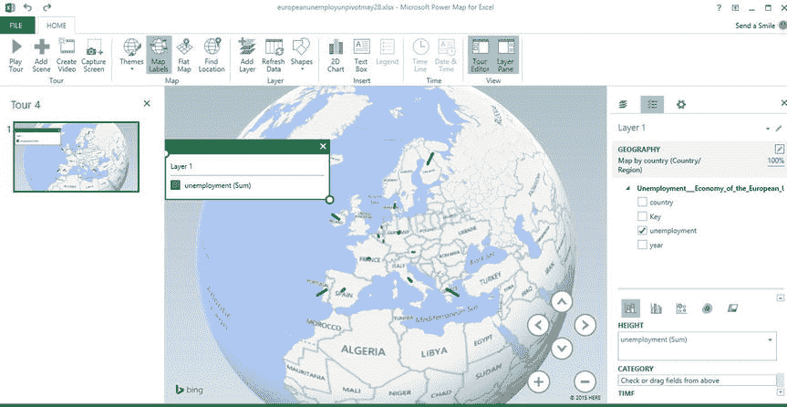

图 9-36.

选择失业率指标

通过点击`高度`窗口中`unemployment`后的箭头并选择`无聚合`，将`unemployment`字段的聚合更改为`无聚合`，如图 9-37 所示。

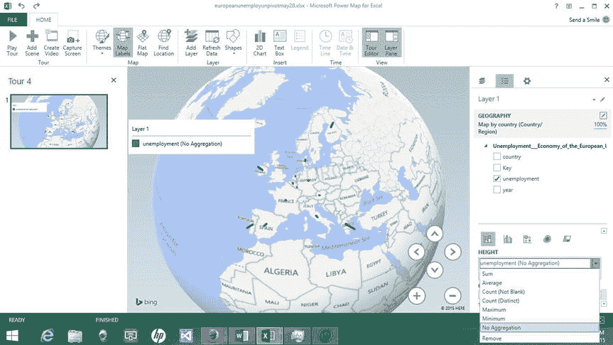

图 9-37.

将失业率聚合更改为无聚合

右键点击`year`并选择`设置为时间`，如图 9-38 所示。

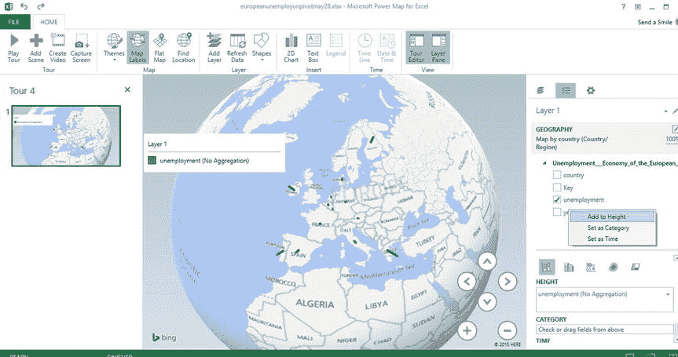

图 9-38.

将年份设置为时间字段

请注意，地图窗口底部会出现一个时间控件，时间显示在左上角的框中，如图 9-39 所示。可以通过点击屏幕底部时间控件上的`播放`按钮来播放时间动画。

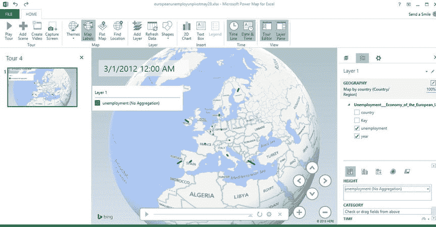

图 9-39.

已设置时间动画的地图

可以通过点击右上角的齿轮图标，然后点击`场景选项`来更改场景持续时间和效果，从而调整播放速度，如图 9-40 所示。可以调整窗格底部的`速度`滑块来减慢或加快过渡效果。

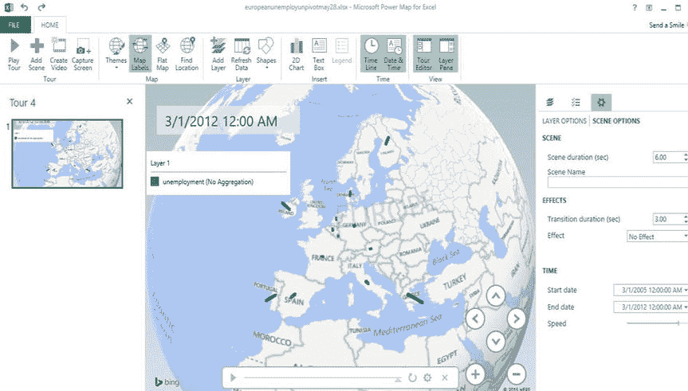

图 9-40.

设置场景持续时间

## 总结

本章演示了如何将数据加载到 Power Query，如何在查询编辑器中塑造数据，以及如何将其加载到 Power Map 中，以创建关于数据的可视化故事。文中展示了 Power Map 的一些功能，例如创建二维和三维可视化，以及创建动画来展示随时间的变化。

