# 10. 统计计算

Excel 提供了多种用于执行统计分析的内置工具。本章重点介绍其中一些工具，包括基本图表功能和 Excel 分析工具库。文中讨论了描述性统计和推断性统计之间的区别，并介绍了 Excel 的统计函数。

-   在 2013 年，Excel 2013 会尝试通过推荐条件格式、图表、工具、汇总和数据透视表来预测您的需求。当数据被高亮显示，或按下 `Ctrl+Q` 时，如果数据区域中的任意单元格被选中，将会弹出一个包含多种格式选项的窗口，如图 10-1 所示。将光标悬停在条件格式选项上，将会在数据上预览该条件格式的效果。

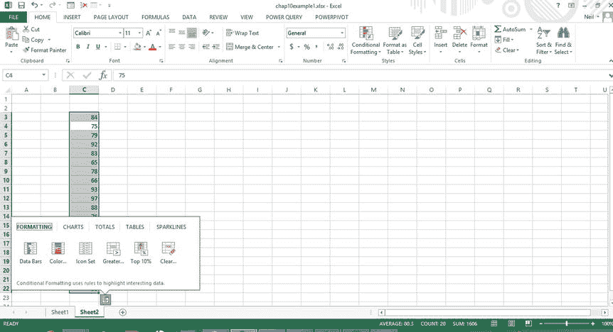

图 10-1：推荐的格式和分析选项

在弹出的窗口中点击“汇总”，将会显示“汇总”菜单，如图 10-2 所示。

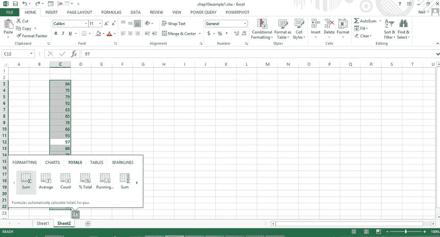

图 10-2：汇总与统计选项

向右滚动并高亮显示“占总计的百分比”，将产生如图 10-3 所示的结果，其中每个项目右侧会显示其在总计中所占的百分比。

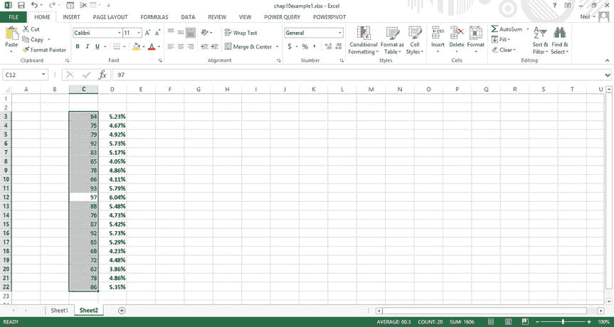

图 10-3：百分比汇总

## 自定义状态栏

请注意，Excel 窗口底部的状态栏会显示与高亮数据相关的统计信息，例如平均值、计数和总和。您可以通过右键单击状态栏并选择要显示的项目来自定义这些显示的值，如图 10-4 所示。

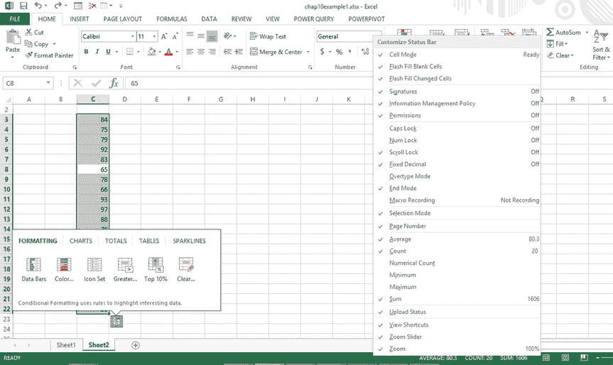

图 10-4：自定义状态栏菜单

例如，如果在“自定义状态栏”菜单中选中了“最小值”和“最大值”，这些值将被添加到状态栏中，如图 10-5 所示。

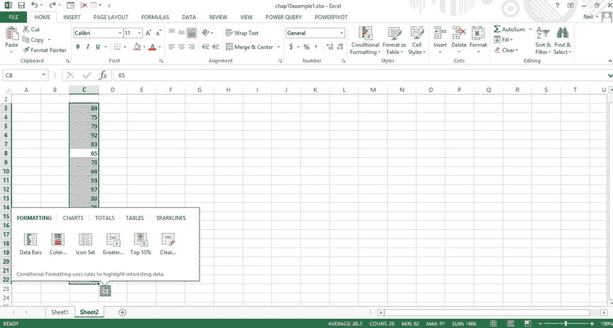

图 10-5：添加了最小值和最大值的状态栏

## 推断统计

抽样涉及检查一个大规模总体的一个小部分，以便对整个总体得出结论。这被称为**推断统计**。为了使样本能代表更大的总体，样本成员必须被随机选择，这意味着总体中的每个成员都有与其他成员相同的被选中的机会。其目标是从样本中得出关于总体的可靠结论。确定样本大小至关重要。样本的误差幅度计算公式为 1 除以样本大小的平方根。因此，随着样本大小的增加，误差幅度会减少。

通常，使用样本是因为调查整个总体在经济上不可行。大数据的承诺之一是，如果数据可用，可以对整个总体进行处理以获得更准确的结果。

## 描述性统计回顾

描述性统计通过几个关键的计算值来总结数据。图 10-6 显示了一个正态分布曲线或钟形曲线。任何值出现的频率由曲线的高度表示。例如，如果在多次试验中抛硬币十次，正面朝上的平均次数将是五次。这是最常出现的结果，由曲线的最高点表示。其次最常见的结果是六次正面和四次反面，或六次反面和四次正面。很少会出现九次正面和一次反面。

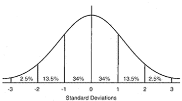

图 10-6：钟形曲线

### 计算描述性统计

最常见的计算统计值是均值、中位数和众数。

-   **均值**：平均值或称算术平均值，通过将所有值相加并除以值的数量来计算。
-   **中位数**：中间值称为中位数——即有 50% 的值高于它、50% 的值低于它的数据点。
-   **众数**：出现频率最高的值称为众数。在钟形曲线中，中位数、众数和均值是相等的。

### 离散程度的度量

然而，许多分布并不完全符合钟形曲线，因此我们需要离散程度的度量。方差衡量一组数字的分散程度。小方差表示数据点往往非常接近均值，因此也彼此接近；而大方差则表示数据点在均值周围以及彼此之间非常分散。

离散程度的一种度量是**标准差**，计算方法是计算每个值与算术平均值的偏差并将其平方。计算这些平方值的算术平均值，然后取其平方根即可得到标准差，标准差用希腊字母 sigma 表示。

68-95-99 规则用于记住正态分布中落在均值周围某个范围内的值的百分比。换句话说，68.27% 的值落在正负一个标准差的范围内；95.45% 的值落在正负两个标准差的范围内；99.73% 的值落在正负三个标准差的范围内。这有时被称为**三西格玛经验法则**。请记住，此规则仅适用于正态分布。请注意图 10-6 中显示的与此规则相对应的百分比。

例如，在对房屋价值的分析中，如果所有房屋销售都落在一个相当狭窄的范围内，例如 40 万到 60 万美元，那么方差和标准差会相对较小。然而，如果几套高端住宅以超过 100 万美元的价格售出，方差和标准差就会更大。这就是本章剩余部分描述的图形化方法对于展示值之间关系的原因。

### Excel 统计函数

Excel 提供了大量函数来计算统计值。以下是一些较常见的函数。

-   `Average(range)`：计算数据范围或离散值列表的算术平均值。它忽略空单元格或包含文本的单元格。
-   `Averagea(range)`：与 `Average` 相同，不同之处在于它将包含文本的单元格赋值为零。
-   `Averageif(range, condition)`：基于用引号括起来的条件语句返回算术平均值。它在计算中不包含空单元格或包含文本的单元格。
-   `Averageifs(range, condition1, condition2)`：基于多个条件语句返回算术平均值。它在计算中不包含空单元格或包含文本的单元格。
-   `Median(range)`：计算中间值或中位数。
-   `Mode(range)`：计算出现频率最高的值，不计算空单元格和包含文本的单元格。

## 图表化数据

Excel 提供了多种以图形方式查看数据的方法。选择最佳的图形工具来准确描绘数据非常重要，如下所述。

-   柱形图和条形图将一个分类变量绘制在一个轴上，将一个数值变量绘制在另一个轴上。
-   XY 散点图展示了两个数值之间的关系。
-   频率分布仅处理一个变量——它显示每个值有多少个实例。它将单个测量值分组到类或箱中。在其最常见的形式中，变量的值位于水平轴（x 轴）上，实例的频率位于垂直轴（y 轴）上。
-   直方图是数值数据分布的图形表示。

## Excel 分析工具库

本节将介绍如何使用 Excel 附带的 **Excel 分析工具库**。分析工具库可用于执行复杂的统计计算，这些计算如果手动编程将会非常耗时。

### 启用 Excel 分析工具库

使用前，必须先激活该工具。

启用 Excel 分析工具库，请按以下步骤操作：

1. 单击 `文件` 选项卡，打开 Backstage 视图。
2. 单击左窗格底部的 `选项`。
3. 在左窗格中选择 `加载项`。
4. 在窗口底部，选择 `Excel 加载项` 并单击 `转到`，如图 10-7 所示。

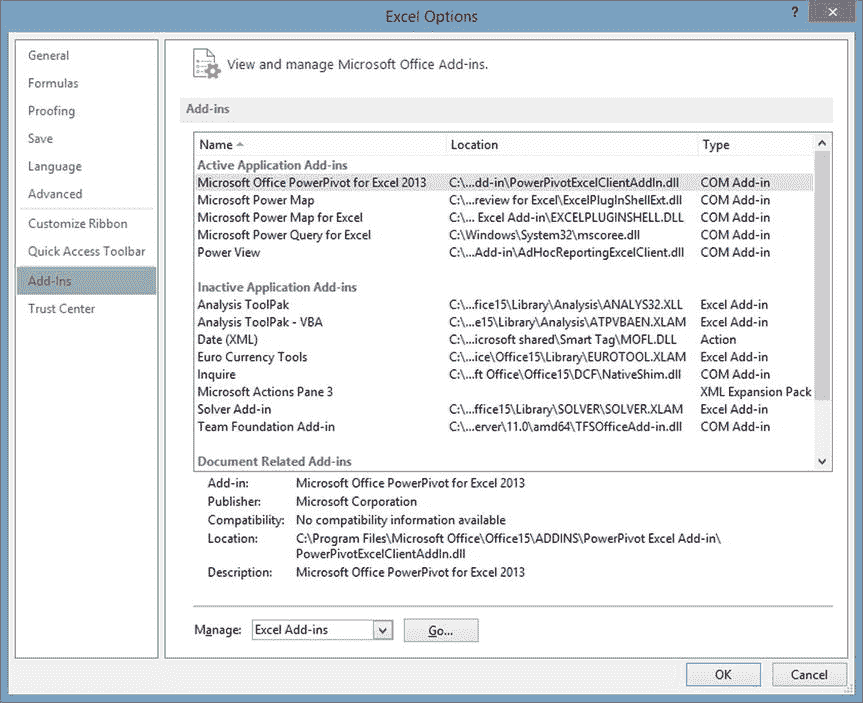
*图 10-7. Excel 加载项屏幕*

5. 选择 `分析工具库`，如图 10-8 所示，并单击 `确定`。

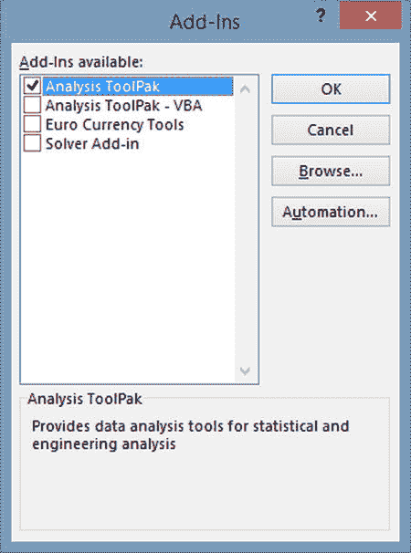
*图 10-8. 加载项弹出窗口*

激活后，即可通过单击 Excel 中 `数据` 选项卡右侧的 `数据分析` 来访问分析工具库。

### 一个简单示例

以下示例将演示如何使用 Excel 分析工具库分析一些样本考试成绩。

**练习 10-1. 使用分析工具库**

请按以下步骤分析考试成绩：

1. 单击 `数据` 选项卡右侧的 `数据分析`。当 `数据分析` 窗口出现时，选择 `描述统计`，如图 10-9 所示。

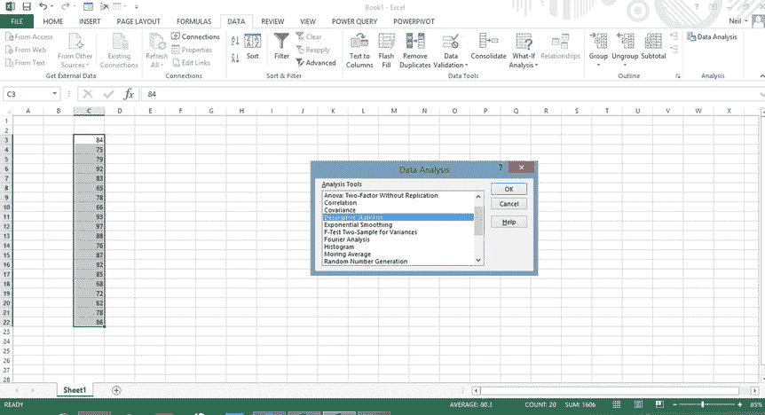
*图 10-9. 数据分析工具*

2. 单击 `确定`。在 `描述统计` 对话框中，指定输入区域和输出区域，并选中 `汇总统计`，如图 10-10 所示，然后单击 `确定`。

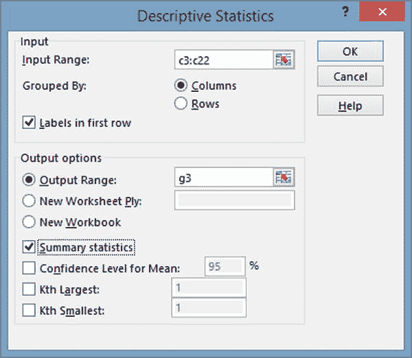
*图 10-10. 描述统计对话框*

结果如图 10-11 所示。

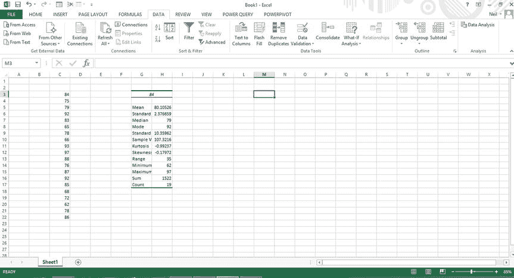
*图 10-11. 描述统计输出*

3. 要使用数据分析工具库绘制直方图，请转到 `数据` 选项卡并单击 `数据分析`。选择 `直方图`，如图 10-12 所示。

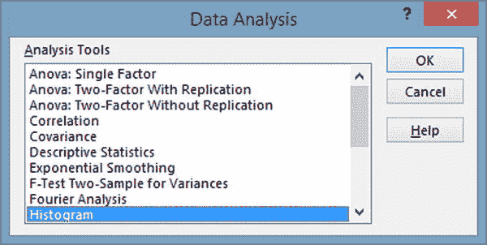
*图 10-12. 从数据分析对话框中选择直方图*

4. 定义区域并选中 `图表输出`，如图 10-13 所示，然后单击 `确定`。

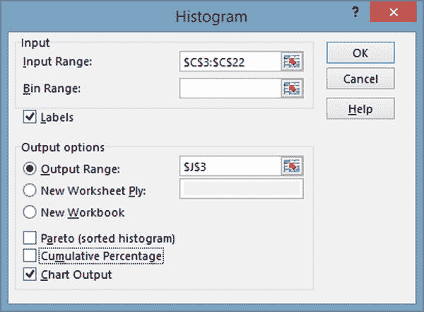
*图 10-13. 直方图对话框*

结果如图 10-14 所示。此操作设置了用于数据分类的组距或类别，这些组距将用于绘制直方图。

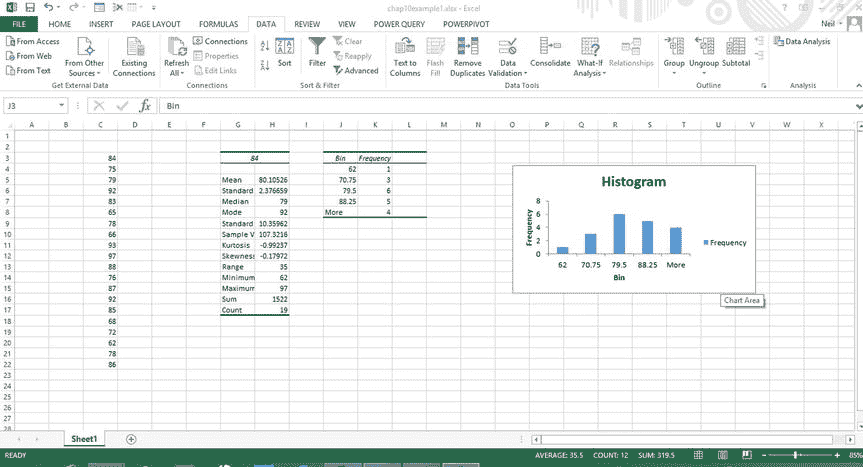
*图 10-14. 直方图*

### 其他分析工具库函数

分析工具库包含其他函数。以下列出了一些最常用的函数：

- `方差分析` 工具提供不同类型的方差分析。它们用于检验两个样本选择的随机性。
- 相关系数是介于 -1 和 +1 之间的一个数值，用于衡量两个变量之间的相关程度。+1 表示完全正相关，意味着两个变量同向变化。-1 表示完全负相关，意味着两个变量反向变化。正相关并不能证明因果关系。Excel 的 `CORREL` 函数也可用于计算相关系数。
- 协方差用于衡量两个随机变量共同变化的程度。
- 指数平滑类似于移动平均线，用于预测时间序列中的下一个值。

## 使用数据透视表创建直方图

数据透视表也可用于创建更个性化的直方图。

**练习 10-2. 自定义考试成绩直方图示例**

请按以下步骤创建一个显示考试成绩分布的直方图：

1. 突出显示要绘制的数据。选择 `插入` 选项卡，然后单击 `数据透视表`。
2. 确认区域，并将数据透视表放在同一个工作表中，位置为 `F3`，如图 10-15 所示。

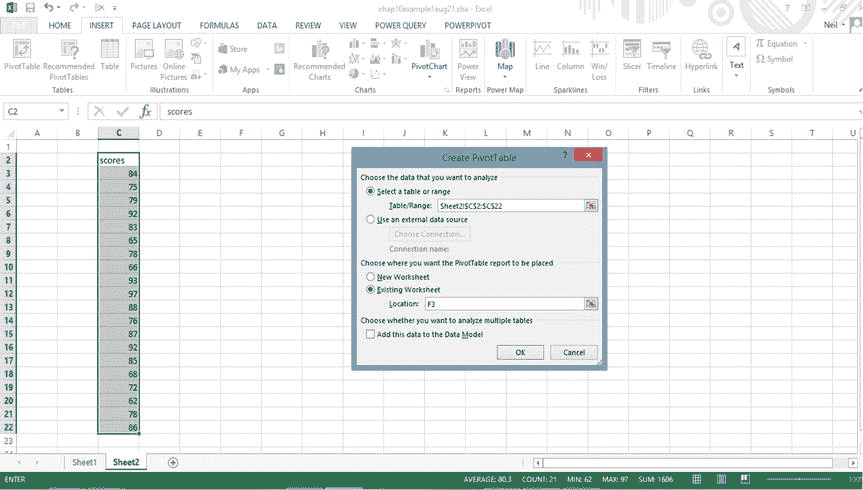
*图 10-15. 创建数据透视表对话框*

3. 将 `成绩` 拖动到 `行` 框中，如图 10-16 所示。

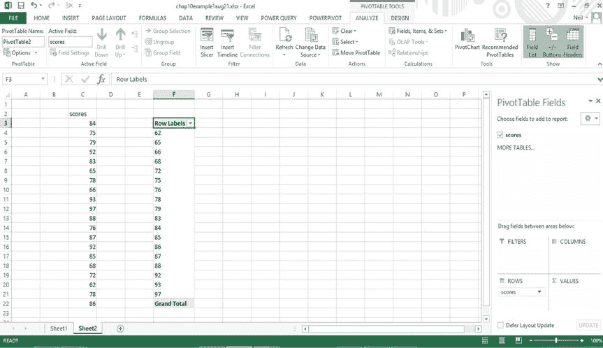
*图 10-16. 成绩作为行*

4. 右键单击数据透视表列，然后选择 `分组`，如图 10-17 所示。

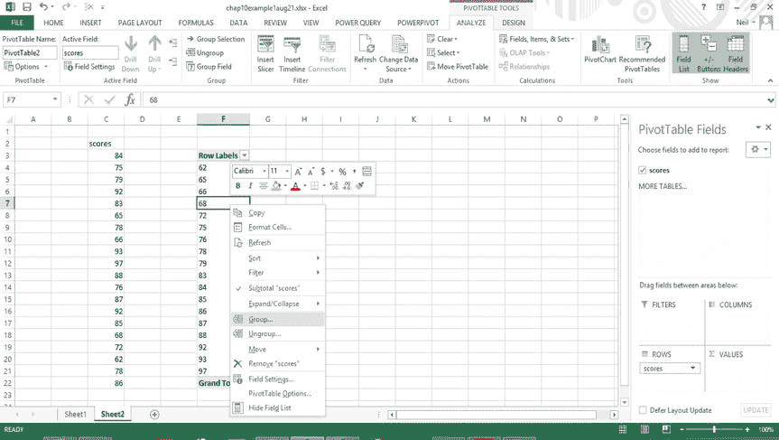
*图 10-17. 从上下文菜单中选择分组*

5. 默认情况下，`分组` 对话框将起始值设为最低分，终止值设为最高分，默认间隔为 10，如图 10-18 所示。单击 `确定`。

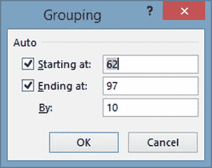
*图 10-18. 分组对话框*

6. 将 `成绩` 拖动到 `值` 框中。结果显示了每个分组类别的频率，如图 10-19 所示。请注意，这些类别大致相当于评分等级：92 到 100 分为 A，82 到 91 分为 B，依此类推。

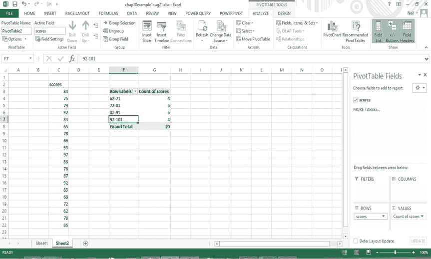
*图 10-19. 分组类别*

7. 要绘制直方图，请单击 `插入` 选项卡并选择 `柱形图`、`二维柱形图`。该结果绘制了每个类别的频率，如图 10-20 所示。

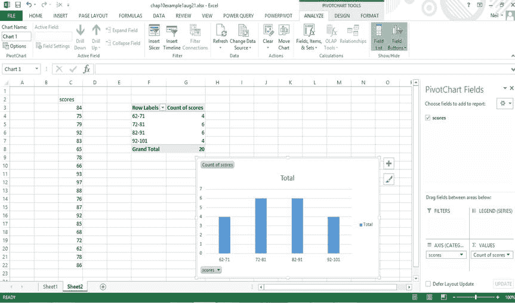
*图 10-20. 直方图*

8. 可以通过单击柱形并按 `Ctrl+1` 来调整图表，这将在屏幕右侧打开 `设置数据系列格式` 窗格。将 `间隙宽度` 滑块调整为零，以消除柱形之间的间距。
9. 可以通过单击标题（目前显示为“总计”）来修改标题，将其更改为“考试成绩频数分布”，如图 10-21 所示。

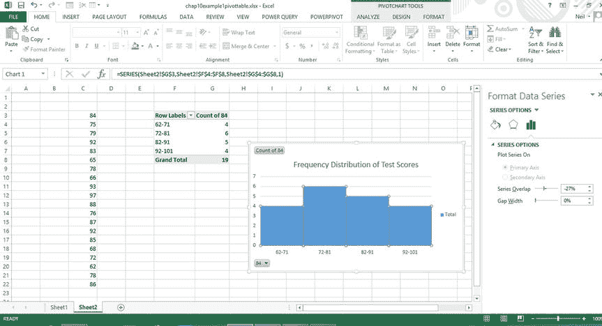
*图 10-21. 带标题的直方图*

## 散点图

通过绘制散点图，可以让程序计算 `R-squared` 值，从而观察两个变量之间的视觉关系。`R-squared` 是一种统计度量，用于衡量数据与拟合回归线（即穿过数据点的最佳拟合直线）的接近程度，它也被称为决定系数。`R-squared` 的取值范围是 0 到 100。`R-squared` 值为 100 表示一个变量的所有变动完全由另一个变量的变动解释。`x` 是自变量，`y` 是因变量。

### 练习 10-3. 成绩与缺勤关系散点图示例

本示例探讨课堂缺勤次数与数字成绩之间是否存在关系，其中 1 表示最低成绩，4 表示最高成绩。成绩数据如图 10-22 所示。

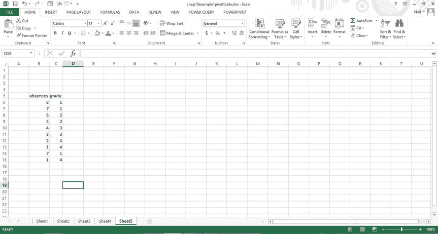

**图 10-22.** 成绩与缺勤数据

请按照以下步骤操作：

选中数据，点击**插入**选项卡，然后选择**散点图 (X, Y)**，如图 10-23 所示。

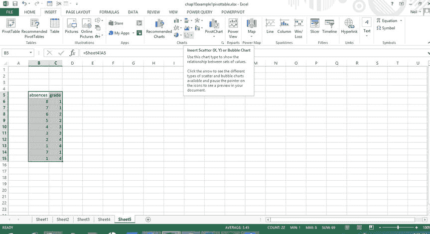

**图 10-23.** 插入散点图 (X, Y) 或气泡图选项

选择**散点图**选项，如图 10-24 所示。

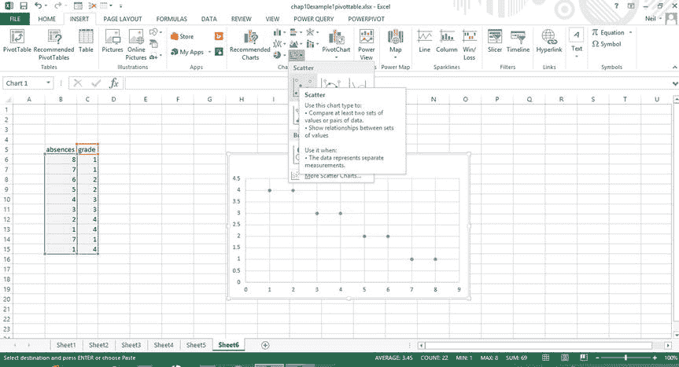

**图 10-24.** 选择散点图选项

点击图表右上角的 `+` 号，然后选择**坐标轴标题**，如图 10-25 所示。

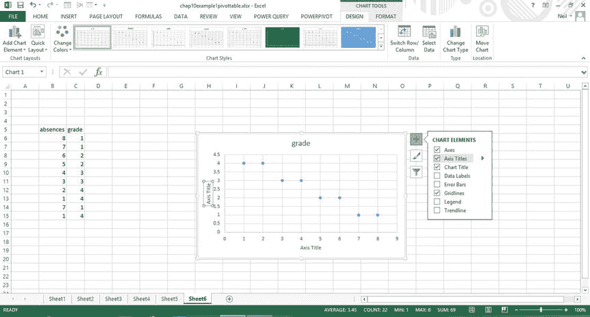

**图 10-25.** 选择坐标轴标题

点击水平轴或 `x` 轴上的**坐标轴标题**，将其改为**缺勤次数**。将垂直轴或 `y` 轴上的标签改为**成绩**，并将图表标题改为“成绩与缺勤关系”，如图 10-26 所示。

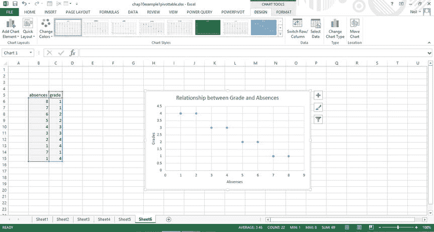

**图 10-26.** 带有标题的图表

右键单击绘图区域，然后选择**添加趋势线…**，如图 10-27 所示。

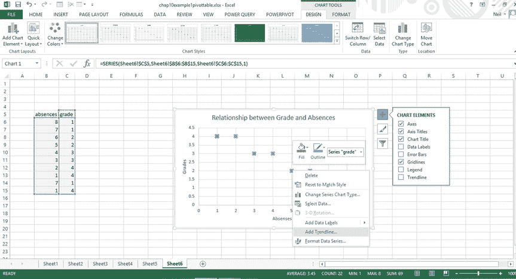

**图 10-27.** 选择添加趋势线…

在右侧的**设置趋势线格式**窗格中，向下滚动并选中**在图表上显示公式**和**在图表上显示 R 平方值**，如图 10-28 所示。直线的公式（包括斜率和 `y` 截距）会显示出来。请注意，`R-squared` 值为 0.9603（以小数形式显示），表明相关性很高。这是一种反向关系，意味着缺勤次数越多，成绩越低。

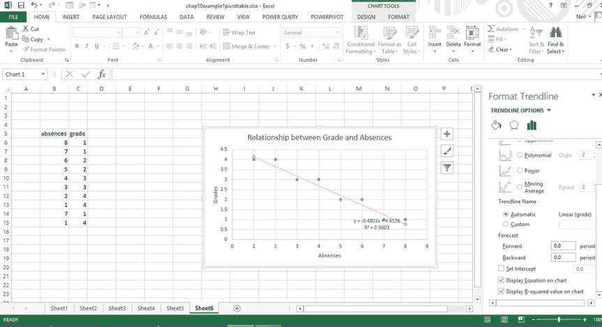

**图 10-28.** 显示公式和 R 平方值的图表

### 小结

本章仅仅触及了 Excel 利用分析工具库计算统计值的表层能力。它展示了如何使用内置的图表工具创建数据的可视化显示，并演示了如何判断两个值之间是否存在关系。这些主题足以写成一整本书。

