# 11. HDInsight

第 1 章 将 Hadoop 描述为一个开源的分布式文件系统，能够处理海量数据。微软在其 Azure 云平台上实现的 Hadoop 称为 HDInsight，旨在处理云中的大量数据。HDInsight 使用 Azure Blob 存储来存储数据，使 Hadoop 作为云中服务可用。Azure 对于以经济高效的方式在云中存储大型数据集非常有用。微软只根据实际使用的资源收费。

Apache Hive 支持分析存储在 Hadoop 中的大型数据集。Hive 是建立在 Hadoop 之上的数据仓库基础设施，用于提供数据汇总、查询和分析。它最初由 Facebook 开发，现已成为一个开源的 Apache 项目。

本章探讨了将数据从 Azure HDInsight 导出到 Excel 进行分析的最简单方法。

## 获取免费 Azure 帐户

之前的章节介绍了如何使用 Azure 数据市场，该市场对于某些数据库基本上是免费的。本章中的示例需要一个 Azure 帐户。可以通过访问 `https://azure.microsoft.com/en-us/pricing/free-trial/` 获得一个 30 天的试用帐户。

将会出现如图 11-1 所示的屏幕。

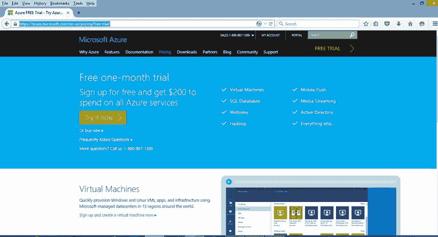

**图 11-1.** 截至 2015 年 7 月的 Azure 免费试用屏幕

点击**立即试用**，系统将提示您输入信息以设置一个为期一个月的免费试用。

## 将 Hadoop 文件导入 Power Query

本示例展示了如何对大型数据集运行 Hive 查询，使用 Windows Azure Blob 存储上的 HDInsight。然后，它演示了如何使用 Power Query 将数据导入 Excel，以便可以使用数据透视表和 Power Map 进行分析。

### 创建 Azure 存储帐户

要完成本教程，您需要刚刚创建的 Windows Azure 帐户。

登录到 Azure 门户 `https://manage.windowsazure.com`。将会出现如图 11-2 所示的屏幕。使用您的 Azure 凭据登录。

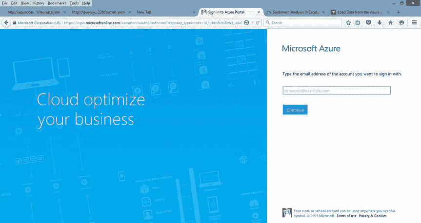

**图 11-2.** Microsoft Azure 门户

登录后，点击 Azure 门户屏幕左下角的 **+新建**，如图 11-3 所示。突出显示新帐户，然后点击屏幕底部的**管理访问密钥**。将出现**管理访问密钥**弹出窗口，如图 11-6 所示。注意主访问密钥和辅助访问密钥。点击密钥右侧的图标可将其复制到剪贴板。点击屏幕右下角的勾选标记以关闭窗口。

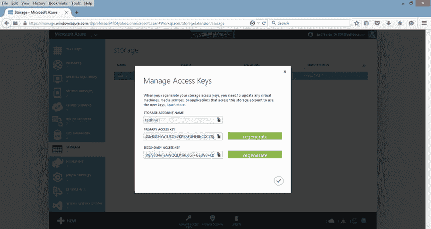

**图 11-6.** 管理访问密钥

点击右下角的**创建存储帐户**并等待帐户创建完成。结果屏幕将出现，如图 11-5 所示。

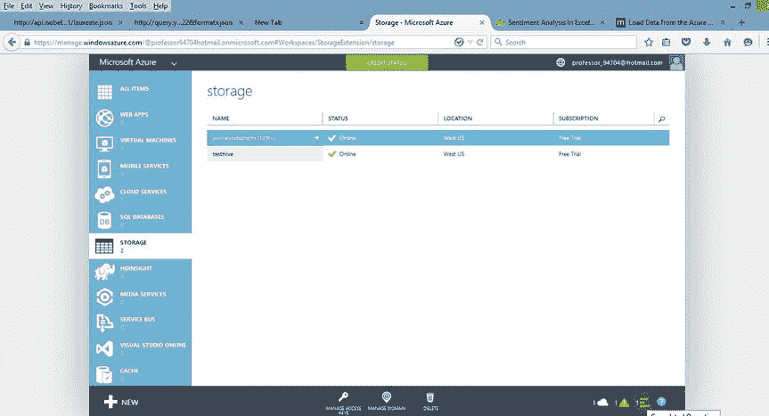

**图 11-5.** 新存储帐户

选择**数据服务** > **存储**和**快速创建**，如图 11-4 所示。为 URL 输入一个唯一的名称。本示例将使用 `testhive`。选择离您最近的位置。

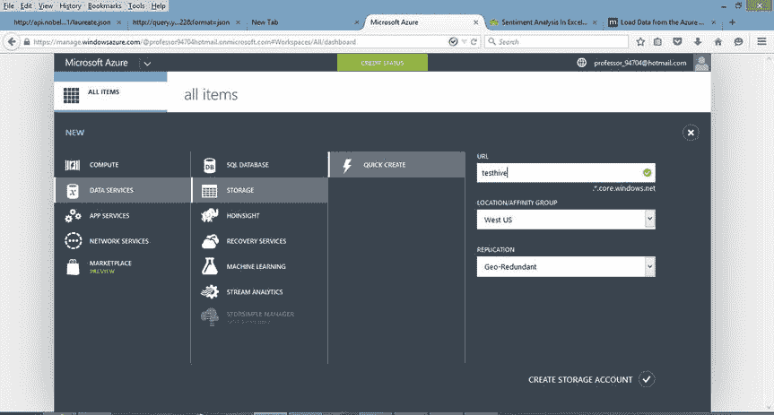

**图 11-4.** 在 Azure 中设置存储帐户

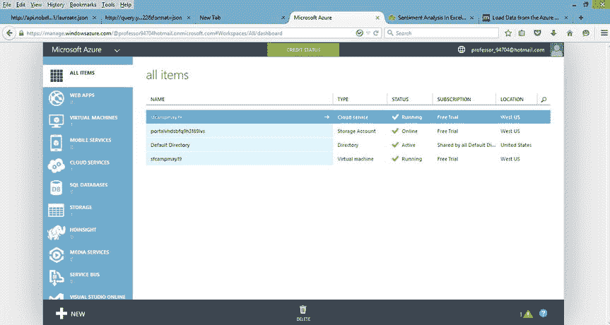

**图 11-3.** Azure 门户屏幕

### 配置 Hadoop 集群

要配置 Hadoop 集群，请按以下步骤操作：

点击屏幕左下角的 `+NEW`。选择 `Data Services` ➤ `HDInsight` ➤ `Hadoop`，然后在屏幕右侧填写相关值，如图 11-7 所示。选择一个集群名称。本例中，两个节点就足够了。Azure 将默认用户名设置为 `Admin`。您需要创建一个至少十位字符的密码，其中至少包含一个大写字母、一个数字和一个特殊字符，并根据提示输入两次。请务必记住您输入的密码。

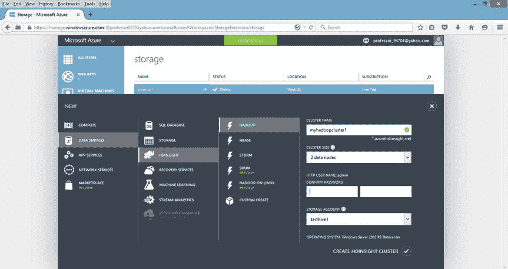

图 11-7. 设置 HDInsight 集群

点击屏幕右下角的 `Create HDInsight Cluster`。然后，集群创建后（可能需要 20 分钟或更长时间），将出现如图 11-8 所示的屏幕。

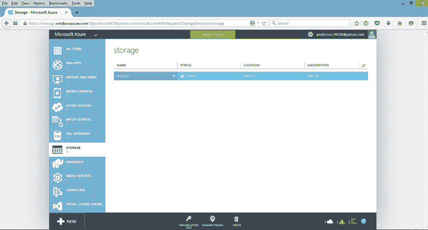

图 11-8. 显示新集群

从左侧窗格中点击 `HDInsight` 以查看集群列表，如图 11-9 所示。应显示刚刚创建的集群。

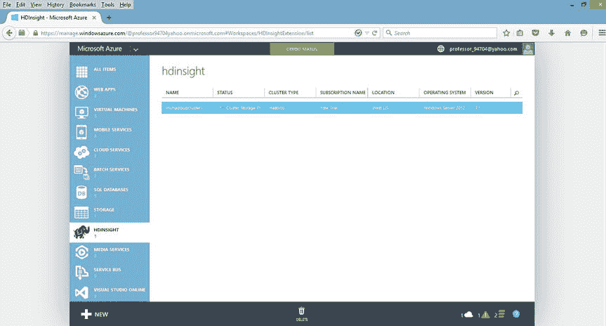

图 11-9. HDInsight 集群列表

选择刚刚创建的集群，然后点击屏幕底部的 `Query Console`。如果系统提示，请输入您的管理员用户名和密码。将出现如图 11-10 所示的屏幕。

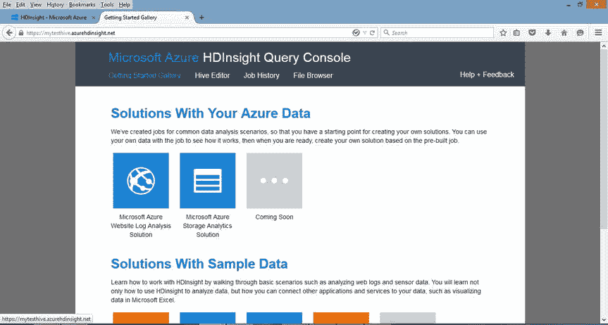

图 11-10. HDInsight 查询控制台

向下滚动以查看“带示例数据的解决方案”。点击屏幕顶部的 `Hive Editor` 选项卡。在 Hive 编辑器中，输入一个查询名称，并接受默认的 SQL `Select * from hivesampletable` 以选择所有记录，如图 11-11 所示。

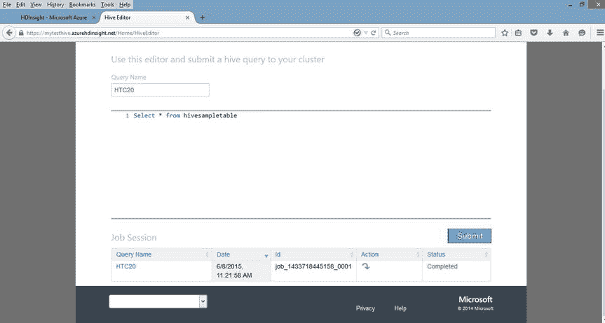

图 11-11. 用于选择所有记录的 SQL 查询

点击 `Submit`。要查看查询结果，请点击屏幕左下角的查询名称，如图 11-12 所示。

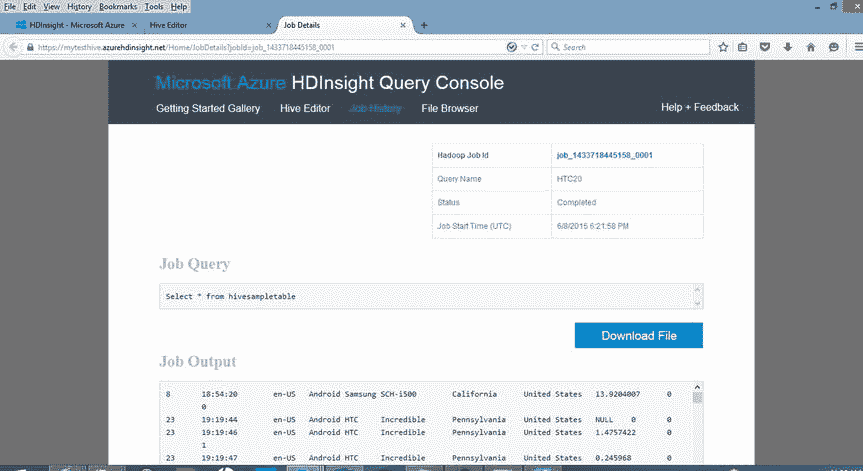

图 11-12. 查询结果

在 HD 查询控制台屏幕上，点击屏幕顶部的 `File Browser`。结果如图 11-13 所示。

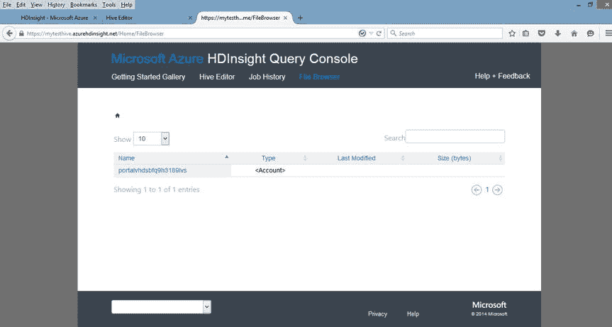

图 11-13. 集群列表

点击左侧 `Name` 列中的第一项，然后点击您的集群名称，将得到如图 11-14 所示的结果。

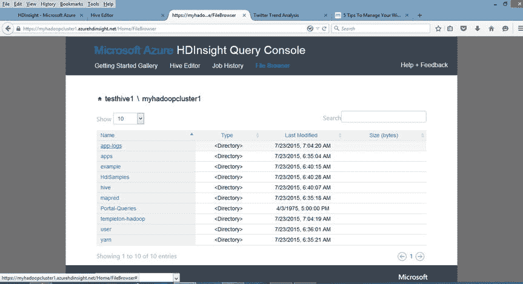

图 11-14. 集群中的文件列表

## 导入到 Excel

有多种方法可以将这些数据导入 Excel。本节将演示如何将文件下载为具有固定长度字段的文本文件。

通过点击屏幕顶部的 `Job History`，然后点击查询名称，返回到图 11-12 所示的屏幕。然后点击 `Download File`。下载的作业日志如图 11-15 所示，其中显示已下载了 59,793 行。您看到的数字可能有所不同。

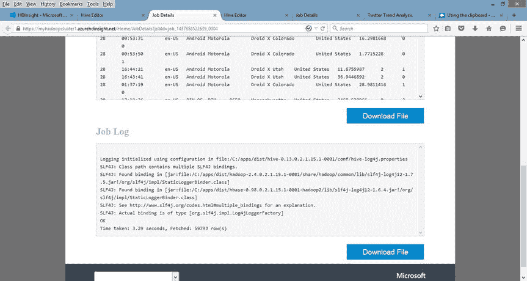

图 11-15. 下载作业日志

点击屏幕底部标有 `Download File` 的蓝色框。当提示选择用于打开文件的程序时，选择记事本。结果将显示在记事本中，如图 11-16 所示。这似乎是一个网站访问日志文件。

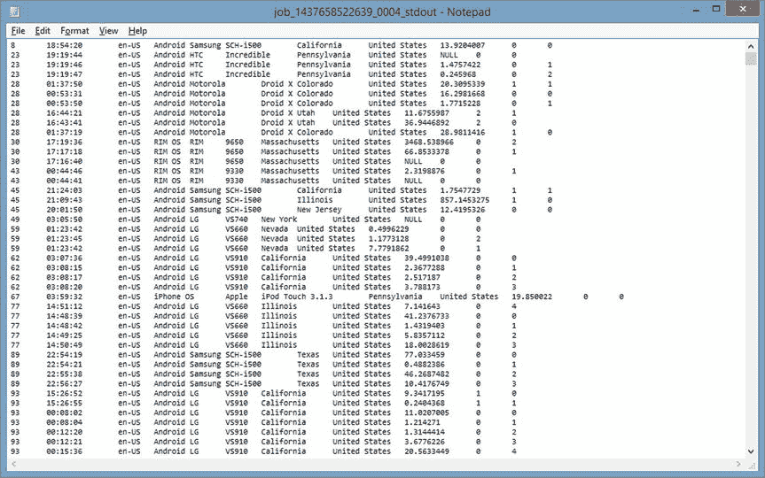

图 11-16. 网站访问日志文件

执行 `Save As` 将文件保存到桌面，以便更容易访问。打开 Excel，然后点击 `Power Query` 选项卡。选择“从文件”，然后选择“从文本”，并浏览找到下载的文件。

该文件将被加载到查询编辑器中，如图 11-17 所示。请注意，Power Query 解析了固定长度的字段，将数据整齐地放入单独的列中，但没有描述性的列标题。

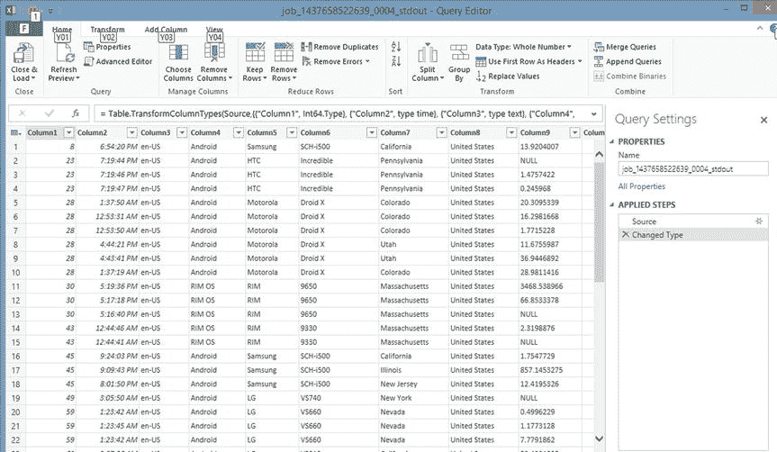

图 11-17. 文件加载到 Power Query 中

要重命名关键列，请右键单击列标题，选择“重命名”，然后输入新的描述性名称，如下所示。

| 旧名称 | 新名称 |
| --- | --- |
| Column2 | 日期时间 |
| Column4 | 操作系统 |
| Column5 | 制造商 |
| Column6 | 型号 |
| Column7 | 州/省 |
| Column8 | 国家/地区 |
| Column10 | 访问次数 |

结果如图 11-18 所示。要将数据加载到电子表格中，请点击功能区左端的 `Close & Load`，然后选择 `Close & Load`。数据将被加载到电子表格中，如图 11-19 所示。

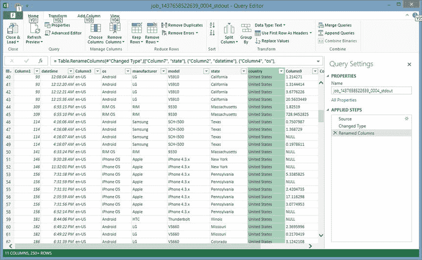

图 11-18. 重命名列后的 Power Query 编辑器

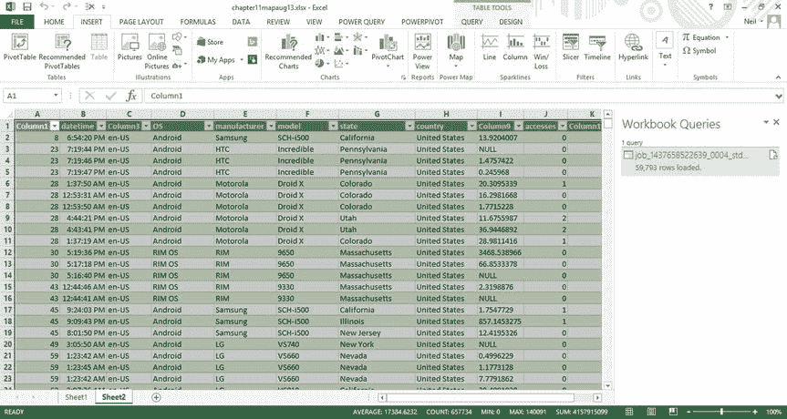

图 11-19. 数据加载到电子表格中

## 创建数据透视表

要创建数据透视表以按州、制造商和型号分析访问次数，请按以下步骤操作：

点击 `Insert` 和 `Pivot Table`。接受默认设置，将其放入新工作表中。将 `state` 拖到 `Columns` 框中，将 `manufacturer` 和 `model` 拖到 `Rows` 框中，并将 `accesses` 拖到 `Values` 框中。结果（显示按制造商和型号划分的访问次数）如图 11-20 所示。

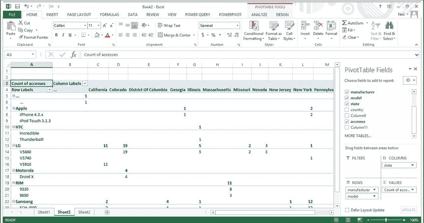

图 11-20. 显示按制造商和型号划分的访问次数的数据透视表

## 在 Power Map 中创建地图

此示例演示如何使用 Power Map 映射数据。请按以下步骤操作：

将数据加载到电子表格后，点击 `Insert` 选项卡，然后点击 `Map` 和 `Launch Power Map`。接受默认设置，将“国家/地区”和“州/省”作为默认地理字段，然后点击“下一步”，如图 11-21 所示。

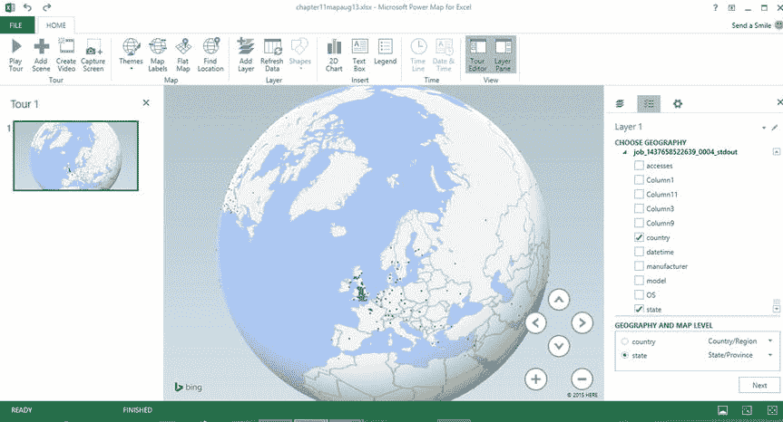

图 11-21. 选择地理字段

点击 `Accesses` 作为高度，右键单击 `OS` 并选择 `Set as Category`，如图 11-22 所示，该图显示了平移到美国的地图。

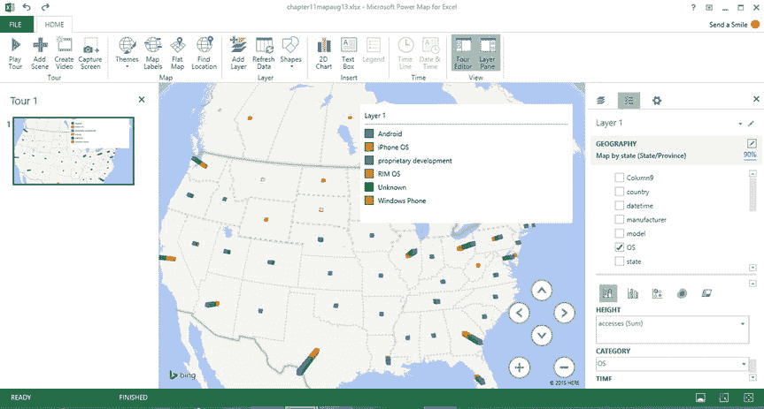

图 11-22. 显示美国按操作系统划分的访问次数的地图

欧洲的类似显示如图 11-23 所示。

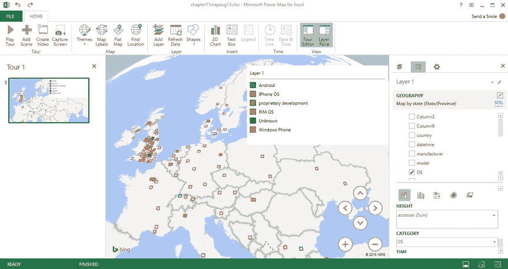

图 11-23. 显示欧洲按操作系统划分的访问次数的地图

如果您用完了刚刚创建的 HDInsight 集群，请将其删除，以免产生费用。

## 总结

本章仅浅显地涉及了在 Azure 中创建和访问 Hadoop 集群，以及将数据导入 Excel 和 Power Query 进行使用数据透视表和 Power Map 分析、以提供按操作系统分类的数据图形显示的强大功能。