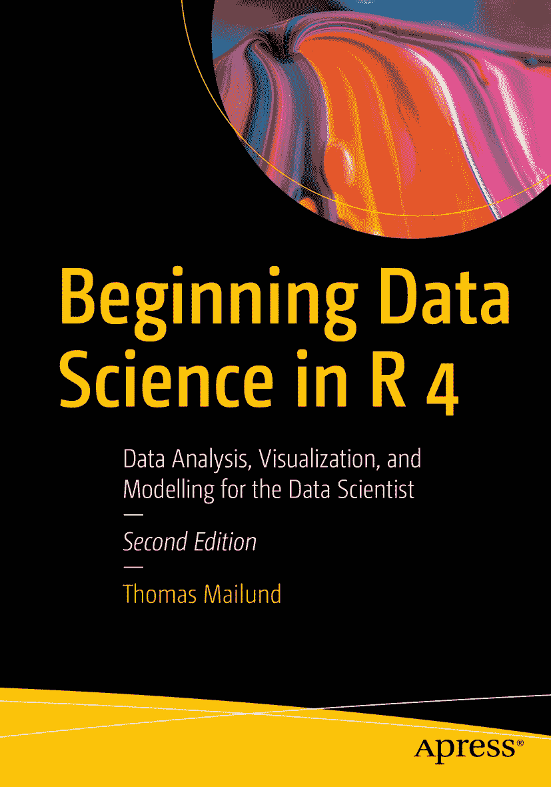

ISBN 978-1-4842-8154-3 电子版 ISBN 978-1-4842-8155-0 <https://doi.org/10.1007/978-1-4842-8155-0>

© 托马斯·梅伦德 2022 本作品受版权保护。出版商保留所有权利，包括全部或部分材料的翻译、重印、插图复用、朗诵、广播、微缩胶片复制或任何其他物理形式的复制，以及信息存储与检索、电子改编、计算机软件，或采用目前已知或未来开发的类似或不同方法的传输。本书中使用的一般描述性名称、注册商标名称、商标、服务标志等，即使未作特别声明，也不意味着此类名称免于相关保护性法律和法规的约束，因而可自由使用。出版商、作者和编辑假定：本书中的建议和信息在出版之日是真实且准确的。出版商、作者或编辑均不对书中所含材料或可能存在的任何错误或遗漏提供明示或暗示的保证。出版商对已出版地图中的管辖权主张和机构归属保持中立。

本 Apress 印记由注册公司 APress Media, LLC（施普林格自然旗下）出版。注册公司地址：美国纽约州纽约市纽约广场 1 号，邮编 10004。