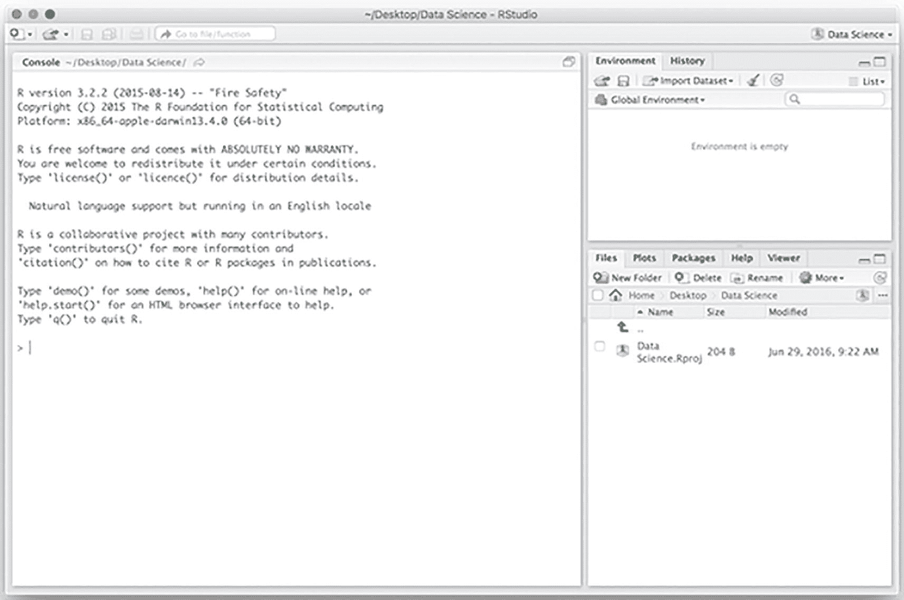
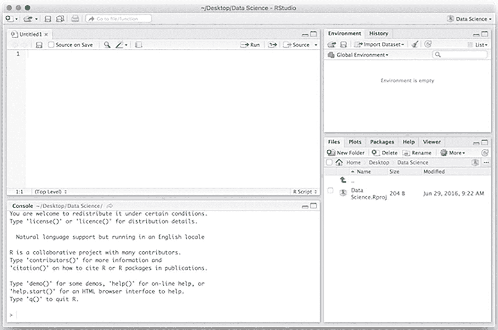
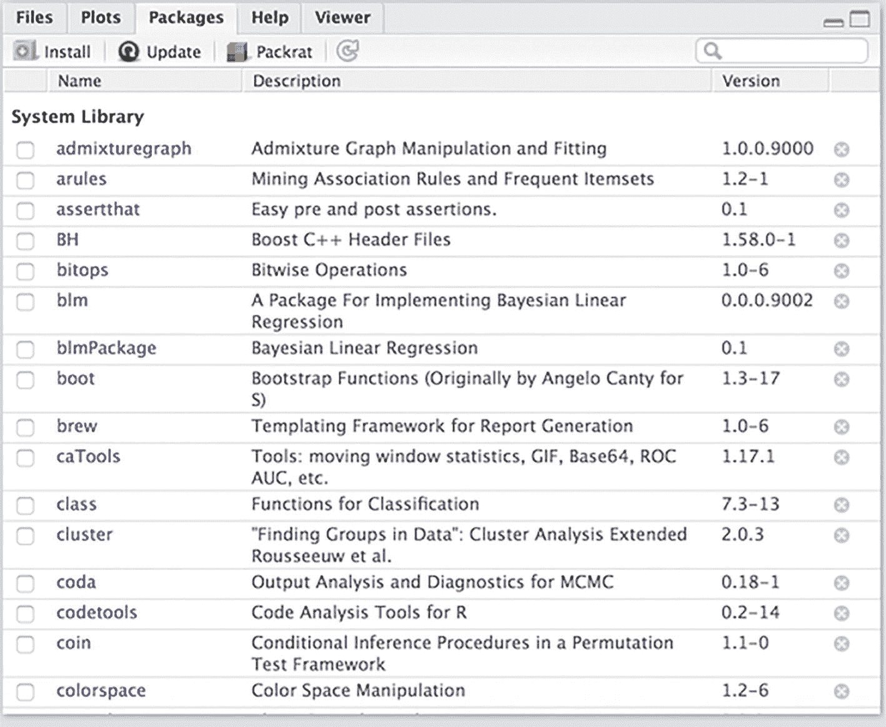

# 1. R 语言编程入门

我们将使用 R 进行数据分析，因此我们需要了解用 R 语言进行编程的基础知识。R 是一种完整的编程语言，兼具函数式编程和面向对象编程的特性，学习完整的语言远远超出了本章的范围。我们将在后面，当我们对 R 的使用有更多经验时，再回到这个话题。不过，好消息是，为了使用 R 进行数据分析，我们很少需要进行大量的编程。至少，如果你采用了正确的编程方式，你就不需要太多编程。

对于数据处理（这是下一章的主题），你主要需要将几个操作串联起来，例如“按此特征对数据进行分组”，接着“计算每个组内这些特征的平均值”，然后“绘制这些平均值”。过去在 R 中实现这些操作要复杂得多，但一些关于如何构建数据流的新思路——以及将这些思路在诸如 `magrittr` 和 `dplyr` 等包中的巧妙实现——显著地简化了操作。我们将在本章末尾看到部分内容，并在下一章中看到更多。不过，首先，我们需要先对 R 有一个初步了解。

## 与 R 的基本交互

如果你还没有下载 RStudio，请先下载。打开它后，你应该会看到一个类似于图 1-1 的窗口。当然，除了你会处于一个空白项目中，而图中（右上角）显示该 RStudio 是在一个名为“数据科学”的项目中打开的。你应该始终在一个项目中工作。项目通过记住你编写的变量和函数、跟踪你打开过的文件等，来跟踪你的分析状态。前往 `文件`，然后 `新建项目` 来创建一个项目。你可以基于现有目录创建项目，但如果这是你第一次使用 R，你可能更希望在一个新目录中创建一个空白项目，那就这样做吧。



**图 1-1** RStudio

打开 RStudio 后，你可以在控制台中输入 R 表达式，控制台是 RStudio 窗口左侧的面板。当你在这里输入一个表达式时，R 会读取、计算它，并打印出结果。当你将值赋给变量时（我们稍后会介绍如何操作），它们会出现在右上角的 `环境` 面板中。在右下角，你可以看到项目所在的目录，你创建的文件将会存放在那里。

要创建一个新文件，请前往 `文件`，然后选择 `新建文件...`。在那里你可以选择几种不同的文件类型。我们感兴趣的是 `R 脚本`、`R 记事本` 和 `R Markdown` 类型。前者是纯 R 代码的文件类型，而后两者用于创建将文档文本与 R 代码混合在一起的报告。对于数据分析项目，我建议使用 `记事本` 或 `Markdown` 文件。当你需要在数月后重新回顾一个项目时，为你正在做的事情编写文档会非常有帮助。

对于本章的大部分内容，你可以直接在控制台中编写 R 代码，或者创建一个 `R 脚本` 文件。如果你创建了一个 `R 脚本` 文件，它会显示在左上角；参见图 1-2。你可以使用此面板右上角的 `运行` 按钮来执行单个表达式，或者使用 `来源` 按钮来执行整个文件。对于编写较长的表达式，你现在可能希望将它们写在 `R 脚本` 文件中。在下一章中，我们将讨论 `R Markdown`，这对于数据科学项目来说是更好的解决方案。



**图 1-2** 打开了一个新的 R 脚本文件的 RStudio


### 将 R 用作计算器

你可以把 R 控制台当作计算器使用：输入想要计算的表达式，按下“回车”，R 就会给出结果。可以稍微尝试一下，熟悉如何在 R 中编写表达式（下面会讲解一些写法），然后从把 R 用作计算器过渡到编写更复杂的分析程序，这仅仅是程度上的差异。毕竟，数据分析程序本质上不过是一连串的计算。

### 简单表达式

与大多数其他编程语言一样，简单的算术表达式采用你熟悉的典型数学记法：

```
1 + 2
## [1] 3
```

```
4 / 2
## [1] 2
(2 + 2) * 3
## [1] 12
```

这里，以 `##` 开头的行展示的是 R 将给出的输出。按照惯例（虽然我不太清楚原因），这两个井号常用于 R 文档中指示输出内容。

它的工作方式也基本符合你的习惯，不过有一点可能例外：你可能习惯在除法运算中将整数视为整数处理。至少在某些编程语言中，整数之间的除法是整数除法，但在 R 中，你可以用整数做除法，如果有余数，你会得到一个浮点数作为结果：

```
4 / 3
## [1] 1.333333
```

当你写下像 4 和 3 这样的数字时，它们总是被解释为浮点数，即使它们打印出来时是整数（即不带小数点）。要显式地得到一个整数，你必须写成 `4L` 和 `3L`：

```
class(4)
## [1] "numeric"
class(4L)
## [1] "integer"
```

整数还是浮点数通常无关紧要，在 R 中看到的所有数字，很可能都是浮点数。

即使你将两个整数相除，得到的仍会是浮点数，并且无需显式告诉 R 你需要浮点数除法。但如果你确实想要整数除法，则需要使用不同的运算符 `%/%`：

```
4 %/% 3
## [1] 1
```

在许多编程语言中，`%` 用于获取除法的余数，但这在 R 中行不通，因为 `%` 有其他用途（创建新的中缀运算符），所以在 R 中，用于此目的的运算符是 `%%`：

```
4 %% 3
## [1] 1
```

除了基本的算术运算符（加法、减法、乘法、除法以及我们刚看到的取模运算符）之外，你还可以使用幂运算符来进行乘方运算。你可以使用 `^` 或 `**` 作为中缀运算符：

```
2 ^ 2
## [1] 4
2 ** 2
## [1] 4
2 ^ 3
## [1] 8
2 ** 3
## [1] 8
```

除了数字之外，还有其他数据类型，但我们不会在这里详尽列举。不过，有两种类型你需要尽早了解，因为它们经常被用到，如果不了解它们的工作原理，可能会带来各种麻烦。这两种类型是字符串和“因子”。

字符串的使用方式符合你的预期。你需要用引号（双引号或单引号）将它们括起来，仅此而已：

```
"Hello,"
## [1] "Hello,"
'world!'
## [1] "world!"
```

字符串并不特别棘手，但我提到它们是因为它们看起来很像因子，但因子并非字符串，只是看起来足够相似，容易造成混淆。在本章后面，当我们了解了函数和向量如何工作之后，我会进一步解释因子。

### 赋值

要给变量赋值，你需要使用箭头运算符。所以，要将值 `2` 赋给变量 `x`，你可以这样写：

```
x <- 2
```

并且你可以通过求值 `x` 来测试 `x` 现在是否持有值 `2`：

```
x
## [1] 2
```

当然，现在你可以在表达式中使用 `x`：

```
2 * x
## [1] 4
```

箭头可以指向两个方向进行赋值，因此你也可以这样写：

```
2 -> x
```

如果在 R 终端中直接输入赋值语句，它不会打印任何内容，但你可以通过将赋值语句放在括号中来让 R 打印它：

```
x <- "invisible"
(y <- "visible")
## [1] "visible"
```

实际上，上述所有内容都是值的向量……

如果你好奇为什么之前打印的所有值前面都有一个 `[1]`，那是因为在 R 中我们通常处理的都不是单个值。我们处理的是值的向量（你将在下一节中了解更多关于向量的信息）。我们目前看到的向量长度都是 1——它们由单个值组成——所以把它们视作单个值并没有错。但它们确实是向量，并且能对单个数字执行的操作用同样的方式也能对多个数字进行操作。

`[1]` 并不表示我们正在查看一个长度为 1 的向量。`[1]` 告诉你，`[1]` 之后显示的第一个值是向量中的第一个值。对于更长的向量，每当 R 换行输出时，你都会看到索引值。这种输出方式让你更容易从输出中找到某个特定索引对应的值。

当你创建一个更长的向量时就会看到这一点。例如，我们可以使用 `:` 运算符创建一个长度为 50 的向量：

```
1:50
##   [1]   1   2   3   4   5   6   7   8   9  10  11  12  13  14  15
##  [16]  16  17  18  19  20  21  22  23  24  25  26  27  28  29  30
##  [31]  31  32  33  34  35  36  37  38  39  40  41  42  43  44  45
##  [46]  46  47  48  49  50
```

`:` 运算符创建一个数字序列，从冒号左侧的数字开始，每次递增 1，直到到达冒号右侧的数字；如果在递增 1 后会超过最后一个数字，则停在截止前的位置：

```
-1:1
## [1] -1  0  1
0.1:2.9
## [1] 0.1 1.1 2.1
```

如果你希望使用除 1 以外的其他增量，可以使用 `seq` 函数：

```
seq(.1, .9, .2)
## [1] 0.1 0.3 0.5 0.7 0.9
```

这里，第一个数字是起始值，第二个数字是结束值（和 `:` 类似），第三个数字则指定了要使用的增量。

因为我们几乎总是在处理向量，所以有一个需要注意的地方我想提醒你。如果你想知道一个字符串的长度，你可能会理所当然地认为可以使用 `length` 函数。但这就错了。`length` 函数返回的是向量的长度，所以如果你给它一个单独的字符串，它总是返回 1：

```
length("qax")
## [1] 1
length("quux")
## [1] 1
length(c("foo", "bar"))
## [1] 2
```

在最后一个表达式中，我们使用了函数 `c()` 来拼接两个字符串向量。将 `"foo"` 和 `"bar"` 拼接起来

```
c("foo", "bar")
## [1] "foo" "bar"
```

会创建一个包含两个字符串的向量，因此对其调用 `length` 的结果是 2。要获取字符串本身的长度，你应该使用 `nchar`：

```
nchar("qax")
## [1] 3
nchar("quux")
## [1] 4
nchar(c("foo", "bar"))
## [1] 3 3
```

如果你想把字符串 `"foo"` 和 `"bar"` 拼接成一个单一字符串 `"foobar"` 的向量，你需要使用 `paste`：

```
paste("foo", "bar", sep = "")
## [1] "foobar"
```

参数 `sep = ""` 告诉 `paste` 在两个字符串之间不要插入任何内容。默认情况下，它会在它们之间放置一个空格：

```
paste("foo", "bar")
## [1] "foo bar"
```


### 索引向量

如果你有一个向量，并且想要获取该向量的第 i 个元素，可以通过索引向量来获取，如下所示：

```
(v <- 1:5)
## [1] 1 2 3 4 5
v[1]
## [1] 1
v[3]
## [1] 3
```

我们在第一个表达式外围加上了括号，以便看到运算的输出结果。在 R 语言中，赋值操作通常是静默执行的，但通过将表达式放在括号内，我们可以确保 R 打印出结果，即从 1 到 5 的整数向量。请注意，这里的第一个元素的索引是 1。许多编程语言从 0 开始索引，但 R 从 1 开始索引。因此，一个长度为 *n* 的向量的索引范围是从 1 到 *n*，这与从 0 到 *n* − 1 的零索引语言不同。

如果你想提取一个子向量，也可以通过索引来实现。只需在方括号内放入你想要索引的向量即可。我们可以使用`:`运算符或连接函数 `c()` 来实现这一点：

```
v[1:3]
## [1] 1 2 3
v[c(1,3,5)]
## [1] 1 3 5
```

你可以使用布尔值向量来挑选出那些值为“真”（true）的元素：

```
v[c(TRUE, FALSE, TRUE, FALSE, TRUE)]
## [1] 1 3 5
```

当这种索引方式与表达式结合使用时，会特别有用。例如，我们可以先获取一个布尔值向量，该向量指示向量中哪些值是偶数，然后使用该向量将这些偶数挑选出来：

```
v %% 2 == 0
## [1] FALSE  TRUE FALSE  TRUE FALSE
v[v %% 2 == 0]
## [1] 2 4
```

你还可以通过改变索引的符号来获取补集：

```
v[-(1:3)]
## [1] 4 5
```

也可以为向量索引赋予名称，一旦赋予了名称，就可以使用这些名称来索引向量。你可以在构造向量时设置名称，或者使用 `names` 函数：

```
v <- c("A" = 1, "B" = 2, "C" = 3)
v
## A B C
## 1 2 3
v["A"]
## A
## 1
names(v) <- c("x", "y", "z")
v
## x y z
## 1 2 3
v["x"]
## x
## 1
```

名称对于创建可通过键来查找值的表格非常方便。

### 向量化表达式

我们之前看到的表达式之所以能作用于向量值而非单个值，原因在于 R 中，算术表达式都是按元素逐个对向量进行运算的。当您编写如下表达式时：

```
x <- 1:3 ; y <- 4:6
x ** 2 - y
## [1] -3 -1  3
```

您是在告诉 R 将向量 `x` 中的每个元素进行平方运算，然后按元素逐个减去 `y` 中的对应元素：

```
(x <- 1:3)
## [1] 1 2 3
x ** 2
## [1] 1 4 9
y <- 6:8
x ** 2 - y
## [1] -5 -3  1
```

即使向量的长度不同，这种运算方式也同样适用，如上例所示。向量 `2` 是一个长度为 1、包含数字 `2` 的向量。当向量长度不相同时，表达式的运算方式是将较短的向量重复使用，直到与较长向量的长度匹配：

```
(x <- 1:4)
## [1] 1 2 3 4
(y <- 1:2)
## [1] 1 2
x - y
## [1] 0 0 2 2
```

如果较长向量的长度不是较短向量长度的整数倍，你会收到一个警告。表达式仍会重复使用较短的向量若干次，只是重复次数不是整数：

```
(x <- 1:4)
## [1] 1 2 3 4
(y <- 1:3)
## [1] 1 2 3
x - y
## Warning in x - y: longer object length is not a
## multiple of shorter object length
## [1] 0 0 0 3
```

在这里，`y` 被完整地用于 `x` 的前三个元素（`1:3`），然后 `y` 的第一个元素被用于 `x` 的第四个元素（`4`）。

### 注释

当你只是交互式地使用 R 终端时，可能不想写注释，但在代码中，注释是必要的。注释可以让你描述代码的意图和实现方式，这样当你日后回头再看代码，并且已经忘记了当初编写时的那些精妙构思时，就不必重新琢磨了。

R 将 `#` 字符之后的所有内容都解释为注释。从 `#` 到行尾，R 解析器会跳过这段文本：

```
# 这是一条注释。
```

如果你在 R Markdown 文档中编写分析代码（我们将在下一章介绍），那么你可能不太需要注释。在这类文件中，文本和 R 代码的混合方式不同。但如果你开发 R 代码，你可能需要注释，现在你知道如何编写注释了。

## 函数

你已经见过函数的使用，尽管当我们看到诸如

```
length("qax")
```

这样的表达式时，你可能没有多想。你没有多想，是因为其中没有什么令人惊讶的地方。我们只是使用了通常的数学函数表示法：*f* (*x*)。如果你想调用一个函数，只需使用这种表示法，并在括号内给出函数的参数。

在 R 中，调用函数时，除了使用参数的位置，还可以使用参数的名称；我们在使用 `paste` 连接两个字符串时，就看到了一个使用 `sep = ""` 的例子。

如果你有一个包含两个参数 *x* 和 *y* 的函数 *f* (*x*, *y*)，调用 *f* (5, 10) 意味着调用 *f*，并将参数 *x* 设为 5，参数 *y* 设为 10。在 R 中，你可以明确地指定这一点，以下两个函数调用是等价的：

```
f(5, 10)
f(x = 5, y = 10)
```

（请不要尝试运行这段代码；我们尚未定义函数 `f`，因此调用它会失败。但如果我们有一个函数 `f`，那么这两个调用是等价的。）

如果你指定了参数的名称，那么顺序就不再重要了，因此另一个等价的函数调用是：

```
f(y = 10, x = 5)
```

你可以将这两种向函数传递参数的方式结合起来，但必须将所有位置参数放在命名参数之前：

```
f(5, y = 10)
```

除了可能让代码更具可读性之外（通常记住参数的作用比记住它们的顺序更容易），这种方法本身并没有太大必要。当它与默认参数结合使用时，它就会变得非常有用。

R 中的许多函数都接受大量参数。这些参数的数量多到你可能记不清它们的用途，更不用说顺序了。它们很像带有许多选项的程序，但除非你需要调整某些设置，否则通常只使用默认值。这些函数有很多参数，但大多数都有实用的默认值，你通常不需要指定它们的值。不过，当你确实需要时，可以通过命名参数来指定。

### 获取函数文档

由于很难记住函数的详细功能，尤其是所有参数的作用，因此你经常需要查阅函数文档。幸运的是，在 R 和 RStudio 中这非常容易做到。无论何时你想知道某个函数的功能，只需向 R 提问，它就会告诉你（假设该函数的作者已经编写了文档）。

以我们前面看到的例子中的函数 `length` 为例。如果你想了解这个函数的功能，只需在 R 终端中输入 `?length`。如果你在 RStudio 中执行此操作，它会在右侧的窗格中显示文档，如图 1-3 所示。

图 1-3: RStudio 的帮助窗格

尝试查阅几个函数的文档，例如，我们之前也见过的 `nchar` 函数。

所有中缀运算符，例如 `+` 或 `%%`，在 R 中也是函数，你也可以阅读它们的文档。但是你不能在 R 终端中输入 `?+` 来获取信息。R 解析器不知道如何处理这种情况。如果你想获取中缀运算符的帮助，你需要用反引号将其引起来。因此，要阅读 `+` 的文档，你需要输入：

```
?`+`
```

你可能不需要通过帮助来了解加法运算的作用，但人们可以编写新的中缀运算符，因此当你需要了解这些运算符时，知道这一点会很有用。


### 编写你自己的函数

你可以轻松地编写自己的函数。使用 `function` 表达式来定义函数，并通过赋值给它一个名称。例如，要编写一个计算数字或向量数字平方的函数，可以这样写：

```
square <- function(x) x**2
square(2)
## [1] 4
square(1:4)
## [1]  1  4  9 16
```

“`function(x) x**2`” 这个表达式定义了函数，任何你需要函数的地方，都可以像这样显式地写出函数表达式。将函数赋值给一个名称，这样你就可以使用该名称来引用这个函数，就像将其他任何值（比如数字或字符串）赋给一个名称一样，让你可以用这个名称来代表该值。

你自己编写的函数，其工作方式与 R 语言内置的或 R 包中的任何函数完全相同，但有一个例外：除非你为函数编写文档，否则你编写的函数将没有文档，而这超出了本章的讨论范围（但在关于构建包的章节中会涉及）。

`square` 函数只是对其输入执行一个简单的算术运算。有时，你可能希望函数执行多项操作。如果你希望函数对其输入执行多个操作，就需要为函数编写多条语句。在这种情况下，你需要为它提供一个由多条语句组成的“函数体”，这样的函数体必须放在花括号中：

```
square_and_subtract <- function(x, y) {
squared <- x ** 2
squared - y
}
square_and_subtract(1:5, rev(1:5))
## [1] -4 0 6 14 24
```

（查看 `rev` 的文档以了解这里发生了什么。确保你理解了这个示例的作用。）

在这个简单的示例中，我们实际上并不需要多条语句。我们可以直接把函数写成：

```
square_and_subtract <- function(x, y) x ** 2 - y
```

只要函数中只有一个表达式，我们就不需要花括号。但对于更复杂的函数，你仍然会需要花括号。

函数的结果——即当你调用它时返回的值——是最后一条语句或表达式（实际上，在 R 语言中，语句和表达式没有任何区别；它们是同一回事）。不过，你可以使用 `return()` 表达式来显式地指定返回值：

```
square_and_subtract <- function(x, y) return(x ** 2 - y)
```

显式返回通常只在你想在函数结束前返回一个值时使用。要看到这样的示例，我们需要控制结构，因此我们得稍等片刻才能看到例子。它在 R 语言中的使用频率不如许多其他编程语言那么高。

不过，如果你习惯了用其他语言编程，有一点至关重要：`return()` 表达式需要包含括号。在大多数编程语言中，你可能会这样写：

```
square_and_subtract <- function(x, y) return x ** 2 - y
```

但这种写法在 R 语言中行不通。试试看，你会得到一个错误。

### 汇总函数与向量化函数

正如我们已经看到的，当我们编写诸如 `x**2 - y` 这样的算术表达式时，这个表达式既适用于 `x` 和 `y` 是单个数字的情况，也适用于 `x` 和 `y` 是向量时的逐元素运算。如果你编写的函数体由这样的表达式组成，那么该函数也将能够进行逐元素运算。我们之前编写的 `square` 和 `square_and_subtract` 函数就是这样工作的。

不过，并非所有函数都这样工作。虽然我们通常可以一次处理一个数据元素，但我们也经常需要从一组数据中提取某些汇总信息，函数同样能处理这种情况。

以 `sum` 函数为例，它将你作为参数传入的向量中的所有值相加（现在查看 `?sum` 以了解文档）：

```
sum(1:4)
## [1] 10
```

这个函数将其输入汇总成一个单一值。还有很多类似的函数，当然，这些函数不能对向量进行逐元素运算；相反，它们会将整个向量缩减成一些较小的汇总统计量，这里就是所有元素的和。

一个函数是否能在向量表达式中工作，取决于它是如何定义的。虽然存在例外，但 R 语言中的大多数函数要么能处理向量，要么像 `sum` 那样对向量进行汇总。当你编写自己的函数时，它是否能对向量进行逐元素运算，取决于你在函数体中放了什么。如果你编写了一个像 `square` 那样只对输入进行算术运算的函数，它就能在向量化表达式中工作。如果你编写了一个对数据进行某种汇总的函数，它就不能。例如，如果我们编写一个像下面这样计算输入平均值的函数：

```
average <- function(x) {
n <- length(x)
sum(x) / n
}
average(1:5)
## [1] 3
```

这个函数显然不会给出逐元素的值。当你编写的函数包含控制结构时，情况会变得稍微复杂一些，我们将在下一节中讨论。无论如何，下面是一个更简洁的实现，因为它只涉及一个表达式：

```
average <- function(x) sum(x) / length(x)
```

哦，对了，顺便提一下，不要用这个 `average` 函数来计算向量的平均值。R 语言已经有一个函数来做这件事了，那就是 `mean`，它在处理缺失数据和长度为零的向量等特殊情况时表现更好。查看一下 `?mean`。

进行汇总并不意味着你必须返回一个单一值。在这个函数中，我们返回了向量中数值的平均值和标准差：

```
mean_and_sd <- function(x) c(mean = mean(x), sd = sd(x))
mean_and_sd(1:10)
##     mean       sd
##  5.50000  3.02765
```

我们使用 `mean` 和 `sd` 函数来计算这两个汇总统计量，然后将它们组合成一个包含两个汇总结果的向量（带有名称的元素）。这不是一个向量化函数，因为我们并没有对输入中的值进行逐元素处理。它计算出的不是单一汇总结果，而是返回了稍微复杂一点的东西。复杂的函数常常返回比向量或单一值更复杂的数据，我们将在后续章节中看到一些例子。不过，如果可以避免，就尽量这样做。输入和输出都简单的函数更容易使用，而当我们编写函数时，我们希望尽可能让自己轻松。有了这个 `mean_and_sd` 函数，我们并没有获得使用 `mean` 和 `sd` 函数时已经拥有的任何优势，将两个操作合并到一个函数中只会不必要地使事情复杂化。

将函数粗略地分为向量化函数（对数据进行逐元素运算）和汇总函数，只是对我们如何使用它们的一种分类。如果你为某个或多个向量中的每个元素计算一个值，就属于前者；如果你汇总某个或多个向量中的所有数据，则属于后者。一个函数的实现可以轻松地同时结合这两种方式。

例如，假设我们想要通过从每个元素中减去均值，然后除以标准差来对数据进行标准化。我们可以这样实现：

```
normalise <- function(x) (x - mean(x)) / sd(x)
normalise(1:10)
##  [1]  -1.4863011  -1.1560120 -0.8257228 -0.4954337
##  [5]  -0.1651446   0.1651446  0.4954337  0.8257228
##  [9]   1.1560120   1.4863011
```

我们为输入中的每个元素计算了一个值，因此这是一个向量化函数，但在实现中，我们使用了两个汇总函数：`mean` 和 `sd`。表达式 `(x - mean(x)) / sd(x)` 是一个向量表达式，因为 `mean(x)` 和 `sd(x)` 变成了长度为 1 的向量，我们可以在涉及 `x` 的表达式中使用它们，从而为每个元素得到一个值。


## 控制流速览

仅使用表达式能完成很多工作，但对于许多计算而言，你需要更复杂的编程。这并非特别复杂，但你确实需要能够根据数据选择执行路径——即选择或 `if` 语句——以及遍历数据、循环或 `for` 语句的方法。

`if` 语句的工作方式如下：

```
if ()
```

如果布尔表达式求值为真，则执行该表达式；若为假，则不执行：

```
# 这条语句不会执行任何操作
if (2 > 3) "false"
# 这条语句会执行
if (3 > 2) "true"
## [1] "true"
```

对于这类表达式，由于我们并未通过求值改变程序状态，因此求值 `if` 表达式本身影响不大。但如果我们将其用于变量赋值，则会产生影响：

```
x <- 1:5
if (x[1] > 3) x[1] <- "bar"
if (x[2] > 2) x[2] <- "baz"
x
## [1] "1"   "baz" "3"   "4"   "5"
```

如果你希望同时处理真值和假值两种情况，可以使用以下形式：

```
if ()  else
if (2 > 3) "bar" else "baz"
## [1] "baz"
```

如果你需要在 `if` 语句中换行，无论是否包含 `else` 部分，都应使用花括号。

并非总是必须这样做。如果 `if` 部分只有单个表达式，可以省略花括号：

```
if (3 > 2)
x <- "bar"
x
## [1] "bar"
```

或者，如果 `else` 部分只有单个语句，也可以省略花括号：

```
if (2 > 3) {
x <- "bar"
} else
x <- "qux"
x
## [1] "qux"
```

但前面的 `if` 部分需要花括号，以便 R 识别出后面还有 `else` 部分。否则会报错：

```
if (2 > 3)
x :3:1: unexpected 'else'
## 2:     x <- "bar"
## 3: else
##    ^
```

如果始终使用花括号，就无需担心何时必须使用、何时可以省略，而且各部分可以包含多条语句，无需额外操心。如果在 `if` 或 `if-else` 表达式中换行，我建议你也始终使用花括号。

`if` 语句的工作方式类似于表达式：

```
if (2 > 3) "bar" else "baz"
## [1] "baz"
```

该表达式的求值结果取决于条件的真值，返回“if”部分或“else”部分的结果：

```
x <- 2
if (x > 3) "bar" else "baz"
x
## [1] "baz"
```

使用花括号同样有效：

```
x <- 2
if (x > 3) { "bar" } else { "baz" }
x
## [1] "baz"
```

但当整个语句写在一行，且两部分都是单个表达式时，我通常不会特意加花括号。

不过，你不能将 `if` 语句用于向量化的表达式，因为如果给布尔表达式传入一个向量，它只会对向量中的第一个元素求值：

```
x <- 1:5
if (x > 3) "bar" else "baz"
## Warning in if (x > 3) "bar" else "baz": the
## condition has length > 1 and only the first
## element will be used
## [1] "baz"
```

如果你需要 `if` 语句的向量化版本，可以使用 `ifelse()` 函数：

```
x <- 1:5
ifelse(x > 3, "bar", "baz")
## [1] "baz" "baz" "baz" "bar" "bar"
```

（阅读 `?ifelse` 文档可了解该函数的详细信息）。

当然，这对编写使用 `if` 语句的函数也有影响。如果你的函数体不是向量化的，那么该函数本身也不会是向量化的。因此，如果你的 `if` 语句依赖于输入——如果不依赖输入，那它基本没什么用——那么该输入不应是向量：

```
maybe_square <- function(x) {
if (x %% 2 == 0) x ** 2 else x
}
maybe_square(1:5)
## Warning in if (x%%2 == 0) x² else x: the
## condition has length > 1 and only the first
## element will be used
## [1] 1 2 3 4 5
```

这个函数本应对偶数求平方，如果传入单个数字，它能正常工作，但我们传入了一个向量。由于该向量的第一个值是 1，`if` 语句只检查了这个值，所以它认为 `x %% 2 == 0` 为假——如果 `x[1]` 是 1，确实如此——结果所有值都没有被平方。这显然不是我们想要的结果，警告也是合理的。

如果你需要一个向量化的函数，则应使用 `ifelse()`：

```
maybe_square <- function(x) {
ifelse(x %% 2 == 0, x ** 2, x)
}
maybe_square(1:5)
## [1] 1 4 3 16 5
```

或者，你也可以使用 `Vectorize()` 函数将非向量化的函数转换为向量化形式：

```
maybe_square <- function(x) {
if (x %% 2 == 0) x ** 2 else x
}
maybe_square <- Vectorize(maybe_square)
maybe_square(1:5)
## [1] 1 4 3 16 5
```

`Vectorize` 函数被称为“函子”——即一个将函数作为输入并返回新函数的函数。如何像操作其他数据一样操作函数，超出了本章的讨论范围，但这是 R 语言非常强大的特性，我们将在后续章节中介绍。

目前，只需知道 `Vectorize` 会接受一个只能处理单个值的函数，然后创建一个能处理整个向量的函数，它会依次用每个元素调用你的函数。你每次只处理一个元素，而 `Vectorize` 函数确保你能逐个元素地处理整个向量。

要遍历向量中的元素，可以使用 `for` 语句：

```
x <- 1:5
total <- 0
for (element in x) total <- total + element
total
## [1] 15
```

与 `if` 语句类似，如果循环体包含多条表达式，需要用花括号括起来。

`for` 语句会遍历向量中的元素。如果你需要索引，可以使用 `seq_along()` 函数，该函数以向量为输入，返回一个索引向量：

```
x <- 1:5
total <- 0
for (index in seq_along(x)) {
element <- x[index]
total <- total + element
}
total
## [1] 15
```

还有用于循环的 `while` 语句。只要表达式为真，它就会重复执行：

```
x <- 1:5
total <- 0
index <- 1
while (index <= length(x)) {
element <- x[index]
index <- index + 1
total <- total + element
}
total
## [1] 15
```

如果你习惯使用从 0 开始的向量索引，请注意这里的 `index <= length(x)`。在从 0 开始的语言中，你通常会写 `index < length(x)`。在这里，那样写会漏掉最后一个元素。

还有 `repeat` 语句，它会一直循环，直到你使用 `break` 语句显式退出：

```
x <- 1:5
total <- 0
index <- 1
repeat {
if (index > length(x)) break
total <- total + x[index]
index <- index + 1
}
total
## [1] 15
```

此外还有 `next` 语句，用于让循环跳到下一次迭代。

既然已经介绍了循环，我觉得有必要说明一下：在 R 语言中，循环的使用频率通常低于许多其他编程语言。许多人积极主张避免使用循环，并且循环被认为会导致代码运行缓慢。这种说法本身并不完全正确，但使用循环确实比使用其他替代方案更容易写出低效的代码。替代方案是使用函数来接管循环功能。通常存在一个函数可以完成你想用循环实现的任务；如果没有，通常可以通过组合 `Map`、`Filter` 和 `Reduce` 这三个函数来达到目的。

但这超出了本章的范围；我们将在本书后续章节中再讨论。


### 因子

现在让我们回到数据类型以及我之前暗示过的因子。因子大多只是向量，但用于存储分类值。这意味着因子的元素应被视为类别或分类，而非数字或字符串。例如，“小”“中”“大”这类分类可以编码为数字，但并没有自然数可以赋予它们。我们可以将软饮料的尺寸编码为 1、2、3，分别代表“小”“中”“大”。这样做，实则隐含地认为“小”与“中”的差距是“小”与“大”差距的一半，而实际情况可能并非如此。包含“小”“中”“大”尺寸的数据应编码为分类数据，而非数字，在 R 中这意味着将它们编码为因子。

因子通常通过向`factor()`函数提供一个字符串列表来构建。该函数将这些字符串转换为不同的类别，因子便成为这些类别的向量：

```
f <- factor(c("small", "small", "medium",
"large", "small", "large"))
f
## [1] small  small  medium large   small  large
## Levels: large medium small
```

这些类别被称为“水平”：

```
levels(f)
## [1] "large"   "medium" "small"
```

默认情况下，它们按字母顺序排列，在本例中给出的顺序是“large”“medium”“small”。你可以在创建因子时通过指定水平来更改此顺序：

```
ff <- factor(c("small", "small", "medium",
"large", "small", "large"),
levels = c("small", "medium", "large"))
ff
## [1] small  small  medium large  small  large
## Levels: small medium large
```

像这样更改水平的顺序会影响许多函数处理该因子的方式。它主要影响到汇总统计或绘图函数呈现结果的顺序。

```
summary(f)
##  large medium  small
##      2      1      3
summary(ff)
##  small medium  large
##      3      1      2
```

`summary`函数在用于因子时，只是统计每种类别的数量，这里我们有三个“small”、一个“medium”和两个“large”。水平的顺序唯一作用就是决定`summary`打印类别的顺序。

不过，不应将给定的水平顺序视为对类别的“排序”。它仅用于显示结果；除非你明确指定，否则水平本身并不附带排序语义。

某些分类数据具有自然顺序，例如“小”“中”“大”。其他类别则没有天然的顺序，例如“红”“绿”“蓝”就没有自然的排序方式。当我们打印数据时，由于文本的呈现顺序，它总会按某种顺序输出。当我们绘制数据时，通常也会按序排列。但在许多数学模型中，我们会区别对待有序分类数据和无序分类数据，因此这种区分有时很重要。

默认情况下，因子不将水平视为有序的，因此它们假定分类数据类似于“红”“绿”“蓝”，而不是像“小”“中”“大”那样有序。如果你想指定水平是有序的，可以使用`factor()`函数的`ordered`参数：

```
of <- factor(c("small", "small", "medium",
"large", "small", "large"),
levels = c("small", "medium", "large"),
ordered = TRUE)
of
## [1] small   small   medium large   small   large
## Levels: small < medium < large
```

你也可以使用`ordered()`函数：

```
ordered(ff)
## [1] small  small  medium large  small  large
## Levels: small < medium < large
ordered(f, levels = c("small", "medium", "large"))
## [1] small  small  medium large  small  large
## Levels: small < medium < large
```

在许多方面，你可以结合字符串和因子进行工作。例如，你可以通过将因子值与某个标签的字符串进行比较，来检查因子值是否属于某个水平：

```
f
## [1] small  small  medium large  small  large
## Levels: large medium small
f == "small"
## [1]  TRUE  TRUE FALSE FALSE  TRUE FALSE
```

这里，我们将因子`f`中的每个元素与字符串“small”进行比较，那些属于`small`水平的元素返回`TRUE`。然而，因子并不是字符串，在某些方面它们的行为有本质不同。它们常常看起来像字符串，这一事实使得问题更加棘手——一些看似完全无害的操作可能隐藏着致命错误。

我见过最多的情况是，R 用户试图使用因子来索引向量。虽然这比本章中我们看到的大部分内容要高级一些，但我希望尽早展示它，以便你意识到其中风险。

当我们创建一个向量时，可以给索引命名。我们可以在创建向量的同一表达式中完成此操作：

```
v <- c(a = 1, b = 2, c = 3, d = 4)
v
## a b c d
## 1 2 3 4
```

或者稍后添加名称：

```
v <- 1:4
names(v) <- letters[1:4]
v
## a b c d
## 1 2 3 4
```

（`letters`向量包含所有小写字母，因此`letters[1:4]`是`a`、`b`、`c`和`d`）。

如果我们为向量中的元素命名，就可以像使用数字一样用它们来索引。如果我们想要索引 2 和 3，可以用`2:3`来索引，但也可以用`c("b", "c")`来索引：

```
v[2:3]
## b c
## 2 3
v[c("b", "c")]
## b c
## 2 3
```

索引的顺序不必与向量中元素的顺序相同，因此，例如，我们可以按顺序提取索引 3 和 2：

```
v[c(3, 2)]
## c b
## 3 2
```

或者使用它们的名称：

```
v[c("c", "b")]
## c b
## 3 2
```

如果我们重复一个索引，对应的值会多次出现：

```
v[c("c", "b", "c")]
## c b c
## 3 2 3
```

这里，我们使用一个字符串向量进行索引，但如果我们使用因子会怎样呢？

因子并非以字符串形式存储，即使我们是基于字符串向量创建的。它存储为一个整数向量，其中整数是水平值的索引。如果你试图用因子来索引向量，这种表示方式可能会给你带来麻烦。

请仔细阅读以下代码。我们有一个向量`v`，可以通过字母`A`、`B`、`C`和`D`来索引（`LETTERS`是一个包含大写字母的向量）。我们创建一个因子`ff`，它按顺序包含这四个字母。当我们用它索引时，得到的结果如我们所料。由于`ff`是字母`A`到`D`，我们便从`v`中选取了带有这些标签且顺序相同的值：

```
v <- 1:4
names(v) <- LETTERS[1:4]
v
## A B C D
## 1 2 3 4
(ff <- factor(LETTERS[1:4]))
## [1] A B C D
## Levels: A B C D
v[ff]
## A B C D
## 1 2 3 4
```

我们很幸运地得到了预期的结果，但这纯属运气，因为这个表达式并非像我们可能以为的那样使用名称进行索引。请更仔细地阅读以下内容！

```
(ff <- factor(LETTERS[1:4], levels = rev(LETTERS[1:4])))
## [1] A B C D
## Levels: D C B A
v[ff]
## D C B A
## 4 3 2 1
```

这次，`ff`仍然是一个按顺序包含类别`A`到`D`的向量，但我们已经指定了水平的顺序是`D`、`C`、`B`、`A`。因此，这些类别存储为的数值实际上是：

```
as.numeric(ff)
## [1] 4 3 2 1
```

当我们用它来索引`v`时，得到的是这些数值索引——因此，我们从`v`中提取出的值顺序与我们（在了解此情况之前的）预期顺序相反（现在你已经知道了）。

将因子当作字符串处理的最简单方法是将其转换为字符串向量。你可以使用这样的向量来索引：

```
as.vector(ff)
## [1] "A" "B" "C" "D"
v[as.vector(ff)]
## A B C D
## 1 2 3 4
```


如果你发现自己曾用因子（factor）来索引某物——或以任何其他方式将因子当作字符串向量使用——你应当停下来，确保将其显式转换为字符串向量。从长远来看，将因子（本质上是整数向量）当作字符串向量来对待，只会带来泪水和痛苦。

## 数据框 (Data Frames)

我们见过各种类型的向量，它们只是数据的序列。除了序列顺序（可能与数据解释相关，也可能无关）之外，它们没有任何结构。这并非我们想要分析的数据的样貌。我们通常拥有的是来自某些观测集合的多个相关变量。对于每个观测数据点，你都有这些变量中的每个变量的一个值（如果某些变量未被观测到，则有缺失数据指示）。本质上，你所拥有的是一个表格，每行对应一个观测，每列对应一个变量。在 R 中，此类表格的数据类型是 `data.frame`。

数据框是向量的集合，其中所有向量必须具有相同的长度，你可以将其视为一个二维表格。我们通常认为数据框的每一行对应某个观测，每一列对应观测的某个属性。以这种方式看待数据框，使得它们对于统计建模和拟合极为有用。

你可以使用 `data.frame` 函数显式创建一个数据框：

```
df <- data.frame(a = 1:4, b = letters[1:4])
df
##   a b
## 1 1 a
## 2 2 b
## 3 3 c
## 4 4 d
```

但你通常是从文件中读取数据框。

要访问数据框中的单个元素，你必须对其进行索引。由于它是一个二维数据结构，你应该提供两个索引：

```
df[1,1]
## [1] 1
```

不过，你也可以将其中一个索引留空，这样你将获得整列或整行：

```
df[1,]
##   a b
## 1 1 a
df[,1]
## [1] 1 2 3 4
```

如果行或列有名称，你也可以使用这些名称进行索引。这多用于列名称，因为列对应于数据集中的观测变量。有两种方法可以访问一列：显式索引

```
df[,"a"]
## [1] 1 2 3 4
```

或者使用 `$列名` 记法，该记法执行相同操作，但允许你在不使用 `[]` 操作和不引用列名的情况下获取列：

```
df$b
## [1] "a" "b" "c" "d"
```

在 R 版本 4 之前，数据框会将字符向量视为因子并隐式转换它。这节省了一点空间，但却是错误的来源，正如我在有关因子的章节中描述的那样，因此在 R4 中，默认行为现在是保持字符串向量为字符串向量。如果 `df$b` 在你运行上述代码时是一个因子，那么你正在使用较旧版本的 R，我建议你更新它。

不过，将字符串向量转换为因子，或者保持它们原样，只是默认行为。你可以通过 `stringsAsFactors` 参数来控制它。如果你将其设置为 `TRUE`，你会得到将字符串转换为因子的旧行为：

```
data.frame(a = 1:4, b = letters[1:4],
stringsAsFactors = TRUE)
##   a b
## 1 1 a
## 2 2 b
## 3 3 c
## 4 4 d
```

如果你使用了 `stringsAsFactors = FALSE`，你将获得现在默认的行为，即保持字符串向量为字符串。

你可以通过使用 `rbind` 和 `cbind` 函数，按行或按列组合两个数据框：

```
df2 <- data.frame(a = 5:7, b = letters[5:7])
rbind(df, df2)
##   a b
## 1 1 a
## 2 2 b
## 3 3 c
## 4 4 d
## 5 5 e
## 6 6 f
## 7 7 g
df3 <- data.frame(c = 5:8, d = letters[5:8])
cbind(df, df3)
##   a b c d
## 1 1 a 5 e
## 2 2 b 6 f
## 3 3 c 7 g
## 4 4 d 8 h
```

这些数据框内置于 R 中，但在各种包中也有多种替代实现。它们与内置数据框的不同之处在于针对特定使用模式进行了优化，或者仅仅是基于程序员的个人偏好。

最流行的变体——你几乎迟早会遇到——是所谓的“tibble”。你可以通过加载 `tibble` 包来访问它：

```
library(tibble)
```

或者通过加载被称为“tidyverse”的大型包集合：

```
library(tidyverse)
```

tidyverse 是一个用于以结构化方式处理数据的大型框架，在众多包中实现，但你可以通过加载 `tidyverse` 一条指令来加载所有常见的包。

如果这两个命令在你尝试时没有生效，那是因为你还没有安装它们。我们很快就会回到使用包的问题，但现在，你可以直接这样做：

```
install.packages("tidyverse")
```

之后，上述两个 `library(...)` 命令应该都能生效。

然后，要创建一个 tibble 而不是内置数据框，你可以使用：

```
tibble(a = 1:4, b = letters[1:4])
## # A tibble: 4 × 2
##       a b
##    
## 1     1 a
## 2     2 b
## 3     3 c
## 4     4 d
```

如你所见，其语法与使用 `data.frame` 函数创建数据框非常相似，结果也类似。通常，你可以将 tibble 作为数据框的直接替代品。你可以在数据框上执行的操作，同样也可以在 tibble 上执行。

在日常编程中，数据框和 tibble 之间没有太大区别，但后者在打印时稍好一些，能为大型数据集合提供更美观的摘要，并且如前所述，它们被 tidyverse 框架广泛使用，因此如果你开始使用其中的包（我强烈建议你这样做），你更有可能使用它们而不是经典的数据框。

对于更复杂的数据框操作，你真的应该使用 `dplyr` 包，它也是 tidyverse 的一部分，但我们将在第 3 章中回过头来讨论。

## 使用 R 包

开箱即用，R 拥有大量功能，但真正的力量来自于其包机制以及可供下载和使用的大量包集合。

当你安装 RStudio 时，你也安装了一组默认包。你可以通过点击右下方面板中的“包”选项卡来查看安装了哪些包；参见图 1-4。



图 1-4

RStudio 包

在这里，你可以更新包——基本包的新版本会定期发布——也可以安装新包。当我们谈到 tibble 时你可能已经这样做过了，但请再试试另一个。尝试安装 `magrittr` 包。我们稍后将用到它。

你也可以从 R 控制台安装包。只需输入：

```
install.packages("magrittr")
```

一旦你安装了一个包，你就可以使用其中的功能。你可以通过编写 `package::f()` 来获取 `package` 中的函数 `f`，或者你可以将一个包中的所有函数加载到你的全局命名空间中，以便无需使用 `package::` 前缀即可访问它们。

加载 `magrittr` 包的功能可以这样做：

```
library(magrittr)
```


## 处理缺失值

大多数数据集中都含有缺失值——即未被观测到的参数，或因记录错误而不得不被屏蔽的参数。在分析中如何处理缺失数据取决于数据和具体分析本身，但这是一个必须处理的问题，即使你只是删除所有包含缺失数据的观测值。

在 R 语言中，缺失数据由特殊值 `NA`（不可用）表示。任何类型的值都可能缺失并表示为 `NA`，重要的是，R 知道 `NA` 代表缺失值，并会相应地处理 `NA`。你应该始终使用 `NA` 来表示缺失数据，而不是使用某个特定的数字（例如 -1 或 999）。R 知道如何处理 `NA`，但无法知道 `-1` 除了表示负一之外还有别的含义。

涉及 `NA` 的运算结果本身也是 `NA`——你无法对缺失数据进行操作，除了得到更多的缺失值外别无他物。这也意味着，如果你比较两个 `NA`，你会得到 `NA`。因为 `NA` 是缺失信息，它甚至不等于它自身：

```
NA + 5
## [1] NA
NA == NA
## [1] NA
NA != NA
## [1] NA
```

如果你想要检查某个值是否缺失，必须使用 `is.na` 函数：

```
is.na(NA)
## [1] TRUE
is.na(4)
## [1] FALSE
```

像 `sum()` 这样的函数，如果其输入包含 `NA`，默认会返回 `NA`：

```
v <- c(1,NA,2)
sum(v)
## [1] NA
```

如果你希望忽略 `NA` 值，通常有一个参数可以指定：

```
sum(v, na.rm = TRUE)
## [1] 3
```

## 数据管道

大多数数据分析都包括读取一些数据，对这些数据执行各种操作，并在此过程中将其从原始形式转换为我们可以开始提取意义的形式，然后在最后进行一些总结或可视化。

分析中的这些步骤通常表现为一系列函数调用，每个函数调用都将数据从一种形式转换为另一种形式。它可能类似于下面的伪代码：

```
my_data <- read_data("/some/path/some_file.data")
clean_data <- remove_dodgy_data(my_data)
data_summaries <- summarize(clean_data)
plot_important_things(data_summaries)
```

用这种方式编写数据分析并没有错。但是，实际涉及的步骤通常比这里列出的要多得多。当步骤很多时，你要么必须非常有创意地为保存数据的变量命名，要么必须在修改数据后通过重新赋值来覆盖变量名称。拥有许多变量名和重新赋值给变量都可能导致问题。

如果你有多个变量，就更容易意外地在错误的变量上调用函数。例如，你可能对 `my_data` 变量而不是 `clean_data` 变量进行汇总。虽然如果你使用不存在的变量名调用函数会得到错误，但当你用错误的数据调用函数时，没有任何机制会捕获这个错误。你很可能会得到错误的结果，而且这个错误很难被发现。这也不是一个以后容易调试的错误。

重新赋值给变量的问题稍小一些。这主要是在交互式使用 R 时会出现问题。在那里，如果你想回头修改正在编写的程序的一部分，你必须回到开始处，也就是数据被导入的地方。你无法在函数调用的中间，用一个引用着与从头运行程序时不同数据的变量开始。如果你总是从头开始运行 R 脚本，这个问题会小一些，但 R 的典型用法是在交互式控制台或 Markdown 文档中使用，在那里这可能是一个问题。

那么，一个解决方案是，不要一次只调用一个函数并将每个临时结果赋值给一个变量。我们不需要像前面的例子那样为每个函数调用写四个语句，而是将第一个函数调用的结果直接输入到下一个函数中：

```
plot_important_things(
summarize(
remove_dodgy_data(
read_data("/some/path/some_file.data"))))
```

这样你摆脱了所有变量，但可读性受到了极大损害，说得客气点是这样。你必须从右到左、由内而外地阅读代码。

### 编写函数调用管道

`magrittr` 包引入了一个技巧来缓解这个问题，后来 R 4.1 版本中有了内置的解决方案。这个解决方案是引入一个“管道操作符”，在 `magrittr` 中是 `%>%`，在 R 4.1 中是 `|>`，它让你可以从左到右编写你想要组合的函数，但达到的效果和依次调用函数并将一个函数的结果传递给下一个函数的输入是一样的。

该操作符的工作原理是，编写

```
x %>% f()
```

或

```
x |> f()
```

等价于编写

```
f(x)
```

使用 `magrittr` 操作符，你可以省略括号，写成 `x %>% f`，但使用内置操作符时，`x |> f` 会被视为语法错误。

这两个管道操作符的工作方式以及如何使用它们有重叠之处，但它们并不等价。内置操作符稍快一些；当你写 `x |> f()` 时，它只是 `f(x)` 的语法糖，意味着两者完全等价，并且使用该操作符比直接调用函数没有任何额外开销。而使用 `magrittr` 操作符时，`x %>% f()` 意味着你每次使用该操作符时都在调用一个函数 `%>%`，这会有一些额外开销。但这也带来了更大的灵活性，`%>%` 操作符更灵活，可以处理 `|>` 操作符无法处理的用例。

你可以串联这样的操作符序列，使得编写

```
x |> f() |> g() |> h()
```

或

```
x %>% f() %>% g() %>% h()
```

或

```
x %>% f %>% g %>% h
```

等价于编写

```
h(g(f(x)))
```

前面的例子将变成

```
read_data("/some/path/some_file.data") %>%
remove_dodgy_data %>%
summarize %>%
plot_important_things
```

使用 `magrittr` 操作符的形式，或者

```
read_data("/some/path/some_file.data") |>
remove_dodgy_data() |>
summarize() |>
plot_important_things()
```

使用内置操作符的形式。

阅读这样的代码可能仍需要一些时间来适应，但它比由内而外地组合函数要容易阅读得多。

如果你曾经在 UNIX Shell 中使用过管道，你应该能立刻看到相似之处。这是组合函数/程序的相同方法。通过组合几个各自完成相对简单任务的函数，你可以创建非常强大的管道。

使用 `%>%` 或 `|>` 操作符编写管道是相对较新的一个惯用法，被引入 R 编程中，但它非常强大，并且越来越多地被用于不同的 R 包中。我们将在接下来的章节中大量使用管道。

顺便提一下，如果你想知道实现 R 管道功能的包为什么叫 `magrittr`，它指的是比利时艺术家勒内·马格利特，他画了一幅著名的烟斗画，并在画下方写上“Ceci n’est pas une pipe”（“这不是一个烟斗”）。不过，关于比利时超现实主义者的介绍就到此为止吧。


### 编写与管道协同工作的函数

管道运算符实际上做的事情非常简单，这使得编写与之配合良好的新函数也变得简单。它只是将左侧计算出的任何结果，作为第一个参数插入到右侧给定的函数中，并且这一过程是从左到右执行的。因此，`x %>% f` 变成 `f(x)`，`x %>% f %>% g` 变成 `f(x) %>% g` 再变成 `g(f(x))`，而 `x %>% f(y)` 则变成 `f(x,y)`。如果你在管道中为函数提供了额外的参数，`%>%` 或 `|>` 左侧的结果会被插入到显式传递给该函数的参数之前。

因此，如果你想要编写与管道配合良好的函数，你应该确保最有可能通过管道传入的参数是你的函数的第一个参数。编写函数时，让第一个参数是它要操作的数据，这样你就完成了大部分工作。

例如，如果你想要一个能从数据框中随机抽取 `n` 行的函数，你可以这样编写，使其将数据框作为第一个参数，参数 `n` 作为第二个参数：

```
subsample_rows <- function(d, n) {
rows <- sample(nrow(d), n)
d[rows,]
}
```

然后你可以简单地将其直接插入到管道中：

```
d % subsample_rows(n = 3)
##             x         y
## 31  0.3159150 1.3485491
## 76 -0.1553485 0.3320349
## 54 -0.5918348 0.8083360
```

或者

```
d |> subsample_rows(n = 3)
##             x           y
## 69 -1.2723834 -0.01965686
## 25  0.8190089  1.05925039
## 87  2.3872326 -0.18939869
```

由于我们在这里模拟随机数据，你的输出会与我的不同，但你应该能看到类似的结果。

### 神奇的“.”参数

现在，你不可能总是那么幸运，使得你想在管道中调用的所有函数都将管道运算符的左侧作为其第一个参数。如果是这种情况，你仍然可以使用该函数，不过，这两个运算符在易用性方面有所不同。

来自 `magrittr` 的运算符（而非内置运算符）会以特殊方式解释符号“.”。如果你在管道的函数调用中使用了“.”，那么 `%>%` 操作的左侧结果将被放置在该位置，而不是作为右侧函数的默认第一个参数。因此，如果你需要将数据作为第二个参数传入，你就在那里放一个“.”，因为 `x %>% f(y, .)` 等价于 `f(y, x)`。同样，当你需要将左侧结果作为命名参数提供时也是如此，因为 `x %>% f(y, z = .)` 等价于 `f(y, z = x)`，这在左侧结果需要传递给模型拟合函数时特别有用。将模型拟合到数据的函数通常将模型规范作为第一个参数，将拟合数据作为名为 `data` 的命名参数：

```
d % lm(y ~ x, data = .)
##
## Call:
## lm(formula = y ~ x, data = .)
##
## Coefficients:
## (Intercept)        x
##      0.2866   0.3833
```

我们将在后续章节中回到模型拟合以及像 `y ~ x` 这样的表达式含义的讨论，所以如果它现在看起来有点奇怪，不必担心。如果你感兴趣，可以随时查看 `lm()` 函数的文档。

内置运算符不会以这种方式解释“.”，而 `d |> lm(y ~ x, data = .)` 会报错（除非你在某处定义了“.”，但你不应该这样做）。`|>` 运算符总是将左侧结果作为右侧函数的第一个参数。如果这不适合你的函数，你就必须调整函数。

对于 `lm`，数据不是第一个参数，但我们可以创建一个以数据为第一个参数的函数：

```
my_lm <- function(data, formula) {
    lm(formula = formula, data = data)
}
d |> my_lm(y ~ x)
##
## Call:
## my_lm(data = d, formula = y ~ x)
##
## Coefficients:
## (Intercept)         x
##      0.2866    0.3833
```

我们通常不喜欢把这种特化函数留在手中，而且在管道之外它也没什么用，所以这并不理想。然而，我们不必先定义函数、给它命名再使用它。我们可以直接使用函数定义本身：

```
d |> (function(d) lm(y ~ x, data = d))()
##
## Call:
## lm(formula = y ~ x, data = d)
##
## Coefficients:
## (Intercept)        x
##     0.2866    0.3833
```

这里的语法乍看可能有点奇怪，函数定义放在括号里，后面还有额外的 `()`，但这实际上和我们一直使用的语法是一样的。我们写过像 `d |> f()` 这样的管道，其中 `f` 指向一个函数。现在也是一样，只不过我们用一个表达式 `(function(d) lm(...))` 代替了函数名，这个表达式会生成一个函数。它需要用括号括起来，以便函数后面的 `()` 不被视为函数体的一部分。换句话说，取 `d |> f()` 并用 `(function(d) lm(...))` 替换 `f`，你就得到了前面的表达式。

这种我们不给名称的函数称为匿名函数，或者引用理论计算机科学的说法，lambda 表达式。从 R 4.1 开始，也许是为了缓解使用不含“.”的 `|>` 的繁琐，有一种更简短的方式来编写它们。除了写 `function(...)`，你可以使用 `\(...)` 得到：

```
d |> (\(d) lm(y ~ x, data = d))()
##
## Call:
## lm(formula = y ~ x, data = d)
##
## Coefficients:
## (Intercept)         x
##      0.2866    0.3833
```

符号 `\()` 旨在看起来像希腊字母 lambda，*λ*。


当然，即使匿名函数有更简洁的语法，写 `d |> (\(d) lm(y ~ x, data = d))()` 而不是直接写 `lm(y ~ x, data = d)` 也并没有带来多少好处，而且当你尝试将函数管道连接在一起，而数据并不能从第一个参数依次流向各个函数时，使用 `|>` 操作符会更加繁琐。如果你遇到这种情况，你会更喜欢使用 `magrittr` 管道。

不过，匿名函数确实有其用途，无论是对于内置的管道操作符还是 `magrittr` 的管道操作符。当你可以一个接一个地调用现有函数时，管道非常棒，但是如果你在管道中需要一个步骤，而没有任何函数能执行你想要的操作，该怎么办？在这里，匿名函数通常是正确的解决方案。

例如，考虑一个函数，它绘制变量 `y` 与变量 `x` 的关系图，并拟合和绘制 `y` 对 `x` 的线性模型。我们可以定义并命名这样一个函数，得到以下代码：

```
plot_and_fit <- function(d) {
    plot(y ~ x, data = d)
    abline(lm(y ~ x, data = d))
}
plot_and_fit(data.frame(x, y))
```

由于给函数命名不会影响函数的工作方式，因此没有必要这样做；我们只需将定义函数的代码放在函数名称的位置，即可得到：

```
data.frame(x, y) |> (\(d) {
    plot(y ~ x, data = d)
    abline(lm(y ~ x, data = d))
})()
```

这是使用内置操作符的方式，或者像这样：

```
data.frame(x, y) %>% (\(d) {
    plot(y ~ x, data = d)
    abline(lm(y ~ x, data = d))
})()
```

这是使用 `%>%` 操作符的方式。

使用 `magrittr` 管道操作符，我们也可以省略最后的 `()`，直接这样做：

```
data.frame(x, y) %>% (\(d) {
    plot(y ~ x, data = d)
    abline(lm(y ~ x, data = d))
})
```

这是因为 `%>%` 操作符右边既可以接受函数调用，也可以接受函数本身，所以我们可以写 `x %>% f()` 或 `x %>% f`，类似地，我们可以写 `x %>% (\(x) ...)()` 或 `x %>% (\(x) ...)`。但是，你不能省略函数定义周围的圆括号。函数定义也是一个函数调用，`%>%` 操作符会尝试将操作符左侧的内容放入该函数调用中，这会导致错误。而 `|>` 操作符会明确检查你是否试图在右侧定义一个函数，并告知你不允许这样做。

不过，使用 `magrittr` 操作符，你不需要显式地以这种方式定义匿名函数；你可以使用“`.`”来模拟相同的效果：

```
data.frame(x, y) %>% {
    plot(y ~ x, data = .)
    abline(lm(y ~ x, data = .))
}
```

通过将这两个操作放在花括号中，我们实际上创建了一个函数，并且该函数的第一个参数会放到我们放置“`.`”的位置。

`magrittr` 操作符对“`.`”的处理不仅仅是改变参数顺序。你可以在调用函数时多次使用“`.`”，也可以在表达式或函数调用中使用它：

```
rnorm(4) %>% data.frame(x = ., is_negative = . < 0)
##            x is_negative
## 1 -0.8841023       TRUE
## 2 -3.4980590       TRUE
## 3 -0.3819834       TRUE
## 4  0.9776881      FALSE

rnorm(4) %>% data.frame(x = ., y = abs(.))
##            x         y
## 1 -0.8841023 0.8841023
## 2 -3.4980590 3.4980590
## 3 -0.3819834 0.3819834
## 4  0.9776881 0.9776881
```

有一个注意事项：如果“`.`”只出现在函数调用中，它仍然会作为第一个参数传递给 `%>%` 右侧的函数：

```
rnorm(4) %>% data.frame(x = sin(.), y = cos(.))
##            .          x          y
## 1 -0.5580409 -0.5295254  0.8482941
## 2 -0.6264551 -0.5862767  0.8101109
## 3 -0.5304512 -0.5059226  0.8625789
## 4  1.8976216  0.9470663 -0.3210380
```

原因在于，当不仅需要表达式计算结果，还需要完整数据时，看到像这样包含函数调用的表达式更为常见。因此，默认情况下，`f(g(.),h(.))` 会被转换为 `f(.,g(.),h(.))`。如果你想避免这种行为，你可以在函数调用周围加上花括号，因为 `{f(g(.),h(.))}` 等价于 `f(g(.),h(.))`。（稍后我会解释花括号的含义）。你可以在管道的函数调用中获得 `f(.,g(.),h(.))` 和 `{f(g(.),h(.))}` 两种行为；默认行为只是最常见的情况。

### 其他管道操作

`%>%` 和 `|>` 操作符是用于指定数据分析管道的非常强大的机制，但在某些特殊情况下，需要稍微不同的行为，而 `magrittr` 包提供了其中一些。要获取它们，你需要使用 `library(magrittr)` 导入该包。如果你使用 `library(tidyverse)` 加载 tidyverse 框架，你只会得到 `%>%`；你需要显式加载 `magrittr` 才能获得其他操作符。

一种情况是，你需要直接引用从管道表达式左侧获得的数据框中的参数。在许多函数中，你可以通过直接命名数据框的参数来获取它们，正如我们之前在 `lm` 和 `plot` 中看到的那样，但在某些情况下，这并不那么简单。

你可以像这样通过索引“`.`”来实现：

```
d %>% {data.frame(mean_x = mean(.$x), mean_y = mean(.$y))}
##       mean_x   mean_y
## 1 0.09496017 3.538881
```

但是，如果你使用 `%$%` 操作符而不是 `%>%`，你可以直接通过命名变量来获取它们：

```
d %$% data.frame(mean_x = mean(x), mean_y = mean(y))
##       mean_x   mean_y
## 1 0.09496017 3.538881
```

另一种常见情况是，当你想要输出或绘制管道的某个中间结果时。当然，你可以先编写管道的第一部分，将数据通过它运行并将结果存储在一个参数中，输出或绘制你想要的内容，然后从存储的数据继续。但你也可以使用 `%T>%`（tee）操作符。它的工作方式类似于 `%>%` 操作符，但 `%>%` 传递的是表达式右侧的结果，而 `%T>%` 传递的是左侧的结果。右侧内容会被计算但不会传递下去，这非常适合你只需要一个步骤的副作用时，比如打印一些摘要：

```
d %T>% {print(summary(.)); plot(y ~ x, data = .)} %>% lm(y ~ x, data = .)
```

最后一个操作符是 `%<>%`，它做了我之前警告过的事情——它将管道的结果重新赋值给左侧的变量。有时，你确实想要这种行为——例如，如果你在加载数据后立即进行一些数据清洗，并且你从不打算使用原始数据和清洗后的数据之间的任何内容，你可以使用 `%<>%`：

```
d %<>% clean_data
```

我很少使用它，并且更倾向于通过一个管道来处理这种情况：

```
d <- d %>% clean_data
```


### 编码与命名规范

人们开发 R 语言代码已有很长时间，但他们在编码方式上并不总是保持一致。因此，当您使用 R 包时，会看到许多不同的代码编写惯例，尤其是在变量和函数的命名方式上。

只要您保持一致性，如何编写代码完全由您自己决定。如果您的代码与所使用的包保持一致，会有助于提高可读性，但这仍取决于您。

不过，关于命名的一些要点值得了解。人们通常有三种方式来命名变量、数据或函数，分别是：

```
underscore_notation(x, y)
camelBackNotation(x, y)
dot.notation(x, y)
```

您可能对前两种命名法很熟悉，但如果您之前使用过 Python、Java 或 C/C++，那么点号命名法看起来就像面向对象编程中的方法调用。事实并非如此（尽管与之相关）。名称中的点并非表示方法调用。R 只是允许您在变量和函数名称中使用点号。

本书中我将主要使用下划线命名法，但您可以根据自己的偏好选择任意方式。不过，我建议您避免使用点号命名法。这样做有充分的理由。正如我们将在本书第二部分介绍面向对象编程时看到的，R 对函数名中的点赋予了某些含义，因此您可能会遇到一些麻烦。R 的内置函数经常在函数名中使用点号，但这是一条危险路径，除非您确信自己能够避免其中的陷阱，否则最好避免使用。

## 练习题

### 正数平均值

您可以使用`rnorm()`函数从正态分布中模拟数值。它的第一个参数是您需要的样本数量，如果您未指定其他参数，它将从*N*(0, 1)分布中采样。

编写一个数据管道（pipeline），以该函数的采样结果作为输入，剔除其中的负值，然后计算剩余值的平均值。提示：一种剔除值的方法是将其替换为缺失值（`NA`）；如果向量包含缺失值，当您为`mean()`函数指定`na.rm = TRUE`选项时，它可以忽略这些缺失值。

### 均方根误差

假设有“真实”值 t = (*t*[1], ... , *t*[*n*]) 和“预测”值 y = (*y*[*1*], ... , *y*[*n*])，则均方根误差定义为 `RMSE(t, y) = sqrt(1/n * sum((t_i - y_i)²))`。

编写一个数据管道，根据包含`t`和`y`值的数据框（data frame）计算该误差。请记住，您可以先在一个表达式中计算平方差，然后在下一步中计算其平均值，最后计算该值的平方根。R 中计算平方根的函数是`sqrt()`。

