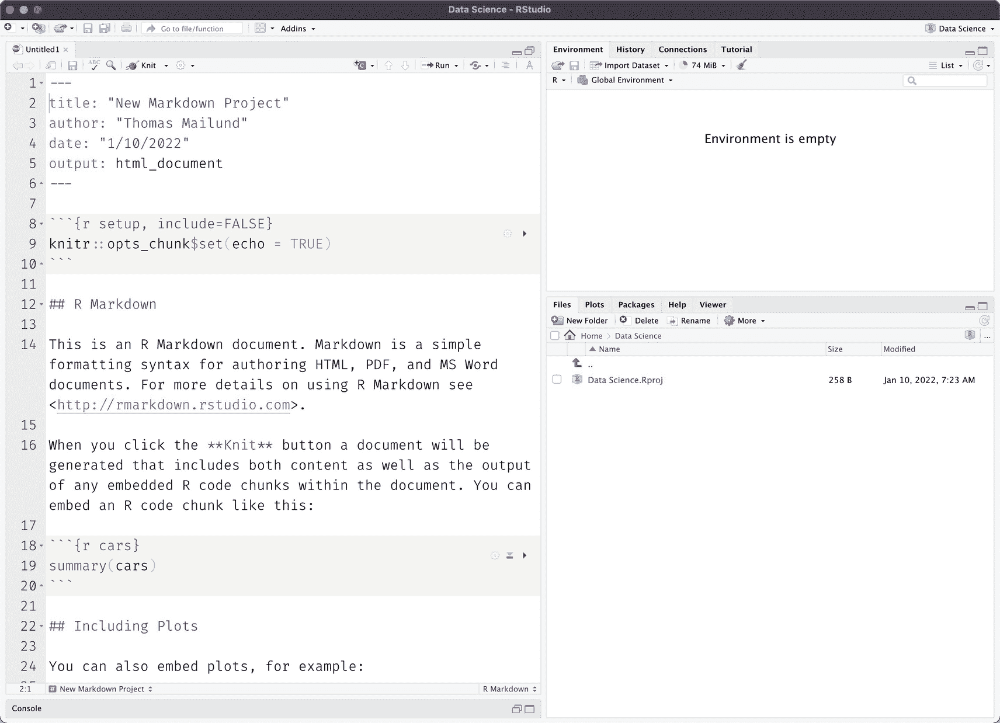
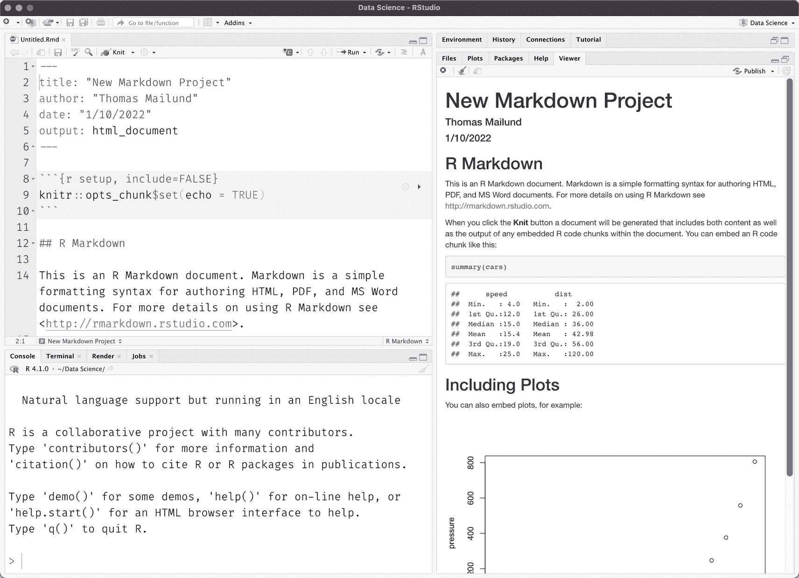
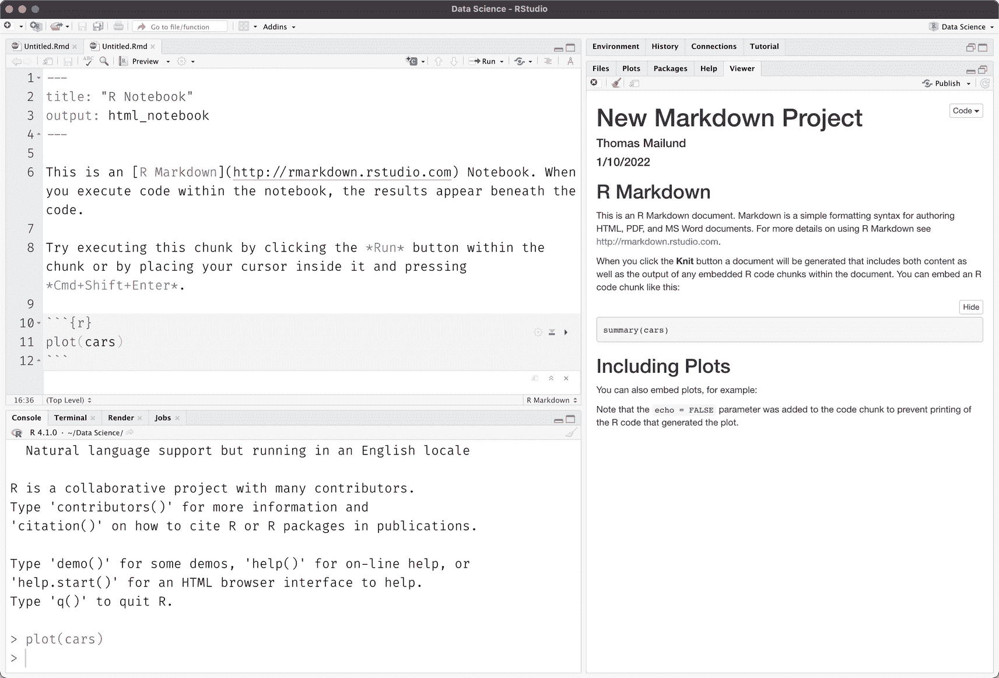
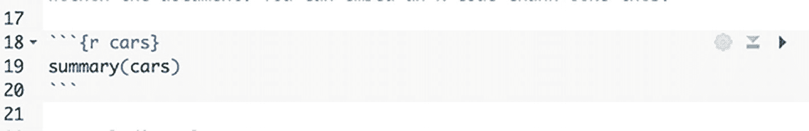
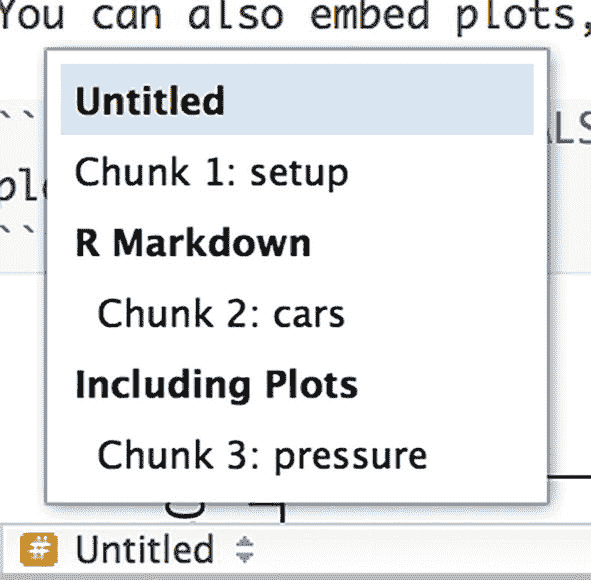
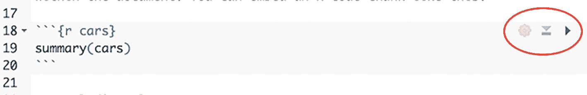
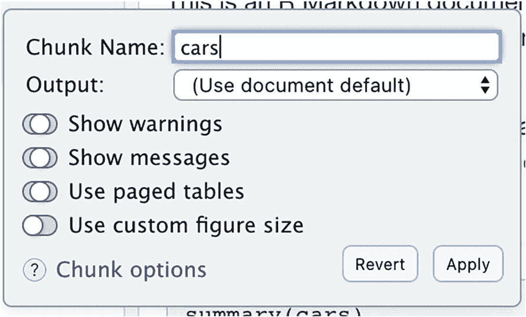
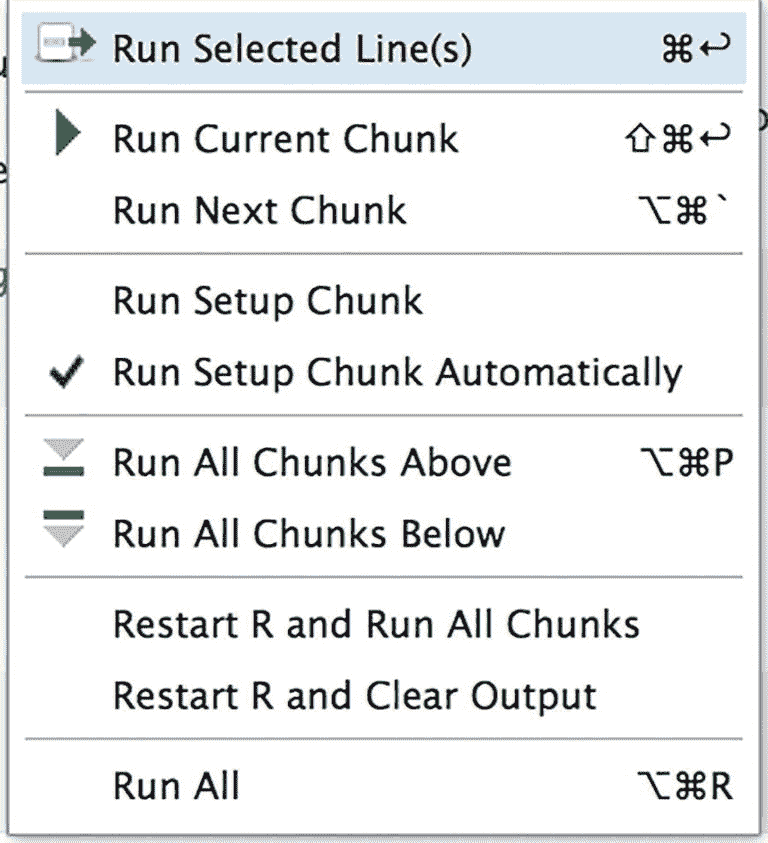

# 2. 可复现分析

典型的数据分析工作流程如下：收集数据，将其放入文件、电子表格或数据库中；然后运行用各种脚本编写的分析，过程中或许会保存一些中间结果，也可能始终基于原始数据操作；创建一些图表或数据相关摘要的表格；最后在文本编辑器或文字处理器中编写关于结果的分析报告。这是许多组织和研究团队中的典型工作流程。大多数从事数据分析工作的人都会采用类似流程的变体。但这也是一个存在许多潜在问题的工作流程。

分析脚本与数据之间存在分离，分析过程与分析文档之间也存在分离。

如果所有分析都基于原始数据，那么第一个问题并非主要难题。但常见的情况是，分析的不同部分各有对应的脚本，一个脚本将中间结果保存到文件中，再由下一个脚本读取。这些脚本描述了数据分析的工作流程，要复现一次分析，您必须按正确顺序运行所有脚本。通常，这种正确顺序只记录在一个文本文件中，甚至更糟——仅存于编写该工作流程的数据科学家脑中。情况会更糟：这种顺序信息不会长期停留在那里，很可能在再次需要之前就已丢失。

理想情况下，您总是希望分析脚本的编写方式能够随时完全自动地重新运行工作流程中的任何部分。

对于第二个问题，问题在于即使工作流程已自动化且易于重新运行，文档也会很快与实际的分析脚本脱节。如果您修改了脚本，未必会记得更新文档。您可能不会忘记更新图表和表格等，但未必会更新关于确切分析运行的文档——例如函数的选项、筛选条件等细节。如果文档与实际分析的偏差足够大，它将变得毫无用处。您可以信任自动化脚本能够随时代表真实的数据分析——这正是首先拥有自动化分析工作流程的好处——但文档却很容易沦为纯粹虚构的描述。

您真正需要的是动态文档。能够以机器和人类都能理解的形式描述分析工作流程的报告。机器将报告视为可随时重新运行分析的自动化工作流程。而我们人类则将其作为文档，它始终准确描述我们所运行的分析工作流程。


## 文学化编程：工作流程与文档的整合

实现自动化工作流程与始终保持最新的文档这两个目标，其中一种方法被称为“文学化编程”。文学化编程是一种软件开发方法，由斯坦福大学计算机科学家高德纳（Donald Knuth）提出，这种方法在编程领域从未真正流行起来，可能是因为大多数程序员不喜欢编写文档。但在数据科学领域，这种方法却重新兴起，Jupyter Notebooks^(¹)和 R Markdown（我们稍后会探讨）等工具已成为许多数据科学家日常工作的重要组成部分。

文学化编程的核心思想是：程序的文档——即关于程序如何运行、以及程序中算法和数据结构如何工作的说明——应与实现该程序的代码编写在一起。`Javadoc`^(²)和`Roxygen`^(³)等工具也做了类似的事情。它们将类和方法的文档以注释的形式与代码一同编写。文学化编程与此略有不同。在`Javadoc`和`Roxygen`中，代码是主要文档，而文档是添加到代码中的注释。而在文学化编程中，文档是供人类阅读的主要文本，代码则是该文档的一部分，被放置在自然需要它的地方。当程序运行时，计算机代码会从该文档中自动提取出来。

文学化编程在编写程序方面从未取得巨大成功，但在进行数据科学工作时，它正在复兴。数据分析项目的结果通常是一份描述模型和分析结果的报告，很自然地会将这份文档视为主要产出。因此，文档本身已经是关注的重点。要应用文学化编程，唯一需要的就是一种将分析代码放入文档报告中的方法。

许多编程语言都支持这一点。Mathematica^(⁴)一直都有笔记本，你可以在其中将代码与文档一起编写。Jupyter^(⁵)（`iPython Notebook`的后继者）允许你编写包含文档和图形、并与可执行代码交错的笔记本。而在 R 语言中，有多种编写文档的方法，这些文档既可用作自动分析脚本，也可用于生成报告。其中，最流行的两种方法是 R Markdown（用于编写这些文档）和`knitr`（用于运行分析和生成报告），但 R Notebooks（R Markdown 的一种变体）也正日益流行。

## 在 RStudio 中创建 R Markdown/knitr 文档

要创建一个新的 R Markdown 文档，请转到“文件”菜单，选择“新建文件”，然后选择“R Markdown…”。随后，RStudio 会弹出一个对话框，你可以在其中选择要创建的文档类型，并添加一些信息，如标题和作者姓名。此时你选择什么并不重要，以后可以更改，但请尝试创建一个 HTML 文档。

结果是一个包含一些样板文本的新文件；参见图 2-1。在文件顶部，两行仅包含“`---`”的线条之间，是文档的一些元信息；在第二个“`---`”之后，是正文。它由 Markdown 语言格式的文本和 R 代码混合组成。



图 2-1

新的 R Markdown 文件

在打开的文件上方的工具栏中，有一个名为“Knit”的菜单项。如果你点击它，它会将 R Markdown 翻译成 HTML 文档并打开它；参见图 2-2。不过，你首先需要保存文件。如果你在保存前点击“Knit HTML”按钮，系统会提示你保存文件。



图 2-2

已编译的 Markdown 文件

新创建的 HTML 文件也会写入磁盘，其文件名取自你为 R Markdown 文件指定的名称。R Markdown 文件的后缀是`.Rmd`，而 HTML 文件具有相同的前缀，但后缀为`.html`。

如果你点击“Knit”旁边的向下箭头，会出现一些额外的选项。你可以选择在 RStudio 右侧的窗格中查看 HTML 文档，而不是在新窗口中查看。如果你在使用笔记本电脑且屏幕空间有限，将文档放在面板中而非单独的窗口中会更方便。你还可以选择生成 PDF 文件或 Word 文件，而不是 HTML 文件。

如果你决定以其他输出格式生成文件，RStudio 会记住这个选择。它会更新元数据中的`output:`字段以反映这一更改。如果你愿意，你也可以直接修改文档中的那一行，通过这种方式进行选择。试试看吧。

如果你当初选择的是“文件”、“新建文件”中的“R Notebook”，而不是“R Markdown”文件，你会得到一个非常相似的文件；参见图 2-3。这里的“Knitr”按钮消失了，取而代之的是一个“Preview”按钮。点击它，你会看到文档显示在图 2-3 的右侧。这两种文件类型之间的差异微乎其微，几乎可以说不存在。Notebook 格式只是另一种输出选项，而两者 _ 都是 _ R Markdown 文件。如果你将第一个文件中的那行`output: html_document`改为`output: html_notebook`，你就会得到一个 notebook。试试看，看看会发生什么。



图 2-3

R Notebook

R Markdown 文件旨在创建报告，而 R Notebook 格式则更侧重于交互式使用。“Knit”一个大型文档可能会很慢，因为文档中的所有分析都将从头开始运行；而对于 notebook，你可以随时查看文档的当前状态，预览时无需重新运行任何分析。因此，Notebook 更快，但如果代码执行顺序不当，使用起来可能会稍微危险一些（参见下文）。不过，你可以在进行分析时始终使用 Notebook，然后在后续将`output: …`格式更改，从头生成报告。由于这两种格式非常相似，在后续内容中我将不对它们进行区分，并将这些文件统称为 R Markdown 文件，因为这是它们共同的输入格式（从它们共有的文件后缀`.Rmd`也可以看出这一点）。


创建文档的实际步骤涉及两种工具和三种语言，但它们整合在一起，因此通常你不会注意到。文档中嵌入了 R 代码。R 代码首先由`knitr`包处理，该包会执行代码并根据你设定的选项处理结果（例如数据和图表）。处理后会生成一个 Markdown 文档（注意，此时已不含任何 R 代码）。接着，这个 Markdown 文档会由工具`pandoc`处理，负责生成最终的输出文件。为此，它使用了文件头部用 YAML 语言编写的元数据，以及用 Markdown 语言编写的实际格式。

你通常无需担心作为文档处理后端的`pandoc`如何运作。如果你只是编写 R Markdown 文档，那么 RStudio 就能让你将它们编译成不同类型的输出文档。但由于处理流程是从 R Markdown 通过`knitr`转换为 Markdown，再通过`pandoc`转换为各种输出格式，你实际上拥有一个非常强大的文档创建工具。我这本书就是用 R Markdown 编写的，每一章都是一个独立的文档，可以单独通过`knitr`运行。然后我让`pandoc`携带一些选项处理生成的 Markdown 文档，将它们合并，并同时生成 PDF 和 Epub 输出。借助`pandoc`，你可以使用不同的模板来设定格式，并根据你创建的输出文档类型（通过为不同格式使用不同模板）来调整格式。这是一个非常强大但也非常复杂的工具，其内容远超本书所能涵盖的范围。你只需知道，如果你想让 R Markdown 文档写作超越 RStudio 本身提供的便捷功能，`pandoc`就在那里随时待命。

正如我所提到的，一个 R Markdown 文档实际上涉及三种语言。我们将按顺序处理它们：首先是头部语言，即 YAML；然后是文本格式语言，即 Markdown；最后是 R 如何嵌入到文档中。

## YAML 语言

YAML 是一种用于指定键值对数据的语言。YAML 代表（递归）缩写“YAML Ain't Markup Language”（YAML 不是标记语言）。没错，当我把这一节称为“YAML 语言”时，我本不应包含“语言”这个词，因为 L 已经代表语言了，但我还是这么做了。我坚持这个选择。这个缩写过去曾代表“Yet Another Markup Language”（另一种标记语言），但由于“标记语言”通常指用于标记文本以指定格式或在文本中嵌入结构化信息的命令——而 YAML 并不做这些——因此缩写被更改了。YAML 用于以各种形式向处理文档的计算机程序提供选项，而不是主要用于标记文本，所以它并非真正的标记语言。

在你的 R Markdown 文档中，YAML 用于头部，即从第一行三个短横线开始到第二行三个短横线之间的所有内容。在你创建新 R Markdown 文件时生成的文档中，它可能看起来像这样：

```
---
title: "New Markdown Project"
author: "Thomas Mailund"
date: "1/10/2022"
output: html_document
---
```

你通常无需手动修改这个头部。如果你使用图形用户界面（GUI），当你更改选项时，它会自动调整头部。不过，当你需要包含参考文献时，确实需要手动修改它（我们稍后会讲到）。此外，如果你需要，你随时可以向头部添加任何你想要的内容，这有时比使用 GUI 更方便。但你不必频繁修改头部。

YAML 为你提供了一种指定键值映射的方法。你编写`key:`，然后紧随其后写上`value`。因此，在上面的例子中，你有键`title`对应值`"New Markdown Document"`，键`author`对应值`"Thomas Mailund"`，以此类推。你并非必须给值加引号，除非值中包含冒号，但你随时可以加上引号。

YAML 头部同时被 RStudio 和`pandoc`使用。RStudio 使用`output`键来决定将你的文档转换为哪种输出格式，这个选择会反映在 Knit 工具栏按钮上；而`pandoc`则使用`title`、`author`和`date`将这些信息放入生成的文档中。

你还可以为键值规范提供稍微更复杂的结构。如果一个键应该对应一个值列表，你使用`-`符号。因此，如果你有多个作者，可以这样使用：

```
---
author:
- "Thomas Mailund"
- "Tom Maygrove"
---
```

或者，你可以有嵌套的键值结构，例如在更改输出主题时（通过点击 Knit 按钮旁边工具栏中的齿轮图标，然后选择“Output Options…”）。

选项的使用方式取决于用于格式化文档的工具链。YAML 头部只是提供规范。有哪些选项可用以及它们的功能是什么，并不属于语言本身的一部分。

对于`pandoc`来说，这取决于用于生成最终文档的模板（稍后详述），所以我甚至无法给出一个完整的列表。任何编写新模板的人都可以决定使用哪些新选项。YAML 头部为你提供了一种向此类模板提供选项的方式，但并不存在一套固定的关键字可供使用。这一切都取决于后续处理工具如何解释它们。

## Markdown 语言

Markdown 语言是一种标记语言——这个名称本身就是一个双关语（注：Markdown 与“mark down”谐音，意为“标记下来”）。它最初是为了简化网页编写而开发的。HTML（我们用来格式化网页的语言）也是一种标记语言，但通常不易于人类阅读。Markdown 旨在通过使用非常简单的标记命令（类似于早期电子邮件尚未成为 HTML 文档时常用的格式）来格式化文本，并辅以将 Markdown 转换为 HTML 的工具，从而解决这个问题。

Markdown 的应用早已超越了网页编写，但它仍然是一种非常简单直观的语言，用于编写人类可读的文本，其中的标记命令随后可以转换为其他文档格式。

在 Markdown 中，你直接编写纯文本即可。因此，正文部分无需任何标记。你需要使用文本编辑器编写，这样文本才是真正的文本，而不是使用文字处理软件——后者的文件格式通常已包含大量屏幕上不易直接看到的标记信息。如果你在编写代码，应该已经了解文本编辑器。如果不了解，只需使用 RStudio 编写 R Markdown 文件即可，这样就没有问题。

当你需要实现纯文本之外的其他效果时，就会使用标记命令。需要学习的命令并不多——其理念是写作时应专注于内容而非格式——因此上手非常快。


### 格式化文本

首先，我们来介绍章节标题。你可以使用不同级别的标题——比如章、节、小节等——只需在新一行的开头使用 `#` 号来指定：

```
### 一级标题
### 二级标题
### 三级标题
```

对于前两级标题，你也可以使用这种格式：

```
一级标题
========
二级标题
--------
```

要在文档中创建列表，你只需按照在纯文本文档中常见的方式书写即可。一个无序列表（不使用数字）是这样写的：

```
* 这是
* 一个
* 无序列表
```

输出效果如下：

*   这是
*   一个
*   无序列表

通过缩进可以创建嵌套列表。你需要让缩进的行向内移动，使得外层文本的起始位置与内层列表项符号之间有一个空格。否则，该行会停留在外层。以下代码的

```
* 这是第一行
    * 这是子行
* 这是另一子行
* 这实际上会回到外层
* 这明确在外层
```

输出是这个列表：

*   这是第一行
    *   这是子行
*   这是另一子行
*   这实际上会回到外层
*   回到外层

如果你愿意，可以使用 `-` 代替 `*` 来创建这些列表，并且可以混用两者：

*   第一行
*   第二行
    *   嵌套行

```
- 第一行
* 第二行
- 嵌套行
```

要创建有序列表，只需使用数字代替 `*` 和 `-` 即可：

```
1. 这是
2. 一个
3. 有序列表
```

输出效果如下：

1.  这是
2.  一个
3.  有序列表

实际上，你不需要让数字严格按顺序排列，只需使用数字即可。所以

```
1. 这是
3. 一个
2. 有序列表
```

会生成相同的输出。不过，计数值会从第一个数字开始，因此

```
4. 这是
4. 一个
4. 有序列表
```

会生成

1.  这是
2.  一个
3.  有序列表

要构建表格，你也使用带有垂直和水平线的典型文本表示法。垂直线分隔列，水平线分隔表头和表格主体。这段代码

```
| 第一列标题 | 第二列标题 | 第三列标题   |
| :--------- | :--------: | -----------: |
| 第一行     | 居中文本   | 右对齐       |
| 第二行     | *某些数据* | *某些数据*   |
| 第三行     | *某些数据* | *某些数据*   |
```

将生成以下表格：

| **第一列标题** | **第二列标题** | **第三列标题** |
| 第一行 | 居中文本 | 右对齐 |
| 第二行 | 某些数据 | 某些数据 |
| 第三行 | 某些数据 | 某些数据 |

表头与主体之间分隔行中的 `:` 号决定了列的对齐方式。将其放在左侧可实现左对齐，放在两侧可实现居中对齐，放在右侧可实现右对齐。

在文本内部，你可以使用标记代码使文本变为斜体或粗体。使用 `*this*` 或 `_this_` 使“this”变为斜体，而使用 `**this**` 或 `__this__` 使“this”变为粗体。

由于 Markdown 是为了生成 HTML 文档而开发的，它当然提供了一种简便的方法来插入链接。你可以使用 `链接文本` 这种表示法，将“链接文本”作为指向“链接 URL”的链接放入文档中。这种表示法也用于在文档内部创建交叉引用——类似于 HTML 文档中的锚点和内部链接——但更多细节稍后介绍。

要在文档中插入图片，你可以使用与链接表示法类似的表示法；只需在链接前加一个 `!` 号，因此 `` 将插入由“图片 URL”指向的图片，并附带“图片描述”作为标题。这里的 URL 通常是一个本地文件，但也可以是通过 HTTP 引用的远程文件。

对于长 URL，即使使用这种简单的表示法，标记后的文本也可能难以阅读，我们可以将 URL 从实际文本中移除，并将它们放在文档的后面部分，例如，放在引用该 URL 的段落之后，或者放在文档的末尾。为此，你可以使用 `[链接文本][链接标签]` 这种表示法，并在后面定义“链接标签”对应的 URL：

```
这是一些文字，[带有一个链接][1]。
链接标签在段落下方定义。
[1]: interesting-url-of-some-sort-we-dont-want-inline
```

你可以使用字符串作为标签。使用数字很方便，但对于长文档，你可能记不住每个数字代表什么：

```
这是一些文字，[带有一个链接][interesting]。
链接标签在段落下方定义。
[interesting]: interesting-url-of-some-sort-we-dont-want-inline
```

你可以使用你从电子邮件中熟悉的形式来创建引用块：

```
> 这是
> 一个引用块
```

会得到以下输出：

> 这是
> 一个引用块

要将原样输入作为文本一部分，你可以选择内联形式或块状形式。在这两种情况下，你都会用到反引号 `` ` ``。在文本内联时，你可以使用单个反引号 `` `foo` ``。要创建一个文本块，你可以这样写：

```
文本块
```

你也可以简单地用四个空格缩进文本，我就是用这种方式创建了一个包含三个反引号的原样文本块。

Markdown 被许多编写程序文档的人广泛使用，因此有一种表示法可以让代码在原样块中获得高亮显示。惯例是在三个反引号后面写上编程语言的名称，然后用于格式化文档的程序会在可能的情况下对代码进行高亮显示。对于 R 代码，你可以写 `r`，所以这个代码块

```r
f <- function(x) ifelse(x %% 2 == 0, x**2, x**3)
f(2)
```

会像这样格式化：

```
f <- function(x) ifelse(x %% 2 == 0, x**2, x**3)
f(2)
```

这种代码块标记唯一的作用就是高亮显示代码。它不会尝试执行代码。代码的执行发生在 Markdown 文档格式化之前，我们稍后会回到这个话题。

### 交叉引用

在原生 Markdown 文档中，对于创建交叉引用的支持并不多。你可以创建指向章节的交叉引用，但不能指向图表或表格。通过 `pandoc` 的扩展可以实现这些功能——我在本书中就使用了它——但从 RStudio 的原生功能来看，目前还无法做到。

不过，随着用于在 Bookdown 中编写书籍和长篇报告的开发工作的推进，这种情况可能很快就会改变。

引用一个章节最简单的方法是将章节名称放在方括号内。如果我在这里写 `[交叉引用]`，就会得到一个指向本“交叉引用”章节的链接。当然，你通常不希望链接文本总是章节名称，所以你也可以写成 `[本章节][交叉引用]`，来获得一个指向“交叉引用”章节但显示文本为“本章节”的链接。

这种方法自然只适用于所有章节标题都是唯一的情况。如果标题不唯一，你就无法通过标题名称来引用它们。这时，你可以为它们添加标签，赋予唯一的标识符。通过在章节标题后写上标识符来实现这一点。要在章节标题后添加名称，你可以这样写：

```
### 交叉引用 {#section-cross-ref}
```

然后你可以使用 `本章节` 来引用该章节。这里，标识符中需要包含 `#` 号——这个标记是 HTML 中锚点使用 `#` 的遗留用法。


### 参考文献

在撰写报告时，常常需要引用书籍或论文。当然，你可以手动处理所有引用，但更好的方法是创建一个包含引用信息的文件，然后通过标记标签引用它。要添加参考文献，你需要在 YAML 头部使用一个名为 `bibliography` 的标签：

```
---
bibliography: bibliography.bib
---
```

这里可以使用多种不同的格式；有关列表，请参见 R Markdown 文档^(⁸)。`.bib` 后缀用于 BibLaTeX。引用文件的格式与 BibTeX 相同，几乎所有提供参考文献信息的网站都会提供这种格式的引用信息。

要从参考文献中引用某个条目，请使用 `[@smith04]`，其中 `smith04` 是该条目在参考文献文件中的标识符。你可以在方括号内用分号分隔同时引用多篇论文，例如 `[@smith04; doe99]`，并且可以添加章节或页码等文本，例如 `[@smith04, chapter 4]`。当你在正文中已经提及作者姓名时，可以省略引用中的作者姓名，只需在 `@` 前加上 `-`，即写成 `正如 Smith 所指出的 [-@smith04]...`。对于文内引用，类似于 `natbib` 中的 `\citet{}`，只需省略方括号，写成 `@smith04 表明...`，并且可以这样结合额外的引用信息：`@smith04 [chapter 4] 表明...`。

要指定使用的引文样式，请在 YAML 头部使用 `csl` 标签：

```
---
bibliography: bibliography.bib
csl: biomed-central.csl
---
```

请访问 [`https://github.com/citation-style-language/styles`](https://github.com/citation-style-language/styles) 查看大量的引文样式列表，那里应有尽有，几乎能满足你的所有需求。

### 控制输出（模板/样式表）

`pandoc` 工具拥有强大的机制来格式化其生成的文档。对于 HTML，这通过 CSS 样式表实现；而对于所有输出格式，则通过使用模板来规定输出的格式化方式。模板机制允许你编写一个 HTML 或 LaTeX 文档，例如，来确定文本各部分的位置以及如何使用 YAML 头部中的变量。这个机制远非本章能够详尽涵盖，但如果你想开始使用 R Markdown 撰写论文，我想在此提及。你完全可以做到这一点；你只需要一个能够按照期刊风格格式化文档的模板。通常，期刊会提供 LaTeX 模板，你可以修改这些模板以适用于 Markdown。

RStudio 对此提供的支持不多，但对于 HTML 文档，你可以使用“输出选项...”（点击齿轮图标）来选择不同的输出格式。

## 在 Markdown 文档中运行 R 代码

到目前为止介绍的格式都是 Markdown（和 YAML）。将其与 R 结合并使其成为 R Markdown 的是通过 `knitr` 实现的。当你格式化文档时，第一步是执行 R 代码以生成一个 Markdown 文档——这会将 `.Rmd` 文档转换为 `.md` 文档，但这个中间文档随后会被删除，除非你明确告诉 RStudio 保留它。它通过运行你想要执行的所有 R 代码并将其结果放入 Markdown 文档中来实现这一点。

最简单的可执行的 R 代码是文本的一部分。如果你想要执行一个 R 表达式，请使用反引号，并在第一个反引号后立即加上 `r`。因此，要执行 `2 + 2` 并将结果放入 Markdown 文档，你可以写 `` `r `` 然后输入表达式 `2 + 2`，文本中就会插入结果 4。你可以在那里写入任何 R 表达式以使其求值。这对于将诸如均值和标准差之类的简短汇总统计信息直接插入文本中，并确保这些汇总信息始终与你正在分析的实际数据保持同步非常有用。

对于较长的代码块，请使用块引用，即三个反引号。不要仅仅写成

```r
2 + 2
```

这样只会显示代码（高亮显示为 R 代码），你应该将 `r` 放在花括号中。

```{r}
2 + 2
```

这会将代码插入你的文档中，同时还会在代码块之后立即显示执行结果。你在 RStudio 中创建 R Markdown 文档时得到的样板代码向你展示了这方面的示例（参见图 2-4）。



*图 2-4: RStudio 中的代码块*

你可以通过将名称紧跟在 `r` 后面来命名代码块。你不必命名所有代码块——如果你有大量代码块，可能也懒得全部命名——但如果给它们命名，通过点击文档下方栏中的结构按钮（参见图 2-5）就可以轻松定位到它们。你也可以在缓存结果时使用该名称来引用代码块，我们稍后会介绍。



*图 2-5: 带有代码块名称的文档结构*

你应该会在每个代码块的右侧看到一个工具栏（参见图 2-6）。最右边的选项，“播放”按钮，可以让你执行该代码块。结果将显示在代码块下方，除非你禁用了该选项。中间的按钮会执行从之前所有代码块直到并包括当前代码块的所有代码。当当前代码块依赖于先前的结果时，这非常有用。齿轮图标用于设置该代码块的选项。



*图 2-6: 代码块工具栏*

代码块选项（参见图 2-7）控制执行代码块时得到的输出。“输出”下拉菜单选择代码块在最终文档中应生成何种输出，而“显示警告”和“显示消息”选择按钮则分别决定是否在输出中包含警告和消息。“使用分页表格”会改变表格的显示方式，将大表格拆分成可以点击翻阅的页面。“使用自定义图形大小”用于确定你生成的图形的大小——不过我们稍后会回到这些主题上。



*图 2-7: 代码块选项*

如果你修改了这些选项，你会发现选项会被包含在代码块的顶行中。当然，你也可以在这里手动控制选项，而且其可用的选项比通过图形用户界面对话框能控制的要多。你可以阅读 `knitr` 文档^(⁹)了解所有细节。

不过，该对话框能够满足你大部分的需求，显示表格或需要缓存代码块结果的情况除外，这两个主题我们都会在后面讨论。


### 分析数据时使用代码块（无需编译文档）

不过，在继续之前，我想强调一点：在 R Markdown 文档中进行数据分析，其用途远不止于创建文档。我个人所有的分析工作都会在这些文档中进行，因为我能够将文档说明与代码结合起来，无论我最终是否需要生成报告。将解释性文本与分析代码相结合，用起来非常方便。

代码块作为独立分析片段被评估的方式，也是这种便利性的一部分。你可以单独评估某个代码块，也可以评估从当前代码块往前的所有代码块。我发现这在分析过程中非常实用。通过键盘快捷键，你可以评估所有代码块、当前代码块之前的全部代码块，或者仅评估当前代码块（见图 2-8）。这让你在进行探索性分析时可以非常轻松地编写一小段代码，并单独评估该段代码。如果你熟悉 Jupyter 或类似的笔记本工具，你一定会觉得这个工作流程很眼熟。



评估代码块的选项

即使在无法从 Markdown 文档生成最终文档的情况下，我也仅仅为了这一功能而继续使用它们。

### 缓存结果

有时，分析的某一部分会非常耗时。这里我指的是 CPU 时间，而不是思考时间——虽然思考时间也是如此，但你不需要反复思考同样的事情。然而，如果你不留意，你就会在电脑上一次又一次地运行相同的分析。

如果你的分析中有这样非常耗时的步骤，那么编译文档将会非常缓慢。每次编译文档时，所有分析都要从头开始执行。这固然是你想要的功能，因为它能确保分析结果不会包含文档中不存在的代码所遗留的残留数据；但如果分析需要花费数小时来编译，就会限制工作流的可用性。

为了缓解这一问题，你可以缓存某个代码块的结果。要缓存代码块的结果，你需要在代码块中添加 `cache=TRUE` 选项。这意味着在代码块的头部添加该选项，类似于添加输出选项的方式。使用此功能时，你需要为代码块命名。没有命名的代码块实际上会被赋予一个默认名称，但这个名称会根据文档中此前无名称代码块的数量而变化。如果你使用名称来保存结果，就不能出现这种情况。因此，你需要为代码块命名。一个被设置为缓存的有名称代码块，在文档编译时，只有当其自上次评估后发生了更改才会被重新评估。如果代码块没有改变，则其评估结果将被直接复用。

R 无法缓存所有内容。因此，如果你在某个缓存的代码块中加载库，那么除非该代码块被重新评估，否则这些库不会被加载。所以，这种方法存在一些限制，但总体而言，它仍然是一个非常实用的功能。

由于其他代码块可能依赖于某个缓存的代码块，因此如果缓存代码块又依赖于另一个（无论是否缓存的）代码块，也可能引发问题。只有当缓存代码块内部的代码发生更改时，它才会被重新评估。因此，如果它依赖于某些你已更改的内容，它就会基于过时的数据记住结果。对此你必须格外小心。

不过，你可以设置代码块之间的依赖关系来解决这个问题。如果一个代码块依赖于另一个代码块的结果，你可以使用代码块选项 `dependson=other` 来指定。这样一来，如果名为 `other` 的代码块（你需要给此类代码块命名）被修改了，则相应的缓存会被视为无效，依赖它的代码块将重新被评估。

### 显示数据

既然你正在撰写一份数据分析报告，那么自然希望包含一些结果。这意味着要以某种形式展示数据。

你可以简单地在代码块中包含评估 R 表达式的结果，但你通常希望使用表格或图形来展示数据，特别是当这份报告是给不熟悉 R 的人看的时候。幸运的是，表格和图形都很容易展示。

要创建表格，你可以使用`knitr`包中的`kable()`函数。尝试在您的基础模板文档中添加一个类似下面的代码块：

```
library(knitr)
kable(head(cars))
```

`library(knitr)` 从 `knitr` 包中导入函数，以便你能使用 `kable()` 函数。你无需在每一个用到 `kable()` 的代码块中都包含这一行，只需在首次使用该函数之前的任何一个代码块中引入即可——`setup` 代码块是一个好位置——但直接在你现在编写的这个代码块中添加它也可以工作。

`kable()` 函数会根据数据框生成一个 Markdown 格式的表格，这样在后续的文档编译步骤中它就会被格式化。无需过分纠结这里的代码细节；`head()` 函数只是提取了 `cars` 数据集的前几行，以免表格过长。

使用 `kable()` 应该能在你的输出文档中生成一个表格。根据你的设置，你可能需要给代码块添加 `result="asis"` 输出选项才能使其正常工作，但通常即使不添加这个选项，它也能生成一个表格。

我们将在后续章节中介绍如何汇总数据。通常，你不会想为整个数据集生成表格，但就目前而言，你可以尝试仅获取 `cars` 数据集的前几行。

在输出中添加图形也同样简单。你只需在代码块中创建一个图形，其结果就会被包含在你生成的文档中。基础的 R Markdown 模板文档已经为你提供了一个例子。我们稍后会更详细地介绍绘图。

### 练习

### 创建一个 R Markdown 文档

前往“文件…”菜单，创建一个 R Markdown 文档。通读模板文本，了解其结构。评估各个代码块。编译该文档。

### 不同输出

从同一个 R Markdown 文档生成一个 HTML 文档、一个 PDF 文档和一个 Word 文档。

### 缓存

在你的文档中添加一个缓存的代码块。让该代码块中的代码生成随机数，例如，使用 `rnorm()`。当你重新编译文档时，你应该会发现这些随机数不会改变。

再创建另一个缓存的代码块，该代码块使用第一个缓存代码块的结果。例如，计算这些随机数的均值。设置依赖关系，观察当你修改第一个代码块时，第二个代码块会被重新评估。

