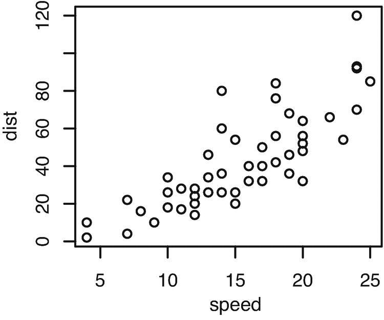
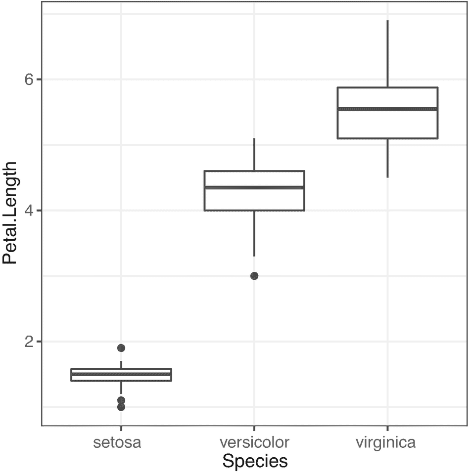
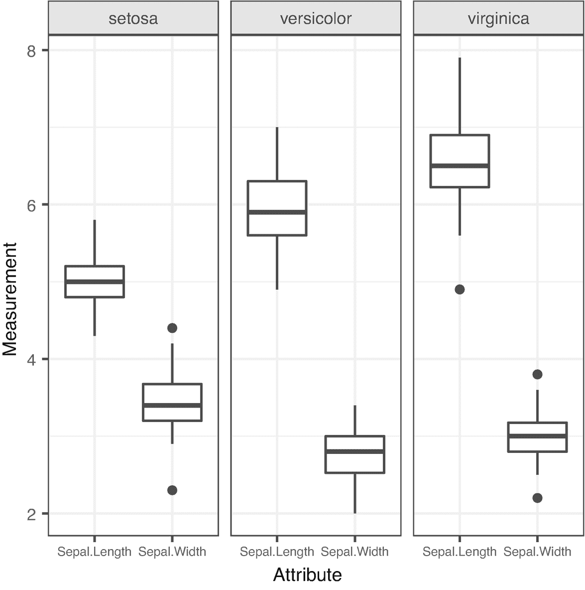

# 3. 数据操作

数据科学既关乎将模型拟合到数据，也关乎操作数据。数据很少以可以直接输入到我们想要分析的统计模型或机器学习算法中的形式出现。数据分析的初始阶段几乎总是要弄清楚如何将数据加载到 R 中，然后弄清楚如何将其转换为一种易于分析的形式。

## R 语言内置数据

R 语言中已内置了一些数据集，或包含在 R 包中可供使用。这些数据对于学习如何使用新方法非常有用——如果你已经熟悉某个数据集及其所能揭示的信息，就更容易评估新方法的表现；或者，它们也可用于对你实现的方法进行基准测试。当然，在分析新数据时，它们的帮助就有限了。

与 R 一起分发的包是`dataset`。我们可以使用`library()`函数将该包加载到 R 中，并获取其中数据集的列表以及每个数据集的简短描述，就像这样：

```
library(datasets)
library(help = "datasets")
```

要将实际数据集加载到 R 的内存中，请使用`data()`函数。这些数据集都相对较小，因此非常适合快速测试你正在编写的代码。例如，要尝试绘制 x-y 图（图 3-1），可以使用`cars`数据集，它只包含两列：速度和制动距离：

```
data(cars)
head(cars)
##  speed  dist
## 1    4     2
## 2    4    10
## 3    7     4
## 4    7    22
## 5    8    16
## 6    9    10
cars %>% plot(dist ~ speed, data = .)
```

我在这里使用了`%>%`管道操作符，因为我们需要将左侧内容传递给`plot`函数中的`data`参数。使用`|>`我们只能将左侧内容传递给右侧函数调用中的第一个参数，但使用`%>%`则可以通过`"."`将输入移至另一个参数。总的来说，我将在本章中交替使用这两个管道操作符，除非出现像前面那样其中一个更方便的情况，届时我会指出原因。

现在暂且不必担心绘图函数；我们将在下一章中回到绘图话题。

如果你正在开发新的分析或绘图代码，通常这些数据集中的一个就可以用来测试代码。

另一个包含多个有用数据集的包是`mlbench`。它包含用于机器学习基准测试的数据集，因此这些数据集旨在测试新方法在已知数据集上的表现。这个包并非与 R 一起分发，但你可以像这样安装它、加载它并获取其中数据集的列表：


*图 3-1 cars 数据集的绘图*

```
install.packages("mlbench")
library(mlbench)
library(help = "mlbench")
```

在本书中，我将在举例说明数据分析时使用这两个包之一的数据。

这些包对我举例来说很方便，如果你在为 R 开发新功能，它们也适合用于测试，但如果你对数据分析感兴趣，很可能你更关心自己的数据，而在这一点上它们当然毫无用处。你需要知道如何将自己的数据导入 R。我们稍后会讲到这一点，但首先我想谈谈如何检查数据集并快速了解其概况。

### 快速查看数据

前面我已经使用过`head()`函数。此函数显示数据框的前*n*行，其中*n*是一个选项，默认值为 6。你可以使用其他*n*值来获取更多或更少的行：

```
cars |> head(3)
##   speed dist
## 1     4    2
## 2     4   10
## 3     7    4
```

类似的函数`tail()`会显示最后*n*行：

```
cars %>% tail(3)
##    speed dist
## 48    24   93
## 49    24  120
## 50    25   85
```

要获取数据框中所有列的汇总统计信息，可以使用`summary()`函数：

```
cars %>% summary
##     speed          dist
##  Min.   : 4.0  Min.   :  2.00
##  1st Qu.:12.0  1st Qu.: 26.00
##  Median :15.0  Median : 36.00
##  Mean   :15.4  Mean   : 42.98
##  3rd Qu.:19.0  3rd Qu.: 56.00
##  Max.   :25.0  Max.   :120.00
```

对于`cars`数据集来说，这并不令人兴奋，所以让我们看看另一个内置数据集上的结果：

```
data(iris)
iris |> summary()
##   Sepal.Length   Sepal.Width    Petal.Length
##  Min.   :4.300  Min.   :2.000  Min.   :1.000
##  1st Qu.:5.100  1st Qu.:2.800  1st Qu.:1.600
##  Median :5.800  Median :3.000  Median :4.350
##  Mean   :5.843  Mean   :3.057  Mean   :3.758
##  3rd Qu.:6.400  3rd Qu.:3.300  3rd Qu.:5.100
##  Max.   :7.900  Max.   :4.400  Max.   :6.900
##   Petal.Width         Species
##  Min.   :0.100  setosa    :50
##  1st Qu.:0.300  versicolor:50
##  Median :1.300  virginica :50
##  Mean   :1.199
##  3rd Qu.:1.800
##  Max.   :2.500
```

你得到的汇总结果取决于各列的数据类型。数值数据通过其分位数进行汇总，而分类数据和布尔数据则通过每个类别或 TRUE/FALSE 值的计数进行汇总。在`iris`数据集中，有一列`Species`是分类变量，其汇总结果是每个水平的计数。

要查看每列的类型，可以使用`str()`函数。此函数给出数据类型的结构，比我们这里需要的更通用，但它确实能让你了解数据框中各列的类型，并且非常有用：

```
data(iris)
iris |> str()
## 'data.frame':    150 obs. of  5 variables:
##  $ Sepal.Length: num  5.1 4.9 4.7 4.6 5 5.4 4.6 ..
##  $ Sepal.Width : num  3.5 3 3.2 3.1 3.6 3.9 3.4 ..
##  $ Petal.Length: num  1.4 1.4 1.3 1.5 1.4 1.7 1...
##  $ Petal.Width : num  0.2 0.2 0.2 0.2 0.2 0.4 0...
##  $ Species     : Factor w/ 3 levels "setosa","v"..
```

## 读取数据

有多个软件包可用于读取不同格式的数据文件，从 Excel 到 JSON 再到 XML 等等。如果你的数据是特定格式，可以尝试用谷歌搜索如何将其读入 R。如果是标准数据格式，很可能有相应的软件包可以帮你处理。

不过，数据通常以某种文本表格的形式提供。大多数工具都可以导入和导出这些表格。R 有大量内置函数用于读取此类数据。使用

```
?read.table
```

可以获取这些函数的列表。这些函数都是`read.table()`函数的变体，只是使用了不同的默认选项。例如，`read.table()`假设数据以空格分隔的列形式给出，而`read.csv()`函数假设数据以逗号分隔值的形式表示，因此这两个函数的区别在于它们对分隔数据列的定义不同。

`read.table()`函数接受大量参数，这些参数用于调整函数以适应你正在读取的文本文件的具体细节。（其他函数接受相同的参数，只是默认值不同。）我发现我最常使用的选项如下：

- `header`：这是一个布尔值，告诉函数是否应将输入文件的第一行视为标题行。如果设置为 TRUE，它将使用第一行来设置所构建数据框的列名；如果设置为 FALSE，则第一行被解释为数据框的第一行数据。

- `col.names`：如果不使用第一行来指定标题，你可以使用此选项来命名列。你需要为其提供一个字符串向量，其中输入数据中每一列对应一个字符串。

- `dec`：这是数字中使用的小数点。我收到的电子表格中既有用“.”也有用“,”作为小数点的，所以这对我来说是一个重要参数。这个参数对你的重要性可能取决于你与多少个国家的人合作。

- `comment.char`：默认情况下，该函数假定“#”是注释的开始，并在看到它时忽略该行的其余部分。如果你的数据中实际使用了“#”，则需要更改此设置。如果注释是用其他符号表示的，情况也同样如此。

- `colClasses`：这让你可以指定每一列应具有的数据类型，因此你可以在此指定某些列应为因子型，而其他列应为字符串型。不过，你必须指定所有列，这很繁琐且有些烦人，因为 R 总体上很擅长为列确定正确的类型。无论如何，这个选项只能帮你到一定程度。你可以指定某一列应为有序因子，但无法指定其水平等。我主要用它来指定哪些列应为因子型、哪些应为字符串型，但使用它也会加快处理大数据集的速度，因为 R 无需再自行判断列类型。

对于读取数据表格，`read.table()`及其相关函数通常通过设置正确的选项就能满足需求。如果在读取数据时遇到问题，请仔细查阅文档，看看是否无法调整函数来加载数据。这并非总是可行，但通常是可行的。当确实无法做到时，我通常会放弃并在另一种语言中编写脚本，将数据格式化成我能加载到 R 中的形式。对于原始文本处理，R 并不是真正的合适工具，与其强行将分析中的所有步骤都塞进 R，我会更务实，选择最适合该任务的工具，而 R 并不总是最优选择。但在采取极端措施、改用其他语言编程之前，你应该仔细检查是否无法先调整某个`read.table()`函数。

## 读取和格式化数据集的示例

我们不再抽象地讨论数据导入，而是来看几个如何读取和格式化数据的示例。

# 乳腺癌数据集

作为从文本文件读取数据的第一个示例，我们考虑 `mlbench` 包中的 `BreastCancer` 数据集。这样我们就有东西可以比较我们的结果了。该数据集的前几行如下：

```
library(mlbench)
data(BreastCancer)
BreastCancer %>% head(3)
##        Id Cl.thickness Cell.size Cell.shape
## 1 1000025            5         1          1
## 2 1002945            5         4          4
## 3 1015425            3         1          1
##   Marg.adhesion Epith.c.size Bare.nuclei
## 1             1            2           1
## 2             5            7          10
## 3             1            2           2
##   Bl.cromatin Normal.nucleoli Mitoses  Class
## 1           3               1       1 benign
## 2           3               2       1 benign
## 3           3               1       1 benign
```

该数据可以在 `archive.ics.uci.edu/ml/datasets/Breast+Cancer+Wisconsin+(Original)` 找到，那里也有数据的描述。实际数据的 URL 是 `archive.ics.uci.edu/ml/machine-learning-databases/breast-cancer-wisconsin/breast-cancer-wisconsin.data`，但由于这个 URL 太长，无法完整放在本书的页面上，我将其保存在一个变量 `data_url` 中，稍后的代码会用到它。要自行运行代码，你只需将该变量设置为 URL：

```
data_url <- "https://..."
```

要下载数据，我们可以直接访问 URL 并保存文件。在我们的 R 代码之外明确下载数据有利有弊。这相当简单，并且我们可以在开始解析数据之前先查看一下数据；但另一方面，这为分析工作流增加了一个无法自动重现的步骤。即使我们在文档中描述了该 URL，并且该链接不会随时间变化，它仍然是工作流中的一个手动步骤——而且是一个人们可能犯错的步骤。

相反，我将直接从 URL 读取数据。当然，这也是工作流中一个有风险的步骤，因为我无法控制数据所在的服务器，也无法保证数据会一直存在且不会随时间变化。无论哪种方式都存在一定风险。我通常会将下载数据的代码添加到工作流中，但同时也会将数据存储在一个文件中。如果我将在缓存 Markdown 块中下载数据并保存到本地磁盘的代码保留下来，它只会在我需要的时候运行一次。

我可以使用 `readLines()` 函数读取数据并将其作为行向量获取。我总可以用它来扫描前一两行，看看文件是什么样子的：

```
lines <- readLines(data_url) lines[1:5]
## [1] "1000025,5,1,1,1,2,1,3,1,1,2"
## [2] "1002945,5,4,4,5,7,10,3,2,1,2"
## [3] "1015425,3,1,1,1,2,2,3,1,1,2"
## [4] "1016277,6,8,8,1,3,4,3,7,1,2"
## [5] "1017023,4,1,1,3,2,1,3,1,1,2"
```

对于这个数据，它看起来是一个没有标题行的逗号分隔值文件。所以我将数据保存为 `.csv` 后缀。R 中用于写入或读取数据的函数都不关心后缀名，但这有助于我自己记住文件的内容：

```
writeLines(lines, con = "data/raw-breast-cancer.csv")
```

为了使该函数成功运行，我首先需要创建一个 `data/` 目录。我建议你始终为所有项目创建一个 `data/` 目录，因为在处理项目时，你需要目录和文件结构清晰。

刚才写入磁盘的文件可以使用 `read.csv()` 函数读取：

```
raw_breast_cancer  head(3)
##   X1000025 X5 X1 X1.1 X1.2 X2 X1.3 X3 X1.4 X1.5
## 1  1002945  5  4    4    5  7   10  3    2    1
## 2  1015425  3  1    1    1  2    2  3    1    1
## 3  1016277  6  8    8    1  3    4  3    7    1
##   X2.1
## 1    2
## 2    2
## 3    2
```

当然，我不会将这些步骤一字不差地写进工作流程中。一旦我发现 URL 末尾的数据是 `.csv` 文件，我便会直接从该 URL 读取它：

```
raw_breast_cancer <- read.csv("https://archive.ics.uci.edu/ml/machine-learning-databases/breast-cancer-wisconsin/breast-cancer-wisconsin.data")
raw_breast_cancer |> head(3)
##   X1000025 X5 X1 X1.1 X1.2 X2 X1.3 X3 X1.4 X1.5
## 1  1002945  5  4    4    5  7   10  3    2    1
## 2  1015425  3  1    1    1  2    2  3    1    1
## 3  1016277  6  8    8    1  3    4  3    7    1
##   X2.1
## 1    2
## 2    2
## 3    2
```

好消息是这些数据看起来与 `BreastCancer` 数据集相似。坏消息是 `BreastCancer` 的第一行似乎在 `raw_breast_cancer` 中被转换成了列名。`read.csv()` 函数将第一行解释为了标题。我们可以使用 `header` 参数来修复这个问题：

```
raw_breast_cancer <- read.csv("https://archive.ics.uci.edu/ml/machine-learning-databases/breast-cancer-wisconsin/breast-cancer-wisconsin.data", header = FALSE)
raw_breast_cancer |> head(3)
##        V1 V2 V3 V4 V5 V6 V7 V8 V9 V10 V11
## 1 1000025  5  1  1  1  2  1  3  1   1   2
## 2 1002945  5  4  4  5  7 10  3  2   1   2
## 3 1015425  3  1  1  1  2  2  3  1   1   2
```

现在第一行不再被解释为标题名称了。这很好，但我们实际得到的名称对于列所包含的内容并没有提供多少信息。

如果你从网站上阅读了该数据的描述，你可以看到每一列是什么，并选择合适的名称。我这里打算偷个懒，直接从 `BreastCancer` 数据集借用名称。

我可以像这样显式地设置名称：

```
names(raw_breast_cancer) <- c("Id", "Cl.thickness", "Cell.size", "Cell.shape", "Marg.adhesion", "Epith.c.size", "Bare.nuclei", "Bl.cromatin", "Normal.nucleoli", "Mitoses", "Class")
raw_breast_cancer |> head(3)
##        Id Cl.thickness Cell.size Cell.shape
## 1 1000025            5         1          1
## 2 1002945            5         4          4
## 3 1015425            3         1          1
##   Marg.adhesion Epith.c.size Bare.nuclei
## 1             1            2           1
## 2             5            7          10
## 3             1            2           2
##   Bl.cromatin Normal.nucleoli Mitoses Class
## 1           3               1       1     2
## 2           3               2       1     2
## 3           3               1       1     2
```

或者我也可以在加载数据时设置它们：

```
raw_breast_cancer <- read.csv("https://archive.ics.uci.edu/ml/machine-learning-databases/breast-cancer-wisconsin/breast-cancer-wisconsin.data", header = FALSE, col.names = c("Id", "Cl.thickness", "Cell.size", "Cell.shape", "Marg.adhesion", "Epith.c.size", "Bare.nuclei", "Bl.cromatin", "Normal.nucleoli", "Mitoses", "Class"))
raw_breast_cancer |> head(3)
##        Id Cl.thickness Cell.size Cell.shape
## 1 1000025            5         1          1
## 2 1002945            5         4          4
## 3 1015425            3         1          1
##   Marg.adhesion Epith.c.size Bare.nuclei
## 1             1            2           1
## 2             5            7          10
## 3             1            2           2
##   Bl.cromatin Normal.nucleoli Mitoses Class
## 1           3               1       1     2
## 2           3               2       1     2
## 3           3               1       1     2
```

好的，我们取得了一些进展。`Class` 列是不对的。它将类别编码为数字（网页文档指定 2 代表良性，4 代表恶性），但在 R 语言中，使用因子（`factor`）会更合适一些。

我们可以通过先将数字翻译成字符串，再将字符串翻译成因子来实现转换。我不喜欢修改原始数据——即使我已经把它保存在文件中——所以我会先复制一份，然后再进行修改：

```
formatted_breast_cancer <- raw_breast_cancer
```

使用 `ifelse()` 将数字映射到字符串相当简单：

```
map_class <- function(class) {
    ifelse(class == 2, "benign",
    ifelse(class == 4, "malignant", NA_character_))
}
formatted_breast_cancer$Class <- formatted_breast_cancer$Class |> map_class()
mapped <- formatted_breast_cancer$Class
mapped |> table()
## mapped
##    bening malignant
##       458       241
```

我本可以用更简单的方式实现：

```
map_class <- function(class) {
    ifelse(class == 2, "benign", "malignant")
}
formatted_breast_cancer$Class <- formatted_breast_cancer$Class |> map_class()
mapped <- formatted_breast_cancer$Class
mapped |> table()
## mapped
##   bening malignant
##      458       241
```

因为 2 和 4 是数据中仅有的数字：

```
formatted_breast_cancer$Class |> unique()
## [1] 2 4
```

但假设没有意外值总是有一点风险，所以我总是倾向于将“异常值”通过将其设置为 NA 来显式处理。

嵌套的 `ifelse()` 编程起来足够简单，但如果有很多不同的可能值，它也会变得有些繁琐。另一个选择是使用一个表格（table）来映射值。为了避免我们将要实现的“表格”与用于统计向量中给定值出现次数的 `table()` 函数混淆，我将把我们创建的表格称为字典（dictionary）。字典是一个你可以查找单词的表格，这正是我们正在实现的。

为此，我们可以使用向量中的命名值。记住，我们可以使用数字和名称来索引向量。

你可以创建一个使用名称作为索引的向量。使用你想要映射的键作为索引，将你想要的结果名称作为值。我们想要将数字映射到字符串，这带来了一个小问题。如果我们用数字索引一个向量，R 会认为我们想要获取向量中的位置。如果我们制作向量 `v <- c(2 = "benign", 4 = "malignant")`——实际上我们无法这样做，这是一个语法错误，并且有充分的理由——那么 `v[2]` 应该被如何解释呢？我们是想要索引 2 处的值 `"malignant"`，还是键为 2 的值 `"benign"`？当我们将向量用作表格时，我们需要使用字符串作为键。这也意味着，在我们查找字典之前，需要将想要映射的向量中的数字转换为字符串。代码如下所示：

```
dict <- c("2" = "benign", "4" = "malignant")
map_class <- function(class) {
    dict[as.character(class)]
}
formatted_breast_cancer$Class <- formatted_breast_cancer$Class |> map_class()
mapped <- formatted_breast_cancer$Class
mapped |> table()
## mapped
##    benign malignant
##       458       241
```

这运行良好，但如果我们查看实际向量而不是汇总它，我们会发现它看起来有点奇怪：

```
mapped[1:5]
##        2        2        2        2        2
## "benign" "benign" "benign" "benign" "benign"
```

这是因为当我们以这种方式通过映射创建向量时，我们保留了值的名称。请记住，我们用来将键映射到值的字典将键作为名称；这些名称会被传递到生成的向量中。我们可以使用 `unname()` 函数去除它们：

```
library(magrittr)
mapped %<>% unname
mapped[1:5]
## [1] "benign" "benign" "benign" "benign" "benign"
```

这里，我使用了 `magrittr` 的 `%<>%` 运算符来同时进行管道操作和重命名 `mapped`；或者，我们可以使用 `mapped <- mapped %>% unname` 或 `mapped <- mapped |> unname()`。

你不需要移除这些名称，它们本身无害，但当你处理的数据带有名称时，某些数据处理操作可能会变慢。

现在我们只需要将这个字符串向量转换为一个因子，我们就得到了我们的 `Class` 列。

整个数据读取和格式化过程可以像这样完成：

```
# 下载数据并将其放入变量中
raw_breast_cancer <- read.csv(
    "https://archive.ics.uci.edu/ml/machine-learning-databases/breast-cancer-wisconsin/breast-cancer-wisconsin.data",
    header = FALSE,
    col.names = c("Id", "Cl.thickness", "Cell.size", "Cell.shape",
                  "Marg.adhesion", "Epith.c.size", "Bare.nuclei",
                  "Bl.cromatin", "Normal.nucleoli", "Mitoses", "Class")
)
# 将 Class 列简化成具有两个水平的因子
formatted_breast_cancer <- raw_breast_cancer
formatted_breast_cancer$Class <- raw_breast_cancer$Class %>%
{
    c("2" = "benign", "4" = "malignant")[as.character(.)]
} |> factor(levels = c("benign", "malignant"))
```

在最后一条语句中，我们使用了 `%>%` 运算符，这样我们就可以在花括号中放置一个表达式。在那里，传入的 `class` 就是 `.`，我们将其转换为字符，然后用来查找我们想要的名称。接着，我们通过 `factor()` 对名称进行管道操作，以得到我们想要的那个因子。这里我们可以使用 `%>%` 或 `|>`。当我们将结果放回 `formatted_breast_cancer` 时，我们不需要使用 `unname()` 移除名称，所以我们就不费这个事了。

在 `factor()` 调用中指定水平并非绝对必要，但我总是喜欢显式地这样做。如果 `factor()` 的输入中有意外的字符串，它最终会成为水平之一，而我可能要到很晚才会发现。显式指定水平可以缓解这个问题。

现在，你不想一直花时间解析输入数据文件，所以我建议将你编写的所有用于读取数据并将其转换为你想要形式的代码，放在一个 R Markup 文档的缓存代码块中。这样，只有在更改代码时，你才会重新评估它。

你也可以使用 `save()` 函数显式地保存数据：

```r
formatted_breast_cancer %>%
save(file = "data/formatted-breast-cancer.rda")
```

这里，我为数据使用了后缀 `".rda"`。它代表 R 数据，你的计算机可能会识别它。如果你点击一个带有此后缀的文件，它将在 RStudio（或你用来处理 R 的任何工具）中打开。保存和加载数据的实际 R 函数并不关心你使用什么后缀，但如果你坚持使用固定后缀，则更容易识别文件类型。

数据会连同数据框的名称一起保存，因此当你使用 `load()` 函数再次加载它时，无需将加载的数据赋值给变量。它将加载到你保存数据时使用的名称：

```r
load("data/formatted-breast-cancer.rda")
```

这既有好处也有坏处。我可能更倾向于控制数据被赋予哪个名称，以便在代码中显式控制变量，但 `save()` 和 `load()` 函数被设计为可保存多个变量，因此这就是它们的工作方式。

我个人不常使用这些函数。我更喜欢在 Markdown 文档中编写分析流程，而那里只需缓存导入代码即可。

### 波士顿房价数据集

对于加载数据的第二个示例，我们从 `mlbench` 包中选取另一个数据集，即 `BostonHousing` 数据，它包含关于犯罪率的信息以及一些可用于预测犯罪率的解释变量：

```r
library(mlbench)
data(BostonHousing)
str(BostonHousing)
## 'data.frame':    506 obs. of  14 variables:
##  $ crim   : num  0.00632 0.02731 0.02729 0.03237..
##  $ zn     : num  18 0 0 0 0 0 12.5 12.5 ...
##  $ indus  : num  2.31 7.07 7.07 2.18 2.18 2.18 7..
##  $ chas   : Factor w/ 2 levels "0","1": 1 1 1 1 ..
##  $ nox    : num  0.538 0.469 0.469 0.458 0.458 0..
##  $ rm     : num  6.58 6.42 7.18 7 ...
##  $ age    : num  65.2 78.9 61.1 45.8 54.2 58.7 6..
##  $ dis    : num  4.09 4.97 4.97 6.06 ...
##  $ rad    : num  1 2 2 3 3 3 5 5 ...
##  $ tax    : num  296 242 242 222 222 222 311 311..
##  $ ptratio: num  15.3 17.8 17.8 18.7 18.7 18.7 1..
##  $ b      : num  397 397 393 395 ...
##  $ lstat  : num  4.98 9.14 4.03 2.94 ...
##  $ medv   : num  24 21.6 34.7 33.4 36.2 28.7 22...
```

和之前一样，实际数据的链接很长，所以我将提供一个短网址 [`http://tinyurl.com/zq2u8vx`](http://tinyurl.com/zq2u8vx)，并且我已经将原始 URL 保存在变量 `data_url` 中。

我已经查看了 URL 末尾的文件，发现它由空白分隔的数据列组成，因此加载它所需的函数是 `read.table()`：

```r
boston_housing <- read.table(data_url)
str(boston_housing)
## 'data.frame':   506 obs. of  14 variables:
##  $ V1 : num  0.00632 0.02731 0.02729 0.03237 ...
##  $ V2 : num  18 0 0 0 0 0 12.5 12.5 ...
##  $ V3 : num  2.31 7.07 7.07 2.18 2.18 2.18 7.87 ..
##  $ V4 : int  0 0 0 0 0 0 0 0 ...
##  $ V5 : num  0.538 0.469 0.469 0.458 0.458 0.458..
##  $ V6 : num  6.58 6.42 7.18 7 ...
##  $ V7 : num  65.2 78.9 61.1 45.8 54.2 58.7 66.6 ..
##  $ V8 : num  4.09 4.97 4.97 6.06 ...
##  $ V9 : int  1 2 2 3 3 3 5 5 ...
##  $ V10: num  296 242 242 222 222 222 311 311 ...
##  $ V11: num  15.3 17.8 17.8 18.7 18.7 18.7 15.2 ..
##  $ V12: num  397 397 393 395 ...
##  $ V13: num  4.98 9.14 4.03 2.94 ...
##  $ V14: num  24 21.6 34.7 33.4 36.2 28.7 22.9 27..
```

如果我们比较已加载的数据和来自 `mlbench` 的数据

```r
str(BostonHousing)
## 'data.frame':    506 obs. of  14 variables:
##  $ crim   : num  0.00632 0.02731 0.02729 0.03237..
##  $ zn     : num  18 0 0 0 0 0 12.5 12.5 ...
##  $ indus  : num  2.31 7.07 7.07 2.18 2.18 2.18 7..
##  $ chas   : Factor w/ 2 levels "0","1": 1 1 1 1 ..
##  $ nox    : num  0.538 0.469 0.469 0.458 0.458 0..
##  $ rm     : num  6.58 6.42 7.18 7 ...
##  $ age    : num  65.2 78.9 61.1 45.8 54.2 58.7 6..
##  $ dis    : num  4.09 4.97 4.97 6.06 ...
##  $ rad    : num  1 2 2 3 3 3 5 5 ...
##  $ tax    : num  296 242 242 222 222 222 311 311..
##  $ ptratio: num  15.3 17.8 17.8 18.7 18.7 18.7 1..
##  $ b      : num  397 397 393 395 ...
##  $ lstat  : num  4.98 9.14 4.03 2.94 ...
##  $ medv   : num  24 21.6 34.7 33.4 36.2 28.7 22...
```

我们看到导入的数据中有整数和数值型数据，但 `chas` 变量应该是因子类型，而其余变量应为数值型。我们可以使用 `read.table()` 的 `colClasses` 参数来解决这个问题。只需为这些类别创建一个字符串向量，除了 `"chas"` 列应为 `"factor"` 之外，其他所有列都设为 `"numeric"`：

```r
col_classes <- rep("numeric", length(BostonHousing))
col_classes[which("chas" == names(BostonHousing))] <- "factor"
```

我们还应该命名这些列，但同样可以偷懒，从 `BostonHousing` 中获取名称：

```r
boston_housing <- read.table(data_url,
col.names = names(BostonHousing),
colClasses = col_classes)
str(boston_housing)
## 'data.frame':    506 obs. of  14 variables:
##  $ crim   : num  0.00632 0.02731 0.02729 0.03237..
##  $ zn     : num  18 0 0 0 0 0 12.5 12.5 ...
##  $ indus  : num  2.31 7.07 7.07 2.18 2.18 2.18 7..
##  $ chas   : Factor w/ 2 levels "0","1": 1 1 1 1 ..
##  $ nox    : num  0.538 0.469 0.469 0.458 0.458 0..
##  $ rm     : num  6.58 6.42 7.18 7 ...
##  $ age    : num  65.2 78.9 61.1 45.8 54.2 58.7 6..
##  $ dis    : num  4.09 4.97 4.97 6.06 ...
##  $ rad    : num  1 2 2 3 3 3 5 5 ...
##  $ tax    : num  296 242 242 222 222 222 311 311..
##  $ ptratio: num  15.3 17.8 17.8 18.7 18.7 18.7 1..
##  $ b      : num  397 397 393 395 ...
##  $ lstat  : num  4.98 9.14 4.03 2.94 ...
##  $ medv   : num  24 21.6 34.7 33.4 36.2 28.7 22...
```

`"chas"` 因子中的水平是 `"0"` 和 `"1"`。这些水平并不太理想，因为它们很容易与数字混淆——它们打印出来会像数字——但它们并不是数字。因子中的数值实际上对应的是 `"0"` 为 1，`"1"` 为 2，所以这可能会令人困惑。但这与 `mlbench` 数据框的水平相同，因此我也就保持原样。

### `readr` 包

通常情况下，`read.table()` 类的函数足以满足你导入数据的需求。我几乎在所有工作中都使用这些函数。但有一个专门用于数据导入的包，它既致力于加快导入速度，又力求使数据导入方式更加一致，因此我认为有必要提一下它。

这个包就是 `readr` 包：

```r
library(readr)
```

它实现了与内置函数相同类型的导入函数。不同之处在于，函数名中使用下划线代替了点号。因此，在你使用 `read.table()` 的地方，`readr` 包提供了 `read_table()`。同样地，它提供了 `read_csv()` 作为 `read.csv()` 的替代品。

`readr` 包在数据读取方式上有不同的默认设置。除此之外，它主要因其比内置 R 函数更快的速度而备受赞誉。如果你将数据导入代码放在一个缓存的代码块中，这应该不会太困扰你；并且，如果数据加载确实是个问题，你需要阅读第 5 章。`readr` 包中的函数返回的不是数据框，而是我们之前简要讨论过的 tibble 数据结构。在大多数情况下，这并无差别，因此我们仍然可以以相同的方式处理加载的数据。

让我们来看看如何使用该包中的函数导入数据。我们回到之前导入的乳腺癌数据。我们下载了乳腺癌数据并将其放入一个名为 `"data/raw-breast-cancer.csv"` 的文件中，因此我们可以尝试从该文件中读取数据。显然，由于它是一个 CSV 文件，我们将使用 `read_csv()` 函数：

```r
raw_breast_cancer <- read_csv("data/raw-breast-cancer.csv", show_col_types = FALSE)
## Warning: One or more parsing issues, call `problems()` on the data frame.
## In addition, there were 11 columns with duplicated names:
## • `1` -> `1...3`
## • `1` -> `1...4`
## • `1` -> `1...5`
## • `2` -> `2...6`
## • `1` -> `1...7`
## • `1` -> `1...9`
## • `1` -> `1...10`
## • `2` -> `2...11`
raw_breast_cancer %>% head(3)
## # A tibble: 3 × 11
##  `1000025`  `5` `1...3` `1...4` `1...5` `2...6`
##                  
## 1  1002945     5      4       4       5       7
## 2  1015425     3      1       1       1       2
## 3  1016277     6      8       8       1       3
## # ... with 5 more variables: `1...7` ,
## #   `3` , `1...9` , `1...10` ,
## #   `2...11` 
```

`show_col_types = FALSE` 选项只是表示我们不想查看推断出的列类型；它移除了我们在此不感兴趣的多行输出。如果你想查看该函数打印的内容，可以自己尝试一下。

该函数的工作方式与 `read.csv()` 函数类似，并将第一行解释为列名。我们收到的警告以及奇怪的列名，正是因为这个原因。这不是我们想要的，但该函数没有提供选项来告诉它第一行不是列名。相反，我们可以告知它列名是什么，然后它就会将第一行作为实际数据读取：

```r
raw_breast_cancer <- read_csv("data/raw-breast-cancer.csv", 
                              col_names = c("Id", "Cl.thickness", "Cell.size", 
                                            "Cell.shape", "Marg.adhesion", 
                                            "Epith.c.size", "Bare.nuclei", 
                                            "Bl.cromatin", "Normal.nucleoli", 
                                            "Mitoses", "Class"),
                              skip = 1,
                              show_col_types = FALSE)
raw_breast_cancer %>% head(3)
## # A tibble: 3 × 11
##        Id Cl.thickness Cell.size Cell.shape
##                        
## 1 1000025            5         1          1
## 2 1002945            5         4          4
## 3 1015425            3         1          1
## # ... with 7 more variables: Marg.adhesion ,
## #  Epith.c.size , Bare.nuclei ,
## #  Bl.cromatin , Normal.nucleoli ,
## #  Mitoses , Class 
```

使用哪个函数来导入数据并不重要。你可以使用内置函数，也可以使用 `readr` 函数。这完全取决于你。

## 使用 `dplyr` 操作数据

数据框非常适合表示这样的数据：其中每一行都是你想要拟合到模型中的不同参数的观测值。在 R 中，几乎所有实现统计模型或机器学习算法的包都基于数据框工作。但要实际操作一个数据框，你通常需要编写大量代码来筛选数据、重新排列数据、以各种方式汇总数据等。几年前，操作数据框所需的编程工作甚至比实际分析数据还要多。随着 `dplyr` 包（发音为“d plier”，其中“plier”发音类似于“pliers”）的出现，这种情况得到了极大改善。

这个包提供了许多便捷函数，允许你以各种方式修改数据框，并使用 `%>%` 或 `|>` 运算符将它们通过管道串联起来。如果你导入 `dplyr`，你将获得大量函数，这些函数允许你使用管道构建用于数据框操作的流水线。

之前，我们通过直接赋值来操作数据列从而格式化数据，就像我们使用 `formatted_breast_cancer$Class <- formatted_breast_cancer$Class %>% ...` 语句那样。这种方法本身并没有错，但它打破了使用管道将数据通过一系列转换传递的理念，因为我们需要不时地将结果赋值给旧列或新列。使用 `dplyr`，你可以在整体上操作数据框，同时仍然可以随意地修改、添加或删除列。

我们在乳腺癌数据集上所做的转换，同样可以使用 `dplyr` 来完成，直接从原始数据集到格式化数据，而无需先创建用于格式化数据的数据框再更新它。你可以这样做：

```r
library(dplyr)
### 下载数据并将其存入一个变量
raw_breast_cancer <- read_csv("data/raw-breast-cancer.csv", 
                              col_names = c("Id", "Cl.thickness", "Cell.size", 
                                            "Cell.shape", "Marg.adhesion", 
                                            "Epith.c.size", "Bare.nuclei", 
                                            "Bl.cromatin", "Normal.nucleoli", 
                                            "Mitoses", "Class"),
                              skip = 1,
                              show_col_types = FALSE)

### 转换数据
formatted_breast_cancer <- raw_breast_cancer |>
  mutate(
    Class =
      case_when(Class == 2 ~ "benign", Class == 4 ~ "malignant") |>
        factor(levels = c("benign", "malignant"))
  )
```

我们仍然通过下载获取原始数据，别无他法，但随后我们将这些原始数据通过一个名为 `mutate` 的函数进行管道传递：`raw_breast_cancer |> mutate(...)` 来更改数据框。`mutate()` 函数（后文详述）可以修改数据框中的列，在上述表达式中，正是如此。通过 `raw_breast_cancer |> mutate(Class = ...)`，我们表示要将 `Class` 列更改为 `mutate` 内 `=` 右侧的内容。你可以在同一个 `mutate` 中修改多个列，但这里我们只更改了一个列。`=` 的右侧部分有些复杂，因为我们正在完成之前所做的所有工作：将 2 和 4 转换为字符串 `"benign"` 和 `"malignant"`，然后据此创建一个因子。不过，如果我们将操作分成两部分，这并没有那么糟糕。首先，我们使用一个称为 `case_when` 的 `dplyr` 函数。它有点像 `ifelse`，但更通用。它的输入是一系列所谓的公式——形式为 `lhs ~ rhs` 的表达式——其中左侧（lhs）应是一个布尔表达式，右侧（rhs）是当左侧为 `TRUE` 时你想要的值。这里表达式很简单：我们测试 `Class` 是 2 还是 4，并相应地返回 `"benign"` 或 `"malignant"`。这将 2/4 编码映射为字符串，然后我们通过管道将其传递给 `factor` 以生成一个因子。结果被写入 `Class` 列。请注意，我们可以仅使用列名直接引用列中的值，这里的 `Class` 正是如此。在前面的小节中，当我们处理数据框的 `Class` 列时，无法做到这一点，我们当时必须写成 `raw_breast_cancer$Class` 才能获取它。`dplyr` 中的函数施展了一些魔法，使你能够将数据框的列视为变量，这使得你需要编写的表达式更易于管理。

#### 一些有用的 `dplyr` 函数

我无法在本章中详尽介绍 `dplyr` 的所有功能。无论如何，它的更新频率很高，当你读到这段文字时，其功能很可能已比我撰写时更为丰富。因此，你需要自行查阅该包的文档。

下面这些只是我经常使用的函数。它们的第一个参数都是数据框或类似结构，因此能完美地与管道（pipe）配合使用。我所说的“数据框类似结构”指的是任何能像数据框一样工作的对象。很多时候，存在比基础内置数据结构更好的数据框表示形式。对于大型数据集，使用不同于基础数据框的表示形式通常更佳，这一点我们将在第 5 章中再次讨论。一些替代数据结构之所以更好，是因为它们能处理磁盘上的数据（R 的数据框必须加载到内存中），或者在某些操作上速度更快。又或者，它们的打印效果更好。如果你在 R 终端输入数据框的名称，它会打印出全部数据。而其他表示形式会自动只显示数据的前几行。

`dplyr` 包有几种数据表示形式。前几章中多次提到的 tibbles（tibble 是一种数据框的增强版）是我个人偏爱的一种，我使用它仅仅是因为我更喜欢打印这种表格时的输出效果。你可以使用 `as_tibble` 函数将基础数据框转换为 tibble：

```r
iris %>% as_tibble()
## # A tibble: 150 × 5
##    Sepal.Length Sepal.Width Petal.Length
##                          
##  1          5.1         3.5          1.4
##  2          4.9         3            1.4
##  3          4.7         3.2          1.3
##  4          4.6         3.1          1.5
##  5          5           3.6          1.4
##  6          5.4         3.9          1.7
##  7          4.6         3.4          1.4
##  8          5           3.4          1.5
##  9          4.4         2.9          1.4
## 10          4.9         3.1          1.5
## # ... with 140 more rows, and 2 more variables:
## #   Petal.Width , Species 
```

它只打印前十行，并且不会打印所有列。这样的输出比打印整个数据框更容易阅读。

好了，现在让我们来介绍 `dplyr` 函数。

# `dplyr` 数据操作函数详解

本文档介绍了 `dplyr` 包中几个核心数据操作函数的用法。

## `select` — 选取指定列，并丢弃其余列

`select()` 函数用于选取数据框的列。它相当于对数据中的列进行索引。

你可以用它来挑选单列：

```r
iris %>% as_tibble() %>% select(Petal.Width) %>% head(3)
## # A tibble: 3 × 1
##   Petal.Width
##         
## 1         0.2
## 2         0.2
## 3         0.2
```

或者多列：

```r
iris %>% as_tibble() %>%
select(Sepal.Width, Petal.Length) %>% head(3)
## # A tibble: 3 × 2
##   Sepal.Width Petal.Length
##                 
## 1         3.5          1.4
## 2         3            1.4
## 3         3.2          1.3
```

你甚至可以通过列的范围来选取：

```r
iris %>% as_tibble() %>%
select(Sepal.Length:Petal.Length) %>% head(3)
## # A tibble: 3 × 3
##   Sepal.Length Sepal.Width Petal.Length
##                         
## 1          5.1         3.5          1.4
## 2          4.9         3            1.4
## 3          4.7         3.2          1.3
```

但这种方式的效果取决于数据框中列的顺序，我觉得这并没有那么实用。

在这些管道操作中，我将 `iris` 数据通过 `as_tibble()` 转换，是因为我更喜欢它的格式。你使用 `dplyr` 函数并不必须这么做，但如果不做转换，你就是在基础数据框而非 tibble 上操作，R 会以略微不同的方式打印你的数据。

真正的实用性来自于对列名的模式匹配。有几种基于列名选取列的方法：

```r
iris |> as_tibble() |> select(starts_with("Petal")) |> head(3)
## # A tibble: 3 × 2
##   Petal.Length Petal.Width
##                 
## 1          1.4         0.2
## 2          1.4         0.2
## 3          1.3         0.2

iris |> as_tibble() |> select(ends_with("Width")) |> head(3)
## # A tibble: 3 × 2
##   Sepal.Width Petal.Width
##                
## 1         3.5         0.2
## 2         3           0.2
## 3         3.2         0.2

iris |> as_tibble() |> select(contains("etal")) |> head(3)
## # A tibble: 3 × 2
##   Petal.Length Petal.Width
##                 
## 1          1.4         0.2
## 2          1.4         0.2
## 3          1.3         0.2

iris |> as_tibble() |> select(matches(".t.")) |> head(3)
## # A tibble: 3 × 4
##   Sepal.Length Sepal.Width Petal.Length
##                         
## 1          5.1         3.5          1.4
## 2          4.9         3            1.4
## 3          4.7         3.2          1.3
## # ... with 1 more variable: Petal.Width
```

`matches` 函数用于搜索正则表达式，在此例中，它会选取任何包含字母"t"（但不能是首字母或尾字母）的名称。

查看 `dplyr` 的文档以了解你还能用哪些选项来选择列。

你也可以使用 `select()` 来移除列。前面的示例是选取你想要包含的列，但如果你在选择条件前加上“`-`”，那么你将移除而非包含你所指定的列：

```r
iris %>% as_tibble() %>%
select(-starts_with("Petal")) %>% head(3)
## # A tibble: 3 × 3
##   Sepal.Length Sepal.Width Species
##                  
## 1          5.1         3.5 setosa
## 2          4.9         3   setosa
## 3          4.7         3.2 setosa
```

## `mutate` — 向数据框添加计算值

`mutate()` 函数允许你通过指定一个用于计算新列值的表达式，来向数据框添加一列：

```r
iris %>% as_tibble() %>%
mutate(Petal.Width.plus.Length = Petal.Width + Petal.Length) %>%
select(Species, Petal.Width.plus.Length) %>%
head(3)
## # A tibble: 3 × 2
##   Species Petal.Width.plus.Length
##                        
## 1 setosa                      1.6
## 2 setosa                      1.6
## 3 setosa                      1.5
```

你可以在 `mutate()` 函数中指定多个列，从而一次添加多列：

```r
iris %>% as_tibble() %>%
mutate(Petal.Width.plus.Length = Petal.Width + Petal.Length,
Sepal.Width.plus.Length = Sepal.Width + Sepal.Length) %>%
select(Petal.Width.plus.Length, Sepal.Width.plus.Length) %>%
head(3)
## # A tibble: 3 × 2
##   Petal.Width.plus.Length Sepal.Width.plus.Length
##                                        
## 1                     1.6                     8.6
## 2                     1.6                     7.9
## 3                     1.5                     7.9
```

当然，你也可以在管道中多次调用 `mutate()`。

## `transmute` — 向数据框添加计算值并丢弃所有其他列

`transmute()` 函数的工作方式与 `mutate()` 类似，区别在于它结合了 `select()` 的功能，因此结果是只包含你创建的新列的数据框：

```r
iris %>% as_tibble() %>%
transmute(Petal.Width.plus.Length = Petal.Width + Petal.Length) %>%
head(3)
## # A tibble: 3 × 1
##   Petal.Width.plus.Length
##                     
## 1                     1.6
## 2                     1.6
## 3                     1.5
```

## `arrange` — 通过排序列来重新排列数据框

`arrange()` 函数通过根据你指定的列进行排序，来重新排列数据框的行：

```r
iris %>% as_tibble() %>%
arrange(Sepal.Length) %>%
head(3)
## # A tibble: 3 × 5
##   Sepal.Length Sepal.Width Petal.Length
##                         
## 1          4.3         3            1.1
## 2          4.4         2.9          1.4
## 3          4.4         3            1.3
## # ... with 2 more variables: Petal.Width ,
## #   Species
```

默认情况下，它按数值递增顺序排序，但你可以使用 `desc()` 函数要求按递减顺序排序：

```r
iris %>% as_tibble() %>%
arrange(desc(Sepal.Length)) %>%
head(3)
## # A tibble: 3 × 5
##   Sepal.Length Sepal.Width Petal.Length
##                         
## 1          7.9         3.8          6.4
## 2          7.7         3.8          6.7
## 3          7.7         2.6          6.9
## # ... with 2 more variables: Petal.Width ,
## #   Species
```

## `filter` — 挑选选定的行，并移除其余行

`filter()` 函数让你能够基于逻辑表达式挑选出行。你需要为该函数提供一个谓词，指定一行应满足什么条件才能被包含进来：

```r
iris %>% as_tibble() %>%
filter(Sepal.Length > 5) %>%
head(3)
## # A tibble: 3 × 5
##   Sepal.Length Sepal.Width Petal.Length
##                         
## 1          5.1         3.5          1.4
## 2          5.4         3.9          1.7
## 3          5.4         3.7          1.5
## # ... with 2 more variables: Petal.Width ,
## #   Species
```

你可以在这里随意发挥创造力，使用逻辑表达式：

```r
iris %>% as_tibble() %>%
filter(Sepal.Length > 5 & Species == "virginica") %>%
select(Species, Sepal.Length) %>%
head(3)
## # A tibble: 3 × 2
##   Species      Sepal.Length
##                  
##      1      virginica   6.3
##      2      virginica   5.8
##      3      virginica   7.1
```

## `group_by` — 根据某些列的值将数据拆分为子表

`group_by()` 函数告诉 `dplyr`，你希望基于分割成不同子集的数据进行操作。

它本身并不是那么有用。它只是告诉 `dplyr`，在后续计算中，应该将数据的不同子集视为独立的数据集。它通常与 `summarise()` 函数配合使用，用于计算汇总统计量。

你可以按一个或多个变量进行分组；只需将要分组的列作为单独参数传递给函数。按因子或离散数值进行分组时效果最佳；按实数分组则没什么意思：

```r
iris %>% as_tibble() %>% group_by(Species) %>% head(3)
## # A tibble: 3 × 5
## # Groups:   Species [1]
##   Sepal.Length Sepal.Width Petal.Length
##                         
## 1          5.1         3.5          1.4
## 2          4.9         3            1.4
## 3          4.7         3.2          1.3
## # ... with 2 more variables: Petal.Width ,
## #   Species
```

这里没有太多变化。你已经重构了数据框，使其存在分组，但在对新数据执行操作之前，没什么值得观察的。`group_by()` 的强大之处在于与 `summarise()` 函数的结合使用。

### `summarise`/`summarize`——计算汇总统计量。

该函数的拼写取决于你身处大西洋的哪一侧。无论拼写如何，它都是同一个函数。

`summarise()` 函数用于从数据框中计算汇总统计量。它允许你通过表达要汇总的内容来计算不同的统计量。例如，你可以要求计算值的平均值：

```
iris %>%
summarise(Mean.Petal.Length = mean(Petal.Length),
Mean.Sepal.Length = mean(Sepal.Length))
##   Mean.Petal.Length Mean.Sepal.Length
## 1             3.758          5.843333
```

它真正强大的地方在于与 `group_by()` 的结合使用。在那里，你可以将数据拆分为不同组，并为每组计算汇总结果：

```
iris %>%
group_by(Species) %>%
summarise(Mean.Petal.Length = mean(Petal.Length))
## # A tibble: 3 × 2
##   Species    Mean.Petal.Length
##                     
## 1 setosa                  1.46
## 2 versicolor              4.26
## 3 virginica               5.55
```

根据你使用的 `dplyr` 版本，你可能会收到一个警告，提示 `summarise` 正在“取消分组”输出。这与我们在将数据框传递给 `summarise` 时它所具有的分组，以及输出所具有的分组有关。在 `dplyr` 1.0.0 之前，只有一个选项，你当然无法更改，但现在有四个选项和一个默认行为，这可能不是你想要的（但很可能至少是为了使该函数与旧代码向后兼容）。如果你收到警告，那是因为你安装了具有新行为的 `dplyr` 版本，但这个版本仍然足够旧，会警告你正在使用默认行为。然后它会告诉你可以使用 `.groups` 参数来更改此行为。

我们可以获得的四种行为是：

* `.groups = "drop_last"` 移除我们引入的最后一个分组。如果我们基于某个分组进行汇总，最终会得到一个每行对应一个分组的表格，并且不再需要保留该组的信息。这是旧的默认行为。

* `.groups = "drop"` 移除所有分组，因此如果我们多次调用 `group_by`，我们会失去所有分组；使用 `drop_last`，我们只会失去最后一个分组。

* `.groups = "keep"` 保持所有分组完全不变。

* `.groups = "rowwise"` 使输出中的每一行成为其自己的分组。

你可以使用 `group_vars()` 检查数据框中的哪些列是分组的一部分，以便查看 `summarise()` 的输出对于这四个选项分别具有哪些分组。首先，我们为 `iris` 数据创建一个分组并检查分组变量：

```
grouped_iris <- iris %>%
as_tibble() %>%
group_by(Species, Petal.Length)
grouped_iris %>% group_vars()
## [1] "Species"      "Petal.Length"
```

使用 `drop_last`，第二个分组变量 `Petal.Length` 被移除，但第一个不会被移除；我们只移除最后一个变量：

```
grouped_iris %>%
summarise(Mean.Petal.Length = mean(Petal.Length),
.groups = "drop_last") %>%
group_vars()
## [1] "Species"
```

如果我们改用 `drop`，则所有分组变量都会被移除，`group_vars()` 会返回 `character(0)`，即空字符串向量：

```
grouped_iris %>%
summarise(Mean.Petal.Length = mean(Petal.Length),
.groups = "drop") %>%
group_vars()
## character(0)
```

如果我们使用 `keep`，则所有分组变量都不会被移除：

```
grouped_iris %>%
summarise(Mean.Petal.Length = mean(Petal.Length),
.groups = "keep") %>%
group_vars()
## [1] "Species"      "Petal.Length"
```

乍一看，`rowwise` 选项看起来很像 `keep`：

```
grouped_iris %>%
summarise(Mean.Petal.Length = mean(Petal.Length),
.groups = "rowwise") %>%
group_vars()
## [1] "Species"      "Petal.Length"
```

然而，这并不是一回事。如果我们使用 `rowwise` 进行汇总，我们会得到一种不同的数据结构，即所谓的 `rowwise_df`（逐行数据框），如果我们查询结果的“类”，可以看到这一点：

```
grouped_iris %>%
summarise(Mean.Petal.Length = mean(Petal.Length),
.groups = "rowwise") %>%
class()
## [1] "rowwise_df" "tbl_df"     "tbl"
## [4] "data.frame"
```

类是一个类型列表，我们将在本书的后半部分了解其工作原理。这种逐行数据类型的用途是进行不同类型的操作，即对数据框的行进行操作。这些内容超出了本书的范围，我就此打住。

对于 `summarise()` 函数，`.groups` 选项仅在执行多个汇总时才重要。在大多数使用场景中，你不会这样做。你操作数据，然后计算一些汇总统计量，这就是最终结果。在这种情况下，保留或丢弃任何分组变量都无关紧要。如果你不关心汇总结果中的分组，可以使用选项 `dplyr.summarise.inform = FALSE` 关闭警告：

```
options(dplyr.summarise.inform = FALSE)
iris %>%
summarise(Mean.Petal.Length = mean(Petal.Length))
```

在这里，即使你没有使用 `.groups`，也不应收到警告。

如果你再次打开该选项，你应该会收到以下警告：

```
options(dplyr.summarise.inform = TRUE)
```

虽然你通常不会在意，但指定 `.groups` 会更安全。至少你需要考虑是否希望结果中包含分组，如果希望，则还需考虑得到的分组是否正确。

这里值得提及一个汇总函数 `n()`，它用于统计数据子集中的观测数量：

```
iris %>%
summarise(Observations = n())
##  Observations
## 1         150
```

同样，当与 `group_by()` 结合使用时，它更有意义：

```
iris %>%
group_by(Species) %>%
summarise(Number.Of.Species = n(), .groups = "drop")
## # A tibble: 3 × 2
##   Species  Number.Of.Species
##                   
## 1 setosa                  50
## 2 versicolor              50
## 3 virginica               50
```

你可以在 `summarise()` 函数中指定多个统计量，从而轻松组合汇总统计结果：

```
iris %>%
group_by(Species) %>%
summarise(Number.Of.Samples = n(),
Mean.Petal.Length = mean(Petal.Length),
.groups = "drop")
## # A tibble: 3 × 3
##   Species  Number.Of.Samples Mean.Petal.Length
##                                
## 1 setosa                  50              1.46
## 2 versicolor              50              4.26
## 3 virginica               50              5.55
```

## 乳腺癌数据处理

为了更深入地了解 `dplyr` 包如何帮助我们探索数据，我们来看看它的实际应用。

让我们回到乳腺癌数据。我们从之前用于转换从 CSV 文件导入的原始数据（存储在变量 `raw_breast_cancer` 中）的修改开始。使用 `dplyr` 函数，我们可以像之前看到的那样创建 `formatted_breast_cancer` 数据，如下所示：

```
formatted_breast_cancer <- raw_breast_cancer |>
as_tibble() |>
mutate(
Class =
case_when(Class == 2 ~ "benign", Class == 4 ~ "malignant") |>
factor(levels = c("benign", "malignant"))
)
```

这次我首先通过管道将原始数据传递给 `as_tibble()`，因为我更喜欢使用 `tibble`。除此之外，代码与之前相同。

我们可以使用 `select()` 和 `head()` 来检查数据是否如预期那样：

```
formatted_breast_cancer |> select(Normal.nucleoli:Class) |> head(5)
## # A tibble: 5 × 3
##   Normal.nucleoli Mitoses Class
##                 
## 1               1       1 benign
## 2               2       1 benign
## 3               1       1 benign
## 4               7       1 benign
## 5               1       1 benign
```

现在让我们稍微看看实际数据。这是为了探索目的而对数据进行的非常粗略的分析。这不是一个规范的分析，但我们将在后面的第 6 章中回到这个话题。

我们可能对不同参数如何影响响应变量 `Class` 感兴趣。例如，良性肿瘤和恶性肿瘤的细胞厚度是否不同？为了检查这一点，我们可以按 `Class` 参数对数据进行分组，并查看平均细胞厚度：

```
formatted_breast_cancer %>%
group_by(Class) %>%
summarise(mean.thickness = mean(Cl.thickness), .groups = "drop")
## # A tibble: 2 × 2
##   Class     mean.thickness
##                 
## 1 benign              2.96
## 2 malignant           7.20
```

看起来存在差异。至于这种差异是否显著，还需要进行适当的检验——毕竟我们这里只是比较均值，方差可能很大。但仅仅通过探索数据，这给我们提供了一个线索，表明这里可能有一些值得研究的东西。

我们可以对其他变量提出同样的问题，比如细胞大小：

```
formatted_breast_cancer %>%
group_by(Class) %>%
summarise(mean.size = mean(Cell.size), .groups = "drop")
## # A tibble: 2 × 2
##   Class     mean.size
##            
## 1 benign         1.33
## 2 malignant      6.57
```

另一种查看方式可能是，针对每种细胞大小，统计我们观察到的良性肿瘤和恶性肿瘤的数量。在这里，我们需要同时按细胞大小和类别进行分组，然后计数，并且我们可能希望排列数据，以便按细胞大小递增或递减的顺序获取信息：

```
formatted_breast_cancer %>%
arrange(Cell.size) %>%
group_by(Cell.size, Class) %>%
summarise(ClassCount = n(), .groups = "drop")
## # A tibble: 18 × 3
##    Cell.size Class   ClassCount
##                 
## 1          1 benign         380
## 2          1 malignant        4
## 3          2 benign          37
## 4          2 malignant        8
## 5          3 benign          27
## 6          3 malignant       25
## 7          4 benign           9
## 8          4 malignant       31
## 9          5 malignant       30
## 10         6 benign           2
## 11         6 malignant       25
## 12         7 benign           1
## 13         7 malignant       18
## 14         8 benign           1
## 15         8 malignant       28
## 16         9 benign           1
## 17         9 malignant        5
## 18        10 malignant       67
```

这里我们再次得到了一些有用的信息。看起来，当细胞大小较小时，良性肿瘤比恶性肿瘤多；当细胞大小较大时，恶性肿瘤比良性肿瘤多。这也是我们以后构建统计模型时可以着手的基础。

这种分组方式之所以有效，是因为细胞大小是以离散数值来衡量的。按浮点数分组则没有意义，此时绘图会更实用。但对于该数据，细胞大小是整数，因此我们可以通过构建表格来探索数据。

我们还可以尝试查看组合参数。我们已经看到，细胞大小和细胞厚度似乎都与肿瘤的良性或恶性程度有关，因此让我们尝试观察细胞厚度如何随类别和细胞大小而变化：

```
formatted_breast_cancer %>%
group_by(Class, as.factor(Cell.size)) %>%
summarise(mean.thickness = mean(Cl.thickness),
.groups = "drop")
## # A tibble: 18 × 3
##    Class     `as.factor(Cell.size)` mean.thickness
##                                    
##  1 benign    1                                2.76
##  2 benign    2                                3.49
##  3 benign    3                                3.81
##  4 benign    4                                5.11
##  5 benign    6                                5
##  6 benign    7                                5
##  7 benign    8                                6
##  8 benign    9                                6
##  9 malignant 1                                7.25
## 10 malignant 2                                6.75
## 11 malignant 3                                6.44
## 12 malignant 4                                7.71
## 13 malignant 5                                6.87
## 14 malignant 6                                6.88
## 15 malignant 7                                6.89
## 16 malignant 8                                7.18
## 17 malignant 9                                8.8
## 18 malignant 10                               7.52
```

我不确定从中能学到多少。似乎对于良性肿瘤，厚度随细胞大小增加，但对于恶性肿瘤，并不存在这种模式。

也许换个方式排列数据能了解更多。如果我们针对每种细胞大小，查看良性和恶性肿瘤的数量，并观察其厚度会怎样呢？

```r
formatted_breast_cancer %>%
group_by(as.factor(Cell.size), Class) %>%
summarise(mean.thickness = mean(Cl.thickness),
.groups = "drop")
## # A tibble: 18 × 3
##    `as.factor(Cell.size)` Class mean.thickness
##                                
##  1 1                      benign          2.76
##  2 1                      malignant       7.25
##  3 2                      benign          3.49
##  4 2                      malignant       6.75
##  5 3                      benign          3.81
##  6 3                      malignant       6.44
##  7 4                      benign          5.11
##  8 4                      malignant       7.71
##  9 5                      malignant       6.87
## 10 6                      benign          5
## 11 6                      malignant       6.88
## 12 7                      benign          5
## 13 7                      malignant       6.89
## 14 8                      benign          6
## 15 8                      malignant       7.18
## 16 9                      benign          6
## 17 9                      malignant       8.8
## 18 10                     malignant       7.52
```

我也不确定从这之中学到了多少，但至少看起来，对于同时存在良性和恶性肿瘤的每种细胞大小，恶性肿瘤的厚度都高于良性肿瘤。这至少是一个发现，是分析的起点。但当我们开始绘制数据图并对它们进行适当的统计分析时，我们会学到更多。我们将在后续章节中再讨论这一点。目前我们就暂且到此为止。

## 使用`tidyr`整理数据

我不太确定“整洁数据”这个概念从何而来。`Hadley Wickham`（你将在 R 数据分析中使用的许多核心包的作者）是这样描述`整洁数据`的：

*   整洁数据是一种将数据集含义映射到其结构的标准方法。数据集是凌乱还是整洁，取决于行、列和表格如何与观测、变量和类型相匹配。

根据我的经验，`整洁数据`意味着我可以高效地绘制或总结数据。这主要取决于数据框中哪些数据以列的形式呈现，哪些不是。

在实践中，这意味着我数据框中的列可以用于我想要进行的分析。例如，如果我想查看`iris`数据集，并了解`Petal.Length`在不同物种间如何变化，那么我可以查看`Species`列与`Petal.Length`列的对应关系：

```r
iris |>
as_tibble() |>
select(Species, Petal.Length) |>
head(3)
## # A tibble: 3 × 2
##    Species Petal.Length
##              
## 1  setosa           1.4
## 2  setosa           1.4
## 3  setosa           1.3
```

我有一列指定了`Species`，另一列指定了`Petal.Length`，而且很容易查看它们的相关性。我可以将一列对另一列绘图（我们将在下一章介绍可视化）。我可以让 x 轴为物种，y 轴为`Petal.Length`（参见图 3-2）。



```r
library(ggplot2)
iris %>%
select(Species, Petal.Length) %>%
qplot(Species, Petal.Length, geom = "boxplot", data = .)
```

（在这个管道中，我们需要使用`%>%`运算符而不是`|>`，因为我们需要将`qplot`的输入传入`data`参数，即“.”所在的位置，而`|>`无法做到这一点。）

这种方法之所以有效，是因为我有一个用于 x 轴的列和另一个用于 y 轴的列。但如果我想绘制鸢尾花的不同测量值以查看它们的情况，会发生什么？每个测量值都是一个单独的列。它们是`Petal.Length`、`Petal.Width`等等。

现在，我遇到了一些问题，因为不同的测量值位于数据框的不同列中。我无法轻松地将它们映射到 x 轴和 y 轴上。

`tidyr`包可以帮我解决这个问题：

```r
library(tidyr)
```

它有一个函数`pivot_longer()`，可以修改数据框，使得列变成因子中的名称，而其他列则变成值。

它所做的本质上是转换数据框，这样你会得到一个包含原始列名称的列，以及另一个包含这些列中值的列。

在`iris`数据集中，我们有关于花萼长度和花萼宽度的观测值。如果我们想检查`Species`与`Sepal.Length`或`Sepal.Width`的关系，我们可以很容易地做到。如果我们想同时检查每个物种的这两个测量值，问题就更大了。数据框的结构不符合我们的需求。

如果我们想把`Sepal.Length`和`Sepal.Width`视为两个测量值，我们可以根据它们的值进行绘图，那么我们需要在数据框中创建一列来告诉我们某个测量值是长度还是宽度，以及另一列来显示该测量值的实际数值。`tidyr`包中的`pivot_longer()`函数让我们可以做到这一点：

```r
iris |>
pivot_longer(
c(Sepal.Length, Sepal.Width),
names_to = "Attribute",
values_to = "Measurement"
) |>
head()
## # A tibble: 6 × 5
##   Petal.Length Petal.Width Species Attribute
##                     
## 1          1.4         0.2 setosa  Sepal.Length
## 2          1.4         0.2 setosa  Sepal.Width
## 3          1.4         0.2 setosa  Sepal.Length
## 4          1.4         0.2 setosa  Sepal.Width
## 5          1.3         0.2 setosa  Sepal.Length
## 6          1.3         0.2 setosa  Sepal.Width
## # ... with 1 more variable: Measurement 
```

上述代码告诉`pivot_longer()`获取`Sepal.Length`和`Sepal.Width`这两列，并将它们转换为两个新列中的名称和值。在这里，你应该将“名称”理解为值来源的输入列的名称，而将“值”理解为该列中的实际数值。我们表示想要两个新列，它们包含来自`Sepal.Length`和`Sepal.Width`这两列的所有值。第一个列，我们通过`names_to`参数将其命名为`Attribute`，将包含我们获取值时的原始列名称；第二个列，通过`values_to`参数将其命名为`Measurement`，将获取原始列中的值。我们没有指定的原始列仍然存在，但它们的值会被重复，以匹配`Sepal.Length`和`Sepal.Width`的值现在合并到一个列中的情况。

在进行此类转换后，我们不一定非要保留所有列。如果我们只想绘制`Sepal.Length`与`Sepal.Width`的关系，可能再按`Species`着色，我们可以使用`select`来选择我们想保留的列。这些列将是用于着色的`Species`、用于区分哪些值是`Sepal.Length`、哪些是`Sepal.Width`的`Attributes`，以及用于实际数值的`Measurement`：

```r
iris |>
pivot_longer(
c(Sepal.Length, Sepal.Width),
names_to = "Attribute",
values_to = "Measurement"
) |>
select(Species, Attribute, Measurement) |>
head(3)
## # A tibble: 3 × 3
##   Species Attribute  Measurement
##                  
## 1 setosa  Sepal.Length       5.1
## 2 setosa  Sepal.Width        3.5
## 3 setosa  Sepal.Length       4.9
```

这将数据转换为一种形式，我们可以将属性与测量值进行绘图（结果见图 3-3）：



```r
iris |>
pivot_longer(
c(Sepal.Length, Sepal.Width),
names_to = "Attribute",
values_to = "Measurement"
) |>
select(Species, Attribute, Measurement) %>%
qplot(Attribute, Measurement,
geom = "boxplot",
facets = . ~ Species, data = .)
```

`tidyr`包还有一个函数`pivot_wider()`，用于按相反方向转换数据框。它并不是`pivot_longer()`的逆操作，因为`pivot_longer()`会删除数据中有关相关性的信息；在透视之后，我们无法再看到哪些长度值与哪些宽度值原本在同一行，除非剩余的列唯一标识了这一点，但这并不能保证（并且对于`iris`数据集来说，它确实不能）。使用`pivot_wider()`，你会恢复到与你在`pivot_wider()`中使用的名称相匹配的列，并且你也能获得你在那里指定的值，但如果其他变量不能唯一标识它们应如何匹配，你可能会在同一列中得到多个值：

```r
iris |> as_tibble() |>
pivot_longer(
c(Sepal.Length, Sepal.Width),
names_to = "Attribute",
values_to = "Measurement"
) |>
pivot_wider(
names_from = Attribute,
values_from = Measurement
)
## Warning: Values from `Measurement` are not uniquely identified; output will
## * Use `values_fn = list` to suppress this warning.
## * Use `values_fn = {summary_fun}` to summarise duplicates.
## * Use the following dplyr code to identify duplicates.
##   {data} %>%
##     dplyr::group_by(Petal.Length, Petal.Width, Species, Attribute) %>%
##     dplyr::summarise(n = dplyr::n(), .groups = "drop") %>%
##     dplyr::filter(n > 1L)
## # A tibble: 103 × 5
##    Petal.Length Petal.Width Species Sepal.Length
##                      
## 1           1.4         0.2 setosa  
## 2           1.3         0.2 setosa  
## 3           1.5         0.2 setosa  
## 4           1.7         0.4 setosa  
## 5           1.4         0.3 setosa  
## 6           1.5         0.1 setosa  
## 7           1.6         0.2 setosa  
## 8           1.4         0.1 setosa  
## 9           1.1         0.1 setosa  
## 10          1.2         0.2 setosa  
## # ... with 93 more rows, and 1 more variable:
## #   Sepal.Width 
```

在这里你应该会看到一些警告；经过第一次转换后，我们没有足够的信息来转换回去。相反，`R`必须将某些键映射到多个值。类型为`<list>`的列就是你有多个值的地方，这些值会以其类型和数量打印出来，例如`<dbl [8]>`。处理这类数据超出了本书的范围，因为它对于大多数数据科学应用来说是非典型数据。我们现在遇到这种情况，仅仅是因为我们试图逆转一个操作，而那个操作是不可逆的。你永远不应该尝试用`pivot_wider()`来逆转`pivot_longer()`操作，我自己也从未需要尝试这样做。

尽管如此，有些情况下你的数据是整洁格式的，而你想将其转换回每个变量一列的形式，这时`pivot_wider()`就是你的首选函数。你只需要处理可能出现的、剩余列无法提供足够信息来完成转换的情况。一种选择是对所有必须放入同一行的值进行汇总，即我们在前面的`iris`示例中作为列表获取的那些值。你可以使用`values_fn`参数为此提供一个函数。我不确定通过均值来汇总这里的值是否有意义，但如果我们想的话，可以这样做：

```r
iris |> as_tibble() |>
pivot_longer(
c(Sepal.Length, Sepal.Width),
names_to = "Attribute",
values_to = "Measurement"
) |>
pivot_wider(
names_from = Attribute,
values_from = Measurement,
values_fn = mean
) |>
# Let's just look at the columns we summarised...
select(Sepal.Length, Sepal.Width)
## # A tibble: 103 × 2
##   Sepal.Length Sepal.Width
##                 
## 1         4.96        3.39
## 2         4.75        3.22
## 3         5.07        3.41
## 4         5.4         3.9
## 5         4.83        3.3
## 6         5.05        3.6
## 7         4.88        3.3
## 8         4.85        3.3
## 9         4.3         3
## 10        5.4         3.6
## # ... with 93 more rows
```

### 练习

现在是将所学付诸实践的时候了。练习不多，但我希望你能亲自完成。毕竟，不做练习就无法真正掌握。

## 导入数据

要熟悉数据导入和转换的步骤，你需要亲自尝试。试着找一个你想要导入的数据集。你可以从我第一章列出的资源库中寻找：

*   `RDataMining.com`
*   `UCI 机器学习库`
*   `KDNuggets`
*   `Reddit r/数据集`
*   `GitHub 公开数据集精选`

或者，你可能已经有一个想要分析的数据集了。

查看一下这个数据集，弄清楚你需要使用哪个导入函数。你可能需要在函数中设置几个参数才能正确加载数据，但稍微花点功夫，你应该能够做到。至于列名，你可以通过阅读数据描述来选择合适的名称，或者，如果你加载的是`mlbench`中已有的数据，可以像我之前的例子那样“走捷径”。

### 使用`dplyr`

现在，用你刚导入的数据来查看各种摘要统计。具体查看数据的哪个方面并不重要，关键在于你要尝试总结数据的不同特征。我们后续会进行恰当的分析。目前，只需用`dplyr`来探索你的数据。

### 使用`tidyr`

回顾一下前面的`dplyr`示例。我在那里绘制了每个物种的`Sepal.Length`和`Sepal.Width`。请对`Petal.Length`和`Petal.Width`做同样的操作。

如果第一个练习中你导入的数据集有类似的可操作项，也请尝试用该数据集做一下。