# 4. 数据可视化

没有什么能比出色的图表更有力地讲述你的数据故事。图形比汇总统计更能捕捉数据的特征，并且常常能展示出仅从摘要中无法获得的信息。

R 拥有出色的数据可视化工具。遗憾的是，它的工具多得让你有些无所适从。有几种不同的数据可视化框架，它们通常不兼容，所以你无法轻易地将各种方法组合使用。

在本章中，我们将探讨 R 中的图形功能。我们不可能涵盖所有绘图功能，因此我将重点介绍两个框架。第一个是基础图形框架。虽然我不常用也不推荐你使用它，但它是许多包的默认框架，因此你需要有所了解。第二个是 `ggplot2` 框架，这是我在数据可视化方面的首选方法。它定义了一个专用于构建图形的领域特定语言，只要你的数据在数据框中，它就非常适合用于数据探索（稍加努力，也能用于创建可发表级别的图表）。

## 基础图形

基础绘图系统由 `graphics` 包实现。通常你不需要加载这个包

```
library(graphics)
```

因为它在启动 R 时就已经被加载了，但你可以使用

```
library(help = "graphics")
```

来获取该包中实现的函数列表。不过，这个列表并不详尽，因为主要的绘图函数 `plot()` 是一个通用函数，许多包都会为其编写扩展以实现专门的图形。

无论如何，你可以使用 `plot()` 函数创建基础图形。这个函数是一个所谓的通用函数，这意味着它的行为取决于接收到的输入。因此，你可以给它不同的第一参数来绘制各种对象的图形。

你能创建的最简单的图形是散点图，即绘制 `x` 和 `y` 值的点（见图 4-1）：

```
x <- rnorm(50)
y <- rnorm(50)
plot(x, y)
```

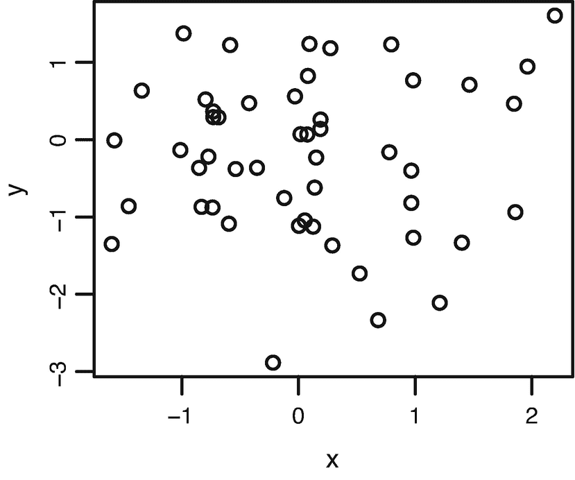

`plot()` 函数接受一个 `data` 参数，你可以用它来绘制数据框中的数据，但你无法像下面这样编写代码来绘制 `datasets` 包中的 `cars` 数据：

```
data(cars)
cars %>% plot(speed, dist, data = .)
```

尽管将数据框传递给了 `plot()`，它仍无法识别 `x` 和 `y` 参数的变量，因此要将绘图加入管道中，你需要使用 `%$%` 操作符，让 `plot()` 能够访问数据框中的变量。例如，我们可以像下面这样绘制 `cars` 数据（见图 4-2）：

```
cars %$% plot(speed, dist, main="Cars data",
xlab="Speed", ylab="Stopping distance")
```

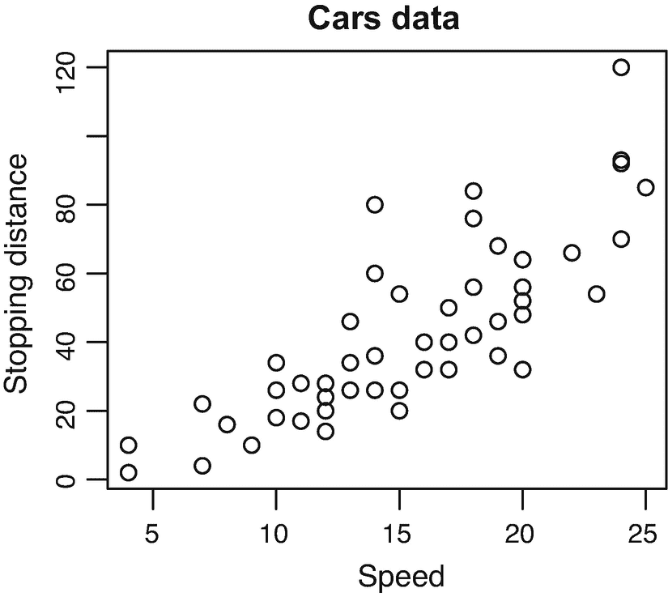

这里，我们使用 `main` 为图形添加标题，使用 `xlab` 和 `ylab` 指定坐标轴标签。

`plot()` 的 `data` 参数在绘图变量以公式形式指定时使用。此时 `plot()` 函数会将公式解释为如何绘制数据。如果 `x` 和 `y` 值以公式形式指定，你可以将包含变量的数据框传递给函数并进行绘图：

```
cars %>% plot(dist ~ speed, data = .)
```

这里，你必须使用 `%>%` 操作符，而不是 `|>`，因为你需要将左侧内容放入 `data` 参数，而不是第一个参数。

默认情况下，图形以点状显示数据，但你可以指定 `type` 参数，以其他方式（如线条或直方图）显示数据（见图 4-3）：

```
cars %$% plot(speed, dist, main="Cars data", type="h",
xlab="Speed", ylab="Stopping distance")
```

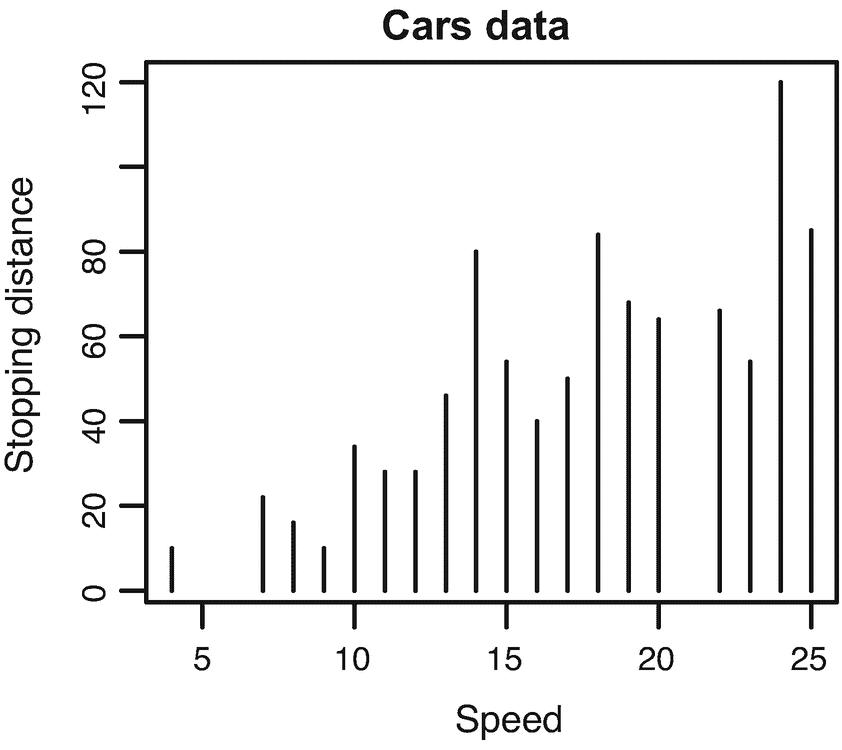

要获取单个变量的直方图，应使用 `hist()` 函数而非 `plot()`（见图 4-4）：

```
cars %$% hist(speed)
```

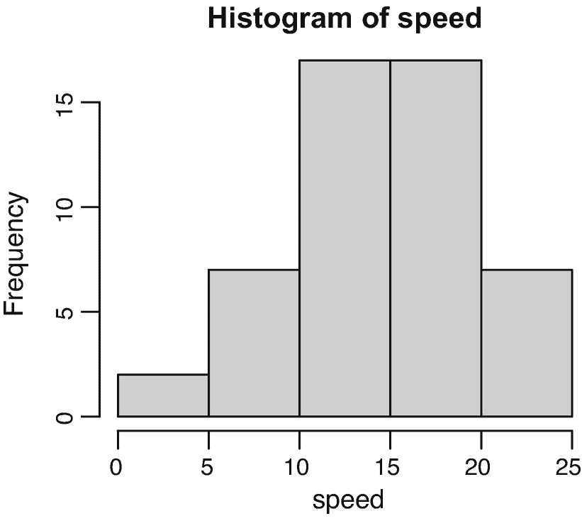

所谓 `plot()` 是一个通用函数（我们将在第 12 章详细讨论），意味着它会根据你提供的参数产生不同的功能。

不同类型对象通常可以（并且经常）拥有自己的绘图功能。这就是为什么即使你听从我的建议使用 `ggplot2` 进行绘图，仍可能时不时用到基础图形的原因。

例如，使用 `lm()` 函数创建的线性回归模型就有其专门的绘图例程。尝试运行以下表达式：

```
cars %>% lm(dist ~ speed, data = .) %>% plot()
```

它将为你生成几个汇总图形，用于评估线性拟合的质量。

许多模型拟合算法会返回一个拟合后的对象，该对象具有专门的绘图功能，如下所示。因此，当你拟合了一个模型后，始终可以尝试对其调用 `plot()`，看看是否能从中得到有用的信息。

`plot()`、`hist()` 等函数以及另外一些函数会创建新的图形，但同时也有大量用于注释图形的函数。`lines()` 和 `points()` 等函数分别用于在当前图形上添加线条和点，而不是创建新图形。

如果我们想绘制 `longley` 数据集，并希望同时看到历年的失业率和军队人数，就可以看到它们的作用：

```
data(longley)
```

查阅 `longley` 的文档（`?longley`）以了解数据的描述。该数据集包含了 1947 年至 1962 年每年的各种统计数据，包括失业人数（变量 `Unemployed`）和军队人数（变量 `Armed.Forces`）。为了在同一张图上绘制这两个变量，我们可以先绘制 `Unemployed` 相对于年份（变量 `Year`）的图形，然后添加 `Armed.Forces` 的线条。见图 4-5。

```
longley %>% plot(Unemployed ~ Year, data = ., type = 'l')
longley %>% lines(Armed.Forces ~ Year, data = ., col = "blue")
```


这几乎能满足我们的需求，但 `plot()` 函数会根据 `plot()` 调用中 `y` 值的范围来选择 `y` 轴的范围，而 `Armed.Forces` 并不完全适合这个范围。为了同时容纳两者，我们必须使用参数 `ylim` 来设置 `y` 轴的界限（见图 4-6）：

```
longley %$% plot(Unemployed ~ Year, type = 'l',
ylim = range(c(Unemployed, Armed.Forces)))
longley %>% lines(Armed.Forces ~ Year, data = ., col = "blue")
```


与 `plot()` 一样，其他绘图函数通常是泛型函数。这意味着我们有时可以将拟合模型等对象传递给它。`abline()` 函数就是这样一个例子。它绘制形如 *y* = *a* + *bx* 的线条，但它有一种变体，可以将线性模型作为输入，并绘制由该模型定义的最佳拟合线。因此，我们可以结合使用 `lm()` 和 `abline()` 函数来绘制 `cars` 数据及其最佳拟合线（见图 4-7）：

```
cars %>% plot(dist ~ speed, data = .)
cars %>% lm(dist ~ speed, data = .) %>% abline(col = "red")
```


使用基础图形系统进行绘图通常遵循这种模式。首先，调用 `plot()` 来设置绘图的画布——可能需要调整坐标轴以确保后续绘制的点能够容纳在画布上。然后，绘制任何额外的数据点——就像我们在 `longley` 数据中看到的第二个时间序列那样。最后，可能还会添加一些注释，例如添加文本标签或边缘注释（参见函数 `text()` 和 `mtext()`）。

如果你想根据其他数据特征来选择点的形状或颜色，例如，根据 `Species` 变量用不同颜色绘制 `iris` 数据的数据点，那么你需要将特征映射到列（见图 4-8）：

```
color_map <- c("setosa" = "black",
"versicolor" = "grey40",
"virginica" = "grey75")
iris %$% plot(Petal.Length ~ Petal.Width,
col = color_map[Species])
```


基础图形系统提供了许多用于制作达到出版质量的图形的函数，但大部分工作在相对较低的层级。如果你想用一个变量来决定点的显示方式，你必须显式地将变量映射到颜色或形状。如果你绘制的第一个点没有覆盖你想要绘制的整个数据范围，你必须设置 `xlim` 和 `ylim` 参数来获得正确的 *x* 轴和 *y* 轴。如果你改变一个坐标轴——比如进行对数变换——或者如果你翻转了 *x* 轴和 *y* 轴，那么你通常需要更新多个函数调用。如果你想要为数据的不同子集创建不同的子图——即所谓的分面（facets）——那么你必须显式地进行子集划分和绘图。

因此，虽然基础图形系统对于制作外观精美的最终图形非常强大，但对于通常需要尝试不同可视化方式的数据探索而言，它不一定是最优选择。

## 图形语法与`ggplot2`包

`ggplot2` 包为基础图形系统提供了一种替代方案，它基于所谓的“图形语法”。其思想是，该系统为您提供了一种用于创建图形的小型领域特定语言（类似于 `dplyr` 为操作数据框提供的领域特定语言）。您通过一系列函数调用来构建图形——类似于使用基础图形系统的方式——但这些函数调用并非彼此独立地直接在画布上绘制。相反，它们都通过修改图形（例如缩放坐标轴或将数据拆分为在不同分面上绘制的子集）或向图形添加可视化图层来操作图形。

要使用它，首先需要导入该库：

```
library(ggplot2)
```

你可以使用以下命令获取它定义的函数列表：

```
library(help = "ggplot2")
```

我只能在这里对 `ggplot2` 包做一个非常简短的、类似教程的介绍。如果你想了解更多细节，市面上有专门介绍 `ggplot2` 的完整书籍。阅读完本章后，你应该能够构建基本的图形，并且应该能够通过在线搜索找到关于如何制作更复杂图形的信息。

我们首先介绍 `qplot()` 函数（代表快速绘图），以此逐步引入 `ggplot2`。该函数的工作方式与 `plot()` 类似——尽管处理方式略有不同——但它创建的却是与 `ggplot2` 其他函数操作的对象类型相同的对象，因此它可以与这些函数结合使用。


### 使用 `qplot()`

`qplot()` 函数可以像 `plot()` 函数一样用来绘制简单的散点图。若要绘制 `cars` 数据集（见图 4-9），我们可以使用：

```
cars %>% qplot(speed, dist, data = .)
```

不过，其实际运作方式略有不同。`qplot()` 函数创建的是一个 `ggplot` 对象，而非直接绘图。只是在语句末尾打印这类对象时，打印的效果就是将它们绘制出来。这听起来有点令人费解，但实际情况就是如此。用于打印 R 对象的函数是一个通用函数，因此打印一个对象的效果取决于该对象为 `print()` 函数实现的具体内容。对于 `ggplot` 对象，这个函数会绘制该对象。不过，对于我们编写的这类代码来说，这配合得很好，因为在上述代码中，整个表达式的结果就是 `qplot()` 的返回值。当这个表达式在 R 交互式环境的最外层被求值时，结果会被打印出来。因此，`ggplot` 对象就被绘制出来了。

上述代码等价于：

```
p <- qplot(speed, dist, data = cars)
p
```

这也等价于：

```
p <- qplot(speed, dist, data = cars)
print(p)
```

之所以是 `print()` 函数而非 `plot()` 函数——虽然 `plot()` 可能更符合直觉——是因为当我们（在 R 交互式环境提示符下）求值一个表达式时，`print()` 函数是会被自动调用的函数。通过使用 `print()`，我们无需显式打印对象，只需确保绘图代码位于程序的最外层即可。然而，如果你在函数内部创建绘图，它不会被自动打印，此时你需要显式调用打印。

我之所以提及这些关于对象创建和打印的细节，是因为使用 `ggplot2` 的典型模式就是：构建这样一个 `ggplot` 对象，对其进行各种操作以修改它，最后通过打印来绘制它。

使用 `qplot()` 时，在 `qplot()` 返回对象之前，会对绘图对象进行一些变换。“快速绘图”之“快速”体现在 `qplot()` 会猜测你可能想要哪种类型的图，然后对绘图对象进行变换以达到目标。为了完全控制最终的图形，我们可以跳过 `qplot()`，显式地完成所有变换——我个人从此再也不使用 `qplot()` 了——但作为入门和熟悉 `ggplot2` 的工具，它仍然是一个不错的函数。

使用 `qplot()`，我们可以比使用 `plot()` 更直接地让数据点的可视化效果依赖于数据变量。在 `plot()` 中要根据 `Species` 对 `iris` 数据着色时，我们需要编写映射代码，然后转换 `Species` 列来获取颜色。而使用 `qplot()`，我们只需指定颜色要依赖于 `Species` 变量即可（见图 4-10）：

```
iris %>% qplot(Petal.Width, Petal.Length,
color = Species, data = .)
```

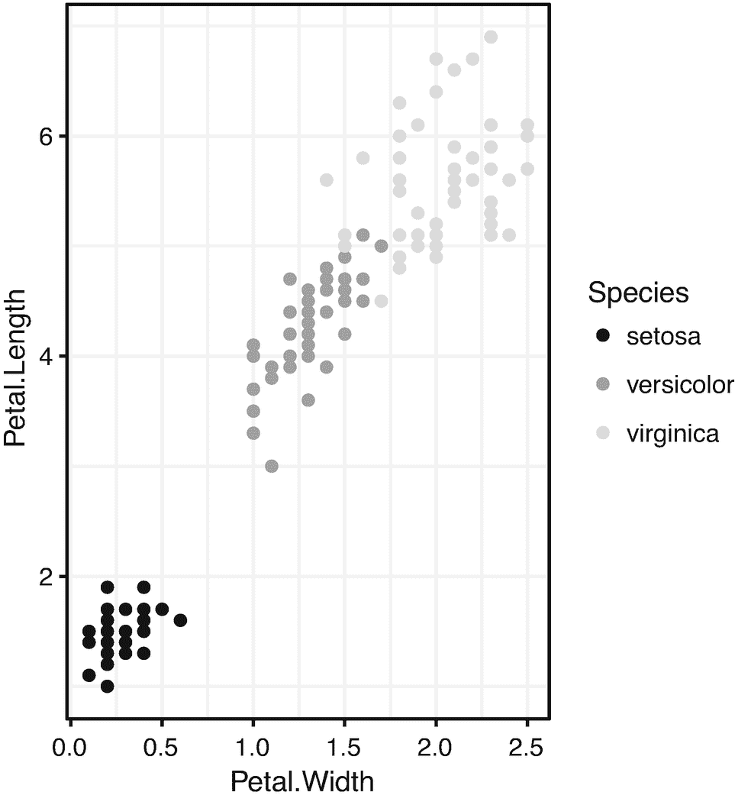

像这样映射颜色时，图例会免费自动生成，不过，如果我们愿意的话，可以通过对 `qplot()` 返回的 `ggplot` 对象进行操作来修改图例。

除了散点图之外，你还可以将 `qplot()` 用于其他类型的图形。如果你只给它提供一个变量来绘图，它会假设你想要的是直方图而非散点图，并为你生成直方图（见图 4-11）：

```
cars %>% qplot(speed, data = ., bins = 10)
```

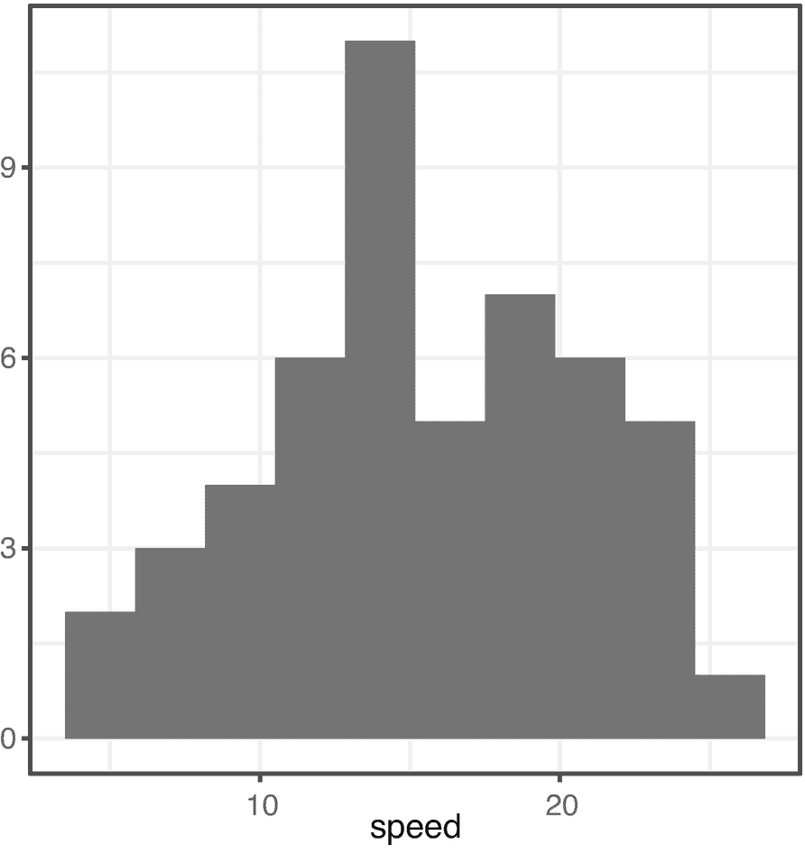

如果你想要密度图，只需明确要求即可（见图 4-12）：

```
cars %>% qplot(speed, data = ., geom = "density")
```

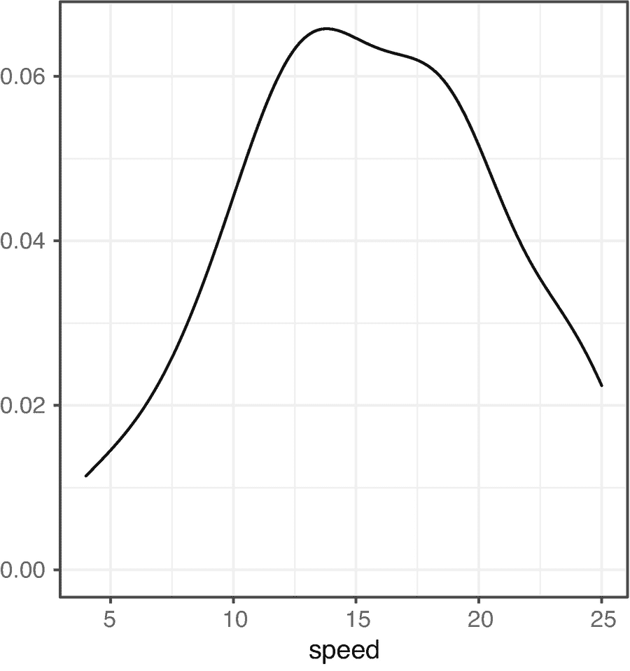

类似地，通过指定几何对象，你可以得到折线图、箱线图、小提琴图等。几何对象决定了底层数据应该如何被可视化。它们可能涉及计算一些汇总统计量（例如我们创建直方图或密度图时的情况），也可能只是像处理散点图那样直接可视化原始数据。不过，它们都描述了数据应该如何被可视化。使用 `ggplot2` 构建图形涉及为你的数据添加几何对象，通常是添加多个几何对象。为了了解具体如何操作，我们将离开 `qplot()`，转而研究如何通过使用几何对象来创建我们之前用 `qplot()` 绘制的图形。

### 使用几何对象

通过串联多个几何命令，我们可以用不同方式展示相同数据——例如，散点图与平滑曲线组合——或者在同一图形上放置多个数据源。在了解更复杂的结构之前，我们先看看如何通过显式调用几何函数来生成之前的`qplot()`图形。

我们从`cars`数据集的散点图开始，之前我们使用了：

```r
cars %>% qplot(speed, dist, data = .)
```

要使用显式几何对象创建此图形，我们需要一个`ggplot`对象，将数据框中的`speed`参数映射到x轴，`dist`参数映射到y轴，并将数据绘制为点：

```r
ggplot(cars) + geom_point(aes(x = speed, y = dist))
```

我们使用`ggplot()`函数创建一个对象，并将`cars`数据作为输入。当我们将数据框赋予此对象后，后续操作即可访问该数据。我们可以覆盖所绘制数据的数据框来源，但除非特别指定，否则我们只能访问创建初始对象时传递给`ggplot()`的数据。接着，我们在同一个函数调用中完成两件事：通过调用`geom_point()`指定将x和y值绘制为点，并使用“美学”函数`aes()`将`speed`映射到x值、`dist`映射到y值。美学负责将数据映射到图形。对于`geom_point()`几何对象，图形需要x和y值，而美学则告诉函数应使用数据中的哪些变量。

`aes()`函数仅为`geom_point()`函数定义了数据到图形的映射。有时我们需要为不同几何对象设置不同映射，有时则不需要。若希望在函数间共享美学设置，可以在`ggplot()`函数调用中设定。这样，后续函数就能像访问数据一样访问它，无需为每个后续函数调用重复指定：

```r
ggplot(cars, aes(x = speed, y = dist)) + geom_point()
```

`ggplot()`和`geom_point()`函数通过`+`组合。使用`+`串联一系列命令来修改`ggplot`对象的方式，与我们使用`%>%`串联一系列数据操作非常相似。这里使用两个不同运算符只是历史原因；如果在开发`ggplot2`时`%>%`运算符已普遍使用，那么它很可能会采用`%>%`。实际情况是，你使用`+`。由于`+`在`ggplot2`中的工作方式与`%>%`在`magrittr`中略有不同，你不能在函数不接受参数时仅使用函数名，因此需要在`geom_point()`中包含括号。

由于`ggplot()`将数据框作为第一个参数，典型的模式是先通过一系列`%>%`或`|>`操作修改数据，然后将结果传递给`ggplot()`，再跟随一系列`+`操作。对`cars`数据执行此操作会形成以下简单管道——在更大规模的应用中，`%>%`管道和`+`图形组合中都会包含更多步骤：

```r
cars %>% ggplot(aes(x = speed, y = dist)) + geom_point()
```

对于`iris`数据，我们使用以下`qplot()`调用创建了一个散点图，颜色由`Species`变量决定：

```r
iris %>% qplot(Petal.Width, Petal.Length,
color = Species, data = .)
```

使用`ggplot()`和`geom_point()`的相应代码如下：

```r
iris %>% ggplot() +
geom_point(aes(x = Petal.Width, y = Petal.Length,
color = Species))
```

这里，我们也可以将美学设置放在`ggplot()`调用中，而不是`geom_point()`调用中。

当将颜色指定为美学属性时，你让它依赖于数据中的另一个变量。如果希望硬编码颜色（或任何图形参数），只需将参数赋值移到`aes()`调用之外。如果`geom_point()`获得了颜色参数，它将使用该颜色绘制点；否则，它将从美学设置中获取颜色（见图 4-13）：

```r
iris |> ggplot() +
geom_point(aes(x = Petal.Width, y = Petal.Length),
color = "grey50")
```

用于绘制直方图和密度图的`qplot()`代码：

```r
cars %>% qplot(speed, data = ., bins = 10)
cars %>% qplot(speed, data = ., geom = "density")
```

可以分别使用`geom_histogram()`和`geom_density()`构建：

```r
cars |> ggplot() + geom_histogram(aes(x = speed), bins = 10)
cars |> ggplot() + geom_density(aes(x = speed))
```

你可以组合更多几何对象，以多种方式展示数据。但这并非总是有意义的，具体取决于数据的汇总方式——组合散点图和直方图可能不太实用。然而，例如，我们可以绘制一个同时显示汽车速度直方图和密度图的图形（见图 4-14）：

```r
cars |> ggplot(aes(x = speed, y = ..count..)) +
geom_histogram(bins = 10) +
geom_density()
```

这只需我们同时调用`geom_histogram()`和`geom_density()`。我们还需要为y值添加额外美学选项。原因是直方图默认会在y轴上显示每个区间内的观测数量，而密度图则积分为一。通过设置`y = ..count..`，你告诉两个几何对象都使用计数作为y轴。要获得密度值，可以使用`y = ..density..`。

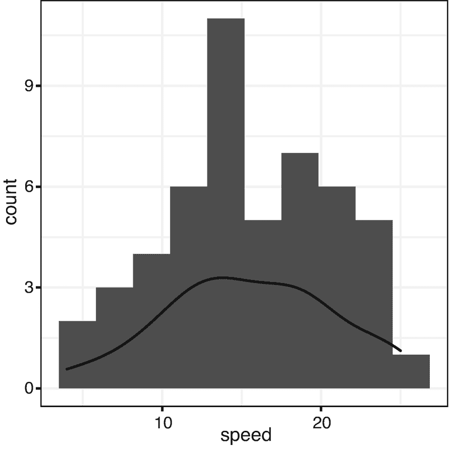

图 4-14

来自`cars`数据的速度组合直方图与密度图

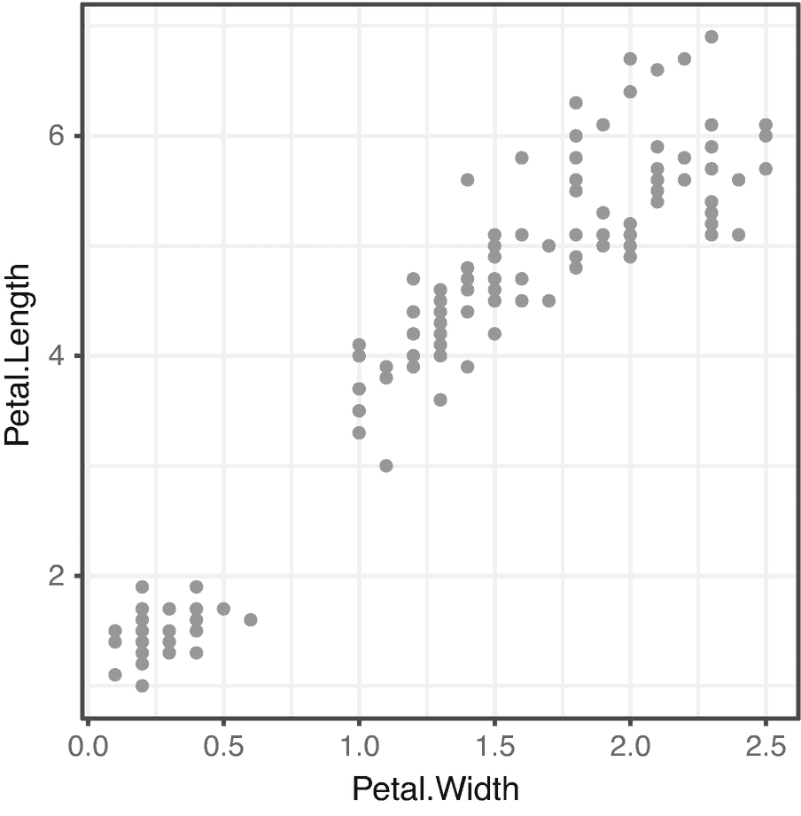

图 4-13

鸢尾花数据，点的颜色为硬编码

我们还可以结合几何对象，在散点图旁显示数据的汇总统计量。我们曾用`plot()`为`cars`数据的散点图添加了线性拟合结果。使用`ggplot2`实现相同效果时，我们添加一个`geom_smooth()`调用（见图 4-15）：

```r
cars %>% ggplot(aes(x = speed, y = dist)) +
geom_point() + geom_smooth(method = "lm")
## `geom_smooth()` 使用了公式 'y ~ x'
```

从`geom_smooth`得到的消息表明，它在线性模型中使用了公式`y ~ x`来平滑数据。当我们使用默认设置而未显式提供所需平滑的公式时，它会通知我们。此处仅表示它在寻找x和y值之间的最佳直线，这正是我们想要的。你可以通过编写`geom_smooth(formula = y ~ x, method = "lm")`使公式显式化，或者使用不同公式，例如`geom_smooth(formula = y ~ 1, method = "lm")`，将y值拟合为常数，得到一条水平线来拟合y的均值（你可以尝试一下）。默认设置通常就是我们所期望的。

之前，我们告诉`geom_smooth()`调用使用线性模型方法。如果不这样做，它将改为绘制局部加权回归平滑线（见图 4-16）：

```r
cars %>% ggplot(aes(x = speed, y = dist)) +
geom_point() + geom_smooth()
## `geom_smooth()` 使用了 method = 'loess' 和 formula 'y ~ x'
```

我们还可以使用多个几何对象来绘制多个变量。对于`longley`数据，我们可以使用两个不同的`geom_line()`来绘制`Unemployed`和`Armed.Forces`数据（见图 4-17）：

```r
longley %>% ggplot(aes(x = Year)) +
geom_line(aes(y = Unemployed)) +
geom_line(aes(y = Armed.Forces), color = "blue")
```

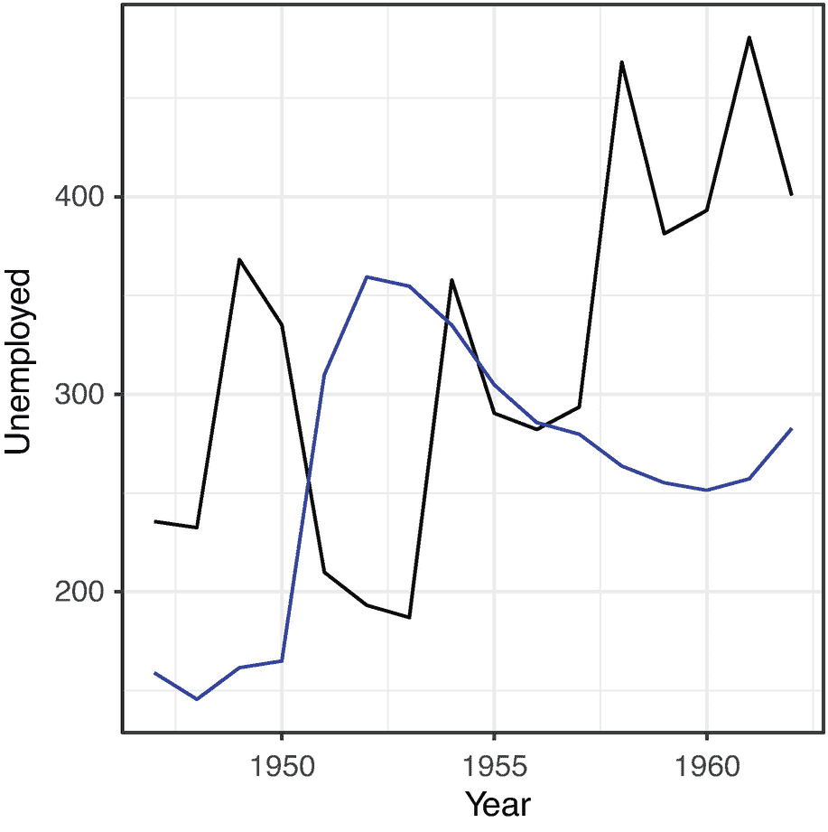

图 4-17

使用`ggplot2`绘制的Longley数据集

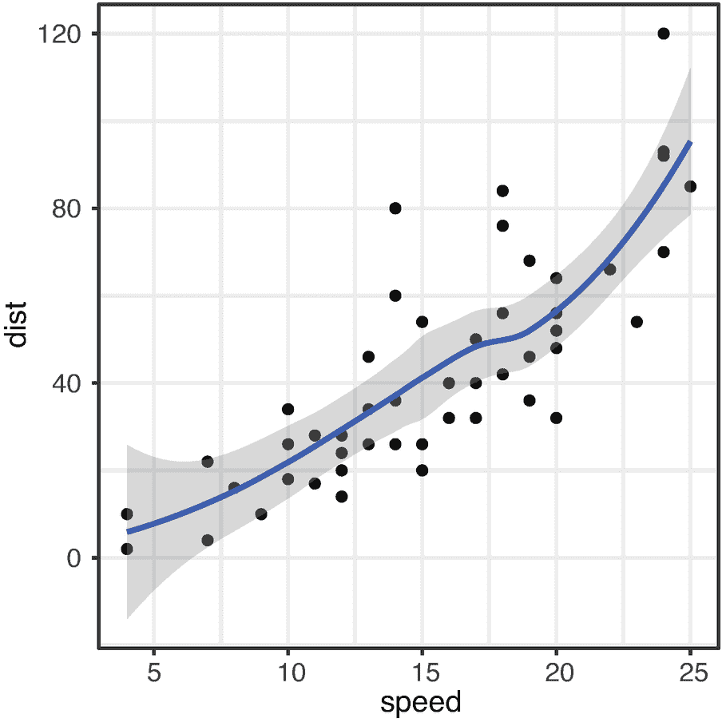

图 4-16

使用loess平滑法绘制的汽车数据集

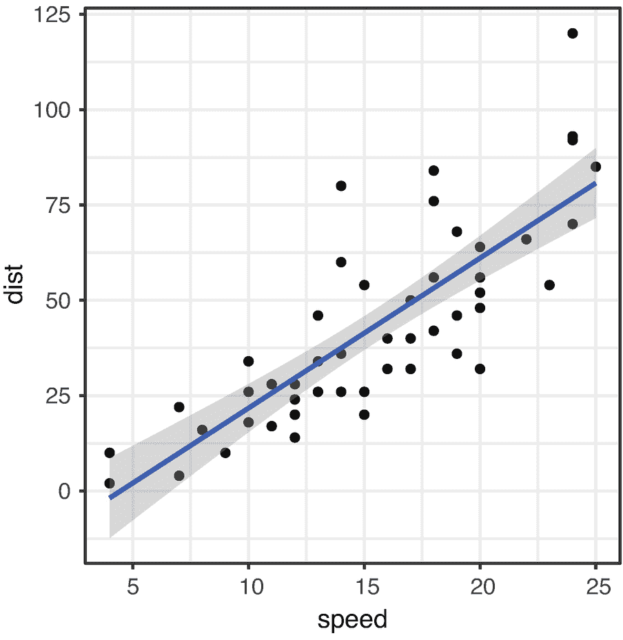

图 4-15

使用线性模型平滑法绘制的汽车数据集

此处，我们在`ggplot()`函数中设置了x值的美学属性，因为它被两个`geom_line()`几何对象共享，但我们在两次调用中分别设置了y值，并且为`Armed.Forces`数据设置了color，将其硬编码而非设为美学映射。由于我们在修改绘图（而非仅在画布上绘制），第二个`geom_line()`调用会调整y轴以适配两条线。因此，我们无需在其他地方设置y轴范围。

我们还可以组合使用`geom_line()`和`geom_point()`，为数据同时绘制线条和点（见图 4-18）：

```r
longley %>% ggplot(aes(x = Year)) +
geom_point(aes(y = Unemployed)) +
geom_line(aes(y = Unemployed)) +
geom_point(aes(y = Armed.Forces), color = "blue") +
geom_line(aes(y = Armed.Forces), color = "blue")
```

像这样为两个变量使用不同美学属性进行绘图，对大多数应用场景来说没问题，但并非总是最优方式。问题在于，我们在绘图代码中表示`Unemployed`和`Armed.Forces`这两个指标是每年获取的两个不同度量值，但数据本身并未将其体现为可计算的内容。如果我们要将这两个度量值拆分到子图中（而非放在同一框架内），就需要编写新的绘图代码。更好的方法是重新格式化数据框，使其包含一列指明观测值是`Unemployment`还是`Armed.Forces`，另一列提供数值，然后根据第一列设置color，根据另一列设置y轴。我们可以使用`tidyr`包中的`pivot_longer`函数来实现（见图 4-19）：

```r
longley %>%
pivot_longer(
c(Unemployed, Armed.Forces),
names_to = "Class",
values_to = "Number of People"
) %>%
ggplot(aes(x = Year, y = `Number of People`, color = Class)) +
geom_line()
```

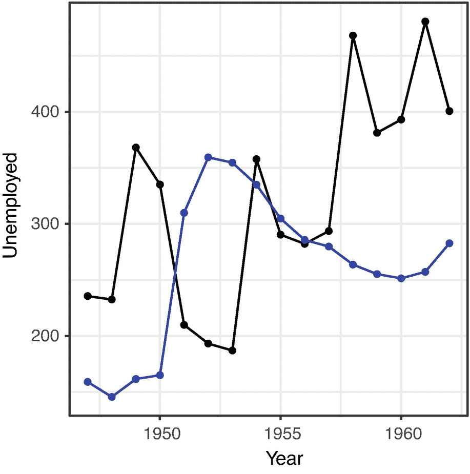

图 4-18

使用`ggplot2`同时以点和线绘制的Longley数据集

在`pivot_longer`表达式中，我们指定要转换`Unemployed`和`Armed.Forces`两列。这两列属于统计数据中的不同类别，因此我们将原始列名放入一个名为`Class`的新列中。这两列统计的是两个类别的人数，所以原始两列的值将放入一个名为`Number of People`的新列。`pivot_longer`表达式中的名称是字符串，我们可以随意命名，但`aes()`表达式中的y值必须是有效的变量名，而有效变量名不能包含空格，因此我们需要转义字符串。我们使用反引号来实现这一点。

转换数据后，只需少量额外代码即可更改绘图。例如，如果我们希望将两个值显示在不同的分面中，只需指定这一点（而非设置颜色）（见图 4-20）：

```r
longley %>%
pivot_longer(
c(Unemployed, Armed.Forces),
names_to = "Class",
values_to = "Number of People"
) %>%
ggplot(aes(x = Year, y = `Number of People`)) +
geom_line() +
facet_grid(Class ~ .)
```

### 分面

分面是显示数据不同子集的子图。在前面的示例中，我们将`Armed.Forces`变量显示在一个子图中，`Unemployed`变量显示在另一个子图中。你可以使用以下两个函数之一来指定分面：`facet_grid()`根据公式`rows ~ columns`创建分面，`facet_wrap()`根据公式`~ variables`创建分面。前者为公式左侧的变量创建一行，为右侧的变量创建一列，并据此构建分面。在前面的示例中，我们使用了`key ~ .`，因此每个键值对应一行。如果我们使用`. ~ key`，则每个键值对应一列。`facet_wrap()`不会显式设置行和列，它仅为公式右侧变量的每个组合创建一个分面，并将这些分面包裹在网格中显示。

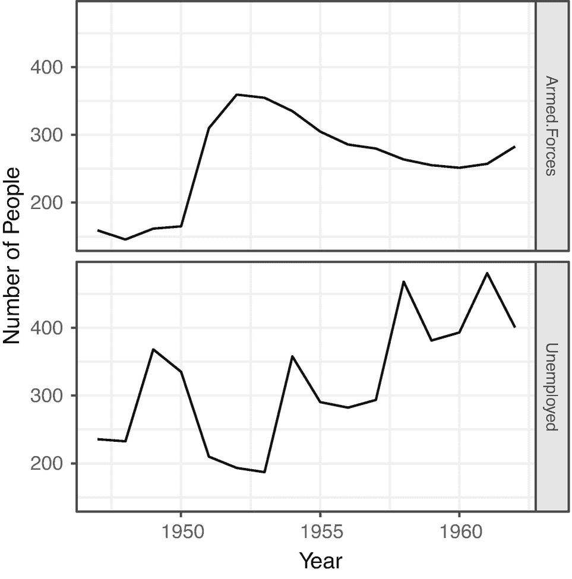

图 4-20

使用分面绘制的Longley数据集

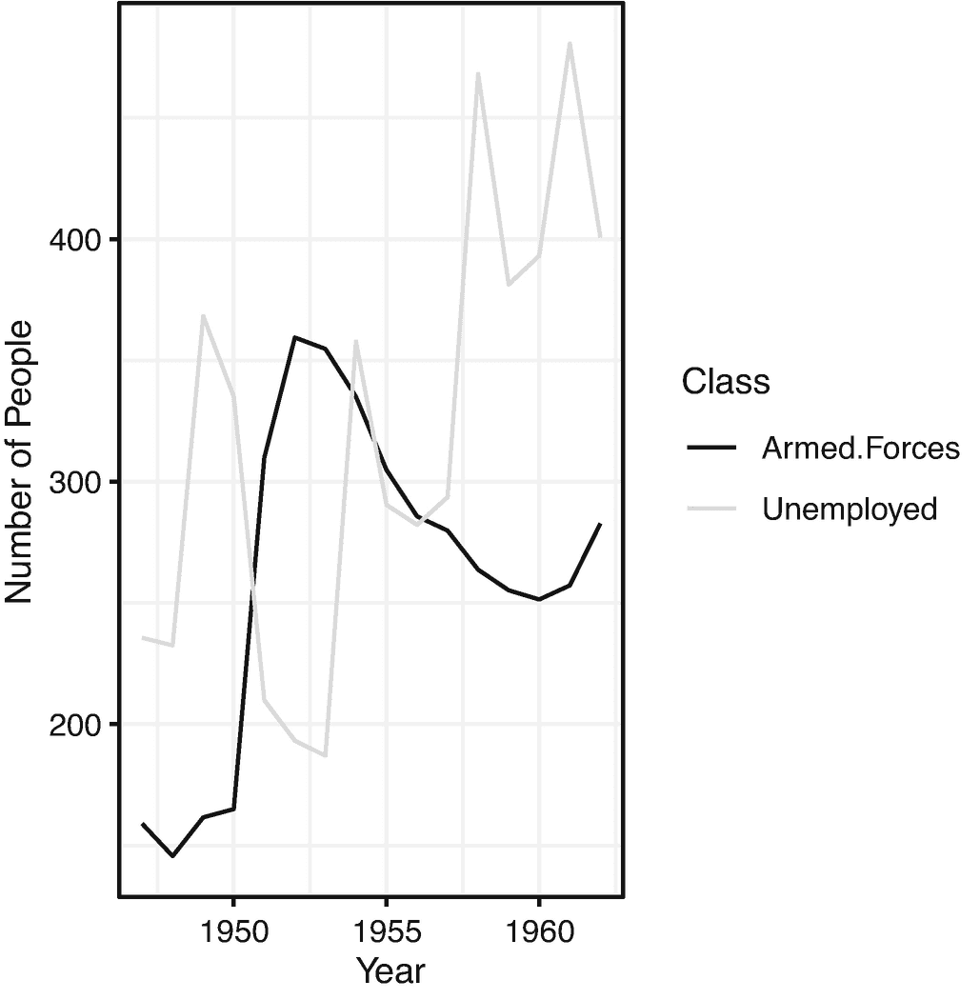

图 4-19

使用整洁数据绘制的Longley数据集

默认情况下，当使用`facet_grid()`创建分面时，`ggplot2`会尝试将所有值放在相同的坐标轴上。因此，在前面的示例中，`Armed.Forces`与`Unemployment`显示在相同的x轴和y轴上，尽管如我们所见，y值的范围并不相同。我们可以使用`scales`参数来改变这一点。同一列中的分面将始终共享相同的x轴，而同一行中的分面将共享相同的y轴。

我们可以用`iris`数据来演示这一点。我们转换`iris`数据，使用`pivot_longer`将除`Species`之外的所有列压缩为两个键值列。在选取列时，通过在列名前加`-`可以排除选定列。然后，我们可以像这样绘制每个物种的测量值：

```r
iris %>%
pivot_longer(
-Species,
names_to = "Measurement",
values_to = "Value"
) %>%
ggplot(aes(x = Species, y = Value)) +
geom_boxplot() +
facet_grid(Measurement ~ .)
```

我们将每个物种的四个测量值绘制在不同的分面中，但由于它们的尺度略有不同，我们只能清晰地看到范围最大的那个尺度的值。我们可以通过设置y轴自由缩放来解决这个问题；对比图 4-21 和图 4-22。

```r
iris %>%
pivot_longer(
-Species,
names_to = "Measurement",
values_to = "Value"
) %>%
ggplot(aes(x = Species, y = Value)) +
geom_boxplot() +
facet_grid(Measurement ~ ., scale = "free_y")
```

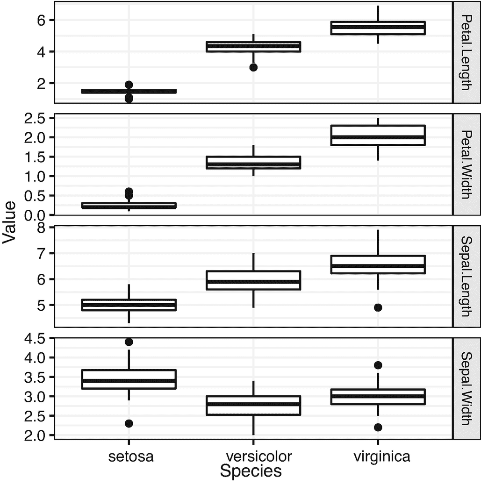

图 4-22

鸢尾花测量值绘制在不同y轴上

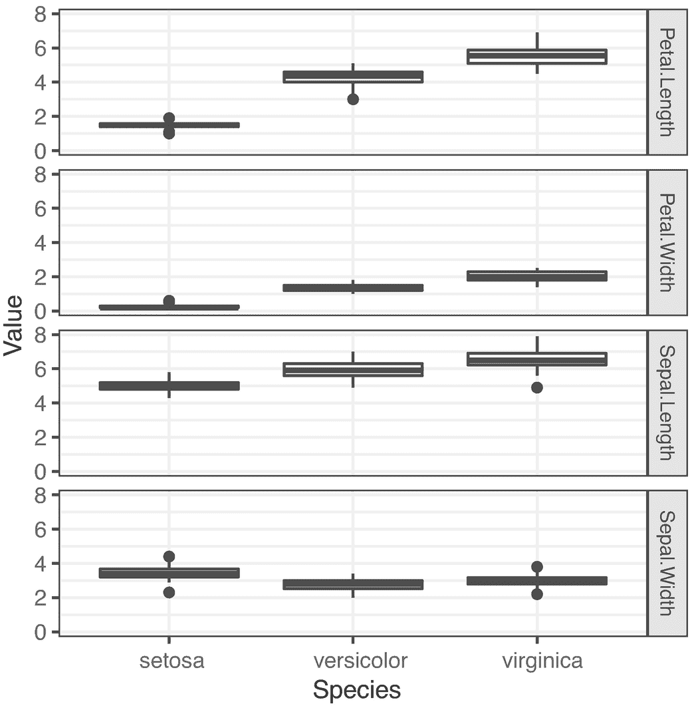

图 4-21

鸢尾花测量值绘制在相同y轴上

默认情况下，所有分面的大小相同。你可以使用`space`变量修改这一点。这主要用于分类值，当某个分面中的水平数量远多于其他分面时。

分面使用的标签取自用于构建分面的变量中的因子。这是一个不错的默认设置，但对于出版质量的图表，通常需要稍微修改标签。你可以通过`facet_grid()`的`labeller`参数来实现。该参数接受一个函数作为参数，该函数负责构建标签。构建此函数最简单的方法是使用另一个函数`labeller()`。你可以为`labeller()`提供一个命名参数，指定一个因子，并使用查找表将水平映射到标签。对于`iris`数据，我们可以用此方法去除测量名称中的点（见图 4-23）：

```r
label_map %>%
pivot_longer(
-Species,
names_to = "Measurement",
values_to = "Value"
) %>%
ggplot(aes(x = Species, y = Value)) +
geom_boxplot() +
facet_grid(Measurement ~ ., scale = "free_y",
labeller = labeller(Measurement = label_map))
```

# 缩放

几何对象指定了数据应如何可视化的一部分，而缩放则是另一部分。几何对象告诉`ggplot2`您希望如何将数据映射到视觉组件（如点或密度图），而缩放则告诉`ggplot2`维度应如何可视化。最容易理解的缩放是 x 轴和 y 轴，如您所熟悉的，数值被映射到图表上的位置，但缩放同样适用于颜色等视觉属性。

缩放最简单的用途就是为轴添加标签。我们也可以使用`xlab()`和`ylab()`函数来实现这一点，如果我们仅仅关心设置标签的话，我们大可以这样做，但为了举例说明，这里我们将展示缩放的使用方法。要在`cars`散点图中设置标签，我们可以编写：

```
cars %>%
ggplot(aes(x = speed, y = dist)) +
geom_point() + geom_smooth(method = "lm") +
scale_x_continuous("Speed") +
scale_y_continuous("Stopping Distance")
```

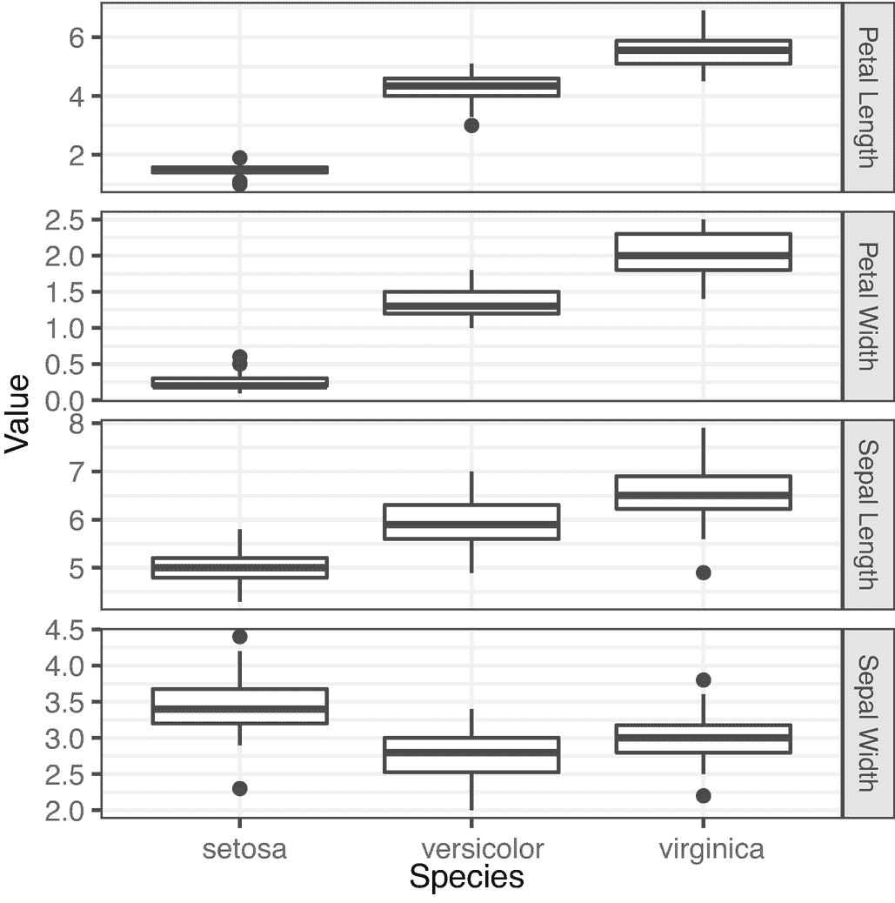

**图 4-23** 调整了测量标签的鸢尾花测量数据

x 轴和 y 轴都显示连续值，因此我们按此方式进行缩放，并将缩放名称作为参数传递。这样，这些名称就会成为轴标签上的文本。通常，我们可以使用`scale_x/y_continuous()`函数来控制轴图形，例如设置显示的断点。如果我们想绘制`longley`数据，使每年都有一个刻度标记，而不是每五年一个，我们可以将断点设置为每年：

```
longley %>%
pivot_longer(
c(Unemployed, Armed.Forces),
names_to = "Class",
values_to = "Number of People"
) %>%
ggplot(aes(x = Year, y = `Number of People`)) +
geom_line() +
scale_x_continuous(breaks = 1947:1962) +
facet_grid(Class ~ .)
```

您还可以使用缩放来修改刻度标记处显示的标签，或设置显示值的范围。

缩放也是转换轴上显示数据的一种方式。例如，如果您想对 x 轴或 y 轴进行对数转换，可以使用`scale_x/y_log10()`函数。与自行对数据进行对数转换后绘图相比，这通常能生成更美观的图表，因为绘图代码知道您希望在对数尺度上显示数据，而不是在线性尺度上显示转换后的数据。

要反转轴，可以使用`scale_x/y_reverse()`。这比反转映射到美学属性中的数据更好，因为所有绘图代码都会自动更新以适配反转后的轴；您无需在所有几何函数调用中更新 x 或 y 的值。例如，要按降序而非升序显示`cars`数据中的速度，我们可以编写：

```
cars %>%
ggplot(aes(x = speed, y = dist)) +
geom_point() +
geom_smooth(method = "lm") +
scale_x_reverse("Speed") +
scale_y_continuous("Stopping Distance")
```

轴不一定是连续的。如果您在美学属性中将一个因子映射到`x`或`y`，则会得到一个离散轴；参见图 4-24，该图展示了将因子`Species`绘制在 x 轴上的`iris`数据。

```
iris %>%
ggplot(aes(x = Species, y = Petal.Length)) +
geom_boxplot() +
geom_jitter(width = 0.1, height = 0.1)
```

由于`Species`是一个因子，x 轴将是离散的，我们可以使用箱线图和抖动几何对象来显示数据及单个数据点。如果我们想修改 x 轴，需要使用`scale_x_discrete()`而不是`scale_x_continuous()`。

例如，我们可以利用此功能修改轴上的标签，将物种名称改为大写：

```
iris %>%
ggplot(aes(x = Species, y = Petal.Length)) +
geom_boxplot() +
geom_jitter(width = 0.1, height = 0.1) +
scale_x_discrete(labels = c("setosa" = "Setosa",
"versicolor" = "Versicolor",
"virginica" = "Virginica"))
```

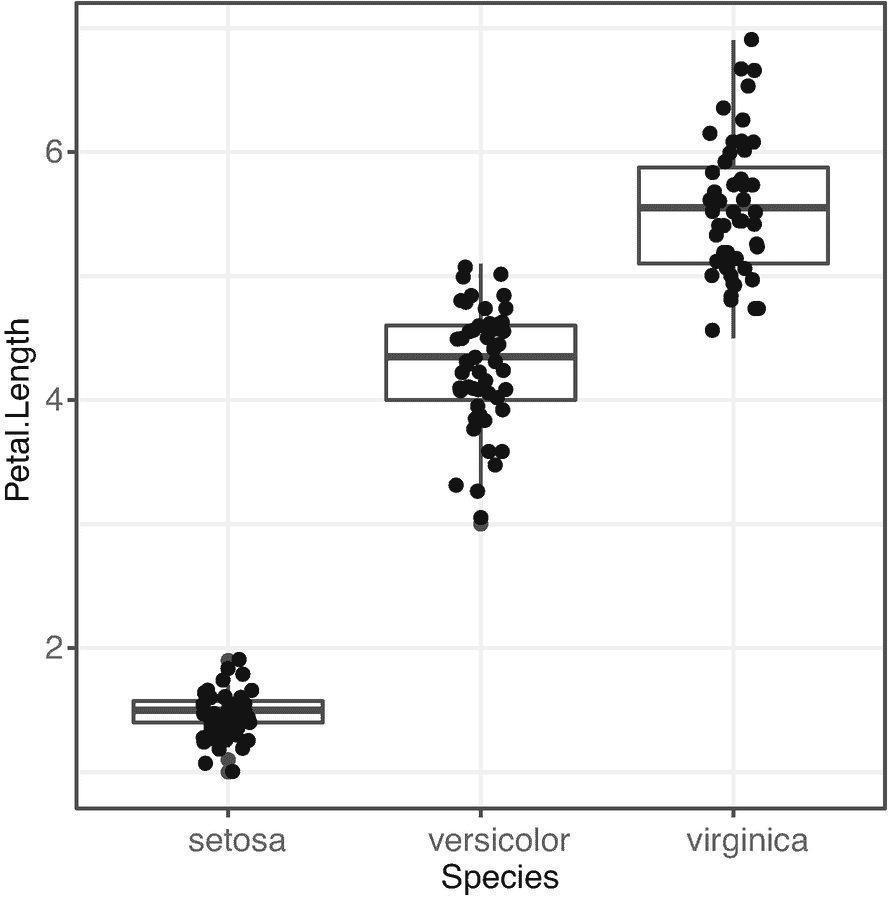

**图 4-24** 将因子绘制在 x 轴上的鸢尾花数据

我们提供了一个从数据水平到标签的映射。设置标签的方法不止一种，但这是最简单的方法。

缩放也用于控制颜色。您可以使用各种`scale_color_`函数来控制线条和点的颜色，并使用`scale_fill_`函数来控制填充区域的颜色。

我们可以按物种绘制`iris`测量数据，并为每个物种赋予不同的颜色。由于我们要着色的是箱体，因此需要使用`fill`美学属性。否则，我们将对箱体周围的线条进行着色。参见图 4-25。

```
iris %>%
pivot_longer(
-Species,
names_to = "Measurement",
values_to = "Value"
) %>%
ggplot(aes(x = Species, y = Value, fill = Species)) +
geom_boxplot() +
facet_grid(Measurement ~ ., scale = "free_y",
labeller = labeller(Measurement = label_map))
```

修改颜色缩放有不同的方法。与轴一样，有两类：离散和连续。`iris`中的`Species`变量是离散的，因此要修改填充颜色，我们需要使用相应的离散函数。最简单的方法是明确地为每个物种指定一种颜色。我们可以使用`scale_fill_manual()`函数来实现（参见图 4-26）：

```
iris %>%
pivot_longer(
-Species,
names_to = "Measurement",
values_to = "Value"
) %>%
ggplot(aes(x = Species, y = Value, fill = Species)) +
geom_boxplot() +
scale_fill_manual(values = c("black", "grey40", "grey60")) +
facet_grid(Measurement ~ ., scale = "free_y",
labeller = labeller(Measurement = label_map))
```

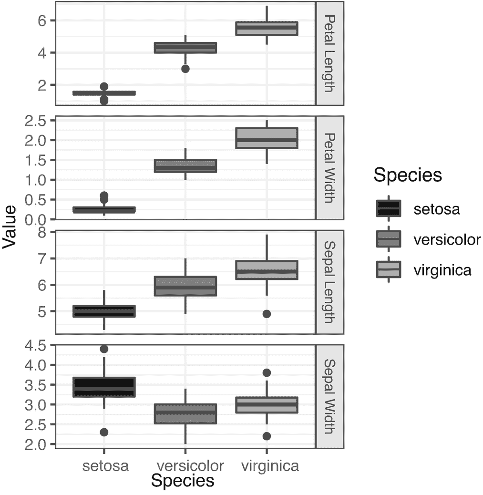

**图 4-26** 使用自定义填充颜色绘制的鸢尾花数据

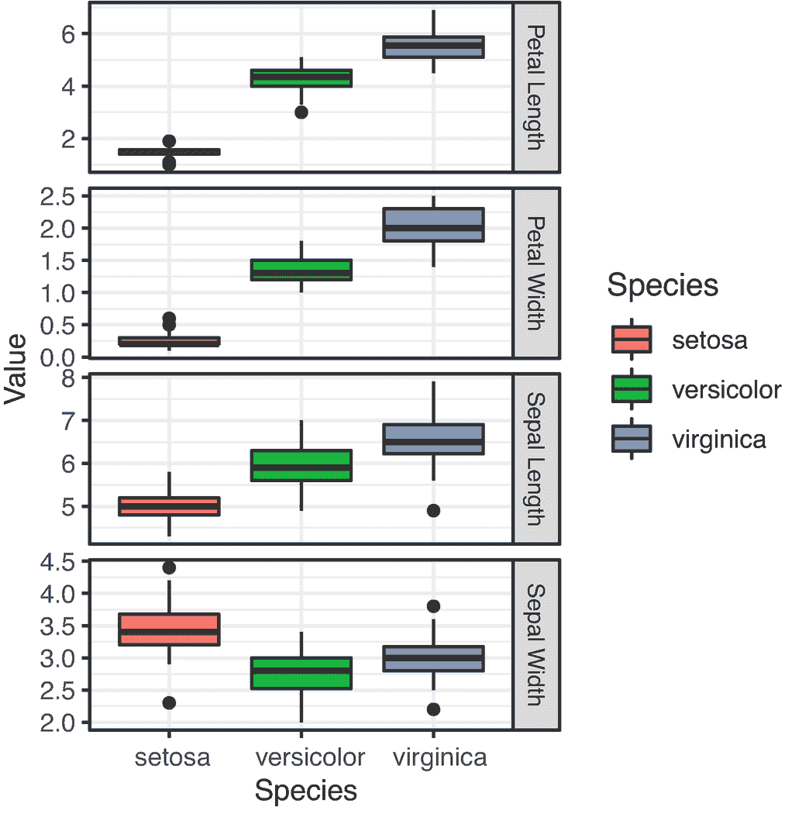

**图 4-25** 使用默认填充颜色绘制的鸢尾花数据

然而，除非您对颜色如何协调以及哪些颜色组合可能对色盲人士造成问题有很好的把握，否则明确设置颜色是有风险的。更好的做法是使用“brewer”调色板选项。这些是构建良好颜色组合的方法（参见 [`http://colorbrewer2.org`](http://colorbrewer2.org)），您可以使用`scale_fill_brewer()`函数来应用它们（参见图 4-27）：

```
iris %>%
pivot_longer(
-Species,
names_to = "Measurement",
values_to = "Value"
) %>%
ggplot(aes(x = Species, y = Value, fill = Species)) +
geom_boxplot() +
scale_fill_brewer(palette = "Greens") +
facet_grid(Measurement ~ ., scale = "free_y",
labeller = labeller(Measurement = label_map))
```

# 主题及其他图形变换

使用 `ggplot2` 的大部分工作包括指定几何对象和标度，以控制数据如何映射到视觉组件上，但您也可以通过仅关注最终结果的函数，对最终绘图的呈现方式进行大量控制。

这些控制大多通过修改所谓的主题来实现。如果您亲自尝试过本章给出的示例，结果可能与本书中的图形有所不同。这是因为我已经使用以下命令为本书设置了一个默认主题：

```
theme_set(theme_bw())
```

`theme_bw()` 设置了您在此看到的图形的最终视觉外观。您可以使用 `+` 将主题添加到绘图中，就像添加其他任何 `ggplot2` 修改一样，或者像我这样将其设为默认主题。您可以使用多个主题；可以查找以 `theme_` 开头的函数，但所有这些主题都可以进行修改，以获得对绘图的更多控制。

除了主题之外，其他各种函数也会影响图形的外观。关于主题和图形变换所能做的所有事情，这里无法全部涵盖，但我可以给您展示一个示例，让您了解可以实现哪些效果。

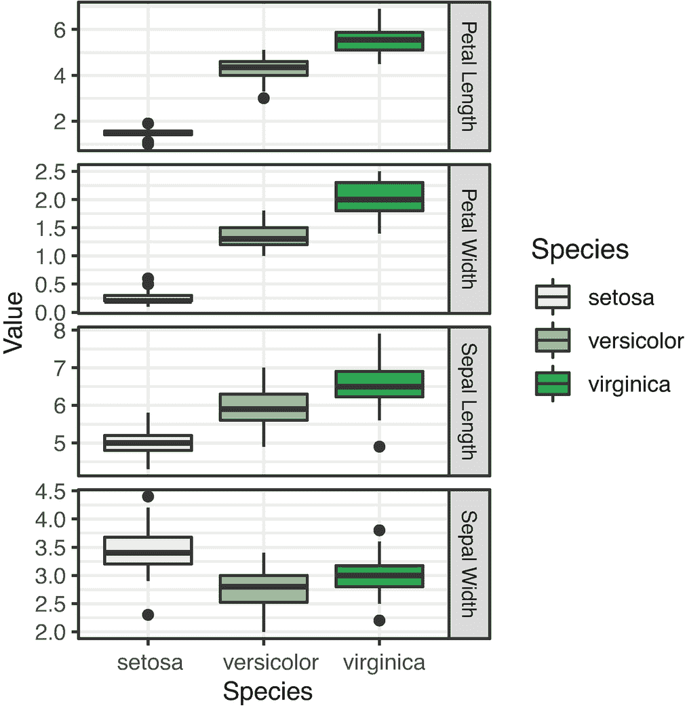

**图 4-27** 使用布鲁尔填充颜色绘制的鸢尾花数据

例如，您可以使用各种 `coord_` 函数更改坐标系——最简单的就是用 `coord_flip()` 翻转 x 轴和 y 轴。当然，这也可以通过更改美学映射来实现，但翻转复杂图形的坐标轴可能比在多个位置更新美学映射更简单。对于之前看过的 `iris` 绘图，我可能想要更改坐标轴。

我还希望将测量标签放在左侧而不是右侧。您可以使用 `facet_grid()` 的 `switch` 选项来控制分面标签的放置位置，将 `switch` 参数设置为 `y` 将切换该标签的位置：

```
iris %>%
pivot_longer(
-Species,
names_to = "Measurement",
values_to = "Value"
) %>%
ggplot(aes(x = Species, y = Value, fill = Species)) +
geom_boxplot() +
scale_x_discrete(labels = c("setosa" = "Setosa",
"versicolor" = "Versicolor",
"virginica" = "Virginica")) +
scale_fill_brewer(palette = "Greens") +
facet_grid(Measurement ~ ., switch = "y",
labeller = labeller(Measurement = label_map)) +
coord_flip()
```

如果我仅仅翻转坐标，且告知 `facet_grid()` 函数使用自由的 y 轴，那么新 x 轴上的轴标签将会出错。使用自由的 y 轴，各个 y 值将有不同的范围，这正是我们想要的，但在翻转坐标后，我们将只能看到其中一个 y 轴的值。其他值会被绘制得像是在同一个轴上，但实际上它们并不在同一个轴上。因此，我已经移除了 `facet_grid()` 中的 `scale` 参数。试着把它加回来，看看会发生什么。

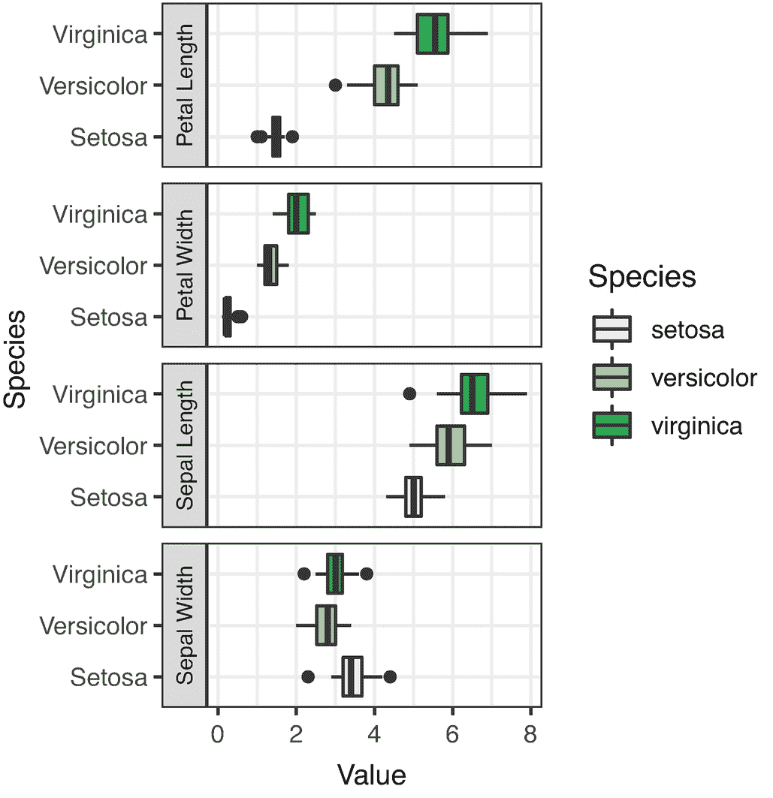

**图 4-28** 翻转坐标并切换分面标签后的鸢尾花图

到目前为止的结果如图 4-28 所示。我们翻转了坐标并移动了标签，但带有彩色背景的标签看起来很难看。我们可以通过修改主题来移除它：`theme(strip.background = element_blank())`。它只是将 `strip.background`（即分面标签的图形属性）设置为空白元素，从而实际上移除了背景颜色。我们还可以通过主题修改来移动图例标签：`theme(legend.position="top")`。

```
iris %>%
pivot_longer(
-Species,
names_to = "Measurement",
values_to = "Value"
) %>%
ggplot(aes(x = Species, y = Value, fill = Species)) +
geom_boxplot() +
scale_x_discrete(labels = c("setosa" = "Setosa",
"versicolor" = "Versicolor",
"virginica" = "Virginica")) +
scale_fill_brewer(palette = "Greens") +
facet_grid(Measurement ~ ., switch = "y",
labeller = labeller(Measurement = label_map)) +
coord_flip() +
theme(strip.background = element_blank()) +
theme(legend.position="top")
```

现在的结果如图 4-29 所示。这已经非常接近可以输出打印的效果了。我们只希望标签化的物种名称和轴标签一样都采用大写字母。

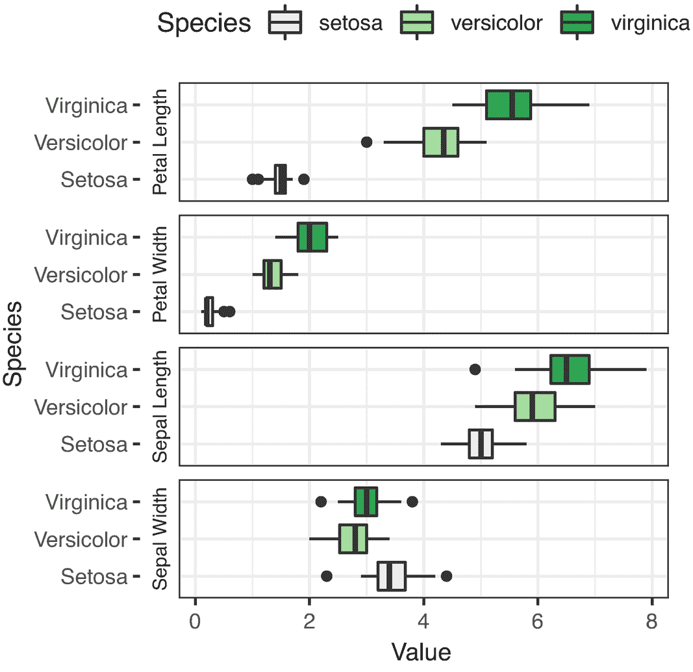

**图 4-29** 经过主题修改的鸢尾花数据

嗯，我们知道如何使用标度的 `labels` 参数来实现这一点，因此最终的绘图代码可能如下所示：

```
label_map <- c(Petal.Width = "Petal Width",
Petal.Length = "Petal Length",
Sepal.Width = "Sepal Width",
Sepal.Length = "Sepal Length")
```

```
species_map %>%
pivot_longer(
-Species,
names_to = "Measurement",
values_to = "Value"
) %>%
ggplot(aes(x = Species, y = Value, fill = Species)) +
geom_boxplot() +
scale_x_discrete(labels = species_map) +
scale_fill_brewer(palette = "Greens", labels = species_map) +
facet_grid(Measurement ~ ., switch = "y",
labeller = labeller(Measurement = label_map)) +
coord_flip() +
theme(strip.background = element_blank()) +
theme(legend.position="top")
```

最终结果如图 4-30 所示。

## 包含多个子图的图形

使用分面（facets）可以满足大部分需要在同一张图中放置多个面板的需求，但并非全部。当你希望在不同面板中展示数据的不同子集，且这些子集使用基本相同的图形时，会用到分面。有时，你需要在不同面板中，将不同类型的图形或不同数据集的图形作为子图组合起来。为此，你需要将原本独立的图形合并在一起。

`ggplot2` 包并不直接支持合并多个图形，但可以通过其底层的图形系统 `grid` 来实现。直接使用 `grid` 的基本工具，你可以利用许多底层功能来修改图形，但如果只是为了合并图形，你会需要一些更高级的函数，而 `gridExtra` 包就能提供这些函数。

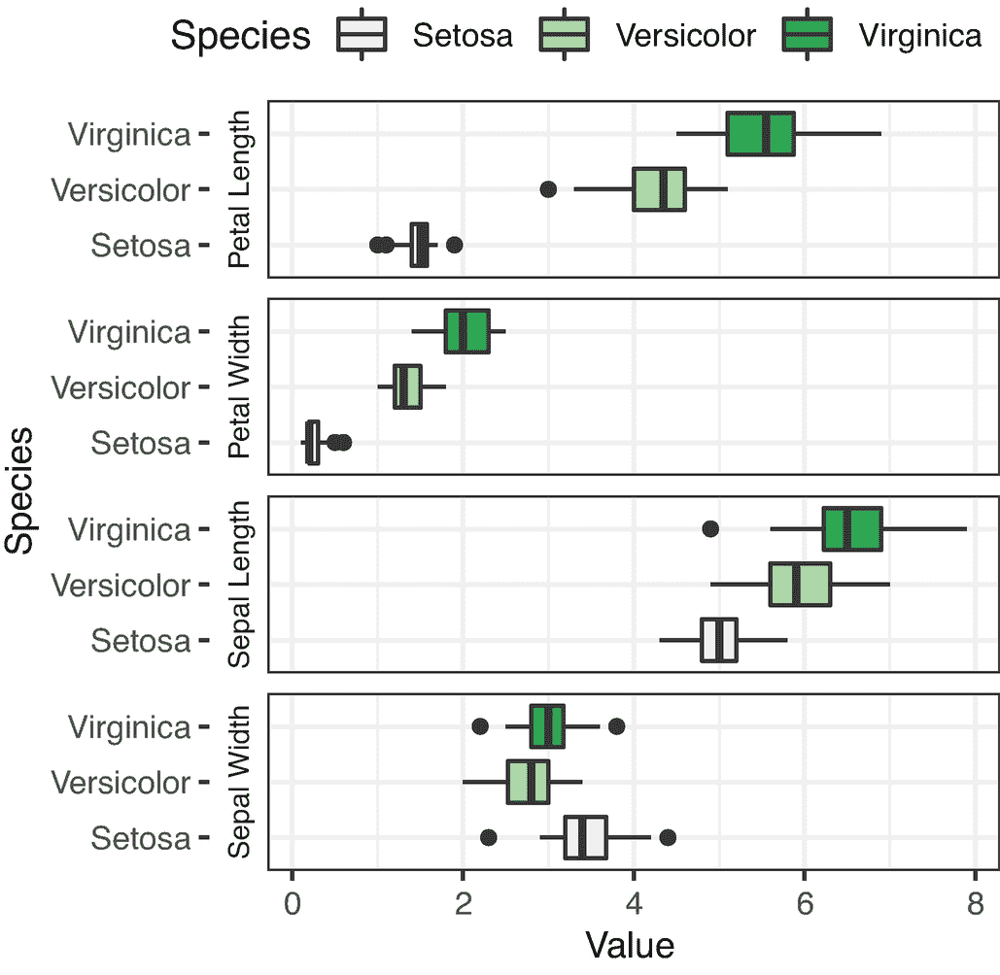

图 4-30

鸢尾花数据集的最终版本图形

要合并图形，首先需要像往常一样创建它们。例如，我们可以创建两个关于 `iris` 数据集的图形：

```
petal <- ggplot() +
  geom_point(aes(x = Petal.Width, y = Petal.Length,
                 color = Species)) +
  scale_color_grey() +
  theme(legend.position="none")
sepal <- ggplot() +
  geom_point(aes(x = Sepal.Width, y = Sepal.Length,
                 color = Species)) +
  scale_color_grey() +
  theme(legend.position="none")
```

然后导入 `gridExtra` 包：

```
library(gridExtra)
```

接着可以使用 `grid.arrange()` 函数创建一个图形网格，将刚才创建的两个图形放入其中（见图 4-31）：

```
grid.arrange(petal, sepal, ncol = 2)
```

我喜欢的另一种方法是使用 `cowplot` 包中的 `plot_grid()` 函数。这个包包含了 Claus O. Wilke（`cow` 即来源于此）为满足自身绘图需求而开发的几个函数，加载它会重新定义默认的 `ggplot2` 主题。如果你不喜欢 `cowplot` 提供的主题，可以使用 `theme_set()` 函数将其改回。

总之，使用 `cowplot` 创建包含子图的图形时，需要先导入这个包：

```
library(cowplot)
```

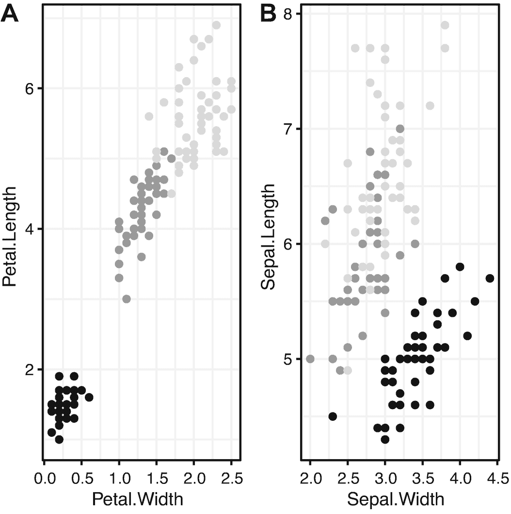

图 4-32

使用 cowplot 合并两个鸢尾花数据集图形

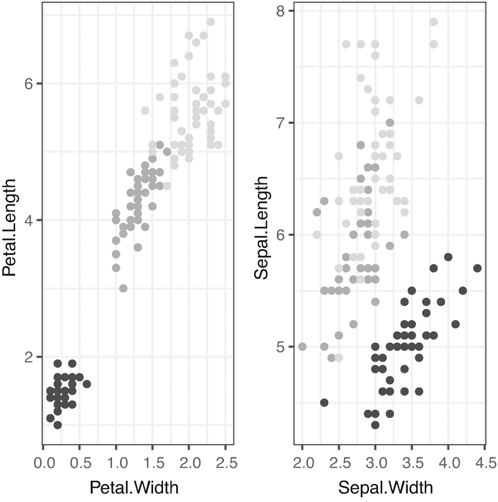

图 4-31

使用 grid.arrange 合并两个鸢尾花数据集图形

如果我们不希望使用它设置的主题，就需要再次使用 `theme_set()` 进行修改，否则我们可以直接使用 `plot_grid()` 来合并之前定义好的图形（见图 4-32）：

```
plot_grid(petal, sepal, labels = c("A", "B"))
```

使用 `patchwork` 包，合并图形会更加简单。你只需将它们相加，即可让它们并排显示：

```
library(patchwork)
petal + sepal
```

管道操作符（`|`）与加号作用相同，因此以下组合方式效果一致：

```
petal | sepal
```

如果你想将一个图形堆叠在另一个之上，可以使用 `/`：

```
petal / sepal
```

你可以结合使用括号，例如，如果你想让 `petal` 和 `sepal` 图形并排，并在它们下方再放一个 `sepal` 图形，可以这样写：

```
(petal + sepal) / sepal
```

### 练习

在上一章中，你应该已经导入了一个数据集，并使用 `dplyr` 和 `tidyr` 通过汇总统计量对其进行了探索。现在，请使用绘图来完成同样的工作。如果你之前查看了汇总统计量，请尝试用箱线图或平滑散点图来表示这些数据。如果你有使用 `tidyr` 整理的多个变量，请尝试绘制类似于本章前面鸢尾花数据集的图形。