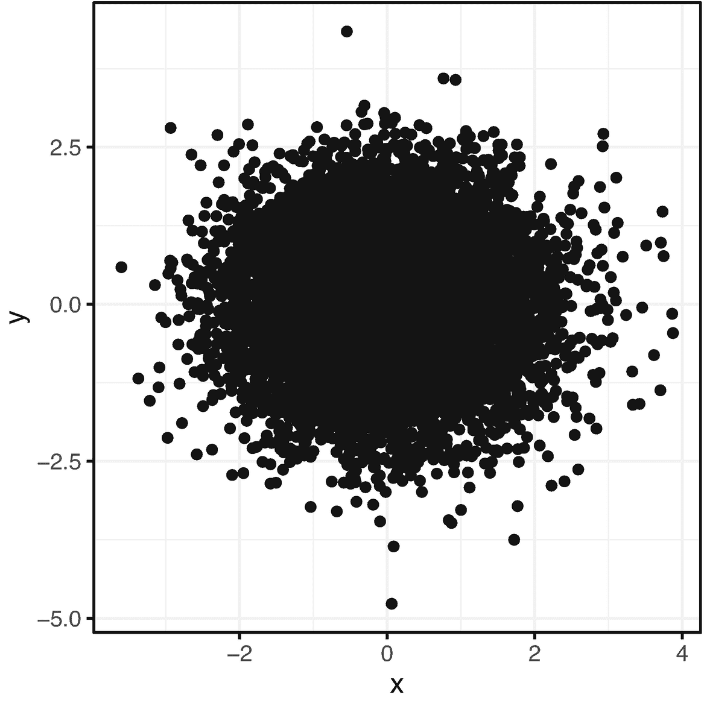
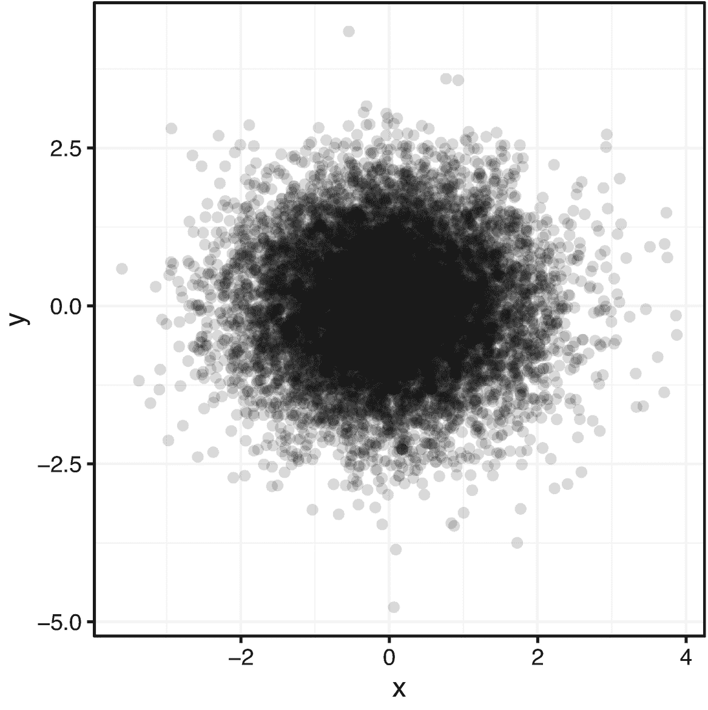
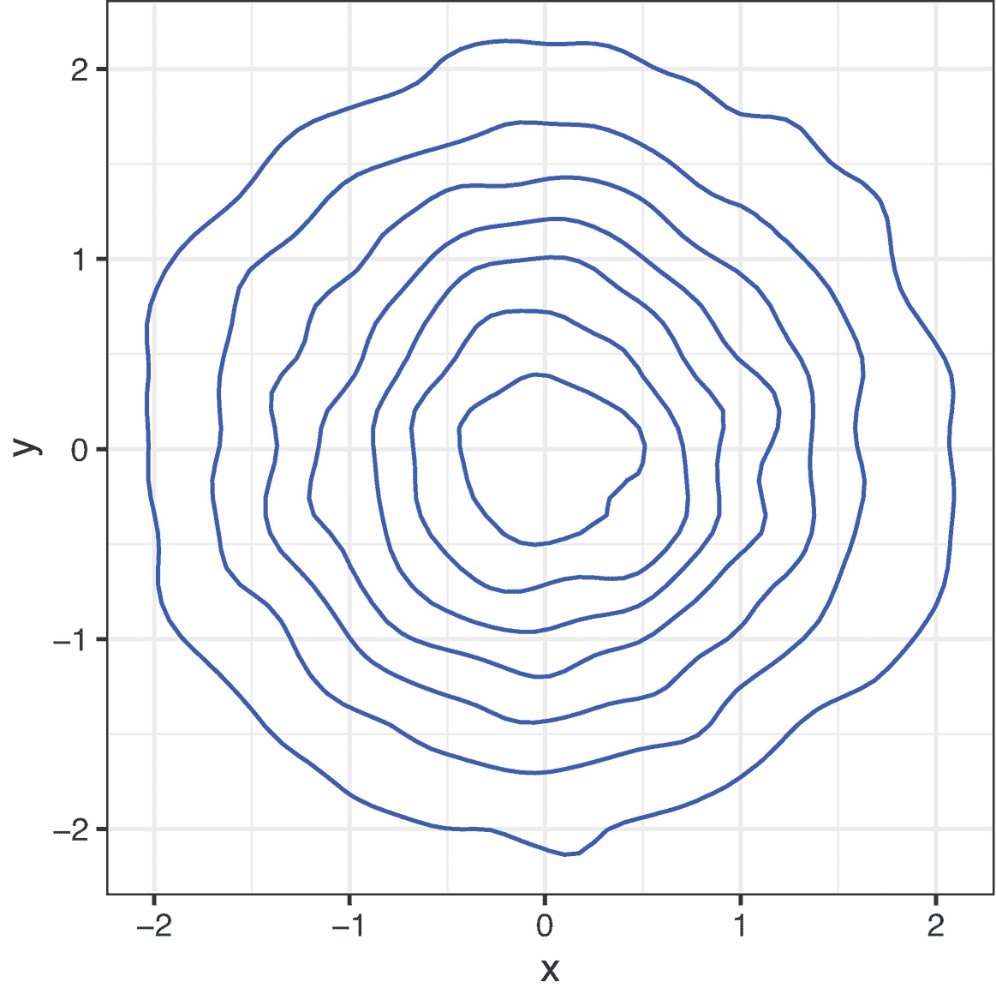
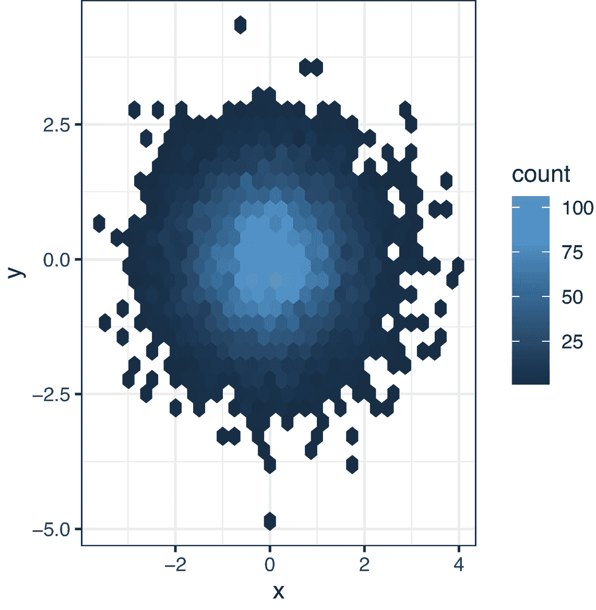
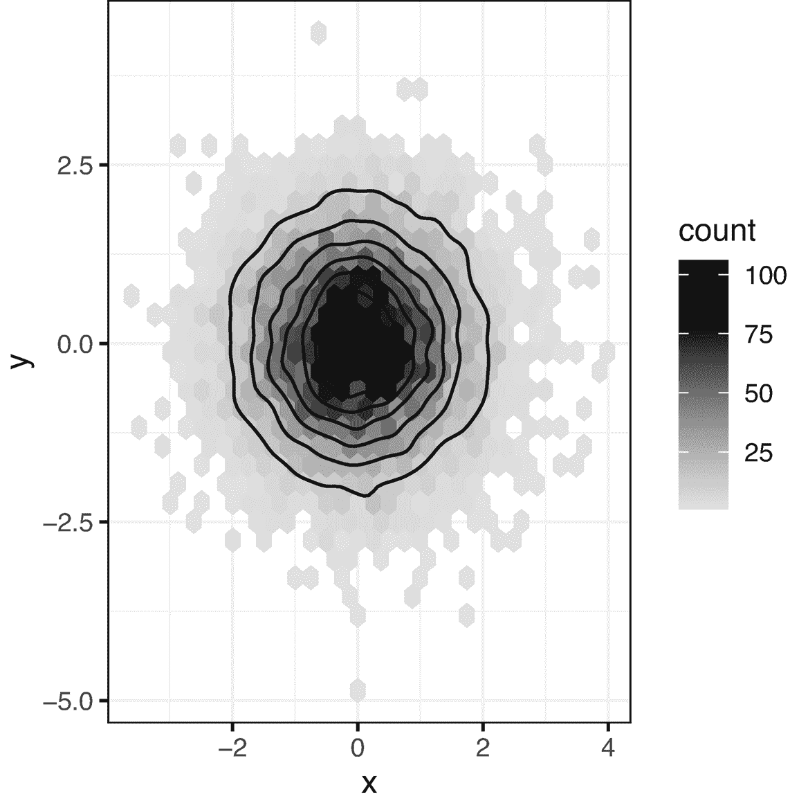

# 5. 处理大型数据集

大数据的概念指的是极其庞大的数据集，其规模之大，以至于需要数据仓库来存储，并且通常需要复杂的算法来处理数据，以及分布式计算来推进分析。至少，我们谈论的是几千兆字节的数据，但往往也涉及几太字节甚至几艾字节。

处理大数据也是数据科学的一部分，但这超出了本书的范畴。本章聚焦于大型数据集，以及如何处理那些会拖慢你分析速度的数据，但并非指那些大到无法在你的台式计算机上分析的数据集。

如果忽略大数据问题，大型数据集的界定很大程度上取决于你打算用数据做什么。这归根结底取决于你所尝试实现的目标的复杂性。有些算法速度很快，能够以线性时间扫描数据——这意味着分析数据所需的时间与数据点数量成线性关系——而另一些算法则需要指数时间，并且无法应用于包含超过几十或几百个数据点的数据集。在给定时间或给定空间（无论是内存、磁盘空间还是其他所需资源）内，能用数据做什么的科学，被称为复杂度理论，这是计算机科学的基础主题之一。不过，在实际应用中，它通常归结为你愿意等待分析完成多长时间，这是一个非常主观的衡量标准。

在本章中，我们仅考虑几个案例，这些案例来自我自己的工作中，数据变得有些过大，无法按我设想的方式处理，而我不得不以各种方式应对。你的案例可能会有所不同，但至少你可以从这些案例中获得一些启发。

## 在分析完整数据集之前，先对数据进行子抽样

我想指出的第一点是：你很少需要分析一个完整的数据集，才能对数据的行为有一个初步了解。除非你在寻找非常罕见的事件，否则查看几千个数据点与查看几百万个数据点所获得的对数据的感知是差不多的。

有时，你确实需要大量的数据来寻找你所需要的东西。例如，在寻找基因变异与常见疾病之间的关联时就是这种情况，这种关联可能非常微弱，你需要大量数据来区分偶然关联和真实关联。但对于数据中大多数具有实际重要性的信号，你通常可以在较小的数据集中看到它们。因此，在将全部数据的全部力量投入分析之前，尤其是当分析变得非常缓慢时，你应该先探索一个较小的数据样本。

在这里，你必须选择一个随机样本。数据中通常存在数据框列之外的结构。这可能是由数据收集时间造成的结构。如果数据是按收集时间排序的，那么你拥有的第一个数据点可能与后面的数据点不同。这一点在数据中没有明确体现，但结构确实存在。随机化你的数据可以缓解由此产生的问题。随机化可能会消除微弱的信号，但借助统计学的力量，我们可以处理随机噪声。处理那些我们根本不知道的、持续存在的偏差要困难得多。

如果你有一个大型数据集，并且它导致你的分析速度变慢，不要害怕，随机选取一个子集并对其进行分析。你可能会在子样本中看到完整数据集中不存在的信号，但这比你担心的可能性要小得多。当你在数据中寻找信号时，你总是要担心假信号。但假信号在较小数据集中出现的可能性并不比在较大数据集中更高。而且，由于有更全面的数据集可以稍后用于验证你的结果，你不太可能在整个分析结束时坚持错误的结论。

得到虚假结果主要与传统的假设检验有关。如果你将 `p` 值信号显著性的阈值设为 5%，那么每二十次中你就会看到一次虚假结果。如果你不进行多重检验校正，几乎可以肯定你会看到虚假结果。当你之后将完整数据投入模型时，这些虚假结果很难幸存下来。

无论如何，对于大型数据集，你更有可能获得与零假设模型有统计学显著差异的结果，而这些差异可能完全与分析无关。我们在分析数据时通常使用简单的零假设模型，而任何复杂数据集都不是由简单的零假设模型生成的。数据量足够大时，你所研究的任何事物都有很大可能与你的简单零假设模型存在显著偏差。现实世界并非从一个简单的线性模型中抽取样本。总会存在一些额外的复杂性。你无法通过少量数据点看到这一点，但如果数据足够多，你可以拒绝任何零假设模型。但这并不意味着你看到的东西具有任何实际重要性。

如果你能在数据的较小子集中发现信号，并且这些信号在你查看完整数据集时依然存在，那么你可以对它们更加信任。

因此，如果数据量拖慢了你的速度，那就进行降采样并分析一个子集。

你可以使用 `dplyr` 函数 `sample_n()` 和 `sample_frac()` 来从数据框中抽样。使用 `sample_n()` 获取固定行数，使用 `sample_frac()` 获取数据的一部分比例：

```r
iris |> sample_n(size = 5)
##   Sepal.Length Sepal.Width Petal.Length
## 1          5.5         3.5          1.3
## 2          6.4         2.8          5.6
## 3          5.7         2.8          4.5
## 4          5.0         3.4          1.5
## 5          5.1         3.8          1.6
##   Petal.Width    Species
## 1         0.2     setosa
## 2         2.2  virginica
## 3         1.3 versicolor
## 4         0.2     setosa
## 5         0.2     setosa
iris |> sample_frac(size = 0.02)
##   Sepal.Length Sepal.Width Petal.Length
## 1          6.3         2.5          5.0
## 2          6.4         2.8          5.6
## 3          6.3         3.3          4.7
##   Petal.Width    Species
## 1         1.9  virginica
## 2         2.2  virginica
## 3         1.6 versicolor
```
（你的输出结果会不同，因为这些都是随机函数，但外观应该相似。）

当然，使用 `dplyr` 进行抽样需要你的数据采用 `dplyr` 可以操作的形式，而且如果数据太大以至于无法加载到 `R` 中，那么你一开始就无法将其放入数据框中进行抽样。幸运的是，`dplyr` 支持使用存储在磁盘而非 `RAM` 中的数据，可以采用多种后端格式，我们稍后会看到。例如，可以将数据库连接到 `dplyr`，并以此方式从大型数据集中进行抽样。

## 分析过程中内存耗尽

`R` 语言可能非常浪费内存。即使你的数据集足够小，能够放入内存且分析时间不成问题，也很容易耗尽内存，因为 `R` 语言记住的东西比表面上看到的要多。

在 `R` 语言中，所有对象都是不可变的，^((10))所以每当你修改一个对象时，实际上是在创建一个新对象。其实现足够智能，只有在数据不同时，你才会拥有独立的数据副本。用两个不同的变量指向同一个数据框，并不意味着该数据框被表示了两次。不过，如果你修改了其中一个变量中的数据框，`R` 会创建一个包含修改内容的副本，于是你现在就有了两份数据，可以通过这两个变量访问。但是，如果你只通过一个变量引用该数据框，那么 `R` 足够智能，不会创建副本。

你可以使用 `pryr` 包来检查内存使用情况和内存变化：

```r
library(pryr)
```
例如，我们可以看看创建一个新向量的代价：

```r
mem_change(x <- rnorm(10000))
## 83.9 kB
```
（你在这里看到的具体数值取决于你的计算机和安装环境，因此如果与我的不同，不必惊讶。）

`R` 不允许修改数据，所以当你“修改”一个向量时，它会创建一个包含更改内容的新副本。这并不会显著增加内存使用，因为 `R` 足够智能，只有在多个变量引用同一个对象时才会进行拷贝：

```r
mem_change(x[1] <- 0)
## 528 B
```
如果我们将这个向量赋值给另一个变量，并不会使用双倍内存，因为这两个变量都只是指向同一个对象：

```r
mem_change(y <- x)
## 584 B
```
但如果我们修改其中一个向量，就必须创建一个副本，这样另一个向量保持不变：

```r
mem_change(x[1] <- 0)
## 80.6 kB
```
这也是使用管道而非在分析过程中将结果赋给多个变量的另一个原因。如果你将结果赋值回同一个变量，是没问题的，所以 `%<>%` 操作符不会导致大量副本的产生。

即便如此，使用管道时仍需谨慎。`R` 中的许多函数会再次复制数据。

如果一个函数对数据进行了任何修改，数据就会被复制到一个局部变量中。可能会存在一些共享，例如，仅在一个局部变量中引用数据框并不会创建副本。然而，如果你在函数中将数据框拆分为训练数据和测试数据，那么就会进行复制，现在你拥有了所有数据的两份副本。函数完成计算后，这部分内存会被释放，所以只有当你非常接近内存限制时，这才会成为问题。

如果这些被复制的数据以某种方式从函数中返回，则不会被释放。例如，模型拟合函数将整个拟合数据保存在返回的对象中，这种情况并不罕见。如果它未经修改就被复制，我们同样不会看到内存增加。但是，如果函数以任何方式修改了它，我们现在使用的内存就是之前的两倍。

当你在 `R` 语言中进行数据分析时遇到内存耗尽问题，通常不是因为无法在初始时表示你的数据，而是因为你最终有了很多副本。你可以通过以下方式在一定程度上避免这种情况：不要将临时数据框存储在变量中，也不要隐式地将数据框副本存储在函数输出中，或者可以使用 `rm()` 函数显式删除已存储的数据以释放内存。

## 数据量过大无法绘图

我通常在处理大数据集时首先遇到问题的地方并非内存耗尽，而是在绘制图形时，尤其是制作散点图时；箱线图或直方图汇总了数据，通常不是问题。

使用大量数据制作散点图时有两个问题。首先，如果你从散点图创建文件，你创建的是一个包含每一个单独数据点的图形。这可能是一个巨大的文件。更糟糕的是，绘制它会花费很长时间，因为查看器必须考虑每一个点。你可以通过创建栅格图形而非 `PDF` 来避免这个问题，但这又引出了第二个问题。点太多时，散点图就不再具有信息量了。点会重叠，你无法看出有多少个单独的数据点落在图形上。通常在计算时间成为问题之前，这就会成为问题。

例如，如果我们有一个包含 10,000 个点的数据框：

```r
d <- data.frame(x = rnorm(10000), y = rnorm(10000))
```
我们仍然可以制作散点图，并且如果图形保存为栅格图形而非 `PDF` 格式，文件大小不会大到无法观看或打印：

```r
d |> ggplot(aes(x = x, y = y)) +
geom_point()
```
结果只是信息量不大；见图 5-1。这些点显示在彼此之上，使得很难看出大片的黑色点云在某些地方的密度是否比其他地方更高。



图 5-1：点过多的散点图

解决方案是，当有很多重叠的点时，让这些点仍然可见。如果点因为具有相同的 `x` 或 `y` 坐标而重叠，你可以对其进行抖动；我们在前一章中看到了这一点。解决相同问题的另一个方法是使用 `alpha` 级别绘制点，这样每个点都有部分透明度。由于点稍微透明，你可以看到点的密度，但你最终得到的图形仍然包含非常多的点；见图 5-2。



图 5-2：使用 `alpha` 值的散点图

```r
d |> ggplot(aes(x = x, y = y)) +
geom_point(alpha = 0.2)
```
然而，这并没有解决文件会绘制每一个点并导致打印和文件大小问题。不过，带透明度的散点图只是一种展示二维密度的方法，我们可以直接使用 `geom_density_2d()` 函数来实现；见图 5-3。



图 5-3：二维密度图

```r
d |> ggplot(aes(x = x, y = y)) +
geom_density_2d()
```
此图显示了密度的等高线。

另一种展示二维密度的方法是使用所谓的六边形图，它是直方图的二维等价物。该图将二维平面分割成六边形网格，并显示落在每个网格内的点的计数。

要使用它，你需要安装 `hexbin` 包，并使用 `ggplot2` 函数 `geom_hex()`；见图 5-4。



图 5-4：六边形图

```r
d |> ggplot(aes(x = x, y = y)) +
geom_hex()
```
`geom_hex()` 使用的颜色是填充颜色，因此你可以使用 `scale_fill` 系列函数来更改它们。你也可以结合六边形图和二维密度图，同时显示网格和等高线；见图 5-5。



图 5-5：结合了六边形图和二维密度的图

```r
d |> ggplot(aes(x = x, y = y)) +
geom_hex() +
scale_fill_gradient(low = "lightgray", high = "grey10") +
geom_density2d(color = "black")
```

## 分析速度过慢

在绘制数据图表时，问题通常只出现在散点图中。否则，你无需担心数据点过多或绘图文件过大。即使绘制大量数据点，真正的麻烦也要等到你创建好图表并将其加载到查看器或发送到打印机时才会显现。

不过，一旦数据点足够多，大多数分析都会变慢，这就会成为问题。

简单的解决方案仍然是进行数据子采样，然后基于子集进行分析。这会在不拖慢分析速度的情况下，向你展示数据中的相关信号。

如果这个方案不适用于你，那么你需要选择效率更高的分析算法。这通常意味着要使用线性时间算法。不幸的是，许多标准算法并非线性时间，即便有些是，其实现方式也未必能让你轻松地以批次方式拟合数据——即一次只更新一批模型参数。你通常需要寻找为此专门编写的软件包，或者自行编写。

有一个软件包既能提供内存高效的线性模型拟合（它避免了创建每行对应一个数据点的模型矩阵并求解方程），又能提供批量更新模型的功能，那就是 `biglm` 包：

```r
library(biglm)
```
你可以使用其中的 `biglm()` 函数代替 `lm()` 函数进行线性回归，也可以使用 `bigglm()` 函数代替 `glm()` 函数进行广义线性回归（详见第 6 章）。

如果你使用的数据框格式能将数据存储在磁盘上，并支持 `biglm` 包（参见下一节），该包会将数据分割成可以加载到内存中进行分析的块。如果你没有能自动处理此过程的包，你可以自行将数据分块。作为一个简单示例，我们可以考虑 `cars` 数据集，并尝试拟合一个以速度为自变量、刹车距离为因变量的线性模型，但每次只处理十个数据点。当然，对于这么小的数据集，我们完全可以不经分块就直接拟合，甚至根本不需要使用 `biglm()` 函数，但这里只是作为例证。

定义分片索引需要一些简单的算术运算，之后我们可以使用 `dplyr` 包中的 `slice()` 函数提取数据子集。我们可以从第一个分片创建线性模型，然后使用以下方法进行更新：

```r
slice_size <- 10
slice <- cars %>% slice(1:slice_size)
model <- biglm(dist ~ speed, data = slice)
for (i in 1:((nrow(cars) / slice_size) - 1)) {
  slice <- cars %>% slice((i*slice_size+1):((i+1)*slice_size))
  model <- update(model, moredata = slice)
}
Model
## Large data regression model: biglm(dist ~ speed, data = slice)
## Sample size = 50
```
贝叶斯模型拟合方法素来以速度慢著称（这有一定道理），但基于共轭先验的贝叶斯模型却非常适合这种分块处理。拥有共轭先验意味着，你分析一个数据集得到的后验分布，可以直接用作下一个数据集的先验分布。这样，你就可以将数据分割成若干分片，用真实的先验拟合第一个分片，然后用前一个模型拟合的结果作为后续分片的先验。

本书最后一章第二个项目中的贝叶斯线性回归模型就是这样一个模型。在那一章中，我们实现了一个 `update()` 函数，它能够基于一个数据集和一个先前拟合好的模型来拟合新模型。将其应用于 `cars` 数据集，并将数据分割成大小为 10 的块，其过程与前面 `biglm` 的例子非常相似。

更棒的是，有些模型允许你独立分析各个分片，然后将结果组合起来，得到整个数据集的模型。这些模型不仅可以分批次分析，而且这些分片可以并行处理，充分利用多核或多计算节点的优势。对于梯度下降优化方法，你可以独立计算每个分片的梯度，然后将它们组合起来，在优化过程中迈出一步。

然而，对于因数据过大而无法高效分析的情况，并没有通用的解决方案。这需要你仔细思考所使用的算法，并且通常还需要对这些算法进行一些定制化的实现，除非你很幸运，能找到能够处理批次数据的软件包。

## 过大而无法加载

`R`希望将处理的数据保存在内存中。因此，如果你的计算机没有足够的`RAM`来容纳数据，那就无能为力了——至少在使用诸如`data.frame`之类的默认数据表示形式时是如此。`R`通常还希望使用 32 位整数作为索引。由于其索引同时使用正数和负数，因此即使内存能容纳更多数据，索引上限也被限制在约二十亿个数据点。

有多个软件包可以处理此问题。其中之一是`ff`包，它能处理我们目前使用的表格类型，但通过内存映射文件来表示数据，并按需将数据块加载到内存中：
```r
library(ff)
```
它本质上会创建平面文件，并具备在分析时将文件中的数据块映射到内存中的功能。

它将数据帧表示为`ffdf`类的对象。如果你将其作为数据帧使用，它们的行为与数据帧完全相同。你可以使用`as.ffdf()`函数将数据帧转换为`ffdf`对象。

例如，你可以使用以下代码将`cars`数据转换为`ffdf`对象：
```r
ffcars <- as.ffdf(cars)
summary(ffcars)
##       Length Class     Mode
## speed 50     ff_vector list
## dist  50     ff_vector list
```

当然，如果你已经能在内存中表示一个数据帧，就无需进行此转换。但`ff`也提供了从文件创建`ffdf`对象的函数。例如，如果你有一个大型逗号分隔值文件，可以使用`read.csv.ffdf()`。

通过`ff`，你可以使用多种函数从内存映射的平面文件中高效计算汇总统计信息。这些函数被实现为泛型函数（我们将在第 12 章中介绍泛型函数）。这意味着对于大多数常见的汇总需求，我们可以高效地处理`ffdf`对象。然而，并非所有函数都支持此功能，因此有时函数会（隐式地）将`ffdf`对象当作普通的`data.frame`来处理。这意味着全部数据可能会被加载到内存中。如果数据过大而无法容纳，这通常行不通。

要处理无法加载到内存中的数据，你必须分批进行分析。这意味着你需要用于分析数据的特殊函数，而遗憾的是，这通常意味着你必须自己实现分析算法。

你不能将`ffdf`对象与`dplyr`一起使用，这是使用`ff`表示数据的一个主要缺点。不过，`dplyr`包本身支持不同的后端，例如关系数据库。如果你能以平面文件形式处理数据，那么将其存入数据库并无益处；但大型数据集通常存储在通过结构化查询语言（SQL）访问的数据库中。这是一种值得学习的语言，但超出了本书的范围。无论如何，`dplyr`可用于访问此类数据库。这意味着你可以编写`dplyr`管道来调用数据处理函数；这些调用将被转换为 SQL 表达式并发送到数据库系统，然后你就能获取结果。

通过`dplyr`，你可以访问常用的数据库系统，如 MySQL ([`www.mysql.com`](http://www.mysql.com)) 或 PostgreSQL ([`www.postgresql.org`](http://www.postgresql.org))。不过，这些系统需要你为数据设置一个服务器。因此，如果你的数据尚未存储在数据库中，一个更简单的解决方案是使用 LiteSQL ([`https://en.wikipedia.org/wiki/LiteSQL`](https://en.wikipedia.org/wiki/LiteSQL))。

LiteSQL 数据库驻留在你的文件系统上，并提供一种文件格式以及使用 SQL 访问它的方式。你可以使用`src_sqlite()`函数打开或创建一个 LiteSQL 文件：
```r
iris_db <- DBI::dbConnect(RSQLite::SQLite(),
path = "iris_db.sqlite3")
```
并使用`copy_to()`将数据集加载到其中：
```r
copy_to(iris_db, iris, temporary = FALSE)
```

当然，如果你已经能在 RAM 中表示一个数据帧，通常不会将其复制到数据库。与将数据保留在内存中相比，通过数据库系统进行操作只会拖慢分析速度——但关键在于，你可以在`R`之外填充数据库，然后使用`dplyr`访问它。

此处的`temporary`选项设置为`FALSE`，可确保你填入数据库的表在会话之间持久存在。如果不将`temporary`设置为`FALSE`，该表只会在数据库打开期间存在；关闭后它将被删除。这适用于许多操作，但不是我们此处想要的。

一旦连接到数据库，你可以使用`tbl()`拉取一个表：
```r
iris_db_tbl  [?? x 5]
## # Database: sqlite 3.38.0 []
##    Sepal.Length Sepal.Width Petal.Length
##                          
## 1           5.1         3.5          1.4
## 2           4.9         3            1.4
## 3           4.7         3.2          1.3
## 4           4.6         3.1          1.5
## 5           5 3\.        6            1.4
## 6           5.4         3.9          1.7
## 7           4.6         3.4          1.4
## 8           5 3\.        4            1.5
## 9           4.4         2.9          1.4
## 10          4.9         3.1          1.5
## # … with more rows, and 2 more variables:
## #   Petal.Width , Species 
```
并使用`dplyr`函数对其进行查询：
```r
iris_db_tbl %>% group_by(Species) %>%
summarise(mean.Petal.Length = mean(Petal.Length, na.rm = TRUE))
## # Source:   lazy query [?? x 2]
## # Database: sqlite 3.38.0 []
##   Species    mean.Petal.Length
##                     
## 1 setosa                  1.46
## 2 versicolor              4.26
## 3 virginica               5.55
```
将`dplyr`与 SQL 数据库结合使用超出了本书的范围，因此我仅建议你参阅该包的文档。

当然，使用数据库后端的`dplyr`操作数据，仅在完全通过`dplyr`进行分析时才有用。要拟合模型等操作，你仍然需要分批处理数据，因此通常仍需要一些自定义代码。

### 练习

#### 子采样
选取你在最后两章中处理的数据集，并从中选出子集。对其进行汇总，并与针对完整数据得到的结果进行比较。绘制子样本的图表，并与你使用完整数据创建的图表进行比较。

#### 六边形图与二维密度图
如果你曾使用任何散点图来观察数据，请将它们转换为六边形图或二维密度图。