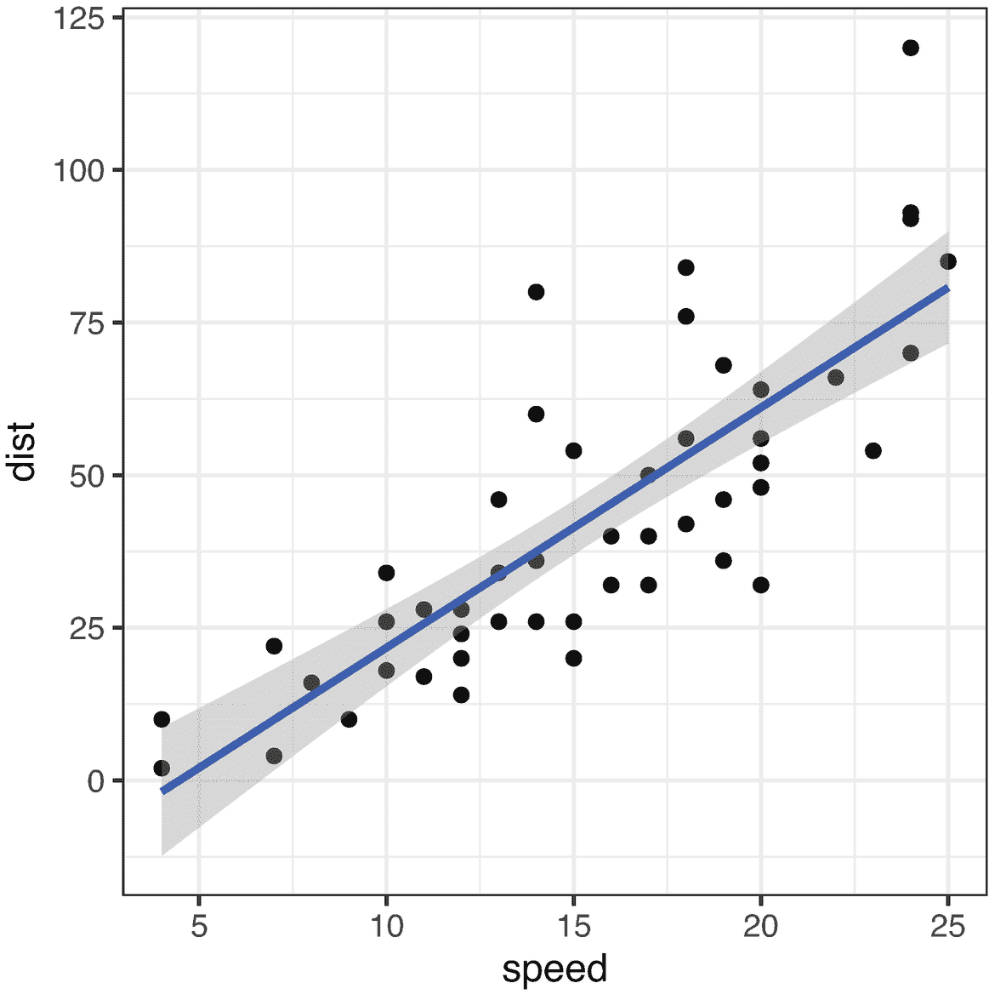
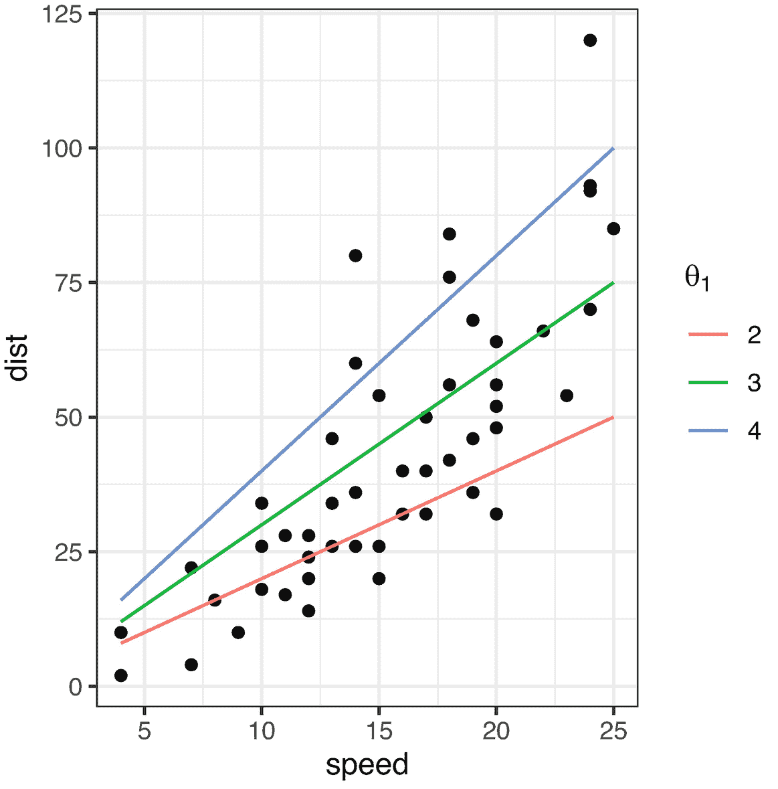
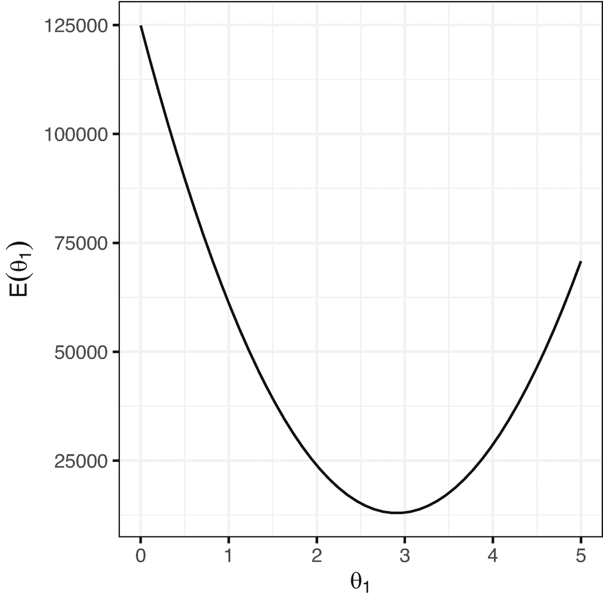
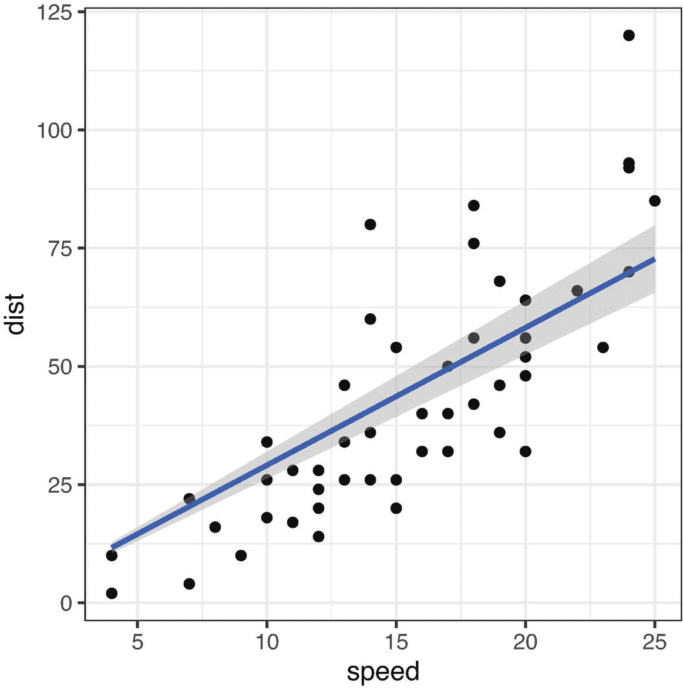
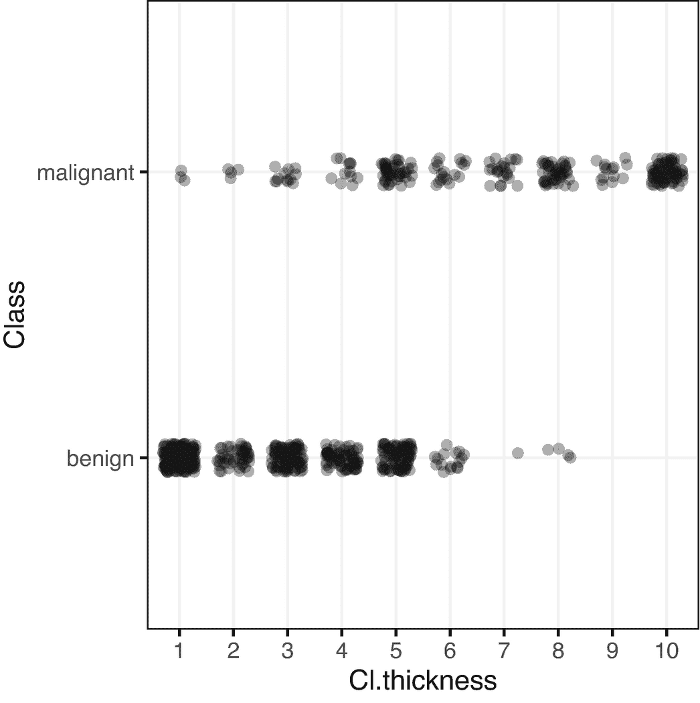
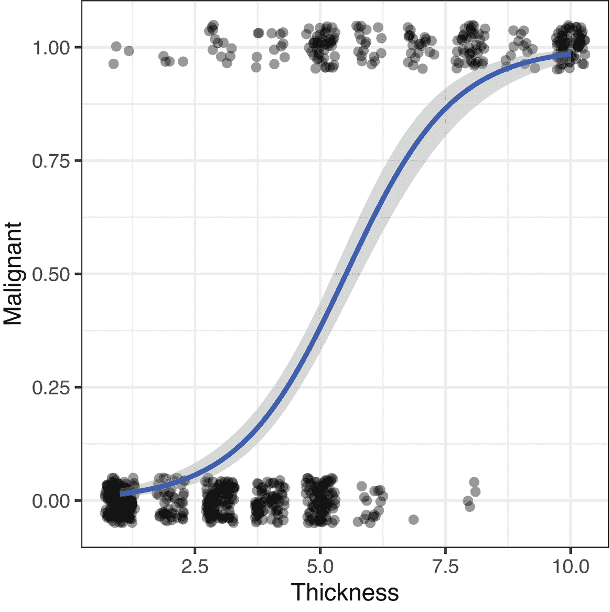
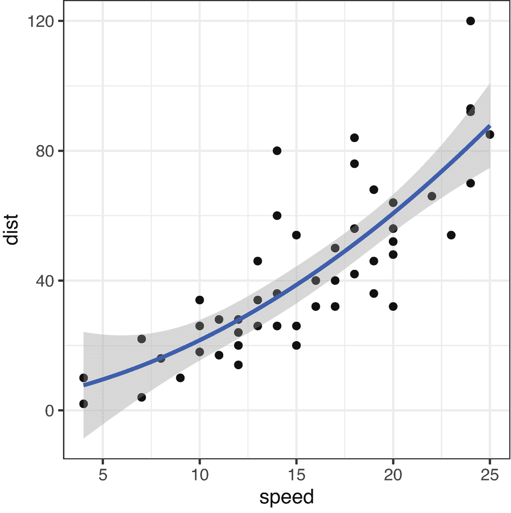
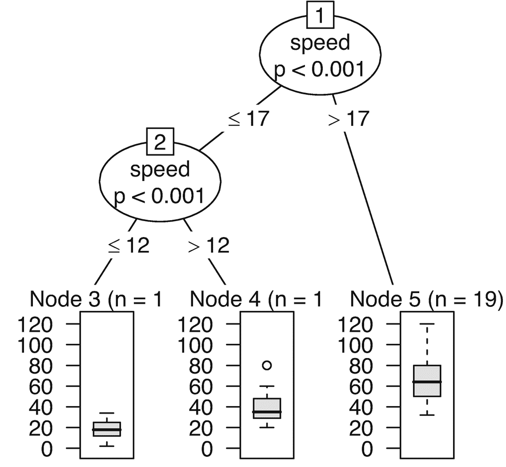

# 6. 监督学习

本章及下一章涉及数据的数学建模，这是数据科学的核心。我们可以称之为统计学，也可以称之为机器学习。其本质是相同的。这一切都关乎从数据中提取信息。

## 机器学习

机器学习是开发和运用从数据中学习的模型与算法的学科。传统算法会实现固定的规则来解决特定问题，例如对数字排序，或寻找两座城市之间的最短路线。要开发此类算法，你需对欲解决的问题有深入理解——除非问题特别简单，或者你已抽象掉所有异常情况，否则这种透彻理解几乎难以企及。更常见的情况是，你可以收集到针对待解决问题好的或差的解法的示例，却无法精确解释某个解法为何好或差。或者，你能获取到提供你感兴趣数据之间关系示例的数据，却未必了解这些关系背后的根本原因。

这正是机器学习能提供帮助之处。机器学习涉及从数据中学习。你并非显式地开发一个算法来解决特定问题，而是使用一个通用学习算法，向其喂入解法的示例，让它从这些示例中学会如何解决问题。

这听起来可能很抽象，但实际上大多数统计建模都是这方面的例子。以线性模型 `y = αx + β + ϵ` 为例，其中 `ϵ` 是随机噪声（通常假定服从正态分布）。当你想建模 `x` 和 `y` 之间的线性关系时，你不会从第一性原理中推导出 `α` 和 `β`。你可以编写一个排序数字的算法而无需事先研究这些数字，但若不查看数据，你通常无法弄清 `y` 和 `x` 之间是什么线性关系。当你拟合这个线性模型时，你就是在进行机器学习。（嗯，我想，如果你手动来做，那不算机器学习，但你也不太可能经常手动拟合线性模型吧。）人们通常不把像线性回归这样简单的模型称为机器学习，这主要是因为“机器学习”这个术语比这些模型年轻得多。线性回归和神经网络一样，都属于机器学习。

## 监督学习

当你拥有一些变量，并想用其他变量来预测它们时，就会用到监督学习——就像线性回归这样的情况：你有一些输入变量（例如 `x`），并且想要一个模型来预测输出（或响应）变量，即 `y = f(x)`。

下一章的主题是无监督学习，它关注的是在你未必清楚自己感兴趣的是何种问题的情况下——即当你没有 `x` 和 `y` 值来了解它们如何关联时，而是拥有一组数据，并想发现其中存在什么模式——在数据中发现模式。

对于监督学习的最简单情形，我们有一个响应变量 `y` 和一个输入变量 `x`，我们想找出一个函数 `f`，将输入映射到输出，也就是使得 `y = f(x)`。我们能利用的是匹配的 `x` 和 `y` 的示例数据。我们将其写成向量 `x = (x[1], ..., x[n])` 和 `y = (y[1], ..., y[n])`，并希望找出一个函数 `f`，使得 `y[i] = f(x[i])`。

我们通常接受观测中可能存在一些噪声，所以 `f` 并不能完美地将 `x` 映射为 `y`。因此，我们可以稍微调整设定，假设我们拥有的数据是 `x = (x[1], ..., x[n])` 和 `t = (t[1], ..., t[n])`，其中 `t` 是目标值，并且 `t[i] = y[i] + ϵ[i]`，`y[i] = f(x[i])`，而 `ϵ[i]` 是观测值 `t[i]` 中的误差。

我们如何对误差 `ϵ[i]` 和函数 `f` 建模，这完全由我们决定。毕竟这只是建模，我们可以做任何想做的事。当然，并非所有模型都一样好，所以我们在选择什么模型以及如何评估选择的好坏时需要谨慎一些，但原则上，我们可以做任何事。

大多数机器学习的工作方式是，算法隐式或显式地定义了一个参数化函数 `f(-; θ)` 的类别，每个函数都将输入映射到输出 `f(-; θ) : x ↦ f(x; θ) = y(θ)`（现在输出值取决于函数的参数 `θ`），而学习过程包括选择参数 `θ`，使得误差最小化，即让 `f(x[i]; θ)` 尽可能接近 `t[i]`。我们希望对所有数据点都接近，或者至少平均而言接近，因此，如果我们用 `y(θ)` 表示向量 `(y(θ)[1], ..., y(θ)[n]) = (f(x[1]; θ), ..., f(x[n]; θ))`，那么我们希望对于某个距离度量 `||·||`，最小化 `y(θ)` 到 `t` 的距离 `||y(θ) – t||`。

### 回归 vs. 分类

监督学习主要有两种类型：回归和分类。当我们要预测的输出变量是一个数值时，使用回归。当我们要预测的是分类变量时，使用分类。

以线性回归为例，`y = αx + β`（或 `t = αx + β + ε`）。这是回归，因为我们要预测的变量是一个数值。参数化的函数族 `f[θ]` 都是直线。如果我们令 `θ = (θ[1], θ[0])` 且 `α = θ[1]`, `β = θ[0]`，那么 `y(θ) = f(x; θ) = θ[1]x + θ[0]`。拟合线性模型就是找到最佳的 `θ`，其中“最佳”定义为使得 `y(θ)` 最接近 `t` 的那个 `θ`。线性回归中使用的距离度量是平方欧氏距离 `|y(θ) - t|² = Σ(yi(θ) - ti)²`。

使用平方距离而不仅仅是距离的原因，主要是数学上的便利——这样更容易最大化 `θ`——但也与我们假设误差项 `ε` 服从正态分布有关。当你在线性回归中拟合数据时，你就是在最小化这个距离；你在寻找参数 `θ`，使得从 `y(θ)` 到 `t` 的距离最小化：

```
θ̂ = argmin_{θ₁, θ₀} Σ (θ₁x_i + θ₀ - t_i)²
```

对于分类的例子，我们假设目标值 `t[i]` 是二元的，编码为 0 和 1，但输入变量 `x[i]` 仍然是实数。定义映射函数 `f(-; θ)` 的一种常见方式是让它将 `x` 映射到单位区间 [0, 1]，并将得到的 `y(θ)` 解释为 `t` 等于 1 的概率。在分类场景中，如果 `f(x; θ) < 0.5`，则预测为 0；如果 `f(x; θ) > 0.5`，则预测为 1（并针对 `f(x; θ) = 0.5` 的情况制定相应策略）。在线性分类中，函数 `f[θ]` 可以这样表示：

`f(x; θ) = σ(θ[1]x + θ[0])`

其中 `σ` 是 S 型函数（一个将 ℝ 映射到 [0, 1] 的“S 形”函数）。`σ` 的一个常见选择是逻辑函数 `σ: z ↦ 1 / (1 + e^{-z})`，这种情况下，我们称拟合 `f(-; θ)` 为逻辑回归。

无论我们是在做回归还是分类，也无论我们使用的是否是线性模型，我们都是在试图找到参数 `θ`，使我们的预测值 `y(θ)` 尽可能接近目标值 `t`。不同机器学习方法的区别在于：预测函数族 `f(-; θ)` 如何定义，我们拥有何种参数 `θ`，以及我们如何衡量 `y(θ)` 和 `t` 之间的距离。这里有很多不同的选择，也有大量不同的机器学习算法。不过，其中许多算法已经在 R 中实现了，因此我们很少需要自己从头实现。我们只需要找到实现所需学习算法的正确包即可。

### 推断 vs. 预测

当我们拟合模型参数时，有一个问题总是值得思考：我们关心的是模型参数，还是仅仅想要一个擅长预测的函数？

如果你和我接受的是同样的统计学教育，那么你最初接触的线性回归主要关注于模型参数。你推断参数 `θ[1]` 和 `θ[0]`，主要是为了弄清楚 `θ[1] ≠ 0` 是否成立，即判断 `x` 和 `y` 之间是否存在（线性）关系。当我们通过将函数拟合到数据上来了解参数时，我们称之为在进行推断，我们在推断参数。

这种对模型参数的关注在许多情况下是合理的。在线性模型中，系数 `θ[1]` 告诉我们 `x` 和 `y` 之间是否存在显著的相关性，意味着我们在统计上相对确信相关性存在，以及是否存在实质性影响，即 `θ[1]` 是否大到在实际应用中值得关注。

当我们关心模型参数时，我们通常不仅想知道最佳拟合参数 `θ̂`。我们还想知道我们对“真实参数”接近估计参数有多大的把握。这通常意味着不仅要估计最佳参数，还要估计置信区间或参数的后验分布。估计这些参数的难易程度很大程度上取决于所使用的模型和算法。

我之前在谈到估计值与“真实参数”有多么接近时，故意将“真实参数”加了引号，这是有充分理由的。只有当您分析的数据是从某个函数 `fθ` 模拟生成，并且存在某个真实的 `θ` 时，真实参数才存在。当您估计参数 `θ̂` 时，您是在寻找最佳参数选择，前提假设是数据是由函数 `fθ` 生成的。在统计教科书之外，没有理由认为您的数据来自于您所考虑的函数族中的某个函数。除非我们试图建立因果关系模型——模拟我们认为世界实际运行的自然力量——否则这通常不是模型拟合的基本假设。我们用于对推断参数进行统计的许多理论确实假设我们拥有正确的函数族，这也是置信区间等概念的来源。在实践中，数据并非来自这类函数，因此对从理论中得到的结果应持怀疑态度。

如果我们有大量数据——这在做数据科学时通常如此——我们可以使用抽样方法直接从数据中获得更经验的参数分布。我将在本章后面简要回顾这一点。

然而，我们并不总是关心模型参数。对于线性回归，解释参数的含义很容易，但在许多机器学习模型中，参数并不那么容易解释——我们也并不真正关心它们。我们只关心我们拟合的模型是否擅长预测目标值。评估我们期望一个函数能够预测得多好，有时也有相关的理论结果，但就像参数估计一样，我们不应该过于信任这些理论。更好的方法是使用实际数据来估计这一点，至于如何获得模型参数的经验分布，我们将在后面讨论。

你是否关心模型参数，取决于你的应用，并且通常取决于你认为模型与现实之间的关系。

### 指定模型

在 R 中指定模型的一般模式是使用所谓的“公式”，这是该语言内置的一种对象类型。最简单的形式是 `y ~ x`，我们应将其解释为 `y = f(x)`。隐含地，假定存在某个用模型参数索引的函数族 `f(-; θ)`，而我们具体使用哪个函数族取决于我们使用哪个 R 函数。

# 线性回归

以一个简单的线性回归为例，`fθ = θ[1]*x + θ[0]`，我们需要用到 `lm()` 函数。

例如，我们可以使用内置数据集 `cars`，它只包含两个变量：速度和刹车距离。我们可以将速度视为 x 值，刹车距离视为 y 值：

```r
cars |> head()
##   speed dist
## 1     4    2
## 2     4   10
## 3     7    4
## 4     7   22
## 5     8   16
## 6     9   10
```



图 6-1

汽车刹车距离与速度的关系图

如果我们绘制该数据集（见图 6-1），就会发现速度和距离之间存在非常清晰的线性关系：

```r
cars |> ggplot(aes(x = speed, y = dist)) +
geom_point() +
geom_smooth(formula = y ~ x, method = "lm")
```

在此图中，我使用了 `"lm"` 方法进行平滑统计，以观察拟合效果。默认情况下，`geom_smooth()` 函数会给出一个 loess 曲线，但由于我们对线性拟合感兴趣，因此我们指定它使用 `lm` 方法。默认情况下，`geom_smooth()` 还会绘制拟合的不确定性区域，即图中的灰色区域。这是回归线可能出现的区域（假设数据由线性模型生成）。但请不要将其与数据点可能出现的区域混淆。如果目标值由 `t = θ[1]*x + θ[0] + ϵ` 给出，且 `ϵ` 的方差非常大，那么即使我们高度确定地知道了 `θ[1]` 和 `θ[0]`，我们仍然无法高精度地预测任何一个数据点的位置。预测精度和推断精度之间存在差异。我们可能以非常高的精度了解模型参数，但无法很好地预测。反之，我们也可能在并不完全了解所有模型参数的情况下进行很好的预测。如果某个模型参数对目标变量的分布影响很小，那么训练数据提供给我们的关于该参数的信息就很少。不过，这种情况通常不会发生，除非模型比实际需要的更复杂，因为我们通常希望移除那些不影响数据的参数。

为了实际拟合数据并获取拟合信息，我们使用带有模型规范 `dist ~ speed` 的 `lm()` 函数，并使用 `summary()` 函数查看拟合信息：^((12))

```r
cars %>% lm(dist ~ speed, data = .) %>% summary()
##
## Call:
## lm(formula = dist ~ speed, data = .)
##
## Residuals:
##     Min      1Q  Median      3Q     Max
## -29.069  -9.525  -2.272   9.215  43.201
##
## Coefficients:
##             Estimate Std. Error t value Pr(>|t|)
## (Intercept) -17.5791     6.7584  -2.601   0.0123
## speed         3.9324     0.4155   9.464 1.49e-12
##
## (Intercept) *
## speed       ***
## ---
## Signif. codes:
## 0 '***' 0.001 '**' 0.01 '*' 0.05 '.' 0.1 ' ' 1
##
## Residual standard error: 15.38 on 48 degrees of freedom
## Multiple R-squared:  0.6511, Adjusted R-squared:  0.6438
## F-statistic: 89.57 on 1 and 48 DF,  p-value: 1.49e-12
```

或者，我们可以使用 `coefficients()` 函数获取点估计值，使用 `confint()` 函数获取参数的置信区间：

```r
cars %>% lm(dist ~ speed, data = .) %>% coefficients()
## (Intercept)       speed
##  -17.579095    3.932409
cars %>% lm(dist ~ speed, data = .) %>% confint()
##                  2.5 %    97.5 %
## (Intercept) -31.167850 -3.990340
## speed         3.096964  4.767853
```

这里，`(Intercept)` 对应 `θ[0]`，`speed` 对应 `θ[1]`。

为了说明拟合过程并使其深入人心，我们可以显式地绘制具有不同参数的模型，即绘制不同 `θ` 选择下的直线。为简化问题，我将设置 `θ[0] = 0`。然后，我可以为不同的 `θ[1]` 选择绘制直线 `y = θ[1]*x`，并直观地观察拟合效果；见图 6-2。

```r
predict_dist % ggplot(aes(x = speed, y = dist, colour = theta)) +
geom_point(colour = "black") +
geom_line(data = predict_dist(cars$speed, 2)) +
geom_line(data = predict_dist(cars$speed, 3)) +
geom_line(data = predict_dist(cars$speed, 4)) +
scale_color_discrete(name=expression(theta[1]))
```

在这个图中，我想根据直线的 `θ[1]` 参数为它们着色，但因为 `cars` 数据框没有 `theta` 列，我有点棘手。我仍然指定了 `theta` 决定颜色，但在绘制点时，我覆盖了这个设定，并规定它们应该绘制成黑色；那么没有 `theta` 值也就无关紧要了。在我绘制直线的 `geom_line()` 调用中，我确实有 `theta` 值，这将决定线条的颜色。直线根据它们在 `predict_dist()` 函数中设置的 `theta` 值进行绘制。

每条直线都代表一个模型选择。给定一个输入值 `x`，它们都会产生一个输出值 `y(θ) = f(x; θ)`。因此，我们可以固定 `θ` 并考虑映射 `x ↦ θ[1]*x`。这是我们在预测给定 `x` 值的输出时使用的函数。如果反过来固定 `x`，我们也可以将其视为 `θ` 的函数：`θ[1] ↦ θ[1]*x`。这正是我们拟合数据参数时所用的，因为如果我们固定数据集，这个映射定义了一个误差函数，即一个根据给定参数衡量预测值与目标值偏离程度的函数。如果像之前一样，我们的输入值和目标值是向量 `x` 和 `t`，那么误差函数就是：

```
E(x,t)(θi) = Σ(i=1 to n)(θ1*xi - ti)²
```

并且我们可以绘制针对不同 `θ[1]` 选择的误差图（图 6-3）。使这个函数最小化的点，就是我们找到的对 `θ[1]` 的最佳估计：

```r
# 获取特定 theta 的误差值
fitting_error  # 设置 theta 值
mutate(errors = fitting_error(theta)) |> # 添加误差
ggplot(aes(x = theta, y = errors)) +
geom_line() +
xlab(expression(theta[1])) + ylab(expression(E(theta[1])))
```



图 6-2

不同参数选择下的预测直线

为了总结这个示例，我们还可以在 `θ[0] = 0` 的条件下绘制并拟合最佳模型。移除截距项所需的公式形式为 `y ~ x - 1`。正是 `- 1` 移除了截距：

```r
cars %>% lm(dist ~ speed - 1, data = .) %>% coefficients()
##    speed
## 2.909132
```

我们也可以使用 `geom_smooth()` 绘制这条回归线及其置信区间，见图 6-4。不过，这里我们需要使用公式 `y ~ x - 1`，而不是 `dist ~ speed - 1`。这是因为 `geom_smooth()` 函数作用于 `ggplot2` 图层，这些图层包含 `x` 和 `y` 坐标，而非直接作用于数据框中的数据。我们在美学映射中将 `speed` 变量映射到 `x` 轴，将 `dist` 变量映射到 `y` 变量，但 `geom_smooth()` 实际处理的是 `x` 和 `y`：

```r
cars |> ggplot(aes(x = speed, y = dist)) +
geom_point() +
geom_smooth(method = "lm", formula = y ~ x - 1)
```

# 逻辑回归（实际上就是分类）

使用其他统计模型的方法与此类似。我们通过公式指定函数类 `f[θ]`，然后使用函数来拟合其参数。下面以二分类问题和逻辑回归为例。





此处，我们可以使用 `mlbench` 包中的乳腺癌数据（在第 3 章中也曾讨论过），来探究肿块厚度是否对肿瘤恶性的风险有影响。也就是说，我们想看看是否能够根据 `Cl.thickness` 变量预测 `Class` 变量：

```r
library(mlbench)
data("BreastCancer")
BreastCancer |> head()
##        Id Cl.thickness Cell.size Cell.shape
## 1 1000025            5         1          1
## 2 1002945            5         4          4
## 3 1015425            3         1          1
## 4 1016277            6         8          8
## 5 1017023            4         1          1
## 6 1017122            8        10         10
##   Marg.adhesion Epith.c.size Bare.nuclei
## 1             1            2           1
## 2             5            7          10
## 3             1            2           2
## 4             1            3           4
## 5             3            2           1
## 6             8            7          10
##   Bl.cromatin Normal.nucleoli Mitoses     Class
## 1           3               1       1    benign
## 2           3               2       1    benign
## 3           3               1       1    benign
## 4           3               7       1    benign
## 5           3               1       1    benign
## 6           9               7       1 malignant
```

我们可以将数据与拟合结果绘制出来，如图 6-5 所示。由于恶性状态取值为 0 或 1，散点会互相重叠，但如果给图形添加一点抖动，我们仍然可以观察到它们；再让散点略微透明，就能看出点的密度了。



```r
BreastCancer |>
ggplot(aes(x = Cl.thickness, y = Class)) +
geom_jitter(height = 0.05, width = 0.3, alpha = 0.4)
```

对于分类问题，我们仍然使用公式 `y ~ x` 来指定预测函数 `y = f(x)`。只不过现在 `y ~ x` 的结果参数是二元的。为了拟合逻辑回归，我们需要使用 `glm()` 函数（广义线性模型），并将 `family` 参数设置为 `"binomial"`。这指定我们使用逻辑函数，将 `x` 和 `θ` 的线性空间映射到单位区间。除此之外，拟合和获取结果的过程非常相似。

不过，我们无法直接用逻辑回归来拟合乳腺癌数据。这里存在两个问题。第一个问题是，乳腺癌数据集将肿块厚度视为有序因子，但逻辑回归需要输入变量为数值型。虽然通常不建议直接将分类数据转换为数值型数据，但从图形来看，在这个例子中这样做似乎可以接受。

使用 `as.numeric()` 函数可以实现转换，但请记住，在处理因子时这是一种有风险的方法！它在这个数据集上确实可行，但我们会采用更安全的方式：先将因子转换为字符串，再转换为数值。

第二个问题是，`glm()` 函数要求响应变量是数值型，例如用 0 或 1 编码类别，而 `BreastCancer` 数据再次将类别编码为因子。通常，不同算法对于分类问题期望输入的是因子还是数值编码会略有差异，因此你需要始终查阅相关文档。不过无论如何，在这两种表示之间进行转换都是非常简单的。

我们可以将输入变量转换为数值，将响应变量转换为 0 和 1，然后将数据与拟合模型一起绘制出来，如图 6-6 所示。对于 `geom_smooth()` 函数，我们指定方法为 `glm`，族为 `binomial`。为了指定族，我们需要将这个参数传递给平滑方法，具体做法是给参数 `method.args` 传递一个命名参数列表；在这里，我们传递了 `list(family = "binomial")`：



```r
BreastCancer |>
mutate(Thickness =
as.numeric(as.character(Cl.thickness))) |>
mutate(Malignant = ifelse(Class != "benign", 1, 0)) |>
ggplot(aes(x = Thickness, y = Malignant)) +
geom_jitter(height = 0.05, width = 0.3, alpha = 0.4) +
geom_smooth(method = "glm", formula = y ~ x,
method.args = list(family = "binomial"))
```

为了获取拟合对象，我们像使用 `lm()` 进行线性回归一样使用 `glm()`：¹³

```r
BreastCancer %>%
mutate(Thickness =
as.numeric(as.character(Cl.thickness))) %>%
mutate(Malignant = ifelse(Class != "benign", 1, 0)) %>%
glm(Malignant ~ Thickness,
family = "binomial",
data = .)
##
## Call: glm(formula = Malignant ~ Thickness, family = "binomial", data = .)
##
## Coefficients:
## (Intercept)   Thickness
##     -5.1602      0.9355
##
## Degrees of Freedom: 698 Total (i.e. Null);   697 Residual
## Null Deviance:         900.5
## Residual Deviance: 464.1    AIC: 468.1
```

### 模型矩阵与公式

大多数统计模型和机器学习算法实际上创建的不是从单个值 `f(-; θ): x ↦ y` 的映射，而是从一个向量 `f(-; θ): x ↦ y` 的映射。当我们为单个 `x` 和 `y` 值拟合一条直线时，实际上也是在处理向量拟合，因为我们需要同时拟合 `x` 值和截距。这就是为什么该模型有两个参数：`θ[0]` 和 `θ[1]`。对于每个 `x` 值，我们实际上使用的是向量 `(1, x)`，其中的 `1` 用于拟合截距。

不过，我们不应将其与模型拟合时输入的向量混淆。如果我们要拟合数据 `(x, t)`，那么我们确实有一个用于输入数据的向量。但线性模型实际看到的是一个用于 `x` 的矩阵，我们称之为 `X`。这个矩阵被称为模型矩阵，它的每一行对应 `x` 中的一个值，并有两列，一列用于截距，另一列用于 `x` 值：

![$$ X=\left[\begin{array}{cc}\begin{array}{c}\begin{array}{c}1\\ {}1\end{array}\\ {}1\\ {}\vdots \end{array}&amp; \begin{array}{c}\begin{array}{c}x1\\ {}x2\end{array}\\ {}x3\\ {}\vdots \end{array}\\ {}1&amp; xn\end{array}\right] $$](images/439481_2_En_6_Chapter/439481_2_En_6_Chapter_TeX_Equc.png)

我们可以使用 `model.matrix()` 函数查看 R 为给定数据集和公式生成的模型矩阵。对于 `cars` 数据，如果我们希望拟合 `dist` 与 `speed` 的关系，会得到如下结果：

```r
cars %>%
model.matrix(dist ~ speed, data = .) %>%
head(5)
##  (Intercept) speed
## 1          1     4
## 2          1     4
## 3          1     7
## 4          1     7
## 5          1     8
```

如果移除截距，我们会得到：

```r
cars %>%
model.matrix(dist ~ speed - 1, data = .) %>%
head(5)
##   speed
## 1     4
## 2     4
## 3     7
## 4     7
## 5     8
```

几乎所有的学习算法都基于模型矩阵工作，因此，在 R 中，它们被实现为接受一个用于指定模型的公式，然后根据该公式和输入数据构建模型矩阵。

对于线性回归来说，其映射非常简单。如果设参数 `θ^T = (θ[0], θ[1])`，那么它只是将参数与模型矩阵 `X` 相乘：

![$$ X\cdot \theta =\left[\begin{array}{cc}\begin{array}{c}\begin{array}{c}1\\ {}1\end{array}\\ {}1\\ {}\vdots \end{array}&amp; \begin{array}{c}\begin{array}{c}x1\\ {}x2\end{array}\\ {}x3\\ {}\vdots \end{array}\\ {}1&amp; xn\end{array}\right]\cdot \left[\begin{array}{c}\theta 0\\ {}\theta 1\end{array}\right]=\left[\begin{array}{ccc}\begin{array}{c}\theta 0\\ {}\theta 0\end{array}&amp; \begin{array}{c}+\\ {}+\end{array}&amp; \begin{array}{c}\theta 1x1\\ {}\theta 1x2\end{array}\\ {}\theta 0&amp; +&amp; \theta 1x3\\ {}\begin{array}{c}\\ {}\theta 0\end{array}&amp; \begin{array}{c}\vdots \\ {}+\end{array}&amp; \begin{array}{c}\\ {}\theta 1 xn\end{array}\end{array}\right] $$](images/439481_2_En_6_Chapter/439481_2_En_6_Chapter_TeX_Equd.png)

这种公式与模型矩阵的结合是指定模型的强大工具。既然我们用于拟合数据的所有算法都在模型矩阵上工作，那么就没有理由限制给它们公式的复杂性。无论如何，这些公式最终都会被转换为模型矩阵，而算法都能处理它们。

如果你想拟合多个参数，没问题。只需写成 `y ~ x + z`，模型矩阵就会有三列：

![$$ X=\left[\begin{array}{ccc}\begin{array}{c}1\\ {}1\end{array}&amp; \begin{array}{c}x1\\ {}x2\end{array}&amp; \begin{array}{c}z1\\ {}z2\end{array}\\ {}1&amp; x3&amp; z3\\ {}\begin{array}{c}\vdots \\ {}1\end{array}&amp; \begin{array}{c}\vdots \\ {} xn\end{array}&amp; \begin{array}{c}\vdots \\ {} zn\end{array}\end{array}\right] $$](images/439481_2_En_6_Chapter/439481_2_En_6_Chapter_TeX_Eque.png)

我们的模型拟合函数处理这个模型矩阵与处理仅由单一变量得到的模型矩阵同样轻松。

因此，如果我们想要同时根据细胞厚度和细胞大小来拟合乳腺癌数据，只需在公式中添加这两个解释变量即可：

```r
BreastCancer %>%
mutate(Thickness =
as.numeric(as.character(Cl.thickness)),
CellSize =
as.numeric(as.character(Cell.size))) %>%
mutate(Malignant = ifelse(Class != "benign", 1, 0)) %>%
model.matrix(Malignant ~ Thickness + CellSize,
data = .) %>%
head(5)
##  (Intercept) Thickness CellSize
## 1          1         5        1
## 2          1         5        4
## 3          1         3        1
## 4          1         6        8
## 5          1         4        1
```

广义线性模型拟合函数将愉快地处理该数据：

```r
BreastCancer %>%
mutate(Thickness =
as.numeric(as.character(Cl.thickness)),
CellSize =
as.numeric(as.character(Cell.size))) %>%
mutate(Malignant = ifelse(Class != "benign", 1, 0)) %>%
glm(Malignant ~ Thickness + CellSize, family = "binomial", data = .)
##
## Call: glm(formula = Malignant ~ Thickness + CellSize, family = "binomial",
##    data = .)
##
## Coefficients:
## (Intercept)    Thickness    CellSize
##     -7.1517       0.6174      1.1751
##
## Degrees of Freedom: 698 Total (i.e. Null);    696 Residual
## Null Deviance:        900.5
## Residual Deviance: 212.3    AIC: 218.3
```

将数据转换为模型矩阵同样适用于因子；它们只是被表示为每个水平的二元向量：

```r
BreastCancer %>%
mutate(Malignant = ifelse(Class != "benign", 1, 0)) %>%
model.matrix(Malignant ~ Bare.nuclei, data = .) %>%
head(5)
##  (Intercept) Bare.nuclei2 Bare.nuclei3
## 1          1            0            0
## 2          1            0            0
## 3          1            1            0
## 4          1            0            0
## 5          1            0            0
##  Bare.nuclei4 Bare.nuclei5 Bare.nuclei6
## 1           0            0            0
## 2           0            0            0
## 3           0            0            0
## 4           1            0            0
## 5           0            0            0
##  Bare.nuclei7 Bare.nuclei8 Bare.nuclei9
## 1           0            0            0
## 2           0            0            0
## 3           0            0            0
## 4           0            0            0
## 5           0            0            0
##  Bare.nuclei10
## 1            0
## 2            1
## 3            0
## 4            0
## 5            0
```

有序因子的转换会稍微复杂一些，但 R 会为你自动完成：

```r
BreastCancer %>%
mutate(Malignant = ifelse(Class != "benign", 1, 0)) %>%
model.matrix(Malignant ~ Cl.thickness, data = .) %>%
head(5)
##  (Intercept) Cl.thickness.L Cl.thickness.Q
## 1          1    -0.05504819    -0.34815531
## 2          1    -0.05504819    -0.34815531
## 3          1    -0.27524094    -0.08703883
## 4          1     0.05504819    -0.34815531
## 5          1    -0.16514456    -0.26111648
##  Cl.thickness.C Cl.thickness⁴ Cl.thickness⁵
## 1     0.1295501     0.33658092    -0.21483446
## 2     0.1295501     0.33658092    -0.21483446
## 3     0.3778543    -0.31788198    -0.03580574
## 4    -0.1295501     0.33658092     0.21483446
## 5     0.3346710     0.05609682    -0.39386318
##  Cl.thickness⁶ Cl.thickness⁷ Cl.thickness⁸
## 1    -0.3113996      0.3278724      0.2617852
## 2    -0.3113996      0.3278724      0.2617852
## 3     0.3892495     -0.5035184      0.3739788
## 4    -0.3113996     -0.3278724      0.2617852
## 5     0.2335497      0.2459043     -0.5235703
##  Cl.thickness⁹
## 1    -0.5714300
## 2    -0.5714300
## 3    -0.1632657
## 4     0.5714300
## 5     0.3809534
```

如果你想在参数之间包含交互作用，可以使用 `*` 代替 `+` 来指定。

```r
BreastCancer %>%
  mutate(Thickness =
           as.numeric(as.character(Cl.thickness)),
         CellSize =
           as.numeric(as.character(Cell.size))) %>%
  mutate(Malignant = ifelse(Class != "benign", 1, 0)) %>%
  model.matrix(Malignant ~ Thickness * CellSize,
               data = .) %>%
  head(5)
##   (Intercept) Thickness CellSize
## 1           1         5        1
## 2           1         5        4
## 3           1         3        1
## 4           1         6        8
## 5           1         4        1
##   Thickness:CellSize
## 1                  5
## 2                 20
## 3                  3
## 4                 48
## 5                  4
```

交互作用如何建模，取决于你的参数是因子还是数值型，但对于数值型值，模型矩阵只会包含一个新列，其中是两个数值相乘的结果。对于因子，你会为因子的每个水平得到一个新列：

这些交互作用列的名称中都包含`:`，你也可以直接在模型公式中写出交互作用项来指定它：

```r
BreastCancer %>%
  mutate(Thickness =
           as.numeric(as.character(Cl.thickness))) %>%
  mutate(Malignant = ifelse(Class != "benign", 1, 0)) %>%
  model.matrix(Malignant ~ Thickness : Bare.nuclei, data = .) %>%
  head(3)
##   (Intercept) Thickness:Bare.nuclei1
## 1           1                      5
## 2           1                      0
## 3           1                      0
##   Thickness:Bare.nuclei2 Thickness:Bare.nuclei3
## 1                      0                      0
## 2                      0                      0
## 3                      3                      0
##   Thickness:Bare.nuclei4 Thickness:Bare.nuclei5
## 1                      0                      0
## 2                      0                      0
## 3                      0                      0
##   Thickness:Bare.nuclei6 Thickness:Bare.nuclei7
## 1                      0                      0
## 2                      0                      0
## 3                      0                      0
##   Thickness:Bare.nuclei8 Thickness:Bare.nuclei9
## 1                      0                      0
## 2                      0                      0
## 3                      0                      0
##   Thickness:Bare.nuclei10
## 1                       0
## 2                       5
## 3                       0
```

如果你想使用数据中除响应变量外的所有变量，你甚至可以使用公式`y ~ .`，其中的`.`会给出数据中除了`y`之外的所有参数。

使用公式和模型矩阵也意味着我们不必使用原始数据。我们可以在将数据交给学习算法之前对其进行转换。通常，我们可以使用任意函数`ϕ`来转换数据。传统上它被称为 phi，因为我们将其产生的东西称为数据的特征，其目的是提取数据的相关特征以提供给学习算法。它通常将向量映射到向量，因此你可以使用它将原始数据中的每一行转换为模型矩阵的行，我们将这个矩阵称为`Φ`而不是`X`：

![$$ \Phi =\left[\begin{array}{c}\begin{array}{c}-\\ {}-\end{array}\\ {}-\\ {}\\ {}-\end{array}\;\begin{array}{c}\begin{array}{c}\phi (x1)\\ {}\phi (x2)\end{array}\;\\ {}\phi (x3)\\ {}\cdots \\ {}\phi (xn)\end{array}\begin{array}{c}\begin{array}{c}-\\ {}-\end{array}\\ {}-\\ {}\\ {}-\end{array}\right] $$](images/439481_2_En_6_Chapter/439481_2_En_6_Chapter_TeX_Equf.png)

如果这听起来非常抽象，那么看一些例子可能会有所帮助。我们回到`cars`数据，但这一次，我们希望拟合一个多项式而不是一条直线。如果`d`表示刹车距离，`s`表示速度，那么我们希望拟合`d` = `θ`[0] + `θ`[1]`s` + `θ`[1]`s`² + `· · ·` + `θ`[n]`s`^`n`。让我们只做`n` = 2，即拟合一个二次多项式。不要对多项式的高次感到困惑，它仍然是一个线性模型。线性模型中的“线性”指的是`θ`参数，而不是数据。我们只需将单一的`s`参数映射为包含不同多项式次数的向量，即 1（用于截距）、`s`（用于线性项）和`s`²（用于平方项）。所以`ϕ`(`s`) = (1, `s`, `s`²)。

我们可以将其写成一个公式。在公式中，我们不需要显式指定截距项——它默认会被包含，如果我们不想要它，则必须使用公式中的`-1`将其移除——但我们需要`speed`，以及`speed²`：

```r
cars %>%
  model.matrix(dist ~ speed + speed², data = .) %>%
  head()
##   (Intercept) speed
## 1           1     4
## 2           1     4
## 3           1     7
## 4           1     7
## 5           1     8
## 6           1     9
```

但这并不完全奏效——你可以看到我们只得到了截距和`speed`——原因是乘法即使在与自身参数交互时也会被解释为交互作用项。而与自身的交互作用不会被加入到模型矩阵中，因为那样做只会是荒谬的。

为了避免该问题，我们需要告诉 R，`speed²`项应按其字面意义解释。我们使用恒等函数`I()`来实现：

```r
cars %>%
  model.matrix(dist ~ speed + I(speed²), data = .) %>%
  head()
##   (Intercept) speed I(speed²)
## 1           1     4         16
## 2           1     4         16
## 3           1     7         49
## 4           1     7         49
## 5           1     8         64
## 6           1     9         81
```

现在，我们的模型矩阵包含三列，这正是我们需要的。

我们可以使用线性模型函数来拟合多项式，如下所示：

```r
cars %>% lm(dist ~ speed + I(speed²), data = .) %>%
  summary()
##
##  Call:
##  lm(formula = dist ~ speed + I(speed²), data = .)
##
##  Residuals:
##      Min     1Q   Median      3Q     Max
##  -28.720  -9.184  -3.188   4.628  45.152
##
##  Coefficients:
##              Estimate  Std. Error  t value  Pr(>|t|)
##  (Intercept)  2.47014    14.81716  0.167       0.868
##  speed        0.91329     2.03422  0.449       0.656
##  I(speed²)   0.09996     0.06597  1.515       0.136
##
##  Residual standard error: 15.18 on 47 degrees of freedom
##  Multiple R-squared: 0.6673, Adjusted R-squared: 0.6532
##  F-statistic: 47.14 on 2 and 47 DF, p-value: 5.852e-12
```

或者，我们可以像这样绘制它（见图 6-7）：

```r
cars %>% ggplot(aes(x = speed, y = dist)) +
  geom_point() +
  geom_smooth(method = "lm", formula = y ~ x + I(x²))
```

这是一个略微更好的拟合模型，但这不是重点。你可以看到如何在公式中转换数据以获得不同的特征，以供拟合算法使用。

### 验证模型

我是如何知道多项式拟合优于线性拟合的呢？从理论上讲，二次多项式应该总是比直线拟合得更好，因为直线是多项式的一个特例。我们只需将`θ[2]`设为零。如果最佳拟合的多项式不满足`θ[2] = 0`，那是因为非零的`θ[2]`能更好地拟合数据。

多项式拟合的结果告诉我，在`summary()`函数的输出中，变量并不显著。不过，它同时显示线性和平方项都不显著，因此这个信息并不是很有用。显然，数据点呈线性分布，所以说不存在线性分量是不正确的。我不能过多依赖`summary()`，因为它只是告诉我，当同时包含这两个分量时，它们都不具有统计显著性。但这并不意味着什么。

然而，我是否应该在意呢？如果我知道更复杂的模型总是拟合得更好，那为什么不同时使用它呢？这种想法的问题在于，尽管最复杂的模型总是能更好地拟合训练数据（即用于拟合模型的数据），但它并不一定能更好地泛化。如果我使用足够高阶的多项式（例如多项式的阶数与数据点的数量相同），我可以完美地拟合数据。但这会同时拟合`x`和`y`之间的系统性关系以及目标值`t`中的统计误差。对于预测第`n + 1`个数据点，它可能完全无用。

我真正需要知道的是，这两个模型中哪一个能更好地根据速度预测距离。



**图 6-7** 拟合二次多项式的汽车数据

我们可以拟合这两个模型，并使用`predict()`函数获取它们的预测值。该函数将拟合模型作为第一个参数，将要预测的数据作为第二个参数：

```r
line <- cars %>% lm(dist ~ speed, data = .)
poly <- cars %>% lm(dist ~ speed + I(speed²), data = .)
predict(line, cars) |> head()
##         1         2        3        4         5
## -1.849460 -1.849460 9.947766 9.947766 13.880175
##         6
## 17.812584
predict(poly, cars) |> head()
##         1        2         3         4         5
##  7.722637 7.722637 13.761157 13.761157 16.173834
##         6
## 18.786430
```

### 评估回归模型

为了比较这两个模型，我们需要一个衡量它们拟合程度的指标。由于两个模型都在拟合预测值与目标值之间的平方距离，一个公平的衡量标准是看均方误差。不过其单位是距离的平方，因此我们通常使用这个平均距离的平方根来衡量预测的质量，这样就能得到以距离为单位的误差：

```r
rmse <- function(x, t) sqrt(mean(sum((t - x)²)))
rmse(predict(line, cars), cars$dist)
## [1] 106.5529
rmse(predict(poly, cars), cars$dist)
## [1] 104.0419
```

现在很显然，多项式模型的拟合效果略好一些，根据理论这也是意料之中的，但这其中有点取巧。我们是在用拟合模型所用的数据来评估模型的表现。对于这一点，更复杂的模型总是表现得更好。这正是我们面临的问题所在。更复杂的模型可能会过拟合数据，并捕捉到我们不希望它捕捉到的统计噪声。我们真正想知道的是模型的泛化能力如何；即它们在未曾见过、也未用于拟合参数的数据上表现如何？

我们已将所有数据用于拟合模型。这通常是个好主意。你想利用所有可用的数据来获得拟合效果最佳的模型。但为了比较模型，我们需要有一部分数据未用于拟合。

我们可以将数据分成两组，一组用于训练，另一组用于测试模型。共有 50 个数据点，所以我可以拿前 25 个来训练模型，用后 25 个来测试它们：

```r
training_data % lm(dist ~ speed, data = .)
poly % lm(dist ~ speed + I(speed²), data = .)
rmse(predict(line, test_data), test_data$dist)
## [1] 88.89189
rmse(predict(poly, test_data), test_data$dist)
## [1] 83.84263
```

二次多项式模型仍然更好，但我仍然在作弊。我的数据集中除了速度和距离外，还有更多的结构。数据框是按照距离排序的，所以训练集包含的是所有短距离数据，而测试集是所有长距离数据。它们并不相似。这样不好。

一般来说，你无法知道数据中是否存在这种结构。在这个特定案例中，由于结构非常明显，很容易看出来，但有时它会更微妙。因此，当你将数据分成训练集和测试集时，你应该随机抽取数据点。这样可以消除数据点顺序带来的结构。

我们可以使用 `sample()` 函数来随机抽取 0 和 1：

```r
sampled_cars
mutate(training = sample(0:1, nrow(cars), replace = TRUE))
sampled_cars |> head()
##   speed dist training
## 1     4     2       1
## 2     4    10       0
## 3     7     4       1
## 4     7    22       1
## 5     8    16       0
## 6     9    10       1
```

这样并不会得到精确的 50/50 训练集和测试集，因为每个数据点被分到哪个类别取决于随机抽样，但我们大约会得到一半的数据用于训练：

```r
training_data  filter(training == 1)
test_data  filter(training == 0)
training_data |> head()
##   speed dist training
## 1     4    2        1
## 2     7    4        1
## 3     7   22        1
## 4     9   10        1
## 5    10   18        1
## 6    10   34        1
test_data |> head()
##   speed dist training
## 1     4   10        0
## 2     8   16        0
## 3    10   26        0
## 4    12   14        0
## 5    12   20        0
## 6    12   24        0
```

现在我们可以更好地评估这些函数的表现了：

```r
line % lm(dist ~ speed, data = .)
poly % lm(dist ~ speed + I(speed²), data = .)
rmse(predict(line, test_data), test_data$dist)
## [1] 66.06671
rmse(predict(poly, test_data), test_data$dist)
## [1] 65.8426
```

当然，准确率分数取决于我们创建训练集和测试集时的随机抽样，因此你可能需要使用更多的样本。我们将在下一节中回到这个话题。

一旦你确定了最佳模型，你仍然希望用你拥有的所有数据来训练它。拆分数据仅仅是评估不同模型效果的一种工具。对于你最终选择使用的模型，你总是希望用所有可用的数据来拟合它。

### 评估分类模型

如果你想做分类而非回归，那么均方根误差就不是评估模型的合适函数了。对于分类，你关心的是有多少数据点被正确分类，有多少被错误分类。

举个例子，我们可以使用乳腺癌数据来拟合一个模型：

```r
formatted_data
mutate(Thickness =
as.numeric(as.character(Cl.thickness)),
CellSize =
as.numeric(as.character(Cell.size))) %>%
mutate(Malignant = ifelse(Class != "benign", 1, 0))
fitted_model %
glm(Malignant ~ Thickness + CellSize,
family = "binomial",
data = .)
```

为了得到它的预测结果，我们可以再次使用 `predict()`，但我们会发现，对于这个特定的模型，预测结果是肿瘤为恶性的概率：

```r
predict(fitted_model, formatted_data, type = "response") |> head()
##          1          2          3          4
## 0.05266571 0.65374326 0.01591478 0.99740926
##          5          6
## 0.02911157 0.99992795
```

我们需要将其转化为实际的预测结果。这里自然的选择是以 50% 为界来划分概率。如果我们更确定一个肿瘤是恶性而非良性，我们就将其归类为恶性：

```r
classify <- function(probability) ifelse(probability < 0.5, 0, 1) classified_malignant <- classify(predict(fitted_model, formatted_data))
```

阈值设定在哪里取决于你的数据以及分类带来的后果。在临床情境中，对于恶性概率低于 50% 的肿瘤，你也许想要进一步检查；或者如果肿瘤只有 50% 的概率是恶性，你可能不想告诉患者肿瘤可能是恶性的。分类时应当考虑你对分类结果的确定程度，这在很大程度上取决于你所处的具体情况。当然，你不想违背你所拥有的最佳认知去下注，所以我并不是建议你将所有概率低于 75% 的情况都归为“假”类。这样做唯一能带来的好处是让你做出比原本更差的预测。但有时你想要保留一些数据不做预测。因此，你可以利用模型预测出的概率，将某些数据点标记为 `NA`。如何利用预测结果提供的概率而不仅仅是类别——假设它能提供的话，这取决于用于分类的算法——这完全取决于你自己和你所分析的具体情境。

### 混淆矩阵

无论如何，如果我们仅将分类阈值设为 50/50，那么我们就可以使用 `table()` 函数将预测分类与实际分类进行比较：

```r
table(formatted_data$Malignant, classified_malignant)
##    classified_malignant
##       0   1
##   0 447  11
##   1  31 210
```

这个将预测结果与真实类别进行对比的表格被称为混淆矩阵。行数计算的是 `formatted_data$Malignant` 参数中看到多少个 0 和 1，列数计算的是 `classified_malignant` 参数中看到的 0 和 1 的个数。所以，第一行是数据表明肿瘤并非恶性的情况，第二行是数据表明肿瘤是恶性的情况。第一列是预测结果认为肿瘤并非恶性的情况，而第二列则是预测结果认为肿瘤是恶性的情况。

当然，这取决于 `table()` 参数的顺序；它并不知道哪个参数包含数据类别，哪个包含模型预测。行与列哪个代表预测结果可能有点难以记忆，但你可以提供一个参数 `dnn`（维度名称）让表格为你记住这一点：

```r
table(formatted_data$Malignant, classified_malignant,
dnn = c("Data", "Predictions"))
##     Predictions
## Data   0   1
##    0 447  11
##    1  31 210
```

正确的预测位于对角线上，而对角线之外的值则是模型预测错误的情况。

第一行是数据表明肿瘤并非恶性的情况。第一个元素，即模型预测肿瘤为良性且数据也认同的情况，被称为真阴性。它右边的元素，即模型认为肿瘤是恶性但数据表明并非如此的情况，被称为假阳性。

第二行是数据表明肿瘤是恶性的情况。第一列是预测结果认为它不是恶性肿瘤的情况，这被称为假阴性。第二列是模型和数据都认为肿瘤是恶性的情况，这就是真阳性。

在这里，“阳性”和“阴性”这两个术语有点棘手。我设法让它们变得不那么突兀，是因为我用了 0 和 1 来称呼类别，你自然会将其与真/假、正/负联系起来，并且在这个数据集中，将恶性肿瘤视为我们希望预测的目标类别也更自然。

类别并不必须是 0 和 1。在这个特定模型中，为了方便逻辑分类，我需要将类别转换为 0 和 1。但实际上，类别是 `"benign"` 和 `"malignant"`：

```r
classify <- function(probability)
ifelse(probability < 0.5, "benign", "malignant")
classified <- classify(predict(fitted_model, formatted_data))
table(formatted_data$Class, classified,
dnn=c("Data", "Predictions"))
##         Predictions
## Data      benign malignant
## benign       447        11
## malignant     31       210
```

现在，哪个是阳性、哪个是阴性取决于我们是希望预测恶性肿瘤还是良性肿瘤。当然，我们确实希望两者都能很好地预测，但术语将其中一个类别视为“真”，另一个视为“假”。

这些术语会延续到后续描述的几种分类评估指标中，在这些指标里，类别和预测结果不再如此明确地陈述。在混淆矩阵中，我们总能清晰地看到真实类别和预测类别分别是什么，但是，一旦我们开始用各种方式对其进行总结，这些信息就不再那么明确可得了。然而，这些总结指标通常仍然依赖于我们将哪个类别视为“阳性”、哪个视为“阴性”。

由于哪个类别属于哪个其实是很随意的事情，因此，决定将哪个称为哪个总值得深思，并且，在任何分析文档中，这绝对是你要明确说明的内容。

### 准确率

衡量分类效果最简单的指标是准确率。它衡量的是在全部样本中正确分类的比例，因此，它是混淆矩阵中对角线值除以总数：

```r
confusion_matrix <- table(formatted_data$Class, classified,
dnn=c("Data", "Predictions"))
accuracy <- sum(diag(confusion_matrix)) / sum(confusion_matrix)
accuracy
## [1] 0.9399142
```

这个衡量分类准确率的指标非常容易理解，但你必须谨慎对待什么是“好的”准确率。当然，“好”是一个主观的术语，所以我们还是从技术角度来思考，考虑“优于随机猜测”。这意味着你用来衡量“好”的基线是随机猜测。至少，这不是主观的。

不过，这一点仍然需要你仔细考虑。因为随机猜测到底意味着什么？我们自然地认为随机猜测是以 50/50 的相同概率选择任意一个类别。如果数据的两个类别拥有相同的观测数量，那么这将是一个好策略，并且平均准确率能达到 0.5。在这种情况下，优于随机猜测就意味着优于 0.5。但数据中每个类别的实例数量不必相同。乳腺癌数据就不是如此。乳腺癌数据中良性肿瘤的数量多于恶性肿瘤：

```r
table(BreastCancer$Class)
##
##    benign malignant
##       458       241
```

在这种情况下，你将更倾向于猜测良性而非恶性。如果你必须猜测，并且已经知道出现良性肿瘤的可能性是恶性肿瘤的两倍以上，那你总是会猜测是良性：

```r
tbl <- table(BreastCancer$Class)
tbl["benign"] / sum(tbl)
##    benign
## 0.6552217
```

总是猜测“良性”比 50/50 的猜测要好得多。当然，这是否算作“猜测”有待商榷，但这是一种猜测策略，你希望你的模型比这个简单的策略表现更好。

总是猜测出现频率最高的类别——假设数据集中类别的频率也能代表新数据中的频率（这是一个很强的假设）——是最优的猜测策略。

如果你真的想看“随机”猜测的效果，可以通过简单地对数据中的类别进行排列来估算。函数 `sample()` 可以做到这一点：

```r
table(BreastCancer$Class, sample(BreastCancer$Class))
##
##          benign malignant
## benign      291       167
## malignant   167        74
```

这给你提供了一个随机猜测的估计结果，但因为是随机的，你可能需要多次运行才能了解其猜测变异性有多大：

```r
accuracy  accuracy())
## [1] 0.5450644 0.5336195 0.5879828 0.5565093
## [5] 0.5622318 0.5565093 0.5364807 0.5278970
```

正如你所见，即使是随机排列的表现也比 50/50 要好——但更好的猜测仍然是仅仅猜测频率最高的类别，而你的模型至少应该要超越这个表现。

### 敏感性与特异性

我们期望分类器具有高准确率，但准确率并非一切。在现实生活中，错误分类的代价往往不同，例如，将良性肿瘤误判为恶性肿瘤，与将恶性肿瘤误判为良性，其后果截然不同。在临床环境中，你必须权衡假阳性与假阴性及其带来的后果。你关心的不仅仅是纯粹的准确率。

我们通常使用两个指标来衡量考虑了上述因素的分类器预测效果：模型的特异性和敏感性。第一个指标衡量模型正确预测阴性案例的频率。在乳腺癌数据中，这指的是，当模型预测肿瘤为良性时，它实际为良性的频率：

```
(specificity <- confusion_matrix[1,1] /
(confusion_matrix[1,1] + confusion_matrix[1,2]))
## [1] 0.9759825
```

敏感性则针对阳性案例做同样的事情。它衡量的是，当数据属于阳性类别时，模型正确预测出这一点的能力：

```
(sensitivity <- confusion_matrix[2,2]/
(confusion_matrix[2,1] + confusion_matrix[2,2]))
## [1] 0.8713693
```

如果你的准确率达到 100%，那么这两者也会是 100%。但通常两者之间存在权衡。使用“最佳猜测”策略（总是选择最常见的类别）会使两者中的一个达到 100%，但代价是牺牲另一个。在乳腺癌数据中，最佳猜测总是良性（阴性案例），而总是猜测良性将使我们的特异性达到 100%。

这种策略总能让两项指标中的一项达到 100%，但代价是将另一项指标降为 0%。如果你只猜测一个类别，那么当数据实际来自该类别时，你的预测完美，但当数据来自另一个类别时，你的预测总是错误的。

因此，我们绝不会只关注优化其中一项指标，那毫无意义。我们追求的是同时优化两者。我们可能认为特异性比敏感性更重要，或者反之亦然，但即使我们希望某项指标达到 100%，我们也希望另一项指标尽可能好。

为了评估我们的表现比随机猜测好多少，我们可以再次与随机排列进行比较。这告诉我们，与随机猜测相比，我们对两者的表现如何：

```
specificity <- function(confusion_matrix)
confusion_matrix[1,1] /
(confusion_matrix[1,1]+confusion_matrix[1,2])
sensitivity <- function(confusion_matrix)
confusion_matrix[2,2] /
(confusion_matrix[2,1]+confusion_matrix[2,2])
prediction_summary <- function(confusion_matrix)
c("accuracy" = accuracy(confusion_matrix),
"specificity" = specificity(confusion_matrix),
"sensitivity" = sensitivity(confusion_matrix))
random_prediction_summary <- function()
prediction_summary(
table(BreastCancer$Class, sample(BreastCancer$Class))
)
replicate(3, random_prediction_summary())
##                [,1]      [,2]      [,3]
## accuracy  0.5536481 0.5536481 0.5278970
## specificity 0.6593886 0.6593886 0.6397380
## sensitivity 0.3526971 0.3526971 0.3153527
```

### 其他指标

特异性也称为真阴性率，因为它衡量的是所有阴性分类中，有多少是正确的。类似地，敏感性也称为真阳性率。也有衡量出错的对应指标。假阴性率与真阴性率类似，但它不是用真阴性数除以所有阴性数，而是用假阴性数除以所有阴性数。假阳性率则类似地用假阳性数除以所有阳性数。将这两个指标与特异性和敏感性放在一起，并不会增加太多信息。真阴性率等于 1 减去假阴性率，真阳性率与假阳性率也是类似的关系。它们只是关注模型出错的情况，而非正确分类的情况。

所有这四个指标都将混淆矩阵按行拆分。它们分别关注数据实际为真和实际为假的情况。我们也可以按列拆分，考虑预测为真和预测为假的情况。

当我们关注预测为假的那一列时——在乳腺癌数据中，即预测为良性的情况——我们有遗漏率，即假阴性数除以所有预测为阴性的总数：

```
confusion_matrix[2,1] / sum(confusion_matrix[,1])
## [1] 0.06485356
```

阴性预测值则是真阴性数除以预测为阴性的总数：

```
confusion_matrix[1,1] / sum(confusion_matrix[,1])
## [1] 0.9351464
```

这两者之和总是等于 1，因此我们实际上只关心其中一个，但选择哪一个取决于我们认为哪个更重要。

对于预测为阳性的情况，我们有阳性预测值和错误发现率：

```
confusion_matrix[2,2] / sum(confusion_matrix[,2])
## [1] 0.9502262
confusion_matrix[1,2] / sum(confusion_matrix[,2])
## [1] 0.04977376
```

错误发现率，通常缩写为 `FDR`，是最常使用的指标。它与经典假设检验中 `p` 值所使用的阈值（显著性水平）密切相关。请记住，在经典假设检验中，如果你设定 5% 的显著性水平，这意味着当原假设为真时，你有 5% 的概率会错误地拒绝它（即预测其为假）。这意味着你的错误发现率是 5%。

经典的方法是选择一个可接受的错误发现率；按照惯例，这个值是 5%，但这个数字本身并无特殊之处——仅仅是惯例而已——然后这个阈值决定了检验统计量需要多么极端，我们才会从预测阴性转向预测阳性。这种方法完全忽略了数据来自阳性类别的情况。它有其用途，但不适用于同时拥有阳性和阴性类别数据的分类问题，因此我们在此不再过多讨论。你在统计学课程中应该见过它，并且可以在任何统计学教科书中了解更多。

### 多于两个类别的情况

以上所有讨论都基于我们有两个类别的情况，一个称为阳性，一个称为阴性。这是一种常见情况，也是我们拥有如此多指标来应对它的原因，但这并非唯一情况。很多时候，我们需要将数据分类到两个以上的类别。

其中唯一可以重复使用的指标是准确率。准确率始终是对角线元素之和除以总观测数。但即便如此，准确率也并非一切。某些类别可能比其他类别更需正确分类——或者只是更难以正确分类——因此，在评估分类效果时，你必须运用大量的合理判断。这里没有什么现成的经验法则可循，更多地需要依靠你自己的判断。

## 采样方法

为了验证分类器，我建议将数据拆分为训练数据集和测试数据集。我还提到数据集中可能存在隐藏结构，因此你应始终对数据进行随机拆分。

通常，随机拆分数据或从数据中随机二次抽样可以带来很多好处。在本章中，我们主要考虑了预测问题，将数据拆分为训练集和测试集使我们能够评估模型对未见数据的预测效果。但随机拆分或二次抽样数据对于统计推断也非常有用。在进行推断时，我们通常可以获得模型参数的置信区间，但这些区间基于理论结果，该结果假设数据来自某个（通常是简单的）分布。而实际数据通常并非如此。如果你想了解参数在数据经验分布下的分布情况，就需要进行二次抽样，并观察得到的具体分布。

### 数据的随机排列

利用 `cars` 数据集，我们将观测值分成两个大小相等的子集。由于该数据是按停车距离排序的，将其分成前半部分和后半部分会导致两个数据集在分布上存在差异。

避免此问题的最简单方法是在分割数据之前，先对数据进行随机排序。通过使用 `sample()` 函数，我们可以获得任意输入向量的随机排列——我们之前已经见识过——并且可以利用这一点来获取数据集的随机顺序。

通过使用 `sample(1:n)`，我们能够得到从 1 到 *n* 的随机排列。我们可以通过向数据框提供一个行索引向量来选择其行。综合这两点观察，我们可以用如下方式获取 `cars` 观测值的随机顺序：

```
permuted_cars <- cars[sample(1:nrow(cars)),]
permuted_cars |> head(3)
##    speed dist
## 9     10   34
## 1      4    2
## 48    24   93
```

数据框左侧的数字是原行号（实际上这是行名，但在此例中是相同的）。

我们可以编写一个简单的函数，用于一般的*数据框*：

```
permute_rows <- function(df) df[sample(1:nrow(df)),]
```

使用这个函数，我们可以将其添加到数据分析管道中，例如这样编写：

```
permuted_cars <- cars |> permute_rows()
```

将数据分成训练集和测试集两个部分是子抽样的一种方法，但这种方法的一种通用形式被用于所谓的交叉验证中。其理念是从我们使用的随机排列中获得多于一个的结果。如果只使用单次训练/测试分割，我们只能得到一个模型在数据集上表现情况的估计值。使用更多分割则能让我们了解这个估计值的方差。

我们可以像这样将数据集分成 *n* 组：

```
group_data <- function(df, n) {
  groups <- rep(1:n, each = nrow(df)/n)
  split(df, groups)
}
```

你目前无需理解此函数的细节，但尝试弄懂它是一个很好的练习，所以欢迎你查阅文档，看看自己能否理解。

结果是一个 `list`，这是一种我们尚未探索的数据结构（但在本书后面进行更严肃的编程时会接触到）。在这里必须使用列表，因为向量或数据框无法容纳复杂数据，所以如果我们尝试将结果合并到这些数据结构中，它们只会被重新合并成一个单一的数据框。

按此操作，我们会得到一个包含 *n* 个数据结构的对象，每个结构都包含一个与 `cars` 数据形式相同的数据框：

```
grouped_cars <- cars |> permute_rows() |> group_data(5)
grouped_cars |> str()
## List of 5
##  $ 1:'data.frame':   10 obs. of  2 variables:
##   ..$ speed: num [1:10] 12 4 14 13 18 19 14 4 ...
##   ..$ dist : num [1:10] 28 2 60 26 76 46 26 10 ...
##  $ 2:'data.frame':   10 obs. of  2 variables:
##   ..$ speed: num [1:10] 15 13 12 18 20 18 12 15 ..
##   ..$ dist : num [1:10] 54 34 20 84 32 42 24 26 ..
##  $ 3:'data.frame':   10 obs. of  2 variables:
##   ..$ speed: num [1:10] 11 24 22 9 14 13 24 20 ...
##   ..$ dist : num [1:10] 28 70 66 10 36 46 120 48..
##  $ 4:'data.frame':   10 obs. of  2 variables:
##   ..$ speed: num [1:10] 12 10 25 17 17 23 19 11 ..
##   ..$ dist : num [1:10] 14 26 85 40 32 54 68 17 ..
##  $ 5:'data.frame':   10 obs. of  2 variables:
##   ..$ speed: num [1:10] 10 20 15 16 13 7 19 24 ...
##   ..$ dist : num [1:10] 18 52 20 32 34 22 36 92 ..
grouped_cars[[1]] # 第一个样本
##    speed dist
## 15    12   28
## 1      4    2
## 22    14   60
## 16    13   26
## 34    18   76
## 37    19   46
## 20    14   26
## 2      4   10
## 5      8   16
## 42    20   56
```

你现在真正需要知道的是，要获取列表中的一个条目，必须使用 `[[]]` 索引，而不是 `[]` 索引。

如果你使用 `[]`，你也能够获取数据，但结果将是一个包含一个元素的列表，这不是你想要的：

```
grouped_cars[1]
## $`1`
##    speed dist
## 15    12   28
## 1      4    2
## 22    14   60
## 16    13   26
## 34    18   76
## 37    19   46
## 20    14   26
## 2      4   10
## 5      8   16
## 42    20   56
```

我们可以利用不同的分组来获取针对 `cars` 数据的线性模型参数的估计值：

```
lm(dist ~ speed, data = grouped_cars[[1]])$coefficients
##  (Intercept)     speed
##   -10.006702  3.540214
```

通过一些编程，我们可以获取每个分组的估计值：

```
get_coef <- function(df)
  lm(dist ~ speed, data = df)$coefficients
# 从第一个分组获取估计值
estimates <- get_coef(grouped_cars[[1]])
for (i in 2:length(grouped_cars)) {
  # 追加下一个分组
  estimates <- rbind(estimates, get_coef(grouped_cars[[i]]))
}
Estimates
##           (Intercept)     speed
## estimates   -10.00670  3.540214
##             -33.89655  4.862069
##             -29.25116  4.744186
##             -11.82554  3.555755
##             -14.87639  3.494779
```

需要立刻强调，这不是实现此目的的最佳方式，但它向你展示了一种可能的做法。我们很快就会介绍更好的方法。尽管如此，你可以看到，以这种方式分割数据可以让我们获得模型参数的分布。

这种方式并非最优编码的原因有几个。行名很难看，但这很容易修复。我们在数据框中组合估计值的方式效率低下——尽管对于这么小的数据集来说影响不大——我们将在本书后面看到原因。然而，主要原因在于，像这样的显式循环使得数据转换过程难以追踪，因为它不是一个处理管道。

`purrr` 包允许我们使用管道处理列表。导入该包：

```
library(purrr)
```

然后你就可以使用 `map_df()` 函数，该函数能将一个函数应用到列表的每个元素上：

```
estimates <- grouped_cars |> map_df(get_coef)
```

`map_df` 函数（顾名思义）会对输入进行映射，将函数应用到输入列表中的每个元素。每次函数调用的结果都会被转换成数据框中的行（名称中的 `_df` 部分由此而来）。这个管道实质上与我们之前编写的更显式的循环完成了相同的操作；只是需要编写的代码更少。如果你习惯于命令式编程语言，这看起来会非常简洁，但如果你有函数式编程语言的经验，这应该会感觉很熟悉。

### 交叉验证

将数据分割成多个小组的一个问题在于，我们会得到方差很大的估计值。与其独立处理每个小数据集，我们可以移除其中一个数据集，然后处理所有其他数据。这意味着我们的估计值将不再独立，但方差会减小。这种移除部分数据子集，然后循环遍历各组、评估每个被剔除组的函数的方法，称为交叉验证。实际上，当我们用它来验证预测时称之为交叉验证，但它同样适用于推断参数。

如果已经将分组后的数据框存放在一个列表中，我们可以使用`[-i]`索引（就像对向量操作一样）从列表中移除一个元素，结果会得到一个包含所有其他元素的列表。然后，我们可以通过`do.call("rbind",.)`这一神奇调用来将列表中的元素合并成一个单独的数据框。

因此，我们可以编写一个函数，它接收分组后的数据框，并返回另一个数据框列表，其中每个列表都包含移除了单个组的数据。一种实现方式如下所示；该实现使用了`dplyr`包中的`bind_rows`函数（可通过`library(dplyr)`加载）：

```
cross_validation_groups <- function(grouped_df) {
  remove_group <- function(group) {
    # 将剩余的组合并成一个数据框
    grouped_df[-group] |> 
      bind_rows()
  }
  # 对从 1 到分组数量的索引进行迭代
  seq_along(grouped_df) |>
    # 获取移除了当前组的数据框
    map(remove_group)
}
```

这个函数比我们之前写过的要稍微复杂一些，但它并没有用到任何我们没见过的东西。在函数中，我们又写了另一个辅助函数`remove_group`。你可以在函数内部再编写函数，如果这样做，内部函数就能访问外部函数中的变量。我们的`remove_group`函数可以访问`grouped_df`这个数据框。我们给它一个参数`group`，并在下标`grouped_df[-group]`中使用`-group`来移除具有该索引的组。由于`grouped_df`是一个由数据框组成的列表，移除其中一个之后我们仍然得到一个数据框列表，但我们更希望得到一个单独的数据框。`bind_rows`函数会将该列表合并成一个单独的数据框，其中包含所有未被移除的数据点。

写好了这个函数，我们就可以创建交叉验证组了。我们使用`seq_along(grouped_df)`来生成从1到`grouped_df`长度的所有数字——使用这个函数比直接写`1:length(grouped_df)`要稍微安全一些，因为它能正确处理空列表，所以你应该习惯使用它。我们使用`map`函数遍历所有这些数字——这个函数也来自`purrr`包，其行为类似`map_df`，但区别在于它返回一个列表而非数据框——并对每个索引应用`remove_group`。这会得到一个数据框列表，这正是我们想要的。

我们本可以将这个功能与`group_data()`函数合并，但我更倾向于编写只做一件简单事情的函数，然后通过管道将它们组合起来。我们可以使用这个函数以及之前做的所有工作，通过交叉验证得到估计值：

```
cars |>
  permute_rows() |>               # 为了安全打乱顺序……
  group_data(5) |>                # 分成五组
  cross_validation_groups() |>    # 然后生成五个交叉验证组
  # 对于每个交叉验证组，估计系数并将结果放入数据框
  map_df(
    # 这里需要 lambda 表达式，因为 lm 函数不把数据框作为第一个参数
    \(df) lm(dist ~ speed, data = df)$coefficients
  )
## # A tibble: 5 × 2
##   `(Intercept)` speed
##          <dbl> <dbl>
## 1         -18.0  3.92
## 2         -14.4  3.86
## 3         -20.1  4.15
## 4         -16.2  3.79
## 5         -19.5  3.96
```

交叉验证的典型用途是剔除一部分数据用于测试，并用其余数据进行训练。

我们可以编写一个简单的函数来实现这种数据拆分方式，类似于`cross_validation_groups()`函数。它不能返回一个数据框列表，而是需要返回一个列表的列表，其中每个列表包含一个训练数据框和一个测试数据框。它看起来像这样：

```
cross_validation_split <- function(grouped_df) {
  seq_along(grouped_df) |>
    map(
      \(group) list(
        # 测试集是当前组
        test = grouped_df[[group]],
        # 训练集是所有其他组
        training = grouped_df[-group] |> bind_rows()
      )
    )
}
```

这个函数遵循与上一个函数相同的模式，我只是懒得写一个内部函数；而是使用了lambda表达式(`\(group) ...`)。它创建一个包含两个元素的列表：`test`和`training`。在`test`中，我们放入当前组——我们使用`[[group]]`下标来获取实际的数据框，而不是包含它的列表——在`training`中，我们放入所有其他组。这里，我们使用`[-group]`来获取所有其他元素的列表——`[[-group]]`对我们不起作用——然后使用之前见过的`bind_rows()`函数将该列表合并成一个单独的数据框。

如果你不理解所有细节，不用担心。在阅读后面的编程章节后，你就会理解了。现在，我希望你能把握住要点。

我就不展示结果了。它只是很长而且不太美观，但如果你想看看，可以输入：

```
cars |>
  permute_rows() |>
  group_data(5)  |>
  cross_validation_split()
```

正如我们所见，我们可以使用`[[]]`来索引列表。我们也可以像对数据框一样使用`$名称`索引，所以如果我们有一个包含`training`数据集和`test`数据集的列表`lst`，我们可以通过`lst$training`和`lst$test`来获取它们。

```
prediction_accuracy <- function(cv_split) {
  cv_split |>
    map_dbl(
      \(tt) {
        # 使用训练数据拟合模型
        fit <- lm(dist ~ speed, data = tt$training)
        # 然后对测试数据进行预测
        predictions <- predict(fit, newdata = tt$test)
        # 计算结果的均方根误差
        rmse(predictions, tt$test$dist)
      }
    )
}
```

你应该能够理解这个函数的大部分内容，尽管我们还没有深入学习R编程，但如果你不理解，也没关系。

然后，你可以将这个函数添加到你的数据分析流程中，以便获取不同组的交叉验证精度：

```
cars |>
  permute_rows() |>
  group_data(5) |>
  cross_validation_split() |>
  prediction_accuracy()
## [1] 56.62113 38.55348 33.52728 59.27442 48.77524
```

这个预测精度函数并不通用。它被固定为使用线性模型和模型公式`dist ~ speed`。我们可以编写一个更通用的函数，但这需要更多的R编程技巧，所以我们就在此打住。

### 选择随机训练和测试数据

在之前的示例中，我使用`sample(0:1, n, replacement = TRUE)`将`cars`数据集分割为训练数据和测试数据。当时我并没有先对数据进行排列，然后再确定性地分割。相反，我是基于选择任意一行作为训练或测试数据的概率来采样训练集和测试集的。

我所做的是在数据框中添加一列，在其中随机选择某个观测值应用于训练数据还是测试数据。由于这需要先添加新列，然后再基于该列选择行，因此它作为数据分析流程的一部分效果并不好。我们可以做得更好，同时对该方法进行稍许的泛化。

为此，我厚颜无耻地从`purrr`包的文档中借鉴了两个函数。它们的作用与我之前编写的分组函数相同。如果你不能完全跟上这个示例，不用担心。但我建议你尝试阅读任何你不理解的函数的文档，并至少努力弄清楚其工作原理。尽可能跟进，但如果有不完全理解的地方，也不必为此焦虑。在读完整个本书后，你随时可以返回来看这个示例。

之前的分组函数是通过将数据拆分为`n`个大小相等的组来定义分组的。而这里的第一个函数则是根据概率从各组中进行采样。它会创建一个命名各组的向量，就像我之前做的那样。它只是根据概率向量中的命名值来命名各组，并基于该向量给出的概率创建一个分组向量：

```
random_group <- function(n, probs) {
probs <- probs / sum(probs)
g <- findInterval(seq(0, 1, length = n), c(0, cumsum(probs)),
rightmost.closed = TRUE)
names(probs)[sample(g)]
}
```

如果我们把这个函数拆开来看，会发现它首先对概率向量进行了归一化。这仅仅意味着，即使我们给它一个总和不为1的向量，它也能正常工作。使用时，如果概率向量总和已经为1，代码会更容易阅读，但即使不是这样，函数也能处理。

第二行代码是最难读懂的部分，它只是将单位区间分割成`n`个子区间，并根据概率向量为每个子区间分配一个组。这意味着`n`个区间中的第一个块被分配给第一个组，第二个块分配给第二个组，依此类推。此时还没有进行任何采样，它只是将单位区间划分为`n`个子区间，并将每个子区间分配给一个组。

第三行代码才是进行采样的地方。它现在取这`n`个子区间，将它们进行排列，并返回每个子区间所落入的概率向量的名称。

我们可以通过多次调用这个函数来看看它的实际效果。我们给它一个概率向量，将第一个概率命名为“training”，第二个命名为“test”：

```
random_group(8, c(training = 0.5, test = 0.5))
## [1] "training" "training" "training" "test"
## [5] "test"     "training" "test"     "test"
random_group(8, c(training = 0.5, test = 0.5))
## [1] "training" "test"    "training" "test"
## [5] "training" "test"    "training" "test"
```

采样时我们会得到不同的类别，但每个类别被选中的概率都是0.5。不过，我们不必非得按照50/50的比例来选择；例如，我们可以选择更多的训练数据而不是测试数据：

```
random_group(8, c(training = 0.8, test = 0.2))
## [1] "training" "training" "training" "training"
## [5] "test"     "training" "test"     "training"
```

第二个函数仅仅使用这种随机分组来分割数据集。它的工作方式与我们之前看到的交叉验证分割完全相同：

```
partition <- function(df, n, probs) {
replicate(n, split(df, random_group(nrow(df), probs)), FALSE)
}
```

这个函数将子采样过程重复`n`次。这里的`n`不是数据框中的观测值数量，而是函数的一个参数。它让你可以选择你想要的数据子样本的数量。

我们可以用它来挑选四个随机划分。此处，训练和测试数据以50/50的概率被选择：

```
random_cars <- partition(cars, n = 4, probs = c(training = 0.5, test = 0.5))
```

如果你在自己的电脑上求值并查看`random_cars`，你会发现结果值比之前长了很多。这是因为这次我们看到的不是更小的数据集；我们拥有的观测值数量与之前一样（是50个），但我们只是对它们进行了随机划分。

我们可以将这个`partition()`函数与之前的准确率预测结合起来：

```
random_cars |> prediction_accuracy()
## [1] 62.76781 87.52504 92.00689 84.99749
```

### 监督学习包示例

在本章中，到目前为止我们研究了用于回归（线性模型）和分类（逻辑回归）的经典统计方法，但针对这两者都存在许多机器学习算法，并且很多都可以作为R包使用。

它们的工作方式与经典算法类似。你将一个数据集和一个指定模型矩阵的公式提供给算法。然后，它们会施展各自的魔法。本章中介绍的所有思想都可以与它们结合使用。

下面，我将介绍几个包，但还有更多可用的包。如果你对某个特定的算法感兴趣并想应用它，通过谷歌搜索应该能帮你找到相应的包。

我将使用我们之前用过的两个相同的数据集来演示它们的使用：`cars`数据集，我们的目标是根据速度预测刹车距离；以及`BreastCancer`数据集，我们试图根据细胞厚度预测其类别。对于这两种情况，经典模型——线性模型和逻辑回归——是更理想的解决方案，并且这些模型不会比它们表现更好，但对于更复杂的数据集，它们通常可以非常强大。

#### 决策树

决策树通过从输入数据构建一棵树来工作，在每个内部节点根据变量值对参数进行分割。这可以是将数值分割到某个阈值之上或之下，也可以是根据因子所处的水平进行分割。

决策树在 `rpart` 包中实现，模型的拟合方式与线性模型类似：

```r
library(rpart)
## Warning: package 'rpart' was built under R version
## 4.1.2
model <- cars %>%
  rpart(dist ~ speed, data = .)
rmse(predict(model, cars), cars$dist)
## [1] 117.1626
```

构建分类模型的方式非常相似。不过，我们不需要将细胞厚度转换为数值；可以直接使用原始的数据框（但如果你有兴趣探索，也可以尝试将因子转换为数值）：

```r
model <- BreastCancer %>%
  rpart(Class ~ Cl.thickness, data = .)
```

当我们使用 `glm()` 函数时，预测结果是肿瘤为恶性的概率。而使用决策树进行的预测会同时给出肿瘤为良性和恶性的概率：

```r
predict(model, BreastCancer) |> head()
##       benign malignant
## 1 0.82815356 0.1718464
## 2 0.82815356 0.1718464
## 3 0.82815356 0.1718464
## 4 0.82815356 0.1718464
## 5 0.82815356 0.1718464
## 6 0.03289474 0.9671053
```

要得到混淆矩阵，我们需要将这些概率转换为相应的类别。`predict()` 的输出不是一个数据框，而是一个矩阵，所以我们首先使用 `as.data.frame()` 函数将其转换为数据框，然后在管道中使用 `%$%` 运算符以便在下一步中按名称访问列：

```r
predicted_class <- predict(model, BreastCancer) %>%
  as.data.frame() %$%
  ifelse(benign > 0.5, "benign", "malignant")
table(BreastCancer$Class, predicted_class)
##        predicted_class
##          benign malignant
## benign      453         5
## malignant    94       147
```

决策树的另一种实现是 `party` 包中的 `ctree()` 函数：

```r
library(party)
model <- cars %>%
  ctree(dist ~ speed, data = .)
rmse(predict(model, cars), cars$dist)
## [1] 117.1626
model <- BreastCancer %>%
  ctree(Class ~ Cl.thickness, data = .)
predict(model, BreastCancer) %>% head()
## [1] benign    benign    benign    benign
## [5] benign    malignant
## Levels: benign malignant
table(BreastCancer$Class, predict(model, BreastCancer))
##
##         benign malignant
##  benign    453         5
##  malignant  94         147
```

我稍微更喜欢这个包，因为它可以绘制拟合模型的图（见图 [6-8]）：



图 6-8 汽车数据集的决策树图

```r
cars %>% ctree(dist ~ speed, data = .) %>% plot()
```

#### 随机森林

随机森林通过构建多个决策树并将它们组合来泛化决策树。它们在 `randomForest` 包中实现：

```r
library(randomForest)
model <- cars %>%
  randomForest(dist ~ speed, data = .)
rmse(predict(model, cars), cars$dist)
## [1] 83.7541
```

对于分类问题，预测结果是以因子形式给出的实际类别，因此无需转换即可得到混淆矩阵：

```r
model <- BreastCancer %>%
  randomForest(Class ~ Cl.thickness, data = .)
predict(model, BreastCancer) %>% head()
```

```r
##          1       2       3         4       5
##     benign  benign  benign malignant  benign
##          6
##  malignant
##  Levels: benign malignant
table(BreastCancer$Class, predict(model, BreastCancer))
##
##           benign malignant
##  benign      437        21
##  malignant    76       165
```

#### 神经网络

你可以使用名为 `nnet` 的包来构建神经网络：

```r
library(nnet)
```

它可以用于分类和回归。我们可以在 `cars` 数据集上看到它的应用：

```r
model <- cars %>%
  nnet(dist ~ speed, data = ., size = 5)
## # weights:   16
## initial   value 123632.602158
## final   value 120655.000000
## converged
rmse(predict(model, cars), cars$dist)
## [1] 347.3543
```

神经网络需要一个 `size` 参数，用于指定网络内层所需的节点数。这里我只用了五个。

对于分类问题，使用类似的调用：

```r
model <- BreastCancer %>%
  nnet(Class ~ Cl.thickness, data = ., size = 5)
## # weights: 56
## initial value 453.502123
## iter 10 value 226.317196
## iter 20 value 225.125028
## iter 30 value 225.099296
## iter 40 value 225.098355
## final value 225.098268
## converged
```

`predict()` 函数的输出是肿瘤为恶性的概率：

```r
predict(model, BreastCancer) %>% head()
##        [,1]
## 1 0.3461460
## 2 0.3461460
## 3 0.1111139
## 4 0.5294021
## 5 0.1499858
## 6 0.9130386
```

我们需要将其转换为类别，为此，可以使用一个 lambda 表达式：

```r
predicted_class <- predict(model, BreastCancer) %>%
{ ifelse(. < 0.5, "benign", "malignant") }
table(BreastCancer$Class, predicted_class)
##         predicted_class
##           benign malignant
##  benign      437         21
##  malignant    76        165
```

#### 支持向量机

另一种流行的方法是支持向量机。它们在 `kernlab` 包的 `ksvm()` 函数中实现：

```r
library(kernlab)
model <- cars %>%
  ksvm(dist ~ speed, data = .)
rmse(predict(model, cars), cars$dist)
## [1] 92.41686
```

对于分类问题，输出同样是一个因子，我们可以直接使用它来获取混淆矩阵：

```r
model <- BreastCancer %>%
  ksvm(Class ~ Cl.thickness, data = .)
predict(model, BreastCancer) %>% head()
## [1] benign    benign    benign    malignant
## [5] benign    malignant
## Levels: benign malignant
table(BreastCancer$Class, predict(model, BreastCancer))
##
##          benign malignant
## benign      437        21
## malignant    76       165
```

#### 朴素贝叶斯

朴素贝叶斯本质上是假设每个解释变量与其他变量独立，并利用每个数据类别中这些变量的分布，来构建在给定解释变量情况下响应变量的分布。

朴素贝叶斯在 `e1071` 包中实现：

```r
library(e1071)
```

该包不支持回归分析——毕竟它需要查看每个输出变量值的条件分布——但我们可以将其用于分类。我们需要的函数是 `naiveBayes()`，并且可以直接使用 `predict()` 的输出得到混淆矩阵：

```r
model <- BreastCancer %>%
  naiveBayes(Class ~ Cl.thickness, data = .)
predict(model, BreastCancer) %>% head
## [1] benign    benign    benign    malignant
## [5] benign    malignant
## Levels: benign malignant
table(BreastCancer$Class, predict(model, BreastCancer))
##
##          benign malignant
## benign      437        21
## malignant    76       165
```

### 练习

#### 拟合多项式

使用 `cars` 数据拟合更高次的多项式，并使用训练数据和测试数据来探索它们的泛化能力。在哪一次多项式下，你能获得更好的泛化效果？

#### 评估不同的分类指标

之前，我编写了计算分类的准确率、特异性（真阴性率）和灵敏度（真阳性率）的函数。为前面描述的其他指标编写类似的函数。将它们组合成一个像我之前做的那样的 `prediction_summary()` 函数。

#### 乳腺癌分类

你已经看到了如何使用 `glm()` 函数来预测乳腺癌数据的类别。使用它为训练数据和测试数据进行预测，将数据随机分成这两类，并使用你的 `prediction_summary()` 函数评估所有指标。

如果可以的话，尝试编写类似于我用来分割数据并评估 `cars` 数据模型的函数。

#### 留一法交叉验证（略难）

我之前编写的代码将数据分为 *n* 组，并据此构建训练集和测试集。这被称为 *n* 折交叉验证。另一种常见的交叉验证方法称为留一法交叉验证。其思路是移除单个观测数据，将其用作测试集，其余所有数据用作训练集。

如果你有大量数据，这种方法并不常用——因为如果数据点很多，移除单个数据点不会显著改变训练后的模型——但对于较小的数据集，它可能非常有用。

请尝试编写一个函数，用于为这一策略构建子采样后的训练集和测试集。

#### 决策树

使用 `BreastCancer` 数据预测肿瘤类别，但尝试纳入更多解释变量。使用交叉验证或训练/测试数据采样来探索其对预测准确率的影响。

#### 随机森林

使用 `BreastCancer` 数据预测肿瘤类别，但尝试纳入更多解释变量。使用交叉验证或训练/测试数据采样来探索其对预测准确率的影响。

#### 神经网络

`nnet` 函数的 `size` 参数指定了模型的复杂度。在 `BreastCancer` 数据上测试分类准确率如何依赖于此变量。

之前，我们仅使用细胞厚度变量来预测肿瘤类别。请纳入其他解释变量，并探索更多信息是否有助于提升预测能力。

#### 支持向量机

使用 `BreastCancer` 数据预测肿瘤类别，但尝试纳入更多解释变量。使用交叉验证或训练/测试数据采样来探索其对预测准确率的影响。

#### 比较分类算法

比较逻辑回归、神经网络、决策树、随机森林和支持向量机在 `BreastCancer` 数据上对肿瘤进行分类的表现。对于每种算法，使用你在实验中得出的最佳模型。

脚注 1 2