# 7. 非监督学习

对于监督学习，我们有一个或多个目标，需要利用一组解释变量进行预测。但并非所有数据分析都涉及构建预测模型。有时，我们只是试图发现所分析数据中的内在结构。这样做可能有多种原因。有时，未知结构能让我们对数据有更多了解。有时，我们则想明确避免未知结构（如果数据集本应相似，我们不希望后来发现存在系统性差异）。无论出于何种原因，非监督学习都关注于发现数据中的未知结构。

## 降维

降维，顾名思义，是一种用于处理高维数据并将其映射到更低维度的方法。其目的通常是可视化数据，以便尝试从图中发现模式。这种分析通常只是对数据进行变换，并不会增加任何信息。它可能会丢失一些信息，但通过减少维度数量，可以更容易进行分析。

需要使用这种方法的数据类型是那些包含大量列的数据。不一定需要很多观测值，但每个观测值都拥有非常多的变量，并且单个列中通常信息很少。一个例子是遗传数据，其中每个个体通常有数十万甚至数百万个遗传位点被观测，在每个位点上，我们都有这些标记处特定遗传变异存在数量的计数，数值范围从 0 到 2。单个标记信息很少，但结合起来可以揭示关于个体的很多信息。我们将在本章看到的第一个例子——主成分分析——就常用于将数千个遗传标记映射到几个信息更丰富的维度上，以揭示不同个体之间的关系。

我不会使用维度非常高的数据，而是用更小的数据集来演示这些方法，在这种情况下这些方法仍然有用。

### 主成分分析

主成分分析（PCA）将你的数据从一个向量空间映射到另一个维度相同的向量空间。因此它本身并不会减少维度数量。然而，它选择了新空间的坐标系，使得最多的信息位于第一个坐标轴，第二多的信息位于第二个坐标轴，以此类推。

在最简单的形式中，它只是一个线性变换。它改变了你向量空间的基，使得数据中的最大方差沿着第一个基向量方向，每个后续基向量的方差依次递减。新向量空间的基称为“主成分”，而“主成分分析”这个名称指的是关注前几个最重要的主成分。

在最终变换之前可能需要对数据进行一些归一化处理，但变换的最终步骤始终是这样一个线性映射。因此，变换后数据中的信息量完全相同；只是沿着不同的维度进行了表示。

由于 PCA 只是变换数据，因此你的数据首先必须是数值向量。对于分类数据，你需要先对数据进行修改。一种方法是将每个水平的因子表示为一个二元向量，就像在监督学习中使用模型矩阵一样。不过，如果你的数据中包含大量因子，PCA 可能不是合适的工具。

详细阐述 PCA 的理论超出了本书的范围——不过许多其他教科书会涉及——因此让我们直接探讨如何在 R 中使用它。

为了说明这一点，我将使用 `iris` 数据集。虽然它不是高维数据，但作为第一个示例足够了。

请记住，该数据集包含三种不同鸢尾花萼片长度、萼片宽度、花瓣长度和花瓣宽度这四个测量值：

```
iris |> head()
##   Sepal.Length Sepal.Width Petal.Length
## 1          5.1         3.5          1.4
## 2          4.9         3.0          1.4
## 3          4.7         3.2          1.3
## 4          4.6         3.1          1.5
## 5          5.0         3.6          1.4
## 6          5.4         3.9          1.7
##   Petal.Width Species
## 1         0.2 setosa
## 2         0.2 setosa
## 3         0.2 setosa
## 4         0.2 setosa
## 5         0.2 setosa
## 6         0.4 setosa
```

为了查看数据中是否存在能够让我们根据测量值区分三个物种的信息，我们可以尝试将某些测量值相互绘制。参见图 7-1 和图 7-2。

```
iris |> ggplot() +
geom_point(aes(x = Sepal.Length, y = Sepal.Width, colour = Species))
iris |> ggplot() +
geom_point(aes(x = Petal.Length, y = Petal.Width, colour = Species))
```

看起来我们确实应该能够区分这些物种。在两个图中，Setosa 都显得与众不同，但在第一个图中，Versicolor 和 Virginia 存在重叠。

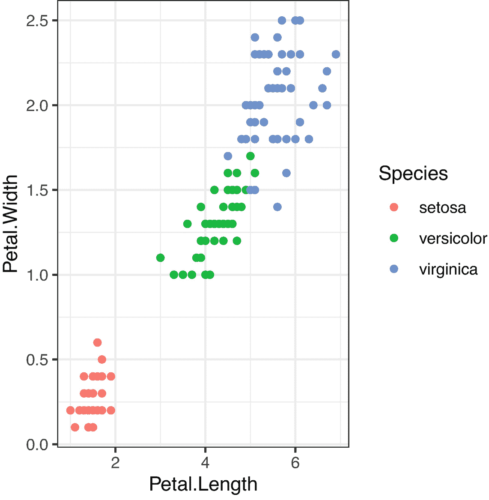

图 7-2 鸢尾花花瓣长度与花瓣宽度关系图

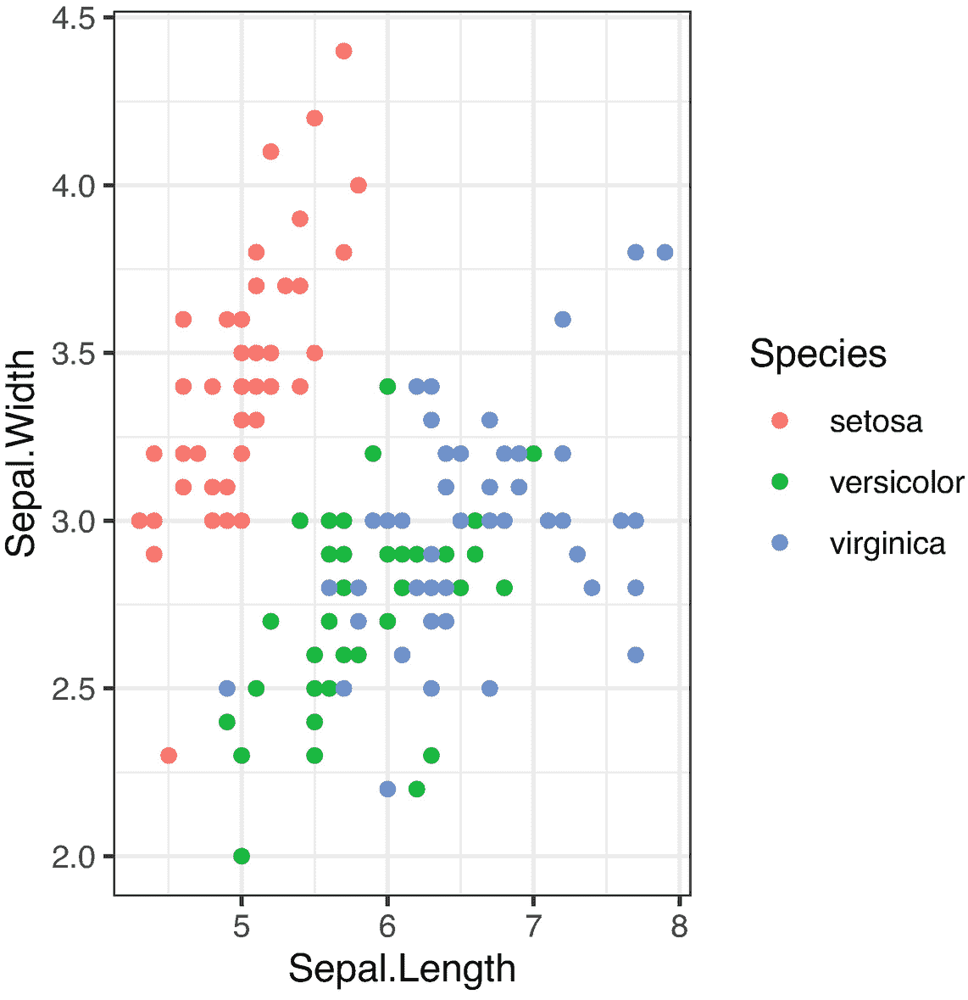

图 7-1 鸢尾花萼片长度与萼片宽度关系图

由于这是一个非常简单的数据集，并且仅仅通过绘制几个维度的相互关系就能明显看到结构，因此这里并非我们通常需要使用 PCA 这种“大炮”的场景，但本节是关于 PCA 的，所以我们还是用它。

由于 PCA 仅适用于数值数据，我们需要移除 `Species` 参数，之后我们可以使用 `prcomp` 函数进行变换：


`pca <- select(-Species) |> prcomp()`
`pca`
```
## Standard deviations (1, .., p=4):
## [1] 2.0562689 0.4926162 0.2796596 0.1543862
##
## Rotation (n x k) = (4 x 4):
##                     PC1         PC2         PC3
## Sepal.Length 0.36138659 -0.65658877  0.58202985
## Sepal.Width -0.08452251 -0.73016143 -0.59791083
## Petal.Length 0.85667061  0.17337266 -0.07623608
## Petal.Width  0.35828920  0.07548102 -0.54583143
##                     PC4
## Sepal.Length  0.3154872
## Sepal.Width  -0.3197231
## Petal.Length -0.4798390
## Petal.Width   0.7536574
```

该操作生成的对象包含了关于结果的多种信息。标准差告诉我们每个主成分中包含了多少方差，而旋转矩阵则描述了线性变换的具体内容。如果绘制 `pca` 对象的图形，我们将看到数据中每个主成分上承载了多少方差（见图 7-3）：

```
pca |> plot()
```

完成变换后，首先要关注的是方差在各主成分上的分布情况。如果前几个主成分没有包含大部分方差，那么变换对你帮助不大。反之，如果方差主要集中在前面几个主成分上，绘制这些主成分的图形或许能为揭示数据信息带来希望。

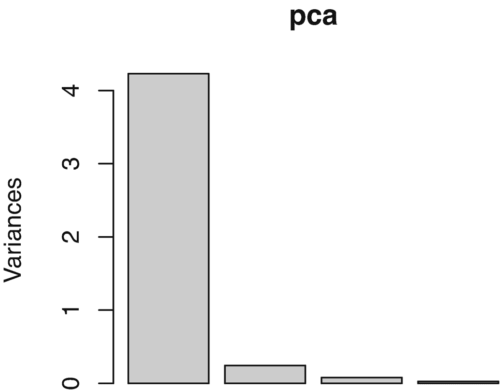

图 7-3

鸢尾花数据集各主成分的方差图

为了将数据映射到主成分张成的新空间，我们使用 `predict()` 函数：

```
mapped_iris <- predict(iris)
mapped_iris |> head()
##            PC1        PC2         PC3
## [1,] -2.684126 -0.3193972  0.02791483
## [2,] -2.714142  0.1770012  0.21046427
## [3,] -2.888991  0.1449494 -0.01790026
## [4,] -2.745343  0.3182990 -0.03155937
## [5,] -2.728717 -0.3267545 -0.09007924
## [6,] -2.280860 -0.7413304 -0.16867766
##               PC4
## [1,]  0.002262437
## [2,]  0.099026550
## [3,]  0.019968390
## [4,] -0.075575817
## [5,] -0.061258593
## [6,] -0.024200858
```

这种方法同样适用于未参与创建 `pca` 对象的新数据。在这里，我们只是用之前用过的相同数据。实际上我们不需要移除 `Species` 变量；它会根据列名自动识别出应使用哪些列。现在，我们可以绘制前两个主成分的对比图（见图 7-4）：

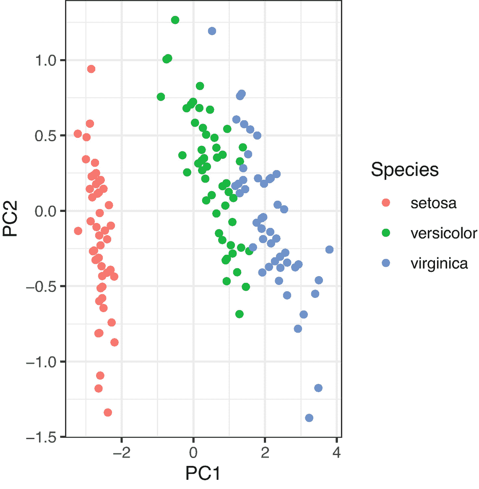

图 7-4

鸢尾花数据集前两个主成分的图

```
mapped_iris |>
as_tibble() |>
cbind(Species = iris$Species) |>
ggplot() +
geom_point(aes(x = PC1, y = PC2, colour = Species))
```

`predict()` 函数返回的 `mapped_iris` 对象是一个矩阵，而非数据框。这无法直接与 `ggplot()` 配合使用，因此我们需要用 `as_tibble` 将其转换回数据框。这会生成数据框的 tibble 变体，不过我们也可以使用 `as.data.frame` 来得到经典的数据结构。由于我们想根据物种对图形着色，需要再次添加该信息——记住 `pca` 对象并不包含这一因子数据——因此我们用 `cbind()` 来完成。之后，就可以绘图了。

从这次分析中我们收获不大。原始列中包含的信息量与变换后数据中的信息量大致相当。不过，既然我们已经实践了 PCA，可以尝试一个更有趣的例子。

我们将使用 `mlbench` 包中的 `HouseVotes84` 数据：

```
library(mlbench)
data(HouseVotes84)
HouseVotes84 |> head()
##        Class   V1 V2 V3   V4   V5 V6 V7 V8 V9 V10
## 1 republican    n  y  n    y    y  y  n  n  n   y
## 2 republican    n  y  n    y    y  y  n  n  n   n
## 3   democrat   y  y     y  y  n  n  n   n
## 4   democrat    n  y  y    n   y  n  n  n   n
## 5   democrat    y  y  y    n    y  y  n  n  n   n
## 6   democrat    n  y  y    n    y  y  n  n  n   n
##    V11  V12 V13 V14 V15  V16
## 1     y   y   y   n    y
## 2    n    y   y   y   n 
## 3    y    n   y   y   n    n
## 4    y    n   y   n   n    y
## 5    y    y   y   y    y
## 6    n    n   y   y   y    y
```

该数据包含了共和党人和民主党人在 16 项不同提案上的投票记录。投票类型包括赞成、反对以及缺失/未知。由于投票结果不太可能意外丢失，这里的缺失数据意味着有人主动决定不投票，因此这并非真正的缺失。缺失数据本身也可能蕴含一些信息。

我们现在可以提出一个有趣的问题：共和党人和民主党人的投票模式是否存在差异？我们预期会有差异，但能否从数据中看到这一点呢？

各列都是二分类变量（如果我们将缺失数据视为有信息量，则实际上是三分类），并且两组之间的差异看起来并不明显，因此每一列的信息量都很小。我们可以尝试对数据进行 PCA：

```
HouseVotes84 |> select(-Class) |> prcomp()
## Error in colMeans(x, na.rm = TRUE): 'x' must be numeric
```

好的，R 报错说数据不是数值型。我们知道 PCA 需要数值型数据，但我们提供的是因子型数据。我们需要改变这一点，可以尝试将投票映射为 0 和 1。

我们需要修改数据框中的每一列，因为所有列都是因子编码，我们需要将它们转换为数值。不过，对所有 `Vi` 列逐一执行 `mutate(V1 = ..., V2 = ..., ...)` 很繁琐，所以我们不采用这种方法。

我们可以使用之前用过的 `purrr` 包中的映射函数来遍历数据框的各列。由于我们要处理所有列（在移除 `Class` 之后），这看起来是个不错的选择。我们希望结果是数据框，因此应该使用 `map_df` 变体。对于要应用到每列的函数，我们希望将每个 `vote` 根据是 `n` 还是 `y` 映射为 0 或 1，但缺失数据应保持为缺失。不过，大多数 R 函数会保留缺失数据，因此如果我们执行 `ifelse(vote == "n", 0, 1)`，`NA` 值仍将保持为 `NA`。对于 `map_df`，我们需要一个函数 `\(vote) ifelse(vote == "n", 0, 1)`。开始操作：

```
HouseVotes84 |>
select(-Class) |>
map_df(\(vote) ifelse(vote == "n", 0, 1)) |>
prcomp()
## Error in svd(x, nu = 0, nv = k): infinite or missing values in 'x'
```

这也不起作用，但现在问题是缺失数据。我们将反对映射为 0，赞成映射为 1，但缺失数据仍然是缺失数据。

我们始终应该仔细思考如何处理缺失数据，尤其是在缺失数据可能携带信息的情况下。一种可能的处理方法是将每一列转换为三个二进制列，分别指示投票为赞成、反对或未投出。

我把这留作练习。在这里，我假设如果有人弃权，那么他们投赞成或反对票的可能性相等，并将缺失数据转换为 0.5。这并不是真实情况，在实际数据分析中你不应该这样做，但我们这里关注的是 PCA 而非事实真相，所以继续往下进行。

由于之后我想将数据映射到主成分上，并且不想重复编写数据转换代码，我将转换结果保存在一个变量中，然后执行 PCA：

```
vote_patterns <-
select(-Class) |>
map_df(\(vote) ifelse(vote == "n", 0, 1)) |>
map_df(\(vote) ifelse(is.na(vote), 0.5, vote))
pca <- prcomp()
```


```mapped_votes <- predict(vote_patterns)
mapped_votes |>
  as_tibble() |>
  cbind(Class = HouseVotes84$Class) |>
  ggplot() +
  geom_point(aes(x = PC1, y = PC2, colour = Class))
```

从投票模式来看，至少在第一个主成分上存在明显的分离。这一点我们从原始数据中无法立即观察到。

### 多维缩放

有时，衡量对象之间的距离比将它们表示为数值向量更容易。以字符串为例，你可以根据其编码将其转换为数字，但可能的字符串空间是巨大的——如果不限制其长度，理论上是无限的——因此这并非实用方法。然而，有许多方法可以衡量两个字符串之间的差异程度。至少对于字符串而言，定义距离度量比将其映射为数值要容易。

当我们拥有距离度量时，可以将数据表示为距离矩阵，其中包含所有成对距离。显然，如果数据点非常多，这并非可行方案——因为成对数量与数据点数量的平方成正比——但对于数千个数据点以内，这并非大问题。多维缩放会利用这样一个包含所有成对距离的矩阵，将每个数据点映射到线性空间中，同时尽可能保留成对距离。

再次考虑 `iris` 数据集。对于该数据集，我们当然有表示为数值向量的数据点，但这是一个我们熟悉的数据集，因此观察新方法在其上的应用很有帮助。

我们可以使用 `dist()` 函数创建距离矩阵：

```r
iris_dist <- select(iris, -Species) |> dist()
```

为了在二维空间中表示这些距离，我们使用 `cmdscale()` 函数。它接受一个参数 `k`，该参数指定我们希望将点放置的维度。如果 `k` 足够大，它可以完美保留所有成对距离，但我们无法对其进行可视化。低维度更适合我们，而为了绘制数据图，我们选择了二维。结果是一个矩阵，其中每一行对应一个原始数据点，每一列对应我们要求的维度——这里当然是二维：

```r
mds_iris <- iris_dist |> cmdscale(k = 2)
mds_iris |> head()
##           [,1]       [,2]
## [1,] -2.684126  0.3193972
## [2,] -2.714142 -0.1770012
## [3,] -2.888991 -0.1449494
## [4,] -2.745343 -0.3182990
## [5,] -2.728717  0.3267545
## [6,] -2.280860  0.7413304
```

我们可以将这个矩阵转换为数据框并绘制成图（见图 7-6）：

```r
mds_iris |>
  as_tibble(.name_repair = ~ c("x", "y")) |>
  cbind(Species = iris$Species) |>
  ggplot() +
  geom_point(aes(x = x, y = y, colour = Species))
```

`as_tibble(.name_repair = ~ c("x", "y"))` 部分将我们拥有的矩阵转换为数据框，这与之前使用 `as_tibble` 的其他情况相同，但这次我们需要做一些特殊处理。矩阵没有列名，而数据框需要列名。`as_tibble` 的参数 `.name_repair` 是处理创建数据框时列名的强大工具，但其全部功能超出了本书的范围。这里，我们仅将列名设置为“x”和“y”。不过，你需要在该字符串向量前加上波浪号 `~`，才能让 `as_tibble` 正常工作，但这里的具体细节比我们当前想要深入探讨的技术问题更为复杂。

由于我们为矩阵赋予了列名，因此可以在 `aes(x = x, y = y, ...)` 中使用它们。如果我们没有给它们命名，这里就无法引用它们。

该图与之前的 PCA 图看起来基本相同，这并非巧合，只是方向上下颠倒了。

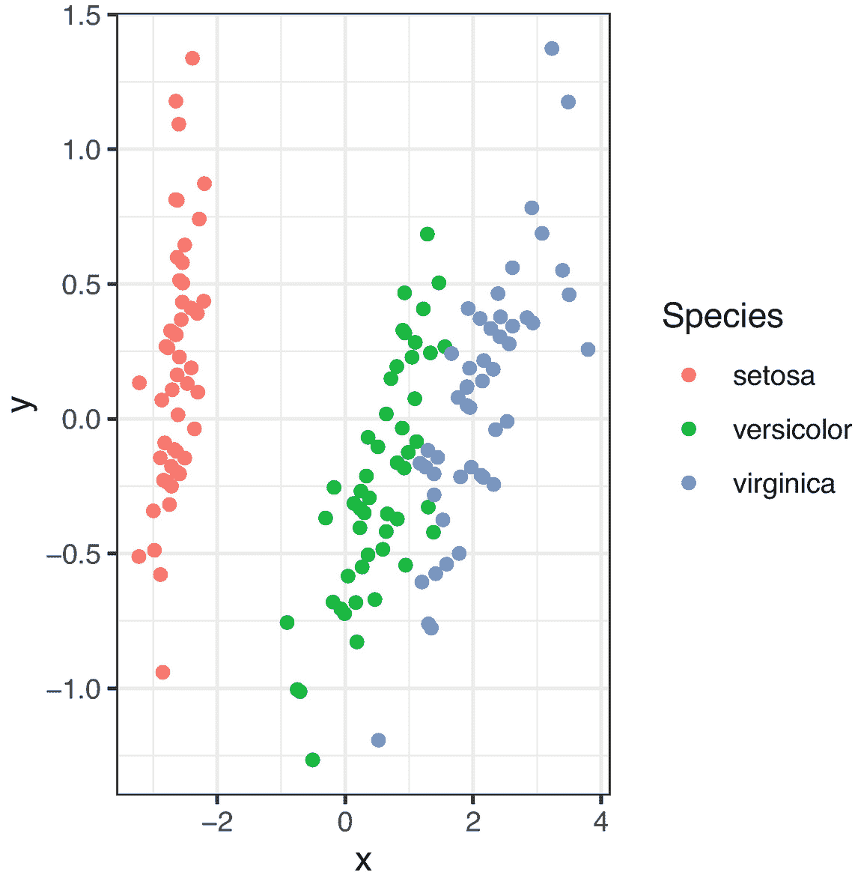

**图 7-6** 鸢尾花数据的多维缩放图

我们可以对投票数据做完全相同的事情——这里，我们可以复用已清洗过的、将因子转换为数值的数据——结果如图 7-7 所示。

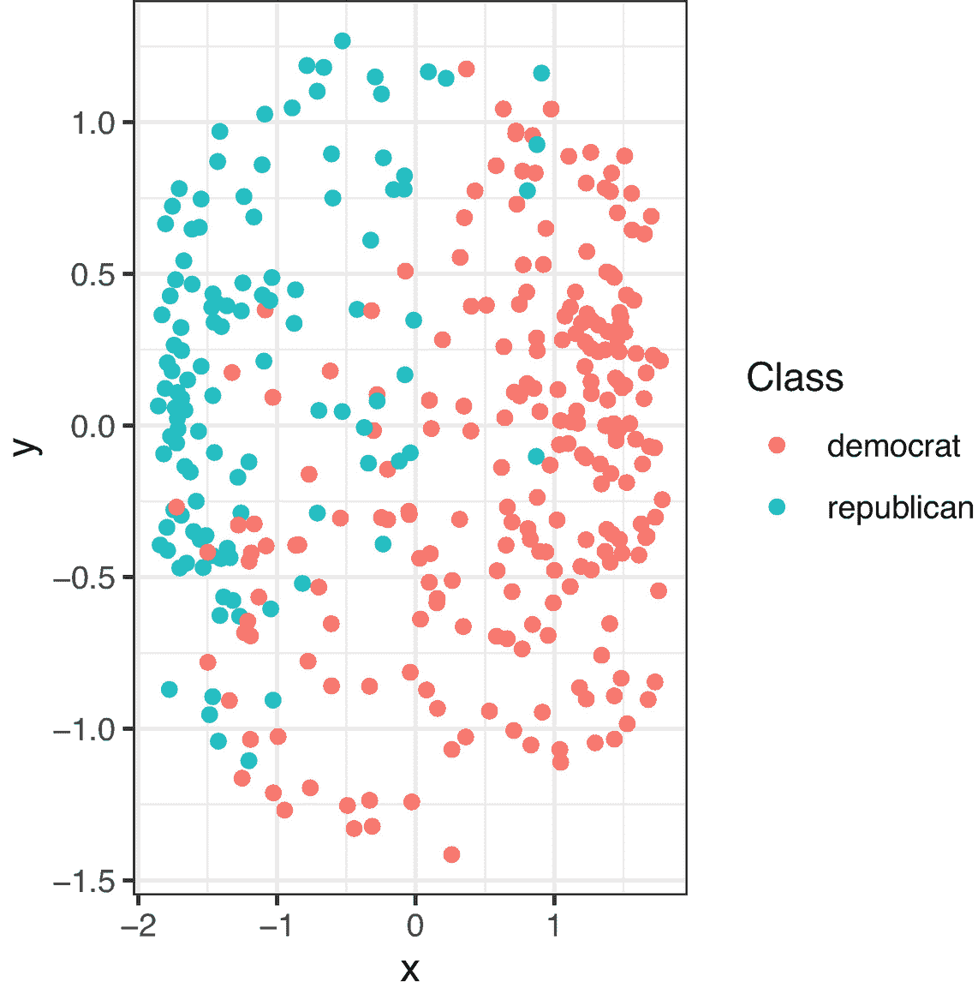

**图 7-7** 众议院投票数据的多维缩放图

```r
mds_votes <- vote_patterns |> dist() |> cmdscale(k = 2)
mds_votes |>
  as_tibble(.name_repair = ~ c("x", "y")) |>
  cbind(Class = HouseVotes84$Class) |>
  ggplot() +
  geom_point(aes(x = x, y = y, colour = Class))
```

顺便提一下，如果您需要计算字符串之间的距离矩阵，或许可以了解一下 `stringdist` 包。为了说明这一点，我们可以模拟一些字符串。以下代码首先有一个函数，用于模拟基于字母“A”、“C”、“G”和“T”的随机字符串，第二个函数则在此基础上添加随机长度。然后，我们使用这些函数创建了十个字符串：

```r
random_ngram <- function(n) sample(c("A", "C", "G", "T"), size = n, replace = TRUE) |>
  paste0(collapse = "")
random_string <- function(m) {
  n <- max(1, m + sample(c(-1,1), size = 1) * rgeom(1, 1/2))
  random_ngram(n)
}
strings <- replicate(10, random_string(5))
```

使用 `stringdist` 包，我们可以计算所有成对的距离矩阵：

```r
library(stringdist)
string_dist <- stringdistmatrix(strings)
```

现在，我们可以将这些字符串绘制在二维空间中，大致保留它们的距离（见图 7-8）：

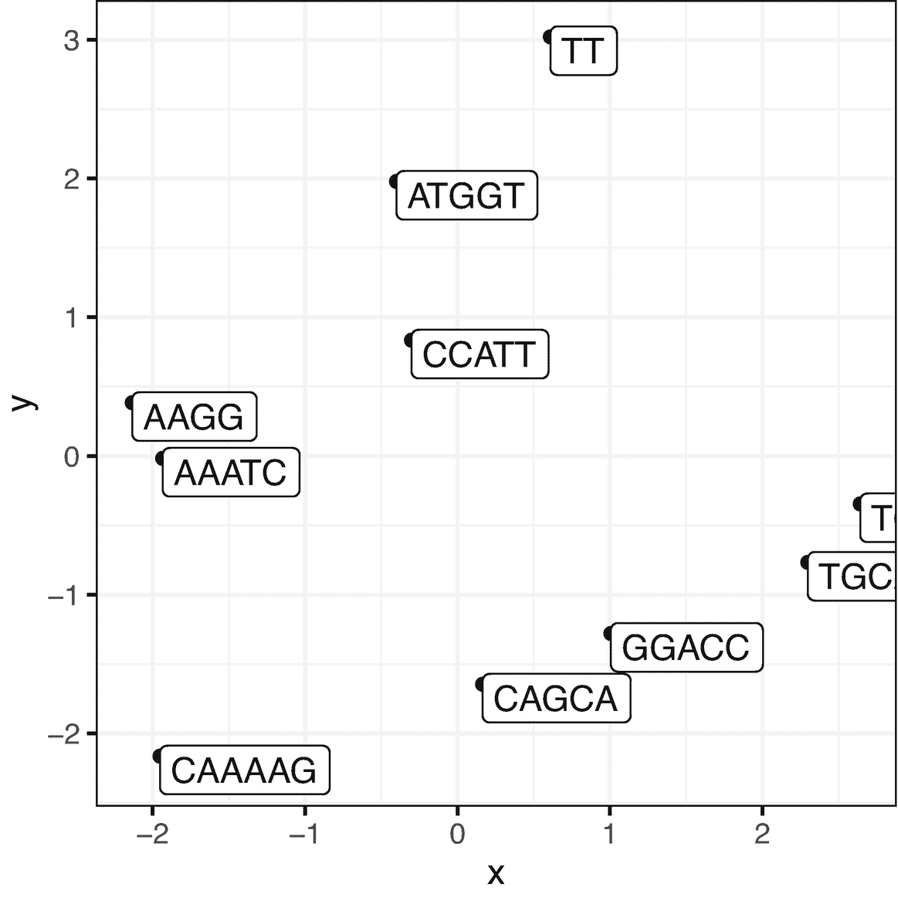

**图 7-8** 随机字符串的多维降维

```r
string_dist |>
  cmdscale(k = 2) |>
  as_tibble(.name_repair = ~ c("x", "y")) |>
  cbind(String = strings) |>
  ggplot(aes(x = x, y = y)) +
  geom_point() +
  geom_label(aes(label = String),
             hjust = 0, nudge_y = -0.1)
```

## 聚类

聚类方法旨在寻找数据点之间的相似性，并根据这些相似性对数据进行分组。这些聚类可以具有或不具有层次结构；当结构是层次化时，每个数据点将关联到多个聚类，从更具体到更一般的顺序排列；而当结构是非层次化时，任何数据点通常只被分配到一个聚类。以下是两种最流行的聚类算法，分别属于这两种聚类类型。


### k-means 聚类

在 *k*-means 聚类中，你需要尝试将数据划分为 *k* 个簇，其中数量 *k* 由你决定。数据通常必须采用数值向量的形式。严格来说，只要你能够计算一组数据点的均值以及数据点对之间的距离，该方法就可行。R 中用于 *k*-means 聚类的函数 `kmeans` 要求输入数值数据。

该算法的基本原理是：首先猜测 *k* 个假设的簇的“中心”。然后，每个数据点被分配给离它最近的中心，从而形成数据的分组，之后所有中心都会移动到其所属簇的平均位置。这个过程会重复进行，直到达到平衡状态。由于初始中心是随机选择的，对函数的多次调用不一定会得到相同的结果。至少可以预期，不同调用之间的簇标签会有所不同。

让我们看看实际应用。我们使用 `iris` 数据集，并移除 `Species` 列，以获得一个数值矩阵传递给函数：

```
clusters <- iris |>
  select(-Species) |>
  kmeans(centers = 3)
```

我们需要在 `kmeans()` 的参数中指定 *k*，即 `centers` 的数量，这里我们选择 3 个。我们知道鸢尾花有三个品种，所以这很自然。生活并非总是如此简单，但在这里这是一个显而易见的选择。

该函数返回一个包含聚类信息的对象。其中两个最有趣的信息是中心点（`centers` 变量）和簇分配（`cluster` 变量）。

让我们首先看一下中心点：

```
clusters$centers
##   Sepal.Length Sepal.Width Petal.Length
## 1     5.901613    2.748387     4.393548
## 2     6.850000    3.073684     5.742105
## 3     5.006000    3.428000     1.462000
##   Petal.Width
## 1    1.433871
## 2    2.071053
## 3    0.246000
```

这些向量与输入数据点的形式相同。它们是我们计算出的三个簇的质心。

簇分配是一个整数向量，每个数据点对应一个数字，指明该数据点被分配到了哪个簇：

```
clusters$cluster |> head()
## [1] 3 3 3 3 3 3
clusters$cluster |> table()
##
##  1  2  3
## 62 38 50
```

每个品种有 50 个数据点，因此如果聚类与品种完美匹配，我们也应该看到每个簇有 50 个点。聚类并不完美，但我们可以尝试绘制数据，看看聚类与品种分类的匹配程度。

我们可以先绘制来自每个品种的数据点被分配到每个簇的数量（见图 7-9）：

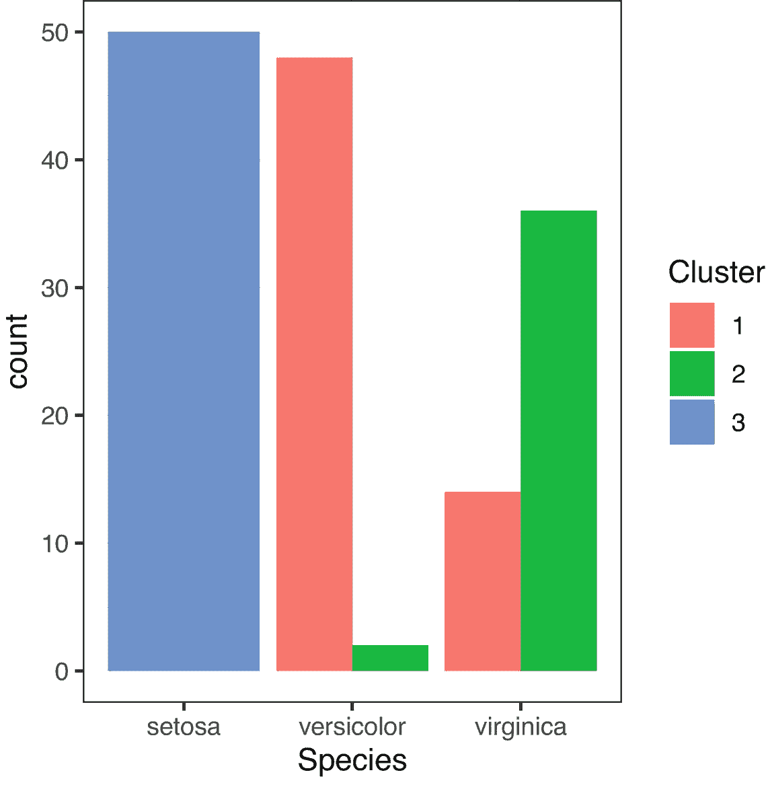

图 7-9

三种鸢尾花品种的簇分配情况

```
iris |>
  cbind(Cluster = clusters$cluster) |>
  ggplot() +
  geom_bar(aes(x = Species, fill = as.factor(Cluster)),
           position = "dodge") +
  scale_fill_discrete("Cluster")
```

我们首先将 `iris` 数据集与来自 `clusters` 的簇关联结合起来，然后制作一个条形图。`position` 参数设置为 `"dodge"`，因此簇分配情况被并排绘制，而不是堆叠在一起。

不出所料，根据我们之前绘制数据所了解的情况，Setosa 品种似乎与其他两个品种明显不同，而另外两个品种（至少根据我们所掌握的四个测量指标来看）在特征上有所重叠。

这里也存在一定的运气成分。`kmeans()` 放置第一个中心点的不同起始点会影响最终结果。例如，如果它把两个簇放在了 Setosa 数据点的范围内，它就会将这些点分成两个簇，并将 Versicolor 和 Virginia 的点合并成一个簇。

始终建议通过可视化来检查聚类结果与实际数据点分布的匹配程度。我们可以通过绘制各个数据点来观察分类和聚类的样子。我们可以绘制任意两个特征的散点图，但我们之前已经了解了如何将数据映射到主成分上，因此我们可以尝试在前两个主成分上绘制数据。你可能还记得，我们可以使用 `predict()` 函数将数据点从四个特征映射到主成分。这既适用于进行 PCA 的原始数据，也适用于我们从 *k*-means 聚类中得到的中心点：

```
pca <- iris |>
  select(-Species) |>
  prcomp()
mapped_iris <- predict(pca, iris)
mapped_centers <- predict(pca, clusters$centers)
```

我们可以绘制映射后的数据点，即 PC1 对 PC2 的散点图（见图 7-10）。为了将主成分与品种信息一起显示，我们需要添加一个 `Species` 列。此外，由于映射后的向量中没有包含簇信息，我们还需要添加簇信息。这是一个数值向量，但我们想将其视为分类变量，因此需要使用 `as.factor()` 进行转换：

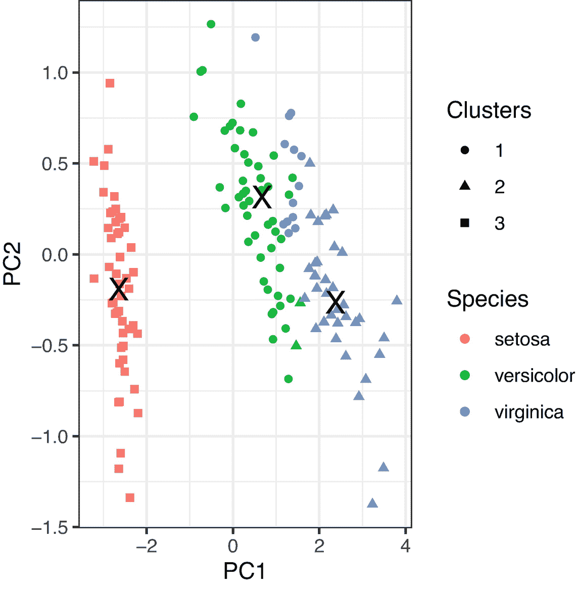

图 7-10

鸢尾花的簇与品种分布

```
mapped_iris |>
  as_tibble() |>
  cbind(Species = iris$Species,
        Clusters = as.factor(clusters$cluster)) |>
  ggplot() +
  geom_point(aes(x = PC1, y = PC2,
                 colour = Species, shape = Clusters)) +
  geom_point(aes(x = PC1, y = PC2), size = 5, shape = "X",
             data = as_tibble(mapped_centers))
```

在图中，我还显示了中心点。我使用 `geom_point()` 的 `data` 参数来提供这些数据，将其大小设置为 5，并将形状设置为 `"X"`。

如前所述，获得这样好的聚类结果存在一定的运气成分。第二次运行 `kmeans()` 函数的结果如图 7-11 和 7-12 所示。


图 7-11

三种鸢尾花品种的较差簇分配

如果你回头看看图 7-10，并认为某些方块点更靠近“三角形簇”的中心，而不是“方块簇”的中心，或者反之亦然，那么你是对的。请不要为此感到困惑；有两个因素具有迷惑性。其一，坐标轴的比例并不相同，因此沿 x 轴的距离大于沿 y 轴的距离。其二，用于分组数据点的距离是在原始特征的四维空间中计算的，而该图只是在前两个主成分构成的二维平面上的投影。


图 7-12

较差聚类情况下的鸢尾花簇与品种分布

不过，关于距离，有一个问题需要注意。该算法基于簇中心到数据点的距离，但如果一个轴以厘米为单位，另一个轴以米为单位，那么沿一个轴的距离在数值上会比沿另一个轴的距离大一百倍。仅仅将所有特征用相同单位表示并不能解决这个问题。首先，这并不总是可行的，没有一种有意义的方式将时间或重量转换为距离。即使可以，被测量的对象也与我们所考虑的单位相关。人的身高以米为单位是有意义的，但你不会希望像细胞大小这样的东西也以米为单位测量。


对于主成分分析而言，这也是一个需要注意的问题。显然，一种试图基于数据方差构建向量空间基的方法，会受到输入数据所用单位的影响。通常的解决方案是重新缩放所有输入特征，使其以零为中心且方差为一。你需要从每个数据点中减去该特征的均值，并除以标准差。这意味着以标准差为单位衡量时，所有维度具有相同的变异程度。

`prcomp()` 函数提供了实现缩放的参数。参数 `center`（默认值为 `TRUE`）用于将数据点平移至均值为零，而参数 `scale.`（注意名称末尾的句点，默认值为 `FALSE`）则用于缩放数据点，使所有维度的方差为一。

`kmeans()` 函数本身不包含这些参数，但你可以使用 `scale()` 函数显式地对数值型数据框进行缩放。我将此留作练习。

现在，让我们更正式地考虑聚类在预测鸢尾花种类方面的效果。这让我们回到了熟悉的领域：我们可以在种类和聚类之间构建一个混淆矩阵。

```
table(iris$Species, clusters$cluster)
##
##               1  2  3
##   setosa      0  0 50
##   versicolor 48  2  0
##   virginica  14 36  0
```

这里的一个问题是，聚类算法并不知道种类信息。因此，即使聚类和种类之间存在一一对应的关系，只有当聚类和种类的顺序完全一致时，混淆矩阵才会是对角线的。

我们可以将每个种类关联到其大多数成员所属的聚类。这并非完美解决方案——因为两个种类可能以此方式被关联到同一聚类，那样我们就仍然无法构建混淆矩阵——但在此处我们考虑的情况下是可行的。我们可以像这样统计每个种类中各类聚的观测数量：

```
tbl <- table(iris$Species, clusters$cluster)
(counts <- apply(tbl, 1, which.max))
## setosa versicolor virginica
##      3          1         2
```

然后像这样构建一个将种类映射到聚类的表格，以得到混淆矩阵：

```
map <- rep(NA, each = 3)
map[counts] <- names(counts)
table(iris$Species, map[clusters$cluster])
##
##            setosa versicolor virginica
##   setosa       50          0         0
##   versicolor    0         48         2
##   virginica     0         14        36
```

关于 *k*-means 最后要说的一点是：既然 *k* 是一个需要指定的参数，那么该如何选择呢？这里，我们知道有三种种类，所以也为 *k* 选择了 3。但当我们起初并不知道数据中是否存在任何聚类，或者存在很多聚类时，我们又该如何选择 *k* 呢？遗憾的是，这并没有一个通用的答案。虽然有几种经验法则，但并没有一个总能应用的完美解决方案。尝试一些方法，观察结果，然后利用你对数据的理解来解释你所看到的。

### 层次聚类

层次聚类是一种在拥有数据距离矩阵时可以使用的技术。其基本思想是通过迭代合并聚类来构建一个嵌套聚类的树状结构。起初，每个数据点自成一个单点聚类。然后迭代地找到彼此靠近的两个聚类并将它们合并成一个新聚类。重复此过程，直到所有数据点都位于同一个大聚类中。存在多种不同的算法，它们在如何选择下一个要合并的聚类以及如何计算聚类之间的距离方面有所差异。在 R 语言中，`hclust()` 函数实现了多种算法——参数 `method` 决定使用哪一种——我们可以在 `iris` 数据集上看到它的应用。我们首先需要一个距离矩阵。这次，我首先对数据进行了缩放：

```
iris_dist <- select(iris, -Species) |> scale() |> dist()
```

然后通过调用 `hclust()` 函数在距离矩阵上构建聚类：

```
clustering <- hclust(iris_dist)
```

我们可以使用通用的 `plot()` 函数绘制结果，参见图 7-13。使用此函数对聚类的显示方式控制不多，但如果你对绘制树状图感兴趣，可以查看 `ape` 包：

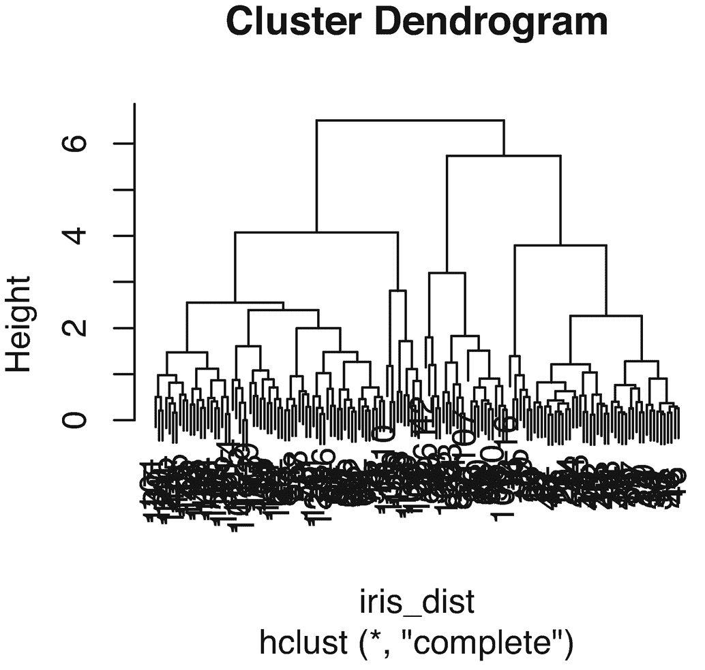
图 7-13
鸢尾花数据的层次聚类

```
plot(clustering)
```

为了创建能与 `ggplot2` 图形良好配合的图，你需要使用 `ggdendro` 包，参见图 7-14：

```
library(ggdendro)
clustering |>
ggdendrogram() + theme_dendro()
```

使用 `ggdendro`，你可以获取原始的绘图线段，从而对树的许多可视化细节拥有控制权。

仅仅可视化聚类通常是不够的，因此为了处理结果，我们需要能够提取实际的聚类分组。`cutree()` 函数（意为剪切树，但名称中只有一个 t）可以让我们做到这一点。你可以通过参数 `h` 在高度 `h` 处分割树来剪切出聚类，或者通过参数 `k` 在恰好包含 `k` 个聚类的层级处分割树。

由于我们处理的是 `iris` 数据，很自然地我们想将数据分割成三个聚类：

```
clusters <- cutree(clustering, k = 3)
```

结果与我们之前使用 *k*-means 聚类得到的格式相同，即一个整数向量，指定每个数据点属于哪个聚类。既然信息已经是熟悉的格式，我们可以尝试将聚类信息绘制成条形图（图 7-15）：

```
iris |>
cbind(Cluster = clusters) |>
ggplot() +
geom_bar(aes(x = Species, fill = as.factor(Cluster)),
position = "dodge") +
scale_fill_discrete("Cluster")
```

或者将各个数据点与种类及聚类信息一起绘制（图 7-16）。

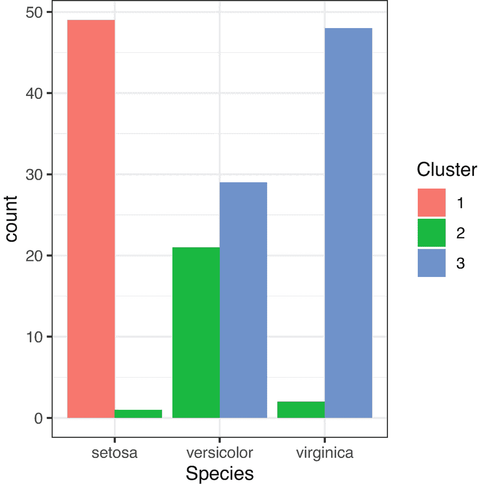
图 7-15
鸢尾花聚类的条形图

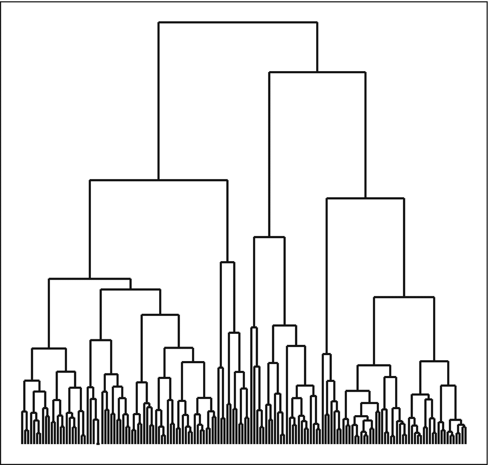
图 7-14
使用 ggdendro 绘制的鸢尾花数据层次聚类图

```
mapped_iris |>
as_tibble() |>
cbind(Species = iris$Species,
Clusters = as.factor(clusters)) |>
ggplot() +
geom_point(aes(x = PC1, y = PC2,
shape = Species, colour = Clusters))
```

如果我们想将聚类用于某种形式的分类，构建混淆矩阵当然也是类似的做法，但层次聚类在分类方面的适用性远不如 *k*-means 聚类。使用 *k*-means 聚类，可以简单地取一个新的数据点并查看它距离哪个聚类中心最近。而使用层次聚类，你需要重建整棵树才能确定它落于何处。


## 关联规则

我们将介绍的最后一个无监督学习方法，针对的是有序或无序的分类数据。就像你需要将因子转换为数值数据才能使用诸如`PCA`之类的方法一样，你也需要将数值数据转换为因子才能使用关联规则。这通常不是问题，你可以使用`cut()`函数将数值向量分割成因子，如果需要有序因子，还可以结合`ordered()`函数使用。

关联规则通过基于输入变量的谓词挑选数据的子集*X*和*Y*，并评估规则*X* ⇒ *Y*，从而在数据中搜索模式。选择*X*和*Y*是一个暴力选择（这就是为什么你需要将数值向量分解成离散类别的原因）。^(¹⁴)

任何*X* ⇒ *Y*的陈述都称为规则，算法会评估所有规则（至少达到一定大小），以判断每条规则的优劣。

关联规则算法在`arules`包中实现：

```r
library(arules)
```

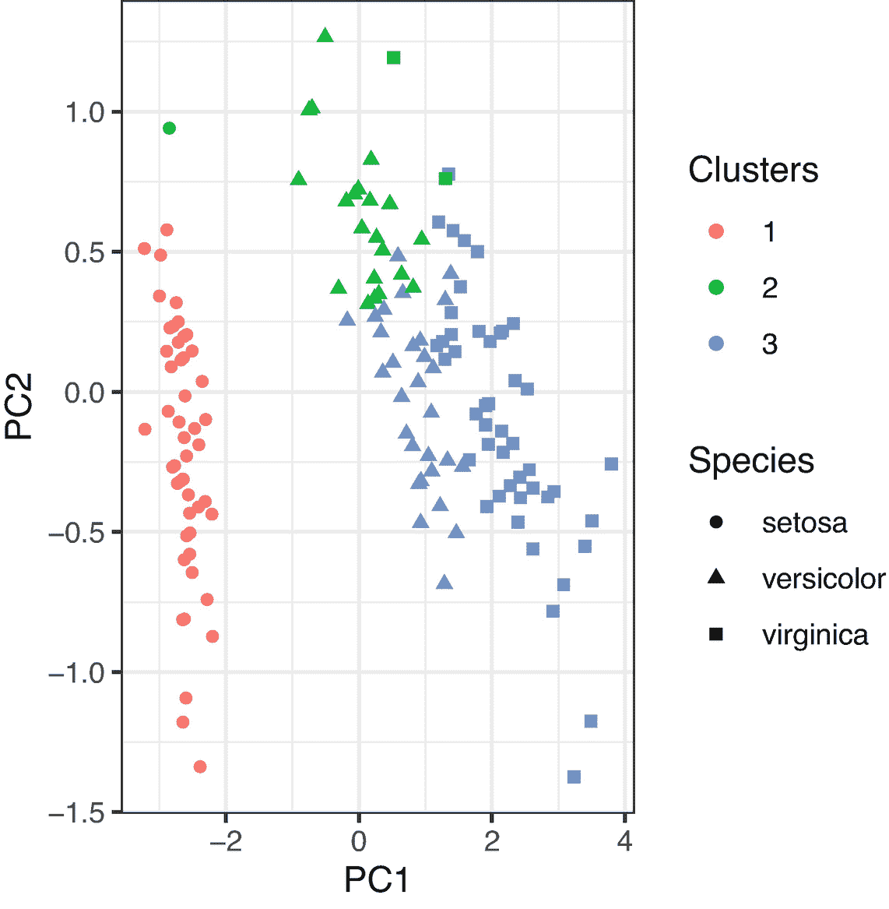

**图 7-16** 按物种和层次聚类信息绘制的鸢尾花数据点

为了演示其实际应用，我们使用`kernlab`包中的`income`数据集：

```r
library(kernlab)
data(income)
income |> head()
##       INCOME    SEX MARITAL.STATUS   AGE
## 1   [75.000-      F        Married 45-54
## 2   [75.000-      M        Married 45-54
## 3   [75.000-      F        Married 25-34
## 4   -10.000)      F         Single 14-17
## 5   -10.000)      F         Single 14-17
## 6 [50.000-75.000) M        Married 55-64
##                 EDUCATION               OCCUPATION
## 1 1 to 3 years of college                Homemaker
## 2        College graduate                Homemaker
## 3        College graduate  Professional/Managerial
## 4          Grades 9 to 11   Student, HS or College
## 5          Grades 9 to 11   Student, HS or College
## 6 1 to 3 years of college                  Retired
##       AREA  DUAL.INCOMES HOUSEHOLD.SIZE UNDER18
## 1 10+ years           No          Three    None
## 2 10+ years           No           Five     Two
## 3 10+ years          Yes          Three     One
## 4 10+ years  Not Married           Four     Two
## 5 4-6 years  Not Married           Four     Two
## 6 10+ years           No            Two    None
##   HOUSEHOLDER  HOME.TYPE ETHNIC.CLASS  LANGUAGE
## 1         Own      House        White      
## 2         Own      House        White   English
## 3         Rent Apartment        White   English
## 4       Family     House        White   English
## 5       Family     House        White   English
## 6          Own     House        White   English
```

该数据包含收入信息以及几个解释变量，并且已经是`arules`可以处理的形式：所有列都是因子类型。

事实上，相同的数据在`arules`包中也以`Income`数据集的形式提供，但它在这里的表示格式与数据框不同，因此我们将使用这个版本的数据：

```r
data(Income)
Income |> head()
## transactions in sparse format with
##  6 transactions (rows) and
##  50 items (columns)
```

为了构建规则，我们使用`apriori()`函数。它接受各种参数来控制函数将返回哪些规则，但我们可以使用所有默认参数：

```r
rules <- apriori()
## Apriori
##
## Parameter specification:
##  confidence minval smax arem  aval
##         0.8    0.1    1 none FALSE
##  originalSupport maxtime support minlen maxlen
##             TRUE       5     0.1      1     10
##  target  ext
##   rules TRUE
##
## Algorithmic control:
##  filter tree heap memopt load sort verbose
##     0.1 TRUE TRUE  FALSE TRUE    2    TRUE
##
## Absolute minimum support count: 899
##
## set item appearances ...[0 item(s)] done [0.00s].
## set transactions ...[84 item(s), 8993 transaction(s)] done [0.01s].
## sorting and recoding items ... [42 item(s)] done [0.00s].
## creating transaction tree ... done [0.00s].
## checking subsets of size 1 2 3 4 5 6 done [0.02s].
## writing ... [785 rule(s)] done [0.00s].
## creating S4 object  ... done [0.00s].
```

我们通过这种方式创建的`rules`对象并非像数据框那样简单的对象，但它允许我们对其使用`head()`函数，并且我们可以使用`inspect()`函数来查看各个规则：

```r
rules |> head() |> inspect(linebreak = FALSE)
##     lhs
## [1] {}                                   =>
## [2] {EDUCATION=Grad Study}               =>
## [3] {OCCUPATION=Clerical/Service Worker} =>
## [4] {INCOME=[30.000-40.000)}             =>
## [5] {UNDER18=Two}                        =>
## [6] {INCOME=[50.000-75.000)}             =>
##     rhs                support   confidence
## [1] {LANGUAGE=English} 0.8666741 0.8666741
## [2] {LANGUAGE=English} 0.1000778 0.9316770
## [3] {LANGUAGE=English} 0.1046369 0.8860640
## [4] {LANGUAGE=English} 0.1111976 0.9009009
## [5] {LANGUAGE=English} 0.1073057 0.8405923
## [6] {LANGUAGE=English} 0.1329923 0.9143731
##     coverage  lift      count
## [1] 1.0000000 1.0000000 7794
## [2] 0.1074169 1.0750027  900
## [3] 0.1180918 1.0223728  941
## [4] 0.1234293 1.0394921 1000
## [5] 0.1276548 0.9699059  965
## [6] 0.1454465 1.0550368 1196
```

这里的`linebreak = FALSE`将规则显示在多行上。我也觉得将`linebreak`设置为`FALSE`来换行令人困惑，但事实就是如此。

每条规则都有一个右侧`rhs`和一个左侧`lhs`。对于规则*X* ⇒ *Y*，*X*是`rhs`，*Y*是`lhs`。规则的质量由以下三列衡量：

*   **支持度 (support)**：数据中*X*和*Y*同时成立的比例。可以理解为 Pr(*X, Y*)。

*   **置信度 (confidence)**：当*X*成立时，*Y*也成立的比率。可以理解为 Pr(*Y | X*)。

*   **提升度 (lift)**：规则相较于随机情况好多少，即在*X*和*Y*独立的情况下，有多大改善。可以理解为 Pr(*X, Y*) / (Pr(*X*) Pr(*Y*))。

好的规则应该有足够高的支持度才具有研究价值——如果一条规则只影响整个数据中极小部分的数据点，那么它可能并不那么重要——因此您希望支持度和置信度都高。它还应能提供比随机预期更多的信息，这由提升度来体现。

您可以使用`sort()`函数根据质量度量对数据进行重新排序：

```r
rules |>
  sort(by = "lift") |> head() |>
  inspect(linebreak = FALSE)
##     lhs
## [1] {MARITAL.STATUS=Married, OCCUPATION=Professional/Managerial, LANGUAGE=
## [2] {MARITAL.STATUS=Married, OCCUPATION=Professional/Managerial}
## [3] {DUAL.INCOMES=No, HOUSEHOLDER=Own}
## [4] {AREA=10+ years, DUAL.INCOMES=Yes, HOME.TYPE=House}
## [5] {DUAL.INCOMES=Yes, HOUSEHOLDER=Own, HOME.TYPE=House, LANGUAGE=English}
## [6] {DUAL.INCOMES=Yes, HOUSEHOLDER=Own, HOME.TYPE=House}
##   rhs   support
## [1] => {DUAL.INCOMES=Yes}   0.1091960
## [2] => {DUAL.INCOMES=Yes}   0.1176471
## [3] => {MARITAL.STATUS=Married} 0.1016346
## [4] => {MARITAL.STATUS=Married} 0.1003002
## [5] => {MARITAL.STATUS=Married} 0.1098632
## [6] => {MARITAL.STATUS=Married} 0.1209830
##     confidence  coverage   lift     count
## [1] 0.8069022   0.1353275 3.281986   982
## [2] 0.8033409   0.1464472 3.267501 1058
## [3] 0.9713071   0.1046369 2.619965   914
## [4] 0.9605964   0.1044145 2.591075   902
## [5] 0.9601555   0.1144223 2.589886   988
## [6] 0.9594356   0.1260981 2.587944 1088
```

您可以结合使用`subset()`函数来过滤规则：

```r
rules |>
  subset(support > 0.5) |>
  sort(by = "lift") |>
  head() |>
  inspect(linebreak = FALSE)
##   lhs
## [1] {ETHNIC.CLASS=White}   =>
## [2] {AREA=10+ years}   =>
## [3] {UNDER18=None}   =>
## [4] {}   =>
## [5] {DUAL.INCOMES=Not Married} =>
##     rhs               support   confidence
## [1] {LANGUAGE=English} 0.6110308 0.9456204
## [2] {LANGUAGE=English} 0.5098410 0.8847935
## [3] {LANGUAGE=English} 0.5609919 0.8813767
## [4] {LANGUAGE=English} 0.8666741 0.8666741
## [5] {LANGUAGE=English} 0.5207384 0.8611622
##      coverage   lift   count
## [1] 0.6461692 1.0910911 5495
## [2] 0.5762260 1.0209069 4585
## [3] 0.6364951 1.0169644 5045
## [4] 1.0000000 1.0000000 7794
## [5] 0.6046925 0.9936402 4683
```


### 练习

### 处理 `HouseVotes84` 数据中的缺失值

在主成分分析（PCA）中，我们将缺失数据转换为 0.5。这样做是为了推进分析，但可能并非恰当的决定。未投票的人未必是犹豫不决的，因此并非同样可能投赞成或反对票；可能存在利益冲突或其他原因。因此，我们应该将每一列转换为三个二进制列。

你可以使用 `dplyr` 包中的 `transmute()` 函数来添加新列并移除旧列——需要重复操作 16 次，可能会有点繁琐，但能够完成任务。

如果你更愿意尝试通过编程来完成这种转换，可以查看 `dplyr` 包中的 `mutate_at()` 函数。你可以将其与列名匹配和多个函数结合使用，以构建三个二进制向量（对于 `ifelse()` 调用，你需要记住，与 `NA` 进行比较总是会得到 `NA`，因此你需要始终先检查这一点）。创建新列后，你可以使用 `select()` 结合 `match()` 来移除旧列。

尝试进行转换，然后再次进行主成分分析。有什么变化吗？

### k 均值聚类

#### 为 k 均值聚类进行缩放

使用 `scale()` 函数对 `iris` 数据集进行缩放，然后重新进行 k 均值聚类分析。

#### 改变 k 值

使用 `kmeans()` 分析 `iris` 数据，k 值从 1 到 10。绘制每个 k 值下的聚类结果，根据聚类结果对数据点进行着色。

脚注 1

