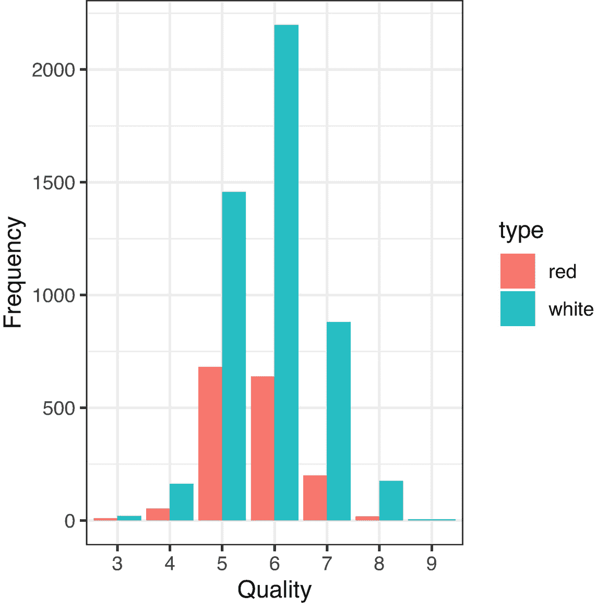
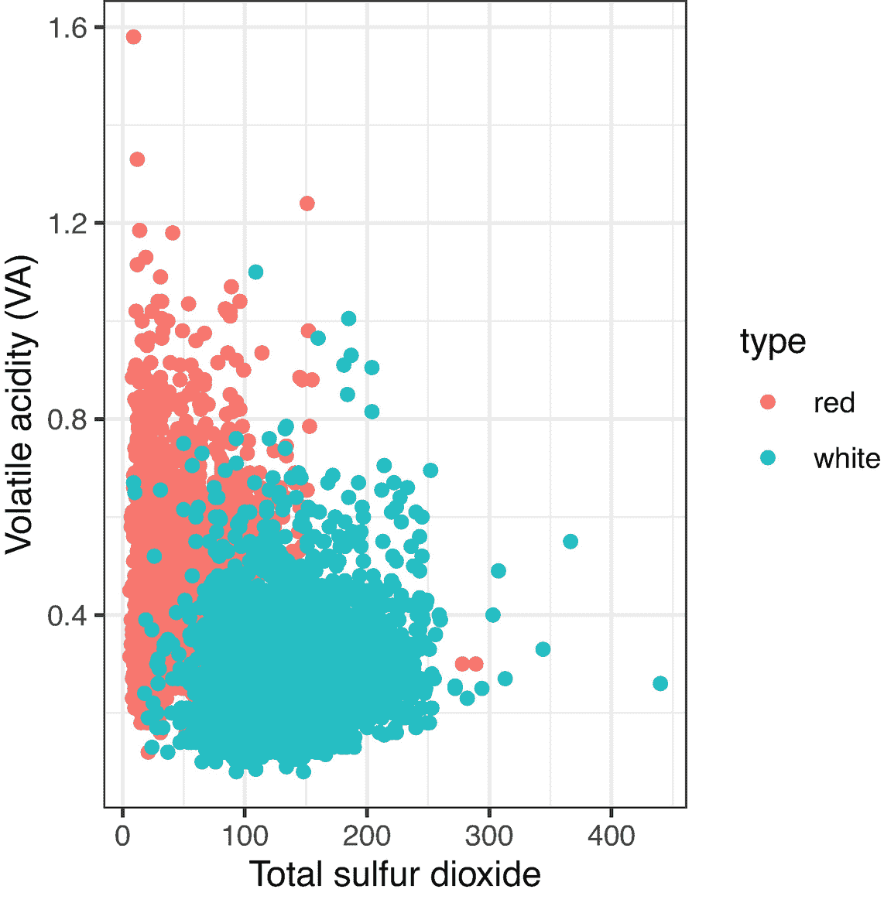

# 项目 1：品酒

为了展示实际的数据分析过程，我将使用我的学生丹·桑德加德在我教授数据科学课程第一年所做的分析。我非常喜欢他的分析，因此想将其收录到本书中。在征得他的同意后，我在下文中重新进行了他的分析。

该数据包含了来自葡萄牙绿酒（Vinho Verde）的理化特征测量值，目标是根据这些测量值来预测葡萄酒的质量。^(15)

## 导入数据

如果我们进入数据文件夹，可以看到数据被拆分为三个文件：红葡萄酒的测量数据、白葡萄酒的测量数据，以及数据描述文件（`winequality.names`）。为了避免显示过长的 URL，我将不列出读取文件的代码，但代码形式如下：

```r
read.table(URL, header=TRUE, sep=';')
```

通过查看文件，我们可以发现包含描述各列的标题，并且字段之间由分号分隔。

我们将红葡萄酒和白葡萄酒的数据分别加载到名为 `red` 和 `white` 的数据框中。

我们可以使用以下代码将两个数据框合并：

```r
wines <- bind_rows(tibble(type = "red", red),
  tibble(type = "white", white))
```

`tibble` 和 `bind_rows` 函数均来自 `dplyr` 包。现在，我们可以通过以下代码查看数据摘要：

```r
summary(wines)
```

你会看到每款葡萄酒有 11 项测量值，并且每款葡萄酒都有一个基于感官数据的质量评分。至少三位葡萄酒专家对葡萄酒进行了评判，评分范围为 0 到 10。没有葡萄酒的得分低于 3 分或高于 9 分。数据中没有缺失值。我们不需要将任何测量值转换为分类数据。质量评分是离散值，但它们属于有序类别，目前我们可以将其视为数值。

## 探索数据

加载数据后，我们首先要进行一些探索性分析，以便对数据有直观感受。

### 质量评分分布

丹做的第一件事是观察两种类型葡萄酒的质量评分分布（见图 8-1）：

```r
ggplot(wines) +
  geom_bar(aes(x = factor(quality), fill = type),
           position = 'dodge') +
  xlab('Quality') + ylab('Frequency')
```

评分极低或极高的葡萄酒很少。如果不考虑质量评分是离散值，它们似乎也服从正态分布。这可能使分析变得更加容易。



图 8-1：葡萄酒质量评分分布

### 这瓶酒是红葡萄酒还是白葡萄酒？

该数据集包含两种类型的葡萄酒：红葡萄酒和白葡萄酒。正如丹指出的那样，品酒师通常会用截然不同的词汇来描述这两种酒，但多项实验^((16))表明，即使是顶尖的品酒师，在无法观察颜色或被蒙住眼睛的情况下，也无法区分红葡萄酒和白葡萄酒。因此，探究数据中可用的物理化学特征是否有助于判断葡萄酒是红还是白，会是一个有趣的问题。

丹使用朴素贝叶斯方法对此进行了探索，因此我们需要 `e1071` 包：

```r
library(e1071)
```

他采用五折交叉验证进行研究，但我会直接使用第 6 章中的 `partition()` 函数：

```r
random_group <- function(n, probs) {
  probs <- probs / sum(probs)
  g <- findInterval(seq(0, 1, length = n), c(0, cumsum(probs)),
                    rightmost.closed = TRUE)
  names(probs)[sample(g)]
}
partition <- function(df, n, probs) {
  replicate(n, split(df, random_group(nrow(df), probs)), FALSE)
}
```

并且我会使用之前为汽车数据编写的预测准确率函数的一个变体，但这次针对葡萄酒数据，并使用 `accuracy()` 函数代替 `rmse()`：

```r
accuracy <- function(table) {
  sum(diag(table)) / sum(table)
}
prediction_accuracy_wines <- function(wines_split) {
  map_dbl(
    wines_split,
    \(tt) {
      # 使用训练数据拟合模型
      model <- naiveBayes(type ~ ., data = tt$training)
      # 然后对测试数据进行预测
      predictions <- predict(model, newdata = tt$test)
      # 获取预测的准确率
      accuracy(table(tt$test$type, predictions))
    }
  )
}
```

公式 `type ~ .` 表示我们希望使用数据中所有剩余的变量（用“`.`”表示）来构建一个预测 `type` 的模型。

如果我们按照 50/50 的比例随机将数据分割为训练集和测试集，会得到以下准确率：

```r
random_wines <- partition(4, c(training = 0.5, test = 0.5))
random_wines |> prediction_accuracy_wines()
## [1] 0.9781471 0.9735303 0.9772238 0.9735303
```

这是一个相当不错的准确率，因此引出了一个问题：为什么品酒师无法区分红葡萄酒和白葡萄酒。

丹通过构建决策树来确定区分红葡萄酒和白葡萄酒的最关键特征，从而对此进行了深入研究：

```r
library('party')
```

在 `party` 包中，有一个名为 `ctree` 的函数，用于构建决策树。我们仍然希望基于所有其他变量来预测 `type`，因此需要公式 `type ~ .`，但 `ctree` 函数不能直接处理 `wines` 数据。它无法预测包含字符串的变量，因此我们必须先将 `type` 中的字符串转换为因子。没问题，我们知道如何操作；可以使用 `mutate` 和如下表达式：

```r
wines |> mutate(type = as.factor(type))
```

然后使用以下命令拟合决策树：

```r
tree <- ctree(type ~ .,
              data = wines |> mutate(type = as.factor(type)),
              control = ctree_control(minsplit = 4420))
```

（`control` 选项仅用于调整函数构建决策树的方式；你可以根据需要自行尝试调整。）

决策树的图像太大，受限于书籍的图片尺寸限制，我无法在此展示，但你可以尝试自己绘制它。

他限制了分割次数，只获取最重要的特征。从决策树中可以看出，总二氧化硫含量被选为根节点的分割依据。二氧化硫是一种常添加到葡萄酒中以防止氧化和细菌活动的化学化合物，这些活动可能会破坏葡萄酒。

葡萄酒中也会天然存在适量的二氧化硫。在欧盟，红葡萄酒的二氧化硫含量限制为 160 ppm，白葡萄酒为 210 ppm，因此根据法律规定，我们实际上预期这两种葡萄酒的二氧化硫含量存在显著差异。于是丹对此进行了研究：

```r
wines |>
  group_by(type) |>
  summarise(total.mean = mean(total.sulfur.dioxide),
            total.sd = sd(total.sulfur.dioxide),
            free.mean = mean(free.sulfur.dioxide),
            free.sd = sd(free.sulfur.dioxide),
            .groups = "drop")
## # A tibble: 2 × 5
##   type  total.mean total.sd free.mean free.sd
##   <chr>      <dbl>    <dbl>     <dbl>   <dbl>
## 1 red         46.5     32.9      15.9    10.5
## 2 white      138.      42.5      35.3    17.0
```

红葡萄酒的总二氧化硫平均含量确实更低，因此该特征被选为决策树中的重要特征是有道理的。如果一瓶葡萄酒的总二氧化硫含量小于或等于 67 ppm，我们可以高置信度地判断它为红葡萄酒，这也与之前的汇总统计数据相符。

决策树提出的另一个重要特征是挥发性酸度，也称为醋味瑕疵。在成品（瓶装）葡萄酒中，高挥发性酸度通常是由有害细菌活动引起的，而使用上述的二氧化硫可以限制这种活动。因此，我们预期这些特征之间存在强相关关系（见图 8-2）：

```r
qplot(total.sulfur.dioxide, volatile.acidity, data = wines,
      color = type,
      xlab = '总二氧化硫',
      ylab = '挥发性酸度 (VA)')
```

该图显示了挥发性酸度随二氧化硫含量变化的函数关系。图中还显示，特别是对于红葡萄酒，当二氧化硫含量较高时，挥发性酸度较低。白葡萄酒的这种模式则不那么明显。然而，丹观察到，正如你在图中可以清晰看到的，当综合考虑 `total.sulfur.dioxide` 和 `volatile.acidity` 这两个特征时，红葡萄酒和白葡萄酒之间存在明显差异。

那么，为什么人类无法品尝出红葡萄酒和白葡萄酒的区别呢？事实证明^((17))，当游离二氧化硫浓度低于 50 ppm 时，人类无法检测到它。尽管两种葡萄酒的总二氧化硫含量差异非常显著，但游离二氧化硫的平均含量低于检测阈值，因此人类无法用它来区分红葡萄酒和白葡萄酒。



图 8-2 二氧化硫与挥发性酸度的关系

```r
wines |>
  group_by(type) |>
  summarise(mean = mean(volatile.acidity),
            sd = sd(volatile.acidity),
            .groups = "drop")
## # A tibble: 2 × 3
##   type   mean    sd
##   <chr> <dbl> <dbl>
## 1 red   0.528 0.179
## 2 white 0.278 0.101
```

类似地，乙酸（导致挥发性酸度）的检测阈值为 0.7 g/L，而我们再次看到其平均含量低于此阈值，因此人类味蕾也无法察觉。

因此，丹得出结论：我们发现用于区分酒类的一些最关键特征，在葡萄酒中的浓度都很低，人类无法品尝出来。