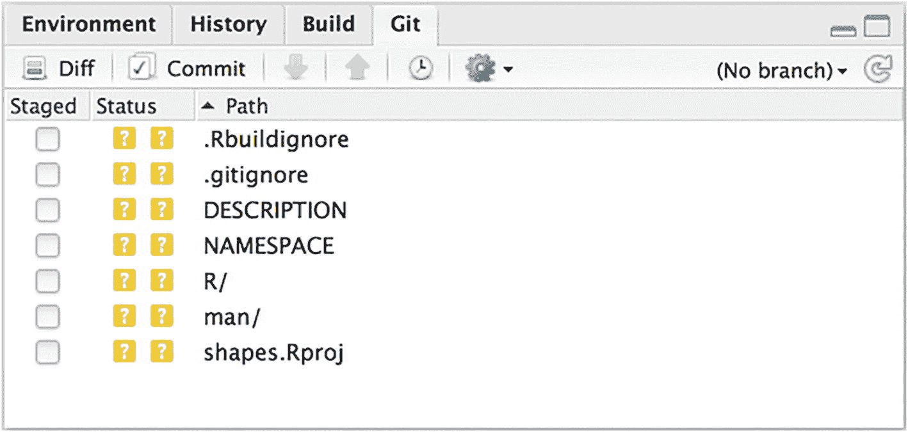
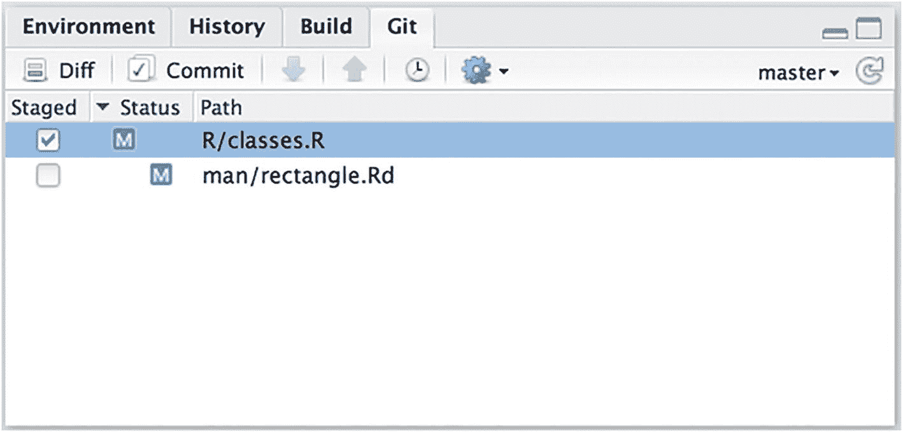
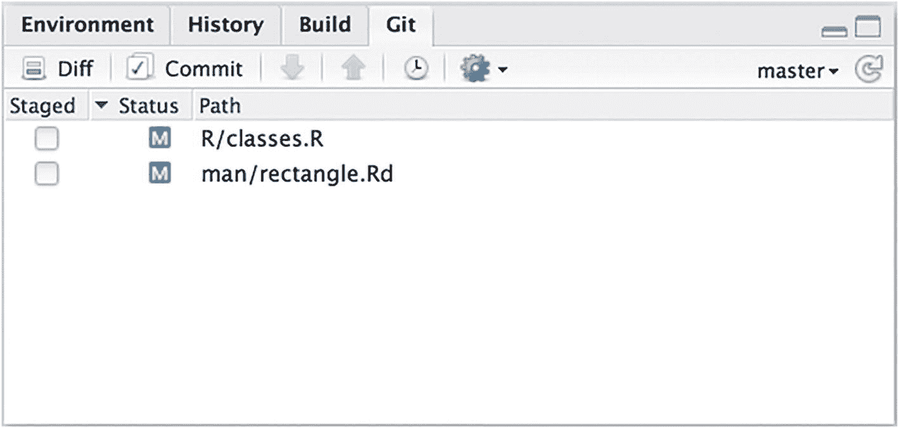
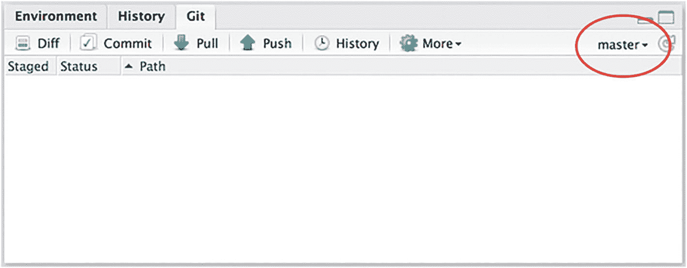
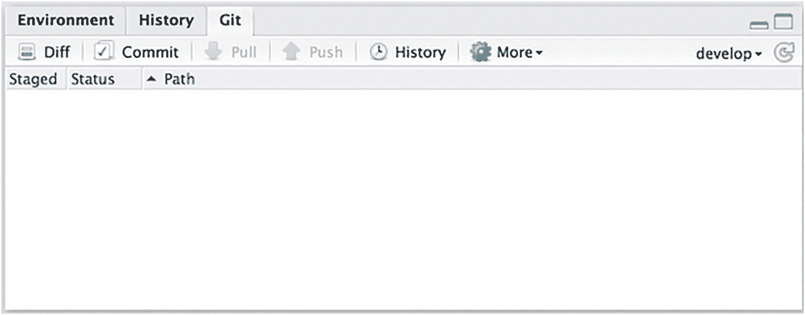
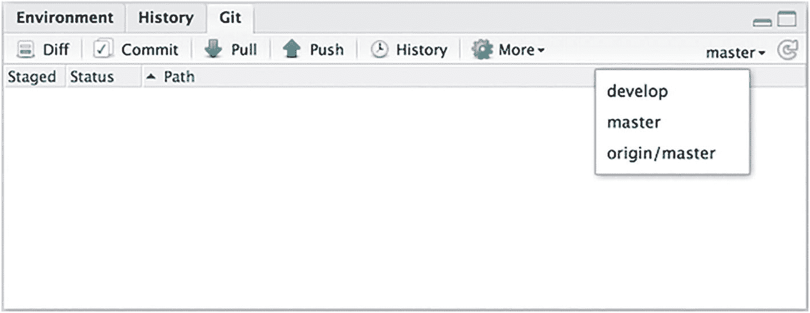
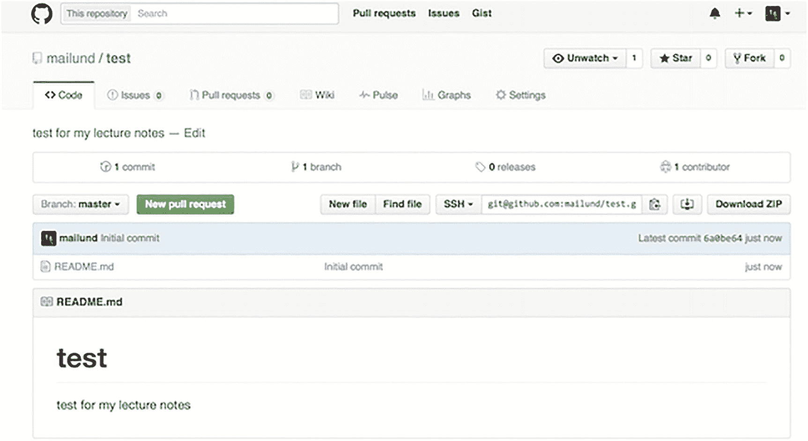

# 15. 版本控制

版本控制，在其最简单的形式中，用于跟踪软件的变化。它也是软件开发中一种高效的协作方式，因为它通常允许多个开发人员对软件进行更改，并将这些更改与其他开发人员的更改合并。RStudio 支持两种版本控制系统：Subversion 和 git。其中，git 使用最广泛，尽管这些事情当然是主观的，但我认为它也是更好的系统。当然，它是我们将在这里使用的系统。

## 版本控制与代码仓库

在软件开发过程中使用版本控制系统主要有两个目的。其一是追踪变更，以便日后查看源代码中哪些修改是在何时做出的，一旦发现错误，可以回退到早期版本尝试不同的方法。它为软件开发提供了一个日志，让你能够回到过去，在发现当前进展走向错误方向时重新尝试。

版本控制系统通常执行的另一项任务是简化团队协作。其核心理念是共享包含所有代码及代码变更的全局仓库（即版本控制系统记录的变更日志），每位开发者修改代码时都在自己的副本上工作，完成修改后将代码提交到仓库。早期的版本控制系统要求在修改文件时锁定文件，以防止其他开发者同时编辑相同文件产生冲突。如今的版本控制系统在并发编辑同一文件方面更为宽松，只要修改不在重叠行上（此时需手动解决冲突），通常会自动合并变更。

通过这种版本控制方式，不同开发者可以同时在代码的不同部分工作，无需担心冲突。即便发生冲突，在尝试向全局仓库推送变更时系统也会识别出来，并提示你解决冲突。

版本控制系统 `git` 甚至允许比这更高程度的并发和独立开发——理论上它并不强制要求存在单一的全局仓库。实践中，为项目的正式版本设置全局仓库是个好主意，人们也确实会这样做。该系统只是不强制要求单一的全局仓库，而是围绕多个可相互同步变更的仓库构建。

使用 `git` 时，你的源代码旁会有一个本地仓库。你可以将这个仓库用作前面提到的日志系统，或者为不同特性或版本创建分支（我们后续会讲到）。你可以像平常一样修改源代码，然后提交到本地仓库，而不会与其他人的变更产生冲突。但既然你们在不同的本地仓库上工作，你就看不到他们的变更，他们也看不到你的。要向另一个仓库提交变更，必须将变更推送过去；要从另一个仓库获取变更，则需要从那里拉取。

这时通常就需要全局仓库了。你在开发某个功能时，先在本地仓库进行修改，完成后将变更推送到全局仓库。如果你没有修改全局仓库的权限（例如你克隆了别人的代码并做了修改），可以请求有权限的人将你的变更拉取到仓库中，这被称为“拉取请求”。

## 在 RStudio 中使用 Git

以上全是理论，如果我觉得写起来困难，你大概理解起来也不容易。不如我们实际看看 `git` 是如何工作的。

`RStudio` 提供了一些基本的与 `git` 交互的工具：你可以创建仓库、提交变更、向其他仓库推送变更。它并不支持 `git` 的全部功能——若需完整功能，你需要使用其他工具或 `git` 的命令行版本——但日常的版本控制任务，它已足够胜任。

### 安装 Git

如果你的计算机上尚未安装 `git`，可以从 [`http://git-scm.com`](http://git-scm.com/) 下载。应该提供 Windows、OS X 和 Linux 版本，不过你的平台可能提供更便捷的安装方式。

例如，在 Debian/Ubuntu 系统上，可以使用：

```
sudo apt-get install git-core
```

而在 Red Hat/Fedora 系统上，可以使用：

```
sudo yum install git-core
```

在其他系统上如何最好地安装 `git`，需要你自行搜索确认。

安装完成后，你需要告诉 `git` 你是谁。它需要此信息来用你的名字标记代码变更。如果只有你一个人开发代码，这一点并不特别重要；但如果有更多人协作开发，就必须识别谁做了哪些修改。在终端中运行以下命令来告诉 `git` 你的身份：

```
git config --global user.name "你的姓名"
git config --global user.email "你的邮箱地址"
```

你可能还需要告诉 `RStudio` 已安装的 `git` 命令所在位置。操作方法是：进入 `Tools` 菜单，选择 `Global Options...`。在弹出的窗口中，左侧图标区域找到 `Git/SVN` 面板，在其中设置 `git` 命令的路径。

你安装的 `git` 是一个命令行工具。`RStudio` 提供了一些与 `git` 交互的图形界面，但并非所有操作都能通过图形界面完成。还有一些图形界面工具能比 `RStudio` 实现更多 `git` 功能，我建议你选用其中一款——我本人常常觉得用它们比用命令行更方便，毕竟我年纪大了，记不住具体命令。

以下是几个不错的选择：

*   Sourcetree（[`www.sourcetreeapp.com`](http://www.sourcetreeapp.com)）：适用于 Windows 和 OS X

*   GitHub Desktop（[`https://desktop.github.com`](https://desktop.github.com)）：适用于 Linux、Windows 和 OS X（用于操作 GitHub 仓库）

*   GitG（[`https://wiki.gnome.org/Apps/Gitg`](https://wiki.gnome.org/Apps/Gitg)）：适用于 Linux

不过，有些情况下你确实需要使用命令行版本。这里有一个非常棒的交互式网页教程，专门针对命令行 `git` 程序：[`https://try.github.io/levels/1/challenges/1`](https://try.github.io/levels/1/challenges/1)。

### 对文件进行修改、暂存和提交更改

如果你在创建包时勾选了使用 git 进行项目管理，那么 RStudio 右上角应该会有一个 Git 标签页，位于 Build 标签页旁边。点击它。

该面板的主要区域会显示一个文件列表。列表包含三列：暂存状态、状态和路径。其中路径列显示的是被修改文件（或目录）的名称，如图 15-1 所示。

如果你是第一次进入这个面板，那么自创建对象以来（包括 RStudio 在创建包时生成的文件），你修改过的所有文件的状态列都会显示一个黄色的问号。这个状态表示 git 尚未识别这些文件。它能看到这些文件存在，但你从未告诉它如何处理它们。现在我们就来解决这个问题。



图 15-1. 显示已修改文件的 Git 面板

暂存列中每个文件都有一个勾选框。勾选一个文件后，其状态会变为绿色的“A”。这表示你已经将该文件暂存，准备添加到 git 仓库中。对所有文件都执行此操作。当你勾选一个目录时，该目录下的所有文件也会被一并暂存。这也是我们目前想要的效果。

向 `git` 提交更改的过程是：在实际提交之前，先将更改暂存。我们刚才所做的就是告诉 `git`，下次提交更改时，我们希望添加这些文件。通常，提交只会影响我们已暂存的更改。这让你可以只提交对源代码所做的部分更改，在某些情况下会很有帮助。你可能对许多文件做了多处更改，但在某个时刻，你只想提交一个特定的 bug 修复，而不想提交尚未完成的新功能相关更改。只暂存你想要提交的更改就能实现这一点。

总之，我们现在已经暂存了所有内容。要提交更改，你需要点击工具栏中的“Commit”按钮。这会打开一个新窗口，显示你即将提交的更改，并允许你（在窗口右上方）编写提交信息。这条信息将写入变更日志。在这里对你的更改进行简短且有意义的描述。如果你以后需要在日志中查找这些更改，就会用到它。然后点击“Commit”并关闭窗口。此时 Git 面板应该不再显示任何文件。这是因为自上次提交以来没有新的更改，而该面板只显示当前软件版本与已提交到 `git` 的版本之间存在差异的文件。

如果我们想在终端中执行刚才的操作，则需要使用 `git add` 命令暂存文件：

```
git add 文件名
```

并使用 `git commit` 命令提交暂存的更改：

```
git commit -m "提交信息"
```

现在尝试修改一个文件。修改完成后，你应该会看到该文件再次出现在 Git 面板中，如图 15-2 所示，不过这次状态列显示的是蓝色的“M”。毫无疑问，这表示已修改（Modified）。

如果你在这里暂存一个文件准备提交，状态仍然是“M”，但 RStudio 会通过将“M”标记稍微左移来指示它已被暂存，如图 15-3 所示。当然，你并非必须依赖这个视觉反馈，因为从已勾选的暂存按钮也能看出文件已被暂存。

提交已修改文件的操作与提交新添加文件完全一样。

在终端中，暂存已修改文件同样使用 `git add` 命令。暂存新文件和暂存已修改文件并没有不同的命令，两者都使用 `git add`。

### 为现有项目添加 Git

如果你在创建项目时没有同时创建 `git` 仓库（而且你刚刚才了解 `git`，除非你每次创建项目都勾选了“git”按钮，否则你可能有很多项目没有关联 `git` 仓库），你仍然可以为现有目录设置 `git`。只需在命令行中操作即可。



图 15-3. 已修改文件，其中一个文件已暂存待提交



图 15-2. Git 面板中显示的已修改文件

进入项目所在的目录并运行以下命令：

```
git init
```

这将创建一个空的仓库。该目录中已有的文件随后就可以像我们之前看到的那样添加进去。

### 裸仓库与克隆仓库

如果你使用像 GitHub 这样的仓库服务器，本节中的大部分内容你永远无需操心。在那里，创建仓库和与其交互都是通过 Web 界面完成的，除了“克隆”仓库之外，你无需担心细节。我们将在此处手动创建一个所谓的“裸”仓库，并了解如何通过它来在不同的本地仓库之间传递更改。

我们创建 R 项目时创建的仓库，或者在目录中使用`git init`创建的仓库，都是用于对项目目录中的源代码进行版本控制的本地仓库。它们并非为开发者之间的协作而设计。尽管在技术上可以将一个此类仓库的更改合并到另一个仓库中，但这过程有些繁琐，不宜日常处理。

为了在不同仓库之间同步更改，我们需要一个裸仓库。裸仓库是一个不包含本地源代码的仓库；它并没有什么特别之处，但它能防止你在本地对其进行直接修改，你只能通过其他仓库的更改来更新它。

要创建裸仓库，我们需要使用 git 的命令行版本。在你想要放置仓库的位置创建一个目录，进入该目录，然后输入：

```
git --bare init
```

现在，这个仓库包含了 git 运行所需的各种文件——你的本地仓库也包含这些文件；当你同时拥有本地源代码时，它们只是隐藏在一个名为`.git/`的子目录中。

我们不会直接对这个仓库进行任何操作。我们只需要它来演示如何与其他连接到此仓库的仓库进行协作。

前往一个你想放置仓库工作版本（含源代码）的目录，通过输入以下命令来克隆一份裸仓库的副本：

```
git clone /path/to/bare/repository
```

你会收到一条警告，提示你克隆了一个空仓库。我们已知这一点，所以不必担心。我们很快会向其中添加内容。

为了演示仓库之间的通信方式，你需要再创建一个工作副本。你可以去另一个目录重复执行克隆命令，或者通过以下命令克隆仓库并为其指定一个新名称：

```
git clone /path/to/bare/repository 名称
```

现在，我们有了裸仓库的两个克隆副本，可以看看如何将更改从一个克隆推送到被克隆的仓库，以及如何将被克隆仓库中的更新拉取到克隆副本中。

正如我之前所写，通过裸仓库传递更改并非将更改从一个仓库移动到另一个仓库的唯一方式，但它是使用 git 最简单的方式，也是你在使用 GitHub 这类服务器时会采用的方式。如果你这样做（我们稍后会介绍具体操作方法），GitHub 会为你创建好裸仓库，你只需将其克隆到你计算机上的某个位置即可开始工作。

### 推送本地更改并获取与拉取远程更改

进入你刚刚创建的某个克隆仓库。它看起来像是一个空目录，因为我们还没有对它进行任何修改。实际上，它包含一个隐藏目录`.git/`，Git 的神奇之处就在这里，但我们无需了解这些。

尝试创建一些文件，将它们添加到 Git，并提交更改：

```
touch foo bar
git add foo bar
git commit -m "新增了 foo 和 bar"
```

如果现在查看日志：

```
git log
```

你会看到已经进行了更改。然而，如果你查看另一个裸仓库的克隆，你会发现这些更改尚未可见。

造成这种情况的原因有两个：(1) 我们只对克隆仓库做了更改，但从未将这些更改推送到两个克隆仓库所连接的裸仓库；(2) 即使我们推送了，也还没有将更改拉取到另一个克隆仓库中。

第一个操作通过`git push`完成。它会将你在本地仓库中所做的更改推送到你克隆来源的仓库：

```
git push
```

你不需要在每次提交后都将更改推送到全局（裸）仓库；事实上，可能也不应该这样做。这种工作流程的理念是：你频繁地向本地代码提交，以实现细粒度的版本控制，但只有当你完成一个功能——或者至少让代码达到一个对他人有意义的可工作阶段时，才将这些更改推送上去。提交一段不完全能工作的代码到本地仓库通常不是大问题——尽管通常应避免——但如果将无法工作的代码推送给他人，就不会受欢迎了。

在第一个克隆仓库中推送更改后，这些更改在第二个仓库中仍然不可见。你需要将它们拉取下来。

有一个命令：

```
git fetch
```

可以获取全局仓库中的更改，并让你在将这些更改与自己的代码合并之前，先检出查看。这很有用，因为你可以先检出并确保这些更改不会破坏你的代码，然后再进行合并。运行`fetch`命令后，你可以从全局仓库检出分支，在那里进行修改，并使用下文描述的分支机制将它们合并到你的代码中。然而，在大多数情况下，我们只想将全局仓库中的更改合并到当前代码中，并且并不想在合并之前修改它。在这种情况下，命令：

```
git pull
```

可以一步完成获取最新更改并将其合并到本地仓库的操作。这是将他人所做的更改（已推送到全局仓库）与你的更改合并时最常用的操作。

转到没有更改的那个克隆仓库，并运行该命令。检查一下，现在你那里是否已经有了这些更改。

与他人协作项目的一般工作流程是：进行更改并将其提交到自己的仓库。你使用这个仓库来存放那些还不准备分享的更改，只有你能看到它们。然后，当准备与协作者分享时，你可以将更改推送到共享仓库；而当你需要他人所做的更改时，你可以将它们拉取下来。

如果你尝试推送到全局仓库，但别人已经推送了你尚未拉取的更改，你将会收到一个错误。不必担心。只需先拉取更改，之后就可以推送你的更改了。

如果你将更改拉取到你的仓库，而此时你仓库中已有尚未推送的已提交更改，该操作就会变成一次合并操作，这需要一条提交信息。对此有一条默认信息，你可以直接使用。

你有两个仓库可以进行实验，所以可以尝试在不同情况下向已有已提交更改的仓库推送和拉取更改。在你亲自进行一些实验之后，前面的解释应该会变得更加清晰。

RStudio 对推送和拉取提供了一些基本支持。如果你创建一个新的 RStudio 项目，并选择将其放在一个现有目录中，可以尝试将其放在你的克隆仓库中。你会发现，Git 面板现在多了两个新按钮：推送（push）和拉取（pull）。

### 处理冲突

如果恰好有人向全局仓库推送了与你在本地仓库中编辑的行重叠的更改，那么当你拉取更改时，就会遇到所谓的冲突。

无论是从 RStudio 拉取还是使用命令行，Git 都会通知你冲突。它会告诉你涉及哪些文件。如果你打开一个存在冲突的文件，你会看到 Git 已经用如下所示的文本标记了冲突：

```
>>>>>>> 9a0e21ccd38f7598c05fe1e21e2b32091bb0839b
```

它会显示你所作的更改版本以及全局仓库中的更改版本。由于两处都有更改，Git 在拉取命令中不知道如何将远程仓库合并到你的仓库中。

你必须进入文件并进行编辑，使其包含你想要的版本（这可能是两个版本的合并）。完成更改后，去掉`<<<<`/`====`/`>>>>`这些标记行。

编辑完存在冲突的文件后，你需要将其暂存——在命令行运行`git add 文件名`，或者在 RStudio 的 Git 面板中勾选暂存列中的文件——然后提交。这会告诉 Git 你已经处理了冲突，如果需要，之后就可以推送你自己的更改了。

### 使用分支

分支是大多数版本控制系统的一项功能，它允许你同时处理代码的不同版本。一个典型的例子是，用一个分支来开发新功能，用另一个分支来维护软件的稳定版本。当你正在实现新功能时，代码处于不断变化的状态，新功能的实现可能存在缺陷，功能的接口也可能在不同设计方案间变动。你不希望用户使用你软件的这种版本——至少应该让他们知道，他们使用的包是不稳定的，并且他们正在使用的接口随时可能发生变化。因此，你需要将开发代码与发布代码分离开来。

如果你只是在特定时间发布版本，然后在发布版本之间实现新功能，那问题不大。用户应该使用你已经发布的版本，而不是发布版本之间的中间提交。但如果你发布了一个存在错误的版本——坦白说，这并非不可能——并且你想在发现错误时修复它，情况就没那么简单了。你可能不希望等到完成所有正在开发的新功能后再去修复这个错误。因此，你需要对发布版本的代码进行修改。如果发现更多错误，你会在发布代码上提交更多修复。而在此期间，你仍在修改你的开发代码。当然，你对发布代码所做的那些修复，也希望能合并到开发代码中。毕竟，你不希望下一个版本再次引入你已经修复过的错误。

这就是分支发挥作用的地方。RStudio 对分支的支持非常有限，它无法帮助你创建分支。为此，我们需要使用命令行。



**图 15-4** 当代码位于`master`分支时的 Git 面板

要创建一个分支，你可以使用命令`git branch 分支名`，因此，要创建一个开发分支——为了简便起见，命名为`develop`——我们使用：

```
git branch develop
```

这仅仅是创建了分支。我们并不会被神奇地切换到该分支或其他什么操作。它只是告诉 git 我们有了一个新分支（并且它从我们在仓库提交历史中的当前位置分叉出来）。

在 RStudio 中，我们可以在 Git 面板中看到当前所在的分支，见图 15-4。在你目前实验过的项目中——以及任何你通过`git init`创建，或在创建项目时勾选了对话框中的 git 选项而创建了 git 仓库的项目中——你都会处于`master`分支。这是默认分支，也是通常用于发布版本的分支。

如果你点击 Git 面板中的分支下拉菜单，会得到仓库中所有分支的列表，见图 15-5。你会看到一个名为`origin/master`的分支。这是中央仓库上的 master 分支，是在拉取数据时合并的那个分支。忽略它即可，它对我们不重要。如果你运行了`git branch develop`命令，那么应该还会有一个`develop`分支。如果选择它，你就会切换到那个分支，见图 15-6。



**图 15-6** 切换到`develop`分支之后



**图 15-5** 选择要切换的分支

你也可以在命令行中获取分支列表，使用命令：

```
git branch
```

你可以使用以下命令来切换分支：

```
git checkout 分支名
```

如果你切换到`develop`分支，你会看到“拉取”和“推送”按钮变成了灰色。你可以在某个分支上修改代码并提交，但（目前）还不能进行推送和拉取操作。我们稍后会介绍这部分内容。

如果你在`develop`分支上对代码做了一些修改并提交，然后切换到`master`分支，你会发现那些修改并不存在。你可以通过查看文件以及查看 git 历史记录（使用`git log`或点击 Git 面板中的“历史记录”按钮）来确认这一点。同样，在`master`分支上所做的修改也不会出现在`develop`分支上。这正是我们想要的。这两个分支是互相独立的，我们可以通过切换分支来在开发分支和软件的发布版本之间进行工作。

当你对一个分支进行了修改，并且希望这些修改也应用到另一个分支时，就需要合并分支。实际上，你是需要将一个分支合并到另一个分支中；这不是一个对称的操作。为此，请先检出你想要修改的目标分支，然后运行命令：

```
git merge 其他分支名
```

将`其他分支`中的修改合并到当前分支。例如，如果你对`master`分支进行了错误修复，并希望将其合并到`develop`分支，你应该这样做：

```
git checkout develop
git merge master
```

如果合并导致冲突，解决冲突的方式与拉取操作导致冲突时的解决方式相同，这并不奇怪，因为`pull`命令实际上只是获取和合并的快捷方式。

#### 典型工作流涉及大量分支

Git 针对使用大量分支进行了优化（这与某些版本控制系统不同，在这些系统中创建和合并分支可能相当缓慢）。这一点体现在许多人在使用 Git 时对分支的应用方式上：你会创建许多分支，在一个由不同代码版本构成的图谱上工作，并在需要时将它们合并在一起。

拥有一个开发分支和一个主分支是仓库结构的典型核心，但为每个你要实现的新功能创建一个分支也是非常普遍的做法。通常，在开始处理某个功能时，你会从`develop`分支分出该功能分支，并在完成功能后将其合并回`develop`分支。为每个错误修复设立一个单独的分支也很常见——通常在你开始实施修复时从`master`分支分出，然后在修复完成后将其合并回`master`分支以及`develop`分支。请参阅 Atlassian 的 Git 教程（`www.atlassian.com/git/tutorials/comparing-workflows`）了解利用各种分支的不同工作流。

如果你为每个功能或错误修复创建了许多分支，那么在完成相关工作后，你可能不想保留它们——不像你希望永久保留的`develop`和`master`分支那样。要删除一个分支，使用以下命令：

```
git branch -d 分支名
```

### 将分支推送至全局仓库

你可以在本地仓库中随心所欲地创建任意数量的分支，但它们并不会自动出现在全局仓库中。我们之前创建的`develop`分支仅存在于本地仓库，并且我们无法将其更改推送到全局仓库——在 RStudio 中可以看到，因为推送（和拉取）按钮是灰色的。

如果你希望某个分支也存在于全局仓库中——以便能够推送更改，并且让协作者能够检出——你需要在该仓库中创建一个分支，并建立本地仓库与全局仓库之间的链接。

你可以通过检出`develop`分支并运行以下命令来实现：

```
git push --set-upstream origin develop
```

该命令会推送更改，并且还会记住将来该分支已与`origin`中的`develop`分支关联。名称`origin`指的是你创建此仓库时所克隆的仓库。

是否希望正在处理的分支也出现在全局仓库中，这取决于个人偏好。如果你正在开发一个希望在完成后才分享、而不提前公开的功能，你可能不希望将该分支推送到全局仓库。不过，对于`develop`和`master`分支，你肯定希望它们存在于全局仓库中。

### GitHub

GitHub（`https://github.com`）是一个用于托管 Git 仓库的服务器。你可以将其视为存放裸仓库/全局仓库的地方，并附带一些额外功能。例如，有自动安装托管在 GitHub 上软件包的方法、用于追踪错误和功能请求的 Web 支持，以及通过 Web 界面在托管项目中共享修复和功能的支持。

要使用它，你首先需要访问其主页并注册。注册是免费的，你只需选择一个用户名和密码即可。

在 GitHub 上创建账户后，你可以通过点击主页右上角的大加号来创建新仓库，见图 15-7。

点击后，你将进入一个页面，可以在其中选择仓库名称、添加简短描述、选择许可证，并决定是否要添加`README.md`文件。我建议你始终保留一个`README.md`文件——因为它会显示在 GitHub 仓库的主页上，可作为软件包的文档。不过，正如我们在第 13 章中看到的，你可能希望设置一个`README.Rmd`文件来生成它。但现在，你可以选择直接生成一个。

仓库生成后，你将进入一个页面，其中显示仓库中的代码概览，见图 15-8。


仅包含一个`README.md`文件的新 GitHub 仓库


GitHub 主页上用于创建新仓库的按钮。位于主页右上角

你可以稍后探索该网页及其实现的功能——了解它支持哪些操作是个好主意——但现在，我们只需将此仓库用作远程全局仓库即可。要克隆它，你需要获取 SSH 按钮旁边字段中的地址。在我的测试仓库中，地址是`git@github.com:mailund/test.git`。你可以使用此地址通过“ssh”协议克隆仓库：

```
git clone git@github.com:mailund/test.git
```

这是一种你可以在许多机器上访问的协议，但它需要你处理公钥/私钥协议。请查看 GitHub 上关于设置 SSH 密钥的文档以了解更多信息（`https://help.github.com/articles/generating-ssh-keys/`）。目前该过程大多已自动化，通常只需推送一次并回答弹出的问题即可完成设置。

然而，如果你使用的是支持 HTTPS（Web 浏览器用于安全通信的协议）的机器，SSH 协议可能不是最便捷的方式。你自己的机器几乎肯定支持 HTTPS，但根据防火墙的设置方式，你可能在计算机集群等环境中无法使用 HTTPS，这时就需要使用 SSH 协议。要改用 HTTPS 而非 SSH，只需点击 SSH 按钮的下拉菜单并选择 HTTPS 即可。这会提供一个略有不同的地址——在我的仓库中，地址是`https://github.com/mailund/test.git`——你可以用它来克隆：

```
git clone https://github.com/mailund/test.git
```

如果一切顺利，你应该能够像使用之前我们自己创建的裸仓库/全局仓库一样，使用这个克隆的仓库。

你也可以在 RStudio 的文件菜单中选择“新建项目…”，然后在弹出的对话框中选择“版本控制”（第三个选项），同时检出仓库并创建一个 RStudio 项目。在下一个窗口中，选择 Git，然后使用 HTTPS 地址作为仓库 URL。

### 将现有仓库迁移至 GitHub

如果你已经在项目中本地使用了 Git，并且想将其迁移到 GitHub，那么你需要做更多的工作——至少如果你想迁移包含所有历史记录的仓库，而不仅仅是当前版本的源代码的话。

首先，你需要创建仓库的一个裸版本。正如我们之前所见，这只是不带源代码的仓库版本。

如果你的仓库名为`repo`，我们可以通过克隆创建一个名为`repo.git`的裸版本：

```
git clone --bare repo repo.git
```

要将其迁移到 GitHub，在那里创建一个空仓库并获取其 HTTPS 地址。然后进入我们刚刚创建的裸仓库并运行以下命令：

```
cd repo.git
git push --mirror
```

现在，删除用于将代码迁移到 GitHub 的裸仓库，并从 GitHub 克隆该版本。这样你就有了一个可以处理的版本：

```
rm -rf repo.git
git clone https://github.com/your-username/new-repo-name.git
```

### 从 GitHub 安装软件包

将 R 包托管在 GitHub 上的一个非常好的额外好处（除了拥有版本控制之外）是，其他人可以直接从那里安装你的包。CRAN 对上传包的要求比 GitHub 严格得多，而且你无法频繁地向 CRAN 上传新版本，因此对于 R 包的开发版本来说，GitHub 是一个极好的选择。

要从 GitHub 安装包，你需要先安装`devtools`包：

```
install.packages("devtools")
```

之后，你可以使用以下命令安装 GitHub 用户“username”编写的名为“packagename”的包：

```
devtools::install_github("username/packagename")
```

### 在 GitHub 上进行协作

你在 GitHub 上创建的仓库默认只有你自己可以编辑。任何人都可以克隆它们来获取源代码，但只有你能向仓库推送更改。这当然有助于防止无关人员随意修改你的代码，但也阻碍了协作。

与他人协作的一种方式是授予他们对仓库的写入权限。在仓库主页上，你必须在工具栏中选择`Settings`条目，然后在左侧菜单中选择`Collaborators`。之后，你会进入一个页面，可以在其中添加由 GitHub 用户账号标识的协作者。协作者可以像你一样向仓库推送更改。为了避免在多位协作者更新代码时造成混乱，在如何将更改合并到`master`（和/或`develop`）分支方面遵循一定的规范会很有帮助。GitHub 推荐并支持的一种方法是：在独立的分支上进行更改，然后使用所谓的拉取请求（pull request）在更改被合并到主分支之前进行讨论。

#### 拉取请求

进行拉取请求的工作流程是：在独立于`develop`或`master`的分支上实现新功能、修复 Bug 或进行其他任何开发，然后不是直接合并它们，而是创建一个所谓的拉取请求。你可以通过切换到仓库主页上的分支并选择大大的绿色`New pull request`按钮来发起拉取请求，或者如果你刚刚做了更改，你应该还会看到一个写着`Compare & pull request`的绿色按钮，点击它即可开始发起拉取请求。

点击该按钮会带你进入一个页面，你可以在其中为拉取请求命名，并编写描述，说明你所做的代码更改的作用。你还需要决定要将拉取请求合并到哪个分支；在你为拉取请求命名的标题上方，你可以选择两个分支：你想要合并到的分支（`base`）以及包含你新更改的分支（`compare`）。你应该在此处选择你创建新分支时从中分支出去的源分支。之后，你就可以创建拉取请求了。

这实际上所做的唯一事情就是创建一个用于讨论你所做更改的 Web 界面。你可以在网页上查看这些更改、进行评论，或者对分支进行总体评论。同时，任何人都可以检出该分支并对其进行自己的修改。只要拉取请求保持打开状态，讨论就会持续进行，人们也可以对该分支进行改进。

当你完成操作后，你可以合并该拉取请求（使用在包含拉取请求讨论的网页上找到的大大的绿色`Merge pull request`按钮）。

#### 复刻仓库而非克隆

在独立的分支上进行更改，然后通过拉取请求合并这些更改，仍然需要仓库的写入权限。这对于与几位朋友协作来说非常棒，但对于从陌生用户那里获取修复代码来说并不理想——也不适合为你编写的其他软件包的修复做出贡献，这些软件包的作者不一定会愿意授予你对他们的软件完全写入权限。

不必担心，即使没有对方仓库的写入权限，仍然可以在 GitHub 上与他人协作。从拉取请求的工作方式来看，实际上并不需要被合并的分支属于同一个基础仓库。如果你愿意，可以从任何地方合并分支。

如果你想对一个没有写入权限的仓库进行更改，你可以克隆它并在克隆后得到的仓库上进行更改，但你无法将这些更改推回你从中克隆的原始仓库。而且，GitHub 上的其他用户看不到你在本地所做的更改（它们在你自己的个人电脑上，而不是在 GitHub 服务器上）。你需要的是一个位于 GitHub 上、是你想要修改的仓库的克隆版本、并且是裸仓库的仓库，这样你才能将更改推送进去。然后，你再将该仓库克隆到自己的电脑上。你对本地电脑所做的更改可以推送到你在 GitHub 上的那个裸仓库中——因为它是一个裸仓库，并且你拥有它的写入权限——并且 GitHub 上的其他用户可以看到你托管的那个仓库。

在 GitHub 上创建这样的仓库被称为“复刻（fork）”该仓库。从技术上讲，这与你克隆仓库并无不同——只不过你创建的是一个裸仓库——这个术语来源于开源软件，在开源软件中，复刻一个项目意味着创建你自己的版本并独立于之前的版本进行开发。

总之，每当你进入 GitHub 上的一个仓库主页时，你应该会在右上角（在你正在查看的仓库名称和分支的右侧）看到一个写着`Fork`的按钮。点击它会创建一个你拥有写入权限的仓库副本。你不能复刻自己的仓库——我不确定为什么不允许这样做，但在大多数情况下，你本来也不想这样做，所以这不是什么大问题——但你可以复刻其他用户账号下的任何仓库。

一旦你创建了副本，你可以像处理任何其他仓库一样，将其克隆到你的电脑上并进行更改。这个仓库与你自行创建的仓库唯一的区别在于，当你创建拉取请求时，GitHub 知道它是从另一个仓库复刻而来的。因此，当你创建拉取请求时，你不仅可以选择`base`和`compare`分支，还可以选择`base fork`（基础复刻）和`head fork`（头复刻）——前者是你想要合并更改的目标仓库，后者是你进行更改的仓库。如果有人复刻了你的项目，并且你在原始仓库中创建拉取请求，默认情况下你不会看到`base fork`和`head fork`的选项，但在创建拉取请求时点击`compare across forks`（跨复刻比较）链接也会启用这些选项。

如果你通过拉取请求将你的更改提交到别人的仓库，其过程与在你自己的项目上发起拉取请求完全相同，只不过在关于更改的讨论结束后，你无法合并该拉取请求。只有拥有该仓库写入权限的人才能执行合并操作。

同样，如果其他人想要对你的代码进行更改，他们也可以发起一个包含他们更改的拉取请求提交到你的代码中，但只有你才能在经过拉取讨论后决定是否将这些更改合并到你的仓库中。

这是一种非常灵活的协作方式——即使是与陌生人协作——用于源代码开发，这也是 git 和 GitHub 的优势之一。

#### 练习

从你之前编写的任意软件包中挑选一个，在 GitHub 上创建一个仓库来托管它。将你的代码推送上去。

