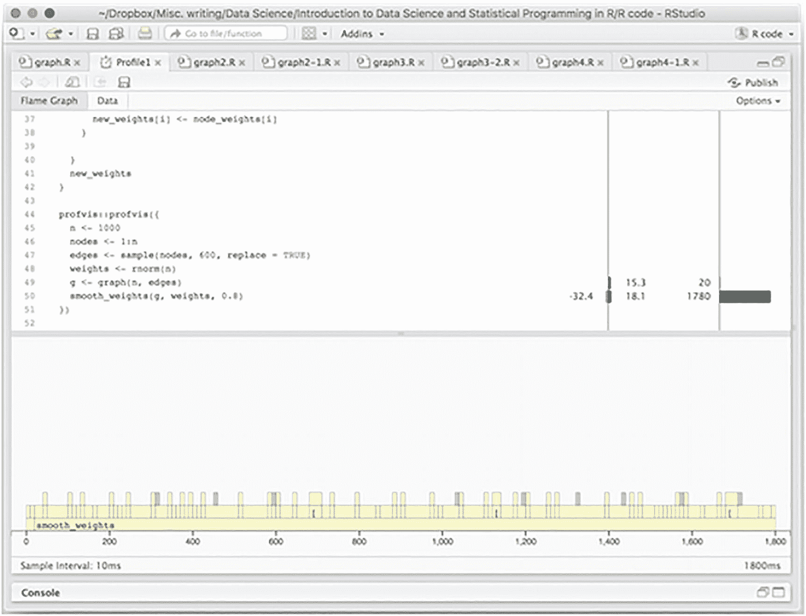
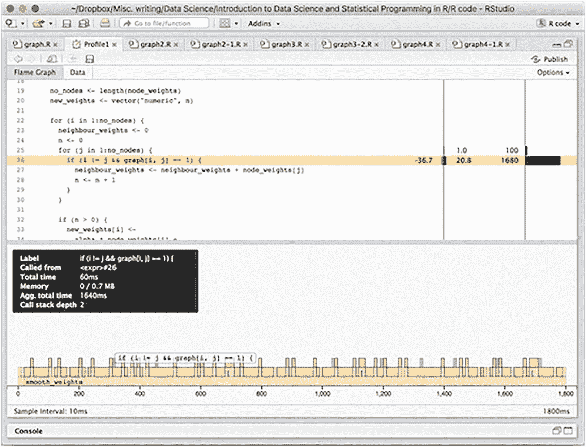
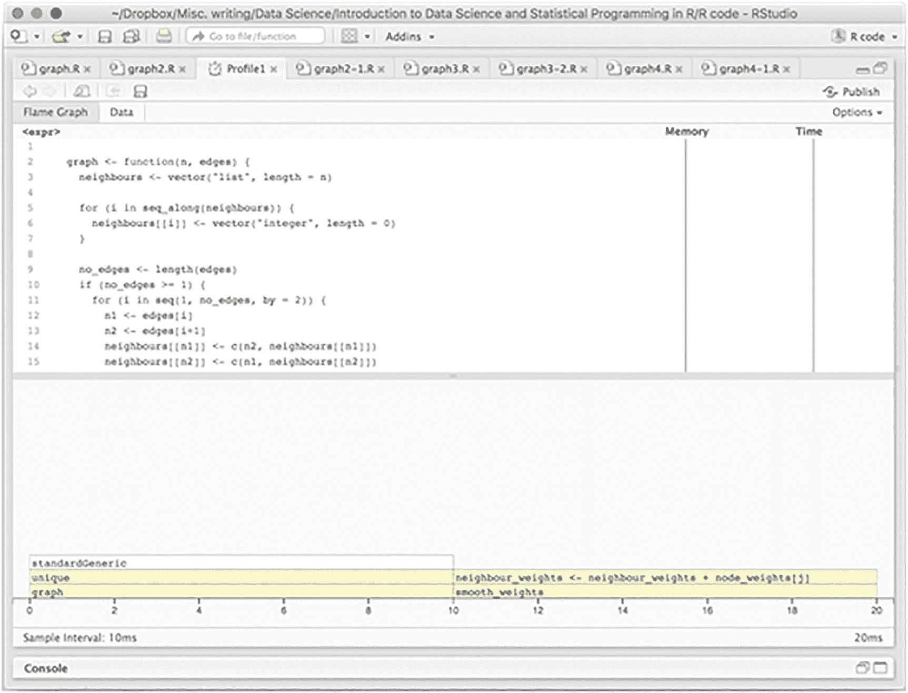
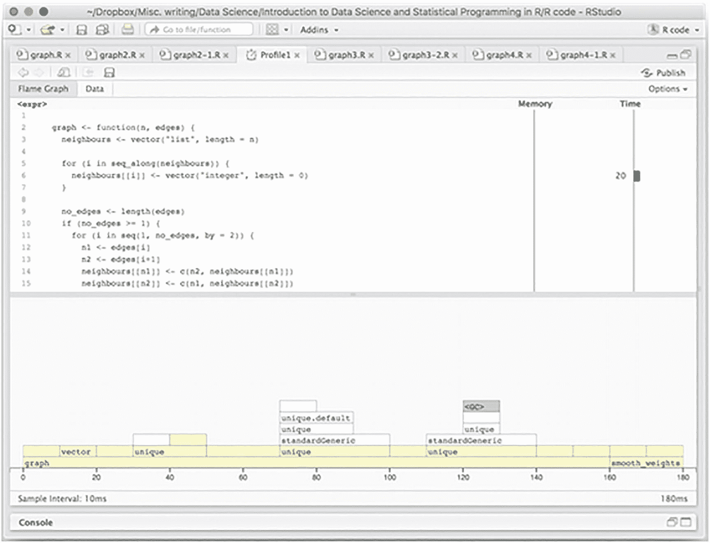
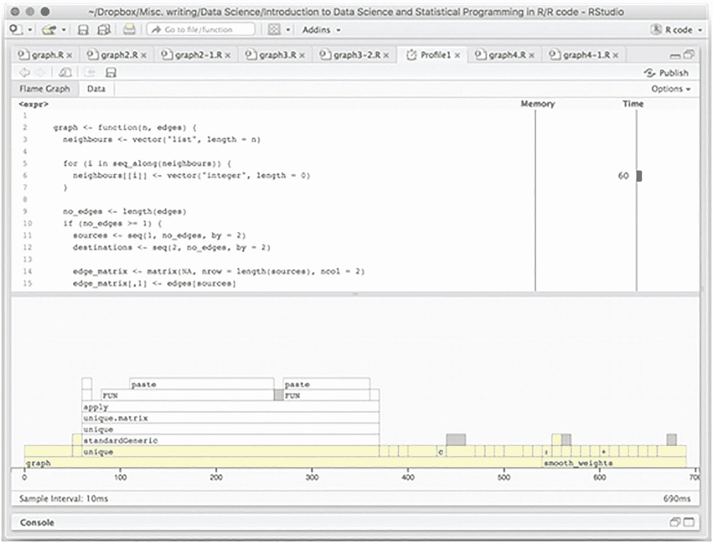
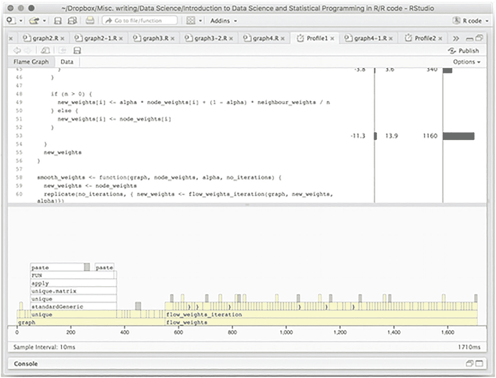

## 16. 性能剖析与优化

在本第二章中，我们将简要探讨当发现代码运行速度过慢时该怎么做，特别是如何找出运行缓慢的原因。

不过，在你开始担心代码性能之前，重要的是先考虑一下是否值得加速。提升性能需要花费你的时间，只有将额外的编程时间考虑在内后，改进后的性能仍能为你节省时间，这才值得去做。对于一个一天之内就能运行完成的分析来说，花一整天去让它变得更快毫无意义，即使它确实会快很多，因为你最终仍然需要花费相同甚至更多的时间才能完成分析。

任何你在一项分析中只需要运行几次的代码，通常都不值得优化。我们很少只运行一次分析——乐观地说，我们可能希望如此，但实际上，当数据或想法发生变化时，我们通常需要反复运行——但我们预计不会运行成百上千次。因此，即使重新运行一项分析需要几个小时，你的时间可能最好花在运行期间做其他事情上。花费大量时间让它变得更快通常并不值得。与你的时间相比，CPU 的时间是廉价的。

不过，如果你正在开发一个软件包，你通常确实需要在某种程度上考虑性能。一个值得开发的软件包通常会有更多用户，运行你的代码所花费的总时间使得在某种程度上加快代码速度是值得的。

### 性能剖析

在让代码跑得更快之前，首先需要找出它为什么慢。你可能对代码的瓶颈在哪里有一些想法，但实际上，猜测这一点出奇地困难。我经常发现，大部分时间实际消耗的地方与我预想的相差甚远。我曾有两次非常努力地尝试加快某个算法的速度，结果却后来发现程序运行缓慢的原因是用于读取程序输入的代码。解析器很慢，而相比之下算法快如闪电。那是在`C`语言中，其抽象层次相当低，通常很容易从代码中看出运行需要多少时间。但在`R`语言中，其抽象层次非常高，要猜测一行代码需要运行多长时间是极其困难的。

关键是，如果你发现代码运行缓慢，你不应该去猜测哪里慢。你应该测量运行时间，从而确切地了解。你需要对你的代码进行性能剖析，才能知道哪些部分占用了大部分运行时间。否则，你最终可能会优化那些只占总运行时间百分之几的代码，而忽略了真正的耗时大户。

在典型的代码中，只有少数几个真正的瓶颈。如果你能找出这些瓶颈并改进它们的性能，你的工作就完成了。其余部分会运行得足够快。找出这些瓶颈所在就需要性能剖析。

我们将使用`profvis`包进行性能剖析。`RStudio`对此包有内置支持，你的菜单栏中应该有一个`Profile`项。这是该包的一个便捷界面，但如果你希望在`RStudio`之外使用它，我将在此直接使用该包。

#### 一个图流算法

作为一个我们希望进行性能剖析的代码示例，可以考虑一个小型图算法。这是一个用于平滑图中节点权重的算法。它是用于在图节点间传播证据权重的算法的一部分，我们曾用它来通过基因-基因相互作用网络增强疾病-基因关联的搜索。思路是，如果在一个相互作用网络中一个基因是另一个基因的邻居，那么它更可能与后者具有相似的疾病关联。因此，已知关联的基因被赋予初始权重，而其他基因如果与这些基因相连，则会获得更高的权重。

然而，该算法用于做什么的细节并不那么重要。它所做的只是在节点间平滑权重。最初，所有节点*n*被赋予一个权重*w*(*n*)。然后，在一次平滑迭代中，这个权重被更新为`w'(n) = α * w(n) + (1 - α) * (1 / |N(n)|) * Σ_{v∈N(n)} w(v)`，其中*α*是介于 0 和 1 之间的数字，*N*(*n*)表示节点*n*的邻居。如果迭代次数足够多，图中所有连通节点的权重将变得相等，但如果提前停止，则只是一次轻微的平滑，具体取决于*α*的值。

为了实现这一点，我们既需要图的表示形式，也需要平滑算法。我们从表示图开始。有很多方法可以做到这一点，但一种简单的格式是所谓的关联矩阵。这是一个矩阵，如果节点`i`和`j`没有直接相连，则其条目为`M[i,j] = 0`；如果相连，则为`M[i,j] = 1`。由于我们希望在这个算法中处理无向图，我们将有`M[i,j] = M[j,i]`。

我们可以使用一个如下所示的构造函数来实现这种表示形式：

```
graph <- function(n, edges) {
  m <- matrix(0, nrow = n, ncol = n)
  if (length(edges) > 0) {
    for (i in seq(1, length(edges), by = 2)) {
      m[edges[i], edges[i+1]] <- m[edges[i+1], edges[i]] <- 1
    }
  }
  structure(m, class = "graph")
}
```

这里，我要求将节点数量作为参数`n`给出，并将边指定为一个向量，其中每对元素对应一条边。如果图需要手动编码，这并不是表示边的理想方式，但由于这个算法预期用于非常大的图，我假设我们可以在其他地方编写代码来读取图表示形式并创建这样的边向量。

这个函数本身没什么大不了的。它只是创建了关联矩阵，然后遍历边来设置它。有一个特殊情况需要处理：如果边向量为空。这时`seq()`调用会返回一个从 1 到 0 的列表，所以我们要避免这种情况。我们可能还想检查边向量的长度是否是 2 的倍数，但我没这么做。我假设生成该向量的代码会处理好这一点。

尽管图表示形式只是一个矩阵，但我为它指定了一个类，以便将来我想为它编写泛型函数。

有了这个图表示形式，平滑函数可以如下所示：

```
smooth_weights <- function(graph, node_weights, alpha) {
  n_nodes <- nrow(graph)
  new_weights <- node_weights
  for (i in 1:n_nodes) {
    neighbours <- which(graph[i, ] == 1)
    n <- length(neighbours)
    if (n > 0) {
      neighbour_weights <- sum(node_weights[neighbours])
      new_weights[i] <- 
        alpha * node_weights[i] + 
        (1 - alpha) * neighbour_weights / n
    } else {
      new_weights[i] <- node_weights[i]
    }
  }
  new_weights
}
```

它创建了我们要返回的新权重向量，然后通过嵌套循环遍历矩阵。如果关联矩阵表明`i`和`j`之间存在连接，并且`i ≠ j`——我们不想在存在自环的情况下添加节点自身的权重——我们就用它来计算均值。如果存在需要更新的内容——当节点`i`有邻居时就会这样——我们就执行更新。

这段代码并不特别优雅，但它是该思路的直接实现。

为了分析这段代码，我们使用`profvis`包中的`profvis()`函数。它接受一个表达式作为其唯一参数，因此若要分析多个函数调用，我们需向其提供一个代码块，将语句序列转换为表达式。

此处生成一个包含 1000 个节点、300 条边和随机权重的随机图。我们并非测试代码，仅对其性能进行分析。然而，若这是真实代码而非示例，我们当然应编写单元测试——若您开始重写代码以进行优化，这一点尤为重要。否则，您最终可能得到运行更快但结果错误的代码。

```
profvis::profvis({
  n <- 1000
  nodes <- 1:n
  edges <- sample(nodes, 600, replace = TRUE)
  weights <- rnorm(n)
  g <- graph(n, edges)
  smooth_weights(g, weights, 0.8)
})
```



**图 16-1** 展示分析结果的窗口

（若您使用`RStudio`，可通过选中`n <- 1000`至`smooth_weights(...)`的代码行，然后在`Profile`菜单中选择`Profile Selected Line(s)`达到同样效果。）

运行此代码将打开一个新标签页并显示结果，参见**图 16-1**。标签页上半部分显示您的代码，并以水平条形图方式注释内存使用情况（先显示）和时间使用情况（后显示）。窗口下半部分则显示时间使用情况及调用堆栈。

我们可以看到总执行时间约为 1800 毫秒。该图的阅读方式为：从左到右，您可以看到运行过程中各时间点执行了哪些内容，底部是我们在`profvis()`代码块中直接调用的函数，其上方是这些函数直接调用的代码，更上层的函数调用则堆叠得更高。



**图 16-2** 从分析窗口中高亮显示正在执行的代码

我们还可以看出大部分时间都花费在`smooth_weights()`函数上，因为它几乎从图形最左侧一直延伸至最右侧。当然，这是符合预期的，但正如我之前提到的，有时分析结果会令您感到惊讶。

如果将鼠标指针移入窗口（无论是代码区域还是底部图形区域），它会高亮显示您所指的内容，参见**图 16-2**。您可利用此功能找出时间消耗在何处。

在此特定案例中，大部分时间似乎花费在内层循环检查边是否存在上。由于这是双重循环的内层部分，这一点或许并不令人意外。并非内层循环全部主体都耗时，而主要是`if`语句，原因可能是我们在每次迭代中都会检查`if`表达式，但仅在其为真时才执行其主体。而面对 1000 个节点和 300 条边，其为真的概率约为 300/(1000*1000) = 3 × 10^-4（实际可能更小，因为某些边可能相同或为自环）。

若此代码存在性能问题，此处应是我们集中优化努力的方向。对于 1000 个节点，我们实际上并没有问题，1800 毫秒毕竟不算长。但我设想中的应用场景约有 30000 个节点，因此进行一些优化或许是值得的。

如果需要优化某些内容，您首先应考虑的是：是否存在更好的算法或数据结构？与仅仅修改实现细节相比，算法层面的改进更有可能带来显著的性能提升。

在此例中，如果我们处理的图是稀疏的（即实际边数远少于所有可能的边数），那么关联矩阵并非理想的表示方式。我们可以通过使用向量表达式替换内层循环或类似技巧来加速代码，但更好的做法是考虑另一种图表示方式。

当然，我们首先应弄清楚所使用的模拟数据是否代表了需要分析的实际数据。如果实际数据是稠密图，而我们却基于稀疏图进行性能分析，则无法准确了解时间消耗在哪里，也无法确定可以合理优化的方向。但我固执地认为，我所设想中的应用场景使用的是稀疏图。

对于稀疏图，我们应采用不同的格式表示边。我们将使用列表而非矩阵来表示边：对于每个节点，都维护一个包含其所有邻居节点的向量。

我们可以如下实现该表示：

```
graph <- function(n, edges) {
  neighbours <- vector("list", n)
  if (length(edges) > 0) {
    for (i in seq(1, length(edges), by = 2)) {
      n1 <- edges[i]
      n2 <- edges[i + 1]
      neighbours[[n1]] <- c(n2, neighbours[[n1]])
      neighbours[[n2]] <- c(n1, neighbours[[n2]])
    }
  }
  for (i in seq_along(neighbours)) {
    neighbours[[i]] <- unique(neighbours[[i]])
  }
  structure(neighbours, class = "graph")
}
```

我们首先生成边向量的列表，然后将其全部初始化为空整数向量。接着遍历输入的边并更新边向量。这种更新方式在计算上可能较慢，因为每次更新都会强制复制之前的向量，但我们事先不知道这些向量的长度，因此这是最简单的解决方案。如果后续的性能分析表明这是一个问题，我们再处理它。

如果输入的边中包含重复的节点对，我们将得到重复的边。这意味着在计算邻居权重的平均值时，同一邻居节点会被使用两次。如果应用允许此类多重边，那没问题，但我们的场景不允许，因此我们在最后对所有向量调用`unique()`函数，以确保同一邻居只被表示一次。

采用这种图表示后，我们可以将平滑函数更新如下：

```
smooth_weights <- function(graph, node_weights, alpha) {
  new_weights <- node_weights
  for (i in seq_along(graph)) {
    neighbours <- graph[[i]]
    n <- length(neighbours)
    if (n > 0) {
      neighbour_weights <- sum(node_weights[neighbours])
      new_weights[i] <- 
        alpha * node_weights[i] + 
        (1 - alpha) * neighbour_weights / n
    } else {
      new_weights[i] <- node_weights[i]
    }
  }
  new_weights
}
```

代码改动很小。我们只需确保`j`仅遍历已知的节点`i`的邻居节点。

性能分析代码与之前相同，运行后将得到如**图 16-3**所示的结果。

我们看到性能得到了显著提升。执行时间从 1800 毫秒降至 20 毫秒。我们还可以看到，一半时间用于构建图，仅另一半用于执行平滑操作。在构建图的过程中，几乎所有时间都花费在`unique()`上；而在平滑函数中，时间则用于实际计算邻居权重的平均值。



**图 16-3** 第一次更改后的性能分析结果

需要指出的是，分析器通过在特定时间点对正在执行的代码进行采样来工作。它不具备无限分辨率；如左下角所示，它每 10 毫秒采样一次。因此，在此次运行中它实际上仅采样了两次。我们看到的这个结果，仅仅是因为样本恰好分别落在了图构建和平滑的那两个代码位置上。我们实际上并未观察到精细的细节。

为了获得更多细节，并更接近实际预期输入的数据规模，我们可以尝试将图的规模增加到 10000 个节点和 600 条边：

```
profvis::profvis({
  n <- 10000
  nodes <- 1:n
  edges <- sample(nodes, 1200, replace = TRUE)
  weights <- rnorm(n)
  g <- graph(n, edges)
  smooth_weights(g, weights, 0.8)
})
```



**图 16-4** 使用更大规模图后的性能分析结果

令人惊讶的是，我们发现在处理较大图时，构建图的实际耗时竟然超过了平滑图的时间。我们还发现，这部分时间主要花在调用`unique()`函数上。

虽然这些调用对于避免重复边是必要的，但并非每次调用都能发挥作用——至少在随机图中，重复边出现的可能性较低——因此，大多数调用实际上并未执行有效操作。

如果我们能通过一次`unique()`调用就去除所有重复边，那么就可以节省一些时间。我们可以做到这一点，但这需要在构建函数中做更多工作。

我们需要确保边的唯一性，这存在两个问题。其一，我们并未将边表示为可调用`unique()`的成对形式，且对`edges`向量直接调用`unique()`显然不是解决方案；其二，同一条边可能以`(i, j)`和`(j, i)`两种截然不同的方式表示。

针对第一个问题，我们可以通过将向量转换为矩阵来解决。对矩阵调用`unique()`会返回唯一的行，因此用这种方式表示边对即可。针对第二个问题，我们可以通过确保边以规范形式表示来解决，例如要求边`(i, j)`中`i < j`。

```
graph <- function(n, edges) {
  neighbours <- vector("list", n)
  edge_matrix <- matrix(edges, ncol = 2, byrow = TRUE)
  for (i in seq(1, nrow(edge_matrix))) {
    if (edge_matrix[i, 1] > edge_matrix[i, 2]) {
      edge_matrix[i, ] <- c(edge_matrix[i, 2], edge_matrix[i, 1])
    }
  }
  edge_matrix <- unique(edge_matrix)
  for (i in seq(1, nrow(edge_matrix))) {
    n1 <- edge_matrix[i, 1]
    n2 <- edge_matrix[i, 2]
    neighbours[[n1]] <- c(n2, neighbours[[n1]])
    neighbours[[n2]] <- c(n1, neighbours[[n2]])
  }
  structure(neighbours, class = "graph")
}
```

尝试对这段代码进行性能分析，看看你会得到什么结果。

在我进行性能分析时，发现运行时间缩短了一半，并且相比于之前，构建图所花费的相对时间也更少。由于代码执行时间同样变得非常短，我们无法仅凭性能分析样本就断定更多细节。

这个图的大小并未达到我编写这段代码时所预期应用场景的规格。我们可以将其扩展至完全规模，即大约 20,000 个节点和 50,000 条边^(³⁶)，并对该规模进行性能分析。结果如图 16-5 所示。

在完整规模的图上，我们的大部分时间仍然花费在构建图上，而不是平滑图上——其中大约一半的构建时间都消耗在`unique()`函数中——但这会有些误导性。我们预计在实际应用中不会只对图调用一次平滑函数。每次调用平滑函数都会进一步平滑权重，我们可能需要对图运行大约十次迭代。

我们可以将函数重命名为`flow_weights_iteration()`，然后编写一个`smooth_weights()`函数，使其能够执行指定次数的迭代。



图 16-5 完整规模图上的性能分析结果

```
flow_weights_iteration <- function(graph, node_weights, alpha) {
  new_weights <- node_weights
  for (i in seq_along(graph)) {
    neighbours <- graph[[i]]
    n <- length(neighbours)
    neighbour_weights <- sum(node_weights[neighbours])
    if (n > 0) {
      new_weights[i] <-
        alpha * node_weights[i] + (1 - alpha) * neighbour_weights / n
    } else {
      new_weights[i] <- node_weights[i]
    }
  }
  new_weights
}
smooth_weights <- function(graph, node_weights, alpha, no_iterations) {
  new_weights <- node_weights
  replicate(no_iterations, {
    new_weights <- flow_weights_iteration(graph, new_weights, alpha)
  })
  new_weights
}
```

然后，我们可以对其进行十次迭代的性能分析：

```
profvis::profvis({
  n <- 20000
  nodes <- 1:n
  edges <- sample(nodes, 100000, replace = TRUE)
  weights <- rnorm(n)
  g <- graph(n, edges)
  flow_weights(g, weights, 0.8, 10)
})
```

结果如图 16-6 所示。显然，如果我们增加平滑函数的运行次数，平滑过程将占据更多的总运行时间，因此这里没有真正的意外发现。已经没有明显的热点区域需要深入探究了。我之前使用`replicate()`函数进行迭代，但它确实有一些开销，因为它不仅仅是循环——还会创建一个结果向量——通过将其替换为显式循环，我可以再节省几毫秒：

```
smooth_weights <- function(graph, node_weights,
                           alpha, no_iterations) {
  new_weights <- node_weights
  for (i in 1:no_iterations) {
    new_weights <-
      smooth_weights_iteration(graph, new_weights, alpha)
  }
  new_weights
}
```

我没有展示这个结果，所以你需要在这方面相信我。然而，目前已经没有任何主要的可优化点了。

如果你的代码已经到了没有明显方法可以加速的地步，你就需要考虑是否真的需要进一步优化了。从这点出发，除非你能想出一个更好的算法（这可能很难），否则进一步的优化将会非常困难，并且很可能得不偿失。在计算运行期间，你最好将时间花在其他事情上，而不是浪费数天时间试图从中榨取更多的性能。

当然，在某些情况下，你确实需要进一步提升性能才能在合理时间内完成分析。你可以采取一些最后的补救措施，例如并行化代码或将时间关键部分迁移到 C++。但就目前而言，我们可以在不到两秒的时间内分析完整规模的图，因此我们绝对不应该再花更多时间来优化这段特定代码了。

### 加速代码运行

如果你确实遇到了性能问题，该如何处理？我假设你所处理的问题并非他人已解决过的——如果已有现成的包可用，你当然应该直接使用，而非自行编写代码。不过，也可能存在类似的问题可供你借鉴调整。因此，在采取任何行动之前，不妨先做些调研，看看是否有人解决过类似问题，以及他们是如何解决的。生活中真正独一无二的问题少之又少，不借鉴他人的经验是愚蠢的。



图 16-6 多次平滑迭代的性能分析结果

确定搜索关键词可能需要一点时间，因为类似的问题可能出现在截然不同的领域中。也许存在一个解决方案，但你不知如何搜索，因为它所用的描述术语与你所在领域完全不同。在邮件列表或 Stack Overflow 上求助或许有所帮助，但别把精力浪费在那些稍加努力自己就能解决的小事上。

如果你真的找不到可以借鉴的现有解决方案，下一步就是开始考虑算法和数据结构。改进这些方面对性能的影响，通常远大于微观优化所能达到的效果。进行任何优化时，首先要思考的是能否使用更好的数据结构或更优的算法。

当然，重新实现复杂的数据结构或算法是一项更艰巨的任务——如果能找到已实现的解决方案，你就不应该自己动手——但这通常也是提升性能最多的地方。当然，在花费时间重新实现算法与所能获得的性能提升之间，总是存在权衡。不过随着经验积累，你会更善于判断这一点。嗯，只能说稍微更善于一点。如果心存疑虑，与其花大量时间尝试改进，不如接受代码运行缓慢的现状。

在采取任何行动之前，请确保你拥有单元测试，用以验证新实现不会破坏旧功能！你的新代码就算快如闪电，但如果结果不正确，那也是毫无价值的。

如果你已经探索过现有包、新的算法和数据结构，却仍然存在性能问题，那么你就进入了微观优化层面。在这个层面上，你通过使用略有不同的函数和表达式来尝试提升性能，但这种层面的改动不太可能带来巨大的性能提升。不过，如果你的代码会被执行数千次或数百万次，那么这些微小的改进加在一起，效果也会很可观。因此，如果性能分析凸显出几个性能热点，你可以尝试重写那里的代码。

在这个优化层面上，采样分析器的作用并不太大。它的采样精度在毫秒级别，这通常比你所需的粒度要粗得多。相反，你可以使用`microbenchmark`包来评估和比较表达式。`microbenchmark()`函数会多次运行一系列表达式，并以纳秒为单位计算执行时间的统计量。如果你想通过微观优化来提升一些性能，就可以用它来评估计算过程中的不同备选方案。

例如，我们可以用它来比较一个自行实现的`sum()`与 R 内置的`sum()`函数：

```
library(microbenchmark)
mysum <- function(sequence) {
  s <- 0
  for (x in sequence) s <- s + x
  s
}
microbenchmark(
  sum(1:10),
  mysum(1:10)
)
```

## 性能分析与优化建议

输出的第一列是被评估的表达式，接着是评估时的最小值、下四分位数、均值、中位数、上四分位数和最大值，然后是评估次数。最后一列对性能进行了排名，此处显示 `sum()` 为 `a`，`mysum()` 为 `b`，因此前者更快。这种排名考虑了评估时间的变化，并非仅按均值排序。

关于通过微观优化来加速代码，有一些经验法则，但你应该始终进行实际度量。直觉往往远不如度量可靠。

一条经验法则是，尽可能使用内置函数。像 `sum()` 这样的函数实际上是用 C 语言实现的，并且经过了高度优化，因此我们自己实现的版本很难与之竞争，正如我们之前所见。

另一条经验法则是，使用能完成工作的最简单函数。更通用的函数会引入各种开销，而简单函数则可以避免这些开销。

你可以使用 `Reduce()` 来将序列中的所有数字相加，但与专用函数相比，使用这种通用函数会相对较慢：

```
microbenchmark(
sum(1:10),
mysum(1:10),
Reduce(`+`, 1:10, 0)
)
```

我们使用这类通用函数是为了编程方便。它们为我们提供了抽象的构建块。我们很少能从它们那里获得性能提升，有时它们甚至可能显著拖慢速度。

第三，尽可能少做工作。R 中的许多函数具有超出我们通常所想的更多功能。例如 `read.table()` 函数，它不仅读取数据，还会自动判断每列的数据类型。如果你使用 `colClasses` 参数告诉它每列的类型，它就能更快地运行，因为不必自行推断。对于 `factor()` 函数，你可以使用 `levels` 参数指定允许的类别，这样它就不必自行处理：

```
x <- sample(LETTERS, 1000, replace = TRUE)
microbenchmark(
factor(x, levels = LETTERS),
factor(x)
)
```

这不仅体现在提供输入时，以帮助函数避免花时间推断某些信息上。函数通常也会返回超过你实际需求的内容。例如，`unlist()` 这样的函数会保留列表的名称到结果向量中。除非你真的需要这些名称，否则你应该丢弃它们，因为携带名称成本高昂。如果你只关心数值向量，应该使用 `use.names = FALSE`：

```
x <- rnorm(1000)
names(x) <- paste("n", 1:1000)
microbenchmark(
unlist(Map(function(x) x**2, x), use.names = FALSE),
unlist(Map(function(x) x**2, x))
)
```

## 2059.874   100   a
```
```

第四，在可能的情况下，使用向量表达式而非循环，这不仅因为这样代码更易读，更因为向量表达式中的隐式循环由 R 的运行时系统处理，其速度远快于你编写的显式循环。

最重要的一点是，在尝试提升性能时，始终要进行测量，并且只有当性能提升显著且值得时，才用更复杂的代码替换简单代码。

## 并行执行

有时，提升速度的方法不是让操作更快，而是同时执行多个操作。如今大多数计算机拥有多个核心，这意味着你应该能够并行运行更多计算。

这些通常基于 `lapply()` 或 `Map()` 等函数的变体；例如，可以查看 `parallel` 包，也可以查阅 `foreach` 包，它提供了一种更高级别的循环构造，同样可用于并行运行代码。

如果考虑我们之前的图形平滑处理，由于每个节点都是独立的计算，我们可以通过并行运行这些计算来加速函数。如果将内部循环移入一个局部函数，我们就可以用对 `Map()` 的调用替换外部循环：

```r
smooth_weights_iteration_map <- function(node_weights, neighbour_weights) {
  handle_i <- function(i) {
    n <- neighbour_weights[[i]] |> length()
    if (n > 0) {
      alpha * node_weights[i] + (1 - alpha) * neighbour_weights / n
    } else {
      node_weights[i]
    }
  }
  unlist(Map(handle_i, 1:length(node_weights)))
}
```

这不太可能加速任何过程——高级 `Map()` 函数带来的额外开销反而会起到反作用——但它让我们可以将 `Map()` 替换为 `parallel` 包中的函数，例如 `clusterMap()`：

```r
unlist(clusterMap(cl, inner_loop, 1:length(node_weights)))
```

在这里，`cl` 是“集群”，仅由我旧笔记本电脑上的两个核心组成：

```r
cl <- makeCluster(2, type = "FORK")
microbenchmark(
  original_smooth(),
  using_map(),
  using_cluster_map(),
  times = 5
)
```

这些改动给了我以下结果。在我的双核笔记本上，我们可以预期并行版本的运行速度最高提升两倍。实际上，它却慢了几个数量级：

```
Unit: milliseconds
expr        min          lq
original_smooth()   33.58665    33.73139
using_map()            33.12904    34.84107
using_cluster_map() 14261.97728 14442.85032
mean      median          uq         max
35.88307    34.25118    36.62977    41.21634
38.31528    40.50315    41.28726    41.81587
15198.55138 14556.09176 14913.24566 17818.59187
neval cld
5   a
5   a
5    b
```

我不完全确定这里的问题是什么，但很可能是每个独立任务非常短，而线程（此处实际上是进程）之间的通信开销最终占用了比实际计算多得多的时间。至少我的性能分析似乎表明了这一点。对于轻量级线程，可以避免一些通信，但我们这里的情况并非如此。

当每个任务运行时间较长，线程不必频繁通信时，并行化的效果会更好。

举一个并行化效果更好的例子：考虑在训练数据上拟合模型并在测试数据上测试其准确性。我们可以使用之前看过的 `cars` 数据以及第 6 章的 `partition()` 函数。

我们编写一个评估单个训练/测试分区的函数，然后顺序或并行地调用它 `n` 次：

```r
test_rmse <- function(partitions) {
  model <- partitions$training %>% lm(dist ~ speed, data = .)
  predictions <- partitions$test %>% predict(model, data = .)
  rmse(partitions$test$dist, predictions)
}
sample_rmse <- function(n) {
  random_cars <- mtcars %>%
    partition(n, c(training = 0.5, test = 0.5))
  unlist(Map(test_rmse, random_cars))
}
sample_rmse_parallel <- function(n) {
  random_cars <- mtcars %>%
    partition(n, c(training = 0.5, test = 0.5))
  unlist(clusterMap(cl, test_rmse, random_cars))
}
```

当我为十个训练/测试分区执行此操作时，这两个函数花费的时间大致相同。也许并行版本稍慢一些，但这次开销并不大：

```
microbenchmark(
  sample_rmse(10),
  sample_rmse_parallel(10),
  times = 5
)
Unit: milliseconds
expr      min       lq
sample_rmse(10) 28.72092 29.62857
sample_rmse_parallel(10) 26.08682 27.15047
mean   median       uq      max neval cld
31.57316 33.05759 33.21979 33.23894     5   a
34.75991 28.17528 29.37144 63.01556     5   a
```

然而，如果我创建 1000 个训练/测试分区，并行版本的运行速度就会开始超过顺序版本：

```
microbenchmark(
  sample_rmse(1000),
  sample_rmse_parallel(1000),
  times = 5
)
Unit: seconds
expr      min       lq
sample_rmse(1000) 3.229113 3.277292
sample_rmse_parallel(1000) 2.570328 2.595402
mean   median       uq      max neval cld
3.459333 3.508533 3.536792 3.744934     5   b
2.921574 2.721095 3.185070 3.535977     5  a
```

由于我的笔记本电脑只有两个核心，它永远无法实现超过两倍的加速，而要实现并行化可能达到的最优速度提升通常也是不可能的。线程间的通信开销增加了并行版本所花费的时间，并且某些代码部分（例如准备所有线程要处理的数据）必须顺序执行。

然而，如果你有一台多核机器，并且能够将分析拆分成足够大的独立块，那么往往能从中获益。

## 转向 C++

这是一个重大的步骤，但通过转向 C 或 C++ 这类语言，你能对计算机进行更精细的控制，因为这使得你能在低得多的层面上编程，并且无需承受 R 语言运行时系统带来的额外开销。当然，这也意味着你不具备 R 语言的许多特性，因此你并不想在 C++ 中编写整个分析过程，但你可能希望将时间关键的代码转换为 C++。

幸运的是，`Rcpp` 包让集成 R 和 C++ 变得相当简单——当然，前提是你同时掌握这两种语言。真正需要注意的唯一一点是，C++ 的索引从 0 开始，而 R 从 1 开始。`Rcpp` 会自动处理这种转换，因此在 R 中索引从 1 开始的向量在 C++ 中可以按索引从 0 开始访问，但在翻译代码时，你必须牢记这一点。

要完整描述这套用于 C++ 和 R 之间通信的框架，远远超出了本书的范围。关于这一点，我将推荐 Dirk Eddelbuettel 的佳作 `通过 Rcpp 无缝集成 R 与 C++`。在此，我只是让你初步了解如何使用 `Rcpp` 来加速某个函数。

我们将再次聚焦于平滑函数。它是一个相对简单的函数，没有使用 R 的任何高级特性，因此是转换为 C++ 的理想对象。我们几乎可以逐字逐句地进行转换，只需记住索引应从 0 而不是 1 开始：

```cpp
NumericVector
smooth_weights_iteration_cpp(List g,
NumericVector node_weights,
double alpha)
{
NumericVector new_weights(g.length());
for (int i = 0; i < g.length(); ++i) {
IntegerVector neighbours = g[i];
int n = neighbours.size();
double neighbour_sum = 0.0;
for (int j = 0; j < n; ++j) {
neighbour_sum += node_weights[neighbours[j]];
}
if (n > 0) {
new_weights[i] = alpha * node_weights[i] +
(1-alpha) * (neighbour_sum / n);
} else {
new_weights[i] = node_weights[i];
}
}
return new_weights;
}
```

类型 `List`、`NumericVector` 和 `IntegerVector` 分别对应 R 中的类型。除了我们创建 `new_weights` 向量的方式之外，这段代码与 R 代码非常接近。

有几种方法可以编译此函数并将其封装到 R 函数中，但最简单的方法就是将其放在一个字符串中，然后交给函数 `cppFunction()`：

```r
cppFunction("
NumericVector
smooth_weights_iteration_cpp(List g,
NumericVector node_weights,
double alpha)
{
NumericVector new_weights(g.length());
for (int i = 0; i < g.length(); ++i) {
// 此处函数体即上面展示的 C++ 代码...
}
return new_weights;
}
")
```

这会创建一个与 C++ 函数同名的函数，可以直接从 R 中调用。`Rcpp` 会负责在需要时进行类型转换：

```r
smooth_weights_cpp <- function(graph, node_weights,
alpha, no_iterations) {
new_weights <- node_weights
for (i in 1:no_iterations) {
new_weights <-
smooth_weights_iteration_cpp(graph, new_weights, alpha)
}
new_weights
}
```

如果我们比较 R 和 C++ 函数，会发现性能有了显著提升：

```
microbenchmark(
smooth_weights(g, weights, 0.8, 10),
smooth_weights_cpp(g, weights, 0.8, 10),
times = 5
)
Unit: milliseconds
expr
smooth_weights(g, weights, 0.8, 10)
smooth_weights_cpp(g, weights, 0.8, 10)
min         lq       mean    median
1561.78635 1570.23346 1629.12784 1572.3979
32.77344   33.38822   35.57017   36.5103
uq        max neval cld
1694.31571 1746.90573     5   b
37.29083   37.88803     5  a
```

将函数转换为 C++ 并不一定意味着你不能使用 R 的高级特性。你可以像从 R 调用 C++ 函数一样轻松地从 C++ 调用 R 函数。在许多情况下，转换为 C++ 的 R 类型也可以像在 R 中一样用于向量表达式。但请注意，在 C++ 中使用高级特性时，其运行时开销与在 R 中相同。翻译这类函数可能不会带来显著的性能提升。然而，像循环这样的底层代码的翻译通常能带来可观的性能提升。如果你的代码中有几个性能热点，它们相对简单，但因为工作量大而非常耗时，那么考虑将它们翻译成 C++ 是值得的，而 `Rcpp` 使这件事变得简单。

不过，不要做得过火。用 C++ 编写的代码更难分析和调试，如果代码混合了 C++ 和 R，重构也会更加困难。请使用它，但只在真正需要时才使用。

### 练习

找一些你写过的代码并尝试对其进行分析。如果能够识别出性能热点，则尝试优化它们。首先考虑算法层面的改动，然后考虑 R 表达式层面的改动——使用 `microbenchmark()` 进行检查——如果所有方法都失败了，则尝试并行化或在 C++ 中实现。

脚注 1 2

