# 17. 项目 2：贝叶斯线性回归

本章的项目是构建一个用于贝叶斯线性回归的 R 包。我们将要使用的模型，对于我们可以想象构建的 R 包来说，有点像是一个玩具示例。我们的目标并不是开发贝叶斯线性回归的所有高级功能。我们只是要构建足够的内容，以了解构建一个真正 R 包所涉及的各个方面。

## 贝叶斯线性回归

在线性回归中，我们假设存在预测变量 `x` 和目标变量 `y`，其中 `y = w[0] + w[1]*x + ϵ`，且 `ϵ ~ N(0, σ²)`。也就是说，我们有一条截距为 `w[0]`、斜率为 `w[1]` 的直线，目标变量围绕该直线上的点呈正态分布。我们有时将 `σ²` 记为 `1/β`，并称 `β` 为**精度**。本文将沿用这种记法，并假设 `β` 是已知量；我们将采用贝叶斯方法估计权重 `wᵀ = (w[0], w[1])`。

由于我们假设已知精度参数 `β`，那么如果我们知道模型的真实权重，每当获得一个 `x` 值时，就能知道 `y` 值的分布：`y ~ N(w[0] + w[1]*x, 1/β)`。

为了符号表示方便，我将定义一个将 `x` 映射为向量的函数：`φ : x ↦ (1, x)ᵀ`。于是有 `wᵀφ(x) = w[0] + w[1]*x` 和 `y ~ N(wᵀφ(x), 1/β)`。

当然，我们并不知道权重的真实值，而必须对其进行估计。在贝叶斯方法中，我们不把权重视为固定但未知的值，而是将其视为来自某个我们部分了解的分布的随机变量。学习权重意味着在观察到 `x` 和 `y` 值的条件下，估计向量 `w` 的后验分布。

我们将假设 `w` 的某个先验分布 `p(w)`。如果观察到一系列匹配的 `x` 和 `y` 值 `xᵀ = (x[1], x[2], ..., x[n])` 和 `yᵀ = (y[1], y[2], ..., y[n])`，我们希望将这个关于权重 `w` 的先验分布更新为后验分布 `p(w | x, y)`。

我们将假设 `w` 的先验分布是一个均值为零、对角协方差矩阵具有某个（已知超参数）精度 `α` 的正态分布，即：

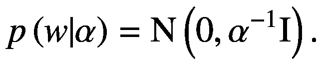

由于本文篇幅所限，我无法在此详细解释原因，但这是线性模型先验的一个良好选择，因为它意味着后验也将是正态分布。同时还意味着，给定 `x` 和 `y`，我们可以通过简单的矩阵运算计算出后验的均值和协方差矩阵。

但首先，我们需要定义模型矩阵。该矩阵用于捕捉我们试图拟合的线性模型是一条直线这一事实，即 `y = w[0] + w[1]*x`。我们为观测向量 `x` 定义模型矩阵如下：

![X = [[1, x1], [1, x2], [1, x3], ..., [1, xn]]](images/439481_2_En_17_Chapter/439481_2_En_17_Chapter_TeX_Equb.png)

通常，每行对应一个观测，包含我们希望纳入模型的各种观测特征；但对于简单的直线，其特征就是斜率和截距，因此对于观测 `i`，其值为 1 和 `x[i]`。

权重 `w` 的后验分布 `p(w | x, y, α, β)` 由下式给出：

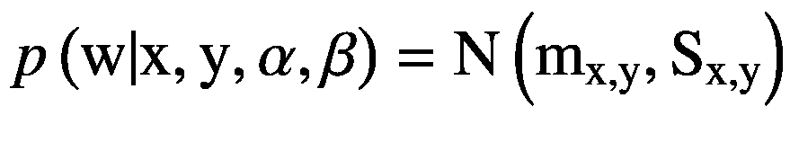

其中

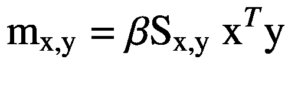

且

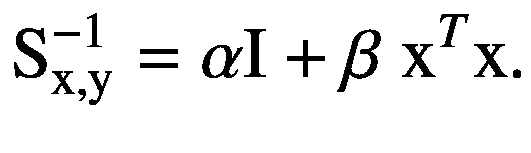

### 练习：先验与后验

#### 从多元正态分布中抽样

若想从多元正态分布中抽样，可使用 `MASS` 包中的 `mvrnorm` 函数：

```r
library(MASS)
mvrnorm(n = 5, mu = c(0,0), Sigma = diag(1, nrow = 2))

##            [,1]       [,2]

## [1,] -0.1664955 -0.4859753

## [2,] -1.4915224 -1.0527432

## [3,] -0.2284911  0.4313458

## [4,]  0.4177218 -1.1576628
```

## 先验分布的构造

我们需要为其提供均值向量`mu`和协方差矩阵`Sigma`。

我们权重向量的先验分布是`N(0, S₀)`，其中

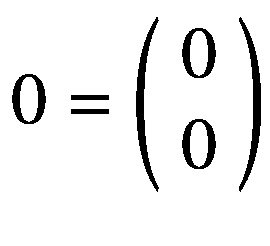

且

![S₀ = (1/α)I = [[1/α, 0], [0, 1/α]]](images/439481_2_En_17_Chapter/439481_2_En_17_Chapter_TeX_Equg.png)

你可以使用`diag`函数来创建对角协方差矩阵。

请编写一个函数`make_prior(alpha)`来构造该先验分布，以及另一个函数`sample_from_prior(n, alpha)`，用于从中抽取`n`个权重向量`w_i`。我的实现将样本返回为一个数据框，其中包含一列`w[1]`样本和另一列对应的`w[0]`样本。你可以按任何方便的形式返回样本。

如果你能从前验分布中抽样，就可以绘制结果图，既可以在`w`空间中作为点显示，也可以在`(x, y)`空间中作为直线显示（点`(w[0], w[1])`描述了直线`y = w[0] + w[1]*x`）。从先验中抽取的样本及两种不同的可视化方式，请参见图17-1和图17-2。

## 计算后验分布

如果我们固定模型参数`β`和`w = (w[0], w[1])^T`，就可以模拟`(x, y)`的值。我们可以先选取一些随机的`x`值，然后模拟出相应的`y`值；参见图17-3，其中红线是已知的直线（由`(w[0], w[1])`给出），黑点是给定模型后随机采样的点。

```
w0 <- 0.3 ; w1 <- 1.1 ; beta <- 1.3
x <- rnorm(50)
y <- rnorm(50, w1 * x + w0, 1/beta)
```

当然，在这种情境下我们并不知道真实的直线。我们拥有的是权重的先验分布`(w[0], w[1])`以及观测到的`(x, y)`值。将这种情况想象为图17-3但去掉红线。不过，如果有了这些点以及先验信息，我们就掌握了关于潜在直线可能形态的信息，这些信息以权重的后验分布形式呈现——即给定观测点后权重所服从的分布。当我们的先验和模型都假设数据点服从正态分布时，后验分布会变得特别简单，正如我们之前所见。我们可以通过之前见过的公式来得到后验分布。

编写一个函数`make_posterior(x, y, alpha, beta)`，用于计算权重的后验分布（均值和协方差矩阵），以及一个函数`sample_from_posterior`，用于从后验分布中进行采样。

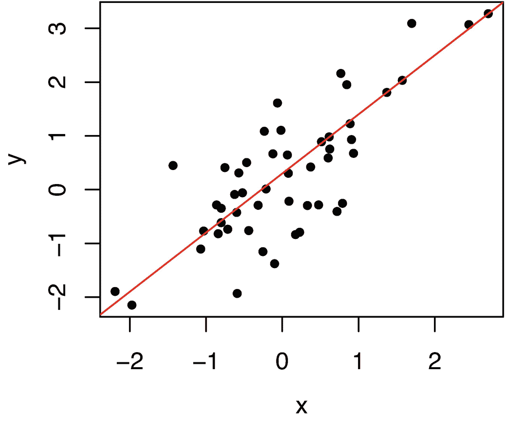

图17-3：随机采样的`(x, y)`值。真实的线性模型以红色显示。

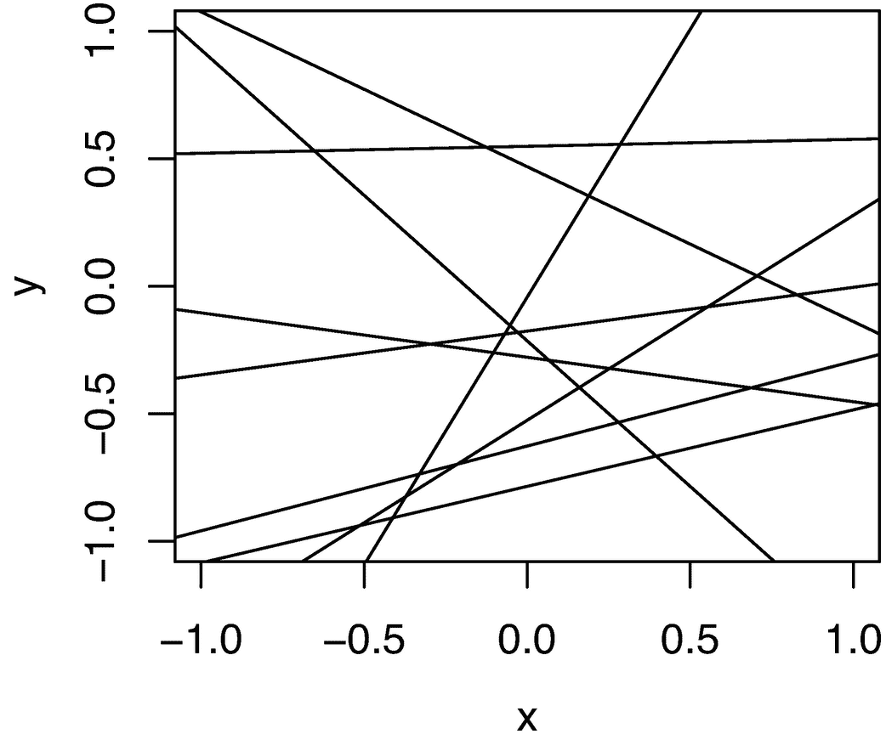

图17-2：从先验分布中采样的权重向量，以直线的形式表示。

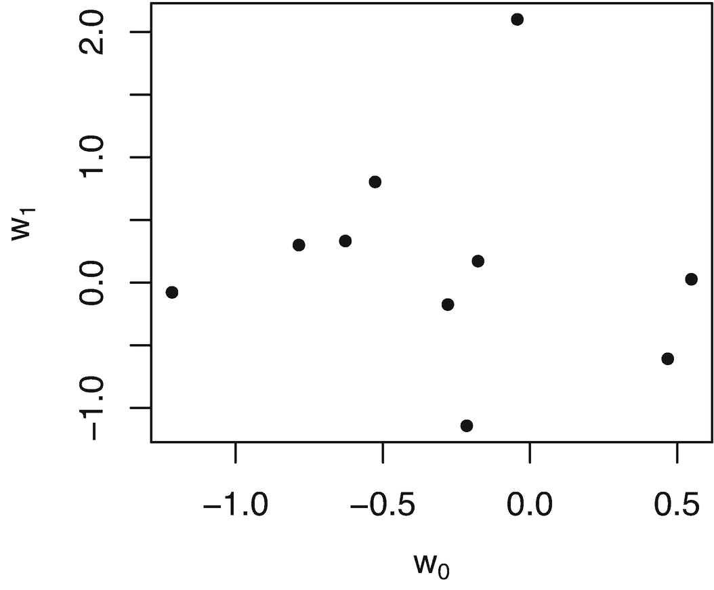

图17-1：从先验分布中采样的权重向量。

如果我们再次假设能够从`(x, y)`点的真实分布中采样，那么每次获得一批点时，我们都可以更新后验知识。当然，在现实世界中，我们并没有真实的分布来进行这种采样，但已有的观测数据代表了这些数据点，因此我们仍然可以在每次获得新信息时更新后验分布。

假设我们已经观测到`n`个点，即`(x[1], y[1]), (x[2], y[2]), ..., (x[n], y[n])`，那么我们可以问自己：现在的后验分布与真实直线有多接近？当然，我们的后验分布并不是一条直线（也不是权重空间中的一个点），而是一个分布。因此，一种方法是：从后验分布中采样，观察这些样本聚集的紧密程度——这告诉我们对于真实值的确定程度——以及它们围绕真实点（如果已知的话）聚集的紧密程度。

在图17-4中，你可以看到一个示例。真实直线，即采样数据点所依据的`(w[0], w[1])`，以红色显示。黑点是用于更新后验分布的`(x, y)`点，灰色线条则是从更新后的后验分布中采样的样本。如你所见，用于推断后验分布的`(x, y)`点越多，分布就越倾向于聚集在真实点周围。

### 对新预测值的目标变量进行预测

给定一个新的`x`值，我们希望预测对应的`y`值。对于固定的`w`，同样有`p(y | x, w, β) = N(w^T ϕ(x), 1/β)`，但由于我们不知道`w`，因此必须对所有`w`进行积分。训练数据改善预测的方式在于，我们不是基于先验分布对`w`进行加权积分，而是基于`w`的后验分布进行加权积分：

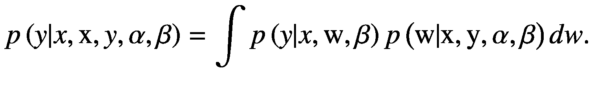

这种对两个正态分布乘积的积分会得到另一个正态分布，并且可以证明它等于：

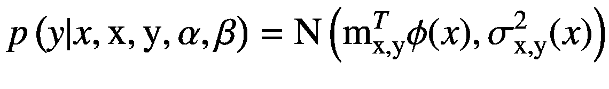

其中`m[x, y]`是`w`的后验分布的均值，并且：

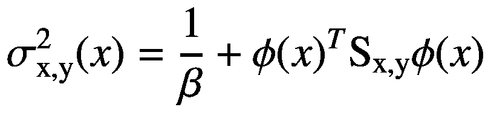

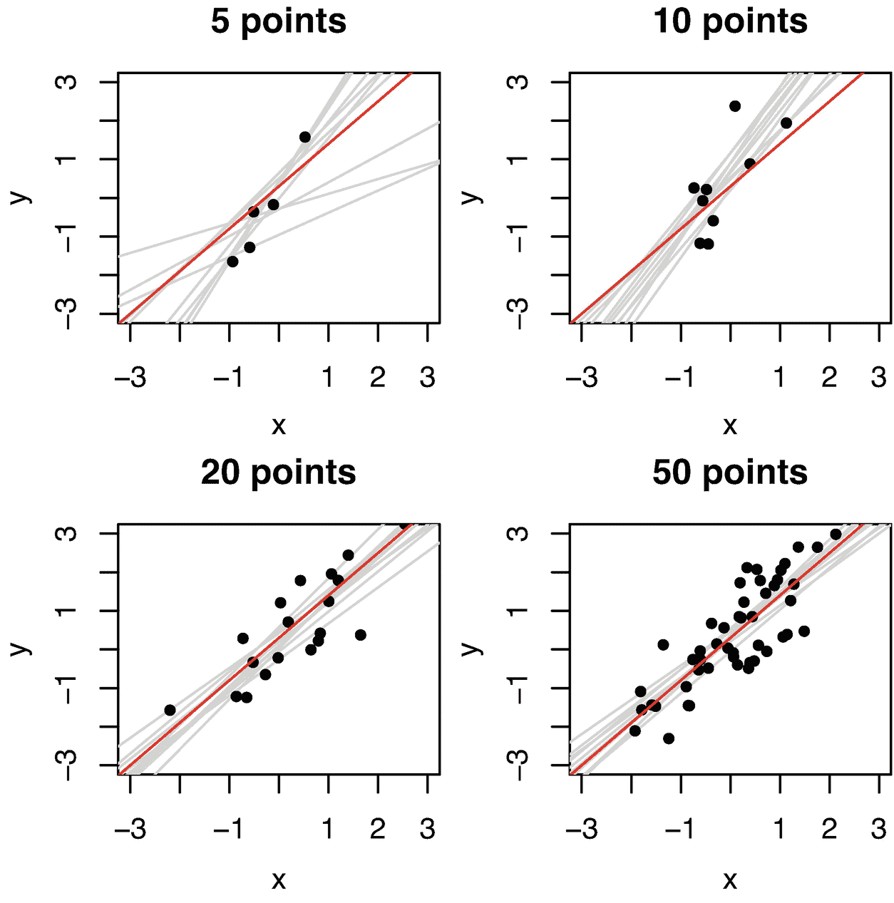

图17-4：从后验分布中抽取的直线。真实直线以红色显示。

其中`S[x, y]`是`w`的后验分布的协方差矩阵。

有了目标值`y`在给定预测值`x`条件下的完整分布，我们当然可以进行预测。`y`的点预测值自然是这个正态分布的均值，即`m[x, y]^T ϕ(x)`。但我们能做的不仅仅是预测最可能的值；由于知道分布，我们当然还可以得到置信区间的值。

编写一个函数，用于预测给定`x`值下最可能的`y`值。使用该函数将推断出的模型绘制在`(x, y)`点上。示例见图17-5。

利用你也拥有`y`的预测分布这一事实，编写一个函数，用于给出该分布的分位数，并利用它绘制预测值周围95%的置信区间；参见图17-6。

## 公式与模型矩阵

我们将继续使用贝叶斯线性回归，并推广可拟合的公式类型。

回顾第6章内容，在将模型拟合到数据时，我们通过所谓的模型矩阵（或设计矩阵）来实现，其形式如下：

![$$ \mathrm{x}=\left[\begin{array}{l}\begin{array}{cc}1&amp; {x}_1\\ {}1&amp; {x}_2\end{array}\\ {}1\kern0.5em {x}_3\\ {}\begin{array}{cc}\vdots &amp; \vdots \end{array}\\ {}\begin{array}{cc}1&amp; {x}_n\end{array}\end{array}\right]. $$](images/439481_2_En_17_Chapter/439481_2_En_17_Chapter_TeX_Equk.png)

该矩阵的第*i*行包含向量`(1, x[i]) = φ(x[i])^T`，用于捕获第*i*个观测值`xi`的预测变量。实际上它包含两个预测变量：其中一个为常量1。该向量捕获的是我们在线性模型中用于预测目标的输入变量。一个变量是`x`值，另一个是编码y轴截距的方式。

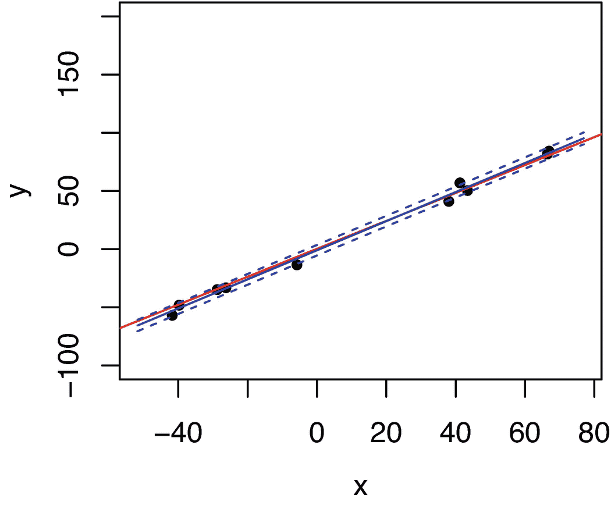

图17-6 — 含95%支持区间的预测结果

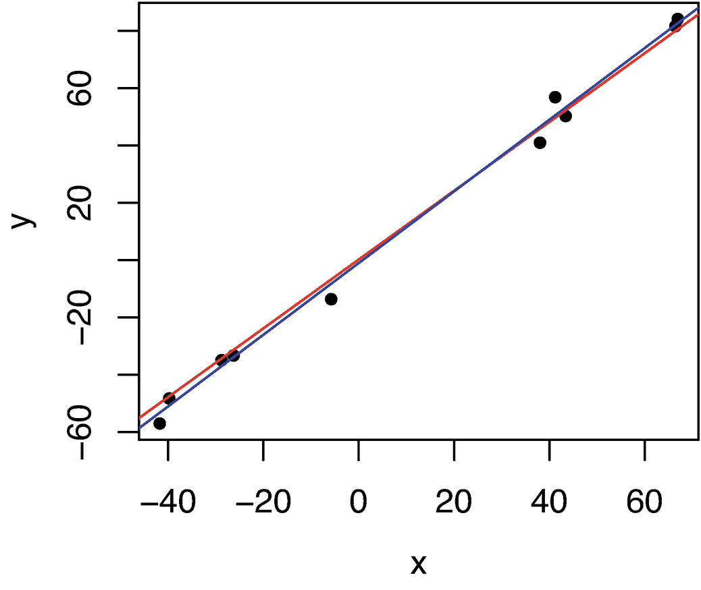

图17-5 — 红色为真实线性模型，蓝色为预测值

为了预测目标，我们使用该行与拟合模型权重的内积：

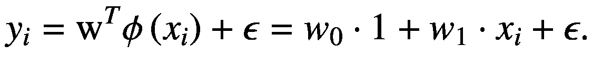

我们将`φ(x)`称为点`x`的特征向量，模型矩阵的每一行对应一个要拟合或预测的数据点，因此第*i*行即为`φ(x[i])^T`。采用我们此处使用的特征向量形式`φ(x)^T = (1, x)`时，拟合的是一条直线，但特征向量并非必须保持这种形式。我们可以构造更复杂的特征向量。

如果我们改用特征向量`φ(x)^T = (1, x, x²)`，并在`w`中添加一个权重使其变为三维`(w[0], w[1], w[2])`，则仍可通过相同方式预测目标`y = w^T φ(x[i]) + ε`。只不过此时`w^T φ(x[i]) = w[0] + w[1]*x + w[2]*x²`，因此拟合的将是一个二次多项式。

如果你现在想“嘿，这不再是线性模型了！”，那你就错了。模型的线性实际上与`x`的线性无关。是`w`的线性使得模型成为线性模型，只要我们通过权重向量与某个特征向量的内积来获得预测值，那么所处理的就仍然是线性模型。你可以随心所欲地设计特征向量`φ(x)`。

若以相同方式构建模型矩阵

![$$ \mathrm{x}=\left[\begin{array}{c}\phi {\left({x}_1\right)}^T\\ {}\phi {\left({x}_2\right)}^T\\ {}\phi {\left({x}_3\right)}^T\\ {}\begin{array}{c}\vdots \\ {}\phi {\left({x}_n\right)}^T\end{array}\end{array}\right] $$](images/439481_2_En_17_Chapter/439481_2_En_17_Chapter_TeX_Equm.png)

那么用于拟合权重和预测新目标值的数学方法相同，只不过权重向量`w`的维度需与特征向量的维度保持一致。

此外，特征向量也不必是单一变量`x`的函数。如果你想拟合包含两个变量的线性模型，即一个平面，只需让特征向量依赖于两个变量：`φ(x, z)^T = (1, x, z)`。与权重向量的线性组合即为`w^T φ(x, z) = w[0] + w[1]*x + w[2]*z`，这恰恰是一个包含两个变量的线性模型。

### 在 R 中使用模型矩阵

在R中，指定特征向量和模型矩阵的方式是使用公式。公式是一个包含波浪符号`~`的表达式，目标变量应放在左侧，解释变量放在右侧。

R用于指定公式的语法相当丰富，如果你感兴趣，可以在R终端中输入以下命令来阅读文档：

```
?formula
```

对于线性模型，我们会写成`y ~ x`。截距项是隐式存在的；你不需要告诉R你想要特征向量包含截距，相反，如果你不想要截距，需要显式地将其移除。你也可以指定多项式特征向量，但R会将乘法`*`解释为变量间的交互作用。要指定`x`的二次多项式，你需要写成`y ~ I(x²) + x`。函数`I`是恒等函数，在这里使用它可以让R将`x²`解释为对数值`x`进行平方运算，而不是试图将其解释为公式规范的一部分。如果你只想拟合`x`的平方项，可以写成`y ~ I(x²)`。对于一般的*n*次多项式，你可以使用`y ~ poly(x,n, raw=TRUE)`。

为了拟合我们的线性模型，我们需要两类数据。在我们已经实现的模型中，我们使用了向量`x`和`y`，但在一般情况下，预测变量`x`应被替换为模型矩阵。根据这个矩阵和`y`，我们就可以拟合模型。

R提供了从公式和数据中获取这两类数据的函数。不过，由于作用域规则，这并非完全直接。如果你在代码的某处编写了一个公式，你希望公式中的变量引用的是当前作用域中的变量，而不是其他地方可能查看该公式的变量。因此，公式需要捕获当前作用域——类似于闭包捕获其周围作用域的方式。另一方面，你也希望能够通过数据框直接将数据提供给模型。通常，你想要拟合的数据是作为数据框中的列存在的，而不是作为作用域中的独立变量。有时，甚至是两者的混合。

函数`model.frame`可以让你捕获所需内容，以收集与公式相关的数据。它会知道公式的作用域，但你也可以通过数据框添加数据。可以把它看作一个`data.frame`，只是它包含了更多通过分析公式而获得的关于数据的信息。

我们可以在下面这个小例子中看到这一切是如何运作的：

```
predictors <- data.frame(x = rnorm(5), z = rnorm(5))
y <- with(predictors, rnorm(5, mean = 3*x + 5*z + 2))
model <- y ~ x + z
model.frame(model, data = predictors)

##            y          x           z

## 1  5.7166648  1.2943469  0.07347801

## 2 -7.3801586  0.7210624 -2.12012399

## 3  0.4894598 -0.6444302  0.15265587

## 4  5.5552442  1.6107988  0.01996477

## 5  7.8151347  0.2048122  0.98655386
```

这里，我们在一个数据框中有两个预测变量`x`和`z`，并在全局作用域中模拟了响应变量`y`。我们使用公式`y ~ x + z`（这意味着*ϕ*(`x`, `z`)^(T) = (1, `x`, `z`)）创建模型，并据此构建一个模型框架，其中包含公式中所有使用的变量的数据。

模型框架的创建方式是：R首先在它接收到的数据框中查找变量，如果找到，则使用该数据；如果未找到，则使用它在公式作用域中找到的数据。如果完全找不到，当然会报告错误。

数据框还用于从变量构造表达式。在作用域中，你可能拥有变量`x`，但没有构建模型矩阵所需的`x`²。`model.frame`函数会为你构造它：

```
x <- runif(10)
model.frame(~ x + I(x²))

##            x       I(x²)

## 1  0.9257926 0.857091....

## 2  0.2048174 0.041950....

## 3  0.3320932 0.110285....

## 4  0.5124721 0.262627....

## 5  0.4848565 0.235085....

## 6  0.1284884 0.016509....

## 7  0.9344755 0.873244....

## 8  0.8077187 0.652409....

## 9  0.7667746 0.587943....
```

## 模型矩阵与公式

在这个例子中，我们的公式没有响应变量；你并不一定需要它。当然，为了能够提取向量`y`，我们需要它来进行线性模型拟合，但R并不一定需要它。

一旦你有了模型框架，就可以使用函数`model.matrix`获取模型矩阵。它需要知道公式和模型框架（前者是为了知道特征函数 *ϕ*，后者是为了知道我们正在拟合的数据）。

接下来，我们构建两个模型，一个拟合经过`y = 0`的直线，另一个允许直线与`y`轴相交于任意点。

注意两个模型的数据框是相同的——两个模型中使用的变量相同——但模型矩阵不同：

```r
x <- runif(10)
y <- rnorm(10, mean=x)
model.no.intercept <- y ~ x + 0
(frame.no.intercept <- model.frame (model.no.intercept))

##              y         x
## 1   0.05218288 0.7020026
## 2   0.78985212 0.2376200
## 3  -0.81501744 0.4099537
## 4  -0.71807916 0.5834204
## 5   0.40083214 0.5577035
## 6  -0.82443129 0.2163221
## 7  -0.98024996 0.1702824
## 8  -0.47115407 0.3512283
## 9   0.35959763 0.2272345
## 10 -0.47588279 0.9553629

model.matrix(model.no.intercept, frame.no.intercept)

##            x
## 1  0.7020026
## 2  0.2376200
## 3  0.4099537
## 4  0.5834204
## 5  0.5577035
## 6  0.2163221
## 7  0.1702824
## 8  0.3512283
## 9  0.2272345
## 10 0.9553629

## attr(,"assign")
## [1] 1

model.with.intercept <- y ~ x
(frame.with.intercept <- model.frame (model.with.intercept))

##              y         x
## 1   0.05218288 0.7020026
## 2   0.78985212 0.2376200
## 3  -0.81501744 0.4099537
## 4  -0.71807916 0.5834204
## 5   0.40083214 0.5577035
## 6  -0.82443129 0.2163221
## 7  -0.98024996 0.1702824
## 8  -0.47115407 0.3512283
## 9   0.35959763 0.2272345
## 10 -0.47588279 0.9553629

model.matrix(model.with.intercept, frame.with.intercept)

##    (Intercept)         x
## 1            1 0.7020026
## 2            1 0.2376200
## 3            1 0.4099537
## 4            1 0.5834204
## 5            1 0.5577035
## 6            1 0.2163221
## 7            1 0.1702824
## 8            1 0.3512283
## 9            1 0.2272345
## 10           1 0.9553629

## attr(,"assign")
## [1] 0 1
```

目标向量，即响应变量`y`，也可以从数据框中提取。这次不需要公式，因为数据框记住了哪个变量是响应变量。你可以使用函数`model.response`从模型框架中获取它：

```r
model.response(frame.with.intercept)

##          1           2           3           4
## 0.05218288  0.78985212 -0.81501744 -0.71807916
##          5           6           7           8
## 0.40083214 -0.82443129 -0.98024996 -0.47115407
##          9          10
## 0.35959763 -0.47588279
```

## 练习

### 构建模型矩阵

构建一个函数，该函数以公式为输入，并通过`...`变量可选地接收一个数据框，然后根据公式和可选数据构建模型矩阵。

### 拟合通用模型

扩展你之前编写的用于拟合直线的函数，使其成为可以拟合任何公式的函数。

## 不含响应变量的模型矩阵

当您拥有模型框架所需的所有变量时，以这种方式构建模型矩阵是很好的，但如果您没有目标值呢？当然，您需要目标值来拟合模型的参数，但稍后，您想要为那些不知道目标值的新数据点预测目标值，那么此时如何构建模型矩阵呢？

使用一些明显是伪造的数据，这种情况可能如下所示：

```r
training.data <- data.frame(x = runif(5), y = runif(5))
frame <- model.frame(y ~ x, training.data)
model.matrix(y ~ x, frame)

##   (Intercept)         x
## 1           1 0.1935202
## 2           1 0.4235126
## 3           1 0.8715640
## 4           1 0.0687407
## 5           1 0.7034587

## attr(,"assign")
## [1] 0 1

predict.data <- data.frame(x = runif(5))
```

但现在，如果我们想为预测数据构建一个框架：

```r
frame <- model.frame(y ~ x, predict.data)
```

我们会得到一个错误。公式告诉`model.frame`它需要变量`y`，但`predict.data`没有这个变量；它只有`x`。因此，去掉公式中的响应部分：

```r
frame <- model.frame(~ x, predict.data)
model.matrix(~ x, frame)

##   (Intercept)         x
## 1           1 0.5181431
## 2           1 0.6967051
## 3           1 0.4965555
## 4           1 0.0729577
## 5           1 0.7235315

## attr(,"assign)
## [1] 0 1
```

如果你不知道公式，当它作为你模型的输入时，这就不那么容易了。你不能简单地将一个未知的公式替换为另一个可能与原公式无关的公式。不过，你可以使用`delete.response`函数从任何公式中移除响应变量。

你不能直接在公式上调用`delete.response`；那不是它处理的对象类型。但你可以将其与`terms`函数结合使用，以获取一个不含响应变量的公式，然后你就能用它为那些不知道目标值的数据构建模型矩阵：

# 假设这是一个你不知道的参数

```
unknown <- y ~ x
```

# 获取不含响应变量的公式
`responseless_formula <- delete.response(terms(unknown))`

# 然后你可以将其与 `model.frame` 一起使用

你可以将其与 `model.frame` 一起使用：

```r
frame <- model.frame(responseless_formula, predict.data)
model.matrix(responseless_formula, frame)
```

## `(Intercept)         x`

```
## 1           1 0.5181431
## 2           1 0.6967051
## 3           1 0.4965555
## 4           1 0.0729577
## 5           1 0.7235315
## attr(,"assign")
## [1] 0 1
```

## 练习

### 为新数据构建模型矩阵

编写一个函数，该函数接收一个公式和一个不含响应变量的数据框作为输入，并为其构建模型矩阵。

### 预测新目标值

更新你之前编写的用于预测新变量值的函数，使其能够处理基于通用公式拟合的模型。如果该函数尚不支持，你还应将其扩展，以便能够处理多个这样的数据点。将新数据点的输入格式设为数据框。

## `blm` 类的接口

到目前为止，我们已经实现了贝叶斯线性回归，但未必是以一种易于复用的形式。将拟合模型相关的数据封装到一个类中，并提供各种访问方法，这才是使模型/类易于复用的关键。

通常，你应该尽可能通过函数来访问对象。如果你知道该类有哪些 `$fields`，编写直接访问这些字段的代码很容易，但这会使以后更改类的实现变得困难。许多基于对象外观假设编写的代码将会崩溃。同样，在后续分析中更改模型/类也会变得困难，因为不同类的内部结构通常不相同。

为了让他人——以及未来的你——更容易使用贝叶斯线性回归模型，我们将为其创建一个类，并提供用于处理它的函数。

这涉及编写特定于你自己类的函数，以及编写人们通常期望一个拟合模型能够实现的多态函数。正是后者使得用你的 `blm` 类替换其他拟合模型成为可能。

如何设计你的类并实现函数——以及通常选择实现哪些函数——取决于你自己，当然，当你为已有的多态函数实现 `blm` 特定版本时，你需要遵守已有的接口。

如何选择表示类的对象以及为其实现哪些函数，通常由你决定。不过，R 中有一个通用约定，即通过调用与类同名的函数来创建给定类的对象。因此，我建议你编写一个名为 `blm` 的构造函数。

目前没有什么明显的类可以继承，所以 `blm` 对象的类应该只是 `"blm"`，而不是一个类向量。如果你想在实现中创建类层次结构，或者实现多个类来处理模型接口的不同方面，你可以尽情发挥。

### 构造函数

我们将创建某个类对象的函数称为构造函数。在某些编程语言中，创建对象和初始化对象是有区别的。这主要在你需要担心内存管理等问题时才有意义，并且可能变得相当复杂，但我们不为此在 R 中操心。然而，这就是为什么在 Python 中构造函数被称为 `init`——它实际上处理的是初始化。Java 也是如此——它强制执行构造函数必须与类同名的规则，而在 R 中这只是约定。在 Java 中，你有创建新对象的特殊语法：`new ClassName()`。在 Python 中，你必须使用类的名称来创建对象——`ClassName()`——但语法看起来就像函数调用。在 R 中，这只是一个约定，即类名和构造函数应该相同。创建对象的语法看起来像函数调用，因为它就是一个函数调用，并且在该函数内部除了返回一个我们设置了类属性的对象外，没有发生任何特殊的事情。

因此，你应该编写一个名为 `blm` 的函数，该函数返回一个你已将其类属性设置为 `"blm"` 的对象。你可以使用 `` `class<-` `` 替换函数或 `structure` 函数在创建对象时进行设置。该对象是一个列表——毕竟，这是你存储复杂数据的唯一方式——列表里放什么取决于你为类的接口所实现的函数需要什么。在开发函数接口的过程中，你可能需要不时地回头更改对象中存储的数据。这没问题。不过，请尽量使用函数来访问对象的内部结构，因为这样做往往能最大限度地减少你在更改对象中存储的数据时需要重写的代码量。

### 更新分布：一个示例接口

我们来探讨一个案例，它可能成为贝叶斯线性模型的接口。这不是你必须要实现的内容，但作为练习值得一试。

在贝叶斯统计中，当我们拟合模型时，所做的是获取模型参数的先验分布 *P*(*θ*)，并在观测到数据 *D* 后，将其更新为后验分布 *P*(*θ* | *D*)。可以这样理解：先验分布是我们对参数的已知信息。通常我们只是基于数学上的便利性来设定先验分布，但你应该将其理解为，根据我们对宇宙运行方式的理解以及以往经验所积累的知识，所持有的参数分布信息。随后，当你观测到更多信息时，你为世界增添了新的信息，这改变了根据已获得的观测值来看待参数的条件概率。

我们这里所说的先验和后验其实并没有什么神奇之处。两者都只是我们模型参数的分布。如果先验是基于以往经验的，那么它实际上就是那些经验的后验分布。只是我们没有以这种方式进行建模而已。

假设我们观测到了数据 *D*[1] 并得到了后验分布 *P*(*θ* | *D*[1])。如果之后我们又观测到了更多数据 *D*[2]，我们就获得了关于参数的更多信息，并可以将参数的分布更新为 *P*(*θ* | *D*[1], *D*[2])。

当然，我们总是可以通过将所有旧数据和新数据放入拟合代码中来计算这个分布。但是，如果我们针对模型似然函数仔细选择了先验分布——并且我说“仔细”是指我们使用了所谓的共轭先验——那么我们就可以仅通过使用不同的先验（即旧的后验分布）来拟合新数据。

共轭先验是这样一种先验分布：它被选择为保证先验和后验属于同一类分布（仅参数不同）。在我们贝叶斯线性模型中，先验和后验都是正态分布，所以我们就有了共轭先验。这意味着，原则上，我们只需要使用相同的拟合代码，但采用不同的先验，就可以用更多的观测值来更新我们拟合好的模型。

在之前的练习中我曾暗示过这一点，但现在你可以更正式地处理它了。你需要一种表示多元正态分布的方法——但无论如何，你在表示 `blm` 对象时都需要它——以及一种在 `blm` 对象内部获取已拟合结果以提取后验分布的方法。

实现此功能的方法有很多种，你可以有试验的余地。您可以编写一个 `update` 函数，它以先验分布和新观测值作为参数，并输出（更新后的）后验分布。在这里，你需要以某种方式同时包含公式以构建模型矩阵。或者，你也可以让 `update` 函数接受一个已拟合的对象和新的数据，并从该已拟合对象中获取公式和先验分布。当然，如果你这样做，你需要将没有任何观测值的先验分布作为特殊情况处理——并且那个先验分布将不知道任何关于公式或模型矩阵的信息。

我们可以尝试类似这样的接口：

```r
update <- function(model, data, prior) { ... }
```

其中 `model` 是公式，`data` 是新的数据集，`prior` 是用于拟合的先验分布。这大致就是构造函数的接口，区别仅在于构造函数中不一定有显式的 `data` 参数（毕竟，你希望能够在没有数据框的情况下拟合模型），而且它根本没有 `prior` 这个参数。

稍作思考后，意识到我们在此处放入的任何模型拟合代码都将与 `blm` 中的完全相同，因此我们可以修改接口以去掉显式的 `data` 参数。如果我们让该参数通过 `...` 传递，我们就可以使用与 `blm` 中完全相同的代码（并随后通过在该处调用 `update` 来移除 `blm` 中的重复代码）：

```r
update <- function(model, prior, ...) { ... }
blm <- function(model, ...) {
```

# 一些代码...
```r
prior <- make_a_prior_distribution_somehow()
posterior <- update(model, prior, ...)
```

为了让这个版本的`blm`正常工作，你需要将先验分布转换成可以传递给`update`的形式，但如果你完成了之前的练习，你应该已经有一个能完成此任务的函数了（尽管你可能希望为这些分布创建一个类，并以此形式返回它们，以便通过接口进行操作，如果你想更进一步的话）。

当然，除了去掉`blm`主体中的模型拟合代码外，你也可以去掉`update`函数，将其功能放入`blm`中，只需让`blm`函数接受一个先验参数。但如果这样做，你需要为其提供一个默认值，以便在未指定先验时使用原来的那个：

```
blm <- function(model, prior = NULL, ...) {
```

# 一些代码...

```
if (is.null(prior)) {
prior <- make_a_prior_distribution_somehow()
}
posterior <- update(model, prior, ...)
```

# 一些用于返回对象的代码...
}
```

不过，我们还是暂时保留 `update` 函数。那么，我们该如何将 `update` 与一个已经拟合好的模型一起使用呢？

```
fit1 <- blm(y ~ x)
fit2 <- update(y ~ x, new_data, fit1)
```

这样是行不通的，因为 `fit1` 是一个 `blm` 对象，而不是一个正态分布。你需要从已拟合模型中提取出这个分布。

如果你在对象中存储了这个分布——并且你应该这样做，因为否则你就无法使用该对象做任何事，因为拟合结果就是后验分布——那么你应该能够获取到它。然而，你不应该像 `fit1$posterior` 那样直接从对象内部访问后验分布。这样做虽然可行，但访问对象内部结构会使后续更改表示方式变得更加困难。我知道我在这里重复了，但值得再强调一遍。你应该尽量避免访问对象的内部结构，除非必要，因为这会使更改表示方式变得更加困难。

相反，编写一个 `posterior` 函数来提供后验分布：

```
posterior <- function(fit) fit$posterior
```

这个函数最终必须访问内部结构——毕竟，你终究需要获取信息——但如果只有这一个函数这样做，并且所有其他函数都使用这个函数，那么当你改变对象的表示方式时，只需要修改这一个函数。

有了这个函数，你就可以这样做：

```
fit2 <- update(y ~ x, new_data, posterior(fit1))
```

你也可以编写 `update` 函数，使其既能接受已拟合模型，也能接受分布作为输入。这样你就只需要一种方法来获取先验对象（可能是分布，也可能是已拟合模型的后验分布），并且该方法需要能同时处理这两种情况。

一种方法是直接测试先验参数的类：

```
update <- function(model, prior, ...) {
if (class(prior) == "blm") {
prior <- posterior(prior)
}
```

# 拟合代码在这里

}

```

然而，由于种种原因，这是一个糟糕的解决方案。首先，它只在你得到的要么是先验分布，要么是类为 `"blm"` 的对象时才能工作。如果以后有人编写了一个继承 `blm` 的类呢？他们的 `class` 属性可能是 `c("myblm","blm")`，这与 `"blm"` 不同，因此这个测试会失败——并且后续代码也会失败，因为后续代码假设你拥有一个分布，但你实际拥有的是一个完全不同类的对象。

为了解决这个问题，你可以使用 `inherits` 函数。它会测试给定的类名是否存在于 `class` 属性中，因此如果有人给你的 `update` 函数传递了一个继承你 `blm` 类的类，它就能正常工作：

```
update <- function(model, prior, ...) {
if (inherits(prior, "blm")) {
prior <- posterior(prior)
}
```

# 拟合代码在这里
}

这是一个不错的解决方案——在面向对象代码中你会经常看到它——但它仍然有一些缺点。它假设唯一能提供可用作先验分布的对象要么是你默认实现先验的方式（并且你之前没有测试过），要么是`blm`类的对象（或其特化）。

当然，你可以测试先验（如果不是拟合对象）是否属于你为分布定义的类，这样可以解决第一个问题，但如何处理其他可能也能提供先验/后验分布的对象呢？

每当你编写这样一个可以提供分布的新类时，你都可以更新你的`update`函数，但其他人无法通过这种方式为你提供分布（除非他们修改你的代码）。以这种方式显式测试对象类型并不是良好的代码设计。解决这个问题的方法与访问对象内部成员相同：通过函数来访问。

如果我们要求任何作为`prior`参数传递给`update`的对象，在需要时都能提供分布，我们可以将代码更新为：

```
update <- function(model, prior, ...) {
  prior <- posterior(prior)
  # fitting code here
}
```

这要求我们为`posterior`创建一个多态函数，并且可能需要为分布对象也编写一个版本。这里我走个捷径，将默认实现设为恒等函数：

```
posterior <- function(x) UseMethod("posterior")
posterior.default <- function(x) x
posterior.blm <- function(x) x$posterior
```

唯一的烦恼是现在函数名为`posterior`。当对象是拟合结果时，它是后验分布；但在其他情况下并非如此。让我们把它改为`distribution`：

```
distribution <- function(x) UseMethod("distribution")
distribution.default <- function(x) x
distribution.blm <- function(x) x$posterior
```

然后相应地更新`update`：

```
update <- function(model, prior, ...) {
  prior <- distribution(prior)
  # fitting code here
}
```

这样，在`update`函数中看起来也更优雅了。

## 设计你的`blm`类

当你着手实现`blm`类时，请思考你正在创建的接口，各个函数如何相互配合，以及你认为其他人将如何复用你的模型。请记住，“未来的你”也是“其他人”，所以这样做也是在帮助你自己。

我们之前开发的`update`函数是类设计中功能示例的一部分，它展示我们如何使其可复用。你应该考虑其他用于访问对象的函数，并设计它们。

例如，提取给定输入点的分布。你已经实现了从预测变量预测响应变量的函数，稍后你还会在`predict`函数中再次实现它。但如果你想充分利用给定输入下响应变量分布的优势，你需要拥有这个分布。你将如何向用户提供这一功能？你又如何在自有函数中使用这一功能？

在开发你的类时，多尝试。每当你修改某些东西时，思考这是否能让其他函数更简单，或者能否将功能泛化，从而使代码更具复用性。

## 模型方法

有一些多态函数通常由代表拟合模型的类提供。并非所有模型都实现了全部函数，但你实现得越多，现有代码就越能操作你的新类——这再次说明了仅通过函数提供对象接口的重要性。

下面是我认为你的`blm`类应当实现的一系列函数。这些函数按字母顺序排列，但其中许多可以通过使用一个或多个其他函数来更简单地实现。因此，在开始编程之前，请通读整个列表。如果你认为某个函数可以通过调用其他函数更简单地实现，那么就按这种方式实现。

在所有情况下，请先阅读泛型函数的 R 文档。你无论如何都需要文档来正确实现每个函数的接口，所以至少通读一遍。本文中的描述只是这些函数功能的概述。

### `coefficients`

该函数应返回模型的拟合参数。对于我们的贝叶斯模型（其中拟合模型是一个分布，而非单个点参数）来说，解释这一函数的含义并不完全直接。我们可以让它返回拟合分布，但按照该函数的典型用法，这样做会使它对现有代码毫无用处。现有代码期望通过此函数获取拟合模型的参数，因此更好的做法是返回参数的点估计值，即计算后验分布时的均值。

返回一个数值向量，参数带有名称，这与`lm`返回的结果一致。

### `confint`

`confint`函数给出拟合参数的置信区间。这里我们遇到与`coefficients`相同的问题：我们推断的是整个分布，而非单个参数（而且，我们的参数没有置信区间，它们有一个联合分布）。尽管如此，我们可以从推断出的分布中计算对应的置信区间。

如果我们的后验分布是`w ~ N(m, S)`，那么权重向量中的第`i`个分量的分布为`w[i] ~ N(m[i], S[i,i])`。由此，结合你期望的密度比例，你可以提取出与所需分位数匹配的阈值。

你接受函数的`level`参数，并通过利用正态分布的对称性获取阈值分位数。因此，你需要的分位数为`c(level/2, 1 - level/2)`。据此，你可以使用`qnorm`函数获得阈值。

### `deviance`

该函数计算预测响应变量与观测值之间的平方距离之和。如果你能获得平方距离，或者即使你只有距离值而需要自行平方，计算起来应该很容易。也许已经有现成的函数可以提供这些值？

### `fitted`

该函数应返回拟合的响应变量。这并非你拟合模型时所用数据中的响应变量，而是模型做出的预测值。

### `plot`

该函数用于绘制模型图。你可以自由决定如何绘制，但我认为一个有用的方式是展示带有拟合线的 x-y 散点图。不过，如果存在多个预测变量，我不确定什么是可视化拟合模型的好方法。除了“绘制某些图形”之外，对于`plot`函数的功能没有明确规则，因此你可以发挥想象力。

### `predict`

该函数应基于拟合的模型进行预测。其接口为：

```
predict(object, ...)
```

但惯例是你在`newdata`变量中提供新数据。如果你不提供新数据，它将返回用于拟合模型的数据上的预测值。

### `print`

当你显式打印一个对象，或者仅仅是在 R 终端中写入一个计算结果为类的对象的表达式时，就会调用此函数。通常，它会打印该对象的简短描述。

对于拟合后的对象，它习惯性地打印拟合函数是如何被调用的，或许还会打印拟合后的系数或拟合效果如何。你可以查看`lm`对象是如何打印的来了解一个示例。

如果你想打印拟合函数是如何被调用的，你需要从你在`blm`构造函数中拟合对象时获取该信息。毕竟，人们感兴趣的是构造函数是如何被调用的。在这个函数内部，你可以通过使用`sys.call`函数来获取它的调用方式。

### `residuals`

此函数返回拟合的残差。也就是预测值与响应变量的观测值之间的差值。

### `summary`

此函数通常用作`print`的更长版本。它提供关于拟合模型的更多信息。

然而，它的作用不止于此。它返回一个包含摘要信息的对象。这实际上意味着什么取决于模型的实现，所以你可以自由发挥。

## 为`blm`构建一个 R 包

我们现在已经为我们的贝叶斯线性回归软件拼凑了大部分组件，是时候将它们收集到一个 R 包中了。这是我们项目的下一步。

你已经有了一个贝叶斯线性回归的实现，包含一个类`blm`，以及多个用于访问此类对象的函数。现在是时候将这些函数收集到一个包中了。

### 确定包接口

当你设计类的功能和接口时，你必须决定类的对象应该具备哪些功能，以及所有函数如何配合使用，以使代码易于扩展和使用。制作包也涉及类似的设计过程。

你为设计类所做的一切，当然，对于包来说也是一样的，但是对于包，你必须决定哪些函数应该被导出，哪些应该保持内部使用。

只有导出的函数才能被加载你包的其他人使用，所以你可能倾向于导出所有可以导出的内容。然而，这是一个糟糕的选择。你的包的接口就是导出的函数，如果你导出太多，你就有了一个需要维护的庞大接口。如果你对包的接口进行更改，那么使用你包的每个人都必须更新他们的代码以适应不断变化的接口。你应该尽量减少对包接口的更改。

你需要弄清楚哪些功能是你认为包功能的核心部分，哪些是内部辅助函数，并只导出那些属于包接口的函数。

### 源文件组织

R 并不真正关心你使用多少个文件来存放源代码，也不关心源代码是如何组织的，但你可能会在意。在未来的某个时候，你将需要能够找到相关的函数来修复错误或扩展包的功能。

决定好你希望如何组织你的源代码。你是希望每个文件只包含一个函数？还是有一些逻辑上的方式，可以根据功能类别将代码拆分，以便每个类别对应一个文件？

### 充分记录你的包接口

至少，你从包中导出的函数应该有文档说明。没有文档，用户（将来也可能包括你自己）将不知道一个函数应该如何使用。

这种文档主要用于在线帮助——即使用`?`获得的帮助——所以它不应太长，但应让读者清楚地了解一个函数应该如何使用。

要给出整个包的总体描述，以及各个函数如何配合使用，以及它们应该如何被使用，你可以为整个包编写文档。

和包数据一样，实际上没有专门的地方来做这件事，但你可以使用与数据相同的技巧。将文档放在`R/`目录下的一个源代码文件中。

以下是我为`admixturegraph`包编写的文档：

```
#' admixturegraph: Visualising and analysing admixture graphs.
#'
#' The package provides functionality to analyse and test
#' admixture graphs against the \eqn{f} statistics described
#' in the paper
#' \href{http://tinyurl.com/o5a4kr4}{Ancient Admixture in Human History},
#' Patternson \emph{et al.}, Genetics, Vol. 192, 1065--1093, 2012.
#'
#' The \eqn{f} statistics, \eqn{f_2}, \eqn{f_3}, and \eqn{f_4},
#' extract information about correlations between gene frequencies
#' in different populations (or single diploid genome samples),
#' which can be informative about patterns of gene flow between
#'
#' @docType package
#' @name admixturegraph
NULL
```

正是`@docType`和`@name`标签告诉 Roxygen 我正在为整个包编写文档。

### 向你的包添加 README 和 NEWS 文件

按照惯例，你还需要在包中包含一个 README 和一个 NEWS 文件。README 文件描述你的包是做什么的以及如何做，可以被看作是包的一个简短广告，而 NEWS 文件则描述你随时间对包所做的更改。

许多开发者偏好使用“markdown”作为这些文件的格式——在这种情况下，它们通常被命名为`README.md`和`NEWS.md`——尤其是如果你将包放在 GitHub 上，拥有一个`README.md`文件是一个好主意，因为当人们访问 GitHub 上的包主页时，它会显眼地显示出来。

#### README

你在 README 文件中写什么取决于你，但按照惯例，它应该简要描述包的功能，或许可以给出一两个关于如何使用它的例子。

如果你用 markdown 编写——在一个名为`README.md`的文件中——如果你将包放在 GitHub 上，它将是主页。

你或许想用 R Markdown 编写，以便获得`knitr`的所有好处。在这种情况下，你应该将文件命名为`README.Rmd`，并在文件头部加上：

```
output:
  md_document:
    variant: markdown_github
```

这告诉`knitr`它应该输出一个 markdown 文件——它将被称为`README.md`。

#### NEWS

此文件应简单地包含你随时间对包所做的更改列表。为了让人们更容易看到哪些更改属于包的哪个版本，你可以将其分成多个部分，每个部分对应一个版本。

## 测试

现在，在包中，我们应该确保所有函数都至少通过一个单元测试进行了测试，并且我们的包能够通过包测试。

## GitHub

注册 GitHub 并为项目创建一个仓库。将代码移到那里。

脚注 12

# 索引

## A
- 自动化测试

## B
- 裸仓库
- 贝叶斯线性模型拟合
- 贝叶斯线性回归
- `blm` 类
- 构建 R 包
- 设计构建模型矩阵的接口
- 构造函数
- 偏差
- 拟合通用模型
- GitHub
- 不含响应变量的模型矩阵
- 模型方法：`coefficients`（系数）、`confint`（置信区间）、`fitted`（拟合值）、`response variables`（响应变量）、`plots`（绘图）、`predictions`（预测）、`print`（打印）、`residuals`（残差）、`summary`（摘要）
- 新数据的模型矩阵
- 源文件的组织规范
- 确定包接口
- 完善包接口文档
- 预测新目标
- 先验与后验
- 公式与模型矩阵
- 多元正态分布，从其中抽样
- 新预测变量值/预测目标变量
- 计算后验分布
- `README` 和 `NEWS` 文件
- 在 R 中处理模型矩阵
- 测试
- 更新分布

## C
- `BugReports`
- `.Buildignore`
- C++
- 类
- 类层次结构，面向对象编程
- 克隆仓库
- 代码加速
- `Confint`
- 共轭先验
- 构造函数
- 控制结构：循环、构造、选择语句
- D
- 数据分析
- 数据处理
- `arrange()` 函数
- `BostonHousing` 数据
- `BreastCancer` 数据集
- `cars` 数据集
- `colClasses` 函数
- `col.names` 函数
- `comment.char` 函数
- `data()` 函数
- 小数点
- `desc()` 函数
- `dplyr` 功能
- `filter()` 函数
- `group_by()` 函数
- `groups` 参数
- `header` 函数
- `head()` 函数
- `library()` 函数
- `mlbench`
- `mutate()`
- `pivot_longer()`
- `read.csv()`
- `readLines()` 函数
- `readr` 包
- `read.table()` 函数
- `save()`
- `select()`
- `Sepal.Length`
- `str()` 函数
- `summarise()` 函数
- `tail()` 函数
- 整洁数据
- `tidyr` 包
- `transmute()` 函数
- `unname()` 函数
- 数据科学
- 数据结构
- 因子类型
- 公式
- 索引
- 列表
- 矩阵
- 名称
- 数值
- 向量
- 数据类型
- 字符
- 复数
- 整数类型
- 逻辑值
- 数值类型
- 偏差
- 编写函数文档
- 动态分派

## E
- 表达式
- 算术表达式
- 布尔表达式

## F
- 拟合响应变量
- 函数式编程
- 匿名函数
- 缓存结果
- 省略号参数
- 阶乘函数
- `filter` 函数
- 高阶函数
- 函数参数
- 返回函数的函数
- 幂函数
- 重复输入输出的函数
- `Map` 函数
- `purrr` 包
- `Reduce` 函数
- 函数
- 默认值
- 惰性求值
- 命名参数
- 返回值
- 作用域规则
- 变量名

## G, H
- Git
- GitHub
- 协作
- 从 GitHub 安装包
- 将现有仓库迁移至 GitHub Desktop
- Git 安装
- 全局仓库，推送分支至
- 图流算法

## I
- `ifelse()` 函数
- 不可变对象
- 关联矩阵

## J
- Java

## K
- `kable()` 函数

## L
- 大型数据集
- `as.ffdf()` 函数
- 贝叶斯线性回归模型
- 贝叶斯模型拟合方法
- `biglm()` 函数
- 复杂性理论
- `dplyr` 函数
- 拟合函数
- `geom_density_2d()` 函数
- `geom_hex()` 函数
- `glm()` 函数
- `read.csv.ffdf()` 函数
- 内存溢出
- 散点图
- `slice()` 函数
- `src_sqlite()` 函数
- `tbl()` 函数
- 传统假设检验
- `update()` 函数
- 文学编程

## M
- 机器学习
- Markdown 语言
- 参考文献
- 交叉引用
- 格式化文本
- `pandoc` 工具
- 逐字块
- 不含响应变量的模型矩阵
- 模型矩阵
- 多元正态分布，从其中抽样

## N
- 朴素贝叶斯
- `NAMESPACE`
- `NEWS` 文件
- `NULL`

## O
- 面向对象编程
- 贝叶斯线性模型拟合类
- 类层次结构
- 数据结构
- 不可变对象
- 与多态函数
- 实现中的特化
- 多态函数
- 多项式
- 形状
- 作为接口的特化

## P, Q
- 并行执行
- 模式识别
- 绘图
- 多态函数
- 多态方法
- 多项式
- 葡萄牙绿酒
- `accuracy()` 函数
- `ctree` 函数
- 拟合模型
- 导入数据
- `null_model()` 函数
- `partition()` 函数
- `predict()` 函数
- `prediction_accuracy_wines()` 函数
- 质量评分
- 红葡萄酒与白葡萄酒
- `rmse()` 函数
- `tibble` 和 `bind_rows` 函数
- 挥发性酸度
- 计算后验分布
- 代码性能分析，加速
- 图流算法
- 并行执行
- 切换到 C++
- 拉取请求
- Python

## R
- `R/` 和 `man/`
- `README`文件
- 递归函数
- `R Markdown`文档
- 样板代码
- 缓存
- 块选项
- 代码块
- 复杂性
- 创建
- 展示数据
- HTML 文档
- Notebook 格式
- 使用`rnorm()`
- `Roxygen`
- R 包
- 添加数据
- 作者与维护者
- `.Buildignore`
- 构建
- 检查包
- 创建
- 依赖关系
- 描述函数
- 文档
- 文件加载顺序
- 导入与导出
- 使用导入的包
- 内部函数
- 许可证
- `NAMESPACE`
- `NULL`
- 包名
- 包作用域 vs 全局作用域
- `R/` 和 `man/`
- `Roxygen`结构
- 使用建议包
- 标题
- 类型、日期、LazyData
- URL 和 BugReports
- 版本
- R 编程语言
- 计算器：算术表达式、赋值、向量索引、向量化表达式
- 注释
- 数据框
- 数据魔法参数
- 数据处理
- 数据管道
- 匿名函数
- 编码与命名规范
- `lm()`函数
- `magrittr`操作符
- 管道操作
- 编写函数
- 因子
- 函数
- 控制流语句
- 文档
- 平方函数
- 汇总函数
- 向量化函数
- 自行编写
- 缺失值
- 包
- R 脚本文件
- `RStudio`窗口
- `RStudio`

## S
- 二次多项式
- 准确率
- 分类模型
- 混淆矩阵
- `predict()`函数
- 回归模型
- `sample()`函数
- 特异度与灵敏度
- `summary()`函数
- 两个类别
- 排序函数
- `Sourcetree`
- 数据拆分
- 交叉验证
- 随机排列
- 训练集与测试集
- 结构化查询语言（SQL）
- 监督学习
- 分类决策树
- 公式
- `geom_smooth()`函数
- `glm()`函数
- 推断 vs 预测
- 交互作用
- 线性模型函数
- 线性回归
- 逻辑回归
- 模型拟合函数
- 模型矩阵
- 神经网络
- `predict_dist()`函数
- 随机森林
- 回归
- 支持向量机

## T
- 测试与包检查
- 自动化测试
- 一致性测试
- 随机测试
- `testthat`
- 单元测试
- 使用随机数
- 编写优良测试
- `testthat`

## U
- 单元测试
- 无监督学习
- 关联规则算法
- `apriori()`函数
- `arules`包
- `head()`函数
- `sort()`函数
- `subset()`函数
- 聚类方法
- 不良聚类
- 混淆矩阵
- 层次聚类
- `iris`物种
- `kmeans()`函数
- k-means 聚类
- 通用`plot()`函数
- `prcomp()`函数
- `predict()`函数
- 降维
- 多维缩放
- 主成分分析 (PCA)
- `URL`

## V, W, X
- 向量化表达式
- 高级函数
- 算术/逻辑表达式
- `ifelse`语句
- 中缀操作符
- `.lapply`函数
- 修改对象操作
- 替换函数
- `.sapply`函数
- `.vapply`函数
- `Vectorize`函数
- 版本控制
- 裸仓库与克隆仓库
- 在 GitHub 上协作
- 为现有项目添加 Git
- 移动现有仓库的文件、暂存文件/提交更改/对文件进行修改
- 分支仓库（而非克隆）
- `GitHub`
- 从 GitHub 安装包
- Git 安装
- 推送分支至全局仓库
- 处理冲突
- 拉取请求
- 推送本地更改/获取/拉取远程更改与仓库
- `RStudio`
- 典型工作流程
- 使用分支
- 数据可视化
- `cowplot`
- `facet_grid()`函数
- `facets`
- `ggplot2`包
- `aes()`函数
- 创建
- 显式几何对象
- `geom_histogram()`函数
- `geom_point()`函数
- `geom_smooth()`方法
- `iris`数据
- `pivot_longer`函数
- `print()`函数
- `qplot()`函数
- `graphics`包
- `abline()`函数
- 绘制的`Iris`数据
- `lm()`函数
- `plot()`函数
- 出版级绘图
- `grid.arrange()`函数
- `plot_grid()`函数
- 缩放鸢尾花测量值
- `scale_fill_brewer()`函数
- `scale_fill_manual()`函数
- `scale_x/y_continuous()`函数
- `xlab()`和`ylab()`函数
- `theme_bw()`函数
- 主题修改

## Y, Z
- YAML 语言