# 15. 版本控制

版本控制，在其最简单的形式中，用于跟踪软件的变化。它也是软件开发中一种高效的协作方式，因为它通常允许多个开发人员对软件进行更改，并将这些更改与其他开发人员的更改合并。RStudio 支持两种版本控制系统：Subversion 和 git。其中，git 使用最广泛，尽管这些事情当然是主观的，但我认为它也是更好的系统。当然，它是我们将在这里使用的系统。

## 版本控制与代码仓库

在软件开发过程中使用版本控制系统主要有两个目的。其一是追踪变更，以便日后查看源代码中哪些修改是在何时做出的，一旦发现错误，可以回退到早期版本尝试不同的方法。它为软件开发提供了一个日志，让你能够回到过去，在发现当前进展走向错误方向时重新尝试。

版本控制系统通常执行的另一项任务是简化团队协作。其核心理念是共享包含所有代码及代码变更的全局仓库（即版本控制系统记录的变更日志），每位开发者修改代码时都在自己的副本上工作，完成修改后将代码提交到仓库。早期的版本控制系统要求在修改文件时锁定文件，以防止其他开发者同时编辑相同文件产生冲突。如今的版本控制系统在并发编辑同一文件方面更为宽松，只要修改不在重叠行上（此时需手动解决冲突），通常会自动合并变更。

通过这种版本控制方式，不同开发者可以同时在代码的不同部分工作，无需担心冲突。即便发生冲突，在尝试向全局仓库推送变更时系统也会识别出来，并提示你解决冲突。

版本控制系统 `git` 甚至允许比这更高程度的并发和独立开发——理论上它并不强制要求存在单一的全局仓库。实践中，为项目的正式版本设置全局仓库是个好主意，人们也确实会这样做。该系统只是不强制要求单一的全局仓库，而是围绕多个可相互同步变更的仓库构建。

使用 `git` 时，你的源代码旁会有一个本地仓库。你可以将这个仓库用作前面提到的日志系统，或者为不同特性或版本创建分支（我们后续会讲到）。你可以像平常一样修改源代码，然后提交到本地仓库，而不会与其他人的变更产生冲突。但既然你们在不同的本地仓库上工作，你就看不到他们的变更，他们也看不到你的。要向另一个仓库提交变更，必须将变更推送过去；要从另一个仓库获取变更，则需要从那里拉取。

这时通常就需要全局仓库了。你在开发某个功能时，先在本地仓库进行修改，完成后将变更推送到全局仓库。如果你没有修改全局仓库的权限（例如你克隆了别人的代码并做了修改），可以请求有权限的人将你的变更拉取到仓库中，这被称为“拉取请求”。

## 在 RStudio 中使用 Git

以上全是理论，如果我觉得写起来困难，你大概理解起来也不容易。不如我们实际看看 `git` 是如何工作的。

`RStudio` 提供了一些基本的与 `git` 交互的工具：你可以创建仓库、提交变更、向其他仓库推送变更。它并不支持 `git` 的全部功能——若需完整功能，你需要使用其他工具或 `git` 的命令行版本——但日常的版本控制任务，它已足够胜任。

### 安装 Git

如果你的计算机上尚未安装 `git`，可以从 [`http://git-scm.com`](http://git-scm.com/) 下载。应该提供 Windows、OS X 和 Linux 版本，不过你的平台可能提供更便捷的安装方式。

例如，在 Debian/Ubuntu 系统上，可以使用：

```
sudo apt-get install git-core
```

而在 Red Hat/Fedora 系统上，可以使用：

```
sudo yum install git-core
```

在其他系统上如何最好地安装 `git`，需要你自行搜索确认。

安装完成后，你需要告诉 `git` 你是谁。它需要此信息来用你的名字标记代码变更。如果只有你一个人开发代码，这一点并不特别重要；但如果有更多人协作开发，就必须识别谁做了哪些修改。在终端中运行以下命令来告诉 `git` 你的身份：

```
git config --global user.name "你的姓名"
git config --global user.email "你的邮箱地址"
```

你可能还需要告诉 `RStudio` 已安装的 `git` 命令所在位置。操作方法是：进入 `Tools` 菜单，选择 `Global Options...`。在弹出的窗口中，左侧图标区域找到 `Git/SVN` 面板，在其中设置 `git` 命令的路径。

你安装的 `git` 是一个命令行工具。`RStudio` 提供了一些与 `git` 交互的图形界面，但并非所有操作都能通过图形界面完成。还有一些图形界面工具能比 `RStudio` 实现更多 `git` 功能，我建议你选用其中一款——我本人常常觉得用它们比用命令行更方便，毕竟我年纪大了，记不住具体命令。

以下是几个不错的选择：

*   Sourcetree（[`www.sourcetreeapp.com`](http://www.sourcetreeapp.com)）：适用于 Windows 和 OS X

*   GitHub Desktop（[`https://desktop.github.com`](https://desktop.github.com)）：适用于 Linux、Windows 和 OS X（用于操作 GitHub 仓库）

*   GitG（[`https://wiki.gnome.org/Apps/Gitg`](https://wiki.gnome.org/Apps/Gitg)）：适用于 Linux

不过，有些情况下你确实需要使用命令行版本。这里有一个非常棒的交互式网页教程，专门针对命令行 `git` 程序：[`https://try.github.io/levels/1/challenges/1`](https://try.github.io/levels/1/challenges/1)。

### 对文件进行修改、暂存和提交更改

如果你在创建包时勾选了使用 git 进行项目管理，那么 RStudio 右上角应该会有一个 Git 标签页，位于 Build 标签页旁边。点击它。

该面板的主要区域会显示一个文件列表。列表包含三列：暂存状态、状态和路径。其中路径列显示的是被修改文件（或目录）的名称，如图 15-1 所示。

如果你是第一次进入这个面板，那么自创建对象以来（包括 RStudio 在创建包时生成的文件），你修改过的所有文件的状态列都会显示一个黄色的问号。这个状态表示 git 尚未识别这些文件。它能看到这些文件存在，但你从未告诉它如何处理它们。现在我们就来解决这个问题。

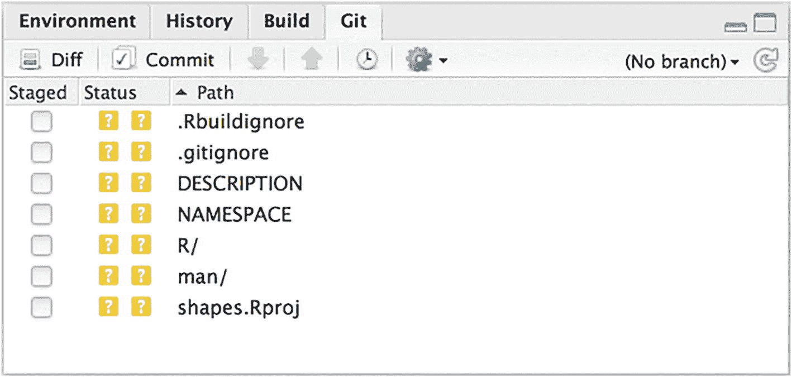

图 15-1. 显示已修改文件的 Git 面板

暂存列中每个文件都有一个勾选框。勾选一个文件后，其状态会变为绿色的“A”。这表示你已经将该文件暂存，准备添加到 git 仓库中。对所有文件都执行此操作。当你勾选一个目录时，该目录下的所有文件也会被一并暂存。这也是我们目前想要的效果。

向 `git` 提交更改的过程是：在实际提交之前，先将更改暂存。我们刚才所做的就是告诉 `git`，下次提交更改时，我们希望添加这些文件。通常，提交只会影响我们已暂存的更改。这让你可以只提交对源代码所做的部分更改，在某些情况下会很有帮助。你可能对许多文件做了多处更改，但在某个时刻，你只想提交一个特定的 bug 修复，而不想提交尚未完成的新功能相关更改。只暂存你想要提交的更改就能实现这一点。

总之，我们现在已经暂存了所有内容。要提交更改，你需要点击工具栏中的“Commit”按钮。这会打开一个新窗口，显示你即将提交的更改，并允许你（在窗口右上方）编写提交信息。这条信息将写入变更日志。在这里对你的更改进行简短且有意义的描述。如果你以后需要在日志中查找这些更改，就会用到它。然后点击“Commit”并关闭窗口。此时 Git 面板应该不再显示任何文件。这是因为自上次提交以来没有新的更改，而该面板只显示当前软件版本与已提交到 `git` 的版本之间存在差异的文件。

如果我们想在终端中执行刚才的操作，则需要使用 `git add` 命令暂存文件：

```
git add 文件名
```

并使用 `git commit` 命令提交暂存的更改：

```
git commit -m "提交信息"
```

现在尝试修改一个文件。修改完成后，你应该会看到该文件再次出现在 Git 面板中，如图 15-2 所示，不过这次状态列显示的是蓝色的“M”。毫无疑问，这表示已修改（Modified）。

如果你在这里暂存一个文件准备提交，状态仍然是“M”，但 RStudio 会通过将“M”标记稍微左移来指示它已被暂存，如图 15-3 所示。当然，你并非必须依赖这个视觉反馈，因为从已勾选的暂存按钮也能看出文件已被暂存。

提交已修改文件的操作与提交新添加文件完全一样。

在终端中，暂存已修改文件同样使用 `git add` 命令。暂存新文件和暂存已修改文件并没有不同的命令，两者都使用 `git add`。

### 为现有项目添加 Git

如果你在创建项目时没有同时创建 `git` 仓库（而且你刚刚才了解 `git`，除非你每次创建项目都勾选了“git”按钮，否则你可能有很多项目没有关联 `git` 仓库），你仍然可以为现有目录设置 `git`。只需在命令行中操作即可。

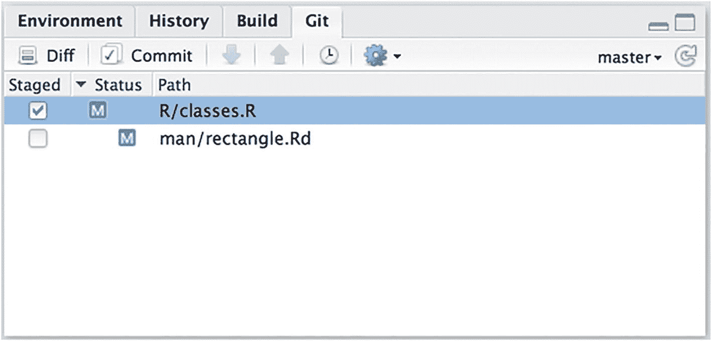

图 15-3. 已修改文件，其中一个文件已暂存待提交

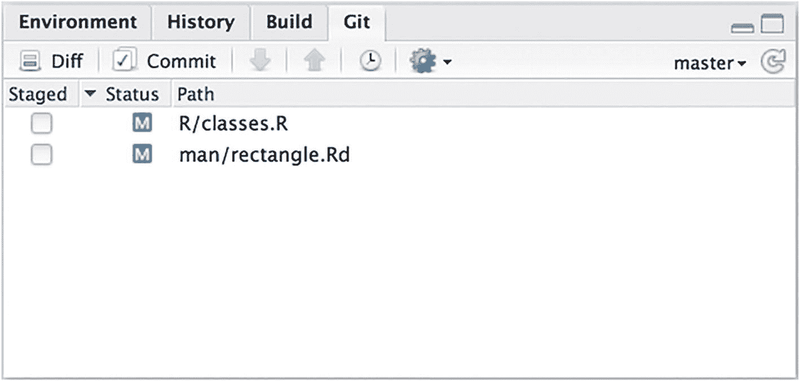

图 15-2. Git 面板中显示的已修改文件

进入项目所在的目录并运行以下命令：

```
git init
```

这将创建一个空的仓库。该目录中已有的文件随后就可以像我们之前看到的那样添加进去。

### 裸仓库与克隆仓库

如果你使用像 GitHub 这样的仓库服务器，本节中的大部分内容你永远无需操心。在那里，创建仓库和与其交互都是通过 Web 界面完成的，除了“克隆”仓库之外，你无需担心细节。我们将在此处手动创建一个所谓的“裸”仓库，并了解如何通过它来在不同的本地仓库之间传递更改。

我们创建 R 项目时创建的仓库，或者在目录中使用`git init`创建的仓库，都是用于对项目目录中的源代码进行版本控制的本地仓库。它们并非为开发者之间的协作而设计。尽管在技术上可以将一个此类仓库的更改合并到另一个仓库中，但这过程有些繁琐，不宜日常处理。

为了在不同仓库之间同步更改，我们需要一个裸仓库。裸仓库是一个不包含本地源代码的仓库；它并没有什么特别之处，但它能防止你在本地对其进行直接修改，你只能通过其他仓库的更改来更新它。

要创建裸仓库，我们需要使用 git 的命令行版本。在你想要放置仓库的位置创建一个目录，进入该目录，然后输入：

```
git --bare init
```

现在，这个仓库包含了 git 运行所需的各种文件——你的本地仓库也包含这些文件；当你同时拥有本地源代码时，它们只是隐藏在一个名为`.git/`的子目录中。

我们不会直接对这个仓库进行任何操作。我们只需要它来演示如何与其他连接到此仓库的仓库进行协作。

前往一个你想放置仓库工作版本（含源代码）的目录，通过输入以下命令来克隆一份裸仓库的副本：

```
git clone /path/to/bare/repository
```

你会收到一条警告，提示你克隆了一个空仓库。我们已知这一点，所以不必担心。我们很快会向其中添加内容。

为了演示仓库之间的通信方式，你需要再创建一个工作副本。你可以去另一个目录重复执行克隆命令，或者通过以下命令克隆仓库并为其指定一个新名称：

```
git clone /path/to/bare/repository 名称
```

现在，我们有了裸仓库的两个克隆副本，可以看看如何将更改从一个克隆推送到被克隆的仓库，以及如何将被克隆仓库中的更新拉取到克隆副本中。

正如我之前所写，通过裸仓库传递更改并非将更改从一个仓库移动到另一个仓库的唯一方式，但它是使用 git 最简单的方式，也是你在使用 GitHub 这类服务器时会采用的方式。如果你这样做（我们稍后会介绍具体操作方法），GitHub 会为你创建好裸仓库，你只需将其克隆到你计算机上的某个位置即可开始工作。

### 推送本地更改并获取与拉取远程更改

进入你刚刚创建的某个克隆仓库。它看起来像是一个空目录，因为我们还没有对它进行任何修改。实际上，它包含一个隐藏目录`.git/`，Git 的神奇之处就在这里，但我们无需了解这些。

尝试创建一些文件，将它们添加到 Git，并提交更改：

```
touch foo bar
git add foo bar
git commit -m "新增了 foo 和 bar"
```

如果现在查看日志：

```
git log
```

你会看到已经进行了更改。然而，如果你查看另一个裸仓库的克隆，你会发现这些更改尚未可见。

造成这种情况的原因有两个：(1) 我们只对克隆仓库做了更改，但从未将这些更改推送到两个克隆仓库所连接的裸仓库；(2) 即使我们推送了，也还没有将更改拉取到另一个克隆仓库中。

第一个操作通过`git push`完成。它会将你在本地仓库中所做的更改推送到你克隆来源的仓库：

```
git push
```

你不需要在每次提交后都将更改推送到全局（裸）仓库；事实上，可能也不应该这样做。这种工作流程的理念是：你频繁地向本地代码提交，以实现细粒度的版本控制，但只有当你完成一个功能——或者至少让代码达到一个对他人有意义的可工作阶段时，才将这些更改推送上去。提交一段不完全能工作的代码到本地仓库通常不是大问题——尽管通常应避免——但如果将无法工作的代码推送给他人，就不会受欢迎了。

在第一个克隆仓库中推送更改后，这些更改在第二个仓库中仍然不可见。你需要将它们拉取下来。

有一个命令：

```
git fetch
```

可以获取全局仓库中的更改，并让你在将这些更改与自己的代码合并之前，先检出查看。这很有用，因为你可以先检出并确保这些更改不会破坏你的代码，然后再进行合并。运行`fetch`命令后，你可以从全局仓库检出分支，在那里进行修改，并使用下文描述的分支机制将它们合并到你的代码中。然而，在大多数情况下，我们只想将全局仓库中的更改合并到当前代码中，并且并不想在合并之前修改它。在这种情况下，命令：

```
git pull
```

可以一步完成获取最新更改并将其合并到本地仓库的操作。这是将他人所做的更改（已推送到全局仓库）与你的更改合并时最常用的操作。

转到没有更改的那个克隆仓库，并运行该命令。检查一下，现在你那里是否已经有了这些更改。

与他人协作项目的一般工作流程是：进行更改并将其提交到自己的仓库。你使用这个仓库来存放那些还不准备分享的更改，只有你能看到它们。然后，当准备与协作者分享时，你可以将更改推送到共享仓库；而当你需要他人所做的更改时，你可以将它们拉取下来。

如果你尝试推送到全局仓库，但别人已经推送了你尚未拉取的更改，你将会收到一个错误。不必担心。只需先拉取更改，之后就可以推送你的更改了。

如果你将更改拉取到你的仓库，而此时你仓库中已有尚未推送的已提交更改，该操作就会变成一次合并操作，这需要一条提交信息。对此有一条默认信息，你可以直接使用。

你有两个仓库可以进行实验，所以可以尝试在不同情况下向已有已提交更改的仓库推送和拉取更改。在你亲自进行一些实验之后，前面的解释应该会变得更加清晰。

RStudio 对推送和拉取提供了一些基本支持。如果你创建一个新的 RStudio 项目，并选择将其放在一个现有目录中，可以尝试将其放在你的克隆仓库中。你会发现，Git 面板现在多了两个新按钮：推送（push）和拉取（pull）。

### 处理冲突

如果恰好有人向全局仓库推送了与你在本地仓库中编辑的行重叠的更改，那么当你拉取更改时，就会遇到所谓的冲突。

无论是从 RStudio 拉取还是使用命令行，Git 都会通知你冲突。它会告诉你涉及哪些文件。如果你打开一个存在冲突的文件，你会看到 Git 已经用如下所示的文本标记了冲突：

```
>>>>>>> 9a0e21ccd38f7598c05fe1e21e2b32091bb0839b
```

它会显示你所作的更改版本以及全局仓库中的更改版本。由于两处都有更改，Git 在拉取命令中不知道如何将远程仓库合并到你的仓库中。

你必须进入文件并进行编辑，使其包含你想要的版本（这可能是两个版本的合并）。完成更改后，去掉`<<<<`/`====`/`>>>>`这些标记行。

编辑完存在冲突的文件后，你需要将其暂存——在命令行运行`git add 文件名`，或者在 RStudio 的 Git 面板中勾选暂存列中的文件——然后提交。这会告诉 Git 你已经处理了冲突，如果需要，之后就可以推送你自己的更改了。

### 使用分支

分支是大多数版本控制系统的一项功能，它允许你同时处理代码的不同版本。一个典型的例子是，用一个分支来开发新功能，用另一个分支来维护软件的稳定版本。当你正在实现新功能时，代码处于不断变化的状态，新功能的实现可能存在缺陷，功能的接口也可能在不同设计方案间变动。你不希望用户使用你软件的这种版本——至少应该让他们知道，他们使用的包是不稳定的，并且他们正在使用的接口随时可能发生变化。因此，你需要将开发代码与发布代码分离开来。

如果你只是在特定时间发布版本，然后在发布版本之间实现新功能，那问题不大。用户应该使用你已经发布的版本，而不是发布版本之间的中间提交。但如果你发布了一个存在错误的版本——坦白说，这并非不可能——并且你想在发现错误时修复它，情况就没那么简单了。你可能不希望等到完成所有正在开发的新功能后再去修复这个错误。因此，你需要对发布版本的代码进行修改。如果发现更多错误，你会在发布代码上提交更多修复。而在此期间，你仍在修改你的开发代码。当然，你对发布代码所做的那些修复，也希望能合并到开发代码中。毕竟，你不希望下一个版本再次引入你已经修复过的错误。

这就是分支发挥作用的地方。RStudio 对分支的支持非常有限，它无法帮助你创建分支。为此，我们需要使用命令行。

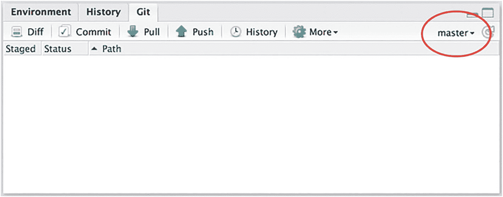

**图 15-4** 当代码位于`master`分支时的 Git 面板

要创建一个分支，你可以使用命令`git branch 分支名`，因此，要创建一个开发分支——为了简便起见，命名为`develop`——我们使用：

```
git branch develop
```

这仅仅是创建了分支。我们并不会被神奇地切换到该分支或其他什么操作。它只是告诉 git 我们有了一个新分支（并且它从我们在仓库提交历史中的当前位置分叉出来）。

在 RStudio 中，我们可以在 Git 面板中看到当前所在的分支，见图 15-4。在你目前实验过的项目中——以及任何你通过`git init`创建，或在创建项目时勾选了对话框中的 git 选项而创建了 git 仓库的项目中——你都会处于`master`分支。这是默认分支，也是通常用于发布版本的分支。

如果你点击 Git 面板中的分支下拉菜单，会得到仓库中所有分支的列表，见图 15-5。你会看到一个名为`origin/master`的分支。这是中央仓库上的 master 分支，是在拉取数据时合并的那个分支。忽略它即可，它对我们不重要。如果你运行了`git branch develop`命令，那么应该还会有一个`develop`分支。如果选择它，你就会切换到那个分支，见图 15-6。

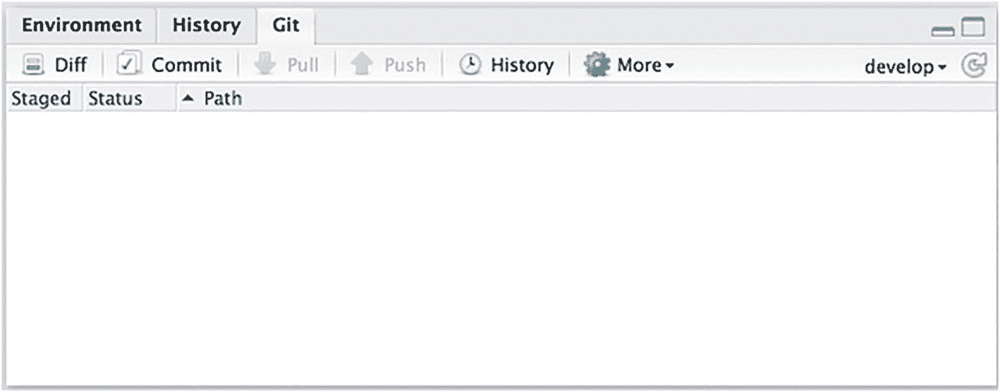

**图 15-6** 切换到`develop`分支之后

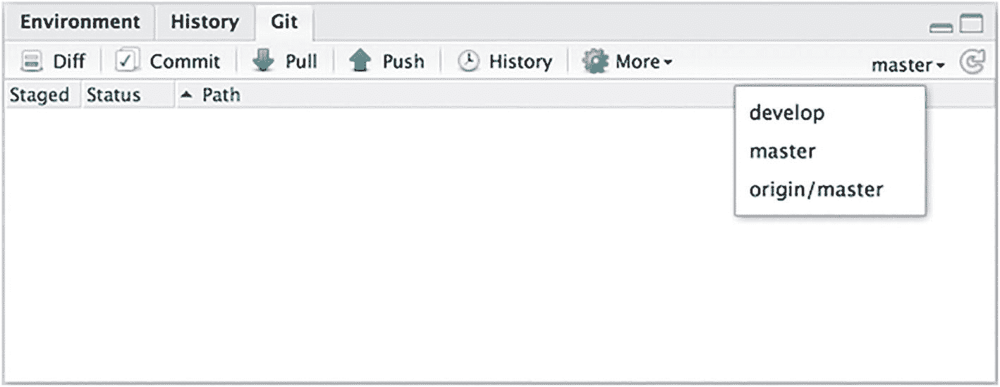

**图 15-5** 选择要切换的分支

你也可以在命令行中获取分支列表，使用命令：

```
git branch
```

你可以使用以下命令来切换分支：

```
git checkout 分支名
```

如果你切换到`develop`分支，你会看到“拉取”和“推送”按钮变成了灰色。你可以在某个分支上修改代码并提交，但（目前）还不能进行推送和拉取操作。我们稍后会介绍这部分内容。

如果你在`develop`分支上对代码做了一些修改并提交，然后切换到`master`分支，你会发现那些修改并不存在。你可以通过查看文件以及查看 git 历史记录（使用`git log`或点击 Git 面板中的“历史记录”按钮）来确认这一点。同样，在`master`分支上所做的修改也不会出现在`develop`分支上。这正是我们想要的。这两个分支是互相独立的，我们可以通过切换分支来在开发分支和软件的发布版本之间进行工作。

当你对一个分支进行了修改，并且希望这些修改也应用到另一个分支时，就需要合并分支。实际上，你是需要将一个分支合并到另一个分支中；这不是一个对称的操作。为此，请先检出你想要修改的目标分支，然后运行命令：

```
git merge 其他分支名
```

将`其他分支`中的修改合并到当前分支。例如，如果你对`master`分支进行了错误修复，并希望将其合并到`develop`分支，你应该这样做：

```
git checkout develop
git merge master
```

如果合并导致冲突，解决冲突的方式与拉取操作导致冲突时的解决方式相同，这并不奇怪，因为`pull`命令实际上只是获取和合并的快捷方式。

#### 典型工作流涉及大量分支

Git 针对使用大量分支进行了优化（这与某些版本控制系统不同，在这些系统中创建和合并分支可能相当缓慢）。这一点体现在许多人在使用 Git 时对分支的应用方式上：你会创建许多分支，在一个由不同代码版本构成的图谱上工作，并在需要时将它们合并在一起。

拥有一个开发分支和一个主分支是仓库结构的典型核心，但为每个你要实现的新功能创建一个分支也是非常普遍的做法。通常，在开始处理某个功能时，你会从`develop`分支分出该功能分支，并在完成功能后将其合并回`develop`分支。为每个错误修复设立一个单独的分支也很常见——通常在你开始实施修复时从`master`分支分出，然后在修复完成后将其合并回`master`分支以及`develop`分支。请参阅 Atlassian 的 Git 教程（`www.atlassian.com/git/tutorials/comparing-workflows`）了解利用各种分支的不同工作流。

如果你为每个功能或错误修复创建了许多分支，那么在完成相关工作后，你可能不想保留它们——不像你希望永久保留的`develop`和`master`分支那样。要删除一个分支，使用以下命令：

```
git branch -d 分支名
```

### 将分支推送至全局仓库

你可以在本地仓库中随心所欲地创建任意数量的分支，但它们并不会自动出现在全局仓库中。我们之前创建的`develop`分支仅存在于本地仓库，并且我们无法将其更改推送到全局仓库——在 RStudio 中可以看到，因为推送（和拉取）按钮是灰色的。

如果你希望某个分支也存在于全局仓库中——以便能够推送更改，并且让协作者能够检出——你需要在该仓库中创建一个分支，并建立本地仓库与全局仓库之间的链接。

你可以通过检出`develop`分支并运行以下命令来实现：

```
git push --set-upstream origin develop
```

该命令会推送更改，并且还会记住将来该分支已与`origin`中的`develop`分支关联。名称`origin`指的是你创建此仓库时所克隆的仓库。

是否希望正在处理的分支也出现在全局仓库中，这取决于个人偏好。如果你正在开发一个希望在完成后才分享、而不提前公开的功能，你可能不希望将该分支推送到全局仓库。不过，对于`develop`和`master`分支，你肯定希望它们存在于全局仓库中。

### GitHub

GitHub（`https://github.com`）是一个用于托管 Git 仓库的服务器。你可以将其视为存放裸仓库/全局仓库的地方，并附带一些额外功能。例如，有自动安装托管在 GitHub 上软件包的方法、用于追踪错误和功能请求的 Web 支持，以及通过 Web 界面在托管项目中共享修复和功能的支持。

要使用它，你首先需要访问其主页并注册。注册是免费的，你只需选择一个用户名和密码即可。

在 GitHub 上创建账户后，你可以通过点击主页右上角的大加号来创建新仓库，见图 15-7。

点击后，你将进入一个页面，可以在其中选择仓库名称、添加简短描述、选择许可证，并决定是否要添加`README.md`文件。我建议你始终保留一个`README.md`文件——因为它会显示在 GitHub 仓库的主页上，可作为软件包的文档。不过，正如我们在第 13 章中看到的，你可能希望设置一个`README.Rmd`文件来生成它。但现在，你可以选择直接生成一个。

仓库生成后，你将进入一个页面，其中显示仓库中的代码概览，见图 15-8。

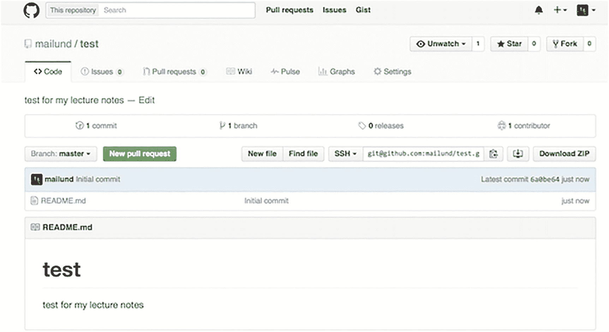
仅包含一个`README.md`文件的新 GitHub 仓库


GitHub 主页上用于创建新仓库的按钮。位于主页右上角

你可以稍后探索该网页及其实现的功能——了解它支持哪些操作是个好主意——但现在，我们只需将此仓库用作远程全局仓库即可。要克隆它，你需要获取 SSH 按钮旁边字段中的地址。在我的测试仓库中，地址是`git@github.com:mailund/test.git`。你可以使用此地址通过“ssh”协议克隆仓库：

```
git clone git@github.com:mailund/test.git
```

这是一种你可以在许多机器上访问的协议，但它需要你处理公钥/私钥协议。请查看 GitHub 上关于设置 SSH 密钥的文档以了解更多信息（`https://help.github.com/articles/generating-ssh-keys/`）。目前该过程大多已自动化，通常只需推送一次并回答弹出的问题即可完成设置。

然而，如果你使用的是支持 HTTPS（Web 浏览器用于安全通信的协议）的机器，SSH 协议可能不是最便捷的方式。你自己的机器几乎肯定支持 HTTPS，但根据防火墙的设置方式，你可能在计算机集群等环境中无法使用 HTTPS，这时就需要使用 SSH 协议。要改用 HTTPS 而非 SSH，只需点击 SSH 按钮的下拉菜单并选择 HTTPS 即可。这会提供一个略有不同的地址——在我的仓库中，地址是`https://github.com/mailund/test.git`——你可以用它来克隆：

```
git clone https://github.com/mailund/test.git
```

如果一切顺利，你应该能够像使用之前我们自己创建的裸仓库/全局仓库一样，使用这个克隆的仓库。

你也可以在 RStudio 的文件菜单中选择“新建项目…”，然后在弹出的对话框中选择“版本控制”（第三个选项），同时检出仓库并创建一个 RStudio 项目。在下一个窗口中，选择 Git，然后使用 HTTPS 地址作为仓库 URL。

### 将现有仓库迁移至 GitHub

如果你已经在项目中本地使用了 Git，并且想将其迁移到 GitHub，那么你需要做更多的工作——至少如果你想迁移包含所有历史记录的仓库，而不仅仅是当前版本的源代码的话。

首先，你需要创建仓库的一个裸版本。正如我们之前所见，这只是不带源代码的仓库版本。

如果你的仓库名为`repo`，我们可以通过克隆创建一个名为`repo.git`的裸版本：

```
git clone --bare repo repo.git
```

要将其迁移到 GitHub，在那里创建一个空仓库并获取其 HTTPS 地址。然后进入我们刚刚创建的裸仓库并运行以下命令：

```
cd repo.git
git push --mirror
```

现在，删除用于将代码迁移到 GitHub 的裸仓库，并从 GitHub 克隆该版本。这样你就有了一个可以处理的版本：

```
rm -rf repo.git
git clone https://github.com/your-username/new-repo-name.git
```

### 从 GitHub 安装软件包

将 R 包托管在 GitHub 上的一个非常好的额外好处（除了拥有版本控制之外）是，其他人可以直接从那里安装你的包。CRAN 对上传包的要求比 GitHub 严格得多，而且你无法频繁地向 CRAN 上传新版本，因此对于 R 包的开发版本来说，GitHub 是一个极好的选择。

要从 GitHub 安装包，你需要先安装`devtools`包：

```
install.packages("devtools")
```

之后，你可以使用以下命令安装 GitHub 用户“username”编写的名为“packagename”的包：

```
devtools::install_github("username/packagename")
```

### 在 GitHub 上进行协作

你在 GitHub 上创建的仓库默认只有你自己可以编辑。任何人都可以克隆它们来获取源代码，但只有你能向仓库推送更改。这当然有助于防止无关人员随意修改你的代码，但也阻碍了协作。

与他人协作的一种方式是授予他们对仓库的写入权限。在仓库主页上，你必须在工具栏中选择`Settings`条目，然后在左侧菜单中选择`Collaborators`。之后，你会进入一个页面，可以在其中添加由 GitHub 用户账号标识的协作者。协作者可以像你一样向仓库推送更改。为了避免在多位协作者更新代码时造成混乱，在如何将更改合并到`master`（和/或`develop`）分支方面遵循一定的规范会很有帮助。GitHub 推荐并支持的一种方法是：在独立的分支上进行更改，然后使用所谓的拉取请求（pull request）在更改被合并到主分支之前进行讨论。

#### 拉取请求

进行拉取请求的工作流程是：在独立于`develop`或`master`的分支上实现新功能、修复 Bug 或进行其他任何开发，然后不是直接合并它们，而是创建一个所谓的拉取请求。你可以通过切换到仓库主页上的分支并选择大大的绿色`New pull request`按钮来发起拉取请求，或者如果你刚刚做了更改，你应该还会看到一个写着`Compare & pull request`的绿色按钮，点击它即可开始发起拉取请求。

点击该按钮会带你进入一个页面，你可以在其中为拉取请求命名，并编写描述，说明你所做的代码更改的作用。你还需要决定要将拉取请求合并到哪个分支；在你为拉取请求命名的标题上方，你可以选择两个分支：你想要合并到的分支（`base`）以及包含你新更改的分支（`compare`）。你应该在此处选择你创建新分支时从中分支出去的源分支。之后，你就可以创建拉取请求了。

这实际上所做的唯一事情就是创建一个用于讨论你所做更改的 Web 界面。你可以在网页上查看这些更改、进行评论，或者对分支进行总体评论。同时，任何人都可以检出该分支并对其进行自己的修改。只要拉取请求保持打开状态，讨论就会持续进行，人们也可以对该分支进行改进。

当你完成操作后，你可以合并该拉取请求（使用在包含拉取请求讨论的网页上找到的大大的绿色`Merge pull request`按钮）。

#### 复刻仓库而非克隆

在独立的分支上进行更改，然后通过拉取请求合并这些更改，仍然需要仓库的写入权限。这对于与几位朋友协作来说非常棒，但对于从陌生用户那里获取修复代码来说并不理想——也不适合为你编写的其他软件包的修复做出贡献，这些软件包的作者不一定会愿意授予你对他们的软件完全写入权限。

不必担心，即使没有对方仓库的写入权限，仍然可以在 GitHub 上与他人协作。从拉取请求的工作方式来看，实际上并不需要被合并的分支属于同一个基础仓库。如果你愿意，可以从任何地方合并分支。

如果你想对一个没有写入权限的仓库进行更改，你可以克隆它并在克隆后得到的仓库上进行更改，但你无法将这些更改推回你从中克隆的原始仓库。而且，GitHub 上的其他用户看不到你在本地所做的更改（它们在你自己的个人电脑上，而不是在 GitHub 服务器上）。你需要的是一个位于 GitHub 上、是你想要修改的仓库的克隆版本、并且是裸仓库的仓库，这样你才能将更改推送进去。然后，你再将该仓库克隆到自己的电脑上。你对本地电脑所做的更改可以推送到你在 GitHub 上的那个裸仓库中——因为它是一个裸仓库，并且你拥有它的写入权限——并且 GitHub 上的其他用户可以看到你托管的那个仓库。

在 GitHub 上创建这样的仓库被称为“复刻（fork）”该仓库。从技术上讲，这与你克隆仓库并无不同——只不过你创建的是一个裸仓库——这个术语来源于开源软件，在开源软件中，复刻一个项目意味着创建你自己的版本并独立于之前的版本进行开发。

总之，每当你进入 GitHub 上的一个仓库主页时，你应该会在右上角（在你正在查看的仓库名称和分支的右侧）看到一个写着`Fork`的按钮。点击它会创建一个你拥有写入权限的仓库副本。你不能复刻自己的仓库——我不确定为什么不允许这样做，但在大多数情况下，你本来也不想这样做，所以这不是什么大问题——但你可以复刻其他用户账号下的任何仓库。

一旦你创建了副本，你可以像处理任何其他仓库一样，将其克隆到你的电脑上并进行更改。这个仓库与你自行创建的仓库唯一的区别在于，当你创建拉取请求时，GitHub 知道它是从另一个仓库复刻而来的。因此，当你创建拉取请求时，你不仅可以选择`base`和`compare`分支，还可以选择`base fork`（基础复刻）和`head fork`（头复刻）——前者是你想要合并更改的目标仓库，后者是你进行更改的仓库。如果有人复刻了你的项目，并且你在原始仓库中创建拉取请求，默认情况下你不会看到`base fork`和`head fork`的选项，但在创建拉取请求时点击`compare across forks`（跨复刻比较）链接也会启用这些选项。

如果你通过拉取请求将你的更改提交到别人的仓库，其过程与在你自己的项目上发起拉取请求完全相同，只不过在关于更改的讨论结束后，你无法合并该拉取请求。只有拥有该仓库写入权限的人才能执行合并操作。

同样，如果其他人想要对你的代码进行更改，他们也可以发起一个包含他们更改的拉取请求提交到你的代码中，但只有你才能在经过拉取讨论后决定是否将这些更改合并到你的仓库中。

这是一种非常灵活的协作方式——即使是与陌生人协作——用于源代码开发，这也是 git 和 GitHub 的优势之一。

#### 练习

从你之前编写的任意软件包中挑选一个，在 GitHub 上创建一个仓库来托管它。将你的代码推送上去。

## 16. 性能剖析与优化

在本第二章中，我们将简要探讨当发现代码运行速度过慢时该怎么做，特别是如何找出运行缓慢的原因。

不过，在你开始担心代码性能之前，重要的是先考虑一下是否值得加速。提升性能需要花费你的时间，只有将额外的编程时间考虑在内后，改进后的性能仍能为你节省时间，这才值得去做。对于一个一天之内就能运行完成的分析来说，花一整天去让它变得更快毫无意义，即使它确实会快很多，因为你最终仍然需要花费相同甚至更多的时间才能完成分析。

任何你在一项分析中只需要运行几次的代码，通常都不值得优化。我们很少只运行一次分析——乐观地说，我们可能希望如此，但实际上，当数据或想法发生变化时，我们通常需要反复运行——但我们预计不会运行成百上千次。因此，即使重新运行一项分析需要几个小时，你的时间可能最好花在运行期间做其他事情上。花费大量时间让它变得更快通常并不值得。与你的时间相比，CPU 的时间是廉价的。

不过，如果你正在开发一个软件包，你通常确实需要在某种程度上考虑性能。一个值得开发的软件包通常会有更多用户，运行你的代码所花费的总时间使得在某种程度上加快代码速度是值得的。

### 性能剖析

在让代码跑得更快之前，首先需要找出它为什么慢。你可能对代码的瓶颈在哪里有一些想法，但实际上，猜测这一点出奇地困难。我经常发现，大部分时间实际消耗的地方与我预想的相差甚远。我曾有两次非常努力地尝试加快某个算法的速度，结果却后来发现程序运行缓慢的原因是用于读取程序输入的代码。解析器很慢，而相比之下算法快如闪电。那是在`C`语言中，其抽象层次相当低，通常很容易从代码中看出运行需要多少时间。但在`R`语言中，其抽象层次非常高，要猜测一行代码需要运行多长时间是极其困难的。

关键是，如果你发现代码运行缓慢，你不应该去猜测哪里慢。你应该测量运行时间，从而确切地了解。你需要对你的代码进行性能剖析，才能知道哪些部分占用了大部分运行时间。否则，你最终可能会优化那些只占总运行时间百分之几的代码，而忽略了真正的耗时大户。

在典型的代码中，只有少数几个真正的瓶颈。如果你能找出这些瓶颈并改进它们的性能，你的工作就完成了。其余部分会运行得足够快。找出这些瓶颈所在就需要性能剖析。

我们将使用`profvis`包进行性能剖析。`RStudio`对此包有内置支持，你的菜单栏中应该有一个`Profile`项。这是该包的一个便捷界面，但如果你希望在`RStudio`之外使用它，我将在此直接使用该包。

#### 一个图流算法

作为一个我们希望进行性能剖析的代码示例，可以考虑一个小型图算法。这是一个用于平滑图中节点权重的算法。它是用于在图节点间传播证据权重的算法的一部分，我们曾用它来通过基因-基因相互作用网络增强疾病-基因关联的搜索。思路是，如果在一个相互作用网络中一个基因是另一个基因的邻居，那么它更可能与后者具有相似的疾病关联。因此，已知关联的基因被赋予初始权重，而其他基因如果与这些基因相连，则会获得更高的权重。

然而，该算法用于做什么的细节并不那么重要。它所做的只是在节点间平滑权重。最初，所有节点*n*被赋予一个权重*w*(*n*)。然后，在一次平滑迭代中，这个权重被更新为`w'(n) = α * w(n) + (1 - α) * (1 / |N(n)|) * Σ_{v∈N(n)} w(v)`，其中*α*是介于 0 和 1 之间的数字，*N*(*n*)表示节点*n*的邻居。如果迭代次数足够多，图中所有连通节点的权重将变得相等，但如果提前停止，则只是一次轻微的平滑，具体取决于*α*的值。

为了实现这一点，我们既需要图的表示形式，也需要平滑算法。我们从表示图开始。有很多方法可以做到这一点，但一种简单的格式是所谓的关联矩阵。这是一个矩阵，如果节点`i`和`j`没有直接相连，则其条目为`M[i,j] = 0`；如果相连，则为`M[i,j] = 1`。由于我们希望在这个算法中处理无向图，我们将有`M[i,j] = M[j,i]`。

我们可以使用一个如下所示的构造函数来实现这种表示形式：

```
graph <- function(n, edges) {
  m <- matrix(0, nrow = n, ncol = n)
  if (length(edges) > 0) {
    for (i in seq(1, length(edges), by = 2)) {
      m[edges[i], edges[i+1]] <- m[edges[i+1], edges[i]] <- 1
    }
  }
  structure(m, class = "graph")
}
```

这里，我要求将节点数量作为参数`n`给出，并将边指定为一个向量，其中每对元素对应一条边。如果图需要手动编码，这并不是表示边的理想方式，但由于这个算法预期用于非常大的图，我假设我们可以在其他地方编写代码来读取图表示形式并创建这样的边向量。

这个函数本身没什么大不了的。它只是创建了关联矩阵，然后遍历边来设置它。有一个特殊情况需要处理：如果边向量为空。这时`seq()`调用会返回一个从 1 到 0 的列表，所以我们要避免这种情况。我们可能还想检查边向量的长度是否是 2 的倍数，但我没这么做。我假设生成该向量的代码会处理好这一点。

尽管图表示形式只是一个矩阵，但我为它指定了一个类，以便将来我想为它编写泛型函数。

有了这个图表示形式，平滑函数可以如下所示：

```
smooth_weights <- function(graph, node_weights, alpha) {
  n_nodes <- nrow(graph)
  new_weights <- node_weights
  for (i in 1:n_nodes) {
    neighbours <- which(graph[i, ] == 1)
    n <- length(neighbours)
    if (n > 0) {
      neighbour_weights <- sum(node_weights[neighbours])
      new_weights[i] <- 
        alpha * node_weights[i] + 
        (1 - alpha) * neighbour_weights / n
    } else {
      new_weights[i] <- node_weights[i]
    }
  }
  new_weights
}
```

它创建了我们要返回的新权重向量，然后通过嵌套循环遍历矩阵。如果关联矩阵表明`i`和`j`之间存在连接，并且`i ≠ j`——我们不想在存在自环的情况下添加节点自身的权重——我们就用它来计算均值。如果存在需要更新的内容——当节点`i`有邻居时就会这样——我们就执行更新。

这段代码并不特别优雅，但它是该思路的直接实现。

为了分析这段代码，我们使用`profvis`包中的`profvis()`函数。它接受一个表达式作为其唯一参数，因此若要分析多个函数调用，我们需向其提供一个代码块，将语句序列转换为表达式。

此处生成一个包含 1000 个节点、300 条边和随机权重的随机图。我们并非测试代码，仅对其性能进行分析。然而，若这是真实代码而非示例，我们当然应编写单元测试——若您开始重写代码以进行优化，这一点尤为重要。否则，您最终可能得到运行更快但结果错误的代码。

```
profvis::profvis({
  n <- 1000
  nodes <- 1:n
  edges <- sample(nodes, 600, replace = TRUE)
  weights <- rnorm(n)
  g <- graph(n, edges)
  smooth_weights(g, weights, 0.8)
})
```

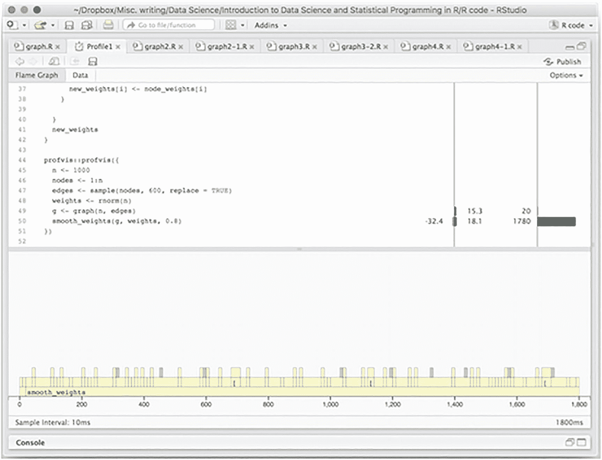

**图 16-1** 展示分析结果的窗口

（若您使用`RStudio`，可通过选中`n <- 1000`至`smooth_weights(...)`的代码行，然后在`Profile`菜单中选择`Profile Selected Line(s)`达到同样效果。）

运行此代码将打开一个新标签页并显示结果，参见**图 16-1**。标签页上半部分显示您的代码，并以水平条形图方式注释内存使用情况（先显示）和时间使用情况（后显示）。窗口下半部分则显示时间使用情况及调用堆栈。

我们可以看到总执行时间约为 1800 毫秒。该图的阅读方式为：从左到右，您可以看到运行过程中各时间点执行了哪些内容，底部是我们在`profvis()`代码块中直接调用的函数，其上方是这些函数直接调用的代码，更上层的函数调用则堆叠得更高。

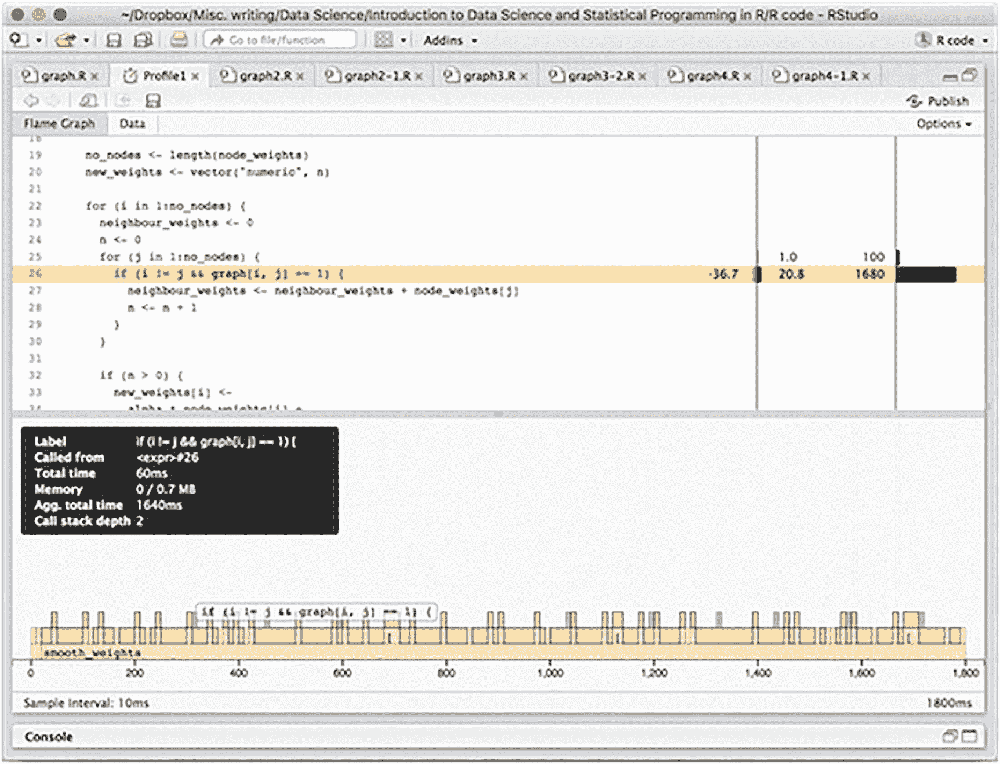

**图 16-2** 从分析窗口中高亮显示正在执行的代码

我们还可以看出大部分时间都花费在`smooth_weights()`函数上，因为它几乎从图形最左侧一直延伸至最右侧。当然，这是符合预期的，但正如我之前提到的，有时分析结果会令您感到惊讶。

如果将鼠标指针移入窗口（无论是代码区域还是底部图形区域），它会高亮显示您所指的内容，参见**图 16-2**。您可利用此功能找出时间消耗在何处。

在此特定案例中，大部分时间似乎花费在内层循环检查边是否存在上。由于这是双重循环的内层部分，这一点或许并不令人意外。并非内层循环全部主体都耗时，而主要是`if`语句，原因可能是我们在每次迭代中都会检查`if`表达式，但仅在其为真时才执行其主体。而面对 1000 个节点和 300 条边，其为真的概率约为 300/(1000*1000) = 3 × 10^-4（实际可能更小，因为某些边可能相同或为自环）。

若此代码存在性能问题，此处应是我们集中优化努力的方向。对于 1000 个节点，我们实际上并没有问题，1800 毫秒毕竟不算长。但我设想中的应用场景约有 30000 个节点，因此进行一些优化或许是值得的。

如果需要优化某些内容，您首先应考虑的是：是否存在更好的算法或数据结构？与仅仅修改实现细节相比，算法层面的改进更有可能带来显著的性能提升。

在此例中，如果我们处理的图是稀疏的（即实际边数远少于所有可能的边数），那么关联矩阵并非理想的表示方式。我们可以通过使用向量表达式替换内层循环或类似技巧来加速代码，但更好的做法是考虑另一种图表示方式。

当然，我们首先应弄清楚所使用的模拟数据是否代表了需要分析的实际数据。如果实际数据是稠密图，而我们却基于稀疏图进行性能分析，则无法准确了解时间消耗在哪里，也无法确定可以合理优化的方向。但我固执地认为，我所设想中的应用场景使用的是稀疏图。

对于稀疏图，我们应采用不同的格式表示边。我们将使用列表而非矩阵来表示边：对于每个节点，都维护一个包含其所有邻居节点的向量。

我们可以如下实现该表示：

```
graph <- function(n, edges) {
  neighbours <- vector("list", n)
  if (length(edges) > 0) {
    for (i in seq(1, length(edges), by = 2)) {
      n1 <- edges[i]
      n2 <- edges[i + 1]
      neighbours[[n1]] <- c(n2, neighbours[[n1]])
      neighbours[[n2]] <- c(n1, neighbours[[n2]])
    }
  }
  for (i in seq_along(neighbours)) {
    neighbours[[i]] <- unique(neighbours[[i]])
  }
  structure(neighbours, class = "graph")
}
```

我们首先生成边向量的列表，然后将其全部初始化为空整数向量。接着遍历输入的边并更新边向量。这种更新方式在计算上可能较慢，因为每次更新都会强制复制之前的向量，但我们事先不知道这些向量的长度，因此这是最简单的解决方案。如果后续的性能分析表明这是一个问题，我们再处理它。

如果输入的边中包含重复的节点对，我们将得到重复的边。这意味着在计算邻居权重的平均值时，同一邻居节点会被使用两次。如果应用允许此类多重边，那没问题，但我们的场景不允许，因此我们在最后对所有向量调用`unique()`函数，以确保同一邻居只被表示一次。

采用这种图表示后，我们可以将平滑函数更新如下：

```
smooth_weights <- function(graph, node_weights, alpha) {
  new_weights <- node_weights
  for (i in seq_along(graph)) {
    neighbours <- graph[[i]]
    n <- length(neighbours)
    if (n > 0) {
      neighbour_weights <- sum(node_weights[neighbours])
      new_weights[i] <- 
        alpha * node_weights[i] + 
        (1 - alpha) * neighbour_weights / n
    } else {
      new_weights[i] <- node_weights[i]
    }
  }
  new_weights
}
```

代码改动很小。我们只需确保`j`仅遍历已知的节点`i`的邻居节点。

性能分析代码与之前相同，运行后将得到如**图 16-3**所示的结果。

我们看到性能得到了显著提升。执行时间从 1800 毫秒降至 20 毫秒。我们还可以看到，一半时间用于构建图，仅另一半用于执行平滑操作。在构建图的过程中，几乎所有时间都花费在`unique()`上；而在平滑函数中，时间则用于实际计算邻居权重的平均值。

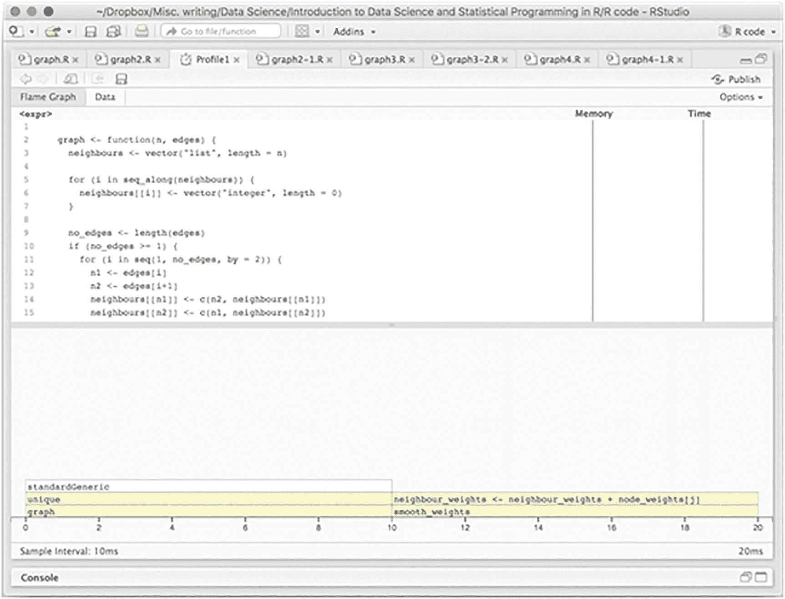

**图 16-3** 第一次更改后的性能分析结果

需要指出的是，分析器通过在特定时间点对正在执行的代码进行采样来工作。它不具备无限分辨率；如左下角所示，它每 10 毫秒采样一次。因此，在此次运行中它实际上仅采样了两次。我们看到的这个结果，仅仅是因为样本恰好分别落在了图构建和平滑的那两个代码位置上。我们实际上并未观察到精细的细节。

为了获得更多细节，并更接近实际预期输入的数据规模，我们可以尝试将图的规模增加到 10000 个节点和 600 条边：

```
profvis::profvis({
  n <- 10000
  nodes <- 1:n
  edges <- sample(nodes, 1200, replace = TRUE)
  weights <- rnorm(n)
  g <- graph(n, edges)
  smooth_weights(g, weights, 0.8)
})
```

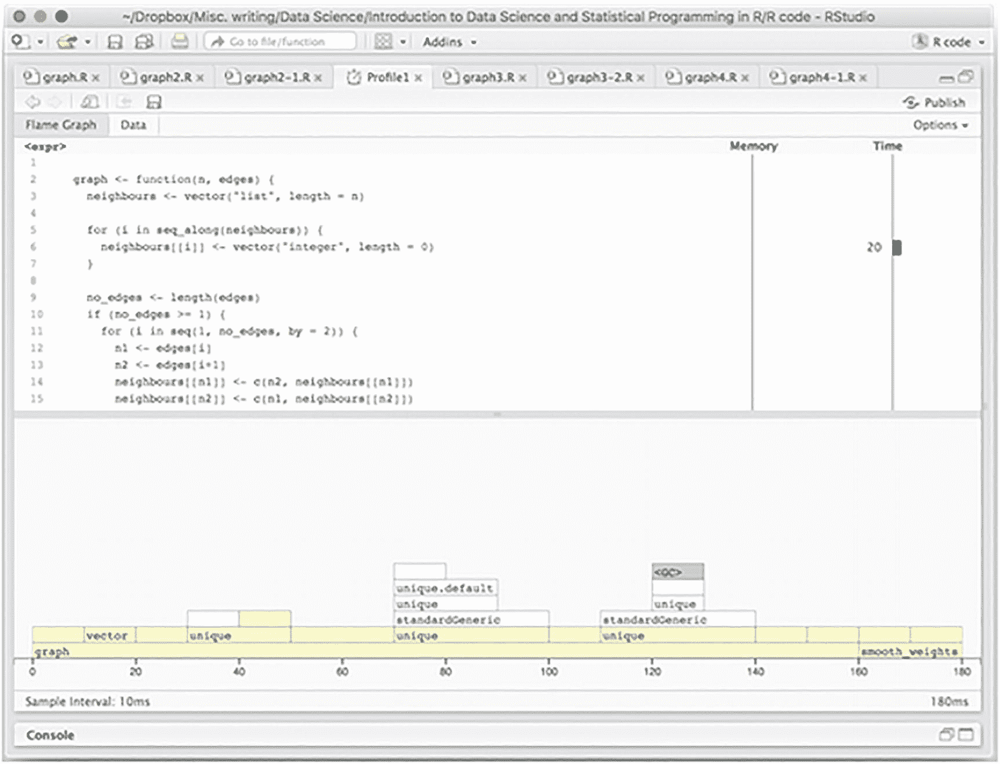

**图 16-4** 使用更大规模图后的性能分析结果

令人惊讶的是，我们发现在处理较大图时，构建图的实际耗时竟然超过了平滑图的时间。我们还发现，这部分时间主要花在调用`unique()`函数上。

虽然这些调用对于避免重复边是必要的，但并非每次调用都能发挥作用——至少在随机图中，重复边出现的可能性较低——因此，大多数调用实际上并未执行有效操作。

如果我们能通过一次`unique()`调用就去除所有重复边，那么就可以节省一些时间。我们可以做到这一点，但这需要在构建函数中做更多工作。

我们需要确保边的唯一性，这存在两个问题。其一，我们并未将边表示为可调用`unique()`的成对形式，且对`edges`向量直接调用`unique()`显然不是解决方案；其二，同一条边可能以`(i, j)`和`(j, i)`两种截然不同的方式表示。

针对第一个问题，我们可以通过将向量转换为矩阵来解决。对矩阵调用`unique()`会返回唯一的行，因此用这种方式表示边对即可。针对第二个问题，我们可以通过确保边以规范形式表示来解决，例如要求边`(i, j)`中`i < j`。

```
graph <- function(n, edges) {
  neighbours <- vector("list", n)
  edge_matrix <- matrix(edges, ncol = 2, byrow = TRUE)
  for (i in seq(1, nrow(edge_matrix))) {
    if (edge_matrix[i, 1] > edge_matrix[i, 2]) {
      edge_matrix[i, ] <- c(edge_matrix[i, 2], edge_matrix[i, 1])
    }
  }
  edge_matrix <- unique(edge_matrix)
  for (i in seq(1, nrow(edge_matrix))) {
    n1 <- edge_matrix[i, 1]
    n2 <- edge_matrix[i, 2]
    neighbours[[n1]] <- c(n2, neighbours[[n1]])
    neighbours[[n2]] <- c(n1, neighbours[[n2]])
  }
  structure(neighbours, class = "graph")
}
```

尝试对这段代码进行性能分析，看看你会得到什么结果。

在我进行性能分析时，发现运行时间缩短了一半，并且相比于之前，构建图所花费的相对时间也更少。由于代码执行时间同样变得非常短，我们无法仅凭性能分析样本就断定更多细节。

这个图的大小并未达到我编写这段代码时所预期应用场景的规格。我们可以将其扩展至完全规模，即大约 20,000 个节点和 50,000 条边^(³⁶)，并对该规模进行性能分析。结果如图 16-5 所示。

在完整规模的图上，我们的大部分时间仍然花费在构建图上，而不是平滑图上——其中大约一半的构建时间都消耗在`unique()`函数中——但这会有些误导性。我们预计在实际应用中不会只对图调用一次平滑函数。每次调用平滑函数都会进一步平滑权重，我们可能需要对图运行大约十次迭代。

我们可以将函数重命名为`flow_weights_iteration()`，然后编写一个`smooth_weights()`函数，使其能够执行指定次数的迭代。

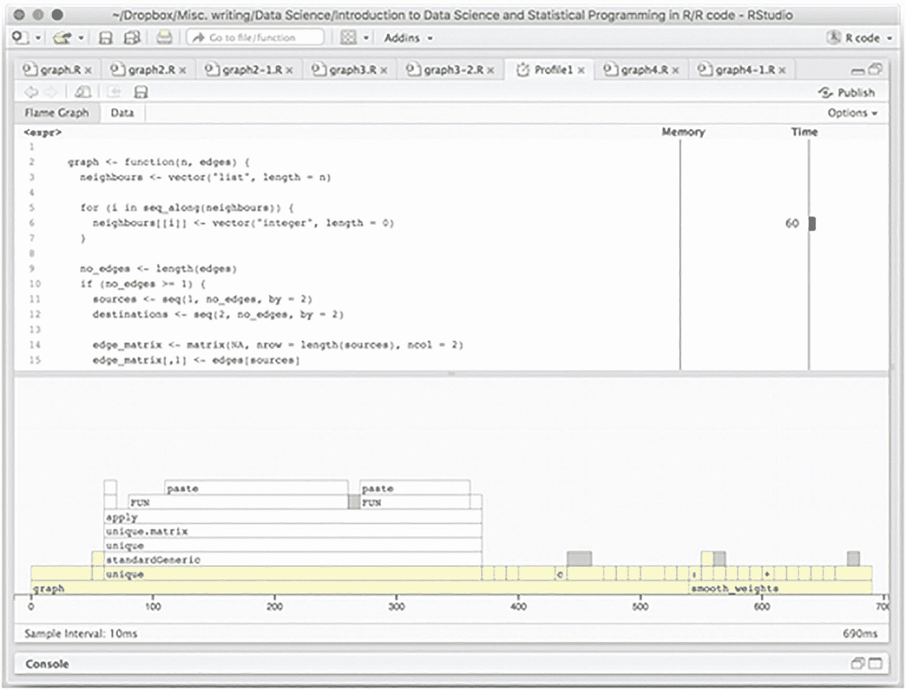

图 16-5 完整规模图上的性能分析结果

```
flow_weights_iteration <- function(graph, node_weights, alpha) {
  new_weights <- node_weights
  for (i in seq_along(graph)) {
    neighbours <- graph[[i]]
    n <- length(neighbours)
    neighbour_weights <- sum(node_weights[neighbours])
    if (n > 0) {
      new_weights[i] <-
        alpha * node_weights[i] + (1 - alpha) * neighbour_weights / n
    } else {
      new_weights[i] <- node_weights[i]
    }
  }
  new_weights
}
smooth_weights <- function(graph, node_weights, alpha, no_iterations) {
  new_weights <- node_weights
  replicate(no_iterations, {
    new_weights <- flow_weights_iteration(graph, new_weights, alpha)
  })
  new_weights
}
```

然后，我们可以对其进行十次迭代的性能分析：

```
profvis::profvis({
  n <- 20000
  nodes <- 1:n
  edges <- sample(nodes, 100000, replace = TRUE)
  weights <- rnorm(n)
  g <- graph(n, edges)
  flow_weights(g, weights, 0.8, 10)
})
```

结果如图 16-6 所示。显然，如果我们增加平滑函数的运行次数，平滑过程将占据更多的总运行时间，因此这里没有真正的意外发现。已经没有明显的热点区域需要深入探究了。我之前使用`replicate()`函数进行迭代，但它确实有一些开销，因为它不仅仅是循环——还会创建一个结果向量——通过将其替换为显式循环，我可以再节省几毫秒：

```
smooth_weights <- function(graph, node_weights,
                           alpha, no_iterations) {
  new_weights <- node_weights
  for (i in 1:no_iterations) {
    new_weights <-
      smooth_weights_iteration(graph, new_weights, alpha)
  }
  new_weights
}
```

我没有展示这个结果，所以你需要在这方面相信我。然而，目前已经没有任何主要的可优化点了。

如果你的代码已经到了没有明显方法可以加速的地步，你就需要考虑是否真的需要进一步优化了。从这点出发，除非你能想出一个更好的算法（这可能很难），否则进一步的优化将会非常困难，并且很可能得不偿失。在计算运行期间，你最好将时间花在其他事情上，而不是浪费数天时间试图从中榨取更多的性能。

当然，在某些情况下，你确实需要进一步提升性能才能在合理时间内完成分析。你可以采取一些最后的补救措施，例如并行化代码或将时间关键部分迁移到 C++。但就目前而言，我们可以在不到两秒的时间内分析完整规模的图，因此我们绝对不应该再花更多时间来优化这段特定代码了。

### 加速代码运行

如果你确实遇到了性能问题，该如何处理？我假设你所处理的问题并非他人已解决过的——如果已有现成的包可用，你当然应该直接使用，而非自行编写代码。不过，也可能存在类似的问题可供你借鉴调整。因此，在采取任何行动之前，不妨先做些调研，看看是否有人解决过类似问题，以及他们是如何解决的。生活中真正独一无二的问题少之又少，不借鉴他人的经验是愚蠢的。

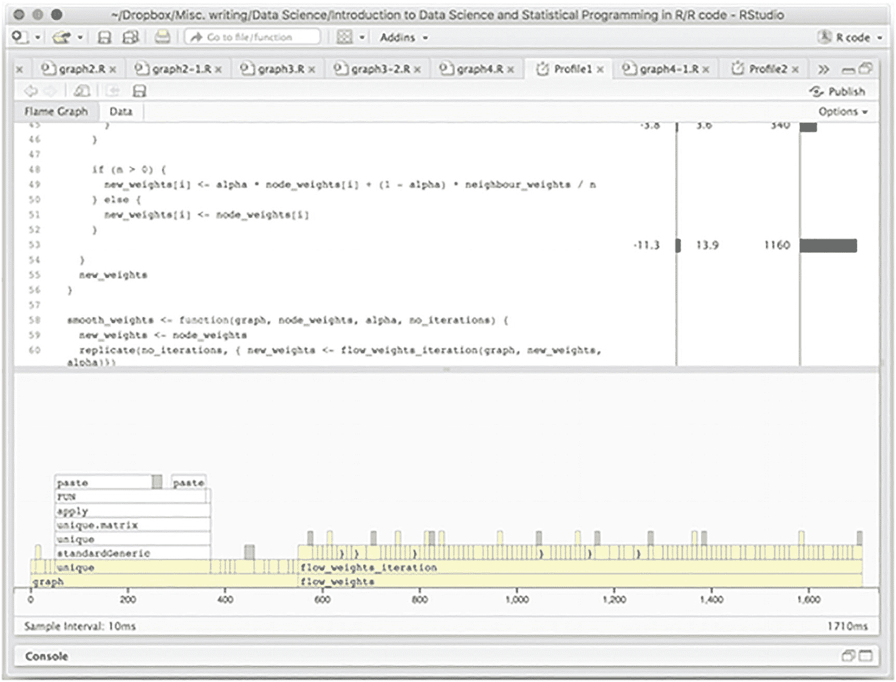

图 16-6 多次平滑迭代的性能分析结果

确定搜索关键词可能需要一点时间，因为类似的问题可能出现在截然不同的领域中。也许存在一个解决方案，但你不知如何搜索，因为它所用的描述术语与你所在领域完全不同。在邮件列表或 Stack Overflow 上求助或许有所帮助，但别把精力浪费在那些稍加努力自己就能解决的小事上。

如果你真的找不到可以借鉴的现有解决方案，下一步就是开始考虑算法和数据结构。改进这些方面对性能的影响，通常远大于微观优化所能达到的效果。进行任何优化时，首先要思考的是能否使用更好的数据结构或更优的算法。

当然，重新实现复杂的数据结构或算法是一项更艰巨的任务——如果能找到已实现的解决方案，你就不应该自己动手——但这通常也是提升性能最多的地方。当然，在花费时间重新实现算法与所能获得的性能提升之间，总是存在权衡。不过随着经验积累，你会更善于判断这一点。嗯，只能说稍微更善于一点。如果心存疑虑，与其花大量时间尝试改进，不如接受代码运行缓慢的现状。

在采取任何行动之前，请确保你拥有单元测试，用以验证新实现不会破坏旧功能！你的新代码就算快如闪电，但如果结果不正确，那也是毫无价值的。

如果你已经探索过现有包、新的算法和数据结构，却仍然存在性能问题，那么你就进入了微观优化层面。在这个层面上，你通过使用略有不同的函数和表达式来尝试提升性能，但这种层面的改动不太可能带来巨大的性能提升。不过，如果你的代码会被执行数千次或数百万次，那么这些微小的改进加在一起，效果也会很可观。因此，如果性能分析凸显出几个性能热点，你可以尝试重写那里的代码。

在这个优化层面上，采样分析器的作用并不太大。它的采样精度在毫秒级别，这通常比你所需的粒度要粗得多。相反，你可以使用`microbenchmark`包来评估和比较表达式。`microbenchmark()`函数会多次运行一系列表达式，并以纳秒为单位计算执行时间的统计量。如果你想通过微观优化来提升一些性能，就可以用它来评估计算过程中的不同备选方案。

例如，我们可以用它来比较一个自行实现的`sum()`与 R 内置的`sum()`函数：

```
library(microbenchmark)
mysum <- function(sequence) {
  s <- 0
  for (x in sequence) s <- s + x
  s
}
microbenchmark(
  sum(1:10),
  mysum(1:10)
)
```

## 性能分析与优化建议

输出的第一列是被评估的表达式，接着是评估时的最小值、下四分位数、均值、中位数、上四分位数和最大值，然后是评估次数。最后一列对性能进行了排名，此处显示 `sum()` 为 `a`，`mysum()` 为 `b`，因此前者更快。这种排名考虑了评估时间的变化，并非仅按均值排序。

关于通过微观优化来加速代码，有一些经验法则，但你应该始终进行实际度量。直觉往往远不如度量可靠。

一条经验法则是，尽可能使用内置函数。像 `sum()` 这样的函数实际上是用 C 语言实现的，并且经过了高度优化，因此我们自己实现的版本很难与之竞争，正如我们之前所见。

另一条经验法则是，使用能完成工作的最简单函数。更通用的函数会引入各种开销，而简单函数则可以避免这些开销。

你可以使用 `Reduce()` 来将序列中的所有数字相加，但与专用函数相比，使用这种通用函数会相对较慢：

```
microbenchmark(
sum(1:10),
mysum(1:10),
Reduce(`+`, 1:10, 0)
)
```

我们使用这类通用函数是为了编程方便。它们为我们提供了抽象的构建块。我们很少能从它们那里获得性能提升，有时它们甚至可能显著拖慢速度。

第三，尽可能少做工作。R 中的许多函数具有超出我们通常所想的更多功能。例如 `read.table()` 函数，它不仅读取数据，还会自动判断每列的数据类型。如果你使用 `colClasses` 参数告诉它每列的类型，它就能更快地运行，因为不必自行推断。对于 `factor()` 函数，你可以使用 `levels` 参数指定允许的类别，这样它就不必自行处理：

```
x <- sample(LETTERS, 1000, replace = TRUE)
microbenchmark(
factor(x, levels = LETTERS),
factor(x)
)
```

这不仅体现在提供输入时，以帮助函数避免花时间推断某些信息上。函数通常也会返回超过你实际需求的内容。例如，`unlist()` 这样的函数会保留列表的名称到结果向量中。除非你真的需要这些名称，否则你应该丢弃它们，因为携带名称成本高昂。如果你只关心数值向量，应该使用 `use.names = FALSE`：

```
x <- rnorm(1000)
names(x) <- paste("n", 1:1000)
microbenchmark(
unlist(Map(function(x) x**2, x), use.names = FALSE),
unlist(Map(function(x) x**2, x))
)
```

## 2059.874   100   a
```
```

第四，在可能的情况下，使用向量表达式而非循环，这不仅因为这样代码更易读，更因为向量表达式中的隐式循环由 R 的运行时系统处理，其速度远快于你编写的显式循环。

最重要的一点是，在尝试提升性能时，始终要进行测量，并且只有当性能提升显著且值得时，才用更复杂的代码替换简单代码。

## 并行执行

有时，提升速度的方法不是让操作更快，而是同时执行多个操作。如今大多数计算机拥有多个核心，这意味着你应该能够并行运行更多计算。

这些通常基于 `lapply()` 或 `Map()` 等函数的变体；例如，可以查看 `parallel` 包，也可以查阅 `foreach` 包，它提供了一种更高级别的循环构造，同样可用于并行运行代码。

如果考虑我们之前的图形平滑处理，由于每个节点都是独立的计算，我们可以通过并行运行这些计算来加速函数。如果将内部循环移入一个局部函数，我们就可以用对 `Map()` 的调用替换外部循环：

```r
smooth_weights_iteration_map <- function(node_weights, neighbour_weights) {
  handle_i <- function(i) {
    n <- neighbour_weights[[i]] |> length()
    if (n > 0) {
      alpha * node_weights[i] + (1 - alpha) * neighbour_weights / n
    } else {
      node_weights[i]
    }
  }
  unlist(Map(handle_i, 1:length(node_weights)))
}
```

这不太可能加速任何过程——高级 `Map()` 函数带来的额外开销反而会起到反作用——但它让我们可以将 `Map()` 替换为 `parallel` 包中的函数，例如 `clusterMap()`：

```r
unlist(clusterMap(cl, inner_loop, 1:length(node_weights)))
```

在这里，`cl` 是“集群”，仅由我旧笔记本电脑上的两个核心组成：

```r
cl <- makeCluster(2, type = "FORK")
microbenchmark(
  original_smooth(),
  using_map(),
  using_cluster_map(),
  times = 5
)
```

这些改动给了我以下结果。在我的双核笔记本上，我们可以预期并行版本的运行速度最高提升两倍。实际上，它却慢了几个数量级：

```
Unit: milliseconds
expr        min          lq
original_smooth()   33.58665    33.73139
using_map()            33.12904    34.84107
using_cluster_map() 14261.97728 14442.85032
mean      median          uq         max
35.88307    34.25118    36.62977    41.21634
38.31528    40.50315    41.28726    41.81587
15198.55138 14556.09176 14913.24566 17818.59187
neval cld
5   a
5   a
5    b
```

我不完全确定这里的问题是什么，但很可能是每个独立任务非常短，而线程（此处实际上是进程）之间的通信开销最终占用了比实际计算多得多的时间。至少我的性能分析似乎表明了这一点。对于轻量级线程，可以避免一些通信，但我们这里的情况并非如此。

当每个任务运行时间较长，线程不必频繁通信时，并行化的效果会更好。

举一个并行化效果更好的例子：考虑在训练数据上拟合模型并在测试数据上测试其准确性。我们可以使用之前看过的 `cars` 数据以及第 6 章的 `partition()` 函数。

我们编写一个评估单个训练/测试分区的函数，然后顺序或并行地调用它 `n` 次：

```r
test_rmse <- function(partitions) {
  model <- partitions$training %>% lm(dist ~ speed, data = .)
  predictions <- partitions$test %>% predict(model, data = .)
  rmse(partitions$test$dist, predictions)
}
sample_rmse <- function(n) {
  random_cars <- mtcars %>%
    partition(n, c(training = 0.5, test = 0.5))
  unlist(Map(test_rmse, random_cars))
}
sample_rmse_parallel <- function(n) {
  random_cars <- mtcars %>%
    partition(n, c(training = 0.5, test = 0.5))
  unlist(clusterMap(cl, test_rmse, random_cars))
}
```

当我为十个训练/测试分区执行此操作时，这两个函数花费的时间大致相同。也许并行版本稍慢一些，但这次开销并不大：

```
microbenchmark(
  sample_rmse(10),
  sample_rmse_parallel(10),
  times = 5
)
Unit: milliseconds
expr      min       lq
sample_rmse(10) 28.72092 29.62857
sample_rmse_parallel(10) 26.08682 27.15047
mean   median       uq      max neval cld
31.57316 33.05759 33.21979 33.23894     5   a
34.75991 28.17528 29.37144 63.01556     5   a
```

然而，如果我创建 1000 个训练/测试分区，并行版本的运行速度就会开始超过顺序版本：

```
microbenchmark(
  sample_rmse(1000),
  sample_rmse_parallel(1000),
  times = 5
)
Unit: seconds
expr      min       lq
sample_rmse(1000) 3.229113 3.277292
sample_rmse_parallel(1000) 2.570328 2.595402
mean   median       uq      max neval cld
3.459333 3.508533 3.536792 3.744934     5   b
2.921574 2.721095 3.185070 3.535977     5  a
```

由于我的笔记本电脑只有两个核心，它永远无法实现超过两倍的加速，而要实现并行化可能达到的最优速度提升通常也是不可能的。线程间的通信开销增加了并行版本所花费的时间，并且某些代码部分（例如准备所有线程要处理的数据）必须顺序执行。

然而，如果你有一台多核机器，并且能够将分析拆分成足够大的独立块，那么往往能从中获益。

## 转向 C++

这是一个重大的步骤，但通过转向 C 或 C++ 这类语言，你能对计算机进行更精细的控制，因为这使得你能在低得多的层面上编程，并且无需承受 R 语言运行时系统带来的额外开销。当然，这也意味着你不具备 R 语言的许多特性，因此你并不想在 C++ 中编写整个分析过程，但你可能希望将时间关键的代码转换为 C++。

幸运的是，`Rcpp` 包让集成 R 和 C++ 变得相当简单——当然，前提是你同时掌握这两种语言。真正需要注意的唯一一点是，C++ 的索引从 0 开始，而 R 从 1 开始。`Rcpp` 会自动处理这种转换，因此在 R 中索引从 1 开始的向量在 C++ 中可以按索引从 0 开始访问，但在翻译代码时，你必须牢记这一点。

要完整描述这套用于 C++ 和 R 之间通信的框架，远远超出了本书的范围。关于这一点，我将推荐 Dirk Eddelbuettel 的佳作 `通过 Rcpp 无缝集成 R 与 C++`。在此，我只是让你初步了解如何使用 `Rcpp` 来加速某个函数。

我们将再次聚焦于平滑函数。它是一个相对简单的函数，没有使用 R 的任何高级特性，因此是转换为 C++ 的理想对象。我们几乎可以逐字逐句地进行转换，只需记住索引应从 0 而不是 1 开始：

```cpp
NumericVector
smooth_weights_iteration_cpp(List g,
NumericVector node_weights,
double alpha)
{
NumericVector new_weights(g.length());
for (int i = 0; i < g.length(); ++i) {
IntegerVector neighbours = g[i];
int n = neighbours.size();
double neighbour_sum = 0.0;
for (int j = 0; j < n; ++j) {
neighbour_sum += node_weights[neighbours[j]];
}
if (n > 0) {
new_weights[i] = alpha * node_weights[i] +
(1-alpha) * (neighbour_sum / n);
} else {
new_weights[i] = node_weights[i];
}
}
return new_weights;
}
```

类型 `List`、`NumericVector` 和 `IntegerVector` 分别对应 R 中的类型。除了我们创建 `new_weights` 向量的方式之外，这段代码与 R 代码非常接近。

有几种方法可以编译此函数并将其封装到 R 函数中，但最简单的方法就是将其放在一个字符串中，然后交给函数 `cppFunction()`：

```r
cppFunction("
NumericVector
smooth_weights_iteration_cpp(List g,
NumericVector node_weights,
double alpha)
{
NumericVector new_weights(g.length());
for (int i = 0; i < g.length(); ++i) {
// 此处函数体即上面展示的 C++ 代码...
}
return new_weights;
}
")
```

这会创建一个与 C++ 函数同名的函数，可以直接从 R 中调用。`Rcpp` 会负责在需要时进行类型转换：

```r
smooth_weights_cpp <- function(graph, node_weights,
alpha, no_iterations) {
new_weights <- node_weights
for (i in 1:no_iterations) {
new_weights <-
smooth_weights_iteration_cpp(graph, new_weights, alpha)
}
new_weights
}
```

如果我们比较 R 和 C++ 函数，会发现性能有了显著提升：

```
microbenchmark(
smooth_weights(g, weights, 0.8, 10),
smooth_weights_cpp(g, weights, 0.8, 10),
times = 5
)
Unit: milliseconds
expr
smooth_weights(g, weights, 0.8, 10)
smooth_weights_cpp(g, weights, 0.8, 10)
min         lq       mean    median
1561.78635 1570.23346 1629.12784 1572.3979
32.77344   33.38822   35.57017   36.5103
uq        max neval cld
1694.31571 1746.90573     5   b
37.29083   37.88803     5  a
```

将函数转换为 C++ 并不一定意味着你不能使用 R 的高级特性。你可以像从 R 调用 C++ 函数一样轻松地从 C++ 调用 R 函数。在许多情况下，转换为 C++ 的 R 类型也可以像在 R 中一样用于向量表达式。但请注意，在 C++ 中使用高级特性时，其运行时开销与在 R 中相同。翻译这类函数可能不会带来显著的性能提升。然而，像循环这样的底层代码的翻译通常能带来可观的性能提升。如果你的代码中有几个性能热点，它们相对简单，但因为工作量大而非常耗时，那么考虑将它们翻译成 C++ 是值得的，而 `Rcpp` 使这件事变得简单。

不过，不要做得过火。用 C++ 编写的代码更难分析和调试，如果代码混合了 C++ 和 R，重构也会更加困难。请使用它，但只在真正需要时才使用。

### 练习

找一些你写过的代码并尝试对其进行分析。如果能够识别出性能热点，则尝试优化它们。首先考虑算法层面的改动，然后考虑 R 表达式层面的改动——使用 `microbenchmark()` 进行检查——如果所有方法都失败了，则尝试并行化或在 C++ 中实现。

脚注 1 2

# 项目 2：贝叶斯线性回归

本章的项目是构建一个用于贝叶斯线性回归的 R 包。我们将要使用的模型，对于我们可以想象构建的 R 包来说，有点像是一个玩具示例。我们的目标并不是开发贝叶斯线性回归的所有高级功能。我们只是要构建足够的内容，以了解构建一个真正 R 包所涉及的各个方面。

## 贝叶斯线性回归

在线性回归中，我们假设存在预测变量 `x` 和目标变量 `y`，其中 `y = w[0] + w[1]*x + ϵ`，且 `ϵ ~ N(0, σ²)`。也就是说，我们有一条截距为 `w[0]`、斜率为 `w[1]` 的直线，目标变量围绕该直线上的点呈正态分布。我们有时将 `σ²` 记为 `1/β`，并称 `β` 为**精度**。本文将沿用这种记法，并假设 `β` 是已知量；我们将采用贝叶斯方法估计权重 `wᵀ = (w[0], w[1])`。

由于我们假设已知精度参数 `β`，那么如果我们知道模型的真实权重，每当获得一个 `x` 值时，就能知道 `y` 值的分布：`y ~ N(w[0] + w[1]*x, 1/β)`。

为了符号表示方便，我将定义一个将 `x` 映射为向量的函数：`φ : x ↦ (1, x)ᵀ`。于是有 `wᵀφ(x) = w[0] + w[1]*x` 和 `y ~ N(wᵀφ(x), 1/β)`。

当然，我们并不知道权重的真实值，而必须对其进行估计。在贝叶斯方法中，我们不把权重视为固定但未知的值，而是将其视为来自某个我们部分了解的分布的随机变量。学习权重意味着在观察到 `x` 和 `y` 值的条件下，估计向量 `w` 的后验分布。

我们将假设 `w` 的某个先验分布 `p(w)`。如果观察到一系列匹配的 `x` 和 `y` 值 `xᵀ = (x[1], x[2], ..., x[n])` 和 `yᵀ = (y[1], y[2], ..., y[n])`，我们希望将这个关于权重 `w` 的先验分布更新为后验分布 `p(w | x, y)`。

我们将假设 `w` 的先验分布是一个均值为零、对角协方差矩阵具有某个（已知超参数）精度 `α` 的正态分布，即：

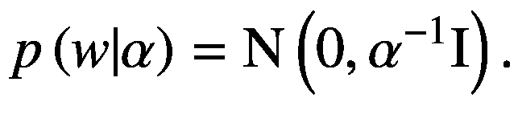

由于本文篇幅所限，我无法在此详细解释原因，但这是线性模型先验的一个良好选择，因为它意味着后验也将是正态分布。同时还意味着，给定 `x` 和 `y`，我们可以通过简单的矩阵运算计算出后验的均值和协方差矩阵。

但首先，我们需要定义模型矩阵。该矩阵用于捕捉我们试图拟合的线性模型是一条直线这一事实，即 `y = w[0] + w[1]*x`。我们为观测向量 `x` 定义模型矩阵如下：

![X = [[1, x1], [1, x2], [1, x3], ..., [1, xn]]](images/439481_2_En_17_Chapter/439481_2_En_17_Chapter_TeX_Equb.png)

通常，每行对应一个观测，包含我们希望纳入模型的各种观测特征；但对于简单的直线，其特征就是斜率和截距，因此对于观测 `i`，其值为 1 和 `x[i]`。

权重 `w` 的后验分布 `p(w | x, y, α, β)` 由下式给出：

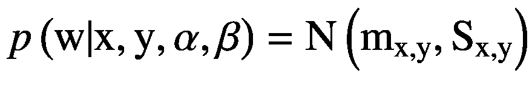

其中

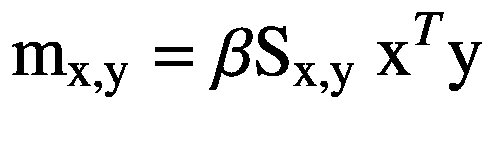

且

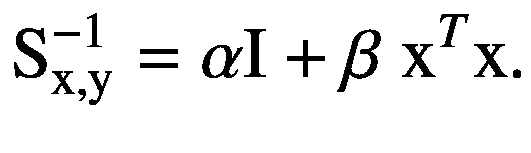

### 练习：先验与后验

#### 从多元正态分布中抽样

若想从多元正态分布中抽样，可使用 `MASS` 包中的 `mvrnorm` 函数：

```r
library(MASS)
mvrnorm(n = 5, mu = c(0,0), Sigma = diag(1, nrow = 2))

##            [,1]       [,2]

## [1,] -0.1664955 -0.4859753

## [2,] -1.4915224 -1.0527432

## [3,] -0.2284911  0.4313458

## [4,]  0.4177218 -1.1576628
```

## 先验分布的构造

我们需要为其提供均值向量`mu`和协方差矩阵`Sigma`。

我们权重向量的先验分布是`N(0, S₀)`，其中

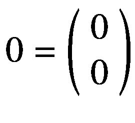

且

![S₀ = (1/α)I = [[1/α, 0], [0, 1/α]]](images/439481_2_En_17_Chapter/439481_2_En_17_Chapter_TeX_Equg.png)

你可以使用`diag`函数来创建对角协方差矩阵。

请编写一个函数`make_prior(alpha)`来构造该先验分布，以及另一个函数`sample_from_prior(n, alpha)`，用于从中抽取`n`个权重向量`w_i`。我的实现将样本返回为一个数据框，其中包含一列`w[1]`样本和另一列对应的`w[0]`样本。你可以按任何方便的形式返回样本。

如果你能从前验分布中抽样，就可以绘制结果图，既可以在`w`空间中作为点显示，也可以在`(x, y)`空间中作为直线显示（点`(w[0], w[1])`描述了直线`y = w[0] + w[1]*x`）。从先验中抽取的样本及两种不同的可视化方式，请参见图17-1和图17-2。

## 计算后验分布

如果我们固定模型参数`β`和`w = (w[0], w[1])^T`，就可以模拟`(x, y)`的值。我们可以先选取一些随机的`x`值，然后模拟出相应的`y`值；参见图17-3，其中红线是已知的直线（由`(w[0], w[1])`给出），黑点是给定模型后随机采样的点。

```
w0 <- 0.3 ; w1 <- 1.1 ; beta <- 1.3
x <- rnorm(50)
y <- rnorm(50, w1 * x + w0, 1/beta)
```

当然，在这种情境下我们并不知道真实的直线。我们拥有的是权重的先验分布`(w[0], w[1])`以及观测到的`(x, y)`值。将这种情况想象为图17-3但去掉红线。不过，如果有了这些点以及先验信息，我们就掌握了关于潜在直线可能形态的信息，这些信息以权重的后验分布形式呈现——即给定观测点后权重所服从的分布。当我们的先验和模型都假设数据点服从正态分布时，后验分布会变得特别简单，正如我们之前所见。我们可以通过之前见过的公式来得到后验分布。

编写一个函数`make_posterior(x, y, alpha, beta)`，用于计算权重的后验分布（均值和协方差矩阵），以及一个函数`sample_from_posterior`，用于从后验分布中进行采样。

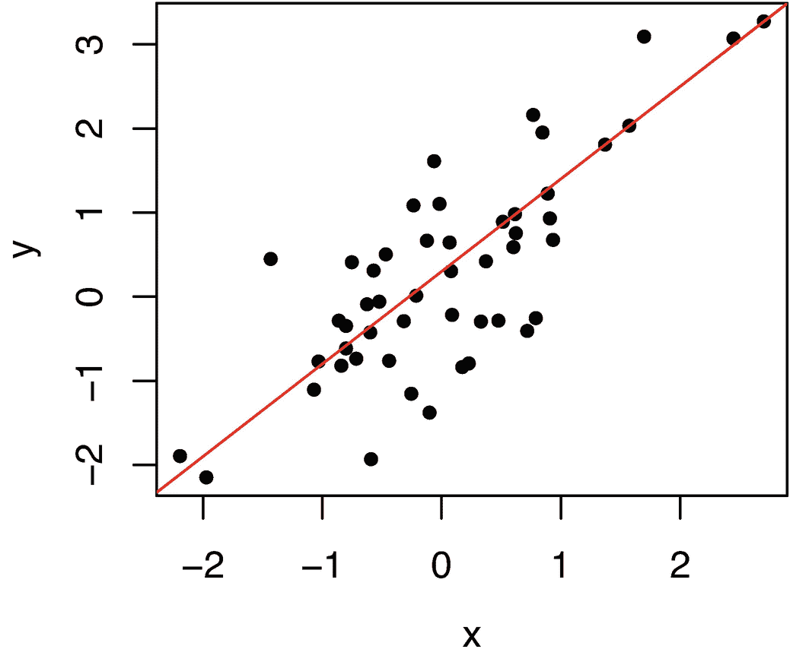

图17-3：随机采样的`(x, y)`值。真实的线性模型以红色显示。

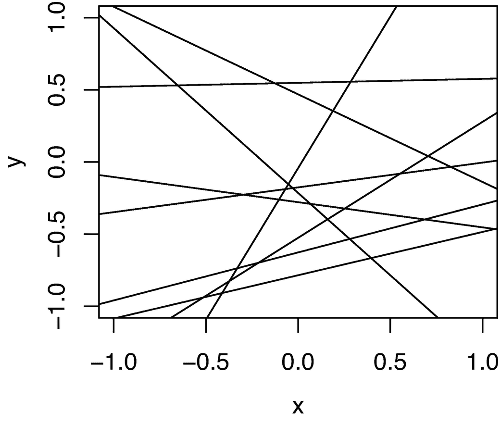

图17-2：从先验分布中采样的权重向量，以直线的形式表示。

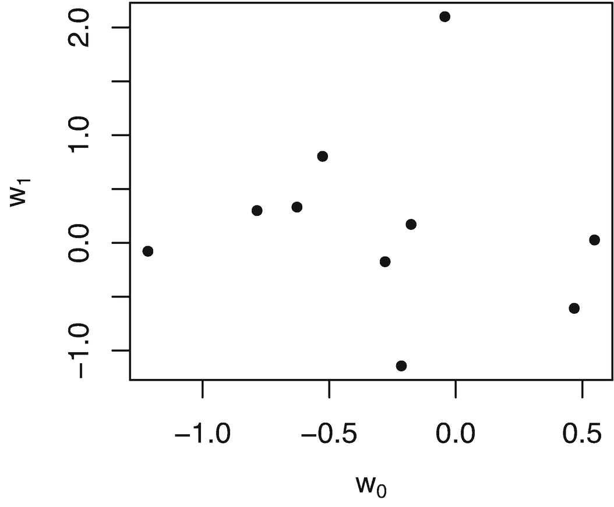

图17-1：从先验分布中采样的权重向量。

如果我们再次假设能够从`(x, y)`点的真实分布中采样，那么每次获得一批点时，我们都可以更新后验知识。当然，在现实世界中，我们并没有真实的分布来进行这种采样，但已有的观测数据代表了这些数据点，因此我们仍然可以在每次获得新信息时更新后验分布。

假设我们已经观测到`n`个点，即`(x[1], y[1]), (x[2], y[2]), ..., (x[n], y[n])`，那么我们可以问自己：现在的后验分布与真实直线有多接近？当然，我们的后验分布并不是一条直线（也不是权重空间中的一个点），而是一个分布。因此，一种方法是：从后验分布中采样，观察这些样本聚集的紧密程度——这告诉我们对于真实值的确定程度——以及它们围绕真实点（如果已知的话）聚集的紧密程度。

在图17-4中，你可以看到一个示例。真实直线，即采样数据点所依据的`(w[0], w[1])`，以红色显示。黑点是用于更新后验分布的`(x, y)`点，灰色线条则是从更新后的后验分布中采样的样本。如你所见，用于推断后验分布的`(x, y)`点越多，分布就越倾向于聚集在真实点周围。

### 对新预测值的目标变量进行预测

给定一个新的`x`值，我们希望预测对应的`y`值。对于固定的`w`，同样有`p(y | x, w, β) = N(w^T ϕ(x), 1/β)`，但由于我们不知道`w`，因此必须对所有`w`进行积分。训练数据改善预测的方式在于，我们不是基于先验分布对`w`进行加权积分，而是基于`w`的后验分布进行加权积分：

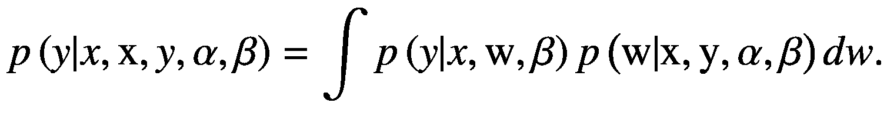

这种对两个正态分布乘积的积分会得到另一个正态分布，并且可以证明它等于：

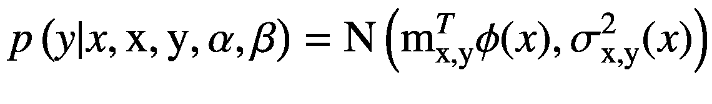

其中`m[x, y]`是`w`的后验分布的均值，并且：

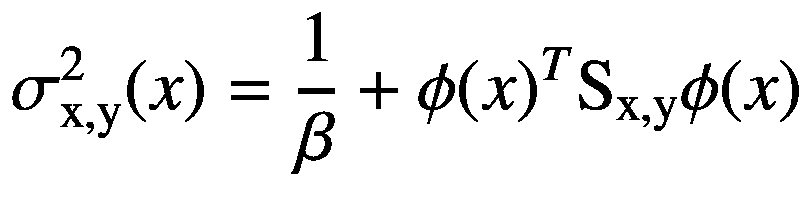

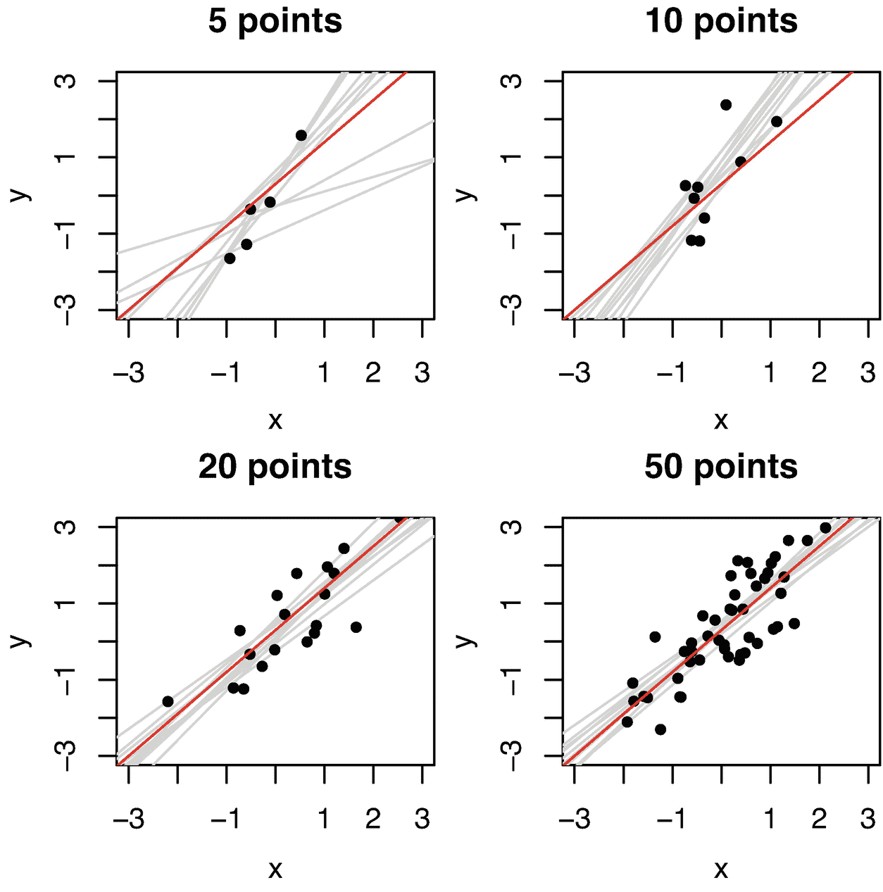

图17-4：从后验分布中抽取的直线。真实直线以红色显示。

其中`S[x, y]`是`w`的后验分布的协方差矩阵。

有了目标值`y`在给定预测值`x`条件下的完整分布，我们当然可以进行预测。`y`的点预测值自然是这个正态分布的均值，即`m[x, y]^T ϕ(x)`。但我们能做的不仅仅是预测最可能的值；由于知道分布，我们当然还可以得到置信区间的值。

编写一个函数，用于预测给定`x`值下最可能的`y`值。使用该函数将推断出的模型绘制在`(x, y)`点上。示例见图17-5。

利用你也拥有`y`的预测分布这一事实，编写一个函数，用于给出该分布的分位数，并利用它绘制预测值周围95%的置信区间；参见图17-6。

## 公式与模型矩阵

我们将继续使用贝叶斯线性回归，并推广可拟合的公式类型。

回顾第6章内容，在将模型拟合到数据时，我们通过所谓的模型矩阵（或设计矩阵）来实现，其形式如下：

![$$ \mathrm{x}=\left[\begin{array}{l}\begin{array}{cc}1&amp; {x}_1\\ {}1&amp; {x}_2\end{array}\\ {}1\kern0.5em {x}_3\\ {}\begin{array}{cc}\vdots &amp; \vdots \end{array}\\ {}\begin{array}{cc}1&amp; {x}_n\end{array}\end{array}\right]. $$](images/439481_2_En_17_Chapter/439481_2_En_17_Chapter_TeX_Equk.png)

该矩阵的第*i*行包含向量`(1, x[i]) = φ(x[i])^T`，用于捕获第*i*个观测值`xi`的预测变量。实际上它包含两个预测变量：其中一个为常量1。该向量捕获的是我们在线性模型中用于预测目标的输入变量。一个变量是`x`值，另一个是编码y轴截距的方式。

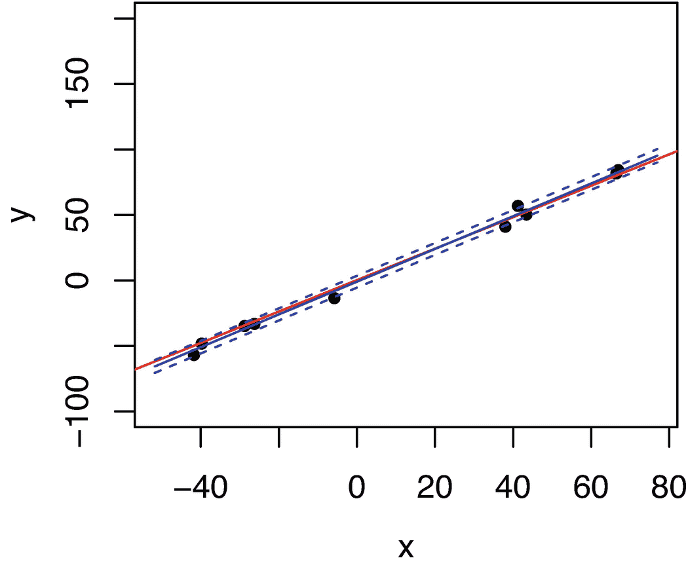

图17-6 — 含95%支持区间的预测结果

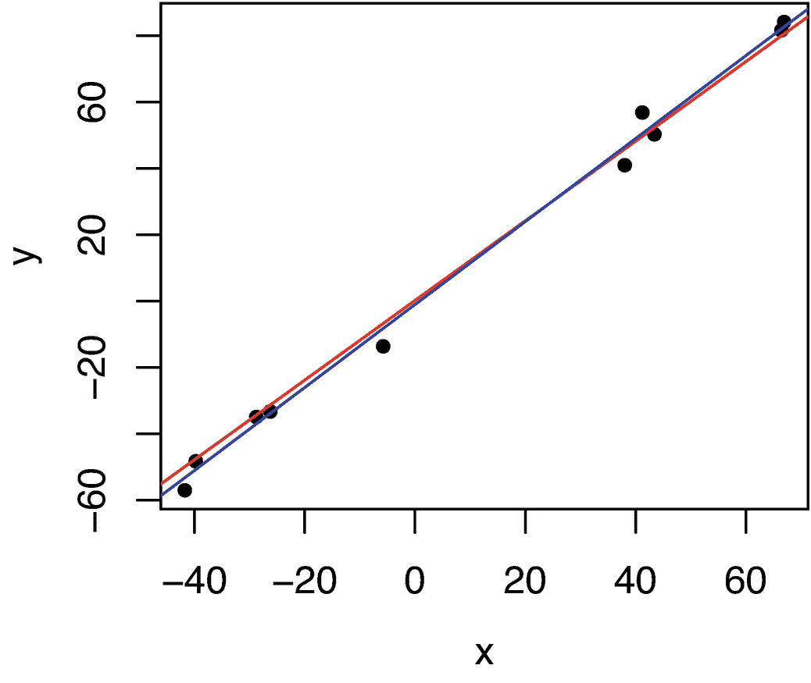

图17-5 — 红色为真实线性模型，蓝色为预测值

为了预测目标，我们使用该行与拟合模型权重的内积：

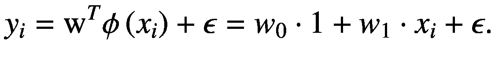

我们将`φ(x)`称为点`x`的特征向量，模型矩阵的每一行对应一个要拟合或预测的数据点，因此第*i*行即为`φ(x[i])^T`。采用我们此处使用的特征向量形式`φ(x)^T = (1, x)`时，拟合的是一条直线，但特征向量并非必须保持这种形式。我们可以构造更复杂的特征向量。

如果我们改用特征向量`φ(x)^T = (1, x, x²)`，并在`w`中添加一个权重使其变为三维`(w[0], w[1], w[2])`，则仍可通过相同方式预测目标`y = w^T φ(x[i]) + ε`。只不过此时`w^T φ(x[i]) = w[0] + w[1]*x + w[2]*x²`，因此拟合的将是一个二次多项式。

如果你现在想“嘿，这不再是线性模型了！”，那你就错了。模型的线性实际上与`x`的线性无关。是`w`的线性使得模型成为线性模型，只要我们通过权重向量与某个特征向量的内积来获得预测值，那么所处理的就仍然是线性模型。你可以随心所欲地设计特征向量`φ(x)`。

若以相同方式构建模型矩阵

![$$ \mathrm{x}=\left[\begin{array}{c}\phi {\left({x}_1\right)}^T\\ {}\phi {\left({x}_2\right)}^T\\ {}\phi {\left({x}_3\right)}^T\\ {}\begin{array}{c}\vdots \\ {}\phi {\left({x}_n\right)}^T\end{array}\end{array}\right] $$](images/439481_2_En_17_Chapter/439481_2_En_17_Chapter_TeX_Equm.png)

那么用于拟合权重和预测新目标值的数学方法相同，只不过权重向量`w`的维度需与特征向量的维度保持一致。

此外，特征向量也不必是单一变量`x`的函数。如果你想拟合包含两个变量的线性模型，即一个平面，只需让特征向量依赖于两个变量：`φ(x, z)^T = (1, x, z)`。与权重向量的线性组合即为`w^T φ(x, z) = w[0] + w[1]*x + w[2]*z`，这恰恰是一个包含两个变量的线性模型。

### 在 R 中使用模型矩阵

在R中，指定特征向量和模型矩阵的方式是使用公式。公式是一个包含波浪符号`~`的表达式，目标变量应放在左侧，解释变量放在右侧。

R用于指定公式的语法相当丰富，如果你感兴趣，可以在R终端中输入以下命令来阅读文档：

```
?formula
```

对于线性模型，我们会写成`y ~ x`。截距项是隐式存在的；你不需要告诉R你想要特征向量包含截距，相反，如果你不想要截距，需要显式地将其移除。你也可以指定多项式特征向量，但R会将乘法`*`解释为变量间的交互作用。要指定`x`的二次多项式，你需要写成`y ~ I(x²) + x`。函数`I`是恒等函数，在这里使用它可以让R将`x²`解释为对数值`x`进行平方运算，而不是试图将其解释为公式规范的一部分。如果你只想拟合`x`的平方项，可以写成`y ~ I(x²)`。对于一般的*n*次多项式，你可以使用`y ~ poly(x,n, raw=TRUE)`。

为了拟合我们的线性模型，我们需要两类数据。在我们已经实现的模型中，我们使用了向量`x`和`y`，但在一般情况下，预测变量`x`应被替换为模型矩阵。根据这个矩阵和`y`，我们就可以拟合模型。

R提供了从公式和数据中获取这两类数据的函数。不过，由于作用域规则，这并非完全直接。如果你在代码的某处编写了一个公式，你希望公式中的变量引用的是当前作用域中的变量，而不是其他地方可能查看该公式的变量。因此，公式需要捕获当前作用域——类似于闭包捕获其周围作用域的方式。另一方面，你也希望能够通过数据框直接将数据提供给模型。通常，你想要拟合的数据是作为数据框中的列存在的，而不是作为作用域中的独立变量。有时，甚至是两者的混合。

函数`model.frame`可以让你捕获所需内容，以收集与公式相关的数据。它会知道公式的作用域，但你也可以通过数据框添加数据。可以把它看作一个`data.frame`，只是它包含了更多通过分析公式而获得的关于数据的信息。

我们可以在下面这个小例子中看到这一切是如何运作的：

```
predictors <- data.frame(x = rnorm(5), z = rnorm(5))
y <- with(predictors, rnorm(5, mean = 3*x + 5*z + 2))
model <- y ~ x + z
model.frame(model, data = predictors)

##            y          x           z

## 1  5.7166648  1.2943469  0.07347801

## 2 -7.3801586  0.7210624 -2.12012399

## 3  0.4894598 -0.6444302  0.15265587

## 4  5.5552442  1.6107988  0.01996477

## 5  7.8151347  0.2048122  0.98655386
```

这里，我们在一个数据框中有两个预测变量`x`和`z`，并在全局作用域中模拟了响应变量`y`。我们使用公式`y ~ x + z`（这意味着*ϕ*(`x`, `z`)^(T) = (1, `x`, `z`)）创建模型，并据此构建一个模型框架，其中包含公式中所有使用的变量的数据。

模型框架的创建方式是：R首先在它接收到的数据框中查找变量，如果找到，则使用该数据；如果未找到，则使用它在公式作用域中找到的数据。如果完全找不到，当然会报告错误。

数据框还用于从变量构造表达式。在作用域中，你可能拥有变量`x`，但没有构建模型矩阵所需的`x`²。`model.frame`函数会为你构造它：

```
x <- runif(10)
model.frame(~ x + I(x²))

##            x       I(x²)

## 1  0.9257926 0.857091....

## 2  0.2048174 0.041950....

## 3  0.3320932 0.110285....

## 4  0.5124721 0.262627....

## 5  0.4848565 0.235085....

## 6  0.1284884 0.016509....

## 7  0.9344755 0.873244....

## 8  0.8077187 0.652409....

## 9  0.7667746 0.587943....
```

## 模型矩阵与公式

在这个例子中，我们的公式没有响应变量；你并不一定需要它。当然，为了能够提取向量`y`，我们需要它来进行线性模型拟合，但R并不一定需要它。

一旦你有了模型框架，就可以使用函数`model.matrix`获取模型矩阵。它需要知道公式和模型框架（前者是为了知道特征函数 *ϕ*，后者是为了知道我们正在拟合的数据）。

接下来，我们构建两个模型，一个拟合经过`y = 0`的直线，另一个允许直线与`y`轴相交于任意点。

注意两个模型的数据框是相同的——两个模型中使用的变量相同——但模型矩阵不同：

```r
x <- runif(10)
y <- rnorm(10, mean=x)
model.no.intercept <- y ~ x + 0
(frame.no.intercept <- model.frame (model.no.intercept))

##              y         x
## 1   0.05218288 0.7020026
## 2   0.78985212 0.2376200
## 3  -0.81501744 0.4099537
## 4  -0.71807916 0.5834204
## 5   0.40083214 0.5577035
## 6  -0.82443129 0.2163221
## 7  -0.98024996 0.1702824
## 8  -0.47115407 0.3512283
## 9   0.35959763 0.2272345
## 10 -0.47588279 0.9553629

model.matrix(model.no.intercept, frame.no.intercept)

##            x
## 1  0.7020026
## 2  0.2376200
## 3  0.4099537
## 4  0.5834204
## 5  0.5577035
## 6  0.2163221
## 7  0.1702824
## 8  0.3512283
## 9  0.2272345
## 10 0.9553629

## attr(,"assign")
## [1] 1

model.with.intercept <- y ~ x
(frame.with.intercept <- model.frame (model.with.intercept))

##              y         x
## 1   0.05218288 0.7020026
## 2   0.78985212 0.2376200
## 3  -0.81501744 0.4099537
## 4  -0.71807916 0.5834204
## 5   0.40083214 0.5577035
## 6  -0.82443129 0.2163221
## 7  -0.98024996 0.1702824
## 8  -0.47115407 0.3512283
## 9   0.35959763 0.2272345
## 10 -0.47588279 0.9553629

model.matrix(model.with.intercept, frame.with.intercept)

##    (Intercept)         x
## 1            1 0.7020026
## 2            1 0.2376200
## 3            1 0.4099537
## 4            1 0.5834204
## 5            1 0.5577035
## 6            1 0.2163221
## 7            1 0.1702824
## 8            1 0.3512283
## 9            1 0.2272345
## 10           1 0.9553629

## attr(,"assign")
## [1] 0 1
```

目标向量，即响应变量`y`，也可以从数据框中提取。这次不需要公式，因为数据框记住了哪个变量是响应变量。你可以使用函数`model.response`从模型框架中获取它：

```r
model.response(frame.with.intercept)

##          1           2           3           4
## 0.05218288  0.78985212 -0.81501744 -0.71807916
##          5           6           7           8
## 0.40083214 -0.82443129 -0.98024996 -0.47115407
##          9          10
## 0.35959763 -0.47588279
```

## 练习

### 构建模型矩阵

构建一个函数，该函数以公式为输入，并通过`...`变量可选地接收一个数据框，然后根据公式和可选数据构建模型矩阵。

### 拟合通用模型

扩展你之前编写的用于拟合直线的函数，使其成为可以拟合任何公式的函数。

## 不含响应变量的模型矩阵

当您拥有模型框架所需的所有变量时，以这种方式构建模型矩阵是很好的，但如果您没有目标值呢？当然，您需要目标值来拟合模型的参数，但稍后，您想要为那些不知道目标值的新数据点预测目标值，那么此时如何构建模型矩阵呢？

使用一些明显是伪造的数据，这种情况可能如下所示：

```r
training.data <- data.frame(x = runif(5), y = runif(5))
frame <- model.frame(y ~ x, training.data)
model.matrix(y ~ x, frame)

##   (Intercept)         x
## 1           1 0.1935202
## 2           1 0.4235126
## 3           1 0.8715640
## 4           1 0.0687407
## 5           1 0.7034587

## attr(,"assign")
## [1] 0 1

predict.data <- data.frame(x = runif(5))
```

但现在，如果我们想为预测数据构建一个框架：

```r
frame <- model.frame(y ~ x, predict.data)
```

我们会得到一个错误。公式告诉`model.frame`它需要变量`y`，但`predict.data`没有这个变量；它只有`x`。因此，去掉公式中的响应部分：

```r
frame <- model.frame(~ x, predict.data)
model.matrix(~ x, frame)

##   (Intercept)         x
## 1           1 0.5181431
## 2           1 0.6967051
## 3           1 0.4965555
## 4           1 0.0729577
## 5           1 0.7235315

## attr(,"assign)
## [1] 0 1
```

如果你不知道公式，当它作为你模型的输入时，这就不那么容易了。你不能简单地将一个未知的公式替换为另一个可能与原公式无关的公式。不过，你可以使用`delete.response`函数从任何公式中移除响应变量。

你不能直接在公式上调用`delete.response`；那不是它处理的对象类型。但你可以将其与`terms`函数结合使用，以获取一个不含响应变量的公式，然后你就能用它为那些不知道目标值的数据构建模型矩阵：