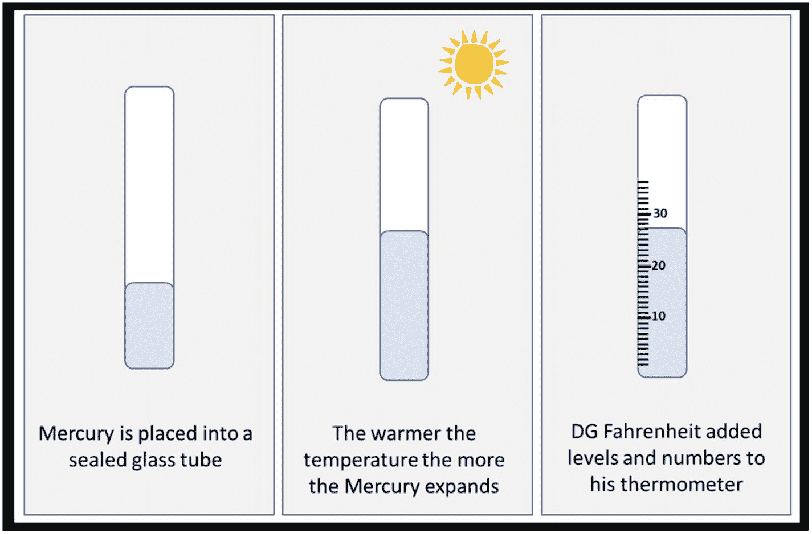
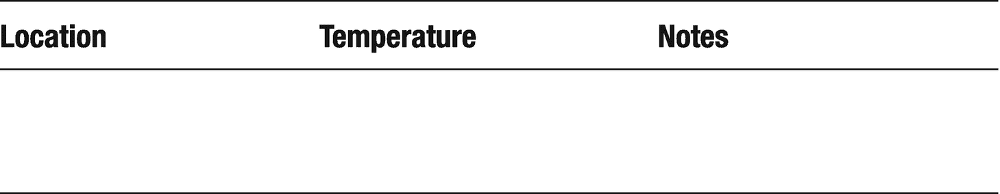

# 数据科学导论

新的一天开始了。闹钟响起，你一跃而起，准备迎接这个世界。你浏览一下天气预报，选好要穿的衣服，匆忙吃几口早餐——也许是泡着牛奶的麦片。你可能会查看一下交通状况，然后相应地规划好去学校或上班的路线。

在你的一天开始之前，你已经与各种不同类型的数据打了交道——时间、天气预报、交通信息、体育赛事结果，甚至是你倒的麦片所需要的“适量”牛奶。所有这一切都由数据驱动。数据已经成为我们日常与世界互动的如此正常的一部分，以至于我们常常对其熟视无睹。我们是贪婪的数据消费者！

所有这些数据从何而来？如果我们是消费者，那谁是生产者，他们又是如何生产的？数据工厂在哪里？为什么我们应该相信某些数据而不相信其他数据？我们如何才能在使用这些应接不暇的数据时变得更明智？理解如何解读和利用数据，是当今数据驱动社会中的一项关键技能。

## 数据科学导论

千里之行，始于足下。在读完本书时，你将对构成理论和应用数据科学基础的概念有一个广泛而扎实的掌握，但第一步是确保这个目标被明确定义。什么是“数据科学”？

关于数据科学的准确定义存在争议。我们将采用最宽泛的定义，即：

*数据科学包括与收集、分析、解释和基于数据采取行动相关的活动。*

如果你数了冰箱里剩下的鸡蛋数量，并算出周几需要再买一些，那么你就完成了一项数据科学活动。或者，如果你估算食堂里还剩多少巧克力布丁，以及排在你前面有多少人，然后推断当你排到前面时是否还有布丁剩下……这又是数据科学！即使是老师在晨会点名，然后在下午再次点名并比较结果的活动，也具备基础数据科学的所有特征。

值得注意的是，许多人更严格地定义数据科学，并将其重点放在数据分析上；大多数被称为“数据科学家”的人主要工作在数据分析领域。例如，加州大学伯克利分校的数据科学教科书^(¹)告诉我们，数据科学“是关于通过探索、预测和推断，从庞大而多样的数据集中得出有用结论的学科。”它不涉及收集这些数据集的过程，也没有详细探讨如何将这些数据用于除进行预测之外的任何其他目的。我们先前采用的定义与伯克利或任何主张数据科学专注于数据分析的评论者并不矛盾。在本书中，我们将采取一个整体的视角，审视那些通向数据分析的活动。你将看到数据收集过程如何影响其分析：实验设计如何引入需要被理解和处理的偏差和因素。本书将向你展示，过程中的每一个环节都是相互关联的，理解这个过程将丰富你的分析。

简单来说，数据科学是将**数据**转化为**信息**的过程。**数据**和**信息**这两个词有其正式且截然不同的含义。我们将在**表格 [1-1]**(#486852_1_En_1_Chapter.xhtml#Tab1) 中说明它们。

**表 1-1** 突出显示数据与信息之间的区别

|   | 数据 | 信息 |
|---|------|-------------|
| 1 | **数据**是做蛋糕的原料，鸡蛋、糖、牛奶等。 | **信息**是切好的一块蛋糕。 |
| 2 | 如果你问 100 个人是否相信气候变化，你将得到 100 个**数据**单位。 | “99%的人认为气候变化问题需要得到解决”这个陈述是**信息**。 |
| 3 | **数据**是被收集或汇集的。 | **信息**来自对数据的分析。 |
| 4 | 一条**数据**读数描述了某事物的状态。 | **信息**是关于某事物的一个“事实” 。 |

## 使用温度

温度是最常见的数据度量之一，也是我们日常会接触到的。

即使我们没有查看天气预报，我们通常也能知道今天的气温大概是多少。我们使用温度测量来烹饪食物，并维持家和工作场所的空气在一个舒适的水平。当人们生病时，我们会测量他们的体温；当发动机温度过高时，我们知道出了问题。

我们在本章中使用温度，因为读者会对其有直观的理解：我们不需要试图解释温度是什么。但是，我们在本章以及全书将要讨论的概念，可以应用于任何数据集：也许你选择的数据是社交媒体点赞数或股市指标，也许是体育赛事结果和联赛排名，或是血细胞中的病毒数量，或是你最喜欢的咖喱店的咖喱辣度。数据科学的原理适用于各种各样的数据。

## 测量温度

大多数人类（但不是全部）能感知温度：我们能感受到夏天火辣辣的太阳，我们的感官会告诉我们极热和极寒的危险。我们对温度有着非常丰富的主观体验，并且常常对此有强烈的看法。

第一个客观测量温度的工具是由丹尼尔·加布里埃尔·华伦海特于 1714 年发明的。他基于水银的温度计工作原理非常简单，如**图 [1-1]**(#486852_1_En_1_Chapter.xhtml#Fig1) 所示。

**图 1-1** 封闭玻璃容器中的水银对温度做出反应

**警告**

还有其他制作温度计的方法——你甚至可以用水和食用色素自己制作一个。水银特别有效，但它也是一种对人体和环境都有毒性的有害元素。在世界许多国家，医院和学校等场所禁止使用水银温度计。对人体的危害来自吸入水银蒸气，因此如果水银温度计破裂，你需要非常小心地处理。酒精是水银最常见的替代品，但无论我们在温度计中放入什么物质，其工作原理都是相同的。

当华伦海特发明温度计时，他也引入了一个标准温标——华氏度——这在当时被广泛使用，并沿用至今。此后，又引入了其他温标，其中摄氏度（百分温标）和开尔文最为常见，也是数据科学家偏好的温标。

为了完成本章中的练习，你需要获取一个或多个温度计——最好是模拟式的，但任何类型都可以。我们将使用摄氏温标，其中 0 度是水的冰点，100 度是水的沸点。

## 1.4 控制数据

在本节中，我们将开始设计一个实验，以调查你家、学校（或类似感兴趣地点）周围不同位置的温度。表面上看，这似乎是一个简单的任务，但我们会花些时间探讨如何确保我们的实验设计具有高质量。

收集数据需要四处走动，在不同位置读取温度值。简单来说，流程如下：

1.  准备好一份地点清单和一支温度计。
2.  步行至指定地点。
3.  查看温度计。
4.  记录温度。
5.  返回步骤 2 并重复，直到测量完所有地点。

这个计划很简单，但存在缺陷。**练习 1-1**（如**表 1-2** 所述）将表明，当我们测量单一位置的温度时，还有其他因素会影响读数。我们将进行一项快速活动，以帮助识别这些**无关变量**。

**无关变量**是指那些影响我们收集到的数据，但与我们所关注的事物无关的因素。理想的做法是将它们从我们的实验中排除。

**表 1-2** 温度实验活动指南

| 练习 1-1 | 控制无关变量 |
| --- | --- |
| 摘要 | 演示无关变量如何影响我们的读数，以及控制这些变量的方法。同时，这也为我们进行练习 1-2 做好准备。 |
| 时长 | 5–10 分钟 |
| 分步流程 | 1. 在单个房间内的 2 个不同位置测量温度。 2. 这些数值是否存在差异？如果存在，原因是什么？ 3. 重复测量：再次测量，但遵循“附加说明”部分概述的指南。 4. 如果你在第一轮测量中发现了差异，现在是否还有类似的差异？ 5. 思考两种方法的差异——第二种方法付出的额外努力是否值得？ |
| 附加说明 | 第二次读取温度计（步骤 3 中）时，请遵循以下流程： • 找一个平整的木质表面，该表面应避免阳光直射，且不要紧邻阳光直射处。该位置应远离气流，且不在任何角落。 • 将温度计平放在平整的表面上，确保刻度清晰可见。 • 后退一步，等待 30 秒。 • 30 秒后，在不触碰温度计或对着它呼吸的情况下读取温度。 |
| 我们将学到什么 | 无关变量的影响。“马虎”的数据收集过程如何导致不可靠的数据。识别和控制无关变量的价值，以及误差幅度如何显现。人类如何对科学产生影响。 |

前面的活动很可能会显示出差异——不同的温度读数。在一个封闭的房间里，这怎么可能呢？房间里的温度肯定是稳定的，那么为什么读数不全都一样呢？有许多因素可能导致这些差异，例如：

*   将温度计置于阳光直射下，会比放在阴凉处得到更高的读数。
*   用手握住温度计会传递一些热量给它，从而改变读数。
*   由于空气流动和热源（例如人）的密度不同，某些房间的不同区域自然会偏暖/偏冷。
*   空气源——例如强风、风扇或空调——会影响读数。
*   不同的温度计可能校准方式不同，或者难以读取。

通过详细规定读取温度计的过程（正如我们在活动的“附加说明”部分所做的那样），我们通过在所有测量中保持这些流程的一致，减少了无关变量的影响。用数据科学的术语来说，我们**控制**了这些变量。有些数据科学家可能会说，我们消除了数据中的一些“噪音”。

## 1.5 理解工具

在本书中，我们将使用越来越复杂的工具来测量各种不同的数据类型。即使是使用简单的水银温度计，准确理解你的工具在测量什么也很重要。

温度计读取的是**环境**温度——即温度计紧邻区域的温度。对于这个实验，我们希望测量某个位置（例如一个房间）的温度，但我们实际测量的是温度计周围有限区域内的温度。

理解测量工具的工作原理，使我们能够识别可能影响读数、进而影响数据质量的因素。我们的温度计测量的是环境温度，而不是房间的温度；我们需要留意那些可能使环境温度与室温产生差异的因素。我们需要确保我们实际测量的那一小片空间区域，能够代表我们感兴趣的更大空间。我们可以利用这些知识来设计能提供更高质量数据的数据收集策略。

## 1.6 数据质量

我们收集数据是为了使用，不言而喻，在其他条件相同的情况下，高质量的数据比低质量的数据更有用。GIGO：垃圾进，垃圾出。但是，是什么让一组数据比另一组数据“质量更高”呢？

为了判断数据质量，我们关注其**有效性**和**可靠性**。

数据的**有效性**指的是它衡量我们想要衡量的内容的程度。我们试图测量某个地点的温度，但实际上我们测量的是温度计周围的温度。说我们记录的温度读数适用于测量地点，这有效吗？

**可靠**的数据是可以复制的。因此，如果几个人同时在同一地点测量温度，我们期望他们都得到相同的结果。如果出现这种情况，我们就说数据是可靠的。

当我们知道两个数据点既**可靠**又**有效**时，我们就可以将它们与其他同样可靠和有效的数据进行比较，并对我们做出的任何观察抱有信心。所以，如果我在英国我的办公桌上测量温度为 25 度，而一位宇航员在国际空间站（ISS）上测量温度为 23 度，那么我就可以相当确定我的办公桌比国际空间站更暖和。

如果我们不控制无关变量，那么我们的数据就不那么有效和可靠。这是否意味着它毫无用处？在现实世界的实验中，并非所有无关变量都能被控制。为了进行现实世界的实验，数据科学家们想出了巧妙的技术，甚至能从低质量数据中提取有价值的见解。诀窍在于识别和理解那些影响我们数据的无关变量，然后在分析数据时对它们的影响进行修正。请看以下示例：

可追溯到 19 世纪的温度记录被用来进行比较，以帮助提供无可辩驳的气候变化证据。多年来，测量设备已被更换，甚至可能改变或升级，而进行测量的地点要么完全改变，要么周围环境已大不相同。所有这些因素都可能对测量结果产生一些影响——它们就是无关变量，并且完全控制这些变量是不可能的。为了处理这种情况，数据科学家使用所谓的**误差范围**，这是对其数据**可靠性**的一种估计。因此，如果温度计读数为 20 度，误差范围为 2，数据科学家就会明白实际温度很可能在 18 度到 22 度之间。

我们已经讨论了如何使用温度计收集高质量数据，但在开展第一个实验之前，让我们快速了解一下如何捕获（或记录）这些数据。

## 1.7 数据捕获

我们计划进行的实验需要记录多个不同的温度值。鉴于人类记忆的特性，每次读取时记下读数是有意义的。

这个记录或写下数据读数的过程被称为**捕获**或**收集**数据。记录数据的方法有很多，但标准方法是使用**数据表**。

你可能已经熟悉以表格形式呈现信息的概念：本书中我们已经使用过几个表格。**表** **1-3** 概述了数据表的关键特征。

**表 1-3** 数据表的关键特征

| 特征 | 描述 | 对或错 |
| --- | --- | --- |
| 1 | 表格由列和行组成。 | 对 |
| 2 | 行与列交叉处，每个矩形称为一个单元格。本段文字就在一个单元格内。 | 对 |
| 3 | 在数据科学中，我们通常在每个单元格中以数字形式写入数据。但我们也像这里一样，将文本放入表格中。 | 对 |
| 4 | 通常表格有若干列，每列用于不同类型的数据，就像这个表格一样。 | 对 |
| 5 | 表格通常行数多于列数。 | 对 |
| 6 | 当你收集的数据越来越多时，你就在表格中不断增加行。只有当你开始收集新类型的数据时，你才添加列。 | 对 |
| 7 | 当你有一些相关联的数据时，例如位置名称和该位置的温度，你应将它们添加到同一行。 | 对 |
| 8 | 如果你知道如何使用表格，你就掌握了阅读本书所需的全部表格知识。 | 对 |

对于上表，问自己两个问题：

1.  **你能否理解信息的呈现方式？** 如果可以，说明你的表格知识足以继续本章的学习。

2.  **你是否好奇第一列和第三列的作用？** 如果是，观察力不错——它们毫无用处——你的表格知识足以继续本章的学习。

表格是一种难以解释但大多数人都会使用的东西。现在，我们只需要将数据捕获到表格中。在下一节的练习中，我们将使用一个包含三列的数据表：

1.  **位置** – 在此列中写下位置的名称。

2.  **温度** – 在此列中写下温度。

3.  **备注** – 使用“备注”列写下可能与实验相关的观察结果。

画一个表格来捕获数据。预留大约 12 行，并尝试选择多样化的位置——我们希望数据有一定的变化。**表** **1-4** 展示了它的样子。

***表 1-4.*** *练习 1-2 的空白数据捕获表*

使用表格时，在左列写下位置名称，然后在中间列写下该位置的温度。“备注”列用于记下可能对实验有价值的观察结果，某些位置可以留空。表 1-5 展示了一个填写完毕的表格可能的样子。

**表 1-5** 练习 1-2 中填写完毕的表示例

| 位置 | 温度 | 备注 |
| --- | --- | --- |
| 员工休息室 | 22.5 | 空调效果极佳，配有大型舒适沙发 |
| 食堂 | 24 | 找不到平坦的木质表面放置温度计 |
| 图书馆 | 20.5 | 有空调 |
| 操场上的大树旁 | 16 | 当天多云 |
| 史密斯女士的教室 | 22.5 | 教室朝向学校向阳的一侧 |
| 科恩女士的教室 | 22 | |
| 恩科莫先生的教室 | 21 | 教室里有三台风扇在吹 |

## 1.8 温度实验

在本节中，我们将开展一项活动，在多个地点采集温度数据；随后在下一节中，我们将分析所采集的数据。我们将整个过程称为一次实验。

本节概述了我们的实验设计，即我们将遵循的一系列操作指南和规则。我们之前已了解到，数据的有效性和可靠性至关重要——清晰且规划周密的实验设计有助于我们控制一些外部变量，从而获得更可靠、更有效的数据。

我们建议你在室内和室外的多个不同地点读取温度读数。理想的结果是获得大约十几个读数，并确保结果之间存在合理的差异范围。

如果你无法访问多个地点，另一种替代方案是在同一地点的不同时间读取温度读数，或者使用医用温度计测量不同植物周围土壤的温度。你甚至可以用其他类型的数据来进行这项练习——用紫外线强度、二氧化碳浓度或任何你能测量且感兴趣的数据来替代温度（`表 1-6`）。

**表 1-6 练习 1-2 概述**

| 练习 1-2 | 比较不同地点的温度 |
| --- | --- |
| 摘要 | 将测量并记录多个不同地点的温度；随后分析这些数据。我们将分析结果以及此项活动的实验设计质量。 |
| 时长 | 30 分钟 |
| 准备 | • 收集一些温度计——它们不必完美，存在偏差和数据问题是可以接受的。• 准备一份地点清单。选择那些温度可能存在一些差异的地点——如果可能，应包括室内和室外。• 绘制一个数据表格用于记录数据。写下地点名称，并添加任何可能有价值的备注（例如，识别外部变量）。 |
| 分步流程 | 1. 访问每个指定地点。2. 按照以下“附加说明”中的指南读取温度计。3. 在每个地点记录温度。4. 返回步骤 1 并重复，直到所有地点都测量完毕。5. 收集完所有数据后，继续学习第 1.9 节，并回答该节列出的问题与主题。 |
| 附加说明 | 读取温度计时，请遵循以下步骤：• 找一个平坦的木质表面，该表面应避免阳光直射，且不紧邻直射区域。该位置应远离微风，且不在任何角落。• 将温度计放在平坦表面上，确保刻度清晰可见。• 后退一步，等待 30 秒。• 30 秒后，在不触碰温度计或对着它呼吸的情况下读取温度。 |
| 我们将学到什么 | 数据收集过程会很有趣，但略显繁琐：人的时间是宝贵的。这是推动使用数字工具的关键因素，我们将在下一章介绍这些工具。参与者将通过回答下一节列出的问题与主题来对数据进行分析——他们将看到，对数据提出问题如何能提供有趣且独特的信息。 |

## 1.9 分析结果

我们现在有了一张根据我们制定的计划谨慎收集的数据表格，该计划的目的是尽可能确保数据的可靠性和有效性。这些数据可能并不完美，但可以公平地说，与没有制定计划相比，大多数人对这些数据的信任度会稍高一些。

这张表格是一个原始数据集——刚刚收集完毕，随时可用于分析。与其试图定义什么是分析，不如让我们直接动手分析！

我们将审视我们的数据集，看看能从中提取出哪些信息。我们将尝试用有意义的英文句子来描述数据：将数据表格转化为对话片段。例如：

- “学校里最热的地方是……”
- “如果你想凉快一下，就去坐……。”
- “数据收集方法在此方面存在缺陷……”

数据分析既是科学，也是艺术：

- 科学部分包括多年来发展起来的工具和技术，我们将在本书后面部分探讨其中一些内容。
- 艺术部分则是充满好奇心的人类思维，思考有趣的问题，并审视数据集是否包含有助于回答这些问题的洞察。

可以稳妥地说，数据分析中最重要的单一要素是人的好奇心。

对于刚刚收集到的数据集，你现在应该提出并尝试回答下面列出的问题。将答案整理成陈述句，用平实的语言表达，可以用于日常对话、电子邮件或社交媒体更新中。留意任何听起来有趣的内容。

我们无法直接为你提供这些问题的答案：想象一下在盛夏的斯里兰卡、冬季的冰岛或你所在的社区使用本书。不同地方的答案会各不相同——你将在完全独特的数据集上工作，你的结论将是原创的。

问题按类别分组。

### 极值分析

几乎对于任何数据集，审视极值通常都能让我们学到一些东西。请提出这类问题：

- 最热的地点在哪里？
- 最冷的地点在哪里？
- 如果两者不同，原因是什么？是什么使得一个地点比另一个地点更暖或更冷？
- 温度的范围是多少？最热和最冷的地点差异有多大？我们能从中推断出什么？

### 平均值分析（集中趋势）

我们将在第 5 章更详细地探讨平均值。现在，请提问：

- 你所分析的学校/区域的平均温度是多少？
- 平均值的用处有多大？有多少地点的温度等于平均值？这真正告诉了我们什么？
- 如果我们认为平均值有用，它是在极值的中点，还是更接近其中之一？无论是哪种情况，这能告诉我们什么吗？

### 随机洞察

同时，通过提出以下问题来寻找数据中的洞察：

- 你能找出减少供暖/制冷开销的方法吗？风扇/暖气/空调是否安装在了最佳位置？
- 是否存在需要关注的问题地点？是否有某个特定区域让人感觉不舒适？
- 如果有多个让人感觉不舒适的地点，是否存在单一原因？
- 温度会影响行为吗？你会如何调查这一点？
- 你会去哪里吃冰淇淋，又会去哪里喝汤？

### 数据质量分析

我们应该始终质疑数据的质量：

- 我们的实验中哪些因素可能影响数据的可靠性？哪些可能影响其有效性？这会如何改变我们的答案？
- 我们在分析中得出的答案在逻辑上合理吗？它们讲得通吗？我们相信它们吗？
- 务必复核任何异常数据！许多研究人员会告诉你，看起来异常的数据通常很有趣，但对有趣数据的第一反应是检查是否存在错误。
- 如果你的实验包含两个或更多组，请检查不同组之间的数据有多相似？任何差异如何解释？
- 我们认为结果中存在误差范围吗？如果是，误差范围有多大？

