# 2. 数据科学走向数字化

本章我们将确定一套电子元件，并用它们构建一系列不同的数字工具。这些工具将用于收集数据，而数据是我们踏上数据科学之旅的关键燃料。

## 2.1 使其数字化

你是否知道，地球上的每一位青少年都出生于 21 世纪，即在互联网、电子邮件甚至谷歌诞生之后？如今成长的许多孩子从未体验过没有数字魔法的世界。我们生活在一个数字时代——它悄然降临在部分人身边，但越来越多的人一出生就身处其中。人们甚至将我们当前的时代称为数字时代或信息时代，这承认了信息已融入我们生活的方方面面。数字革命——用数字技术取代模拟技术——为现代社会奠定了基础。

尽管第 1 章中的模拟温度计表现良好，但要进一步学习数据科学，我们需要接触日益复杂的数据集：随着实验规模的扩大，我们将收集成百上千、甚至数百万个数据点。我们的模拟温度计已无法胜任此任务，其他模拟工具亦是如此。我们需要复杂的数字工具才能完成这一旅程。

## 2.2 数字测温

在第 1 章中，我们了解了模拟温度计的工作原理；数字温度计的基本原理与之相同。环境温度会导致某种物质发生反应、产生变化，而这种变化会以某种方式被观测到：

- 在模拟温度计中，水银的可见液面发生变化。
- 在数字工具中，该反应被转换为计算机（或微处理器）能够感知和解读的电信号。

图 2-1 展示了构成数字温度计的不同组件。这是一个非常基础的“电路图”或“框图”，其风格贯穿全书。

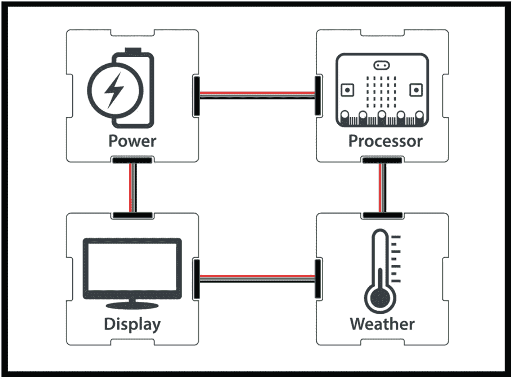

**图 2-1** 数字温度计的核心组件

任何数字温度计都包含以下组件：

1. **电源**：数字电路需要电力供应。
2. **微处理器**：其作用将在下文详细说明。
3. **温度传感器**：当电力供应给温度传感器时，它会对其周围的环境温度做出反应。传感器通过电路传输其状态数据，其作用与模拟温度计中的水银相同。
4. **输出温度数据的方式**：例如，在屏幕上显示。
5. **这些组件需要以某种方式连接起来**：连接组件的线路同样重要。

### 微处理器的作用

微处理器好比婴儿的大脑：潜力无限，但自身无法实际完成任何事。婴儿通过被教导来学习执行基本动作，而我们则通过将计算机程序加载到微处理器上来“教导”它执行基本动作。

微处理器是电路的“大脑”。电流在电路中流动，微处理器“监控”电流，解读其中编码的任何数据，然后据此做出行动。要充当温度计：

- 微处理器知道自己需要“监听”来自温度传感器的任何信号：它之所以知道，是因为有人——也许是我们——对它进行了相应“编程”。当接收到传感器的信号时，微处理器能够将该信号转换为一个可用的数据点：即温度读数。
- 微处理器也知道如何向屏幕发送信息以显示文字和数字：它之所以知道，同样是因为在程序中被告知了方法。它会向屏幕发送一个信号，使屏幕显示温度。有人——也许是我们——已经对微处理器进行了编程/告知，使其知道在屏幕上显示什么信息以及如何显示。

## 2.3 构建数字工具

我们真的需要学会构建数字工具才能成为数据科学家吗？在专业领域，数据科学家并不需要成为工具制造者：

- 有许多现成的产品可以满足您的数据收集需求。您可以购买气象监测仪、二氧化碳监测仪以及能显示温度的应用程序。
- 开展数据科学工作的团队可能拥有多个领域的专家，各自负责流程的不同部分：可能会有其他人负责构建数据收集工具。
- 您可以委托他人为您收集数据。许多企业会向您出售各种数据。或者使用在线工具。

本书是为那些无法使用上述方法的人编写的；我们将不得不自行收集数据，并构建所需的数据收集工具。

知道如何构建数字工具始终是一项有用的技能，但这显然不是数据科学的核心技能。数据科学领域涵盖众多学科：数据分析师、工具制造者、数据收集者、项目经理和实验设计师等。他们的贡献在数据科学流程中都发挥着作用。在本书中，我们只需学习足够的电路构建知识，以便能够构建探索数据科学所需的工具。我们将向您展示如何做到这一点，而无需先成为工程师：阅读本书并不需要任何电路构建（或计算机编程）的先前知识。

## 2.4 使用 BBC micro:bit 作为温度计

你知道吗，BBC `micro:bit` 内置了一个温度传感器？它使用起来非常简单，这意味着我们可以对 `micro:bit` 进行编程，让它像一个温度计一样工作，而这正是我们接下来要做的。

我们已经了解到，理解测量工具有助于我们理解它所产生的数据：

在制造 BBC `micro:bit` 时，主板上并没有配备温度传感器。直到设计完成后，一位工程师才意识到，`micro:bit` 上的某个芯片内置了热传感器，并且可以从中读取温度数据。类似的故事还有，有人发现 `LED` 矩阵的光敏特性也可以用作一个简易传感器。

要将 `micro:bit` 用作温度计，我们需要编写一些代码，然后将其复制（或烧录）到 `micro:bit` 上。我们构建的每一个数字工具都需要进行编码。

## 2.5 本书使用的编码指南

在整本书中，我们将构建越来越复杂的数字工具，以帮助我们发展数据科学技能，而每个工具都需要编写相应的代码。在编写工具代码时，我们始终会提供两种选择：

1. **免编码方案**：访问我们的资源网站（`http://xib.one/XB`），找到“第 X.Y 节”。你会看到一个可以下载并直接烧录到 `micro:bit` 上的 `hex` 文件。页面上有操作说明。在整本书中，我们都会为你提供“免编码”解决方案。

2. **你自己编码的方案**：在可能的情况下，我们将使用 Microsoft `MakeCode`，这是一个有趣且易于使用的积木式代码编辑器。当 `MakeCode` 无法提供所需功能时，我们会使用 `MicroPython`。我们将使用 `Mu` 编辑器进行 `MicroPython` 编码。

如果你选择自己编写代码，我们会首先向你展示自然语言代码：这是一种用自然语言编写的、实现目标所需过程的逐步描述。然后，我们会向你展示所需的 `MakeCode` 积木（或 `MicroPython` 代码），用于将自然语言代码转换为能在你的 `micro:bit` 上运行的实际代码。这种方法使得代码更容易适应不同的硬件平台或不同的编程语言：自然语言代码充当了一个简单但充分的软件规范。

## 2.6 使用 micro:bit 代码编辑器

如果你选择自己编写代码，那么你需要选择一个代码编辑器。BBC `micro:bit` 有几种选择；我们将提供 `MakeCode` 和 `Mu`（`MicroPython`）的指南。

本书的目的不是向你介绍如何在 BBC `micro:bit` 上编码——有很多优秀的书籍可以供你学习。但对于那些刚接触 BBC `micro:bit` 编码的人来说，有几个关键主题是你需要理解的。你可以通过我们的资源网站（`http://xib.one/XB`）上的链接来阅读相关资料。

## 2.7 使用“免编码”方案

并非每个需要使用气象站的人都想亲自为其编写代码。在某些情况下，编码是一项重要技能，而在其他情况下则无关紧要：在计算机科学课上和在地理课上搭建气象站，其方法会截然不同，也会带来非常不同的学习成果。当然，本书的重点是数据科学：我们构建的工具以及为它们编写的代码只是辅助手段——我们需要它们来恰当地讲述数据科学的故事，但它们并非故事的主角。

免编码方案，加上本章后面描述的易于搭建的组件系统，将让你在几分钟内就能让你的数字工具启动并运行。你只需要按照描述构建工具，然后从提供的网址下载代码即可。

并且，不要认为这是在作弊！你买新冰箱时不会去编程，你开车前也不必给汽车编写代码。那么，为什么你就一定要给一个数据采集工具编程呢？

## 2.8 为 micro:bit 温度计编程

现在我们将构建自己的 `micro:bit` 温度计。

这个电路非常简单——只需要一个 `micro:bit` 和一个电源（图 2-2）。我们不需要任何额外组件，因为我们将使用 `micro:bit` 的板载温度传感器和 5x5 `LED` 矩阵来显示温度。

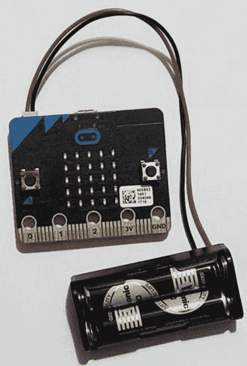

**图 2-2**  
`micro:bit` 温度计——仅需一个 `micro:bit` 和一个电源（2xAAA 电池组）

有多种方式可以为你的 `micro:bit` 供电，最常见的有：

1.  你可以用 `USB` 线将 `micro:bit` 连接到 `USB` 插座上。
2.  你可以将 `micro:bit` 附带的 2xAAA 电池组插入可用的连接端口。

关于此的更多详细信息，请参见我们的**资源网站**（[`http://xib.one/XB`](https://nam12.safelinks.protection.outlook.com/?url%253Dhttp%253A%252F%252Fxib.one%252FXB%2526data%253D02%257C01%257C%257C96ee9c32c458423e9b6a08d7c36cd73f%257C84df9e7fe9f640afb435aaaaaaaaaaaa%257C1%257C0%257C637192744542720716%2526sdata%253D0W1OfWTmIx3U20MIwolvjFvh9lCQJVpw9KNNvUwCdU8%253D%2526reserved%253D0)）。我们将构建的许多数字工具需要便携，因此你应确保手头有 `micro:bit` 电池组和一些电池。

我们需要编写代码来告诉 `micro:bit` 如何充当温度计：图 2-3 展示了相应的“自然语言代码”。

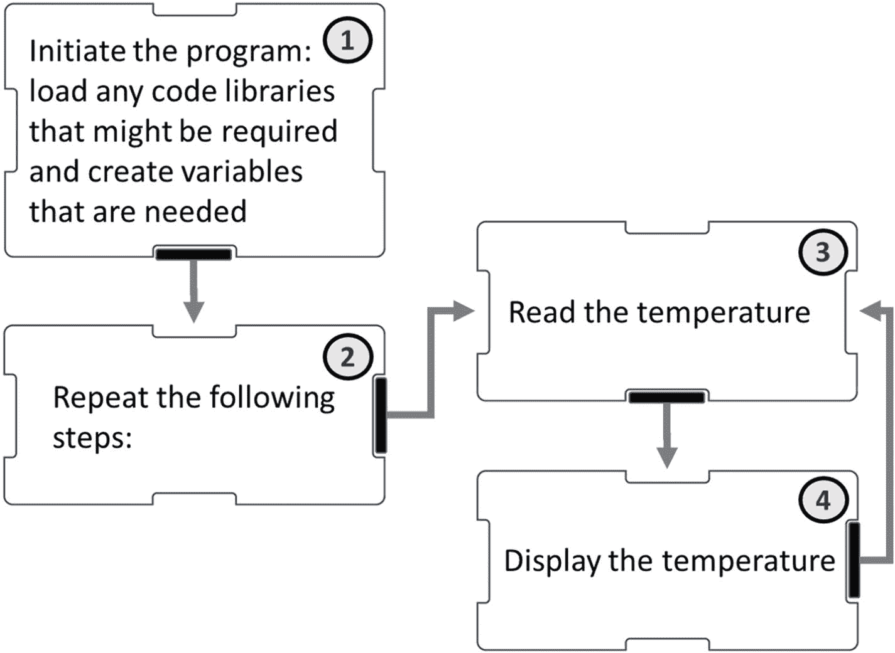

**图 2-3**  
数字温度计的自然语言代码

**无代码选项**：你可以在我们的**资源网站**上找到本节所需代码的预编译版本。前往[`http://xib.one/XB`](https://nam12.safelinks.protection.outlook.com/?url%253Dhttp%253A%252F%252Fxib.one%252FXB%2526data%253D02%257C01%257C%257C96ee9c32c458423e9b6a08d7c36cd73f%257C84df9e7fe9f640afb435aaaaaaaaaaaa%257C1%257C0%257C637192744542720716%2526sdata%253D0W1OfWTmIx3U20MIwolvjFvh9lCQJVpw9KNNvUwCdU8%253D%2526reserved%253D0)并搜索**第 2.8 节**。

表 2-1 展示了如何将前面的**自然语言代码**转换为可编译并加载到 `micro:bit` 上的 `MakeCode` 积木。

**表 2-1**  
使用 `MakeCode` 积木开发代码

| 步骤 | MakeCode 操作 | 说明 |
| --- | --- | --- |
| 1 | 打开 `MakeCode` 并开始一个新项目。 | `MakeCode` 会自动导入 `micro:bit` 核心库。 |
| 2 | 确保你的项目中有一个 `forever` 循环：  | 放在 `forever` 循环内的代码会反复运行。新项目默认会预载一个 `forever` 循环。 |
| 3 和 4 | 将以下积木添加到 `forever` 循环中： 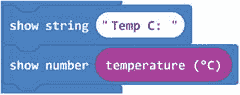 | 第一个积木会让 `"Temp C:"` 在 `micro:bit` 的 `LED` 上滚动显示。第二个积木会让温度值在 `micro:bit` 的 `LED` 上滚动显示。 |

图 2-4 展示了 `micro:bit` 温度计的完整 `MakeCode` 程序。

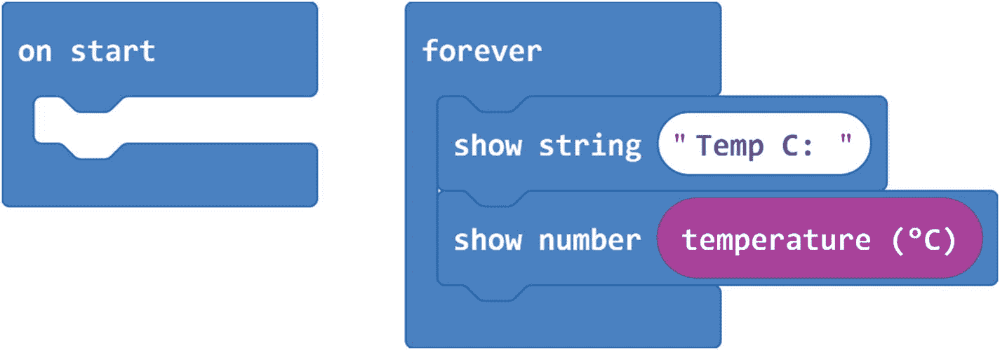

**图 2-4**  
`micro:bit` 温度计的 `MakeCode` 积木

代码编写完成后，你只需编译并将其下载（“烧录”）到你的 `micro:bit` 上。如果你不确定如何操作，请查看我们的**资源网站**（[`http://xib.one/XB`](https://nam12.safelinks.protection.outlook.com/?url%253Dhttp%253A%252F%252Fxib.one%252FXB%2526data%253D02%257C01%257C%257C96ee9c32c458423e9b6a08d7c36cd73f%257C84df9e7fe9f640afb435aaaaaaaaaaaa%257C1%257C0%257C637192744542720716%2526sdata%253D0W1OfWTmIx3U20MIwolvjFvh9lCQJVpw9KNNvUwCdU8%253D%2526reserved%253D0)）。

烧录过程完成后，以摄氏度为单位的温度将显示在 5x5 `LED` 矩阵上，并持续滚动。输出效果大致如图 2-5 所示。

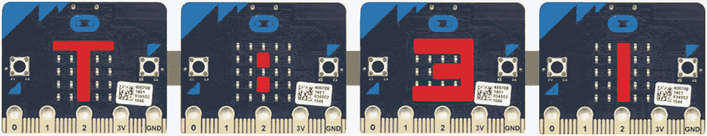

**图 2-5**  
温度读数在 `micro:bit` 上从右向左滚动显示。每个 `micro:bit` 图像代表输出的一帧。

我们上传到 `micro:bit` 上的代码告诉它如何像一个数字温度计一样工作。我们已经构建了第一个数字工具；现在该使用它了。

## 2.9 比较模拟温度计和数字温度计

我们将进行一个快速练习，如表 2-2 所述，同时用 `micro:bit` 和一个模拟温度计读取温度，然后比较结果。

**表 2-2**  
练习 2-1 的详细信息

| 练习 2-1 | 房间里的温度是多少？ |
| --- | --- |
| 概述 | 我们使用不同的工具测量房间内的温度，理想情况下由多个不同的人读取。数值会有所不同：`micro:bit` 的温度传感器几乎总是读取到比空气更高的温度，因此其读数很可能高于模拟读数。本练习旨在揭示关于数据质量和所用工具的见解，同时引入数据聚合的概念。我们如何才能将所有不同的结果整合成一个单一的度量：房间里*到底*是多少度？ |
| 时长 | 10–15 分钟 |
| 分步流程 | 1. 获取至少 1 个 `micro:bit` 温度计和一个模拟温度计。 2. 在房间内的不同位置读取两个设备的温度，并将其记录在表格中。 3. 当发现差异时，思考可能的原因。 4. 收集完数据后，完成**第 2.9 节**中列出的要点。 |
| 学习内容 | 我们应用所学到的关于数据质量的知识来分析结果，并尝试理解差异。通过试图就房间温度达成一致，我们初步了解了数据聚合和范围的概念。同时，我们还学习了如何使用设计的 `micro:bit` 工具来收集数据。 |

## 2.10 分析

在后面的章节中，我们将探讨一些可用于增强分析能力的工具。但分析总是始于好奇心——通常始于诸如此类的问题：

“我所在社区的空气质量很差吗？”

“这个湖的水位是否在逐年下降？”

“到月球的距离有多远？”

请完成以下各节中的主题。

### 极值分析

查看 `micro:bit` 和模拟温度计读数的最大值和最小值。**极差** 是最大值和最小值之间的差值。哪个工具拥有最大的极差，为什么？这告诉我们什么，它有什么启示？极差是大好还是小好？为什么？所有这些都回到了数据的可靠性/有效性上。

较大的极差可能仅仅反映了房间内不同区域温度不同。但总体来说，较小的极差可能意味着更高的精度——如果整个房间温度稳定，那么精确的温度计读数范围就会很紧凑。

但我们的 `micro:bit` 还涉及另一个因素：它们的温度传感器测量的是其所在芯片的工作温度，这通常高于室温。因此，它们**可能**会显示更小的极差，但这也许是因为它们对环境温度的敏感度较低。

### 平均值分析：“集中趋势”

对于*这个房间的温度是多少？*这一问题，是否真的存在一个完美且正确的答案？如果有，房间的哪些部分恰好是那个温度？我们会选择哪一个单一数值来描述这个房间的温度？平均值是对大量数字集合的一种便捷且有用的概括。

### 数据质量分析

我们的某个温度计是对的吗？还是其中一个比另一个更准确？记住要将这一点与工具实际测量的内容联系起来。

**两者**相对于它们所测量的对象来说都是正确的——如果存在误差，那是因为我们进行了**外推**。当我们进行外推时，我们取一个有意义的值并将其应用于其他事物。

因此，当我们取一个适用于房间中非常小体积的温度值，并将其应用于整个房间时，我们就对数据进行了外推。外推可能会影响数据的有效性：外推得越多，数据失去有效性的风险就越大。

### 内省

如果我们要重复这个练习，有哪些地方可以改进？

对于之前的问题，确实没有绝对的对错之分；这个练习的价值在于提问和讨论——养成对数据集提出大量问题的习惯。这是数据分析阶段的核心。

数据分析确实会变得更加规范化。专业的数据分析工具非常复杂，支撑它的数学理论既精妙又繁复。但无论你使用什么工具，数据分析都意味着提出问题，然后找到答案。对数据科学家来说，一组数据就像一盒未拆封的巧克力，是一种有待探索和发现的乐趣。但首先，一定要先检查配料表！

## 2.11 为什么选择 `micro:bit`？

在前一节中，模拟温度计可能使用起来稍微简单一些，而且很可能也更精确一点；如果我们只是想测量温度，那么没有迫切的理由要改用 `micro:bit`。

展望未来，我们将坚持使用数字工具：数字意味着我们可以接触到大量的硬件、软件和知识，在我们的数据科学实验中能够有效地利用它们。

想象一下，构建一个能够读取花粉水平，然后在你四处走动时将其实时上传到追踪该水平的网站上的工具。如果水平过高，就添加一个警示灯，让几十个人同时使用它，并实时更新你的路线，带你经过最不可能引发你过敏的区域。这就是应用数据科学，正是这种能够做这类酷炫事情的承诺，让我们坚持使用数字工具。

BBC `micro:bit` 可能不是一个很出色的温度计，但它在很多方面满足了我们对微处理器的需求：
*   它是一个非常易于使用的微处理器——比市面上任何其他选择都更加用户友好。
*   编码编辑器非常易于使用。
*   很多人已经拥有它（流通量接近 500 万），而且还在持续生产。它是一个不断发展的平台，尤其是在教育领域。
*   它得到了很好的支持——有大量的资料和帮助。
*   它还有一些酷炫的元素：来自神秘博士的创造者，BBC `micro:bit` 登场！

我们将在本书中全程使用 BBC `micro:bit`，但在列出硬件需求时，我们也会推荐替代方案。你也可以使用手头的 `Circuit Playground`、`Raspberry Pi` 或 `Arduino` 设备，同样可以轻松地阅读本书。

不过，BBC `micro:bit` 本身并不能满足我们所有的需求——我们在本章中的经验已经揭示了一些缺点：
*   它包含一个温度传感器，以及一个磁力计和一个加速度计，但没有其他环境传感器。我们需要访问更广泛的传感器组，以便收集有趣的数据。
*   5x5 的 LED 矩阵不太适合读取大量数据。在某些时候，我们将需要其他方法来从 `micro:bit` 中提取数据。

我们将转向数字化，并将使用 BBC `micro:bit` 作为我们数字工具包中的微处理器。我们还需要用其他一些套件来增强它，以收集我们所需的所有数据。

## 2.12 我们需要什么套件？

每个数字测量设备都有一些共同特征：它们都由相同的基本组件构成。在本书中，当我们描述如何构建设备时，将使用诸如图 2-1（如前所示）和图 2-6 这样的电路/框图来向您展示所包含的硬件组件。使用这些电路/框图，你可以利用手头的任何硬件来构建你的工具/仪器。图 2-6 展示了一个由七个组件构建的电路示例。

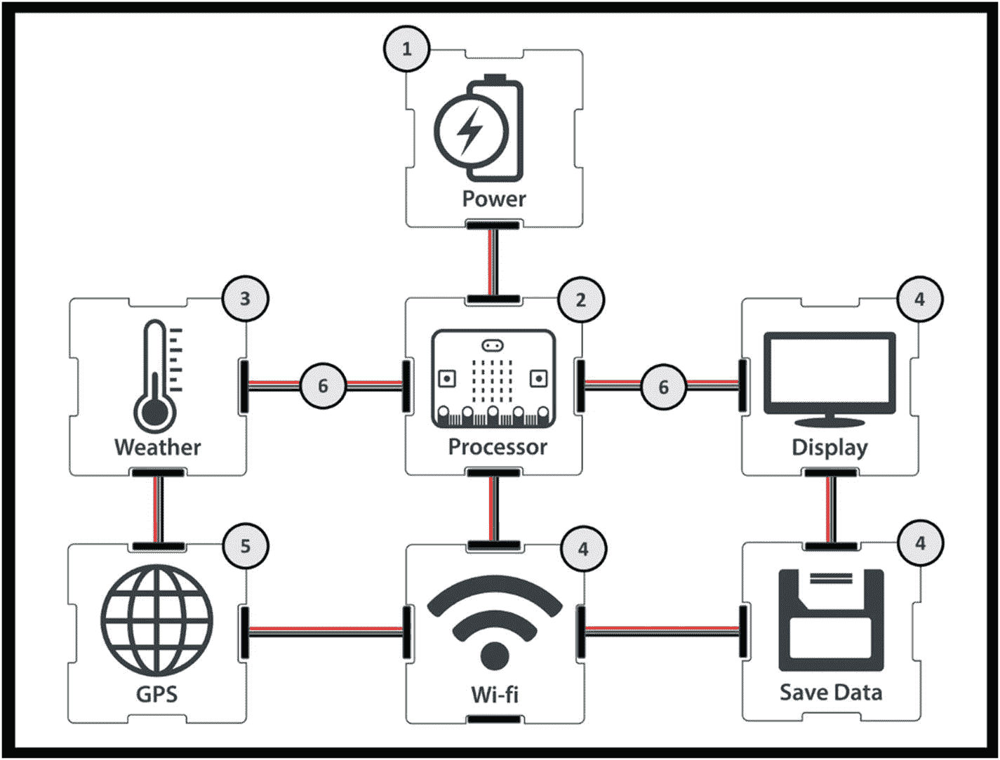

**图 2-6** 一个复杂数字工具组件的简单示意图

我们在本书中构建的工具将包含以下大部分组件：
1.  **电源**：我们将使用随 `micro:bit` 附带的 2xAAA 电池盒或 USB 线缆供电。
2.  **微处理器**：我们将使用 BBC `micro:bit`。
3.  **一个或多个传感器**：用于测量事物的传感器。市面上有大量数字传感器可供选择，到本书结束时，你应该有足够的信心找到特定传感器并使用它来创建数字测量工具。
4.  **多种数据输出方式**：图中展示使用了 `OLED` 显示屏、文件系统和 `Wi-Fi` —— 三种不同的方式来访问从传感器收集的数据。
5.  其他**酷炫部件**：如 `GPS` 或执行器（用于移动或控制事物：例如启动电机或打开灯光）。
6.  **连接所有部件的方式**：当所有部件连接起来后，我们就得到了一个**“电路”**。各组件连接的方式是电路的关键要素，通常并不简单。

图 2-5 中所示的仪器将构成一个出色的天气监测工具。`GPS` 模块允许我们对结果进行**地理标记**，以识别读取数据的位置。`Wi-Fi` 模块将用于将数据从仪器上传到`物联网`（`IoT`）平台，同时也允许我们获取实时时间，用于为数据添加**时间戳**（即记录数据读取的时间）。数据会本地保存到存储卡上，以防 `Wi-Fi` 连接中断。我们需要一个能够让我们构建这种复杂程度的数据采集仪器的工具包。

## 2.13 选择我们的工具包

大多数电子产品零售商都会储备我们所需的组件：只需在谷歌上搜索一下，就能制作出一些非常酷且独一无二的工具。

但除非你熟悉微电脑领域，否则琳琅满目的选项会让人望而生畏。从初学者到资深制作者，以下问题总让购物变得有些压力：
-   我们怎么知道该买哪些？市场上有几十种二氧化碳传感器——哪些适合我们的需求？
-   我们如何确保买来的零件能协同工作？所有组件都**兼容**吗？正确的电压是多少，电压又到底是什么？它们都讲同一种二进制语言，还是有方言？我是剪红线还是绿线？
-   一个相关的挑战是**连接性**——这些组件实际上是如何组装在一起的？我们该如何把它们连接起来？

为了避免这类担忧，也为了省去学习电路知识的必要，我们将使用 **XinaBox** 系列的组件来补充我们的 BBC `micro:bit`。该系列在多个方面满足我们的需求：
-   它与 `micro:bit` 兼容，并且可以通过 `MakeCode` 和 `MicroPython` 轻松编程。
-   组件可以通过连接器连接——我们可以像搭乐高一样轻松地搭建电路。无需学习任何电路搭建知识。
-   它提供了本书中所需的所有组件。
-   将组件“**映射**”到我们的需求很简单。想增加 `Wi-Fi`？有对应的 `xChip`。`LoRa`、`GPS` 或蓝牙？也有对应的 `xChip`。需要测量紫外线、运动或二氧化碳水平的传感器？同样有对应的 `xChip`。而且它们都以相同的方式连接。

使用这个系统能让我们专注于数据科学的核心技能——我们不需要花大量时间学习如何使用烙铁、面包板和导线来搭建复杂电路。那虽然很有趣，也是一项很棒的技能，但并非本书的重点。

图 2-7 展示了一个安装在 **IM01 桥接板** 上的 `micro:bit`。

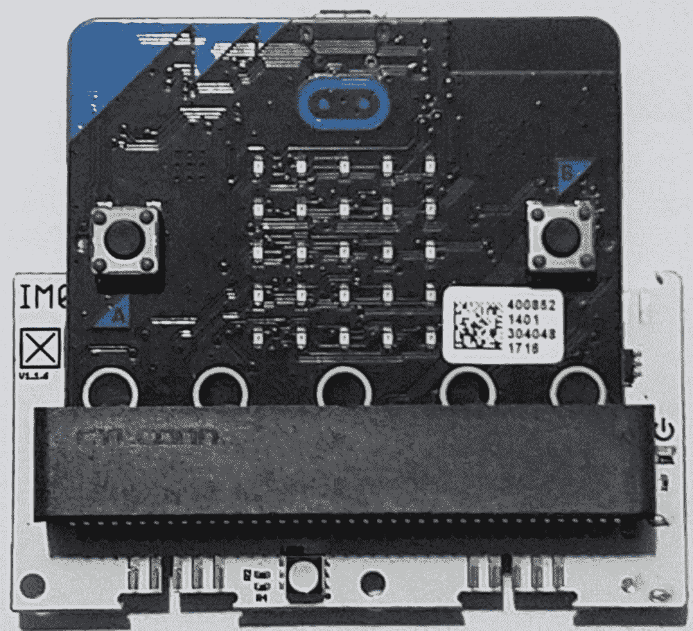

图 2-7

`micro:bit` 可以轻松滑入 XinaBox `IM01` 桥接板

图 2-8 和 2-9 展示了两个 **xChip** 连接在一起的情形。ID 清晰可见（左侧为 `OD01`，右侧为 `SW01`）。

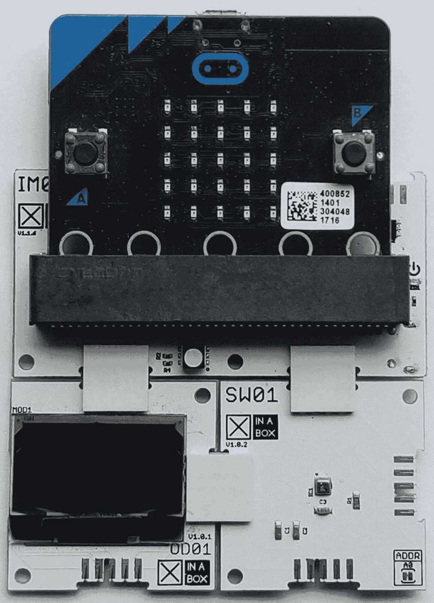

图 2-9

将 `xChips` 夹到桥接板上，你就构建好了一个数字工具

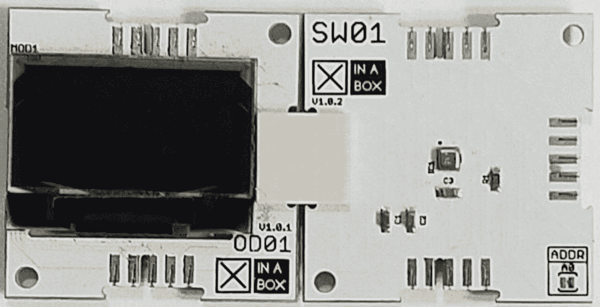

图 2-8

使用 `xBus` 连接器，`xChips` 可以轻松地夹在一起。只需确保 ID 始终朝上即可

对于那些不使用 `micro:bit` 或没有 XinaBox 套件的用户，请注意：
-   尽管每项活动都使用 `micro:bit` 和 XinaBox 套件解决，但我们会提供替代的硬件方案，其自然语言代码应易于适配。
-   活动中的硬件是以通用方式描述的——如果你能搭建所描述的电路，无论使用何种系统，都应该能跟上本书的内容。

## 2.14 硬件要求指南

在本书中，我们将进行一系列越来越复杂的实验。每个实验都需要我们收集数据，并且我们需要构建一个工具来完成这项工作。我们将在“硬件要求”部分定义该工具所需的组件，其中将包含以下细节：

表 2-3

硬件要求组件列表表示例

| 我们需要什么 | 我们将使用什么 | 替代硬件 |
| --- | --- | --- |
| 电源 | `micro:bit` 2xAAA 电池组 | USB 数据线 |
| 微处理器 | `micro:bit` | Adafruit `Circuit Playground` |
| 天气传感器 | XinaBox `SW01` xChip | 任何带有博世 `BME280` 芯片的设备 |
| 显示屏 | XinaBox `OD01` OLED 屏幕 | `micro:bit` 5x5 LED 矩阵 |
| 连接性 | XinaBox `IM01` 桥接板和 `xBus` 连接器 | 边缘连接器扩展板、面包板和跳线 |

1.  将显示一个简单的框图/电路图，标识出我们工具中使用的组件。图 2-1 和图 2-6 即为此类示例。
2.  一个表格将列出这些组件——表 2-3 即为一例。我们在“我们需要什么”一列中列出框图/电路图中的组件。我们还在“我们将使用什么”一列中列出了本书中使用的硬件。第三列“替代硬件”展示了你可以用来构建相同工具的不同硬件设置。

图 2-10 展示了一个使用表 2-3 中“我们将使用什么”一列所列硬件构建的“工具”。

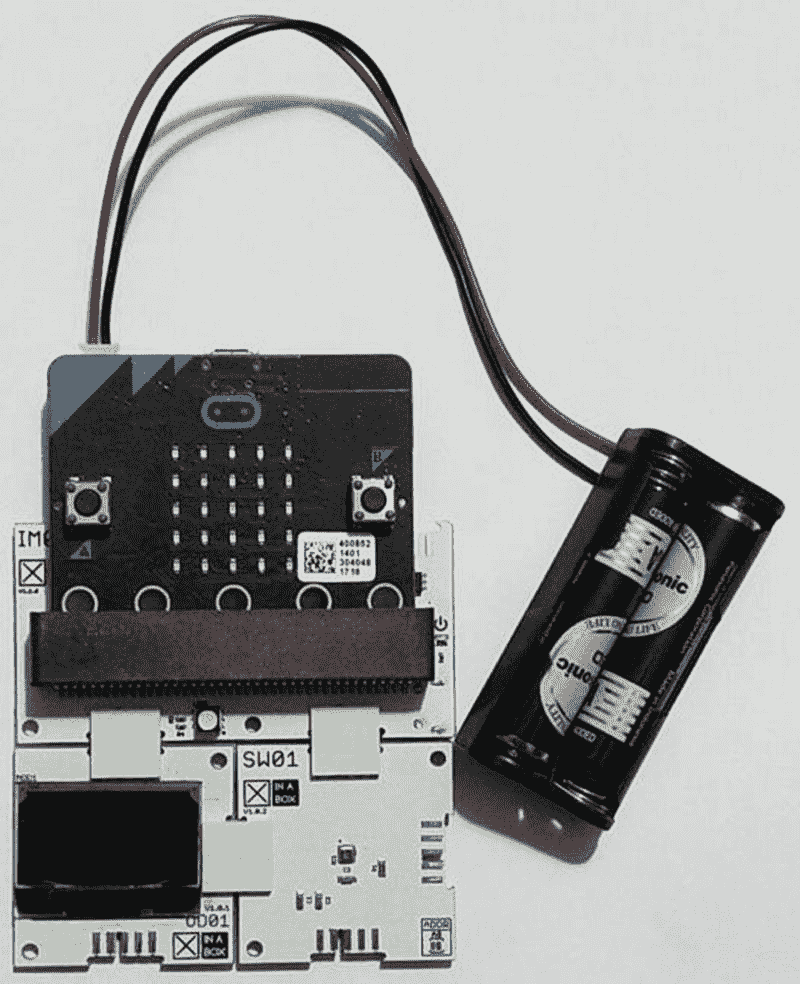

图 2-10

一个使用“我们将使用什么”一列中列出的硬件构建的工具

所有提供的代码（无代码、`MakeCode` 和 `MicroPython`）都将与表 2-3 中“我们将使用什么”一列所述硬件兼容。

如果你使用不同的硬件，可能需要稍微调整代码。特别是，大多数制造商会提供库（或扩展）供你与其套件一起使用。如果你使用不同的硬件，请查阅制造商网站，了解如何查找和使用相应的库。将它们添加到你的工作区的方式应与我们网站上描述的方式类似。

## 2.15 总结

要进行有意义的数据科学实验，我们需要收集自己的数据。这将要求我们构建数字数据收集工具，并为其编写代码。

我们选择了一个非常简单的硬件系统来构建工具，并提供了多种编写代码的方案。这包括无代码方案，旨在让那些不热衷于自己编写代码的人也能使用数据收集工具：成为一名计算机程序员与接触数字技术并非同一回事。

我们将使用的系统是 BBC `micro:bit` + XinaBox “xChips”。除了购买能执行我们所需功能的现成工具外，很难找到比这更简单的选择了。有了这个系统，即使没有任何硬件知识，我们也能踏上数据科学之旅。

