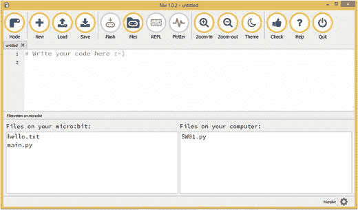
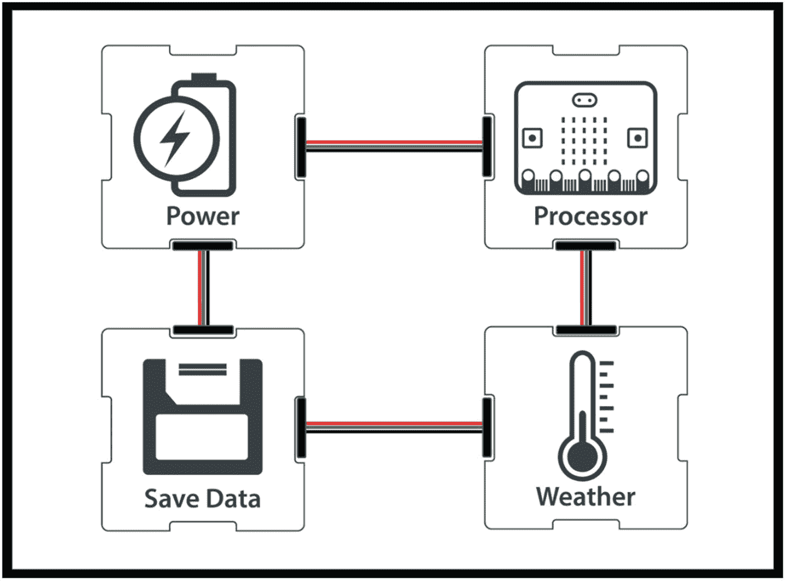
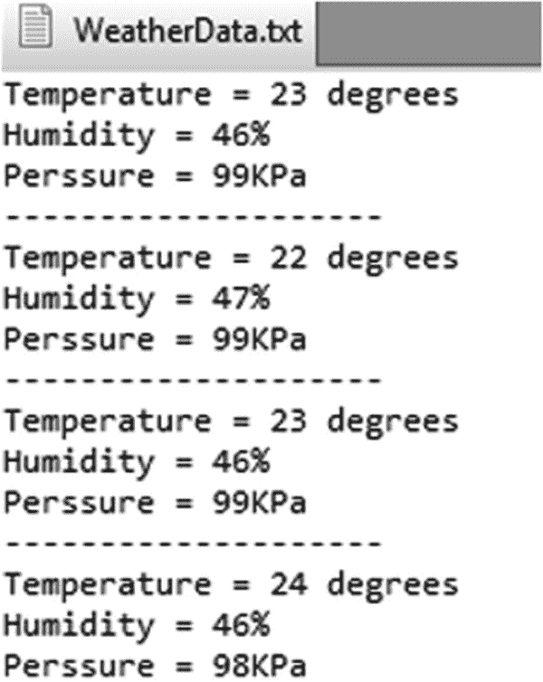
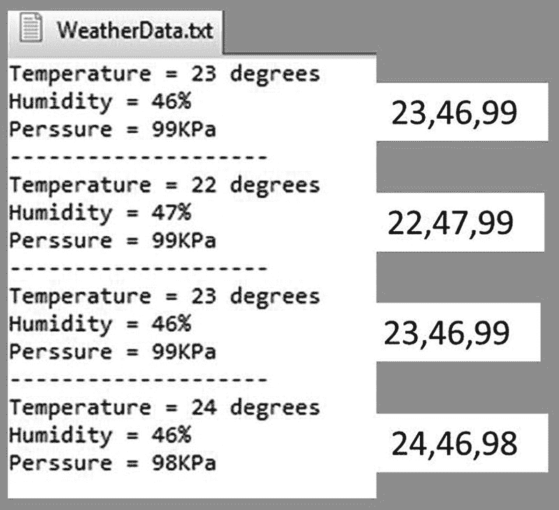
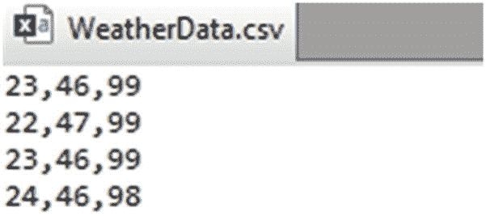
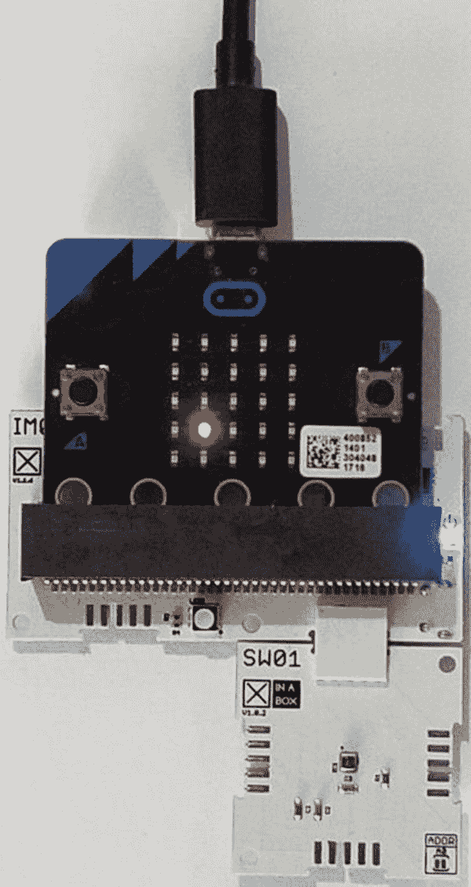

# 4. 处理大型数据集

在本章中，我们将通过显著增加收集的数据量，在数据科学实验方面向前迈进一步。到目前为止，我们只处理了十几个数据点，这足以满足我们的需求。但有时候相关性（以及数据其他有趣的特征）是微妙的，难以发现。我们的数据集越大，我们寻找的答案就越有可能存在于其中。

如果我们打算收集成百上千甚至数百万个数据点，我们的工具包就存在一个弱点：这个缺陷限制了我们可以合理收集的数据量。考虑这个问题：如果我们想记录一段较长时间（比如说 24 小时）内的天气测量数据，我们该如何重新设计`第3`章中的实验？

这个弱点当然就是那个手拿纸笔、尽职尽责地在风雨中站上整整一天一夜、每隔 5 分钟记录一次温度、湿度和气压的人。

在本章中，我们将通过数字化方式收集和存储数据，从而开始消除数据收集过程中的人为因素。这将使我们能够建立起一个包含大量温度和气压数据的数据库，我们将在`第5章`中分析这些数据之间的相关性。

## 4.1 实验设计

本章将要开展实验，探究我们在第 3 章中观察到的温度与气压之间的相关性。我们将在 24 小时内记录这些测量值，然后分析数据并量化相关性的强度。虽然这听起来与第 3 章的做法相似，但存在两个关键区别：

1.  我们将收集更多数据。
2.  我们将使用软件进行数据分析。

该实验分为两章：在本章中，我们将搭建并使用`micro:bit`气象站来收集大量数据集；然后在第 5 章中对数据进行分析。表 4-1 描述了我们将如何收集实验所需的数据。

**表 4-1** 练习 4-1 详情

| 练习 4-1 | 温度与大气压之间存在相关性吗？ |
| --- | --- |
| 概述 | 我们将在 24 小时内尽可能多地收集温度和气压数据，然后进行分析。 |
| 逐步流程 | 1. 为数据收集仪器找一个合适的位置。确保电量充足。 2. 将仪器放置在选定位置并开机。它将开始记录数据。 3. 24 小时后取回仪器。 4. 从`micro:bit`中提取数据并加载到计算机上。 5. 使用计算机上的软件进行分析。 |
| 我们将学到什么 | • 如何在`micro:bit`上使用文件存储。 • 如何构建数据文件。 • 如何使用电子表格进行数据分析。 • 如何量化/测量相关性。 • 温度与气压的相关强度。 • 什么是统计显著性。 |

本实验首先需要的是一种能记录 24 小时数据的方法。

## 4.2 将`micro:bit`用作文件存储设备

我们不能指望有人能在一个地方站 24 小时，每隔几分钟就记录一次温度和气压读数。为了消除这种需求，我们将在数据收集过程中将记录的数据保存到文件中，之后再访问该文件。直接将数据保存到文件将使我们能够更高效地组织数据收集过程：打开仪器电源，放置 24 小时进行数据测量和记录，然后回来取走仪器。随后可以检索文件。

`MicroPython`拥有一个文件系统，允许我们在`micro:bit`上保存文件。`MakeCode`中没有类似选项，因此我们需要用`MicroPython`为此编写代码。

使用文件系统的第一步是学习如何将数据写入文件。为此，你只需要一个`micro:bit`和一个电源。

用`micro:bit`写入文件的`自然语言代码`列于表 4-2 中。

**表 4-2** 在`micro:bit`上创建并写入文件的自然语言代码

| 步骤 | 描述 | 备注 |
| --- | --- | --- |
| 1 | 创建文件。 | 在`micro:bit`存储中创建一个文件并为其命名。 |
| 2 | 以写入模式打开文件。 | 文件必须先“打开”才能使用。 |
| 3 | 写入文件。 | 我们将向文件写入一些任意数据，以便稍后检查代码是否成功。 |
| 4 | 关闭文件。 | 使用完文件后，务必关闭它。 |

**无代码选项**：你可以在我们的`资源网站`上找到本节所需代码的完整可用版本。访问 [`http://xib.one/XB`](https://nam12.safelinks.protection.outlook.com/?url%253Dhttp%253A%252F%252Fxib.one%252FXB%2526data%253D02%257C01%257C%257C96ee9c32c458423e9b6a08d7c36cd73f%257C84df9e7fe9f640afb435aaaaaaaaaaaa%257C1%257C0%257C637192744542720716%2526sdata%253D0W1OfWTmIx3U20MIwolvjFvh9lCQJVpw9KNNvUwCdU8%253D%2526reserved%253D0) 并搜索`第 4.1 节`。

表 4-3 列出了实现表 4-2 中`自然语言代码`的`MicroPython`代码。

**表 4-3** 使用`MicroPython`将“Hello, World!”写入文件

| 步骤 | `MicroPython` |
| --- | --- |
| 1&2 | 输入以下内容并按回车键：`with open('hello.txt', 'w') as my_file:` 这将在`micro:bit`存储中创建名为`hello.txt`的文件，然后将其打开以便稍后写入。 |
| 3 | 输入以下内容并按回车键：`my_file.write("Hello, World!")` 这会将`Hello,World!`写入文件。 |
| 4 | 文件会自动关闭——我们无需为此编写任何代码。 |

将`“Hello, World!”`写入文件的完整`MicroPython`代码如下：

```
with open('hello.txt', 'w') as my_file:
    my_file.write("Hello, World!")
```

编译代码并将其刷写到`micro:bit`上。

刷写过程完成且`micro:bit`重置后，将创建一个名为`“hello.txt”`的文件，其中包含你提供的内容（`“Hello, World!”`）。在接下来的章节中，我们将向你展示如何查看和访问该文件。

我们放入`micro:bit`的代码基本上告诉它如何像一个文件存储设备一样运行：现在我们可以将任何我们想要的内容写入文件，包括数据，并且稍后能够检索它们。

这一功能提升了`micro:bit`作为数据科学工具的潜力。文件存储使我们能够扩展数据收集能力，并执行原本可能无法完成的实验。在本章中，我们将研究如何将气象站的数据保存到文件，但同样的技术可以用于任何数量的传感器。你的`micro:bit`可以成为监测各种环境指标的数字化工具的基础。

## 4.3 访问`micro:bit`上的文件

将数据保存到`micro:bit`的文件中后，下一步是将其检索出来并在计算机上使用，因为我们可以利用计算机上强大的分析工具。

有几种工具可用于列出和访问`micro:bit`上存储的文件，包括`Mu`和`MicroFS`。我们将向你展示如何使用`Mu`访问刚刚写入的文件。

表 4-4 列出了使用`Mu`查看`micro:bit`存储中文件所需遵循的步骤。

**表 4-4** 使用`Mu`列出`micro:bit`存储上的文件

| 步骤 | 描述 |
| --- | --- |
| 1 | 使用 micro USB 线将`micro:bit`连接到计算机。 |
| 2 | 在`Mu 工具栏`上，单击`文件`按钮。`文件`窗格将出现在`Mu`窗口底部。在`文件`窗格中，`“micro:bit 上的文件”`下方，你将看到`micro:bit`上的文件列表。 你能看到在上一个练习中创建的文件吗？ |
| 3 | 再次单击`文件`按钮以关闭`文件`窗格。 |

**警告**

当你使用`Mu`将代码刷写到`micro:bit`上时，`MicroPython`代码的副本会保存到持久存储中（`main.py`）。删除此文件会阻止你的代码运行，你需要重新刷写`micro:bit`。

## 4.4 将文件传输到计算机

学习如何将数据写入文件的目的是为了让我们能够使用计算机上一些强大的分析工具。我们只需要先将文件从`micro:bit`移出，再移动到计算机上即可。表 4-5 概述了具体的操作流程。

**表 4-5** 从`Mu`中提取文件，然后打开并查看其内容

| 步骤 | 描述 |
| --- | --- |
| 1 | 在`Mu`工具栏上，单击`文件`。 |
| 2 | 将之前创建的`hello.txt`文件从“`你的 micro:bit 上的文件`”拖放到“`你的计算机上的文件`”。该文件将从`micro:bit`存储区复制到计算机的硬盘上，并会显示在“`来自你计算机的文件`”下。 |
| 3 | 在“`来自你计算机的文件`”窗格中，右键单击`hello.txt`，然后从快捷菜单中单击`打开`。该文件将使用计算机上安装的用于处理文本文件的默认应用程序打开。 |
| 4 | 检查打开的文件，确认其中包含文字“Hello world!”。 |
| 5 | 退出该应用程序。 |

你也可以通过计算机上使用的任何`文件资源管理器`来访问该文件。该文件会保存在`Mu`默认保存文件的同一文件夹中。

现在，我们已经将文件写入`micro:bit`内存，然后提取了该文件并在计算机上将其打开。我们已掌握了在实验中使用文件系统所需的一切知识。

## 4.5 硬件要求

我们的数字仪器需要包含的组件如`图 4-1`所示。



**图 4-1** 用于读取天气数据并将其保存到文件的数字工具

**表 4-6** 列出了我们将用于构建气象站工具的具体硬件。

**表 4-6** 气象站工具的硬件要求

| 所需物品 | 我们使用的物品 | 数量 | 替代品 |
| --- | --- | --- | --- |
| 微处理器及向其烧录代码的手段 | 配备用于连接笔记本/台式机的 micro-B USB 线的`micro:bit` | 1 | Raspberry Pi、Circuit Playground |
| 电源 | `micro:bit`电池座 | 1 | Seenov Inc 太阳能电池 |
| 用于读取天气数据的传感器 | XinaBox SW01 – 高级气象传感器 | 1 | SparkFun Weatherbit |
| 持久化存储器 | `micro:bit`板载内存 | 1 | XinaBox IM01`micro:bit`桥接器（SD 卡） |
| 用于连接所有组件的工具 | XinaBox IM01`micro:bit`桥接器 | 1 | 面包板、边缘连接器扩展板、鳄鱼夹导线以及跳线 |
| xBus 连接器 | 1 |

## 4.6 将传感器数据存储到文件中

当我们向文本文件写入数据时，我们可以写入任何我们想要的内容：任何数字或字母。我们可以将传感器数据以易于阅读的纯文本格式存储，如`图 4-2`所示。



**图 4-2** 包含传感器数据的文本文件截图

采用这种方法时，文件的大量空间将被诸如“温度”、“湿度”、“气压”和“度”等词语占据：它们虽然有助于文件的可读性，但也占用了文件空间。我们写入文件的每个字符都会“消耗”一些空间，如果`micro:bit`的内存很紧张（正如我们将会看到的，它确实很紧张），我们就需要剔除冗余数据。

我们必须做出的最艰难的决定是不收集湿度数据：谁知道在分析阶段会出现什么有趣的观察结果呢？但正如你在接下来的章节中将看到的，`micro:bit`上的内存量非常有限。我们的实验旨在分析气压和温度之间的关系，因此我们决定忽略湿度，因为它无助于我们回答实验的具体目标。`micro:bit`文件系统上的存储空间非常宝贵，我们节省的每个字符都必须物有所值。

`图 4-2`中所示文件的核心问题是，它是我们为此实验“发明”的一种定制格式。这是一种不寻常的文件数据存储方式，并且在不识别我们创建格式的软件中打开它会很棘手。我们可以轻松读取，但计算机会很吃力。

相反，我们将使用一种经过验证的文件格式：我们将创建一个`逗号分隔值`（或`CSV`）`文件`。以这种格式写入数据可以确保我们能够在电子表格程序中打开该文件：数据将自动作为表格导入，这对我们的分析来说非常完美。

CSV 文件必须遵循一些约定：

- `文件`的每一行都是一条`记录`。行尾字符表示一条记录的结束。
- 一条记录是多个`字段`的集合：对我们来说，这意味着每条记录将包括一个温度和气压值。
- 文件中的每个值由逗号分隔。

`图 4-3`显示了与`图 4-2`相同的文件，但数据记录是以 CSV 格式写入的。



**图 4-3** 以 CSV 格式记录的数据文件

为了确保我们构建的文件符合 CSV 规范，在将每条记录写入文件时，我们将按照以下步骤进行：

1. 在文件中开始新的一行（或一条“新记录”）。
2. 将温度值写入文件。
3. 向文件写入一个逗号。
4. 将气压值写入文件。
5. 写入一个行尾字符。

如果我们遵循这个过程，当我们在文本编辑器中打开我们的`csv`文件时，它看起来会像`图 4-4`所示。



**图 4-4** 以 CSV 格式保存并在文本编辑器中查看的数据

使用`micro:bit`文件系统给我们带来了另一个挑战。随着越来越多的数据被`写入`（或`追加`）到文件中，最终`micro:bit`将无法再向其中写入更多数据：会达到文件大小的上限。尽管`micro:bit`有大约`30 KB`的内存保留用于文件存储，但它无法按照我们想要的方式写入那么大的文件。其他因素，例如`micro:bit`的工作内存，也是限制因素。

`micro:bit`文件系统的工作方式是，当你向文件写入任何内容时，都会覆盖文件中已有的所有内容。这意味着当我们想要向文件追加更多数据时，我们必须将文件中已有的所有数据读入一个变量，然后将我们想要追加的额外数据添加到该变量中。然后，我们将包含新记录的整个文件内容重新写回文件。将数据写入文件时最常见的限制因素是`micro:bit`将整个文件内容存储到单个变量中的能力。

## 4.7 测量可存储的数据点数量

我们的实验设计指出应“尽可能多地收集温度和压力数据”。了解 `micro:bit` 上能存储多少数据会很有帮助：

-   如果能在 `micro:bit` 上存储 100 个数据点，就意味着在 24 小时内大约每 14.5 分钟读取一次数据。
-   如果能在 `micro:bit` 上存储 1000 个数据点，就意味着大约每 90 秒读取一次数据。
-   如果能在 `micro:bit` 上存储 10000 个数据点，就意味着大约每 9 秒读取一次数据。

为了找出 `micro:bit` 的容量，我们将编写代码，向其中持续写入数据直至其崩溃，然后查看它在停止工作前成功保存了多少数据。很有趣！别担心，`micro:bit` 不会损坏。

我们将编写一个能在几秒内（而非 24 小时）快速填满文件的程序。我们将对 `micro:bit` 编程，使其读取 `SW01` 传感器上的温度和压力数据并写入 `CSV` 文件，并持续执行直至无法写入。

表 4-7 中的自然语言代码展示了需要告诉 `micro:bit` 执行的步骤。

**表 4-7** 测量数据点的自然语言代码

| 步骤 | 自然语言代码 | 备注 |
| --- | --- | --- |
| 1 | 导入所有必需的库。 | 我们需要核心 `micro:bit` 库以及气象传感器的库。 |
| 2 | 初始化气象站。 | `micro:bit` 的大多数传感器和扩展件在使用前都需要进行“初始化”。 |
| 3 | 如果 `micro:bit` 存储中已存在数据文件则停止。 | 如果 `micro:bit` 中已存在数据文件，则在 `micro:bit` 上显示“x”并退出代码。否则继续执行代码。 |
| 4 | 创建文件并打开用于写入。 | 这是我们要写入数据的文件。 |
| 5 | 重复以下步骤。 | 我们将持续读写数据，直到程序崩溃！ |
| 6 | 将文件内容读入一个变量。 | 我们不能简单地向文件添加数据——当写入任何内容时，它会覆盖文件中原有的内容。因此，我们需要先将文件的现有内容复制到一个变量中。 |
| 7 | 读取气象传感器的温度和湿度数据。 | 我们将向变量中“追加”以下内容：`temperature, humidity [换行符]` |
| 8 | 将变量内容写回文件。 | 这将把变量内容写入持久化存储，覆盖现有文件。 |

**免代码选项**：你可以在我们的资源网站上找到此处使用的预编译代码的完整工作版本。访问 `http://xib.one/XB` 并搜索第 4.7 节。

**注意**：此代码需要 `SW01 MicroPython` 库才能运行。请按以下步骤操作：
1.  下载 `SW01` 库（请参阅资源网站）。
2.  将预编译代码刷写到 `micro:bit` 上。
3.  将 `SW01` 库复制到 `micro:bit` 中。

**警告**：请务必按列出的顺序执行这些步骤。

表 4-8 展示了如何将自然语言代码转换为可编译并加载到 `micro:bit` 上的 `MicroPython` 代码。

**表 4-8** 使用 `MicroPython` 开发代码

| 步骤 | 描述 |
| --- | --- |
| 1 | 输入以下内容：<br> `from microbit import *`<br> `from SW01 import SW01`<br> `import os`<br> `import sys`<br> 这将把所有必需的库导入到你的程序中。 |
| 2 | `SW01 = SW01()`<br> 这将初始化（或称“实例化”）`SW01` 库。 |
| 3 | `d = 0`<br> `try:`<br> `    d = os.size("we.csv")`<br> `except:`<br> `    pass`<br> `if (d > 0):`<br> `    display.show("*")`<br> `    sys.exit()`<br> 当 `micro:bit` 上电时，如果已存在名为 `we.csv` 的文件，屏幕上将显示“x”，程序将停止运行。这确保我们在尝试取回文件时不会覆盖它。 |
| 4 | `open("we.csv", "w")`<br> 这将创建名为 `we.csv` 的文件并打开用于写入。 |
| 5 | `while True:`<br> 这是一个循环（类似于 `MakeCode` 中的 `forever` 积木块）：它会持续运行，直到 `micro:bit` 断电，或发生错误（在我们的程序中，它会一直运行到数据文件过大导致 `micro:bit` 抛出错误为止）。 |
| 6 | `try:`<br> `    with open("we.csv") as a:`<br> `        cont = a.read()`<br> `    cont = cont + str(SW01.getTempC()) + "," + str(SW01.getHumidity()) + "\n"`<br> `except:`<br> `    display.show(".")`<br> `    sys.exit()`<br> 这将执行以下操作：<br> • 打开文件进行读取。<br> • 将文件内容复制到一个变量 (`cont`) 中。<br> • 从气象传感器读取温度和湿度。<br> • 将它们作为一条记录追加到内容末尾。<br> 当写入过程中存储空间满时，LED 矩阵上会显示一个句点，程序将终止。 |
| 7 | `with open("we.csv", 'w') as b:`<br> `    b.write(cont)`<br> 这将把变量 `cont` 的内容写入文件。 |

完整的 `MicroPython` 代码清单如下：

```python
from microbit import *
from SW01 import SW01
import os
import sys
SW01 = SW01()
d = 0
try:
    d = os.size("we.csv")
except:
    pass
if (d > 0):
    display.show("*")
    sys.exit()
open("we.csv",'w')
while True:
    try:
        with open("we.csv") as a:
            cont = a.read()
        cont = cont + str(SW01.getTempC()) + "," + str(SW01.getHumidity()) + "\n"
    except:
        display.show(".")
        sys.exit()
    with open("we.csv", 'w') as b:
        b.write(cont)
```

当代码运行时，`micro:bit` 上会创建一个文件，并持续向文件末尾追加新记录。请按以下步骤查看 `micro:bit` 停止前写入了多少条记录：

将代码刷写到你的 `micro:bit` 上。刷写完成后代码将开始运行。

等待代码停止运行（如 LED 所示，如图 4-5）。



**图 4-5** 所示 LED 亮起，表示数据记录已停止

取出文件并按照前面的方法打开。

滚动到文件末尾，检查写入了多少行——记下这个数字。

重复几次（首先从 `micro:bit` 存储中删除数据文件，然后重新启动 `micro:bit`）。如果你有多个 `micro:bit`，可以尝试不同的设备，也可以让其他人一起尝试。结果会因人而异、因时而异，但很可能你能够存储 50 到 60 条记录。

我们发现可靠地存储 50 条记录是可行的。

再看一下我们在表 4-8 步骤 3 中编写的代码。这段代码可以防止现有的数据文件被添加或覆盖。如果你的 `micro:bit` 显示一个小“x”，则表示此“软件锁定”代码已被激活，并且在 `micro:bit` 上检测到了现有数据文件（图 4-6）。你需要从 `micro:bit` 文件系统中删除该文件才能继续。


**图 4-6** 小 x 表示文件系统中已存在数据文件

**简易信息码**

`x` = 存储中已存在数据文件。不进行数据记录。

`.` = 数据记录已完成。从存储中取出数据文件。

# 利用文件存储复现气象站实验

现在我们已掌握了搭建气象站并记录 24 小时数据所需的所有信息和技术。我们只需选择记录数据的间隔时间，而对`micro:bit`存储容量的理解在此就派上了用场：

- 我们预计可以记录 50 个读数。
- 在 24 小时内，总共有 86400 秒。
- 我们将每 1728 秒（即每隔 28.5 分钟）记录一次读数。

代码与我们**第 4.7 节**（**表** **4-8**）中测试文件存储容量时所写的代码几乎相同。差异在以下代码清单中已高亮显示。

主要区别在于，之前写的代码中，我们不想在写入文件之间等待；而现在我们需要在每次读数之间添加一个较长的延迟。我们还为代码增加了一个简单功能，以防止数据捕获自动启动。现在，只有当你在`micro:bit`上按下按钮 A 时，气象站才会*开始*捕获数据。

完整代码如下所示，也可在资源网站上获取：

```
from microbit import *
from SW01 import SW01
import os
import sys
SW01 = SW01()
d = 0
try:
d = os.size("we.csv")
except:
pass
if (d > 0):
display.show("*")
sys.exit()
bp = False
while True:
if button_a.was_pressed():
a = open("we.csv", "w")
bp = True
if (bp == True):
try:
with open("we.csv") as a:
cont = a.read()
cont = cont + str(SW01.getTempC()) + "," + str(SW01.getHumidity()) + "\n"
except:
pass
display.show(".")
with open("we.csv", 'w') as b:
b.write(cont)
sleep(1440000)    # 每隔 28.5 分钟
```

当此代码运行时，`micro:bit`上会创建一个文件。每隔 28.5 分钟，气象传感器数据会被采样并保存到该文件中。如果内存缓冲区或存储空间已满，程序将停止工作。

以下步骤说明了如何将气象站作为便携工具，在偏远地点捕获气象数据：

1. 将`micro:bit`连接到电脑，并将代码烧录到其中。
2. 从电脑上拔下`micro:bit`，连接便携电池电源。
3. 将`micro:bit`放置在你想要采集气象数据的地点。
4. 按下按钮 A 开始采集。
5. 当`micro:bit`停止工作（存储空间满后），5x5 LED 矩阵上的一个 LED 会亮起。
6. 使用 micro USB 线将`micro:bit`连接到电脑，并按照之前说明的方法提取文件。

**注意**

此代码设计得尽可能简单。它可以通过多种方式进行改进，例如添加更多错误处理，以及通过`micro:bit`的 LED 提供关于程序状态的反馈。

# 解决内存限制问题

了解`micro:bit`文件存储的限制，使我们能够相应地设计实验。我们可以采用一些策略，确保充分利用可用空间：

-   只捕获所需的数据。如果你在下午 1 点开始实验，并且每 5 分钟读取一次传感器数据，那么你不需要在每次读取传感器时都记录时间。
-   你可以尝试写入多个文件，例如，将 40 条记录写入一个文件，然后在出现任何错误之前开始写入另一个文件。
-   尝试将温度数据写入一个文件，将气压数据写入另一个文件。
-   将数据存储在 SD 卡上。它可以存储比`micro:bit`更多的数据，并且当你向`micro:bit`烧录新程序时，SD 卡上的数据不会丢失。
-   更频繁地将数据从`micro:bit`传输到电脑——我们之前的计划是每 24 小时从`micro:bit`中取出数据，但如果我们能在数据被读取时就通过无线方式从`micro:bit`传输数据呢——那么`micro:bit`的存储容量就完全不会限制我们了。

还有其他优化`micro:bit`持久化存储以存储更多数据点的方法。

-   为传感器数据文件使用简短名称（例如，使用`we.csv`而不是`weather.csv`）。
-   避免使用在 5x5 LED 矩阵上显示文本和图像的函数（例如`display.scroll()`和`display.show()`）。
-   避免使用额外的库（例如，用于 OLED 屏幕的库）。

# 扩展数据存储容量

我们将在下一章对包含 50 个数据点的数据集进行分析，目前这些数据已经绰绰有余。但这实际上数据量非常少：一天有 86,400 秒，我们为什么只满足于 50 个数据点呢？

一个解决方案是查看`micro:bit`的扩展模块，看是否有提供扩展内存选项的产品。市面上有几种产品可供选择：SparkFun 和 XinaBox 提供的外围设备可以通过将数据记录到 microSD 卡来扩展`micro:bit`的数据记录能力。如果你有一个 XinaBox IM01 `micro:bit`桥接器，你会注意到其背面有一个 microSD 卡插槽。

# 总结

在本章中，我们学习了如何使用`micro:bit`的文件系统来存储记录的数据并在之后检索它，从而无需人工参与采集过程。我们在 24 小时内记录了一组气象数据，这些数据存储在一个文件中，我们已将其传输到笔记本电脑/电脑上。

现在我们准备使用本章收集的数据进行更详细的分析，这是`第5章`的重点。

