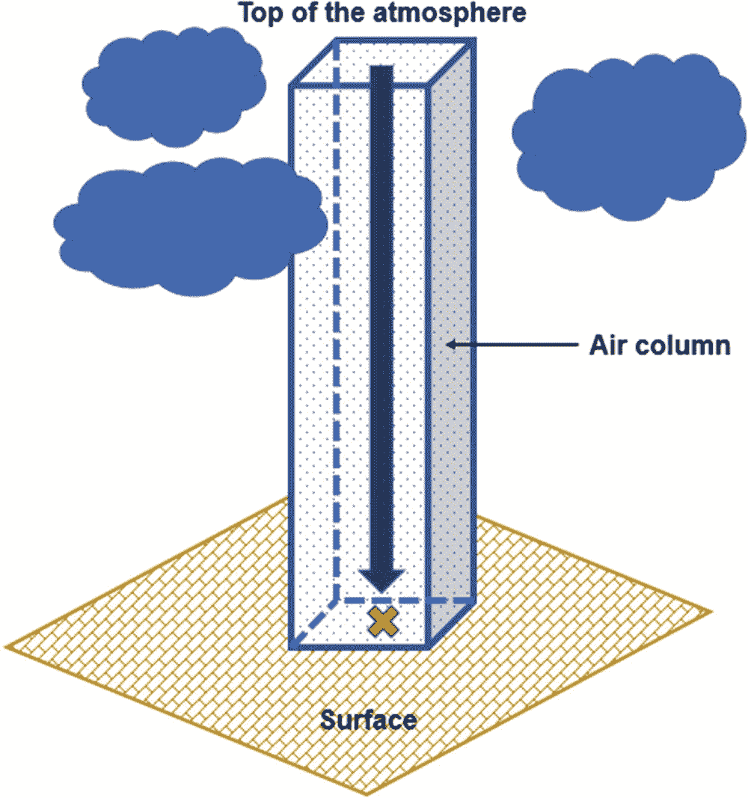
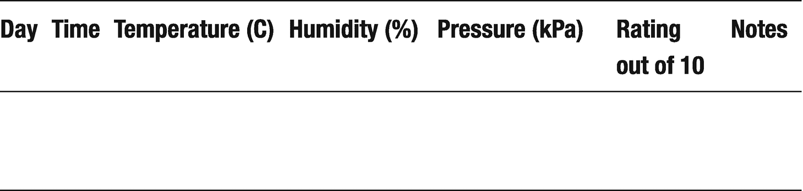
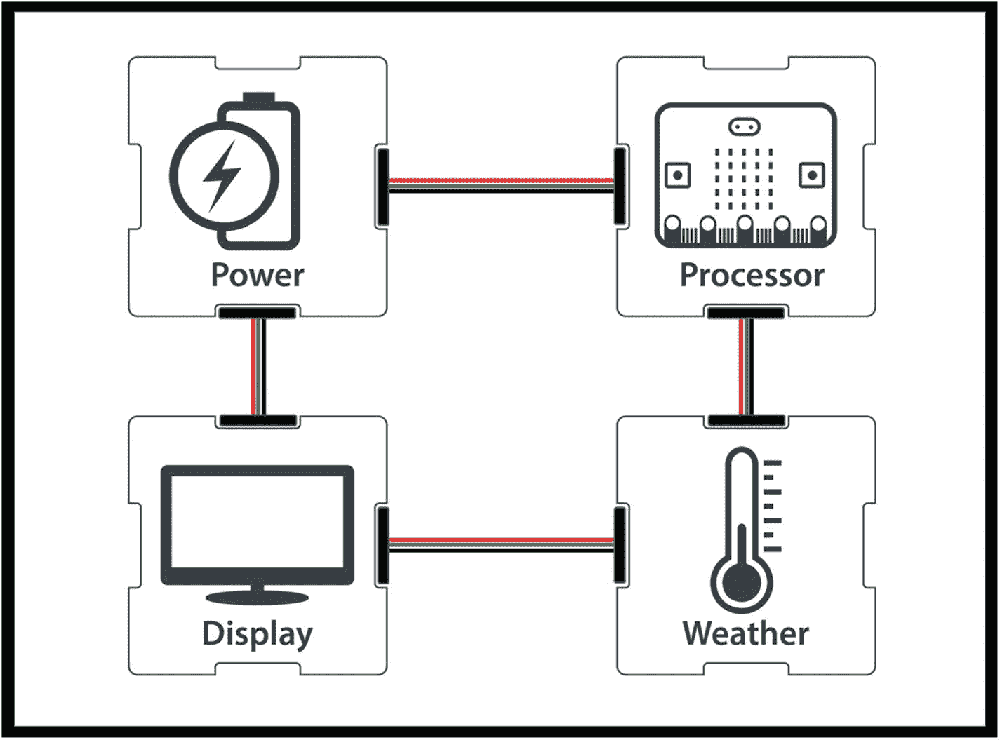
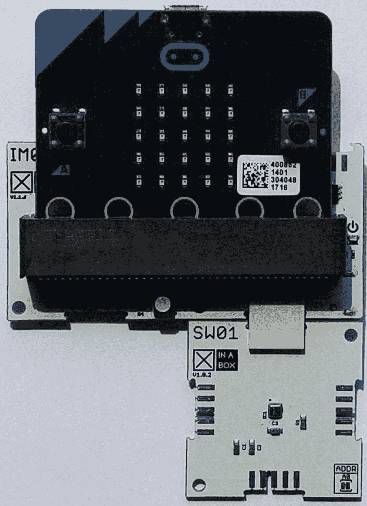
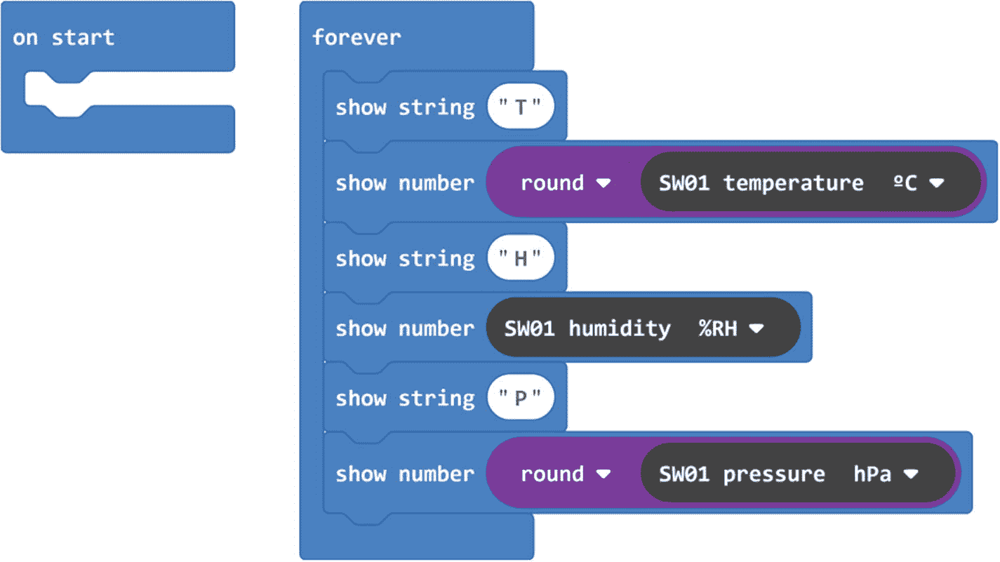
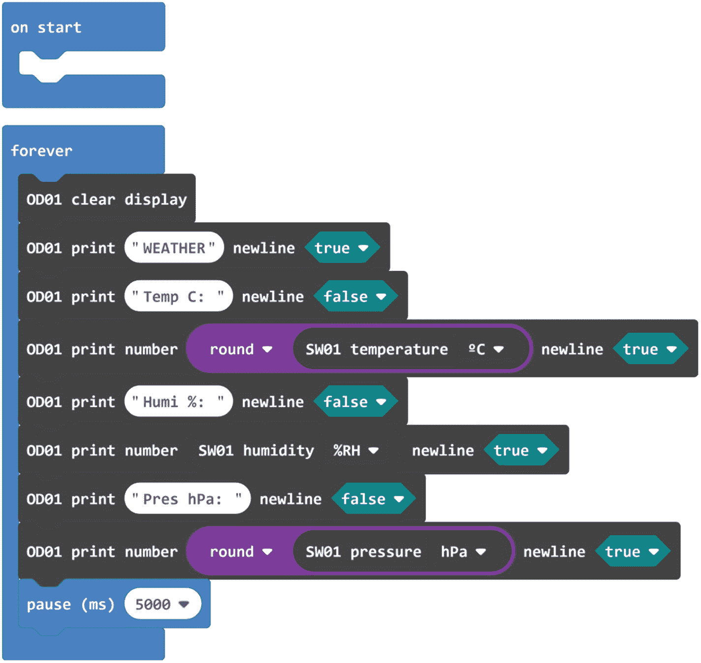
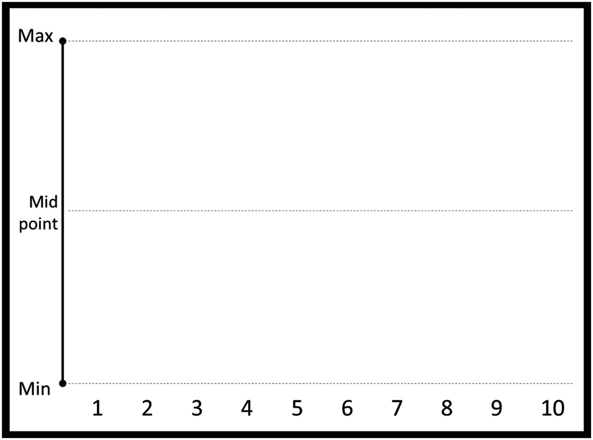
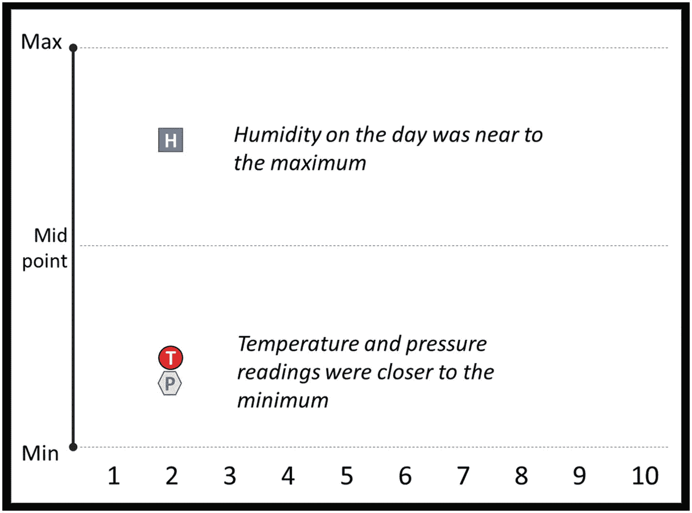
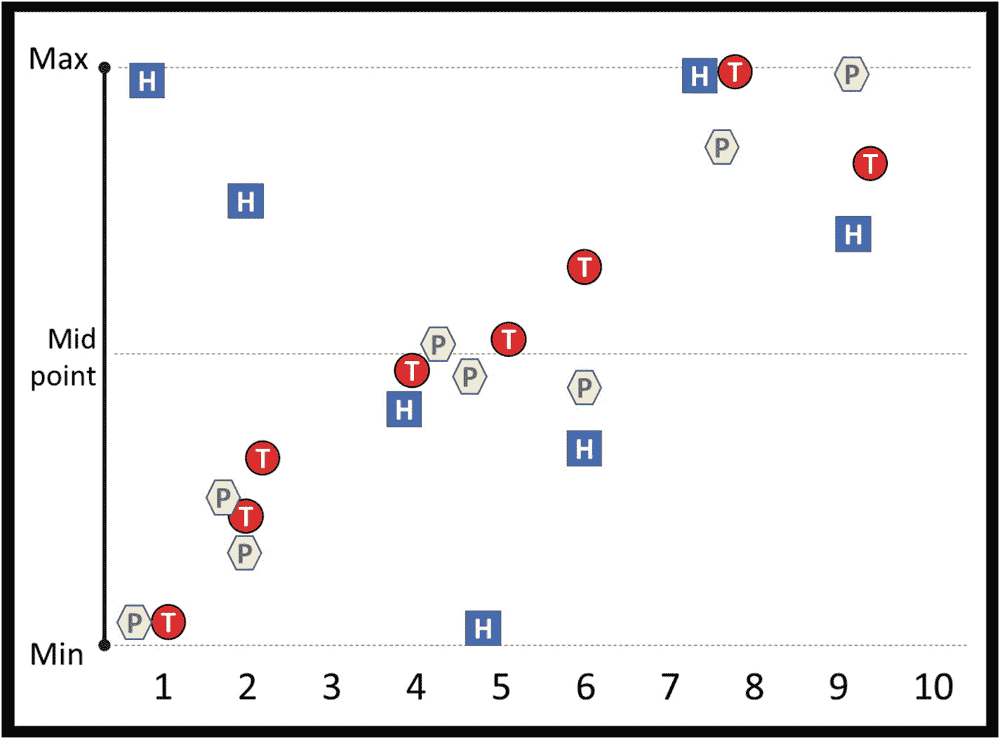
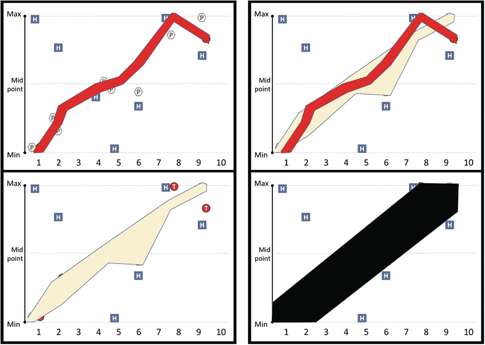

# 3. 天气实验

在本章中，我们将设计一个实验，记录温度、湿度和大气压强。我们将使用数字工具包构建一个气象站，然后研究这些测量值如何影响我们对天气的日常感知。

## 3.1 引言

如果要在数据科学中挑选一个最重要的概念，那很可能是**相关性**：

> 当两个不同的数据集存在相关性时，意味着它们通常会在某种可相互预测的方式下表现：通过观察一个数据集，我们可以对另一个数据集做出预测。我们对相关性有一种直观的理解：我们知道夜晚会更凉爽，所以一天中的时间与温度之间存在相关性；我们也会理所当然地认为，在其他条件相同的情况下，个子高的人往往比个子矮的人更重一些。我们称之为“常识”的很多东西都建立在现实世界中这类相关性之上。我们将在**第** **5** **章**中更详细地探讨相关性。

在数据中发现相关性是令人兴奋的，并且可能带来非常有趣、有时甚至是开创性的洞见。我们将收集大量数据，然后从中搜索相关性。

## 3.2 测量天气

人类对天气有一种感知——我们对它的体验是发自内心的——我们能感受到它。它既能成就或破坏我们的情绪，也能拯救或毁灭整个文明，还能把一个完美的日子变成终生的遗憾。当然，还有那些美丽的彩虹！

天气是人类的基本体验；随着气候变化扰乱世界各地的天气模式并带来极端事件，研究天气的需求变得越来越紧迫。我们对天气了解得越多，就越能更好地预测它，甚至可能控制它。但这种理解始于数据，我们将着手收集这些数据。那么，我们如何测量**“天气”**呢？

气候/天气科学家会使用多种测量指标，例如温度、湿度、大气压力、光照水平、土壤湿度、土壤温度、风向和风速、雨量计等等：

> 影响或有助于描述**“天气”**的因素多得令人眼花缭乱。用于预测天气的数学方法被称为**混沌理论**，这非常贴切！一只蝴蝶可能在亚马逊扇动翅膀，并在保加利亚引发一场季风，但这只会在无数其他因素完美契合的情况下发生。天气预测曾赢得过战争，也曾导致过生命损失，而提高这些预测的质量是整个数据科学家行业永无止境的追求。

## 3.3 选择要测量的数据

我们将搭建一个气象站，用于监测三个关键的天气相关参数（因素）：

**温度**：我们已经详细探讨过这个参数了。

**湿度**是指空气中存在的水蒸气（水分）含量。水蒸气是水的气态形式：微小的水颗粒是我们呼吸空气的一部分。

与温度一样，极端湿度水平也会让人感到不适：低湿度沙漠干燥、脆弱的酷热与雨林潮湿、粘人的闷热感截然不同，但同样令人不适。

湿度通常通过两种方式测量。

1. 一种方法称为**比湿度**：这是对一千克质量的空气（包括水在内）中所含水蒸气质量的度量。如果空气更潮湿，则水蒸气更多。如果空气较干燥，则水蒸气较少。

2. 一种更常见的测量方法是**相对湿度**，即空气中实际水蒸气含量与该温度下空气可能容纳的最大水蒸气量之比——温暖的空气比冷空气能容纳更多的水蒸气。该值以百分比表示。

当你观看天气预报，他们提到湿度时，通常指的是相对湿度：我们对湿度的感知与相对湿度的关联性比与比湿度更强。

我们使用一种叫做**湿度计**的工具来测量空气、土壤或封闭空间中的水蒸气含量。有模拟湿度计和数字湿度计：我们的工具将是数字式的。

**大气压力**（有时称为气压）是指大气所施加的压力大小：

> 抬头向上看：在你上方数英里的空中都是空气，大量大量的空气，而且它们有质量。这些空气被地球引力向下拉——正好压在你的头上！大气压力本质上是衡量给定区域上方有多少空气的一个指标。

我们通过观察空气对固定区域施加的压力大小来测量大气压力。例如，在海平面在一个普通的日子里，大气压力约为每平方英寸 14.7 磅。这相当于：

*   每平方厘米大约 1 千克的压力
*   对一个中等身材的成年人施加数吨的压力
*   对一个约 2000 平方英尺的房屋施加 2100 吨的压力

**图** **3-1** 说明了点 **X** 处的压力是其上方空气重量的一个因素。

图 3-1

柱状空气施加在点 X 上的重量

测量大气压力最常用的单位是帕斯卡或千帕：1 kPa = 1000 Pa。其他使用的单位包括 PSI（磅每平方英寸）和毫巴（或简称巴）。在本书中，我们将使用 `kPa`。

> 要理解 `kPa` 这个量程，有必要知道在海平面上的压力大约是 `101kPa`。随着海拔升高，平均 `kPa` 会下降——在珠穆朗玛峰顶约为 `34kPa`。在海平面或以上自然发生的大气压力中有记录的最高值略低于 `109kPa`。

当你快速改变海拔高度时，是空气压力让耳朵感到发闷；我们给轮胎充气时，增加的就是这种压力。当我们给气球充气时，我们增加了内部的压力；许多人报告说，当气压特别高时，会有头痛和焦虑等反应。与温度和湿度一样，大气压力也是我们能够感知到的。

大气压力同样是天气的一个重要方面：高压往往会带来更稳定、宜人的天气，而气压下降则常常预示着恶劣天气的到来。空气从高压区向低压区的移动是塑造我们地球天气的基本力量。

## 3.4 天气实验

实验是一种旨在学习新知识或验证已有认知的项目。在这个实验中，我们将尝试探究收集到的测量数据与我们描述天气的方式之间的关联：

> *这个天气实验将帮助我们了解温度、湿度和气压如何影响我们对天气的感知。实验将展示这些测量数据的哪些组合能为记录数据的人提供理想的天气条件。*

在我们的实验中，我们将在较长一段时间内，于不同时间点收集温度、湿度和气压数据。理想情况下，最好是连续记录几天的日志。

每次读取读数时，我们都需要对当时的天气进行主观评估——给出一个 1 到 10 分之间的评分，具体标准如下：

1.  10 分表示对于你所在地的该季节而言，这是最理想的天气。
2.  1 分表示在合理范围内，该季节可能遇到的最糟糕天气。
3.  5 分表示天气完全符合该季节的预期。

这完全是主观的：请根据你在记录数据那一刻对天气的感受来打分——不要想太多！多样性也是好的——尝试收集各种不同天气条件下的数据。

我们将根据**表 3-1** 的样式，将数据记录在表格中。

***表 3-1.*** *为空白的天气站实验数据表*

本实验融合了**客观数据**（时间、温度、湿度和气压）与**主观**数据（10 分制评分和备注）。

> *主观测量值通常不太可靠，数据科学家会尽量避免使用它们，如果无法避免则会进行严格管控。但我们在分析时会小心谨慎，不会过度推论结果：本实验将帮助记录评分的人洞察自己的天气体验与温度、湿度和气压之间的关联。我们不应指望实验能告诉我们除此之外的其他信息。但在分析过程中，我们会保持开放的心态。*

## 3.5 构建我们的天气站工具

为了进行实验，我们需要构建一个能够测量温度、湿度和气压的数字仪器。

**图 3-2** 展示了数字天气站仪器的**“电路”**或**“模块”**框图。

图 3-2

天气站工具的“电路”或“模块”框图，显示连接了电源、天气传感器和 OLED 显示屏的微处理器

**表 3-2** 列出了我们将用于构建天气站工具的硬件。

表 3-2

天气站工具的硬件需求

| 所需组件 | 我们使用的型号 | 数量 | 替代方案 |
| --- | --- | --- | --- |
| 微处理器及烧录代码的方式 | micro:bit，附带连接笔记本/台式机的 USB 线 | 1 | Raspberry Pi Circuit Playground |
| 电源 | 2 节 AAA 电池盒 | 1 | Seenov Inc 太阳能电池 |
| 读取天气数据的传感器 | XinaBox SW01 – 高级天气传感器 | 1 | SparkFun Weatherbit |
| 查看数据的屏幕 | micro:bit 5x5 LED 矩阵 | 1 | XinaBox OD01 – 64x128 OLED 显示屏 |
| 连接各组件的方式 | XinaBox IM01 micro:bit 桥接板 | 1 | 面包板、边缘接口转接板、鳄鱼夹导线和连接线 |
| 用于连接 xChips 的 xBus 连接器 | 3 |

我们将展示两种显示传感器数据的方式：

1.  本节及**第 3.6 节**将介绍如何使用 micro:bit 的 5x5 LED 矩阵。
2.  在**第 3.7 节**中，我们将在 micro:bit 上添加一个 64x128 像素的 OLED 显示屏（XinaBox OD01），并将数据输出到该屏幕上。

选择合适的方案，并按下图所示组装部件。或者，也可以使用一套完全不同的组件来构建一个能实现相同功能的工具。目标是收集数据并进行分析；我们使用的工具本身并不特别重要。

**图 3-3** 展示了不带 OLED 显示屏的天气站。

图 3-3

使用 micro:bit LED 矩阵进行显示的天气站

**图 3-4** 展示了带 OLED 显示屏的天气站。

图 3-4

带 OLED 显示屏的天气站

## 3.6 为我们的气象站编程

硬件已经准备就绪，但我们还需要教微处理器/micro:bit 像数字气象站一样工作：我们需要为它编写代码。

**表 3-3**展示了我们将转化为`MakeCode`积木的自然语言代码。

**表 3-3** 数字气象站的自然语言代码

| 步骤 | 自然语言代码 | 备注 |
| --- | --- | --- |
| 1 | 加载所需的任何库。 | *我们需要核心的 micro:bit 库以及我们气象传感器的库。* |
| 2 | 不断重复以下步骤。 | *程序将持续运行，直到 micro:bit 关机。以下动作将被重复……* |
| 3 | 在屏幕上显示“T”，然后显示温度。 | *我们只显示“T”代表温度，以避免等待太久才能滚动显示。* |
| 4 | 在屏幕上显示“H”，然后显示湿度。 | *出于同样原因，我们只显示“H”代表湿度。* |
| 5 | 在屏幕上显示“P”，然后显示大气压力。 | *我们只显示“P”代表大气压力。* |

> ***免编程选项***：*你可以在我们的***资源网站**上找到本节所用代码的预编译版本。访问* [*http://xib.one/XB*](http://xib.one/XB) *并搜索***3.6 节**。

**表 3-4**显示了如何将之前的自然语言代码转换为可以编译并加载到你的 micro:bit 上的 MakeCode 积木。

**表 3-4** 使用 MakeCode 积木开发代码

| 步骤 | MakeCode | 备注 |
| --- | --- | --- |
| 1 | 将 XinaBox `SW01` 扩展添加到你的项目中。 | • 点击**高级**/**扩展**。• 输入“XinaBox”²。• 选择`SW01`。 |
| 2 | 确保你的编程区域中有一个`forever`循环。 |  |
| 3 | 将此处显示的两个积木添加到`forever`循环中： | 第一个积木用于显示“T”。第二个积木以整数形式显示温度。 |
| 4 | 将此处显示的两个积木添加到`forever`循环中温度积木之后： | 第一个积木用于滚动显示“H”。第二个积木用于显示相对湿度。它不需要转换为整数。 |
| 5 | 将此处显示的 2 个积木添加到`forever`循环中湿度积木之后： | 第一个积木用于显示“T”。第二个积木以整数形式显示压力。 |

**图 3-5**显示了 micro:bit 气象站的完整 MakeCode 程序列表。

**图 3-5** micro:bit 气象站的 MakeCode 积木

代码编写完毕后，你只需编译并将其下载（“刷写”）到你的 micro:bit 上。

刷写过程完成后，温度、湿度和大气压力数据将连续在 5x5 LED 矩阵上滚动显示。

传感器读数取自安装在`SW01`上的一个小芯片：博世`BME280`就是`SW01`正面那个微型金属立方体。通过操作读数来测试传感器是否工作：

1. **温度**：用手指触摸传感器几秒钟。手指的热量应导致温度上升（**图 3-6**）。

**图 3-6** 用手指触摸传感器

2. **湿度**：通过向`BME280`传感器呼气来改变湿度。你呼出的湿气应导致湿度增加（**图 3-7**）。

**图 3-7** 为传感器加湿

3. **压力**：拿一根空心橡胶管，将一端放在`SW01`上，使其覆盖`BME280`传感器。将管子和电路板紧紧固定在一起。然后向管子的另一端吹气（通过噘起的嘴唇用力吹）。这应会增加压力（**图 3-8**）。

**图 3-8** 向传感器施加气压

## 3.7 升级显示器

micro:bit 的 5x5 LED 矩阵足以显示这三个测量值，但屏幕上同时只能显示一个字符，阅读起来很困难。并且字符滚动时很容易错过。

为了解决这个缺点，并为我们提供一个更大的屏幕来输出数据/信息，我们将升级到 OLED 显示器。我们将使用来自 XinaBox³ 的 64x128 像素`OD01`显示屏，并调整代码，以便在 OLED 上同时显示所有三个测量值。

> ***免编程选项**：你可以在我们的***资源网站**（*[`xib.one/XB`](http://xib.one/XB)*）上找到本节所需代码的预编译版本。

我们正在构建的工具先前已在**图 3-4**中展示。其代码非常相似：我们只需调整它，使其将输出定向到 64x128 OLED 屏幕，而不是 micro:bit 的 5x5 LED 矩阵。

**图 3-9**显示了带有 XinaBox `OD01` OLED 显示器的 micro:bit 气象站的 MakeCode 积木。

**图 3-9** 带 OLED 的 micro:bit 气象站的 MakeCode 积木

**注意**
此代码需要 XinaBox `OD01` 扩展。通过点击 **高级/扩展**，然后输入 `“xinabox/pxt-od01”` 来导入它。

## 3.8 实验设计

我们已经掌握了设计实验所需的所有背景信息，并且拥有一个用于收集数据的数字工具。我们将遵循的过程在**表** **3-5** 中进行了概述。

**表 3-5** 练习 3-1 的详细信息

| 练习 3-1 | 温度、湿度和气压的综合影响如何影响我对天气的感知 |
| --- | --- |
| 摘要 | 使用**表** **3-1** 作为模板记录天气数据日志。一天中的任何时间都可以采集数据：目标是记录尽可能多的不同天气场景。尝试采集大约 15 个测量值。本练习旨在介绍如何处理多个变量以及寻找数据中的模式/相关性。如果实验按计划进行，参与者可能会注意到温度和气压之间存在有趣的相关性。 |
| 分步流程 | 1. 参与者应绘制一个表格来捕获数据。他们需要能够使用测量温度、湿度和气压的工具。2. 参与者应尝试每天记录几次数据，理想情况下是在各种条件下进行记录。我们希望收集广泛多样的数据。在处理数据收集工具时，请运用我们在第 1 章和第 2 章中学到的谨慎原则。3. 当参与者收集到 15 个数据点时，就足够了。4. 数据收集完成后，着手处理**第 3.9 节 分析**中列出的要点。 |
| 我们将学到什么 | • 温度、湿度和气压如何影响我们对天气的评价。• 相关性的介绍。• 在分析中使用可视化。• 自然界中温度和气压之间存在相关性^(⁴)，并且这种相关性有可能在你的结果中显现出来。如果是这样，我们使用的可视化技术应该有助于我们观察到这一点。 |

## 3.9 可视化收集到的数据

我们已经收集了相当多的数据：填好的表格里密密麻麻都是数字。大多数人发现，通过将数据/数字组转换为信息图或图表等图像，更容易理解它们。这些可视化结果是数据的摘要，其中最佳的可视化结果能够将多年的研究和数据收集浓缩成普通人在一眼之间就能理解的简单表示。在本节中，我们将在纸上创建一个可视化结果，并在下一节中对其进行分析，以寻找我们最初问题的答案。

首先，在一张纸上画一个空白的图表，如图 **3-10** 所示。

**图 3-10** 已准备好添加数据的空白图表

接下来，将下表（**表** **3-6**）抄写到另一张纸上，并填写温度、湿度和气压的最大值和最小值。我们同样对中点感兴趣——即最小值和最大值之间的中间值。通过执行以下操作来填写：

*   通过从最大值中减去最小值来找出范围。
*   将范围除以 2。
*   将该值加到最小值上，得到中点。

> *因此，如果你的最小值是 12，最大值是 20，那么中点就是 16。*
> *对于最小值 94 和最大值 101，中点就是 97.5。*

**表 3-6** 记录天气值的范围（最小值和最大值）

| 测量项 | 最小值 | 最大值 | 区间（最大值 – 最小值） | 半区间（区间/2） | 中点（最小值 + 半区间） |
| --- | --- | --- | --- | --- | --- |
| 温度 | 11 | 27 | 16 | 8 | 19 |
| 湿度 | 30 | 68 | 38 | 19 | 49 |
| 气压 | 95 | 102 | 7 | 3.5 | 98.5 |

我们将以**表** **3-6** 作为参考，逐一处理天气数据的每一行，在图表上为温度、湿度和气压添加标记。我们为每个变量添加一个视觉上不同的标记（如图 **3-11** 所示）。

**图 3-11** 已添加第一行数据的图表

我们从第一行数据开始，如**表** **3-7** 所示。

**表 3-7** 我的第一个数据点——英格兰一个阴冷的夏日雨天

| 日 | 时间 | 温度 | 湿度 | 气压 | 评分 | 备注 |
| --- | --- | --- | --- | --- | --- | --- |
| 周一 | 上午 10 点 | 16 | 55 | 97 | **2** | 穿抓绒衣&下雨 |

当我们把这行数据添加到图表上时，看起来就像**图** **3-11**。

在**图** **3-11** 中，可以清晰地看到哪个值是温度、湿度和气压。如果你喜欢，可以使用其他标记，只要确保容易看出哪个标记对应哪个测量项即可。

要将标记放置在图表上，请遵循以下步骤：

*   所有三个标记都直接添加在数字 2 的上方。这是我给出的**评分**：当时对于夏天来说很冷，而且雨下得很大，所以我给它打了 2 分。
*   我的总体最低温度是 12，最高温度是 27，因此中点是 19.5。那天的温度是 15，高于最低值但低于中点。*我将“T”标记添加在最低值和中点之间，稍微更靠近最低值。*
*   我的最低湿度是 30，最高是 68，中点是 49。我记录的湿度值是 58，大约位于中点与最大值之间的一半位置。*我将“H”标记添加在中点和最大值之间。*
*   我的最低气压是 95，最高是 101。我的读数是 96，低于中点（98）但高于最低值，更接近最低值。*我将“P”标记添加在最低值略偏上的位置。*

依此类推：继续使用这种方法，处理表格中的所有行，并将标记添加到图表中。有些标记会略微重叠，但这没关系——关键在于我们已清晰标记了温度、湿度和气压，这样当我们查看图表时，眼睛可以很容易地识别每个标记代表什么。完成后，你的图表应该类似于**图** **3-12** 所示的样子。

**图 3-12** 一个完成的可视化结果

你可能已经注意到，我们在绘制数据图表时有些不够精确；如果多花点功夫，本可以做到更加准确。可视化只是数据的摘要：它是一个比充满数字的表格更容易理解的快照。我们走了一些捷径以使绘制图表更简单快捷，但如果我们的可视化结果不够充分，我们总是可以尝试以更高的精度重新创建它。让我们看看目前这个版本的效果如何。

## 3.10 分析我们收集的数据

在第 1 章和第 2 章中，我们探讨了针对数据和实验设计可以提出的各种问题。当数据分析开始时，这些应当始终萦绕在你心头。

但对于本次实验，我们明确的目标非常清晰：记录数据的人要了解温度、湿度和气压如何共同影响他们对天气的个人感受。在你下一次度假时，你最希望这些变量各自达到什么水平？

让我们看看能从图表中发现什么。由于本次实验中制作的每一张图表都会不同，所以无法预判你看到的具体内容。相反，我们将回顾作者们在开展这项实验时所收集到的结果。

我们在**图****3-12**中看到了完整的结果，但我们要寻找的是其中的模式。为了帮助观察，请思考我们在**图****3-13**中添加的以下标记：

图 3-13

将我的温度和气压评分分组

-   温度标记周围的红色框
-   气压标记周围的黄色框
-   将这两者框在一起的黑色框

这个黑色框非常有效地展示了我的评分与温度和气压之间的关系：

-   **图****3-13****的左上方**：我的评分与温度强烈相关：我喜欢温暖的日子，相比寒冷的日子往往会给出更高的分数。这并非令人惊讶的新信息：我早就知道这一点。但这仍是个好消息：我所创建的可视化图表显示了一个我知道真实存在的相关性，这验证了我们所用的可视化方法。也许数据中还潜藏着其他不那么明显的相关性。

-   **图****3-13****的左下方**：气压也与我的评分相关：比起低压的日子，我更喜欢高压的日子。这让我有点意外：在进行这项实验之前，我并未怎么留意过这一点。

-   **高湿度与我的极端评分相关**：如果湿度很高，我要么会非常喜欢这一天，要么会极其讨厌它。这也让我有点意外，并且我不确定该如何解读。这是有用的信息，还是仅仅有趣而已？

你发现了类似的情况吗？每张可视化图表都是独一无二的，任何得出的结论也都是个人化的：它们只适用于记录评分数据的那个人。

> *对于完成该可视化图表的某些人来说，温度和气压的标记很可能显示出相关性的证据。在所示的数据中，我们可以看到（相对）低温与低压往往同时出现，高温与高压也是如此。这可以从图**3-13**中观察到：右侧的图表显示气压和温度表现出非常相似的行为。你的温度和气压评分也显示出这种特征吗？*

如果答案是“是”，那么人们可能倾向于认为温度与气压之间存在相关性已成定论。但是，我们的实验并非为得出这一结论而设计的。我们的实验已经达到了目标：我们了解了一些关于自己如何感知天气状况的事情。此外，它还为我们暗示了一些有趣的事情：两种完全不同的现象之间存在真实世界的相关性。但是，要想有把握地断言温度与气压之间存在相关性，我们需要收集更多的数据，并使用更复杂的分析技术。在得出结论时务必谨慎：硬核事实是数据科学中珍贵的宝藏，而且通常得来不易。

## 3.11 本章小结

在本章中，我们着手了解温度、湿度和气压如何影响我们对天气的感知，并构建了工具和可视化图表来帮助我们回答这个问题。我们的目标是引入相关性的概念，并在收集的数据中寻找它们。我们将在**第****5****章**再次探讨相关性。

有些读者可能已经在自己的可视化图表中观察到了有意义的关联：它们告诉你一些感觉有趣和/或真实的东西。也许这已经是你所知道的事情（我们大多数人都知道温度如何影响我们对天气的评价），也可能是新的信息（较少人意识到大气压的影响）。然而，关键收获并非我们了解（或未了解）到关于温度、湿度或气压的什么内容。相反，这项练习表明，你可以收集不同的数据集并应用分析技巧来揭示它们之间的关联：利用数据科学，我们可以分析不同现实世界现象相互之间的影响。我们能够了解到关于这个世界的新知识。

脚注 1   2   3

