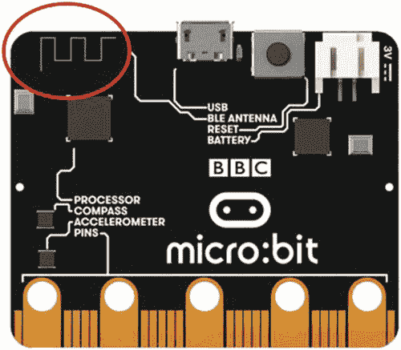
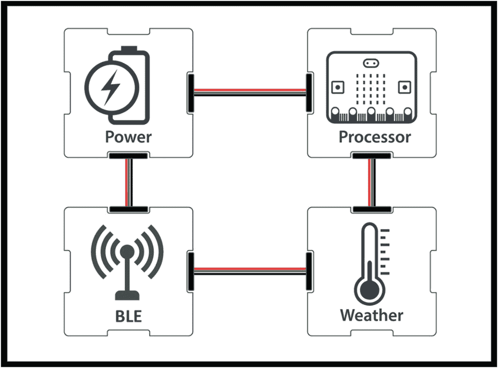
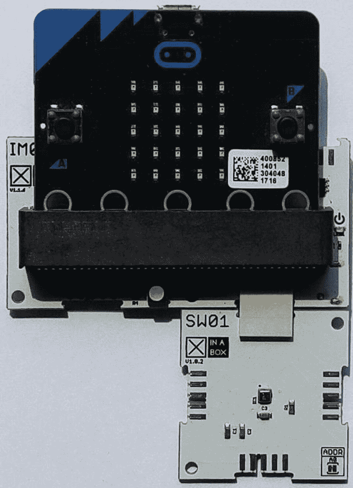
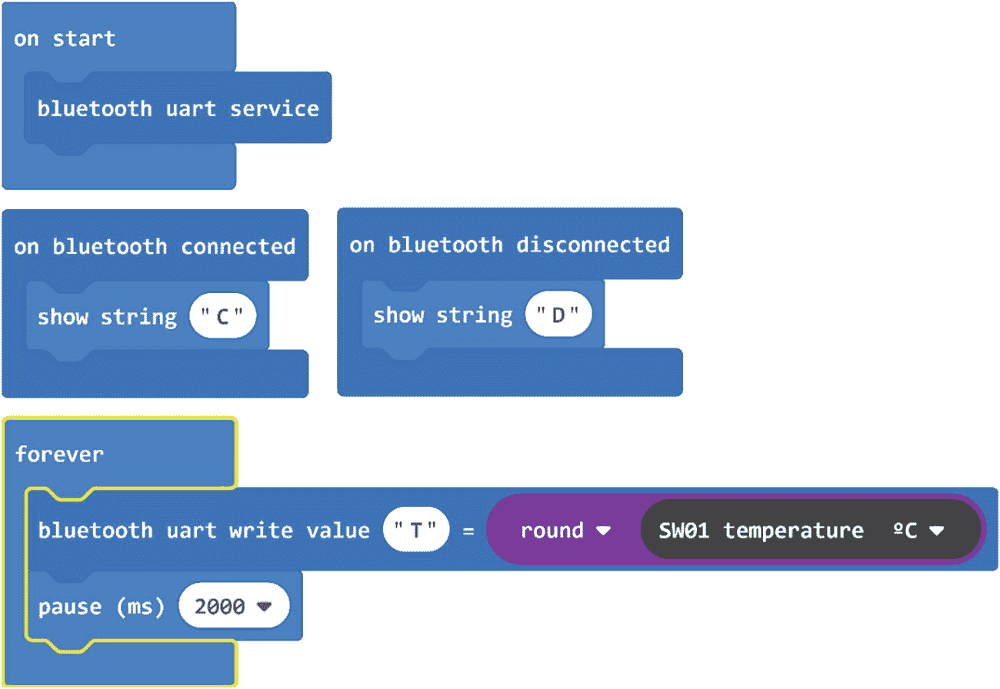
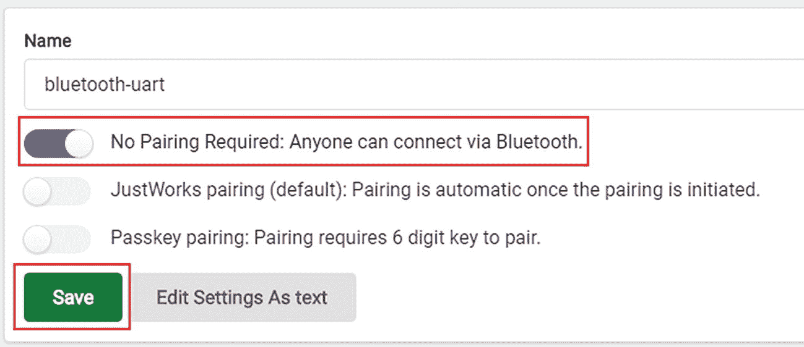
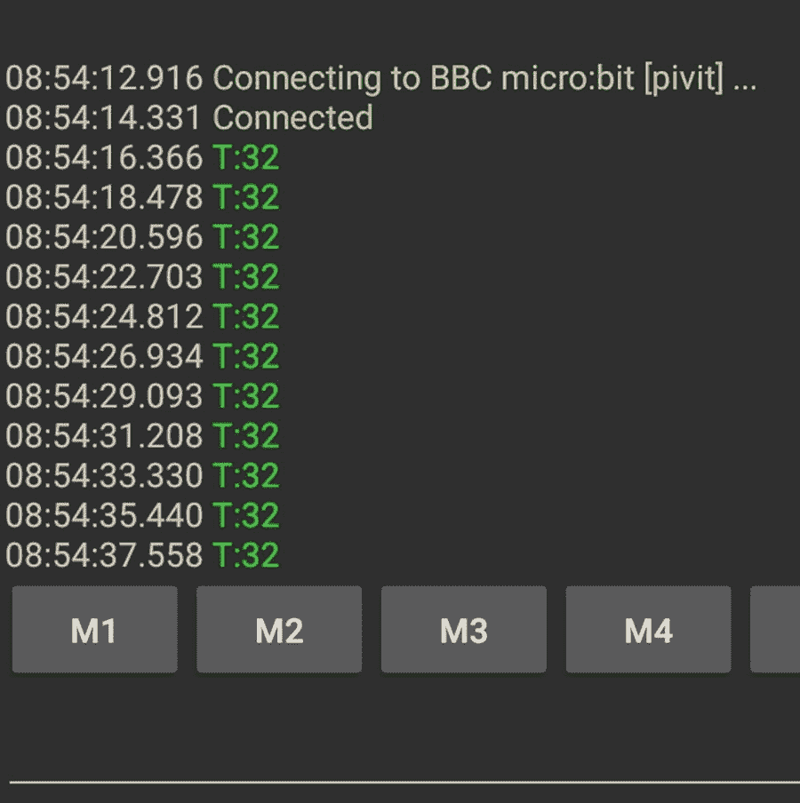

# 7. 使用蓝牙进行数据科学

在本章之前，我们已经探讨了如何使用 BBC `micro:bit` 构建数据采集工具，使我们能够进行有意义的真实世界数据科学实验。在这个过程中，我们发现了自身能力的一个缺陷：`micro:bit` 可以测量几乎无限量的数据，但保存这些数据或将其从 `micro:bit` 中取出（并放入我们可以使用的环境）一直是个挑战。

在第6章的结尾，我们得出结论，无线技术可以为我们提供在数据记录时提取数据的方法。在本章中，我们将探讨一种可用于实现此功能的技术：我们将了解蓝牙如何帮助满足这一需求。

## 7.1 什么是蓝牙？

从本质上讲，两个微处理器之间的无线通信是一个相对简单的概念。其工作原理如下：

1. 取两个微处理器，并为每个微处理器添加一个短距离无线电发射器。
2. 这些微处理器可以被编程来发送和接收无线电信号。
3. 因此，我们可以对其中一个微处理器进行编程，使其在特定频率上发送特定信号。
4. 我们可以对另一个微处理器进行编程，使其监听相同的特定频率，并在接收到特定信号时做出反应。
5. 这样，我们的两个微处理器就实现了无线通信。

蓝牙是一套管理无线通信的规则和程序：它是一个人们同意遵循的标准。它定义了该过程的五个组成部分如何实现：第一个处理器如何将数据转换为特定信号？使用什么频率？第二个处理器如何知道该消息来自第一个处理器，而不是来自恶意的第三个处理器？

当人类进行无线通信（即，交谈）时，我们使用口头语言。我们说出的话语传达含义，其他因素也同样如此，例如，我们如何强调词语、选择哪些词语以及说话的音量。我们不仅交流思想，也交流情感。为了让其他人理解我们所传达的所有深层含义和层次，他们需要理解我们使用的口头语言，以及支配这些细微差别的“规则”。我们话语形成的声音波就像无线电信号，而其他一切就像蓝牙标准。

在我们的数据科学之旅中，深入理解蓝牙标准并不特别相关，因此我们将在需要使用时挑选出所需的关键特性。现在只需知道蓝牙是管理无线通信的一种标准方式，并且：

* 这套标准/规则列表是由人们编写并由人们维护的。
* 通过拥有一个已商定的标准，不同的制造商可以构建相互兼容的“蓝牙”设备。
* 蓝牙技术联盟（`SIG`）确保蓝牙规范得到维护、推广、保护，并在必要时进行更新。他们使其与不断变化的技术格局保持相关性。
* 如果某个设备遵循了标准中规定的所有规则，那么将其称为“`支持蓝牙的设备`”是合理的。

## 7.2 为什么要使用蓝牙？

我们调查蓝牙适用性的最有力理由是，BBC `micro:bit` 内置了 `低功耗蓝牙` (`BLE`) 天线，如图 7-1 所示。`BLE` 是蓝牙的一个版本，其设计旨在非常经济地使用电量。

图 7-1 micro:bit 背面，`BLE` 天线已圈出

如果板载的 `BLE` 能够满足我们在第6章中确定的需求，那么我们的拼图最后一块就位了，我们可以将云服务和物联网添加到我们的数据科学工具包中。

## 7.3 在 micro:bit 上使用 BLE

我们使用无线通信的主要目标是收集我们的数据，然后将其传输到更合适的位置：可能传输到像 `Excel` 这样的程序，或者传输到 5000 英里外的服务器，甚至可能传输到人工智能服务。很简单！

当你们听到并非如此简单时，应该不会感到惊讶：在 `micro:bit` 上使用 `BLE` 能做的事情有一些限制：

* 无法选择在 `MicroPython` 中使用 `BLE`。
* 在 `MakeCode` 中，最稳定的 `BLE` 实现是使用 `UART` 线缆——也就是说，它不是无线的。

尽管存在这些限制，在追求数据科学的过程中，我们仍然有多种方式可以利用 `BLE`，但我们需要首先了解一些有关 `BLE` 如何处理数据的知识：

* `BLE` 规范要求 `BLE` 设备拥有一个 `配置文件`，该文件包含关于设备及其能够提供的数据（称为 `服务`）的信息。
* `micro:bit` 有一个 `配置文件`，定义了它将根据请求共享的数据（即，它提供的 `服务`），包括来自加速度计、磁力计、板载温度传感器、按钮以及一些其他组件的数据。
* 当另一个 `支持 BLE 的` 设备与 `micro:bit` `配对`^(¹¹)时，两者都会共享其配置文件，并且各自都可以访问对方提供的数据服务。
* 术语 `任意数据` 指的是未包含在配置文件中的任何数据。如果我们向 `micro:bit` 添加一个外设，例如气象站或 `CO2` 监测器，来自该外设的数据就是任意数据，并且不能作为一项服务提供。

我们的范围比 `micro:bit` 原生提供的数据更广泛。我们可能今天想测量天气，明天想测量 `CO2` 水平，后天想测量土壤酸度。对于仅使用加速度计和/或磁力计数据的实验，`micro:bit` 和 `BLE` 是一个很棒的组合，但对于其他所有情况，我们将需要另一种解决方案。

不过，有一些巧妙的 `BLE` 使用方法可能对我们有价值，例如，基于 `MakeCode` 的 `Bluetooth UART` 允许我们将 `任意` 数据传输到连接的智能设备上；我们将在第 7.4 节中对此进行探讨。还有其他一些使用 `USB` 线缆的实现也相当稳定。但是，对于任何需要 `micro:bit` 通过 `USB` 线缆连接到计算机的用例，第 6 章中提到的 `Excel Data Streamer` 是难以超越的。

## 7.4 使用蓝牙 UART 构建 BLE 气象站

我们将重建气象站，使其利用 `Bluetooth UART`：我们将数据从 `micro:bit` 直接传送到智能设备。

图 7-2 展示了一个支持 `BLE` 的数字气象站仪器的模块电路图。

图 7-2 支持 `BLE` 的数字气象站电路图

表 7-1 列出了我们将用于构建蓝牙气象站工具的硬件。

**表 7-1** 蓝牙气象站工具的硬件需求

| 你需要什么 | 我们使用的物品 | 数量 | 替代方案 |
| --- | --- | --- | --- |
| 微处理器及向其烧录代码的方法 | `micro:bit` | 1 | `Adafruit Feather 32u4 Bluefruit LE` |
| 电源 | 带 `JST` 连接器的 `2xAAA` 电池盒 | 1 | 锂聚合物电池 – 3.7v |
| 读取天气数据的传感器 | `XinaBox SW01` | 1 | `Adafruit BME280 I2C` 或 `SPI 温度` `湿度压力传感器` |
| 向应用程序发送天气数据的蓝牙无线电 | `micro:bit` 内置蓝牙无线电 | 1 | `Adafruit Bluefruit LE Shield` |
| 将所有部件连接起来的方法 | `XinaBox IM01` `micro:bit` 桥接器和 `xBus` 连接器 | 11 | 连接线 |

选择合适的工具，并按照图 7-3 所示组装部件。

图 7-3 使用 `micro:bit` 内置蓝牙无线电的气象站

## 7.5 使用串口蓝牙终端应用

我们将通过蓝牙 `UART` 向智能手机/平板电脑发送数据。为此，我们的智能设备需要具备蓝牙功能，并且我们需要在其上安装一个兼容的应用。在 Google Play 上可以找到许多适用于 `micro:bit` 蓝牙 `UART` 的应用；我们测试了其中很多应用，发现有些在基于蓝牙 `UART` 的数据传输方面表现不错，但我们也遇到了一些问题。我们发现，大多数时候都能成功连接的应用是 `Serial Bluetooth Terminal`。

蓝牙 `UART` 的带宽很低，这意味着你无法非常快速地发送大量数据。对于一次发送小块数据来说，它已经足够用了。

请在运行 Android 操作系统的智能手机/平板电脑上从 Google Play 安装 `Serial Bluetooth Terminal` 应用。目前，该应用没有适用于 iOS 用户的版本。

## 7.6 编写 BLE 气象站代码

我们需要编写的代码与我们之前的气象站代码（例如，第 3 章，第 3-7 节）非常相似：主要区别在于我们必须开启蓝牙 `UART` 服务并通过该服务输出数据（而不是将数据输出到屏幕上）。自然语言代码只有细微差别。

表 7-2：低功耗蓝牙气象站的自然语言代码

| 步骤 | 自然语言代码 | 备注 |
| --- | --- | --- |
| 1 | 导入任何必要的库。 | 我们需要一个用于气象传感器和蓝牙的库。 |
| 2 | 启动蓝牙 `UART` 服务。 | 蓝牙 `UART` 服务允许其他设备（如智能手机/平板电脑）与 `micro:bit` 交换任意数据。 |
| 3 | 重复以下步骤。 |  |
| 4 | 从气象传感器读取温度。 | 如果你愿意，也可以使用湿度或气压。 |
| 5 | 通过蓝牙 `UART` 发送温度数据。 | 我们通过 `BLE` 将数据发送到运行在智能设备上的 `Serial Bluetooth Terminal` 应用来输出数据。 |

**无代码选项**：您可以在我们的资源网站上找到本节所用代码的预编译版本。请访问 [`http://xib.one/XB`](https://nam12.safelinks.protection.outlook.com/?url%253Dhttp%253A%252F%252Fxib.one%252FXB%2526data%253D02%257C01%257C%257C96ee9c32c458423e9b6a08d7c36cd73f%257C84df9e7fe9f640afb435aaaaaaaaaaaa%257C1%257C0%257C637192744542720716%2526sdata%253D0W1OfWTmIx3U20MIwolvjFvh9lCQJVpw9KNNvUwCdU8%253D%2526reserved%253D0) 并搜索第 7.6 节。

图 7-4 显示了 `micro:bit` 低功耗蓝牙气象站的完整 `MakeCode` 程序。

图 7-4：向运行在智能手机/平板电脑上的 `Serial Bluetooth Terminal` 应用发送气象传感器数据的 `MakeCode` 模块

> **注意**
> 代码编写为仅发送温度。通过修改，你也可以添加湿度和气压数据。但是，一次发送的数据越多，由于带宽低而遇到困难的可能性就越大。如果我们想要同时发送多个数据点，这种方案的扩展性并不好。

在将代码下载并烧录到 `micro:bit` 之前，还有一件事要做：

图 7-5：蓝牙 `UART` 的配置设置

- 进入项目设置（点击页面右上角的齿轮图标）。
- 选择无需配对：任何人都可以通过蓝牙连接选项（图 7-5）。
- 点击保存以保存新设置，然后返回编辑器。

现在编译你的程序并将其烧录到你的 `micro:bit` 上。重置你的 `micro:bit` 并保持供电。

启动你安装在智能手机/平板电脑上的 `Serial Bluetooth Terminal` 应用，从菜单（左上角）中选择 `Devices` ➤ `BLUETOOTH LE`。然后从列表中选择你的 `micro:bit` 的名称。该应用将连接到你的 `micro:bit`。同时，字母 "C" 将显示在 `micro:bit` 的 5x5 LED 矩阵上。之后，温度数据将显示在应用的终端上（图 7-6）。

> **注意**
> 有时你的应用可能无法在第一次尝试时连接到 `micro:bit`。请多尝试几次，如果问题仍未解决，请重启应用/`micro:bit`。如果几次尝试后仍然无法工作，请尝试 Wi-Fi，我们将在第 9 章中讨论。

图 7-6：传感器数据显示在应用的终端上

我们已经成功地从 `micro:bit` 上无线提取了数据。你现在可以使用正在用来查看这些数据的应用中的工具了。

关闭应用将断开你的智能手机/平板电脑与 `micro:bit` 之间的 `BLE` 连接。

## 7.7 micro:bit 上 BLE 的其他选项

`MicroPython` 不支持 `BLE`，并且在 `MakeCode` 中支持有限，但是有很多其他方法可以编写 `micro:bit` 代码：可以在诸如 `ArduinoIDE` 或 `mBed` 等平台上开发应用程序，从而开启更多可能性。我们的网站提供了一个我们整理的应用程序，它使用 `ArduinoIDE` 为 `micro:bit` 构建了一个支持 `BLE` 的气象站，该气象站可以连接到物联网。

这个例子开始展示 `BLE` 在 `micro:bit` 上的真正潜力，但它复杂且冗长，不适合学习者或初学者，并且比其他潜在解决方案复杂得多，我们将在后面的章节中开始探讨这些解决方案。

## 7.8 总结

`micro:bit` 上可用的蓝牙版本（`BLE`）提供了一些工具，这些工具在我们进行数据科学工作时可能非常有用。如果我们只需要 `micro:bit` 自带的数据，或者可以接受有限的数据，或者有线解决方案就足够了，那么 `BLE` 有很多优势。但这些限制令人感到局限，而且 `BLE` 并不能让我们自由、轻松地访问物联网或云端。

在本章开始时，我们着手寻找一种从 `micro:bit` 无线提取数据的方法；虽然 `BLE` 有一些非常有趣和实用的应用，但它也有局限性。

我们将把 `BLE` 添加到我们的工具箱中，但我们会继续寻找无线解决方案。`BLE` 有很多优势，是一项非常有前途的技术，但只要我们将 `micro:bit` 作为数据收集工具的核心，这些限制就会制约我们的能力。

## 脚注

[1] (#486852_1_En_7_Chapter.xhtml#Fn1_source)

