# 8. 探索 micro:bit 无线电

在第 7 章中，我们看到 `micro:bit` 上的 `BLE` 功能由两个完全不同的组件组成：

- 一个物理板载无线电发射器/接收器（天线）
- `BLE` 标准，这些标准管理着传输内容、传输方式以及如何处理接收到的消息

`BLE` 充当管理者：它管理着天线的使用方式，但与天线是完全分离的。可以绕过 `BLE` 直接访问无线电，由我们自己来管理天线。本章将介绍如何利用 `micro:bit` 无线电为我们数据科学工具箱增添价值。

## 8.1 标准至关重要

`BLE` 的一项出色功能是允许 `micro:bit` 与其他（支持 `BLE` 的）设备进行通信。它可以与手机、平板电脑和笔记本电脑配对，但不能与其他 `micro:bit` 配对。

如果没有 `BLE` 标准来管理无线电通信，我们将面临类似于听到某人用我们不熟悉的语言说话时所遇到的问题：我们能听到他们发出的声音，但无法从中提取含义。两个无线电设备可以无休止地发送和接收信号：除非发送方和接收方都同意使用一种共同的语言，否则它们将无法理解彼此。

某种通信标准是必要的：如果我们放弃 `BLE`，就必须用其他东西来代替它。`MakeCode` 和 `MicroPython` 都提供了一种替代方案，一种更简单的使用板载无线电的方法。

## 8.2 使用无线电进行输入/输出

我们已经了解了如何将数据写入 `micro:bit` 的内存、如何将数据打印到屏幕以及如何通过 `BLE` 连接传输数据。在所有这些情况下，我们所做的事情都非常相似：我们都在输出数据。无线电只是我们可以输出数据的另一个地方：我们不是告诉微处理器将数据发送到屏幕或文件，而是告诉它通过天线进行传输。

`MicroPython` 和 `MakeCode` 都提供了将板载天线用作数据通信工具的工具。它们应用的标准不同；其主要后果是，使用 `MicroPython` 编写的代码运行的 `micro:bit` 无法通过无线电与使用 `MakeCode` 编程的 `micro:bit` 进行通信。

`MakeCode` 和 `MicroPython` 都提供了使用天线所需的基本功能：它们允许将数据转换为无线电信号，进行无线传输，然后在接收时再转换回数据。我们知道，如果我们（例如）将数字“4”或单词“hello”转换为无线电信号并传输，那么另一端的 `micro:bit` 接收到这个信号后，就能解释出“4”或“hello”的含义。但正如我们将看到的，在代码中我们仍有工作要做。

板载无线电的一个限制是它只允许 `micro:bit` 与其他 `micro:bit` 通信。我们可以用它来构建一个封闭的 `micro:bit` 网络，这些 `micro:bit` 可以相互通信。我们如何在数据科学工作中有意义地使用它呢？

## 8.3 使用无线电构建网络

在第 1 章中，我们看到温度计记录的是环境温度，即传感器附近极小空间体积的温度。

要测量一个房间/大区域的温度，并确保我们对结果有信心，最好对几个不同位置进行采样，并基于多个数据点得出答案。`micro:bit` 无线电是完成这项工作的完美工具。

我们要做的是构建一个由 `micro:bit` 组成的小型网络；我们使用四个，但两个也行，而且这个练习可以扩展到更多数量。我们的网络将按如下描述运行：

- 我们将让四个 `micro:bit` 通过无线电相互通信。
- 网络中的一个 `micro:bit` 将与其他 `micro:bit` 不同：我们将其称为 `服务器` 或 `收集器`，它的工作是监听网络中其他 `micro:bit` 发出的无线电信号。
- 其他三个 `micro:bit` 是 `节点`。它们是一样的，其工作是测量温度并传输结果。
- `服务器` 将监听网络中 `micro:bit` 发出的温度数据。当它接收到所有节点的数据后，它会汇总数据并显示平均值。

`图` `8-1` 描绘了一个基于无线电的简单 `micro:bit` 网络，包含三个 `节点` 和一个 `服务器`。

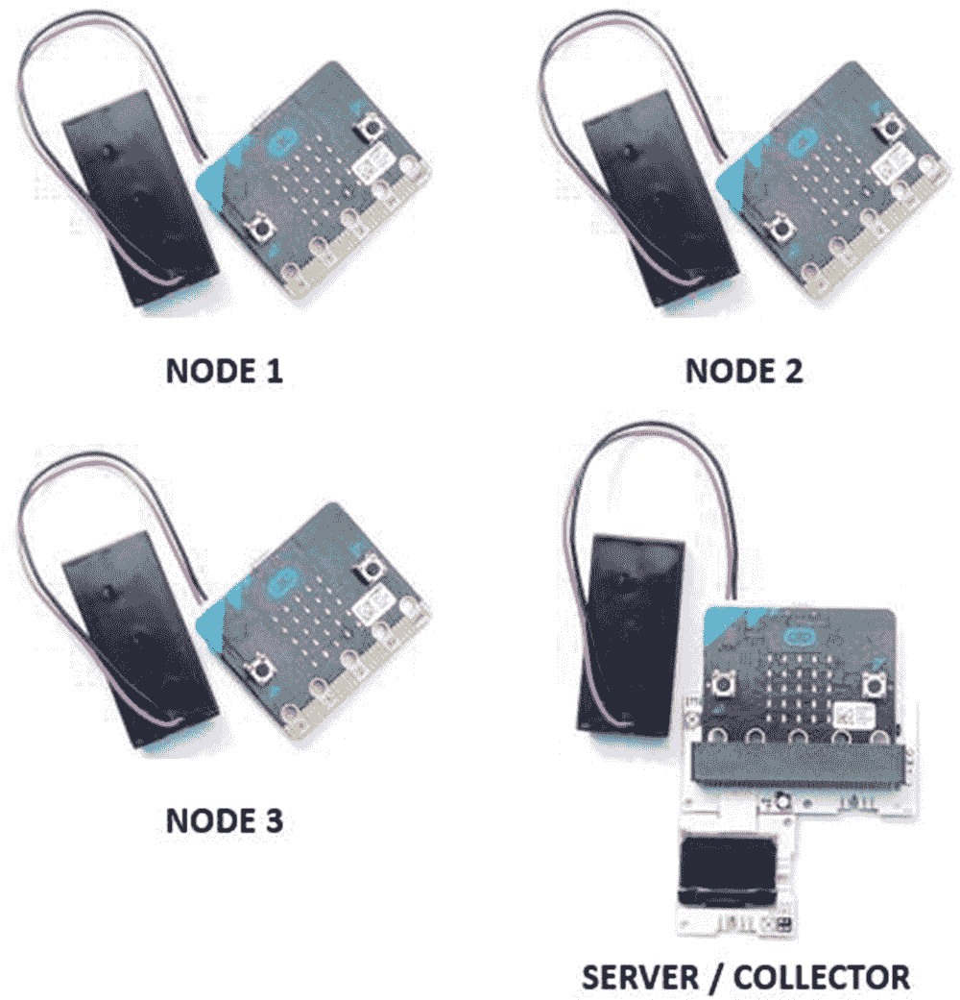

`图` `8-1`

我们的网络由四个独立的仪器组成

## 8.4 选择 MakeCode 还是 MicroPython

`MicroPython` 和 `MakeCode` 处理无线电通信的方式存在一些细微差别。其中最明显的是关于组/通道：

- 在 `MakeCode` 中，有 256 个组，范围从 0 到 255。要在 `micro:bit` 上使用无线电功能，你必须将其分配到一个组。
- 在 `MicroPython` 中，有 84 个（一些资料声称是 100 个）通道，编号为 0–83，可用于发送/接收信号。

在本章的剩余部分，我们将使用 `MakeCode`：我们的目标是理解 `micro:bit` 上的无线电如何为我们的数据科学实验增加价值，而 `MakeCode` 使用起来稍微简单一些。此外，避免考虑 `MakeCode` 和 `MicroPython` 在实现无线电方面的微妙但武断的差异，将确保我们始终专注于核心信息。

## 8.5 MakeCode 无线电组

当我们通过无线电发送数据时，假设是数字“4”，`MakeCode` 标准会用其他数据（例如 `组 ID`）对其进行填充。所以，当你告诉 `MakeCode` 发送“4”时，实际发送的内容可能看起来更像是“32_4”（这做了简化，但说明了问题）。所有数据一起发送，被称为一个 `数据包`。

`Micro:bit` 在每个 `数据包` 内广播其 `组 ID`。此外，一个 `micro:bit` 只会处理包含相同 `组 ID` 的消息。`图` `8-2` 显示了部署为两个组的六个 `micro:bit`。

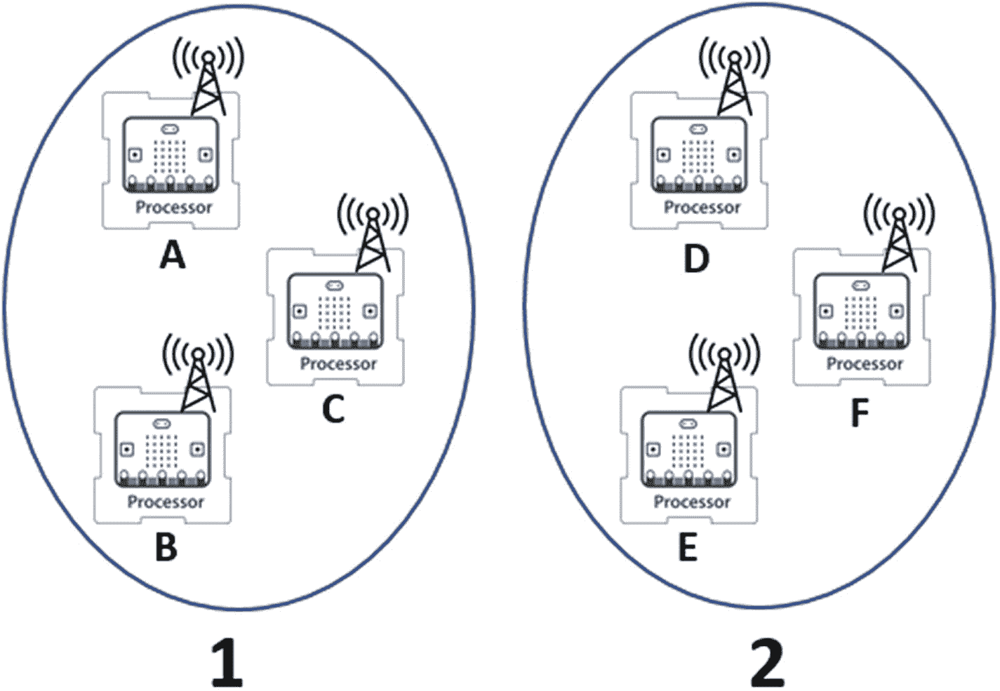

`图` `8-2`

部署为两个组的六个 `micro:bit`

在组 1 中，`micro:bit` A、B 和 C 在发送 `数据包` 时都使用相同的 `组 ID`，并且它们只处理接收到的包含该 `组 ID` 的 `数据包`。它们可以相互通信，但不能与组 2 中的 `micro:bit` D、E 和 F 通信。组 2 中的 `micro:bit` 会忽略来自组 1 的任何消息，反之亦然。

`Micro:bit` 无线电不执行单向或双向通信。相反，它就像广播电台播放音乐和声音一样广播数据。如果任何 `micro:bit` 想要接收另一个 `micro:bit` 广播的数据，它们只需要处于同一组即可。

## 8.6 节点与收集器

为了构建我们的联网温度计，我们将设计一个简单的无线电网络，它由几个 `节点` 和一个 `收集器` 组成：

- `节点` 收集数据并将其传输给同一组中的其他 `micro:bit`。
- `收集器` 监听来自 `节点` 的数据，并以某种预定的方式对这些数据做出响应。

我们将使用的示例包括三个 `节点` 和一个 `收集器`。你可以通过添加或移除 `节点` 来调整网络规模；如果这样做，你需要修改代码。一个最多包含十个 `节点` 的 `micro:bit` 网络应该是相对稳定的。

`图` `8-3` 显示了我们将要构建的无线电网络：

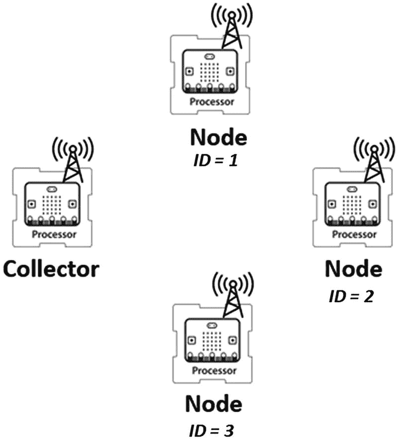

`图` `8-3`

我们简单的无线电网络，包含三个 `节点` 和一个 `收集器`

每个 `节点` 都有一个唯一的 ID，我们将在代码中定义它。它们各自测量 `环境温度`（使用内置的 `micro:bit` 温度计），然后广播温度和它们的 `节点 ID`。其间会设置一个 5 秒的时间延迟。

`收集器` 将监听无线电传输。当它接收到一条带有正确 `节点 ID` 的消息时，它会从 `数据包` 中提取 `温度` 和 `节点 ID`。它将等待直到网络中所有 `节点` 都报告了它们的温度；然后它会计算出平均温度并显示出来。

## 8.7 构建节点

我们将构建三个节点。每个节点所需的硬件非常简单：只需一个 `micro:bit` 和一个电源。我们将使用板载温度传感器、天线以及 5x5 LED 矩阵来显示“消息已发送”状态。`图` `8-4` 展示了我们的三个节点。

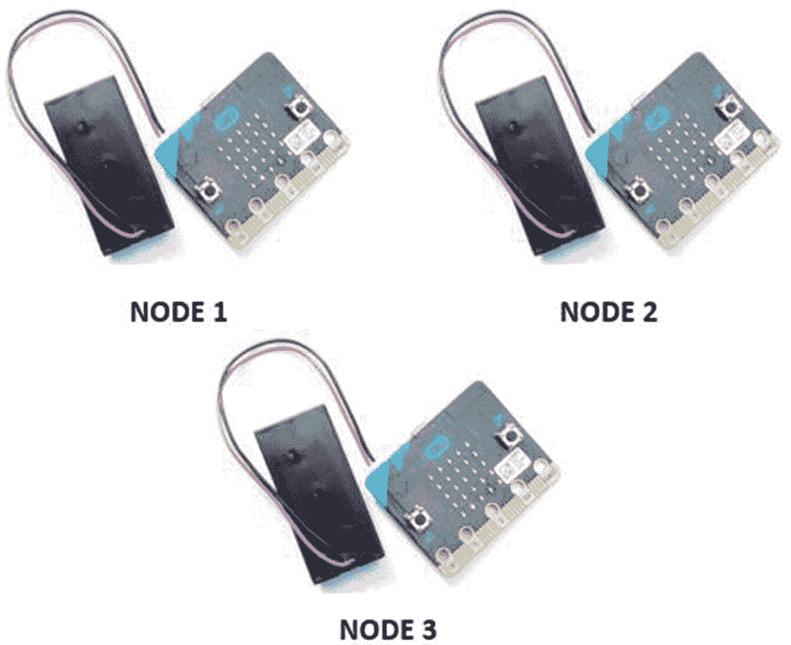

`图` `8-4` 三个 `micro:bit` 温度传感器节点

我们需要编写的代码以自然语言形式在`图` `8-5` 中说明。

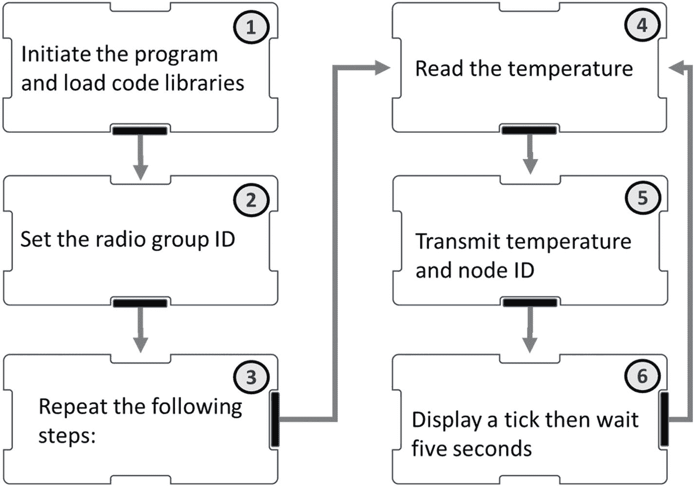

`图` `8-5` 传感器节点的自然语言代码

**免代码选项**：您可以在我们的资源网站上找到本节所用代码的预编译版本。访问 [`http://xib.one/XB`](http://xib.one/XB) 并搜索 **第 8.7 节**。

`表` `8-1` 展示了如何将前面的自然语言代码转换为可编译并加载到节点中的 `MakeCode` 代码块。

`表` `8-1` 使用 `MakeCode` 代码块开发传感器节点代码

| 步骤 | 描述 |
| --- | --- |
| 1 | 确保你的 `MakeCode` 项目包含 `Radio` 扩展。如果没有，请使用 `Extensions` 选项将其添加到项目中。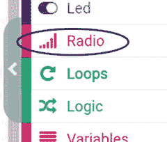 |
| 2 | 将 `radio set group` 代码块添加到 `on start` 代码块中。除非你需要不同的组 ID（有效范围：0-255），否则请使用默认的 `group ID`。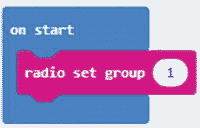 **注意** 所有节点使用相同的组 ID。 |
| 3 | 重复以下步骤。 |
| 4 | 将 `radio send value` 代码块添加到 `forever` 代码块中。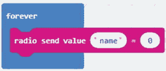 这将以名称-值对的形式发送数据：我们将发送 `Node ID`（节点 ID）作为名称，温度作为值。 |
| 5 | 在 `name` 框中输入 `Node ID`。为其他节点使用*不同*的 `Node IDs`。然后将 `temperature` 代码块添加到 `value` 框中：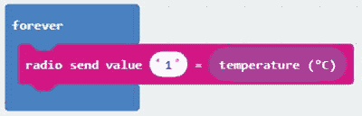 |
| 6 | 在 `radio send value` 代码块之后添加以下代码块：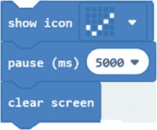 `show icon` 代码块用于在数据包发送后在 `micro:bit` 的 5x5 LED 矩阵上显示一个对勾符号。`pause` 代码块用于每 5 秒发送一次数据。 |

`图` `8-6` 展示了 `micro:bit` 传感器节点 1 的 `MakeCode` 代码块。

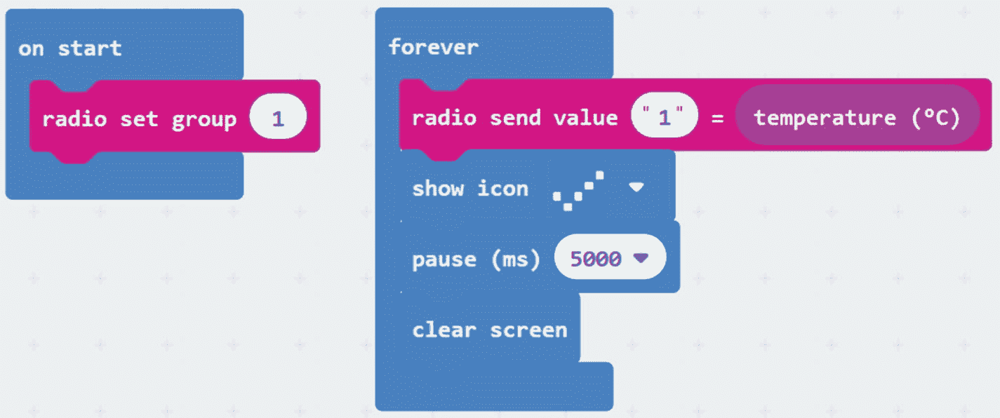

`图` `8-6` 传感器节点 1 的 `MakeCode` 代码块。它位于无线组 1 中，节点 ID 为 1

现在编译代码并将其烧录到你的 `micro:bit` 上。将其标记为节点 1；然后修改其他节点的代码（只需修改 `radio send value` 代码块）并同样进行烧录。

## 8.8 构建服务器/收集器

我们的服务器/收集器也将使用 `micro:bit` 和电源，但我们会添加一个 OLED 显示屏来查看数据（`图` `8-7`）。

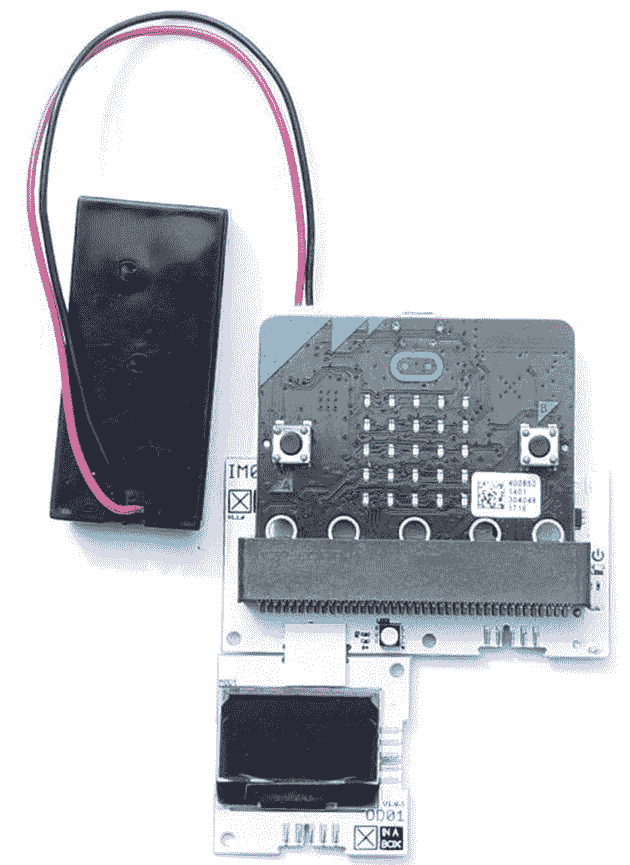

`图` `8-7` 服务器/收集器

代码需要以何种方式工作，在`图` `8-8` 中以自然语言形式进行了概要说明。

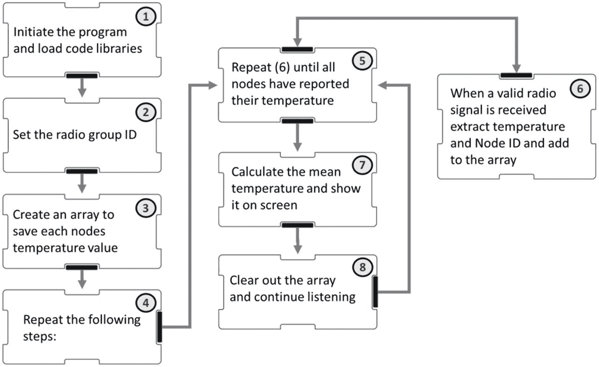

`图` `8-8` 收集器的自然语言代码

**免代码选项**：我们的资源网站提供了适用于 1、2、3 和 4 个节点的服务器/收集器代码版本。访问 [`http://xib.one/XB`](http://xib.one/XB) 并搜索 **第 8.10 节**。

虽然自然语言代码相对简单，但将其转换为 `MakeCode` 代码块（或 `MicroPython`）对于经验不足的程序员来说将是一项艰巨的任务。我们实际上是在构建一个服务器，一个非常简单的服务器，但尽管如此，这仍然是一项重要的编程任务。

完整的 `MakeCode` 代码块程序（包含好几页）在`图` `8-9` 中展示。如果您有兴趣了解自然语言代码的每一步是如何转换为代码块的，请查看配套网站。

如果您对代码本身不太感兴趣，而更关心这些设备所能支持的数据科学应用，那么请问问自己以下问题：

1. 您能否修改代码，使其适用于其他测量值，例如湿度或二氧化碳水平？
2. 您能否修改代码以添加更多节点？
3. 您能否向程序员描述您的需求，以便他们可以修改代码？

如果您对问题 (3) 的回答是肯定的，那么您是否会编程其实并不重要。掌握出色的编程技能对于数据科学家来说是一项很好的本领，但即使没有这项技能，您仍然可以成为一名优秀的数据科学家。在后续章节中，我们将连接 `Wi-Fi`、构建物联网应用，并与人工智能进行通信。在这些实例中，我们使用的代码都不会像以下代码那样复杂。非编程人员：请坚持下去！

`图` `8-9` 展示了 `micro:bit` 收集器的 `MakeCode` 代码块。

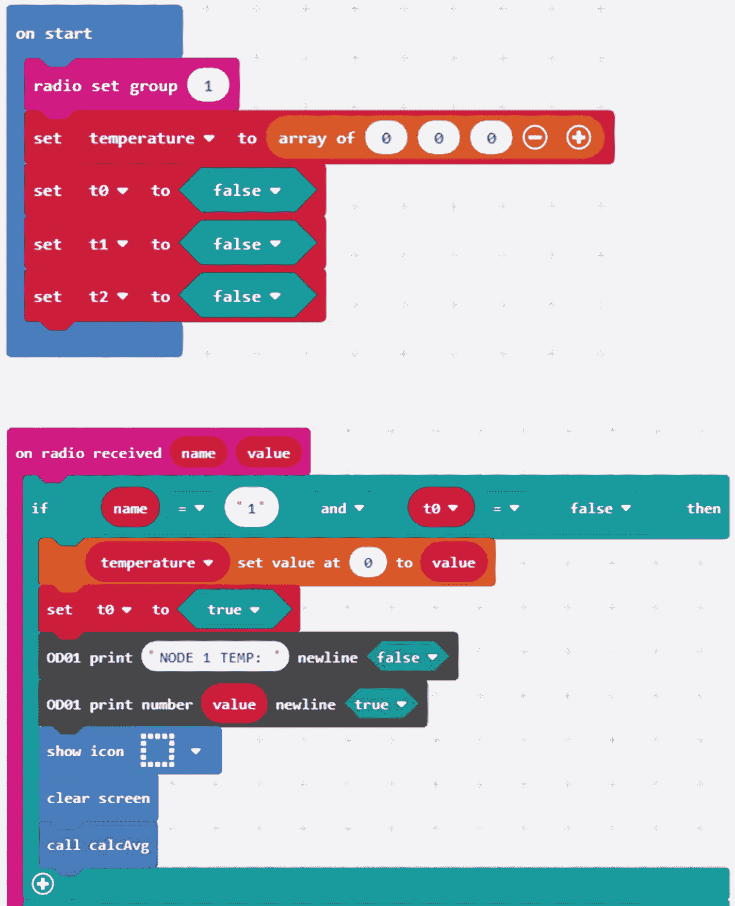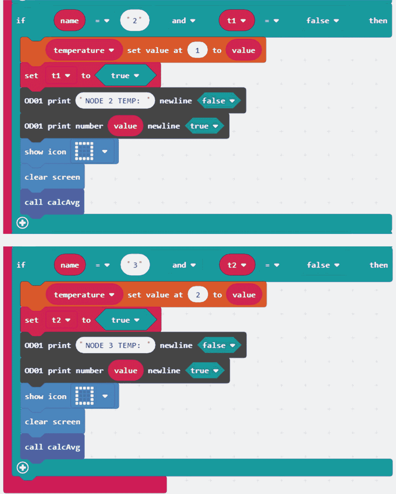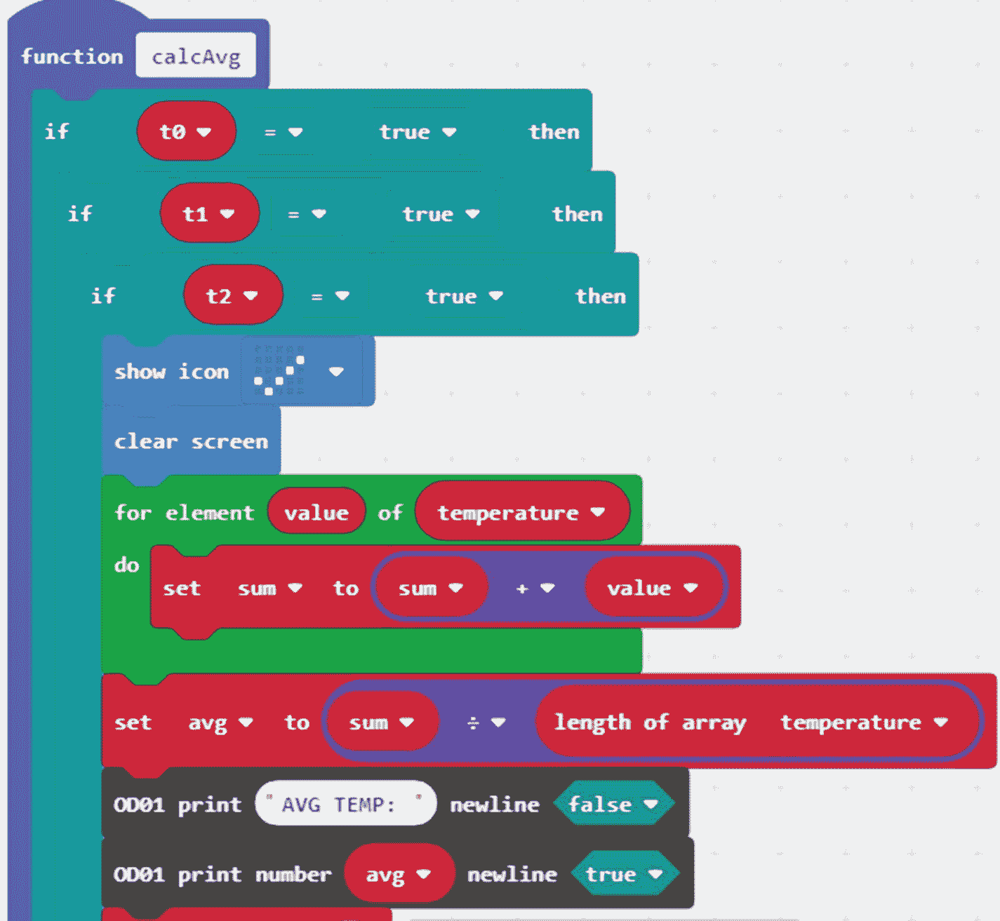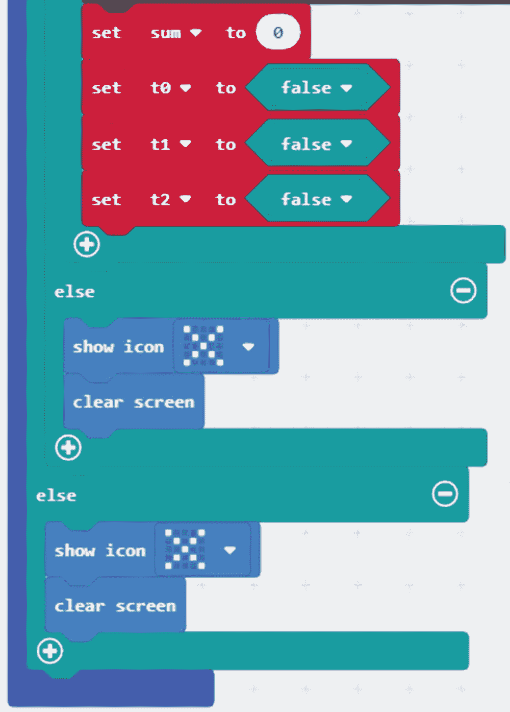

`图` `8-9` `micro:bit` 收集器的 `MakeCode` 代码块

将代码烧录到收集器中，然后给它上电。确保节点也已上电。

收集器将监听组 1 的频道，当它收到来自其程序中设定的监听节点的消息时，它会从该消息中提取温度数据并显示在屏幕上。当所有节点的数据都接收完毕后，收集器会在 OLED 屏幕上显示平均温度（`图` `8-10`）。

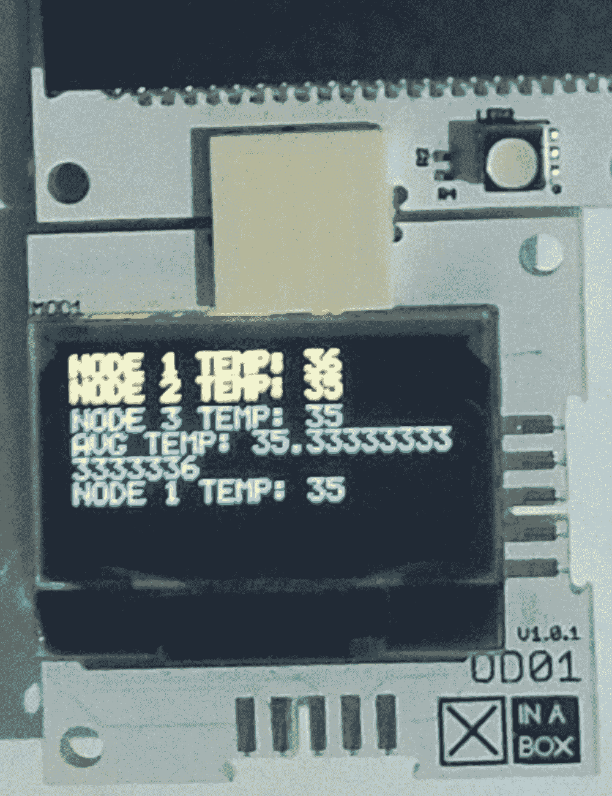

`图` `8-10` OLED 屏幕显示来自每个传感器节点的温度以及计算出的平均温度

通过将节点放置在偏远位置来测试你的网络：它们能离收集器多远？“视线”对于通信范围有多重要？可以修改节点代码来发送其他类型的数据，我们在前面的章节中已经看到如何为 `micro:bit` 添加传感器。你还可以在网络上添加哪些传感器来提供有用的数据？

## 8.9 总结

无线电功能可用于创建能够相互通信的 `micro:bit` 封闭网络。我们之前构建的示例可以进行扩展：最多十个 `micro:bit` 应能在同一网络内协同工作。通过多个传感器节点向服务器报告数据，你可以监控和控制办公室、教室、异宠栖息地、核反应堆或任何无线电信号覆盖的区域。

然而，只要这些网络是封闭的，我们就无法利用物联网（`IoT`）的潜力，并且我们的应用范围将受限于 `micro:bit` 本身的能力。无线电功能可以被运用在我们的数据科学实践中，但在我们能够连接到云端并使用其提供的服务之前，我们的工具箱仍是不完整的。在第 9 章中，我们将为 `micro:bit` 添加 `Wi-Fi`，并最终打开通往物联网的大门。

