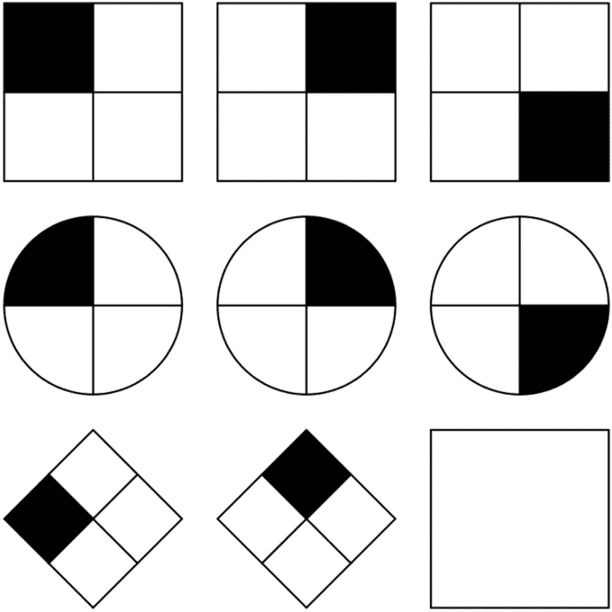
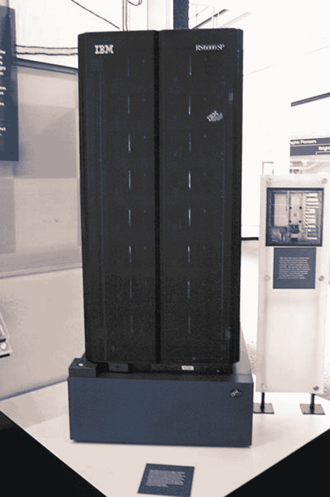
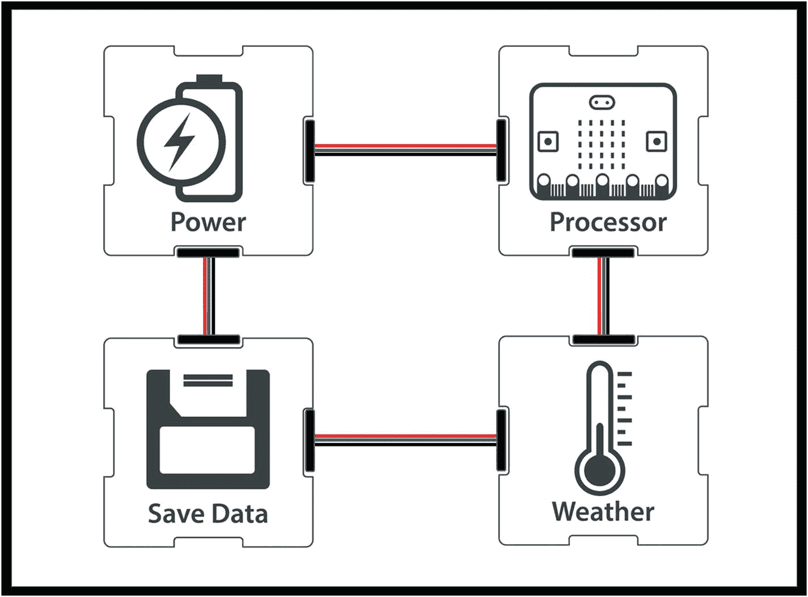
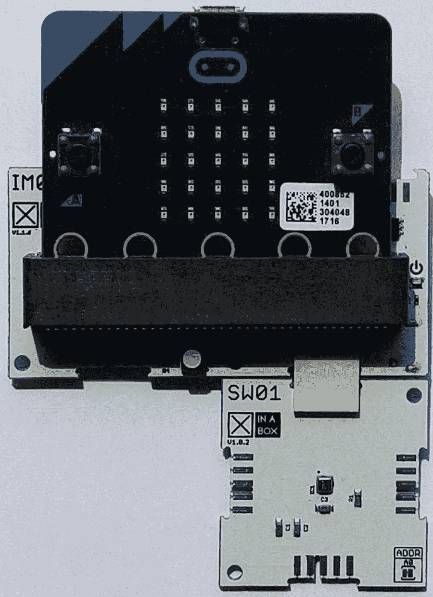
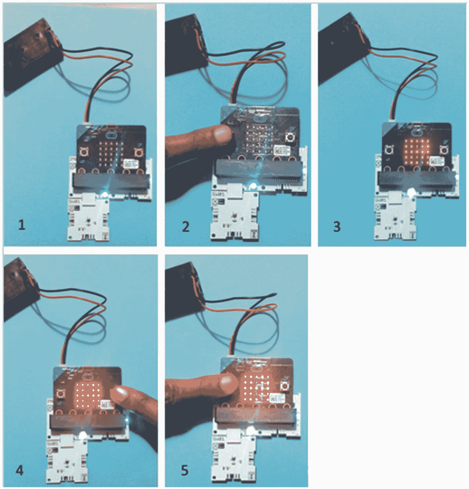
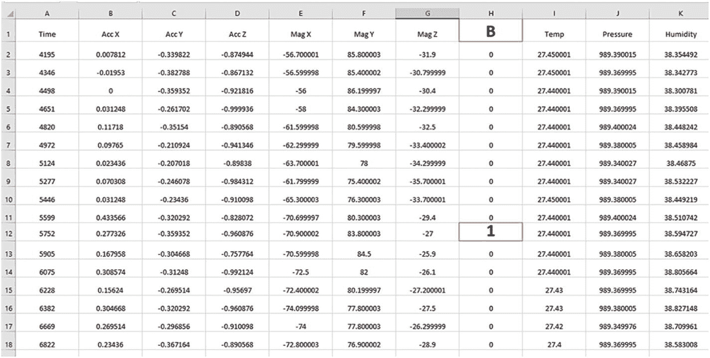
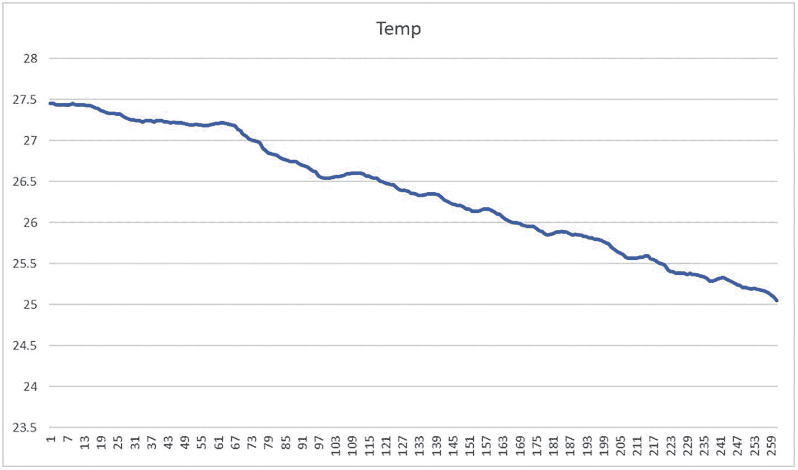
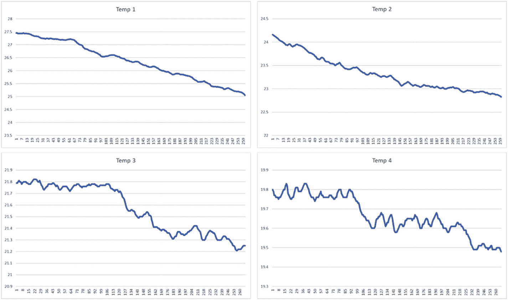

# 10. 机器学习和人工智能简介

> *HAL 9000*^((14))：“抱歉，戴夫，恐怕我做不到。”
>
> ——《2001：太空漫游》^((15))

在本章中，我们将通过数据科学的视角来审视人工智能 (AI) 和机器学习 (ML)：它们是什么，有何不同，以及它们能提供什么？

## 10.1 人工智能

要理解人工智能，我们首先需要理解真正的东西：什么是真正的智能？其他生物或机器是否拥有智能？我们人类，真的拥有智能吗？

借助我们对数据科学日益深入的理解，要客观地、以任何科学严谨的态度来回答诸如此类的问题，其挑战在于收集关于我们所研究对象的*数据*。而收集数据需要某种形式的*测量*。作为数据科学家，我们需要一个关于“智能”的简洁且客观的定义，以及一种测量它的方法。

但关于智能究竟是什么，并没有真正的共识；没有普遍的定义或便捷的测量工具。

智商测试（图 10-1）是测量“智能”最广为人知的方法。还有其他类似的测试，以及一些完全不同的方法，例如计算脑化指数或由训练有素的心理学家进行评估。

智商测试以及我们现有所有方法的问题在于，它们试图测量的对象缺乏明确性。智商测试的结果与在一系列有限的脑力技能上的表现相关，而这些技能受到设计该测试的科学家们的高度重视。这些脑力技能被认为是与“智能”紧密相关的因素。

也许当我们最终有了一个人人都认同的智能定义时，我们会观察到它与智商分数之间存在相关性。但我们可以确信的是，它只衡量了某人在一组任务中的表现如何。我们会质疑将智商数据外推并直接作为智能衡量指标的有效性和可靠性。

图 10-1

一个智商测试例题（来自瑞文标准推理测验示例）。哪个图案适合填入空白方格？来源：[`en.wikipedia.org/wiki/Intelligence_quotient#/media/File:Raven_Matrix.svg`](https://en.wikipedia.org/wiki/Intelligence_quotient%2523/media/File:Raven_Matrix.svg)

似乎不可避免的是，这种智商并非将我们与蛞蝓或树木区分开来的那种智能。*正是那种*智能才是计算机科学家及其资助者们的圣杯。

尽管“智能”一词定义模糊，但我们在识别他人以及非人类实体（例如海豚、黑猩猩或计算机）的`智能行为`时却毫不费力。

`智能行为`是满足以下条件的行动：

-   观察者不会将其归因于运气或对习得行为的模仿。
-   不是反射或自动反应：它们需要行为发出者的意志和洞察力。
-   其结果为该实体带来有利的结果，或避免不利的后果。
-   我们不会预期在相同情况下，其他类似实体会每次都重复该行为。
-   不是孤立事件。一个智能实体应预期会定期表现出`智能行为`。

因此，我们可以观察到行动中的智能。诚然，将某个行为标记为`智能行为`是主观的，但我们可以列举出广泛人群都会认同其符合`智能行为`门槛的行为。对于机器而言，一些示例如下：

-   它表现出一种并非被编程设定、但对达成目标有效的行为。
-   它表现出一种行为，达成了它未被编程设定要去追求的目标。

关注`智能行为`为我们提供了一种定义智能的实用方法：

-   智能是促使有机体或机器展示“`智能行为`”的驱动力。

具有讽刺意味的是，阿甘无意中说对了：“*蠢人做蠢事*”；对我们而言，这可以理解为“智能就是展现`智能行为`”。不过，他说得更好听一些。

## 10.2 人工智能/机器学习？

机器学习（ML）和人工智能（AI）这两个术语在新闻和社交媒体上经常出现，但很少有人清楚它们的区别。冒着因过度简化而惹恼专家的风险，AI 和 ML 的主要区别可以总结如下：

-   **AI** 专注于创造能够展现`智能行为`的机器。
-   **ML** 的核心目标是数据分析。它是 AI 的一个分支，专注于能够从经验中学习和改进的系统：提高其产生结果的质量和准确性，或寻找达成目标的新颖方法。

> ML 是 AI 的一个子集，本书后面章节所看的示例正是一个 ML 实现。

为了说明 AI 和 ML 的区别，请考虑这一点：当 AlphaGo 在棋盘游戏围棋中击败世界顶尖选手时，这是 ML 的胜利。如果 AlphaGo 为了不被发现，或为了确保其人类对手不至于太过沮丧而故意输掉一局，那才是 AI 的胜利。

我们不打算逐一分析构成 ML 的 14 种不同类型的学习。我们也不会去思考三四种不同类型的 AI，或探究究竟什么算 ML、什么不算。构成 AI 的核心元素虽然迷人，但我们也暂且略过。我们在此的目标是培养对 AI 的直观理解，并学习如何将其用作数据科学实验的工具。

## 10.3 机器学习/人工智能与数据科学

人工智能领域博大精深，仅用一章的篇幅我们几乎不可能触及皮毛。但浅尝辄止足以让我们在数据科学工作中运用 AI——就像我们不必从零造车就能驾驶汽车一样，我们同样可以在数据科学事业中利用 AI 服务，而无需亲自构建 AI 模型。

目前有大量可供公众使用的 AI 服务，其中许多是事务性的：将数据传入服务，利用数据执行某些操作，然后返回一些数据。这其实相当平凡。

使用某项服务并不需要真正了解其内部运作机制：它如何处理和转换我们的数据就像"黑箱"一样。不过，正如传感器的案例所示，为了有效使用这些服务，对它们处理数据的方式有个基本了解是理想的。在下一节中，我们将通过一个练习来帮助理解机器学习服务的运作原理。

关于 AI 的能力及其未来前景，存在大量炒作。但请明确一点，在实现新颖且直觉性的认知跨越方面，最聪明的 AI 也无法与你相提并论。AI 相对于我们的优势在于其处理数据的能力：处理令人难以置信的庞大数据集，并对其进行海量分析。

对于复杂的数据科学应用来说，AI 是一个非常强大的工具，但如果在整个过程中没有人类的参与，AI 不过是一台疯狂的机器——一只永远追逐自己尾巴的机器狗。AI 就像一位厨师，使用各种食材为人类主人准备完美的餐食，但这厨师却无法品尝自己的作品。最终，还是由人类来审视 AI 生成的任何事实/结论，并做出最重要的判断：这有趣吗？

20 世纪 AI 的转折点之一，是 1997 年 5 月 IBM 的深蓝超级计算机（图 10-2）在国际象棋中击败了特级大师、世界排名第一的加里·卡斯帕罗夫。这台计算机在六局系列赛中以 3.5 比 2.5 获胜，对很多人来说，这感觉像是人类智力优势终结的开始。从此以后，计算机在国际象棋上将永远"优于"人类——下一个领域会是什么？

但故事不止于此：卡斯帕罗夫提出了有力论据，认为发生了不正当行为（他用词是"作弊"）。他提出了一些支持论点；最有趣的是深蓝走出的某一步棋，卡斯帕罗夫坚信 AI 不可能构思出这样的棋步。深蓝在比赛进行时有若干人类操作员在维护，因此存在干预手段。当 IBM 拒绝卡斯帕罗夫重赛的要求并拆解深蓝时，卡斯帕罗夫的说法得到了更多证据支持。无论真相如何，这场人机大战都是重大新闻，深蓝的成功预示着一个新时代的到来：AI 已经来临。

**图 10-2**
IBM 的深蓝，摄于计算机历史博物馆。[`commons.m.wikimedia.org/wiki/File:Deep_Blue.jpg#mw-jump-to-license`](http://commons.m.wikimedia.org/wiki/File:Deep_Blue.jpg%2523mw-jump-to-license)

## 10.4 像机器一样思考

常言道，理解一个人的最好方式是设身处地。推而广之，要理解机器学习，执行一些机器学习服务所承担的同类功能是合情合理的。

我们将构建一个实验，要求我们经历数据分析过程中的若干步骤。该实验旨在调查某个目标行为，并观察其与我们捕获的一组环境数据之间是否存在任何相关性。

实验的真正意义不在于结果本身，而在于我们将能够进行的分析方式。我们在实验过程中所做的很多事情可以由 AI 完成，也有相当一部分是 AI 做不到的。通过并排比较这两类情况，我们将深入了解 AI 能为我们带来什么。

尽管如此，我们建议的这个实验确实也有潜力产生有趣的数据。关键在于选择正确的目标行为：

是什么让你决定起身去倒杯饮料？或者往椅背上一靠伸个懒腰？或者挠挠后脑勺？机器并不会表现出类似的行为特征，或"怪癖"。

这些有时随机、有时无意义、有时甚至是自动化的行为，是否预示着我们所寻求的那种难以捉摸的智能？还是说，某些环境刺激引发了你的这些反应？

仔细选择一个目标行为，然后系好安全带：这个实验可能会揭示关于命运与自由意志这一古老难题的洞见（剧透：它大概不会）。

## 10.5 实验设计

**表 10-1** 概述了我们将调查环境条件对目标行为影响的活动。

**表 10-1**
调查触发目标行为的因素

| 练习 10.1 | 环境因素是否会触发目标行为？ |
| --- | --- |
| 摘要 | 我们将记录目标行为表现出时的环境条件。然后审视这些环境测量数据，观察其是否与目标行为存在相关性。 |
| 分步流程 | 1. 决定要调查的目标行为。 2. 搭建"硬件"部分描述的数据采集工具，并烧录相应的代码。 3. 为数据采集工具寻找合适的位置。 4. 将工具放置在选定位置并通电。 5. 让设备持续运行。当目标行为出现时，点击`micro:bit`上的`B`按钮。 6. 一旦记录到 6 次行为实例，提取数据并加载到笔记本电脑/计算机上。 7. 使用笔记本电脑/计算机上的软件，按照"分析"部分所述进行数据分析。 |
| 我们将学到什么 | • 是否有证据表明，某些环境因素可能在触发目标行为中起作用？ • AI 服务为这类实验可能增添的价值。 |

实验包含两个不同的步骤：

1. 数据收集阶段
2. 数据分析阶段

我使用的目标行为是冲泡咖啡的冲动，我在办公桌前工作时每天会感到两到三次。这种冲动没有时间规律：我并非每天固定时间或每隔特定时间喝一杯。相反，我会发现自己不知不觉地走向厨房，常常并没有有意识地决定再去泡一杯。对我来说，这是一个非常合适的例子，但你需要找到一个对你有意义的例子。

# 10.6 硬件要求

我们的数字仪器需要包含的组件如**图** **10-3** 所示。

图 10-3 数据记录器的核心组件

**表** **10-2** 列出了我们将用于构建数据记录器（或称“目标行为监测仪器”）的具体硬件。

表 10-2 数据记录器的硬件要求

| 所需物品 | 我们使用的物品 | 数量 | 替代方案 |
| --- | --- | --- | --- |
| 微处理器及向其烧录代码的工具 | micro:bit 及用于连接笔记本/台式机的 micro-B USB 线缆 | 1 | Raspberry Pi Arduino XinaBox CS11 |
| 电源 | micro:bit 电池盒 | 1 | Seenov Inc 太阳能电池 |
| 读取天气数据的传感器 | XinaBox SW01 – 高级天气传感器 | 1 | SparkFun Weatherbit |
| 持久化存储器 | 带 microSD 卡的 Xinabox IM01 micro:bit 桥接器 | 1 | 微处理器板载内存 |
| 将所有组件连接起来的工具 | XinaBox IM01 micro:bit 桥接器 | 1 | 面包板、边缘连接器扩展板、鳄鱼夹导线及连接线 |
| xBus 连接器 | 1 |

在使用 microSD 卡之前，请确保已使用 `FAT32` 选项对其进行格式化。如果你不确定如何格式化 SD 卡，我们的**资源网站**上对此过程有详细说明。
格式化完成后，将 microSD 卡插入 `IM01` 背面的插槽中。

**我们使用的物品**一栏中描述的数据记录工具如**图** **10-4** 所示。

图 10-4 组装好的数据记录硬件

## 10.7 软件

我们可以为 micro:bit 编写软件，利用其板载内存来记录我们关注的数据：第 **4** 章描述的代码和技术即可实现此目的。不过，micro:bit 的内存限制会严重制约我们能够收集的数据量。
另外，Raspberry Pi、Arduino 或 XinaBox 的 CS11 核心也能支持所需的数据记录应用。还有一些其他解决方案可用于从 micro:bit 提取数据，例如 Excel Data Streamer。只要你能标记观察到目标行为的时间点，任何用于捕获传感器数据的技术都是可行的。

我们选择使用 micro:bit 和 XinaBox `IM01` 桥接器组合，因为它非常符合我们的需求，且操作简单。我们使用的代码将记录一系列不同的传感器读数，并将这些数据写入一个 `CSV` 文件。该文件保存在 `IM01` 桥接器上装载的 microSD 卡中。
编码部分并非本章的核心内容：我们不会引入任何新的编程概念，只是应用我们已经涉及的概念（将传感器数据保存到持久化存储器）。所需的软件可以从我们的资源网站下载，该网站还展示了如何使用 `IM01` 在 `MakeCode` 中复现代码：
访问 `http://xib.one/XB` 并搜索 **第 10.7 节**。

## 10.8 使用硬件

硬件构建完成后，即可通电并使用。**图** **10-5** 展示了我们硬件运行中的一些快照。

图 10-5 使用数据记录器记录目标行为出现时的环境条件。(1) 通电。(2) 按下按钮 A 开始记录。(3) 正在记录数据。(4) 按下按钮 B 标记数据。(5) 再次按下按钮 A 停止/恢复记录

按下 micro:bit 上的 `A` 按钮开始记录，并将其放在伸手可及的地方。像往常一样活动，直到你注意到自己表现出目标行为。此时按下 `B` 按钮。

当你按下 `B` 按钮时，你就“标记”了数据：数据文件中的一条记录会被标记为“1”。这一点如**图** **10-6** 所示。

图 10-6 实验中收集的标记数据

在**图** **10-6** 中，`H` 列的标题（标题名 = `B`）被高亮显示。请注意，该列中的第 `12` 行数值为 `1`（同样被高亮显示）。当你按下 micro:bit 上的 `B` 按钮时，数值 `1` 就会被写入此列。这使我们能够识别观察到目标行为的时间点。

继续记录和标记数据，直到你获得多个目标行为实例。我们建议在进入分析阶段之前记录四到六个实例；更多实例会产生更好的结果，但也需要更多的工作。

# 10.9 分析数据

收集并下载数据后，下一步就是对其进行分析，看看数据深处是否隐藏着有趣的秘密。

如果你使用了之前推荐的硬件和软件，那么你应该会得到一个带有以下标签的数据集：

- `时间戳`：这是一个整数，表示自 micro:bit 通电以来经过的毫秒数。
- `加速度 X`：x 轴方向的加速度测量值（相对于 micro:bit，由板载加速度计记录）。
- `加速度 Y`：y 轴方向的加速度测量值。
- `加速度 Z`：z 轴方向的加速度测量值。
- `磁力 X`：x 轴方向的磁力测量值（由 micro:bit 板载磁力计记录）。
- `磁力 Y`：y 轴方向的磁力测量值。
- `磁力 Z`：z 轴方向的磁力测量值。
- `B`：标记——该值通常为 0，仅在 B 按钮被点击时为 1。
- `温度`：由 `SW01 xChip` 记录的摄氏温度。
- `气压`：由 `SW01 xChip` 记录的大气压力。
- `湿度`：由 `SW01 xChip` 记录的相对湿度。

标记为`B`的字段中的数据告诉我们受试者何时表现出了目标行为。

寻找数据字段与目标行为之间关联性的一个相当简单的方法是使用下述流程绘制折线图：

图 10-7 目标行为发生前的温度数据

- 在数据中找到目标行为发生时对应的点——即 H 列出现数值 1 的位置。
- 选择另一个要查看的数据字段（例如温度）。从当前记录**向上**高亮该字段中的数据（以选择在标记目标行为之前记录的数据）：选择几百条记录。
- 点击**插入/图表/折线图**。创建一个显示高亮数据的折线图。
- 你的图表看起来会类似于图 10-7。

我们在图 10-7 中看到的是温度数据。它显示了在我感到冲动想泡杯咖啡前几分钟的数据。我本可以选取更长时段内更大块的数据，但我选择不这么做：想泡咖啡的冲动通常很突然，所以我想观察一个较短的时间段。请以类似的方式运用你的逻辑来选择要分析的时间段。

就其本身而言，这种可视化几乎没有价值。我们需要查看其他类似的图表，并检查是否存在相似的模式。针对每次目标行为重复生成图表的这个过程。尝试使用相同数量的数据点，并且不要让图表使用重叠的数据。

我生成了四个图表，如图 10-8 所示。

图 10-8 显示目标行为发生前温度变化的四个图表

将这些图表并排放置，有助于我们发现是否存在某种模式：即在目标行为发生前，图表形状的相似之处。

在显示的四个实例中，温度在我感到冲动想泡杯茶之前是持续下降的。这出乎意料：尽管我假设最可能与目标行为相关的度量值是温度，但我确实没想到会看到一种模式。这些数据并不能证明什么，但它表明温度可能在触发我的“咖啡冲动”中发挥了作用。我心中的数据科学家将此结果标记为值得以后更严格调查的内容。

我们分析过程的下一步是对所有不同的度量值重复此过程，看看是否有其他模式出现。我们有九个传感器读数可以选择，因此需要绘制大量图表——最好马上开始！

但是，**不**。在这一点上，我们应用人类智能来指导我们的分析：

加速度有可能成为目标行为的触发因素吗？磁力计读数呢？我的逻辑告诉我，这种可能性要么为零，要么非常接近于零。湿度和/或气压起作用的可能性更大。我判断，花时间创建加速度和磁力计数据的图表并不值得我付出努力，并且我会优先考虑那些更有可能产生结果的度量值。用省下的时间，我会再去泡杯咖啡（天气有点凉了！）。

## 10.10 人类与机器的比较

目前有多种公开可用的人工智能服务，我们将在下一章介绍如何访问其中之一。然而在这个实验中，我们完全是手动完成的。表 10-3 列出了我们进行的若干活动和操作，并说明了在每个实例中人工智能可能能够做什么。

表 10-3 数据分析：比较人类和人工智能可能如何执行此处概述的分析

| 我所做的 | 人工智能会做的 |
| --- | --- |
| 我出于好奇设计了一个实验来探究某事。 | 人工智能会响应某种命令。它们天生没有好奇心。 |
| 我选择先查看温度：感觉它是最可能产生影响的度量值。 | 人工智能会查看所有不同的度量值，然后查看它们之间各种组合。随着时间的推移，它会学会优先考虑那些能更稳定地产生显著结果的度量值。 |
| 我制作了四个图表，它们都关注基于逻辑假设选择的相似时间段。然后我目视检查了我制作的图表。 | 人工智能会使用广泛的模式匹配算法来彻底分析数据，测试各种不同的时间段。只要有足够的时间处理数据，它就能找到任何具有统计显著性的结果。 |
| 我寻找模式。 | 人工智能寻找模式。 |
| 我运用逻辑来减少工作量。我珍惜自己的时间，并排除了我认为无关紧要的度量值。 | 人工智能会利用先前的学习来指导其搜索方式，并且只要有工作需要完成，或者直到被告知停止，它都会继续工作。 |
| 我认为结果很有趣，可能值得进一步调查。 | 人工智能会报告具有一定统计显著性程度的结果。我们可以训练人工智能为一个结果被人类认为有趣的可能性打分。 |
| 我可能会基于直觉和经验做出一些预测。 | 人工智能可能会基于大量先前的类似事件，以及一个经过高度训练和演进的预测模型来做出预测。 |

请注意，表 10-3 中最可能被归类为“智能行为”的活动都列在了“**我所做的**”一栏中。人工智能可以提供很多帮助，但数据科学中真正的智能仍然来自参与流程的人。

然而，人工智能的价值显而易见，它可以执行大量复杂分析，这些分析对人类来说太耗时，并且超出了我们大多数人的技能范围。在下一章中，我们将解锁这种能力，并开始在数据科学工作中使用人工智能。

# 10.11 总结

在本章中，我们探讨了智能，包括人工智能和真实智能，并了解了人工智能和机器学习的核心所在。随后我们进行了一项实验，收集了数据并对其进行了分析：该实验旨在让我们以可与人工智能对比的方式处理数据。

关键收获在于，人工智能是一种可以增强人类智力的工具，能够实现人类无法独自完成的结果。反之，如果没有人类智力驱动，大多数人工智能服务就如同树倒于无人之境，其声响无人听闻一般，毫无意义。

目前尚无证据表明人工智能能帮助我们成为更优秀的数据科学家，但它显然具备这种潜力。是时候利用它了。

脚注 1 2 3

