# 11. 使用机器学习服务

在第`9`章中，我们了解了如何将我们的`micro:bit`气象站连接到`IoT`平台，以增强我们的数据科学工具集。在第`10`章中，我们探讨了人工智能/机器学习为数据科学实验带来的潜在价值，以及它如何将我们从某些流程中解放出来，让我们能够最大限度地利用时间来发挥好奇心和直觉——这些不可替代的人类特质才是数据科学真正的智慧所在。

在本章中，我们将把两者结合起来，探讨如何将一项在线且免费使用的机器学习服务添加到我们不断发展的气象站项目中：我们将构建一个真正的“人工智能驱动的预测性气象站”。

## 11.1 定义我们的物联网应用

什么是“人工智能驱动的预测性气象站”？我们究竟要构建什么？需求描述很简单：

1.  包含一个边缘设备：一个`micro:bit`记录温度和湿度数据，并将其发送到`IoT`平台。
2.  它将使用人工智能（特别是机器学习）来分析这些数据，并据此预测降雨的可能性。
3.  预测结果将显示在`micro:bit`的`5x5 LED`显示屏上。

到目前为止，我们对列表中的第 1 项和第 3 项已经熟悉；本章我们将重点放在第 2 项：如何将机器学习服务集成到我们的气象站中。这个过程并不简单：我们将需要构建一个`物联网应用程序`。

本章中使用的术语`物联网应用程序`，是指我们设置和使用的所有不同`IoT`服务及其联合提供的功能的统称。将其称为应用程序是恰当的：我们所做的是使用一系列模块（“服务”），并配置它们以实现某个结果。这类似于将几个不同的代码块组合在一起制作一个程序，或者将几个电子元件连接起来制作一个数字仪器。在许多方面，我们在此构建的天气预报示例，就是物理计算中机器学习的 Hello World！

本章重点在于构建物联网应用程序。我们构建的边缘设备——即我们的气象站仪器——将在第`12`章中介绍。值得记住的是，你可以从任何可行的来源向物联网应用程序发送数据，而不仅仅是我们将在下一章中构建的那个来源。

## 11.2 选择物联网服务提供商

我们正在构建的物联网应用程序的一个基本组件，是驱动我们预测模型的机器学习引擎。在开始构建应用程序之前，我们需要找到一个合适的机器学习服务。

我们将使用 `Microsoft Azure`。我们选择使用 `Azure`，而不是扩展我们在第`9`章中构建的 `IBM IoT` 平台，原因如下：

1.  多样性。了解如何使用两个领先的`IoT`服务提供商比只知道一个要好。而且，也许其中一个服务提供商被屏蔽或对你来说无法使用。
2.  每个提供商设置`IoT`平台的方式略有不同。一旦你同时设置好了 `IBM` 和 `Azure` 平台，你在设置任何`IoT`平台时都应该更有信心。
3.  通过 `Azure`，我们可以访问广泛且不断增长的服务范围，以添加到我们的工具集中。

完成本章内容后，我们鼓励你回到 `IBM IoT` 平台，研究一下如何将其与 `IBM Watson` 人工智能服务集成。

设置 `Azure` 的过程相当冗长繁琐，但一旦完成，你就可以重用大部分功能，并更换其中的部分内容，比如发送的数据和你使用的机器学习服务。虽然我们专注于气象站，但你应该能够使用相同的过程，将不同的边缘设备与 `Azure` 提供的广泛机器学习服务集成起来。

## 11.3 设置 Microsoft Azure：云计算服务

你首先需要的是一个 `Azure` 订阅；如果你没有，你应该能够创建一个 `30 天免费`账户，该账户将允许你访问此处使用的所有服务。

要开始使用，需要两个步骤：

1.  设置一个 `Microsoft Azure` 账户：在线搜索“设置 `Azure` 账户”，了解如何在你的所在地设置一个账户。
2.  设置好 `Azure` 账户后，确保你能访问 `Azure Machine Learning Studio`（`https://studio.azureml.net/`）。

## 11.4 使用 Azure 门户创建 IoT 中心

本节介绍如何使用 `Azure` 门户创建 `IoT 中心`。

`IoT 中心`是在边缘设备（此处为气象站，但我们也可能有多个设备）与物联网应用程序之间建立联系的服务。它控制设备对物联网应用程序的访问权限。

要设置中心，您需要执行以下操作：

| `订阅：` | 选择用于您的中心的订阅（例如：`即用即付`）。 |
| --- | --- |
| `资源组：` | 选择`新建`，填写您要使用的名称（例如：`iot-hubs`），然后选择`确定`。 |
| `区域：` | 从列表中选择您希望中心所在的区域。选择离您最近的位置，但如果您的区域不可用，请使用显示的默认区域。 |
| `IoT 中心名称：` | 为您的中心输入一个名称（例如：`your-iot-hub`）。此名称必须全局唯一。如果您输入的名称可用，则会显示一个绿色的勾选标记。为保持唯一性，我们使用了本书的 `ISBN-13` 编号（`978-1484243565`）。 |

-   登录 `Azure` 门户（`https://portal.azure.com/`）。
-   在 `Azure` 主页上，选择 **+ 创建资源** 按钮。
-   在**搜索市场**字段中输入 **IoT 中心**。
-   在**市场**页面上，从搜索结果中选择 **IoT 中心**。
-   在 **IoT 中心**页面上，选择**创建**。
-   在**基本**选项卡上，按如下所示填写字段：

| `定价和缩放层级：` | 选择 `F1：免费层级`。*注意：每个订阅仅限使用一个免费`IoT`中心。* |
| --- | --- |
| `IoT 中心单元数：` | `1` |
| `Azure 安全中心：` | `关闭` |
| `高级设置 > 设备到云分区：` | 保留默认值 `4` |

-   完成后，您的**基本**选项卡应如下所示（**图** **11-1**）。

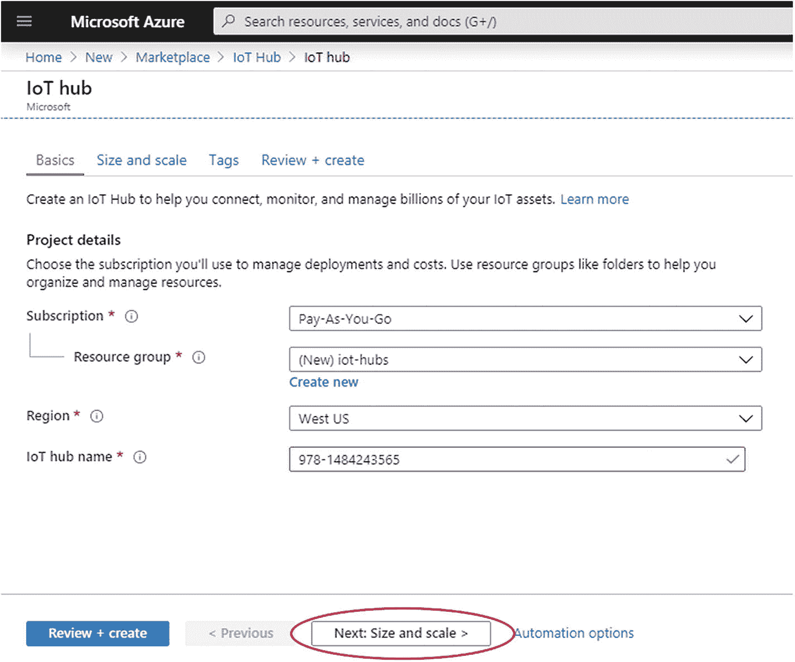

图 11-1 配置基本选项卡

-   选择 **下一步：大小和缩放** 继续创建您的中心。在**大小和缩放**选项卡上，按如下所示填写字段：

完成后，您的**大小和缩放**选项卡应如下所示（**图** **11-2**）。

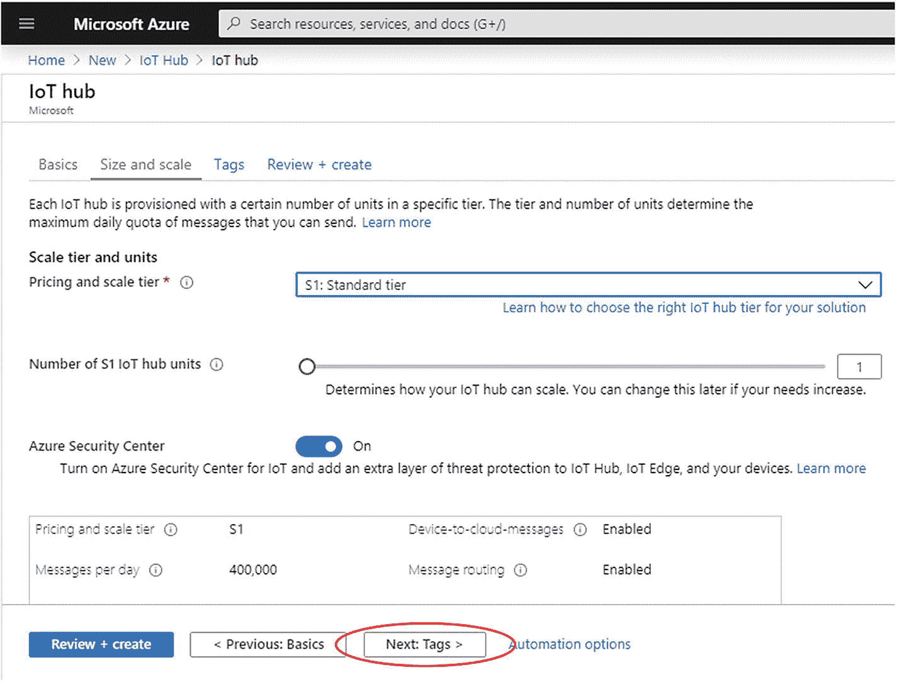

图 11-2 配置大小和缩放选项卡

| `名称：` | `department` |
| --- | --- |
| `值：` | `data science` |

-   选择 **下一步：标签** 继续创建您的中心。在**标签**选项卡上，按如下所示填写字段：

-   完成后，您的**标签**选项卡应如下所示（**图** **11-3**）。

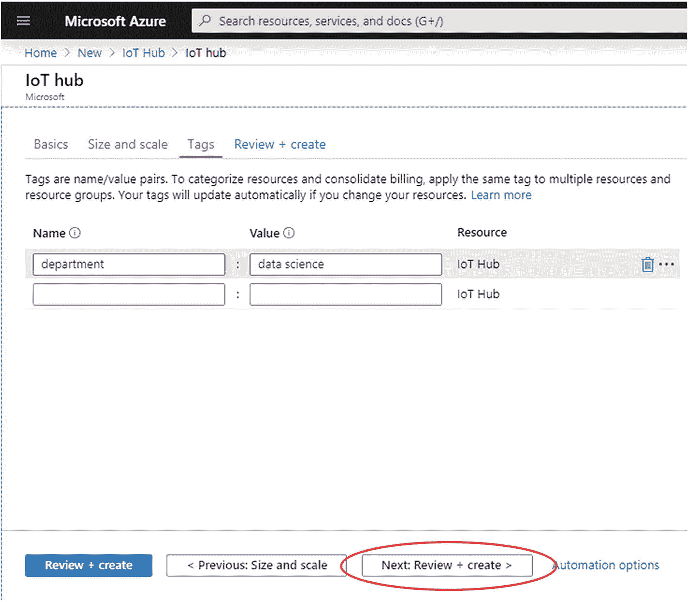

图 11-3 配置标签选项卡

-   选择 **下一步：查看 + 创建** 继续创建您的中心。您的**查看 + 创建**选项卡应如下所示（**图** **11-4**）。

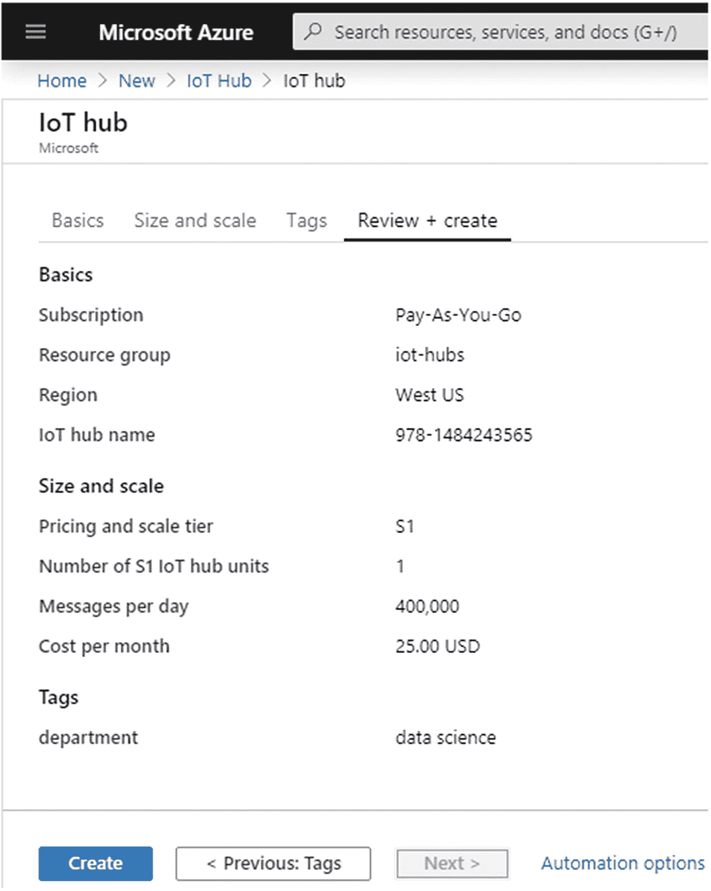

图 11-4 查看 + 创建选项卡

-   选择**创建**以创建您的新中心。创建中心可能需要几分钟时间。

创建 `IoT` 中心后，我们将深入探讨 `Azure` 机器学习工作室并设置 `Azure` 逻辑应用。在创建逻辑应用时，您需要提供 `IoT 中心`和`资源组`的名称，因此请确保您有这些详细信息。

## 11.5 在 Azure 机器学习工作室中设置天气预报模型

要使用天气预报模型，我们首先选择一个模型：有多个选项可用。然后，我们必须将选定的“天气预报实验”导入到我们的 `Azure` 机器学习工作室项目中：

-   打开 `ML` 工作室 – 确保您已登录。
-   在同一浏览器的另一个选项卡中，转到此 URL（`https://gallery.azure.ai/Experiment/Weather-prediction-model-1`）以定位我们使用的天气预报 `AI`“实验”。*还有几个可用的实验，您也可以尝试，以及大量其他实验可供操作。*

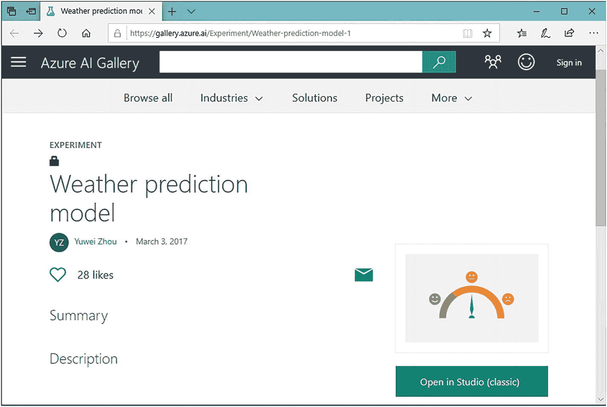

图 11-5 `Azure AI` 库实验：天气预报模型

-   单击**在工作室中打开**。然后会弹出一个模态窗口，提示您选择一个区域：保留默认选项，然后单击勾选标记继续。
-   导入实验后，`ML Studio` 界面应如下所示（**图** **11-6**）。

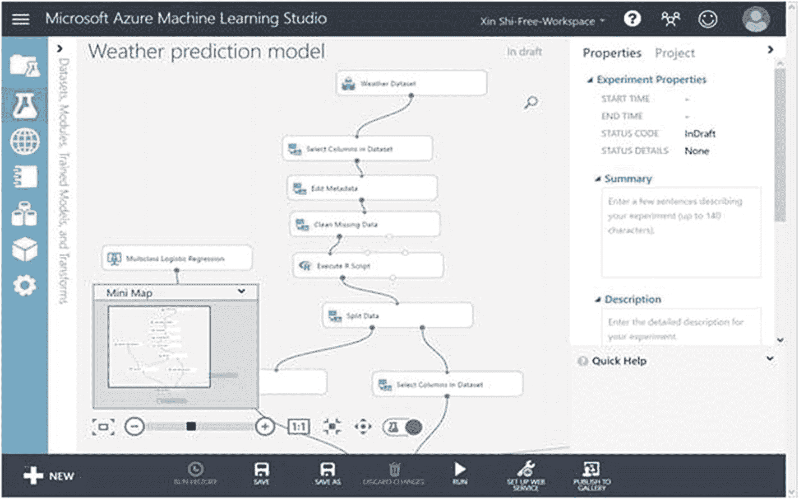

图 11-6 天气预报模型

-   单击**运行**（在屏幕底部的菜单中）以验证这些步骤。
-   当流程中的每一步运行时，它也会进行验证，并且您会看到每当一个步骤成功验证时，都会添加一个绿色的勾选标记。应该没有任何错误。所有步骤验证完成后，它应该会停止运行 – 可能需要一分钟左右。
-   单击**设置 WEB 服务 ➤ 预测 Web 服务**。这可以在底部菜单中 **运行** 按钮旁边找到。

> **注意**
> 除非系统在上一步中全程通过了验证过程，否则 **设置 WEB 服务** 选项将不可选。完成后，所有步骤都应显示小的绿色勾选标记。

-   单击设置 `Web` 服务后，您的视图会随着生成模型的新版本而更新：**预测实验**，这就是我们将要使用的。完成后，应该有两个选项卡：训练实验和预测实验。
-   我们将**移动**`Web 服务输入`块。此块告知实验从何处将 `Web` 服务的数据（即，来自我们的气象站仪器）注入到模型中。
-   单击连接`Web 服务输入`和`天气数据集`的线条（单击连接到`Web 服务输入`块的位置）– 这将断开它们的连接。
-   现在，将线条连接到`评分模型`块，如**图** **11-7** 所示。

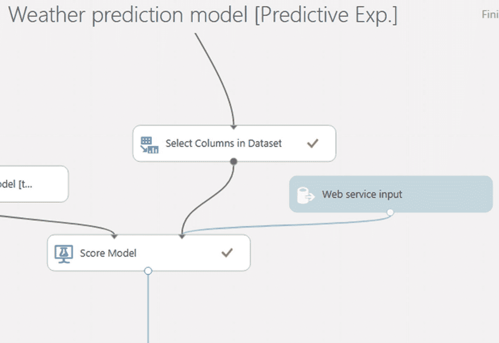

图 11-7 将“Web 服务输入”连接到“评分模型”

-   完成这些操作后，单击**运行**以让新模型进行验证。请记住等待它完成。
-   单击**部署 WEB 服务**以将模型部署为 `Web` 服务。

您现在已构建了一个**实验**，您可以通过单击左侧菜单中的**实验**列表来查看它。您还创建了一个**Web 服务**对象，我们将从 `Azure` 链接到该对象：我们将把数据传递到此 `Web` 服务中。为此，我们需要记下一些详细信息（`URI` 和 `API` 密钥）：

-   单击左侧菜单上的**Web 服务**链接。您会看到一个列表，其中至少显示一个 `Web` 服务。
-   单击我们刚刚创建的 `Web` 服务的名称 – 默认情况下，它将被命名为**天气预报模型（预测扩展）（图** **11-8****）**。

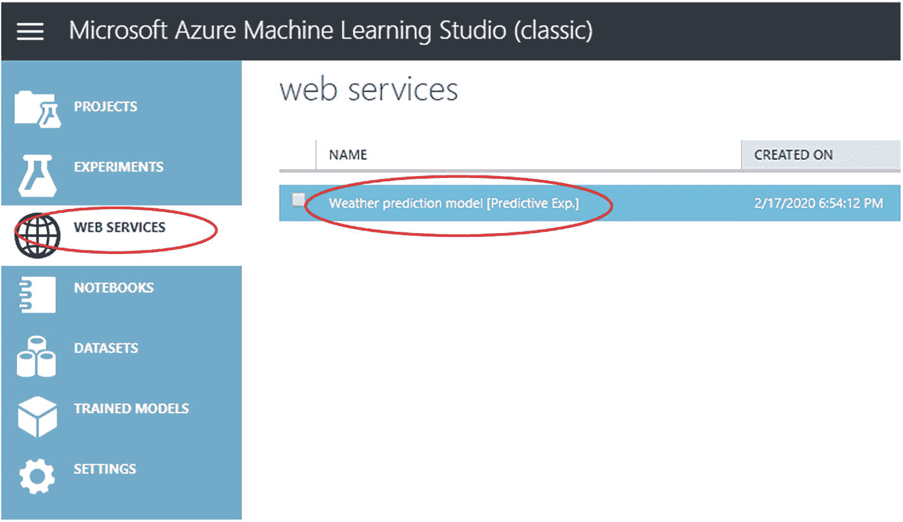

图 11-8 用于访问 Web 服务详细信息的链接

-   在 **天气预测模型 [预测实验]** 页面中，记下你的 `API` 密钥（**图** **11-9**）。

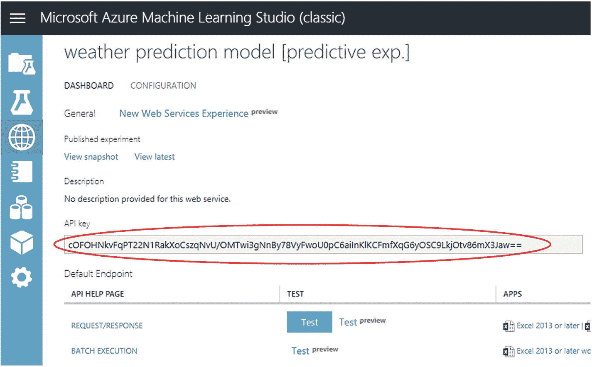

图 11-9 Web 服务身份验证的 `API` 密钥

-   在 **天气预测模型 [预测实验]** 页面中，点击 **请求/响应** 链接（位于 **图** **11-9** 的左下方）。

-   应该会打开一个新标签页，页面标题为 **天气预测模型 [预测实验] 的请求响应 API 文档**。 这里包含我们在 `Azure` 中需要的最终详细信息：记下此页面中的 **请求 URI**（**图** **11-10**）。

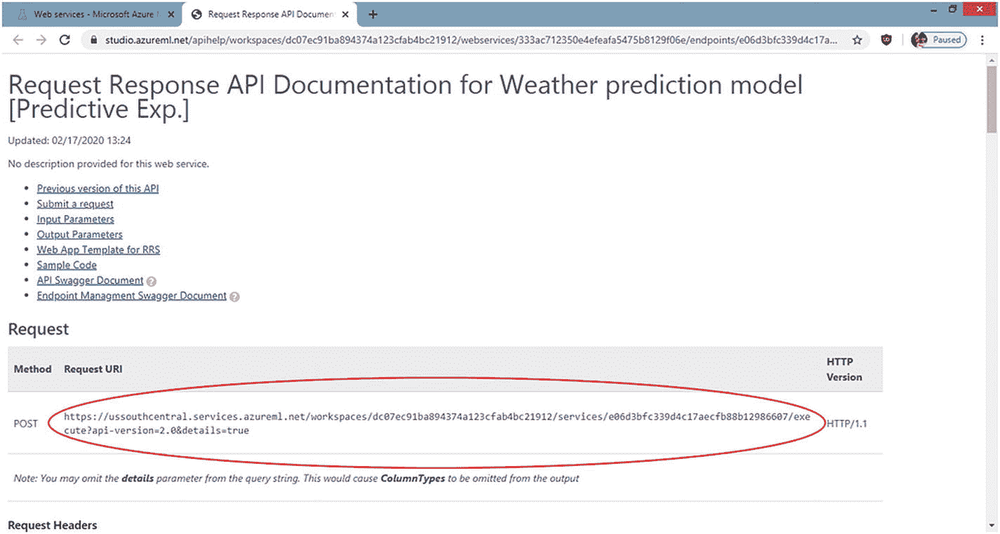

图 11-10 天气预测模型的请求 `URI`

-   再次切换到 **天气预测模型 [预测实验]** 页面（在单独的标签页中）。然后点击 **测试** 按钮测试该 `Web` 服务（**图** **11-11**）。

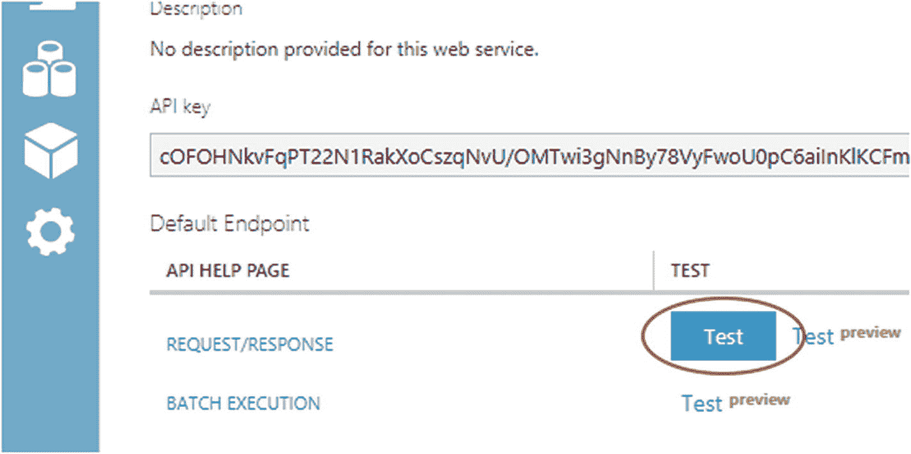

图 11-11 用于 Web 服务的测试链接

-   系统会提示你添加温度和湿度的虚拟变量：输入一些值，然后点击 **确定** 按钮（勾选）（**图** **11-12**）。

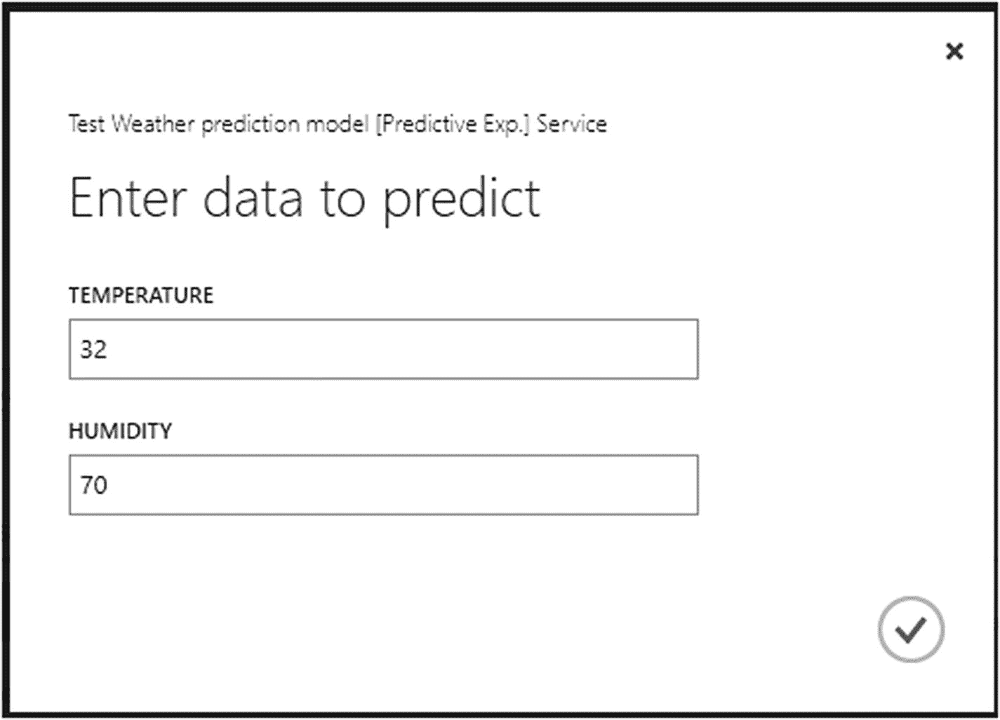

图 11-12 手动输入温度和湿度值的输入模态框

-   预测结果将显示在底部菜单上方。点击 **详细信息** 查看完整结果。它看起来应该类似于 **图** **11-13**。

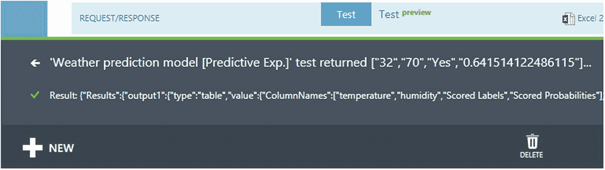

图 11-13 响应结果

**响应结果** 显示了当您输入的测试变量被处理时，`ML` 服务将返回的数据。结果（数组）中有四个关键数据点：

| 32 | 温度值（提供的测试值） |
| 70 | 湿度值（提供的测试值） |
| 是 | 降雨的二元概率：如果指数 > 0.5 则为是，否则为否 |
| 0.641514122486115 | 降雨概率指数 |

-   **关闭** 结果部分。

测试应该可以正常工作。如果不行，请尝试删除 `Web` 服务并重新部署，或重新导入实验。

`Azure Machine Learning Studio` 已设置好并准备就绪。在我们的 `IoT` 应用程序完成之前，我们需要定义我们正在使用的服务将如何协同工作，以及数据将如何从应用程序的每个组件传递到下一个组件：我们需要设置**工作流**。

## 11.6 使用 Azure Logic Apps 创建工作流

让我们回顾一下我们到目前为止所做的工作：

1.  我们设置了一个`Azure`帐户以访问其云服务。
2.  我们配置了一个`IoT 中心`，以便我们可以在 Azure 和我们的气象站之间通信数据。
3.  我们启动了`Azure ML Studio`，选择了一个天气预测模型，然后将其设置为可供使用。

到目前为止，有三个独立的组件/服务需要协同工作：我们的气象站设备、`IoT 中心`以及`ML Studio`模型/实验。比这更复杂的实验可能有多个数据源，并可能使用各种服务/附加组件。工作流工具用于帮助管理具有许多动态部分的复杂项目：本质上，它们确保步骤按正确的顺序执行。

在本节中，我们使用`Azure Logic Apps`构建一个工作流。此应用程序将定期检查我们的气象站是否正在发送数据。当检测到新数据时，此应用程序将通过 Web 服务将其发送给天气预测模型（托管在`Azure ML Studio`上）。它还将接收来自 ML 服务的响应，将其转换（`解析`）为我们指定的格式，然后将结果发送回我们的气象站设备。

按照此处列出的步骤创建一个新的逻辑应用：

- 在 Azure 主页上的`Azure 服务`下，点击`创建资源`。
- 在`新建`页面的`Azure 市场`下，点击`集成`，然后点击`逻辑应用`（`图 11-14`）。

    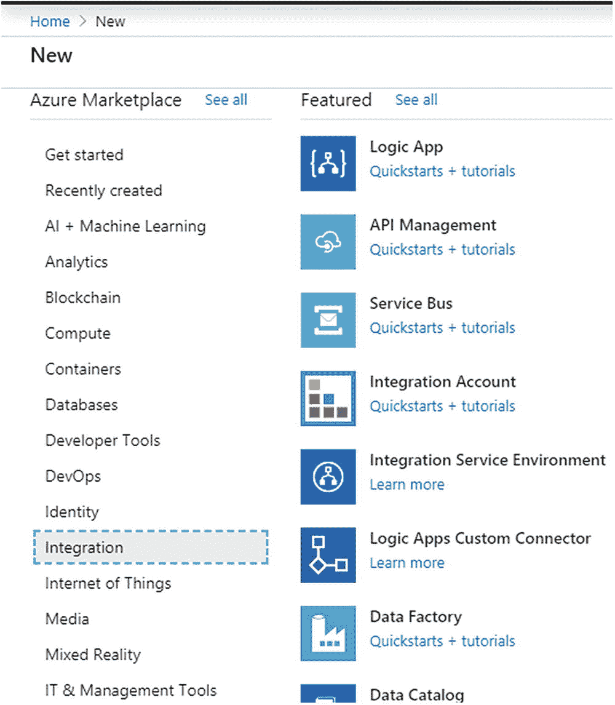

    `图 11-14`

    选择逻辑应用资源

- 在`逻辑应用`窗格中，提供有关逻辑应用的信息，如`图 11-15`所示。完成后，点击`审阅 + 创建`来验证信息。

    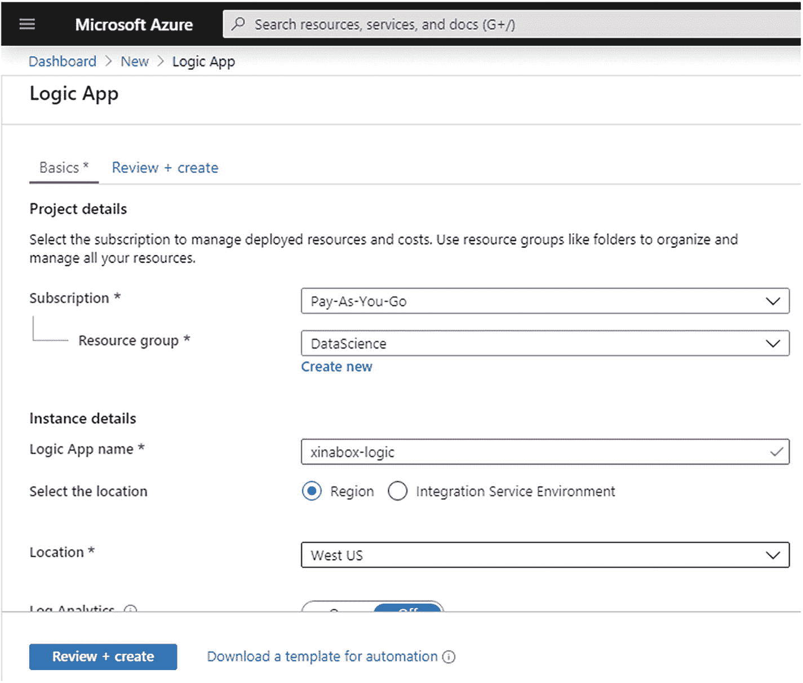

    `图 11-15`

    “基本信息”选项卡的详细信息

- 如果提供的信息正确，点击`创建`。这将开始部署你的逻辑应用。这可能需要一些时间。
- 点击`转到资源`以访问已部署的逻辑应用（`图 11-16`）。

    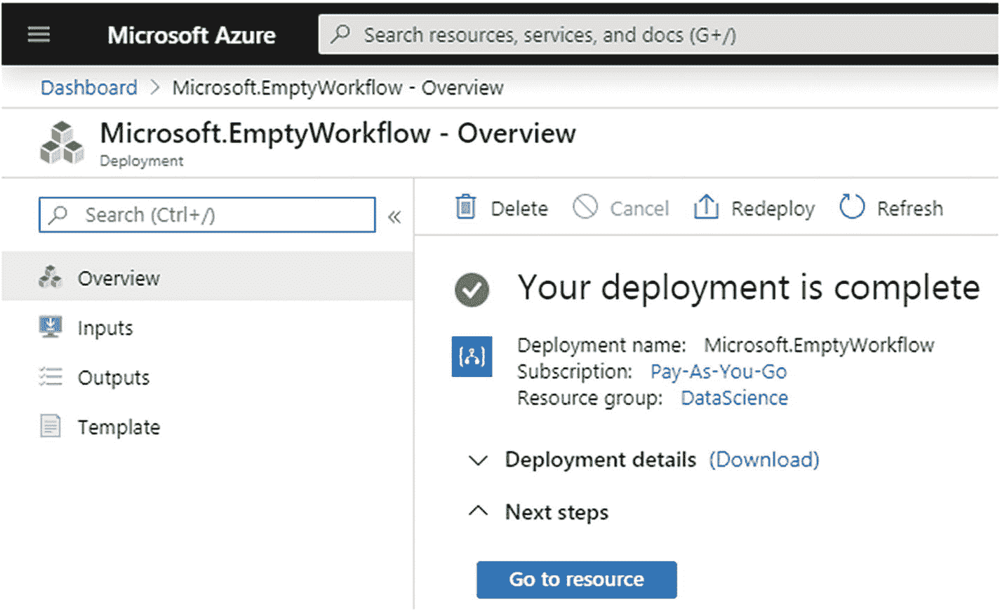

    `图 11-16`

    部署确认消息

提示

您也可以通过直接在搜索框中输入名称来查找并选择您的逻辑应用。

- `逻辑应用设计器`将打开，并显示包含介绍视频和常用触发器的页面。
- 向下滚动页面。在`模板`下，点击`空白逻辑应用`。

## 11.7 设置工作流

我们现在来审查刚刚创建的工作流，并确保每个步骤都配置正确。

`Azure Logic App`管理着五个基本操作/步骤/事件，它们是工作流的关键；无论您使用什么服务来实现 ML，都会有与这些步骤等同的步骤：

1.  从气象站设备发送数据
2.  将数据传递到 ML 服务
3.  解释（“解析”）来自 ML 服务的结果
4.  设置一个变量来存储来自 ML 服务的数据
5.  管理并将此数据发送回气象站设备

我们将更详细地审查每个步骤。

### 步骤 1：从气象站仪器发送数据

工作流在气象站仪器发送数据时启动/触发。此步骤在 Azure 逻辑应用中被称为“`收到 HTTP 请求时`”触发器。

要设置工作流的这一部分：

- 在 `Logic App 设计器`中，于 `搜索框`下方，选择`所有`。
- 在搜索框中，输入`http`以查找 HTTP 触发器。
- 从`触发器`列表中，点击`收到 HTTP 请求时`触发器（`图 11-17`）。

    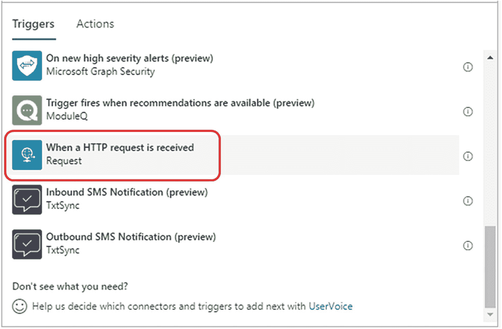

    `图 11-17`

    选择“收到 HTTP 请求时”触发器

- 填写 `收到 HTTP 请求时` 触发器的信息，如`图 11-18`所示。

    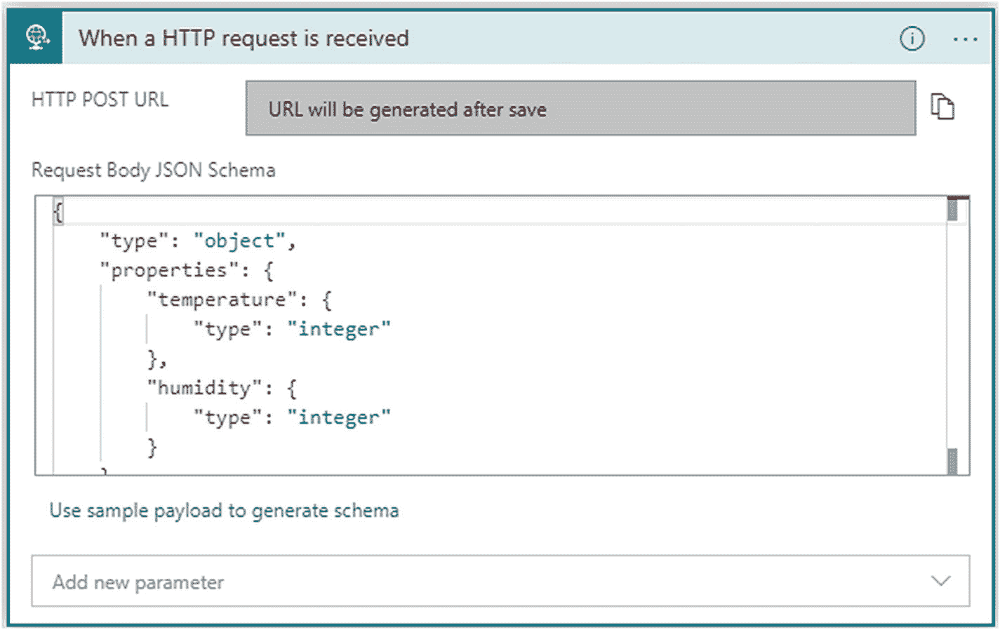

    `图 11-18`

    `收到 HTTP 请求时`触发器详细信息

- 以下是`架构`的完整列表，你可以直接将其复制到`请求正文 JSON`¹⁷`架构`文本框中：

```
{
"properties":
{    "humidity":
{    "type": "integer"
},
"temperature":
{    "type": "integer"
}
},
"type": "object"
}
```

### 步骤 2：将数据传递到 ML 服务

工作流中的下一步是将温度和湿度值传递给我们于第 11.2 节中设置的 Azure ML Web 服务。

| 方法：  | POST                                                                                                                              |
| :------ | :-------------------------------------------------------------------------------------------------------------------------------- |
| URI：   | 从`天气预测模型 [预测体验] 的请求-响应 API 文档`中复制的请求 URI。 – 参见第 11.5 节。                                                       |
| 标头：    | `Accept`                 | `application/json`                                              |
|         | `Authorization`          | 从`天气预测模型 [预测体验] 的请求-响应 API 文档`中复制的 API 密钥。 – 参见第 11.5 节。注意：确保在`Bearer`和`API 密钥`之间添加一个空格。 |
|         | `Content-Type`           | `application/json`                                              |
| 查询：   | 保持为空                                                                                                                 |
| 正文：   | `{   "GlobalParameters": {},   "Inputs": {       "input1": {           "ColumnNames": [               "temperature",               "humidity"           ],           "Values": [               [                   "value",                   "value"               ]           ]       }   }}`                                                                                                                    |
| Cookie：  | 保持为空                                                                                                                 |

- 在设计器视图中，点击`+ 新建步骤`（`图 11-19`）。

    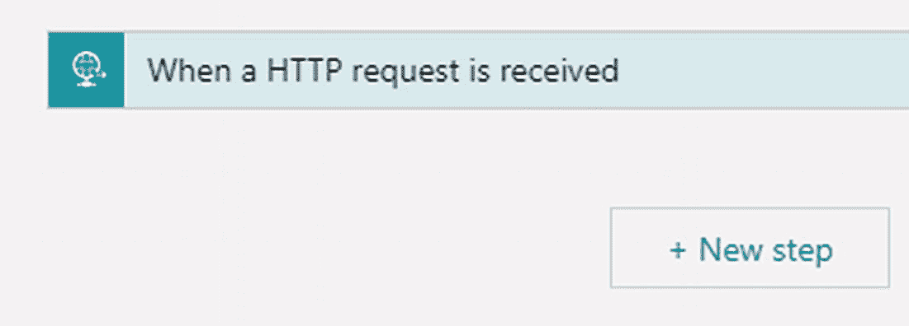

    `图 11-19`

    添加新步骤

- 在搜索框中输入`HTTP`。从结果中选择`HTTP`操作组（`图 11-20`）。

    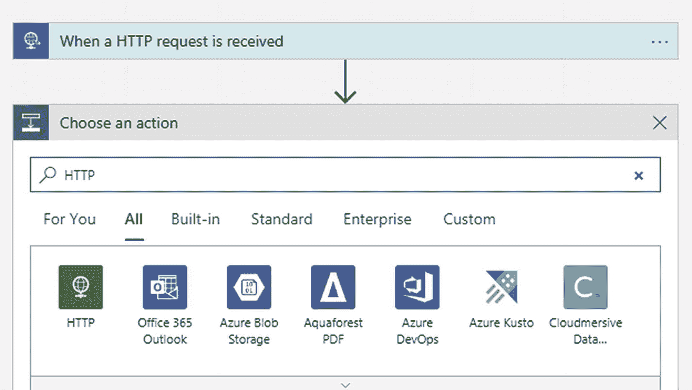

    `图 11-20`

    搜索`HTTP`操作组

- 这将展开为几个操作。从`操作`列表中，选择`HTTP`操作（`图 11-21`）。

    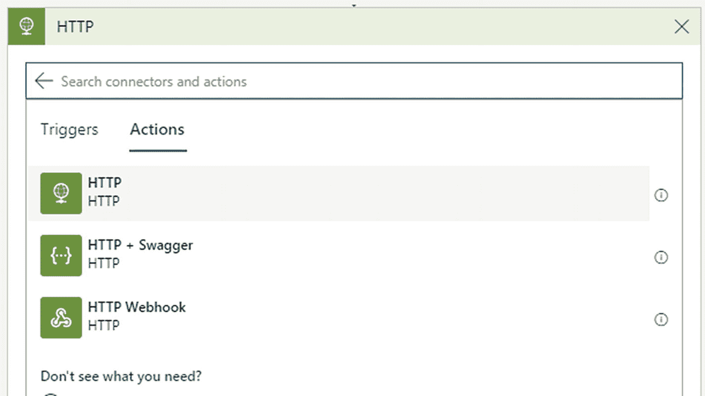

    `图 11-21`

    选择`HTTP`操作

- 为 HTTP 操作提供以下信息：

现在在`正文`中，将`temperature`和`humidity`的值替换为`动态内容`。

- 选中第一个出现的`"value"`（包括双引号），然后从`动态内容`窗格中选择`temperature`（`图 11-22`）。

    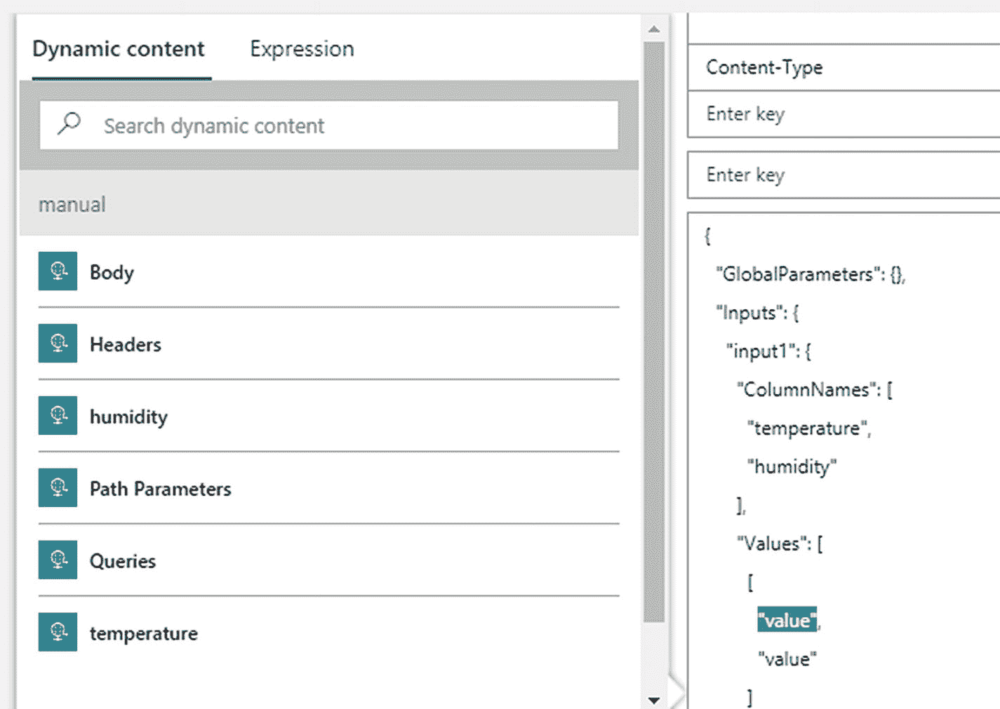

    `图 11-22`

    插入动态内容 (步骤 1)

- 接下来，将第二个出现的`"value"`替换为动态内容`humidity`。

现在你的`JSON 正文`应该类似于这样（`图 11-23`）。

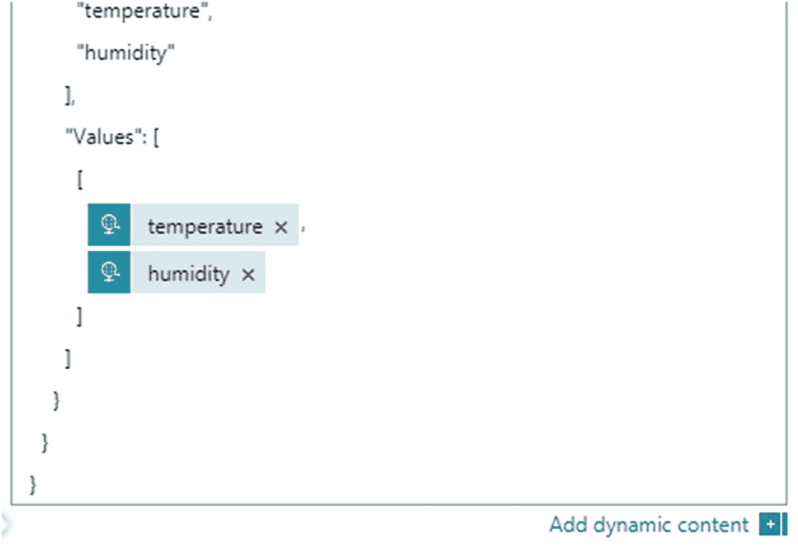

`图 11-23`

插入动态内容 (步骤 2)。在此例中，为温度和湿度

完成后，`HTTP`模板应该类似于这样（`图 11-24`）。

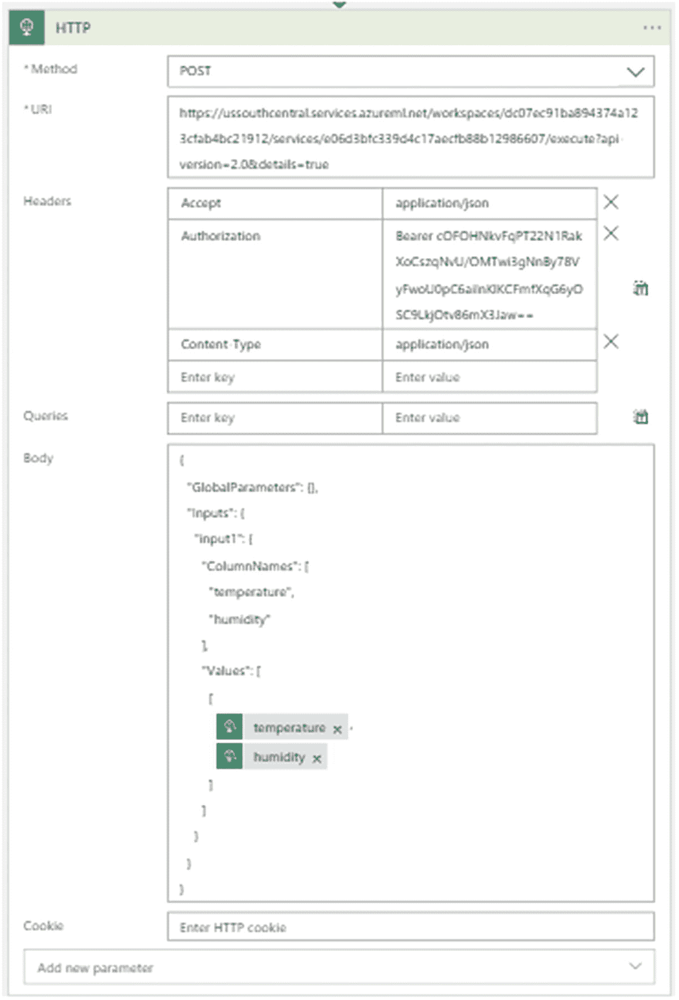

`图 11-24`

`HTTP`操作详细信息

### 步骤 3：解释（解析）ML 服务的结果（解析 JSON）

数据通过 Web 服务以`请求`形式传递到 Azure ML 模型，ML 模型以`响应`形式将结果发回。该响应是一个`JSON 对象`（即一个包含 JSON 格式数据的“文件”），我们需要解析它以提取所需的值。为此，我们将添加名为`解析 JSON`的操作。

| 内容： | 点击`内容`框，然后在动态内容中，于 HTTP 下方选择`正文`。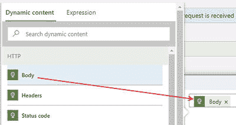 |
| :------- | :----------------------------------------------------------------------------------------------------------------------------------------------------------------------- |
| 架构：  | `{   "properties": {      "Results": {         "properties": {            "output1": {               "properties": {                  "type": {                     "type": "string"                  },                  "value": {                     "properties": {                        "ColumnNames": {                           "items": {                              "type": "string"                           },                           "type": "array"                        },                        "ColumnTypes": {                           "items": {                              "type": "string"                           },                           "type": "array"                        },                        "Values": {                           "items": {                              "items": {},                              "type": "array"                           },                           "type": "array"                        }                     },                     "type": "object"                  }               },               "type": "object"            }         },         "type": "object"      }   },   "type": "object" }` |

- 在设计器视图中选择`+ 新建步骤`。
- 在搜索框中输入`Parse JSON`。从`操作`列表中，选择`Parse JSON`（`图 11-25`）。

    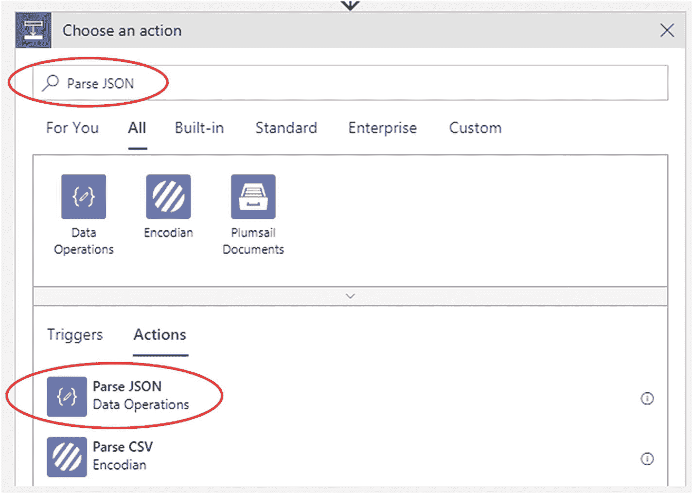

    `图 11-25`

    搜索并选择`Parse JSON`操作

- 按如下所示和所述为`Parse JSON`操作提供此信息：

完成后，`Parse JSON`模板应该类似于这样（`图 11-26`）。

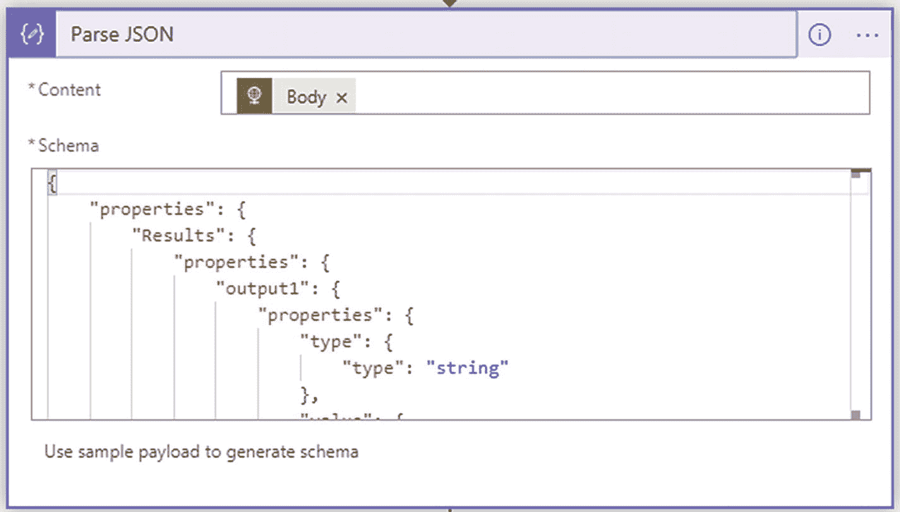

`图 11-26`

`Parse JSON`操作详细信息

### 步骤 4：设置变量以存储来自机器学习服务的数据

现在，我们需要将要从 JSON 对象中提取（解析）的降雨预测分数（“是”或“否”）分配给一个`String`类型的变量。为此，我们将添加名为`初始化变量`的操作。

| **名称：** | `Score` |
| --- | --- |
| **类型：** | `String` |
| **值：** | 我们将使用一个公式来获取二维数组中的“评分标签”：`body('Parse_JSON')?['Results']?['output1']?['value']?['Values']?[0]?[2]` |

- 在设计器视图中选择`+ 新建步骤`。
- 在搜索框中输入`初始化变量`。从`操作`列表中，选择`初始化变量`（`图 11-27`）。

    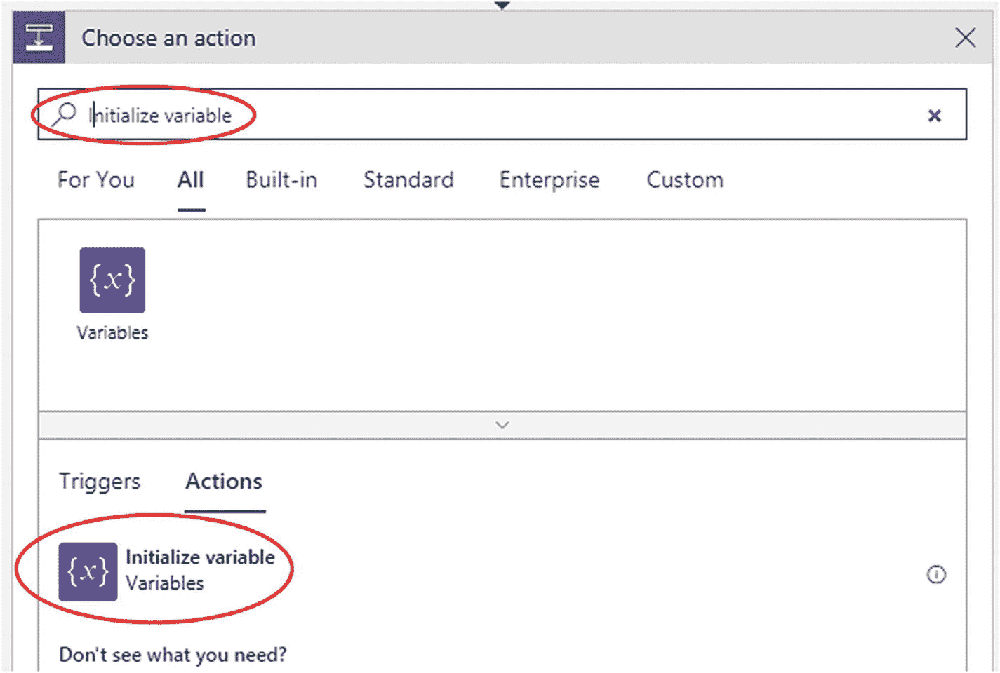

    `图 11-27`

    搜索并选择“初始化变量”操作

- 为`初始化变量`操作提供如下所示的信息：

完成后，`初始化变量`模板应如下图所示（`图 11-28`）。

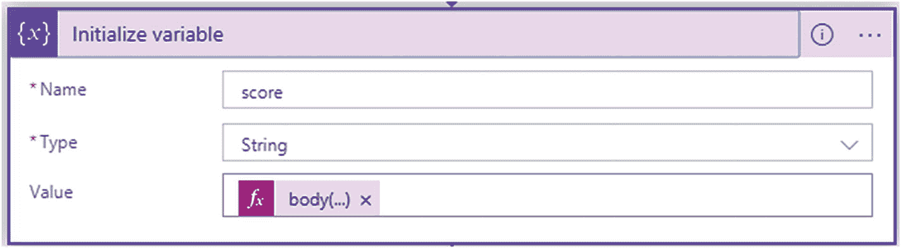

`图 11-28`

“初始化变量”操作详情

### 步骤 5：将数据发送回气象站仪器

最后，我们将变量 `score` 发送到 micro:bit，以便在 5x5 LED 矩阵上显示。

| **状态代码：** | `200` |
| --- | --- |
| **标头：** | 保持为空 |
| **主体：** | 从`变量`类别下的`动态内容`窗格中插入动态变量`score`。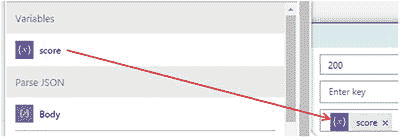 |

- 在设计器视图中选择`+ 新建步骤`。
- 在搜索框中输入`响应`。等待搜索结果。然后在`操作`列表中，选择`响应`（`图 11-29`）。

  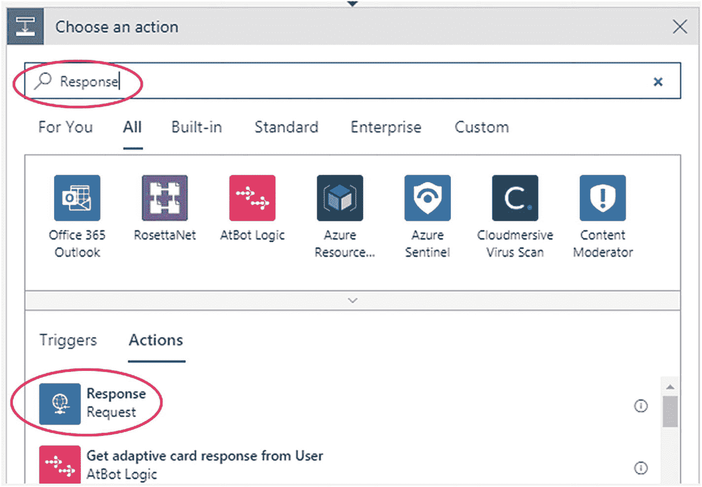

  图 11-29  
  搜索并选择“响应”操作

- 为`响应`操作提供如下所示的信息：

完成后，`响应`模板应如下图所示（`图 11-30`）。

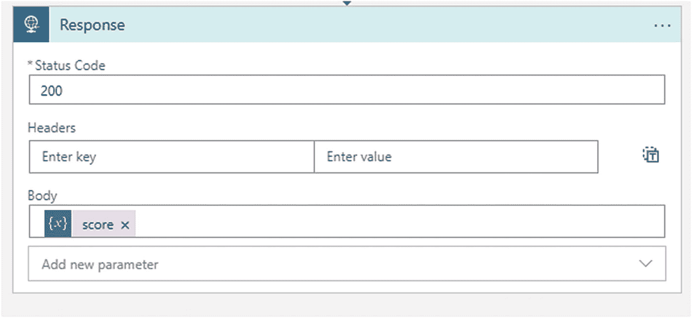

图 11-30  
“响应”操作详情

完成！保存你的逻辑应用：在`设计器`工具栏上，单击`保存`。这可能需要一些时间。

## 11.8 测试工作流

现在，我们将手动启动逻辑应用以进行测试：

- 运行你的逻辑应用 – 在`设计器`工具栏上，选择`运行`。检查工作流可能需要一些时间。完成后，你将在页面右上角收到一条通知，提示已成功检查逻辑应用的触发器，应如下图所示（`图 11-31`）。

  

  图 11-31  
  触发器检查成功的通知

- 你的工作流将再次以`运行模式`显示（`图 11-32`）。如果测试成功，标题栏右上角将添加一个勾选图标（绿色圆圈中的白色勾选）。

  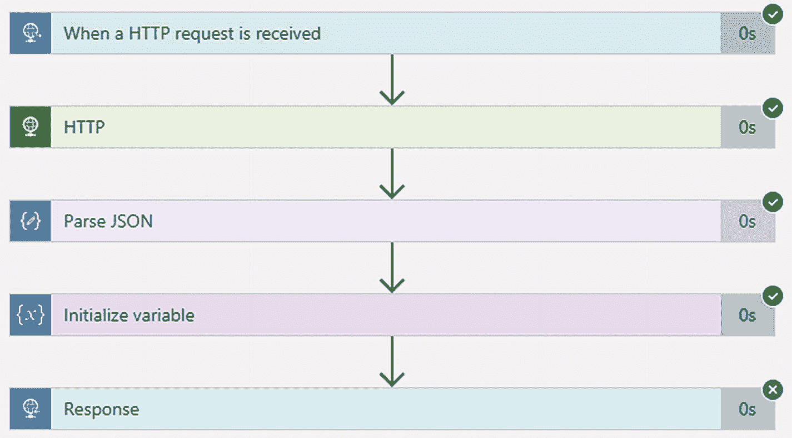

  图 11-32  
  手动触发工作流

- `响应`操作的标题栏上有一个叉号图标（灰色背景上的叉号），表示测试未成功。要查看`响应`操作的输出详情，请单击`响应`操作标题栏内部。你应该会看到消息（`图 11-33`）：“ActionResponseSkipped”。这是因为工作流没有从硬件接收到任何数据。目前这没关系：一旦我们连接好气象站，一切都会正常工作。

  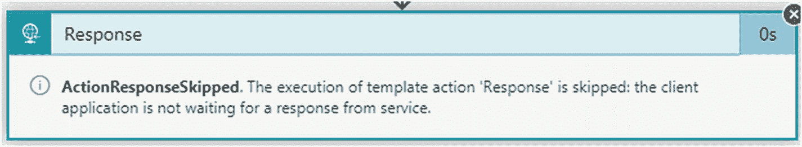

  图 11-33  
  响应触发器显示 `ActionResponseSkipped` 消息

- 在设计器工具栏上，选择`设计器`以返回到设计器视图。

现在我们已经完成了物联网应用的设置和测试，并且支持机器学习预测功能的气象站已准备就绪。我们只需要开始向它输入数据即可。

## 11.9 总结

从概念上讲，使用机器学习服务的过程非常简单：你传入一些数据，机器学习服务执行其黑箱操作，然后返回一个值。设置和使用它不需要几十个步骤和无数选项；但实际情况确实如此。

在本章中，我们已经设置并配置了构建支持机器学习的预测性气象站所需的物联网基础设施。我们构建了一个包含机器学习服务的物联网应用：来自我们数字仪器的数据将由该服务处理并生成预测数据。然后，这些数据被发送回我们的仪器，并显示在屏幕上。

在下一章中，我们将构建气象站数字仪器并将其连接到我们的物联网应用。

