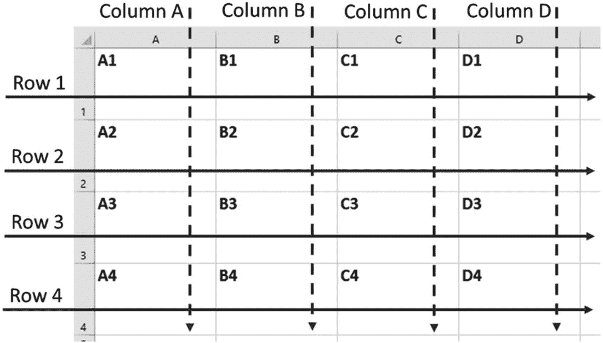
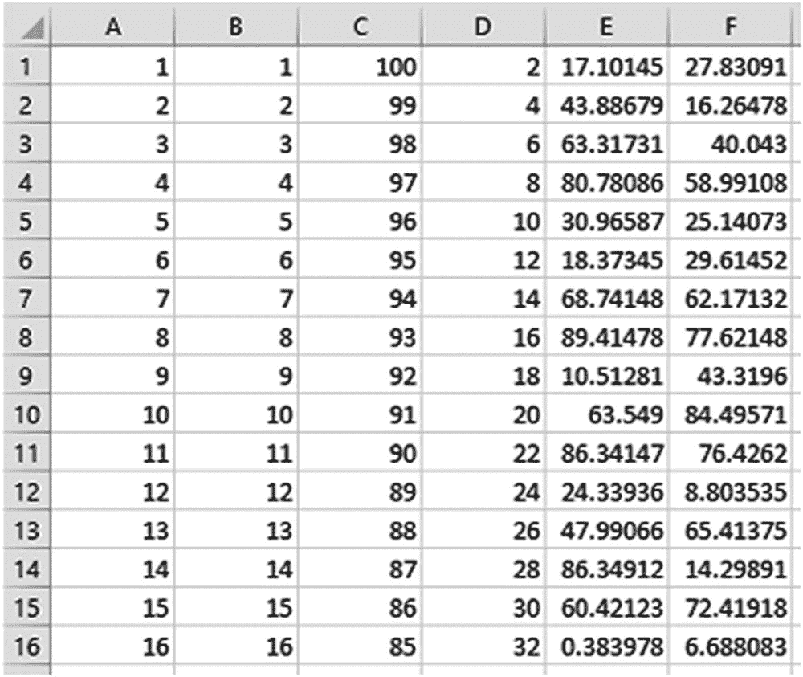
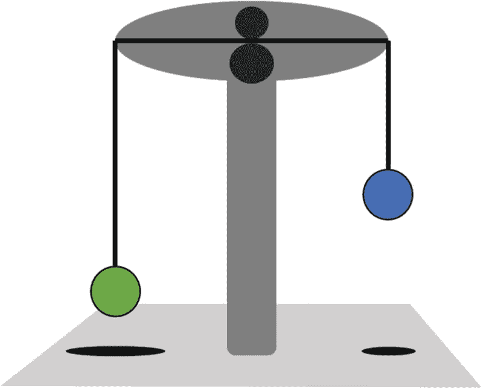
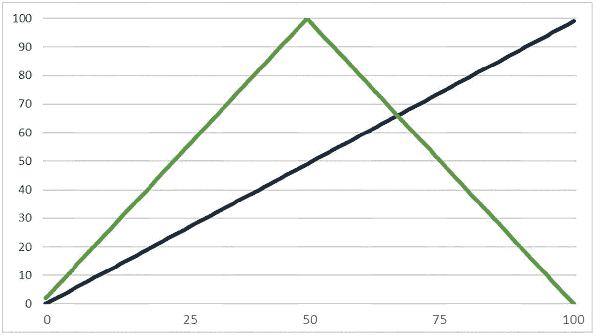

# 数据分析入门

从第 4 章我们获得了一个数据表。我们的目标是分析我们收集的温度和气压数据之间的关系，看看这些测量值之间是否存在相似性。如果存在，这种相似性有意义吗？我们如何衡量这种相关性？

在本章中，我们将研究如何使用广泛可用的软件来回答这个问题，在此过程中解锁一个大多数电脑用户都能使用的丰富且易用的数据分析工具。借助现代电子表格程序，数据科学确实触手可及，本章将向你展示如何利用这些技术瑰宝。

## 拓展我们的分析工具

为了查看第 4 章中的温度和气压数据，我们可以采用类似第 3 章中使用的方法：手动绘制可视化图表。现在，这需要花费更长的时间，具体取决于你收集的数据量，但仍然是可行的。

然而，这种方法可扩展性不佳——如果我们收集整个月的气象数据，或者找到一种方法收集（比如）10,000 个数据点，会发生什么？我们将达到这样一个阶段：通过查看表格来了解数据范围，或手工绘制图表，不再是人类能够实际完成的任务。

正如我们在第 4 章中使用持久化内存来减少人类在数据收集过程中需要扮演的角色一样，我们也将使用数字工具来辅助我们的分析。

## 5.2 数据分析软件

在计算机普及之前，数据分析速度缓慢且劳动强度大。那时使用手绘的数据表（类似于我们在前几章中创建的那些），而开展我们一直在探讨的那种基于数据的实验，需要广泛的知识储备、大量的训练以及极大的耐心——这是一种罕见的素质组合。

随着计算机的出现以及我们在前几章中探讨的各种功能的开发，数据科学的潜力呈指数级增长：

软件取代了人力，但计算机和代码并不能取代我们在数据科学过程中的角色。相反，它们将我们从繁琐的任务中解放出来，让我们能够将时间和精力投入到需要人类智慧和直觉的环节。尽管人工智能（AI）近年来取得了一些进展，但从未有任何数据科学实验是完全由计算机完成的。人类因素始终存在且不可替代。

可以公平地说，数据分析的计算机化使数据科学得以普及：强大且易用的软件让任何拥有笔记本电脑和数据的人都能进行复杂的分析。

数据科学家并没有一个统一的软件套件作为标准。许多人信奉`Python`、`SAS`或某种`SQL`变体。在本章中，我们将使用电子表格，它拥有我们所需的所有功能，包括：

*   支持数据表。我们创建的 CSV 文件在任何电子表格程序中都能轻松打开。
*   许多电子表格程序内置了可用于数据分析的函数，例如衡量两组数据之间相关性的函数。
*   支持可视化。多数电子表格允许你轻松创建标准图表和其他可视化内容。
*   电子表格相对易于使用。
*   功能强大的电子表格程序分布非常广泛，易于获取。
*   电子表格通常非常实用，掌握电子表格程序的使用方法是一项值得培养的技能。

## 5.3 选择电子表格程序

我们将使用`Excel`作为电子表格程序，但也有其他可行的替代方案，包括`Google Sheets`、`OpenOffice`和`LibreOffice`。

如果你使用的是其他电子表格程序，并且不确定它是否适合学习本章内容，只需用搜索引擎搜索你的电子表格名称加上“相关性公式”这几个字。如果你使用的软件带有内置的相关性测量函数，那么你应该能够使用该软件学习本章。如果没有，我们建议你另选一个软件，其中许多可以在网上免费获取。^(⁵)

虽然我们将介绍使用电子表格程序进行数据分析的基础知识，但你还需要掌握一些本书不会涵盖的核心技能。你需要知道如何：

*   打开电子表格程序并开始一个新项目。
*   在电子表格程序中打开 CSV 文件。
*   在单元格中输入数值。
*   在电子表格中导航。

`图 5-1` 概述了我们用于描述电子表格不同方面的一些关键术语。

图 5-1

列、行和单元格的命名约定

*   **行**：行横向排列，从左到右，并从 1、2、3 等序号开始编号。
*   **列**：列纵向排列，从上到下，并用 A、B、C 等字母标记。
*   **单元格**：单元格是列和行相交的位置，并根据其所在的列和行进行标记：例如`A1`、`B3`或`C8`。

## 5.4 测量相关性

在第 3 章中，我们看到温度和压力的变化方式相似：它们似乎以某种方式相关联，我们使用术语“相关性”来描述这种关系。然而，我们无法说明这种相关性有多强——我们缺乏客观描述它的语言。它们是 100%相关，还是 0.5 相关？这两个问题本身是否有意义？

相关系数的测量范围在-1 到+1 之间：

*   两组数据之间可能的最强相关性得分为 1。当两组数据的相关性得分为 1 时，通常意味着它们描述的是完全相同的事物（例如，以摄氏度表示的温度和以华氏度表示的温度的相关性为 1）。
*   得分为 0 或非常接近 0 意味着两组数字之间没有关系。它们所测量的事物完全不相关。
*   两组各有几百个随机数的集合不太可能得到正好为 0 的相关性得分。我们可能预期分数在 0.1 或-0.1 左右，但由于它们是随机的，任何情况都可能发生。
*   不存在“好”或“坏”的相关性得分——它仅仅是对两组数据行为相似程度的一种描述。

你会如何解读相关性得分为-1 的情况？

`表 5-1` 提供了一个简单的练习，用于演示数字集之间的相关性得分。

表 5-1

探究相关系数

| 步骤 | 操作内容 | 备注 |
| --- | --- | --- |
| 1 | 打开电子表格程序并开始一个新项目/电子表格/工作簿。 | 从一个空白工作表开始——我们将输入一些数字。 |
| 2 | 在 A 列：输入数字 1 到 100。 | 有一些技巧可以帮助你完成此操作：你不需要逐个输入每个数字。 |
| 3 | 在 B 列：复制第一列的数字。 | A 列和 B 列完全相同——因此它们应该具有最大的相关性得分。 |
| 4 | 在 C 列：输入数字 100 到 1，使其在每个单元格中递减。 | 这是 A 列的倒序。这将如何与 A 列相关？ |
| 5 | 在 D 列：输入数字 2, 4, 6…到 100，然后往回：98, 96, 94 等。 | 在此列中，数字直到中间部分都与 A 列非常相似，之后开始下降。我们预期 D 列与 A 列的相关性如何？ |
| 6 | 在 E 列：在 100 个单元格中每个都输入 1 到 100 之间的随机数。 | 使用随机数生成函数。对于 Excel 和 Google Sheets，你可以使用`= 100*RAND()`。 |
| 7 | 在 F 列：复制你在第 5 步中的操作。 | E 列和 F 列都只有随机数。 |

完成后，你的电子表格应类似于`图 5-2`。

图 5-2

按照表 5-1 填入数据后的电子表格顶部

在此值得暂停一下，思考一下`表 5-1`中“备注”列提出的问题。你的预期是什么？设定好你的预期后，请按照`表 5-2`中的步骤操作，计算相关性得分。

## 5.5 计算相关性得分

按照`表 5-2`中的步骤，在比较我们在`表 5-1`中创建的不同列时，找出相关性得分。

`表 5-2` 为表 5-1 数据添加相关性得分

| 步骤 | 操作说明 | 备注 |
| --- | --- | --- |
| 1 | 使用在表 5-1 中创建的同一个电子表格。 | 我们将在 G 列输入标签，在 H 列输入公式。 |
| 2 | 在线搜索如何在电子表格程序中使用相关性函数的详细信息。 | 对于 Excel 和 Google Sheets 来说，计算两列数据相关性得分的公式是`=CORREL(A1:A100,B1:B100)`。 |
| 3 | 在单元格 G1 中，输入`A 和 B 的相关性`。在 H1 中输入`=CORREL(A1:A100,B1:B100)`。 | 这将比较 A 列与 B 列的数据。输入公式后，你将看到结果。是否如你所料？ |
| 4 | 在单元格 G2 中，输入`A 和 C 的相关性`。在 H2 中输入`=CORREL(A1:A100,C1:C100)`。 | 这将比较 A 列与 C 列的数据。输入公式后，你将看到结果。是否如你所料？ |
| 5 | 在单元格 G3 中，输入`A 和 D 的相关性`。在 H3 中输入`=CORREL(A1:A100,D1:D100)`。 | 这将比较 A 列与 D 列的数据。输入公式后，你将看到结果。是否如你所料？ |
| 6 | 在单元格 G4 中，输入`A 和 E 的相关性`。在 H4 中输入`=CORREL(A1:A100,E1:E100)`。 | 这将比较 A 列与 E 列的数据。刷新随机数，看看相关性得分如何随之变化。 |
| 7 | 在单元格 G5 中，输入`E 和 F 的相关性`。在 H5 中输入`=CORREL(E1:E100,F1:F100)`。 | E 列和 F 列都包含随机数——E 列与 A 列的相关性更强，还是与 F 列的相关性更强？当你刷新随机数时，这种情况会改变吗？ |
| 8 | 尝试比较其他列，看看它们的相关性得分。 | 在电子表格中使用公式生成具有不同相关性得分的数字列是很有趣的。 |
| 9 | 保存并关闭。 | 我们不会再使用这个电子表格了。 |

从这些结果中，我们可以了解有关相关系数的一些知识：

*   A 列和 B 列完全相同。它们的相关性得分是`1`。
*   A 列和 C 列完全相反：一个上升时，另一个就下降——它们基本上是彼此的镜像。但通过观察一个列的行为，可以完全预测另一个列的行为。它们的相关性得分是`-1`。

`图 5-3`展示了一个可能测得相关性为`-1`的实验。绿色球的高度和蓝色球的高度存在完美的负相关。

图 5-3 蓝色球上升时，绿色球下降。

*   尽管 A 列和 D 列在开始时表现相似，但这种趋势并未持续整个数据集。它们的行为无关，知道其中一列在上升并不能帮助我们猜测另一列是在上升还是下降。相关性得分非常低（`-0.03`）。^(⁶)

`图 5-4`在折线图上显示了A 列和 D 列的值。

图 5-4 显示 A 列到 D 列数值的折线图。

## 5.6 理解相关系数/得分

我们已经看到了相关性为`1`、`-1`以及接近`0`的含义，但我们应该如何看待两组数据的相关性为`0.4`、`-0.5`或`0.78`呢？虽然没有硬性规定，并且具体情况始终是一个影响因素，但在严格控制实验之外，可以使用以下指南来解释相关性得分：

*   当两组数据的相关性为`0.7`或更高（或`-0.7`或更低）时，可以安全地将其描述为**强**相关。高于`0.9`则属于非常强。如果在我们的数据科学实验中看到如此高的得分，我们会非常有兴趣去理解所测量事物之间的潜在关系。
*   得分在`0.4`到`0.7`之间（或`-0.4`到`-0.7`之间）意味着数据集之间存在相关性——有一些证据表明存在关系。这可能是有趣的，我们可能会更深入地研究这个问题，但前提是我们已经研究了所有强相关的情况。
*   得分在`0.2`到`0.4`之间（或`-0.2`到`-0.4`之间）意味着数据集之间存在**中等**相关——有一些证据表明存在可能值得关注的弱关系。
*   低于`0.2`（或`-0.2`）表明数据集之间没有真正的关系。

相关性不一定要强才能成为有用的结果：排除数据集之间的相关性可能是一个实验的目标。例如，你的实验可能旨在证明身高和发色没有关联。接近零的相关性得分将有助于证明这一点。

## 5.7 计算天气数据的相关性得分

现在，计算温度与压力数据之间相关性强度的过程相当简单，详见表 5-3。

`表 5-3` 计算温度与压力数据的相关系数

| 步骤 | 操作说明 | 备注 |
| --- | --- | --- |
| 1 | 在你的电子表格程序中打开第 4 章的 CSV 文件。 | 它应该导入为 2 列，并带有标题行。检查数据是否已正确导入；如果没有，请重试或搜索快速修复方法。 |
| 2 | 在 D1 中输入：`相关性得分 =`。在 E1 中输入：`=CORREL(A1:A42,B1:B42)`。 | 根据数据行数调整公式。记下结果。 |
| 3 | 保存文件。 | 我们稍后会用到它。 |

我们在 E1 中输入的公式应返回一个介于`-1`和`1`之间的数字：这是衡量你在实验中记录的温度和压力读数之间相关程度的指标。无论你得到什么分数，都回答了我们在实验中提出的问题^(⁷)：温度和压力之间是否存在相关性？使用第 5.5 节中的指南来唯一地回答这个问题。

在我们的实验中，我们能够收集的数据量是有限的，这意味着我们只观察了温度和压力。如果手头有更多数据，相关性得分分析可以有一些很好的应用：

*   我们在第 1 章中看到，与天气相关的可测量数据点有很多——多达几十个。多年来，气候科学家分析了这些数据并测量了它们之间的相关性。这有助于建立起关于天气的知识体系，该体系可用于（除其他外）进行预测。
*   医学科学建立在不起眼的相关性之上。如果一项新程序与患者的预期寿命之间存在强相关性，我们可能会说已经找到了“治疗方法”。
*   想象一下，能够测量关于你自己的 100 项事物，然后找出与你的幸福感最相关的 5 项。