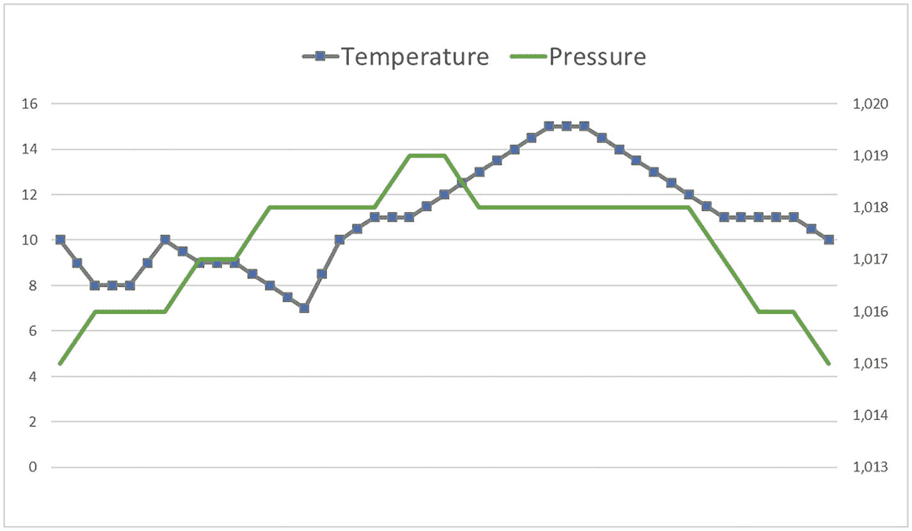

# 使用可视化工具

大多数电子表格程序都提供生成可视化的工具，这些通常包括一些标准图表类型（例如，折线图、柱状图和饼图）。在不同的程序中，生成和编辑图表的方式类似，而且在线支持通常很好。我们将按照以下步骤生成一个非常简单的折线图来显示我们的温度和湿度数据，你应该能够在所使用的任何电子表格程序中按这些步骤操作：

1.  突出显示电子表格中的两列数据。
2.  点击`插入`。
3.  找到`图表`选项并点击。
4.  选择列出的第一个`折线图`选项。

这将为你生成一个基础的折线图，可能足以满足你的需求。你可以通过多种方式编辑图表，具体方式因程序而异，但只要遵循这些简单的指导原则，你应该就能顺利操作：

-   要选择图表的特定部分，请点击它。通常会出现某种视觉指南（例如，角落的标记）来显示你选择了什么。
-   如果你想编辑图表上的某个内容，请选择它，然后右键单击。查找包含`编辑`一词的选项。点击它。
-   尝试各种设置——你不会弄坏任何东西。
-   如果对结果不满意，可以重新开始。

我们的图表如**图 5-5**所示。我们省略了具体的时间；时间通常显示在底部的 x 轴上。看看你是否能通过观察数据猜出黎明破晓的时间。

**图 5-5** 一张显示 24 小时内温度和压力的折线图。2019 年 9 月在英国拍摄。