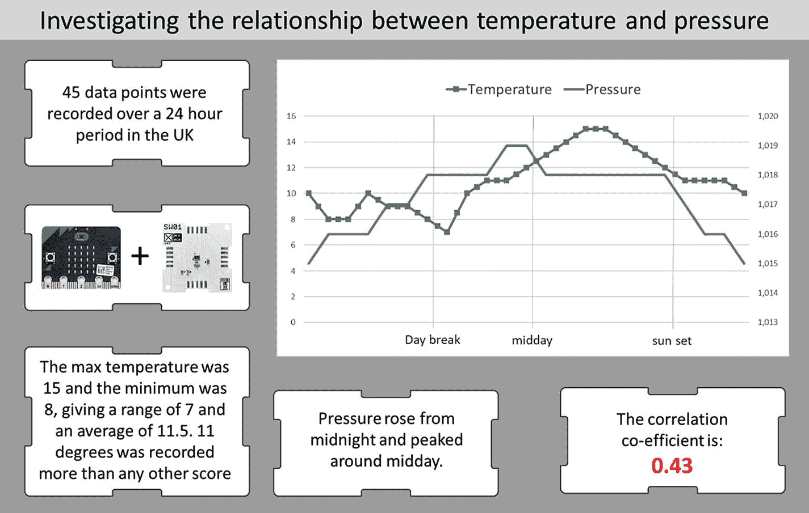

# 报告

我们对温度和压力数据的分析产生了一些结果。我们获得了相关性得分、最大值、最小值、范围、平均值以及一个可视化图表。但是，在结果被整理成文并提交报告给我们的**利益相关者**之前，我们的实验尚未完成。这些人是代表他们进行数据科学实验的对象——可能是我们的雇主、一个慈善基金会或一个投资者。即使我们是为自己而做，一篇博客或社交媒体更新也是一种报告形式。

你整理这份报告的方式将取决于你使用的软件，但无论采用何种方式，都有一些有用的指导原则值得尝试遵循：

-   包含你实验的简要总结。
-   显示样本大小——你收集了多少个数据点。
-   尽量将所有内容放在一页内。
-   不要使用技术性语言——用通俗易懂的英语展示结果。
-   添加你的可视化图表。

我们的报告如**图****5-6**所示。

**图 5-6** 一份展示实验概览的单页报告

## 5.11 统计显著性

回顾一下我们在**表****5-1**和**表****5-2**中看到的示例。我们复制了几列包含 100 个数字的数据，然后检查了不同列之间的相关系数。再来看一下 A 列和 D 列，以及**图****5-4**。

你认为如果我们只使用这两列的前 50 个数字，结果会一样吗？

让我们提出一个类似但措辞截然不同的问题。考虑以下场景：

-   你有两个数据集，都包含温度和压力数据。
-   一个数据集有 100 万个数据点，连续采集了 10 年。另一个数据集有 500 个数据点，采集了 2 周。
-   在较小的数据集中，温度与压力之间的相关系数为 0.5。在较大的数据集中，相关系数为 0.75。

考虑到前面概述的场景，如果有人请你描述这个相关系数，你会说它是**强相关**还是**中等相关**？

我们大多数人会本能地信任较大的数据集——1000 万个数据点比 1000 个数据点包含更多实质内容和潜在信息，这很合理。每个数据点都包含一些价值——就像构成图像的像素一样。拥有更多数据点就像是拥有更多像素：随着分辨率的提高，我们看清全局的能力也会增强。

因此，逻辑告诉我们，来自较大数据集的结果在某种程度上比来自较小数据集的结果更有意义。同理，可以合理地说，来自大型、有效、可靠数据集的结果比来自不那么**丰富**的数据集的结果更有意义。“丰富”数据这个术语非常恰当——它指的是有可能产生大量信息的数据。

**统计显著性**的概念是衡量特定结果有多有意义的最佳指标。计算显著性的数学原理相当复杂，不在我们此处的讨论范围内，但非常有趣，值得深入研究。然而，对数据科学家来说，重要的不是了解显著性分数所依据的数学原理，而是理解统计显著性分数的含义：

-   相关系数与显著性分数完全不同。
-   显著性通常以百分比或指数的形式表示。
-   它通常被称为**置信度**水平。
-   它是衡量如果重复实验，特定结果再次出现的可能程度。
-   如果某个结果的显著性分数为 50%，这意味着如果重复实验，有 50%的概率会观察到相同的结果。这个结果一半时间成立，其余时间不成立。
-   如果某个结果的显著性分数为 100%，这意味着它总是成立——一个不容置疑的事实。100%的分数非常罕见。
-   数据科学家设定了一个任意阈值：高于此阈值的结果可以被视为“事实”的显著性水平——通常是 95%或 99%。我们接触过的几乎每一个科学事实，都是在显著性分数大于 95%甚至 99%（但几乎总是低于 100%）的实验中证明的。

根据经验法则，在少于 50 个读数的数据集中很少能发现显著结果；较大的数据集更有可能产生显著结果，并且数据越有效、越可靠，就越有可能发现显著结果。在大多数数据科学实验中，不显著的结果会被舍弃或谨慎对待。

计算相关性分数的显著性是有可能的，鼓励读者深入研究这一点。

## 5.12 本章小结

在本章中，我们探讨了如何使用电子表格来帮助分析我们在**第****4**章中构建的数据表。我们解决的关键挑战是从`micro:bit`中提取数据，并将其导入更适合数据分析任务的工具中。电子表格功能强大且广泛可用，但当物联网仅一步之遥（一个调制解调器）时，何必止步于将数据从`micro:bit`移动到笔记本电脑呢？

脚注 1 2 3

