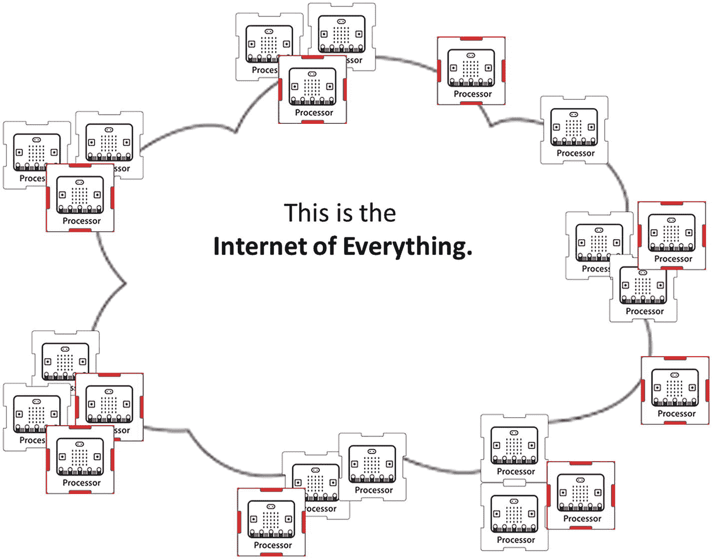
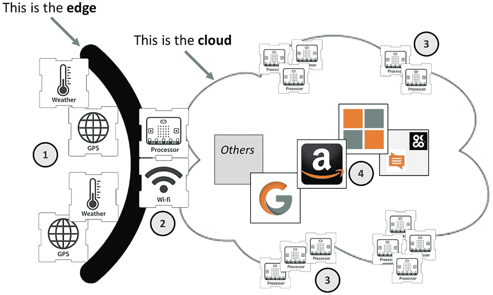
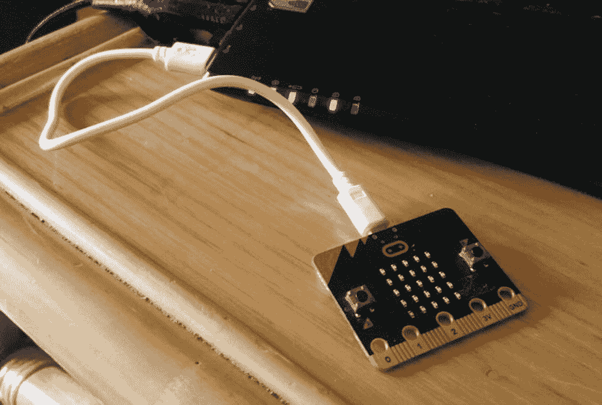

# 6. 将物联网引入数据科学

在本章中，我们将从数据科学家的角度来审视**物联网**（IoT）。什么是物联网？它如何帮助我们扩展数据科学能力？

## 6.1 我们数据科学工具箱中的弱点

在前面的章节中，我们进行了日益复杂的数据科学实验。我们的问题和工具都变得更加精密，但基本流程通常包括以下步骤：

1.  **好奇心**：这个过程总是始于好奇心；一个问题。
2.  **实验设计**：然后我们规划如何回答这个问题——我们应该收集什么数据？需要什么工具？我们定义了执行实验所需采取的步骤。
3.  **数据收集**：实验涉及一段数据收集期。
4.  **数据传输**：收集到的数据从数据收集工具转移到更适合分析的其他环境中。到目前为止，我们已经将数据转录到纸上并将数据保存到文件中。
5.  **分析**：使用适当的技术和软件对从数据收集工具中检索到的数据进行分析。
6.  **报告**：我们制作了可视化图表，并看到了数据如何以对话式事实的形式呈现。
7.  **反思**：从实验中汲取经验教训，以改进未来的设计。

到目前为止，我们数据科学工具箱中最大的弱点在于第 4 步。我们将数据写在纸上，并使用`micro:bit`的持久内存来记录数据，但这两种方案的可扩展性都不太好。为了收集数量更大的数据，我们需要找到其他方法将数据从基于`micro:bit`的数据收集工具传输到分析软件中。正是在这里，物联网将向我们证明其价值。

## 6.2 物联网概述

在为我们的大数据科学实验找到物联网的角色之前，我们需要清晰且简单地理解物联网究竟是什么。这不是技术层面的理解——那自有其他书籍来阐述。我们需要了解物联网如何在我们的大数据科学工作中发挥作用；随后再学习如何加以利用。

要理解物联网，不妨先思考"万物互联"和"人类互联网"这两个概念。^(⁸) 图 `6-1` 展示了全球所有相互连接的计算机：即万物互联。

图 6-1

万物互联：全球所有相互连接的计算机

在`图` `6-1`中，红色高亮的方块代表人类用于访问 Facebook、YouTube、电子邮件、网上银行等服务的计算机与智能设备。这就是"人类互联网"：我们在浏览器或连接的应用上获得的所有体验，都源自这些设备。

构成物联网的智能设备，则是`图` `6-1`中所有未被红色高亮的方块。这些设备自主运行、相互交互，无需人类直接干预。

人类互联网（IoH）和物联网（IoT）非常相似：

*   **人类互联网**（IoH）的构建是为了让**人类**能够理解：数据会以易于消化的方式呈现给我们，并且在与 IoH 交互时，通常也设计得非常简便。
*   **物联网**（IoT）的构建则是为了让**机器**能够轻松理解：它旨在让数据在网络中快速、高效地从一个地方传输到另一个地方。

人类互联网和物联网并非截然分开的独立系统：

*   IoH 和 IoT 并没有各自独立的基础设施：就像卡车和汽车行驶在同一条道路上，两者的数据同样经由相同的网络传输。
*   两者存在大量重叠：IoH 使用来自 IoT 的服务并访问其数据，同时也被人类用于控制和校准 IoT。从某些角度看，IoH 就像是 IoT 的"前端"：它是一扇窗户，我们通过它来观察并与 IoT 进行交互。

物联网和人类互联网各自拥有独特的协议^(⁹)和技术。沿用前面的汽车比喻，这些差异可以类比为柴油车与汽油车之间的区别。

因此，物联网系统是指两个或多个机器之间通过互联网进行交互，且在此过程中的任何阶段都无需人类参与的系统。

但为什么冰箱、房屋或卫星会想要共享数据，而且为什么它们要在不涉及人类的情况下这样做呢？各类创新且实用的应用已被开发出来，并且越来越多的应用正在被构想和构建：

*   **智能家居**。许多家庭使用供暖和照明设备，这既消耗能源又花费金钱。分布于家中的传感器可以提供关于房屋哪些区域需要照明或供暖的信息，中央控制系统则据此调节相应水平。
*   **智能路灯**正变得越来越普遍。它们不仅有助于减少不必要的照明，还常常集成了可报告其他数据的监控器——例如环境传感器或闭路电视摄像头。
*   **支持物联网的健康监测器**将医疗数据发送至 AI 系统进行分析，一旦观察到任何令人担忧的数据，便会发出警报。
*   一些建筑安装了**支持物联网的监测器**，用于记录与建筑状况相关的数据。如果数据表明建筑需要维护，详细信息将被发送给工程团队，由其前来进行检查。

从上述例子中浮现出一个共同主题：物联网服务于我们。典型的物联网系统会收集和分析数据，然后执行对人类有益的操作。它可能在发现不利状况时向我们发出警报，也可能调整系统使其更安全或更高效。

物联网并非计算机接管世界的手段；相反，它是我们人类将大量活动委托给计算机，以使自己的生活更轻松、更舒适的方式。至少就目前而言，计算机仍是随着人类的节拍起舞。

## 6.3 云的剖析

在我们探讨如何将物联网融入数据科学之旅之前，还有几个我们将遇到且需要基本了解的概念。本节将澄清一些语义，并审视构成物联网系统的不同组件。

首先，在**第 6.2 节**的基础上，我们将了解互联网、物联网以及“云”的定义：

- **互联网。** 在**第 6.2 节**中，我们提到了万物互联和人类互联，但并未明确这两者中哪一个才是“互联网”一词的真正含义。大多数人会将互联网等同于“万物互联”。
- **云**是万物互联的一个子集：它由多台计算机（通常是强大的服务器）组成，为互联网上的其他计算机提供服务。这些计算机可以保存数据、处理数据、执行事务，甚至提供人工智能服务。
- **物联网**可以被视为互联网中无需人工干预即可传输或处理数据的系统。

**图 6-2** 展示了不同连接组件如何协同工作的简化视图。

图 6-2

物联网系统的剖析

参照**图 6-2**中的编号元素：

1. **边缘设备**：一些数字设备与现实世界相连，例如记录天气数据或提供 GPS 坐标的传感器。当它们连接到互联网时，就会从外部提供新的数据。因此，这些设备位于物联网的边缘，我们称之为边缘设备。
2. **网关设备**：网关设备为边缘设备提供连接到互联网/物联网的方式。请注意，如果你想把边缘设备连接到物联网，那就意味着你想将数据发送到某个地方——发送到其他设备。主要有两种选择（下方的 3 和 4）。
3. 构成万物互联和物联网的其他设备/网络（如**图 6-1**所示）。
4. **服务提供商**：全球有一个庞大的在线服务行业。电子邮件、图片备份、社交媒体、银行以及海量其他服务都在云端供我们使用。这些服务构成了云的主干。

因此，云是大量服务提供商的集合，他们提供我们通过互联网使用的工具（如电子邮件和社交媒体）。这些服务并非免费；例如，谷歌提供和维护 Gmail 是需要成本的。

**云并非一项无私的事业**。服务提供商提供服务需要花钱，因此他们当然需要收回这些成本。

从某种程度上说，每个接入云端的网关都需要为其在云上使用的服务支付一定的代价。我们可能通过为特定服务支付现金来付费，也可能通过提供对服务提供商有价值的个人数据来付费。通常，他们可能通过让广告商向我们投放营销信息来赚钱。

诚然，有些服务确实是免费的，但就像你进入商店时，就要为带走的任何商品付款一样，在使用云服务时，你也应该以某种形式支付费用。

在本书中，我们将使用免费服务来开始物联网的探索——大多数提供商都提供免费试用期。但这些服务总是在不同方面受到限制，要想无限制地使用这些服务，最终还是需要付费。

## 6.4 从 micro:bit 传输数据

在**第 6.1 节**中，我们研究了数据科学过程的不同方面，并指出了现有工具集中最大的弱点：我们无法使用 micro:bit 收集任何实质性的数据量。它在测量我们所需的数据方面表现出色，但在存储数据方面却不太合适。

物联网为此提供了一种解决方案：它提供了从记录几十个数据点到几乎无限数量的方法：

通过在数据记录后立即传输数据，我们避免了 micro:bit 上存储数据的固有限制。如果我们能将数据转移到另一个更适合存储大量数据的平台，那么我们就受限于该平台，而非 micro:bit。有些物联网平台的设计目的就是让这一点变得简单：它们提供云服务来存储数据。因此，如果我们能找到一种方法将数据传输到合适的物联网平台，那么 micro:bit 的数据存储问题就不再会成为我们数据科学能力的限制因素。

我们面临的挑战是：如何将 micro:bit 上正在收集的数据传输到另一台设备？有四种方法可以实现：

1. 由一个人转录记录下来的数据，然后手动输入到下一台设备。我们在前面的章节中尝试过这种做法，但很快放弃了，因为它太费劳力了。这不是一个可行的选择。
2. 连接一个能够存储大量数据的外设。在第 5 章末尾，我们研究了一个用于 micro:bit 的 SD 卡解决方案，该方案允许存储超过 1GB 的数据文件。如果你能获取到硬件，并且不介意只能在数据收集完成后才能访问数据，那么这是一个极好的解决方案。
3. 使用线缆连接 micro:bit 和另一台设备。我们将在**第 6.6 节**中讨论**有线**选项。
4. 使用**无线**选项。计算机能够通过多种方式无线传输数据，我们将在**第 6.5 节**中讨论这些方式。

我们的目标是将数据从 micro:bit 传输到云端^((10))，在那里，广泛的工具和功能将使我们能够显著提高数据科学的生产力。现在我们将考虑选项 3 和 4，并在后续章节中决定采用哪一个。

## 6.5 物联网的无线通信选项

无线通信并非新鲜事物：早在计算机时代之前，我们的祖先就已使用它进行通信，且并不仅限于彼此交谈。烽火和灯塔就是利用光波传递信息的无线通信方式。

人与人之间以及计算机之间的无线通信存在许多相似之处：

-   人类可以非常轻松且频繁地无线发射和接收数据。说话是最明显的方式，但其他因素如肢体语言，也被用来向附近能听到或注意到我们的人传递数据。
-   计算机可以非常轻松且频繁地无线发射和接收数据。发射无线电波是最常见的方式，但还有其他选项可用。我们不会对这些选项给予关注。

目前有三种主流技术通过发射和接收无线电信号来传输数据，并用于将设备连接到物联网以及访问基于云的服务：

-   **蓝牙**：`micro:bit` 内置了一个符合 BLE（低功耗蓝牙）规范的无线电发射器。其无线电功能可以独立使用，无需调用蓝牙协议。我们将在**第** **7** **章**探索蓝牙的能力，然后在**第** **8** **章**介绍如何在不使用蓝牙的情况下使用无线电。
-   **Wi-Fi**：**第** **9** **章**将更详细地介绍 Wi-Fi，并展示如何为你的 `micro:bit` 添加 Wi-Fi 功能。
-   **LoRaWAN** 和 **Sigfox**：LoRaWAN（远距离广域网）和 Sigfox。这两者都是令人兴奋且不断发展的技术，但目前它们在 `micro:bit` 上的支持有限。蓝牙、无线电和 Wi-Fi 得到更好的支持，并将适用于广泛的数据科学应用。本书的其余部分将使用这些无线通信方法。

> **注意**  
> 在某些情况下，LoRaWAN 或 Sigfox 比蓝牙或 Wi-Fi 更合适。LoRa 的覆盖范围及其低功耗模式使其非常适合部署远程传感器：在高空实验（例如从气象气球上的传感器传输数据）中是一个流行的选择。由于篇幅有限，我们在本书中省略了这些技术。

## 6.6 使用串行连接传输数据

可以使用 UART（USB）线缆从 `micro:bit` 提取数据。数据可以通过“串行”线缆从 `micro:bit` 直接传输到计算机，并在计算机上大量保存（**图** **6-3**）。

*图 6-3*  
使用 USB 线缆连接到计算机的 `micro:bit` 可以通过该线缆将数据传输到计算机。

这种方法久经考验，但也存在一些限制：

-   测量仪器必须与计算机保持在一根线缆长度之内。虽然有许多数据科学用例可以通过这种方案充分实现，但本书的其余部分将专注于无线解决方案：即如何在 `micro:bit` 与另一设备之间传输数据，而不受物理连接的限制。
-   过程并不简单。虽然有代码库和应用程序可使其尽可能简化，但众多的选项和配置对初学者来说可能有点棘手。
-   这无疑是你技能库中的一个有用工具，但它能实现的用例，我们在本书后面探索的无线选项同样可以很好地实现。

如果有线解决方案能满足你的所有需求，你应该考虑深入研究一下。Micro:bit 基金会的网站提供了你所需的所有详细信息。

> **注意**  
> 对于 `micro:bit`，有一个相对较新的有线解决方案，它比目前 Micro:bit 基金会和社区推广的方法更容易使用。**Excel Data Streamer** 应用程序可在最新版本的 Excel 中使用，并可用于将 `micro:bit`（或任何边缘设备）的数据直接输入 Excel（通过串行/USB 端口）。鉴于 Excel 与其他 Office 365 应用程序集成的便捷性，该解决方案可能非常强大。如果你能访问 Office 365 并正在寻找有线解决方案，那么可以考虑这个方案。

## 6.7 总结

在本章中，我们试图揭开与物联网相关的一些术语的神秘面纱，并探讨了其构建所依赖的技术。我们看到了它如何帮助解决我们工具包中的主要弱点：数据存储限制。同时也有迹象表明，它可以为我们带来其他好处：如果云计算提供了我们可以访问的服务，那么其中一些服务肯定会对我们的数据科学工作有所帮助？我们了解到无线通信是连接到物联网的理想方式，并且通过使用蓝牙、无线电或 Wi-Fi，我们将构建一个网关，将我们的边缘设备连接到云端，从而解决数据存储问题。届时，我们将有能力进一步探究物联网还能提供什么。

脚注 1   2   3

