# 9. 使用 Wi-Fi 连接到互联网

在第 6 章中，我们了解到，能够将实验连接到互联网，有望极大地增强我们的数据科学工具箱。在第 7 章和第 8 章中，我们探究了 micro:bit 板载功能是否能够让我们连接到云端，以便访问那里的服务。尽管 BLE 和 micro:bit 无线电都提供了一些非常有用的无线功能，但与几章前相比，我们在正确连接物联网方面仍然没有进展。现在是时候将目光投向 micro:bit 以外的原生功能了。

如今，连接到物联网相对简单，最常见的方式是使用 Wi-Fi。（12）在本章中，我们将为 micro:bit 气象站添加 Wi-Fi，并将其连接到云端。

## 9.1 定义我们的物联网气象站

仅仅为我们的 micro:bit 气象站添加 Wi-Fi 功能固然很好，但这实际上意味着什么呢？我们到底要构建什么？我们需要对系统的工作方式有一个更清晰的概念：

1.  我们的 micro:bit 气象站不会有太大变化：我们将记录温度、湿度和气压数据。这次，我们将通过 Wi-Fi 输出这些数据。
2.  我们将把 micro:bit 气象站连接到一个物联网平台。
3.  我们将把气象数据发送到该物联网平台。
4.  数据进入平台后，我们就能使用多种工具/服务。我们将构建一个图表，用于实时显示数据并将其与历史数据进行比较。

正如我们在第 6 章中所见，一旦数据进入我们的物联网平台，我们就能使用一系列可以在数据科学工作中运用的工具。在第 9.4 节中，我们将设置我们的物联网平台，但首先，我们要准备好所需的硬件。

## 9.2 构建我们的 Wi-Fi 气象站

除了我们在第 8 章中使用的硬件之外，我们还需要引入一个提供 Wi-Fi 连接的模块。图 9-1 展示了支持 Wi-Fi 的数字气象站仪器的框图。

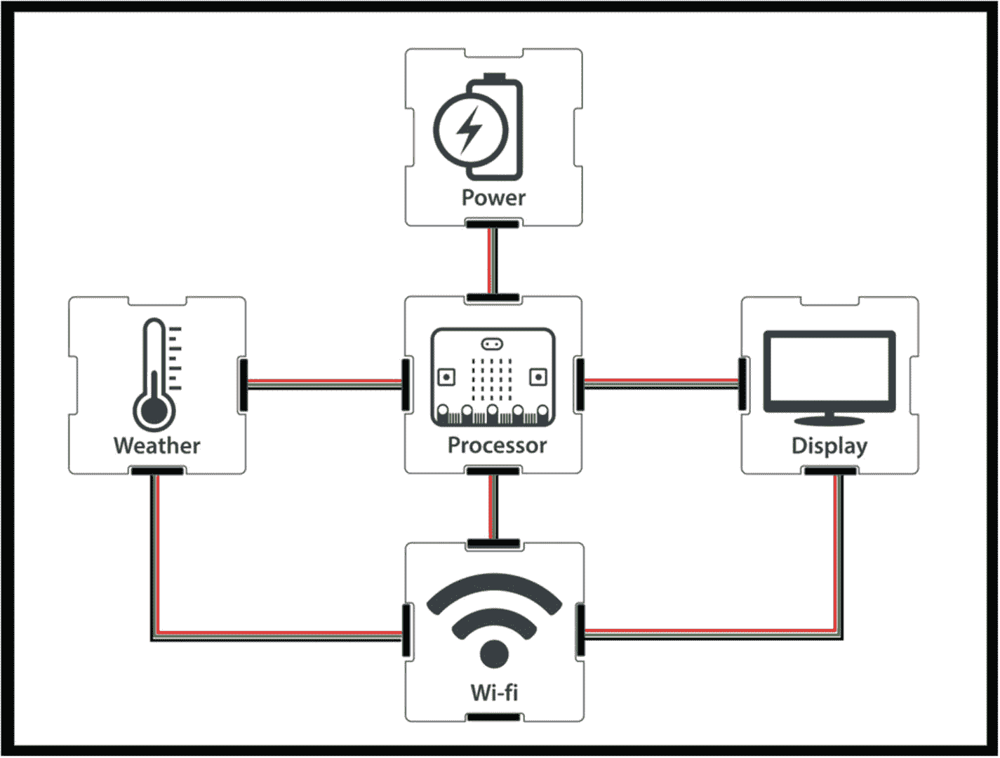

*图 9-1 构建支持 Wi-Fi 的气象站工具所需的组件*

表 9-1 列出了我们用于构建 micro:bit 气象站边缘设备的具体硬件。

*表 9-1 micro:bit 气象站边缘设备的硬件建议*

| 你需要什么 | 我们使用的硬件 | 数量 | 替代方案 |
| --- | --- | --- | --- |
| 微处理器和向其烧录代码的方法 | micro:bit 及 micro-B USB 数据线 | 1 | Raspberry Pi / Circuit Playground |
| 电源 | 通过 `XinaBox IM01` 连接的 USB 充电宝 | 1 | `XinaBox PB01` – 双 AA 电池供电包 |
| 读取气象数据的传感器 | `XinaBox SW01` 气象传感器 | 1 | SparkFun Weatherbit |
| Wi-Fi 核心模块 | `XinaBox CW01` Wi-Fi 核心模块 | 1 | SparkFun ESP32 Thing |
| 显示数据的屏幕 | Micro:bit 5x5 LED 矩阵 | 1 | `XinaBox OD01` – 64x128 OLED 显示屏 |
| 连接所有组件的方式 | `XinaBox IM01` – micro:bit 桥接模块 | 1 | 面包板、边缘连接器扩展板、鳄鱼夹引线及连接线 |
| xBus 连接器 | 2 | | |

图 9-2 展示了组装完成后的 micro:bit 气象站边缘设备的样子。

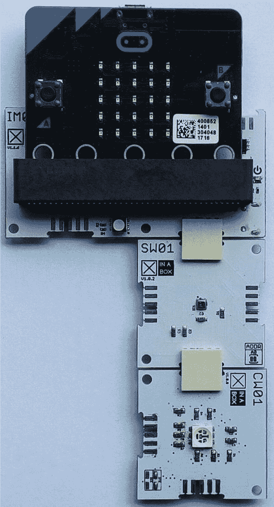

*图 9-2 带 Wi-Fi 的 micro:bit 气象站*

## 9.3 更新固件

**固件** 是微处理器上作为其操作系统运行的计算机程序。我们编写的代码（使用 `MakeCode`/`MicroPython`）并烧录到 `micro:bit` 上，是一套由固件解释的指令：我们的程序告诉固件该做什么。

BBC micro:bit 首次发布至今已有近五年时间，在此期间它并没有实质性的改变。早期版本的 micro:bit 固件不支持 Wi-Fi：你可能需要更新固件，这不仅是为了本章，也为了第 11 章中的示例。

确保固件始终是最新的是一个好习惯，因此，如果你最近没有更新过，我们建议你在继续之前进行更新。这非常简单：只需将一个文件烧录到 micro:bit 上即可，这将确保所有最新版本和高级功能在你的 micro:bit 上正常工作。你可以在我们的资源网站或 Micro:bit 基金会的网站上找到完整的说明。

尽管我们仅使用其 Wi-Fi 功能，但来自 `XinaBox` 的 `CW01` 也是一个微处理器；它本身也加载了固件。为了将 `CW01` 与 `micro:bit` 一起使用，有必要确保它运行正确的固件。不过，大多数读者**不需要**更新该固件；这完全取决于你从哪里获得的 `CW01`：

-   如果 `CW01` 是 `XinaBox XK05` 套件的一部分，则**不需要**更新。
-   如果你是单独购买的 `CW01`，或者它随其他套件（例如 `XK01`）一起提供，则需要进行更新。

更新 `CW01` 固件的完整说明可在我们的资源网站上找到。

> *在继续之前，请确保 `micro:bit` 和 `CW01` 都运行着合适的固件。*

## 9.4 选择物联网平台

要搭建物联网气象站，我们需要选择一个物联网平台。目前有多种选择，有些平台相对更简单易用。

`XinaBox` 的 `CW01` Wi-Fi 模块对应的 `MakeCode` 扩展包含了一些专门用于轻松连接 `Ubidots`、`ATT` 和 `Azure` 的积木块。它还提供了“通用”的 `MQTT` 积木块，允许你连接到任何遵循 `MQTT` 标准的物联网平台。

我们将以 `IBM Cloud` 为例进行演示，原因如下：

*   我们需要选择一个平台，而 IBM 一直处于物联网领域的前沿。
*   展示如何在 `MakeCode` 中使用 `MQTT` 积木块，能让你更好地掌握连接到任何物联网平台的方法。专用的积木块虽然更易用，但只能用于它们所适配的特定物联网平台。
*   你将能够访问 IBM Cloud 的一系列广泛服务（包括 IBM Watson AI 服务）。
*   他们提供 28 天的免费试用服务，让你无需付费即可进行测试。

要注册 `IBM Cloud` 账户，你需要拥有一个 `IBMid`。这将允许你登录所有 IBM 产品和服务。如果你还没有，请按照以下步骤使用你的电子邮件地址进行注册：

> **警告**
> 我们发现 Outlook 邮箱地址无法用于创建 `IBM Cloud` 账户。Gmail 邮箱可以正常使用。

*   访问 IBM Cloud 登录页面（`https://cloud.ibm.com/login`），然后点击**创建 IBM Cloud 账户**（**图 9-3**）。

    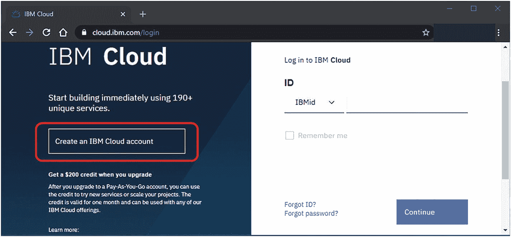

    *图 9-3* – IBM Cloud 登录页面

*   输入你的**电子邮件地址**。
*   填写其余字段，然后点击**创建账户**。
*   下一页将显示你的账户是否已成功创建（**图 9-4**）。

    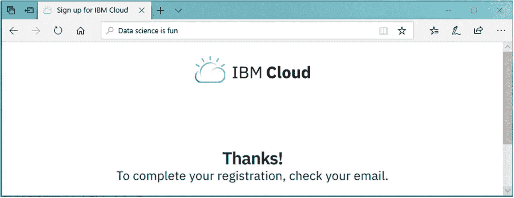

    *图 9-4* – 账户创建成功消息

*   检查你的电子邮件，然后点击收到的确认邮件中的**确认账户**来确认你的账户。
*   你将被重定向到登录页面。点击**登录**继续操作。
*   你将被重定向到**关于您的 IBMid 账户隐私**页面。在向下滚动页面找到**继续**按钮之前，请确保你同意隐私政策。
*   你将自动登录到 **IBM Cloud 仪表板**（**图 9-5**）。

    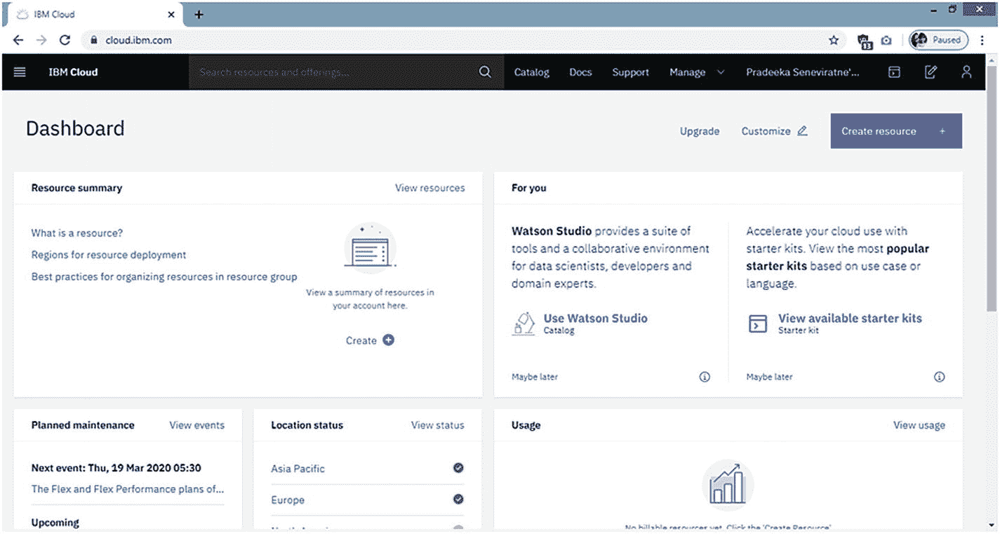

    *图 9-5* – IBM Cloud 仪表板

`IBM Cloud 仪表板`是一个中心枢纽，你可以从中访问所有 IBM 产品和服务。

## 9.5 设置物联网平台

我们将要连接 micro:bit 气象站的服务恰如其分地命名为 `IBM Internet of Things Platform`（IBM 物联网平台），可通过 `IBM Cloud 仪表板`访问，具体步骤如下：

*   在 `IBM Cloud 仪表板`中，点击**创建资源**（**图 9-6**）。

    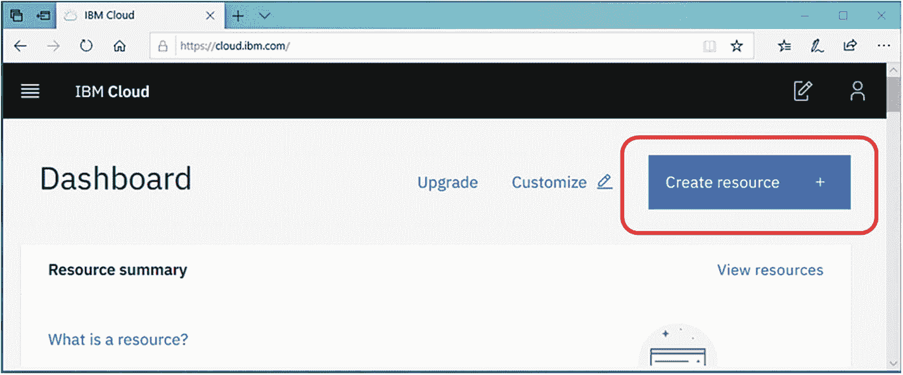

    *图 9-6* – 使用 IBM Cloud 仪表板创建新资源

*   在**目录**页面中，从服务列表中选择 **Internet of Things**。然后在筛选结果中选择 **Internet of Things Platform**（**图 9-7**）。

    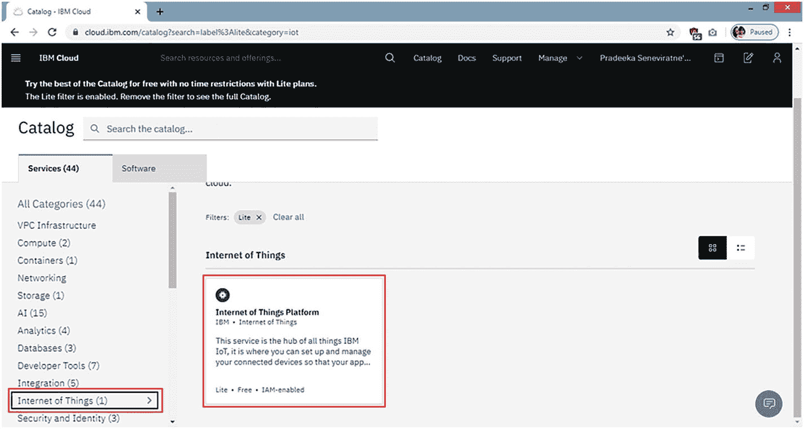

    *图 9-7* – 选择 Internet of Things Platform 服务

*   选择 **Lite 计划**（轻量版）。
*   向下滚动页面并重命名服务名称（例如，**Weather Service**（气象服务））（**图 9-8**）。

    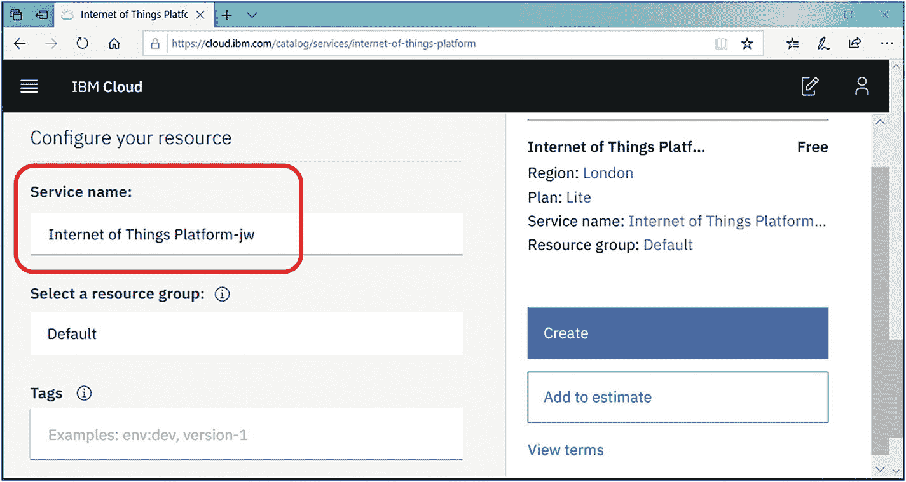

    *图 9-8* – 重命名默认服务名称

*   点击**创建**。几秒钟后，服务将被创建。
*   点击**启动**（**图 9-9**）。

    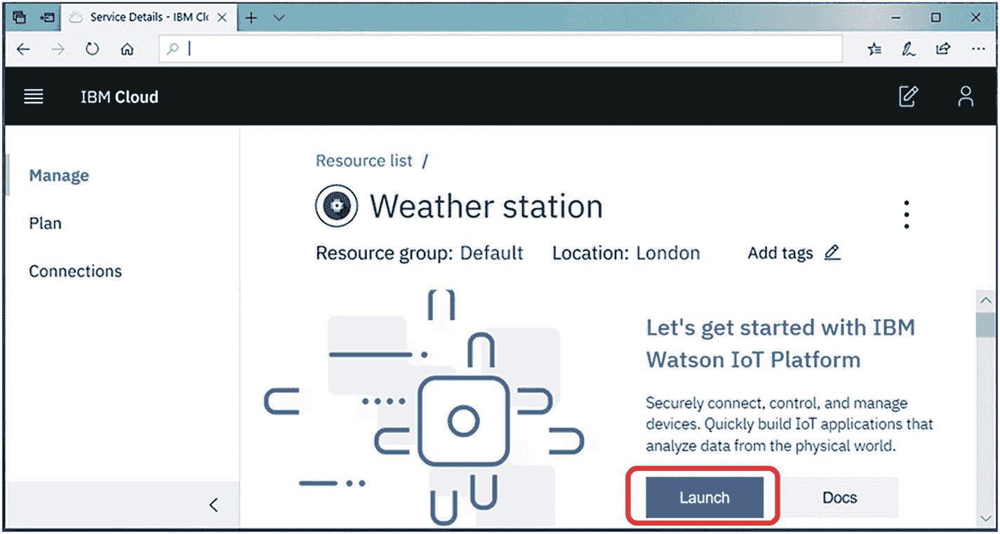

    *图 9-9* – 我们气象服务的启动页面

*   这将把你重定向到 `IBM Watson IoT Platform`，我们将在下一节中进行设置。

## 9.6 将气象站添加到物联网平台

现在我们已经设置了一个物联网平台，我们将把 micro:bit 气象站连接到该平台。我们仍需对其进行配置，但基本的基础设施已经就位。

配置物联网平台的第一步是识别允许连接到平台的设备。以下步骤将实现此目标：

*   点击页面右上角的**添加设备**（**图 9-10**）。

    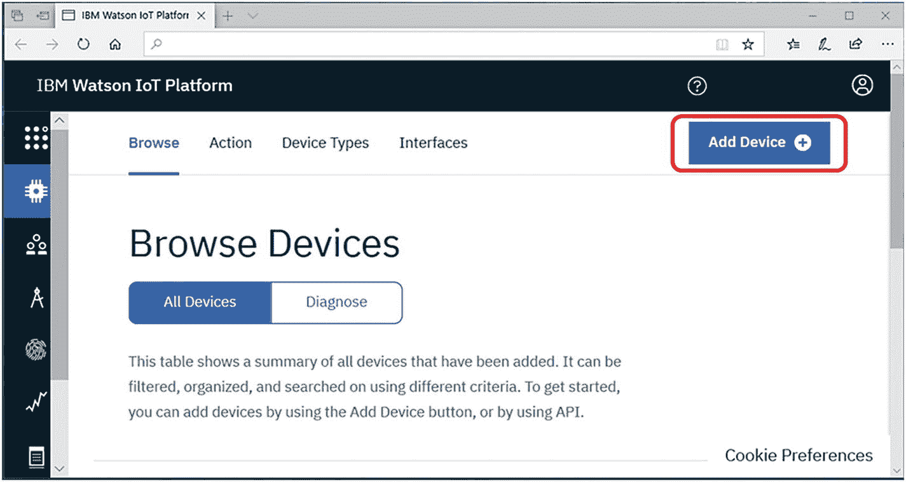

    *图 9-10* – 添加新设备

*   在**添加设备**窗口中，输入设备的名称和唯一 ID，然后点击**下一步**（**图 9-11**）。我们使用了以下详细信息：
    *   **设备类型**：`XinaBox`
    *   **设备 ID**：`xb123456`

        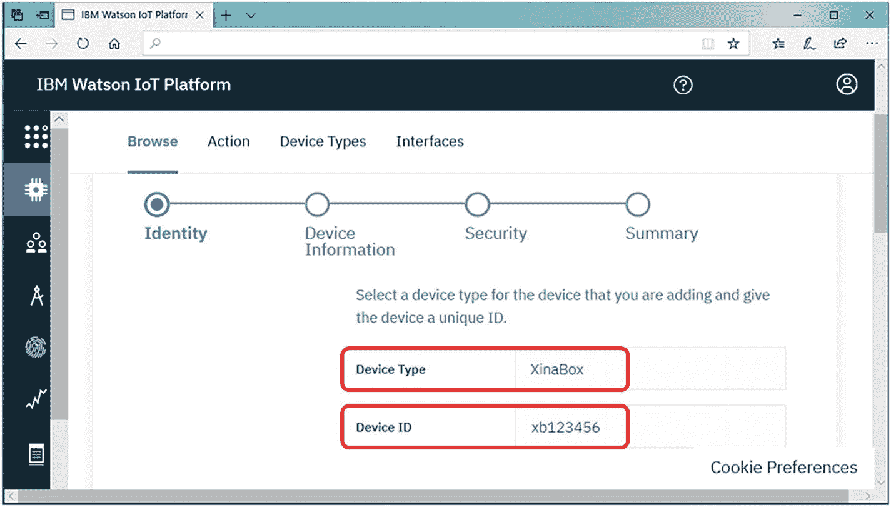

        *图 9-11* – 添加设备的第 1 步

*   在**设备信息**标签页中，将所有设备信息留空，然后点击**下一步**。
*   在**安全**标签页中，将**身份验证令牌**留空（以便自动生成身份验证令牌）。点击**下一步**。
*   在**摘要**标签页中，点击**完成**。
*   下一页显示**设备凭证**（**图 9-12**）。

    > **警告**
    > 离开此页面后，如何重新获取身份验证令牌尚不明确。请务必备份该页面的屏幕截图，或将设备凭证抄写在纸上。在编写代码时将会用到它们。

    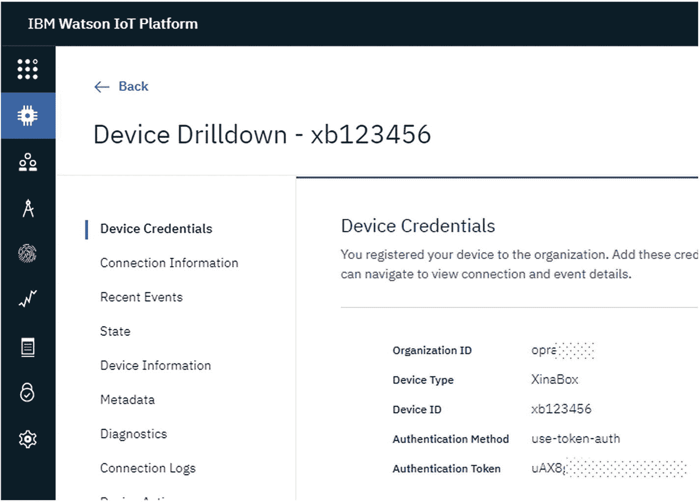

    *图 9-12* – 我们刚添加的设备的设备凭证

*   点击页面左上角的**返回**，查看已添加的所有设备。你的设备将显示在设备列表中。
*   点击左侧导航栏中的**安全**（**图 9-13**）。

    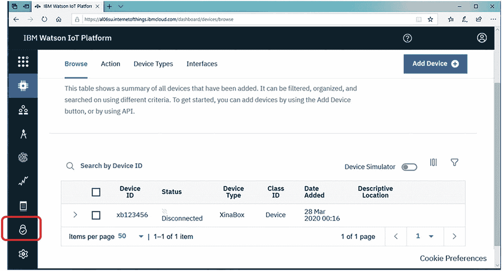

    *图 9-13* – 左侧菜单中可用的“安全”标签页

*   在**策略**页面中，点击**编辑**以编辑**连接安全**（**图 9-14**）。

    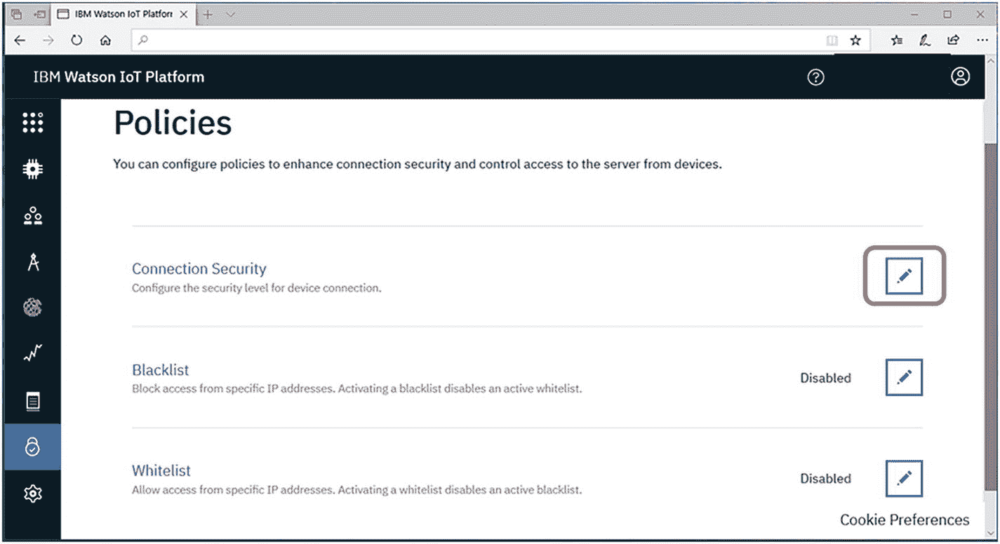

    *图 9-14* – 策略页面

*   从**安全级别**下拉列表中选择 **TLS Optional**（可选 TLS）（**图 9-15**）。然后点击右上角的**保存**。

    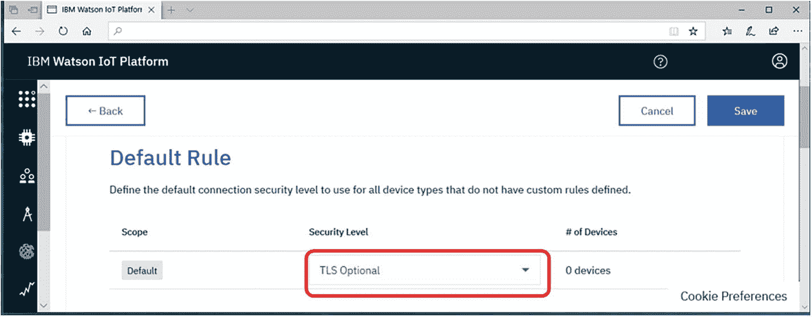

    *图 9-15* – 为默认规则选择的安全级别，将应用于你的所有设备

在**第 9.5 节**中，我们设置了“物联网应用”的框架，在本节中，我们定义了与将要连接到该平台的设备相关的关键参数。剩下要做的就是告诉我们的物联网应用如何处理我们将从该设备发送给它的数据。

## 9.7 在物联网平台中可视化数据

本节我们将告诉物联网平台如何处理数据以及如何输出/显示数据。我们将构建一个可视化图表：折线图。

`IBM Watson` 允许我们设置虚拟“看板”，你可以在看板上添加各种不同的内容。之后，当一切运行顺畅时，你将能够通过浏览器查看这些看板（称为**看板**）。

添加到看板上的内容称为**卡片**。卡片是预定义的项目（例如，折线图），用于展示物联网平台中定义的设备数据或相关信息。你可以在一个看板上添加多张卡片。在本节中，我们将先在 `Watson 物联网仪表板` 中创建一个新的**看板**，然后向其添加一张**卡片**。

## 按照以下步骤添加新看板：

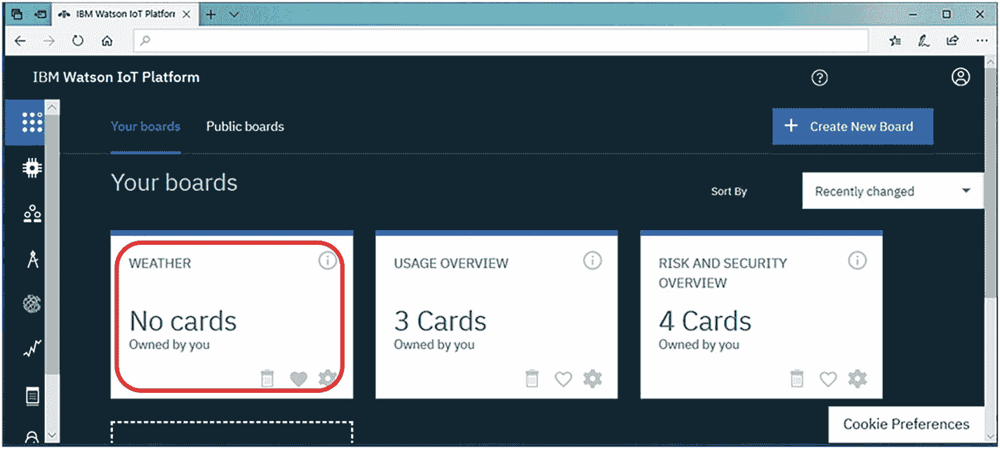
**图 9-17** 新创建的看板显示在“你的看板”下

*   点击左侧导航栏中的**看板**。
*   点击 **+ 创建新看板**。
*   在**创建新看板**窗口中，在**信息**选项卡中提供以下配置详情（**图** **9-16**）。然后点击**下一步**按钮。
    *   **看板名称**：`天气`
    *   **描述**：`显示来自各种气象传感器的数据。`

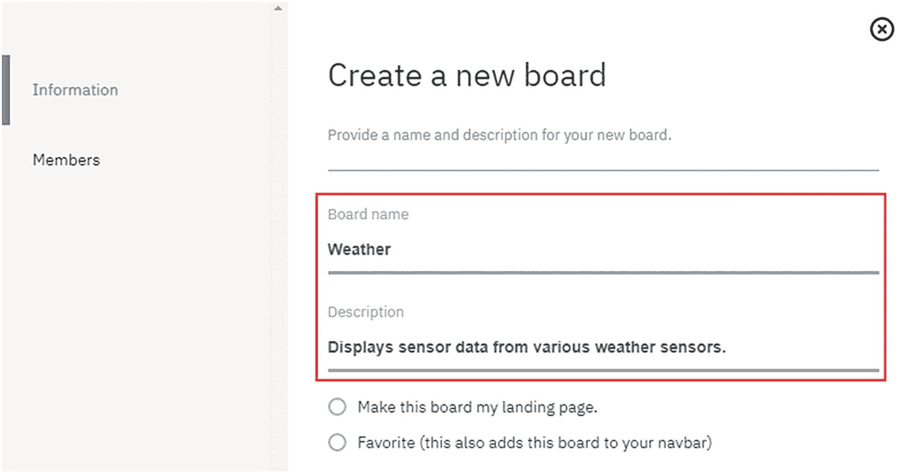
**图 9-16** 创建新仪表板：信息选项卡

*   在**成员**选项卡中不要提供任何信息，只需点击**提交**。
*   此时**看板**将被创建，并加载“你的看板”页面（**图** **9-17**）。

现在我们有了一个空的看板，可以添加卡片了；我们将添加一个折线图卡片，用于展示接收到的天气数据。这个折线图将显示温度和相对湿度数据（不包括气压——因为气压使用的量级差异太大，会弄乱图表）。你会看到可以添加到看板上的卡片有多种类型。

*   点击**天气**看板。
*   点击 **+ 添加新卡片**。
*   在**创建卡片**窗口中，点击**折线图**（**图** **9-18**）。

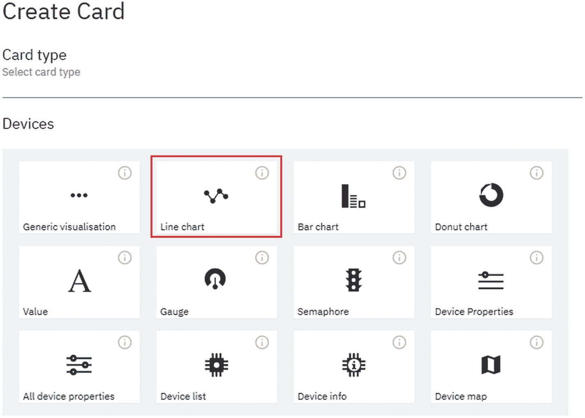
**图 9-18** 选择折线图数据可视化选项

*   在**创建折线图卡片**窗口中，在**卡片源数据**选项卡中，选择你之前创建的**设备**，然后点击**下一步**（**图** **9-19**）。

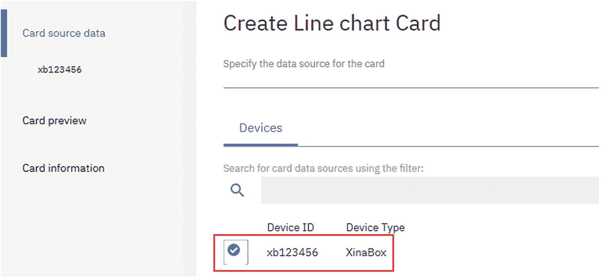
**图 9-19** 选择设备

*   点击选择 `xb123456` 设备（提醒：这是我们在**第 9-6 节**中指定的**设备 ID**），然后点击**下一步**。

在这一步中，我们将 `micro:bit` 边缘设备连接到了折线图。现在需要告诉折线图使用哪些数据以及如何处理这些数据。我们将添加两个数据集（温度和湿度）；需要按照**表** **9-2** 中的详细信息添加这些**新数据集**。

**表 9-2** 设置折线图卡片所使用的参数

| 需要输入的数据点名称 | 温度对应的值 | 湿度对应的值 |
| --- | --- | --- |
| **事件** | `status1` | `status2` |
| **属性** | `Temperature` | `Humidity` |
| **名称** | `Temperature` | `Humidity` |
| **类型** | `Number` | `Number` |
| **单位** | `C` | `%` |
| **最小值** | `-40` | `0` |
| **最大值** | `85` | `100` |

*   在**卡片预览**选项卡中，点击**XL**。然后点击**下一步**。
*   在**卡片信息**选项卡中，提供以下详细信息并点击**提交**。
    *   **标题**：`实时与历史天气数据`
    *   **配色方案**：选择任意颜色

卡片已添加到看板中，看板现在可以用了：一旦我们设置好数据馈送，就应该能看到折线图实时更新温度和湿度数据。

其他卡片也可以按照类似的方式添加到看板中。何不再添加一张卡片来可视化气压数据呢？

## 9.8 为我们的 Wi-Fi 气象站编写代码

本节我们将编写所需代码，让 `micro:bit` 像一个数字气象站一样工作；我们首先要设置好物联网平台，因为代码中需要用到平台的详细信息。**图 9-20** 用自然语言概述了程序流程。

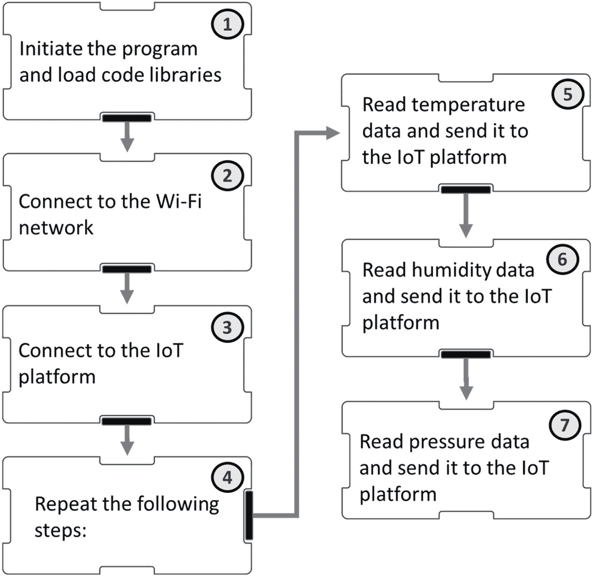
**图 9-20** 物联网气象站的自然语言代码

**图 9-20** 包含两个我们之前未曾接触过的步骤：

- **第 2 步**：连接到 `Wi-Fi` 网络。要连接 `Wi-Fi` 网络，你需要知道其名称（**SSID**）和**密码**。在开始编写代码前，请准备好这些信息。
- **第 3 步**：连接到物联网平台。相关内容在**表 9-3** 中说明。

你需要将来自物联网平台的若干详细信息输入到代码中。**表 9-3** 解释了如何查找和构造在 `MakeCode` 中使用的每个参数。

**表 9-3** 设置 `MakeCode` 块的参数

| 需要在 `MakeCode` 中设置的参数 | 参数的位置/如何创建参数 |
| --- | --- |
| 要连接到物联网平台，你需要设置**客户端 ID** 值。 |  客户端 ID 由 3 个参数组成，你需要按照非常特定的格式将它们连接（“**拼接**”）在一起。需要的参数是： - **组织 ID** - **设备类型** - **设备 ID** 格式为：`d:组织 ID:设备类型:设备 ID` 当你正确拼接数据后，结果应类似这样：`d:oprah53:XinaBox:xb123456` |
| 要连接到物联网平台，你需要在**连接到 `MQTT` 代理**块中设置 3 个值。 |  为此，你需要在**连接到 `MQTT` 代理**块中输入 3 个参数： 1. **代理 URL**（或“连接地址”）：将**组织 ID** 添加到字符串 `.messaging.internetofthings.ibmcloud.com` 的开头。 正确的**代理 URL** 如下所示：`opra53.messaging.internetofthings.ibmcloud.com` 2. **用户名**：此处输入固定字符串`use-token-auth`。 3. **密码**：密码是在**设备凭证**部分中指定的**认证令牌**。 |
| 要将数据传递到物联网平台，你需要向特定的**主题**发送一个**有效载荷**。 |  我们发送给物联网平台的内容称为**有效载荷**，我们必须指定将其发送到何处：即**主题**。 1. **有效载荷**：我们需要拼接 3 部分来构建有效载荷。选择一个拼接块并添加以下元素： - `{"[变量名]": "` - 你想要发送的值 - `"}` 因此，如果你要发送温度数据，拼接块将类似这样： 2. **主题**：主题是一个字符串，它告知物联网平台将数据传递给哪个卡片，以及它是哪个数据点。主题的格式为 `iot-2/evt/<事件>/fmt/json`。一个有效的主题应类似这样：`iot-2/evt/status1/fmt/json` `<事件>` 是你在设置卡片时，在**编辑折线图卡片 > 连接数据集** 中输入的事件名称：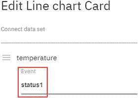 |

**表 9-4** 展示了如何使用**表 9-3** 中列出的参数，将**图 9-20** 中的代码转换为 `MakeCode` 块。

**表 9-4** 使用 `MakeCode` 块开发代码

| 步骤 | 描述 |
| --- | --- |
| 1 | 开始一个新项目。添加 `XinaBox` **SW01** 和 **CW01** 扩展。 |
| 2 | 将 **`CW01` 连接到 WiFi** 块添加到 **`on start`** 块中。 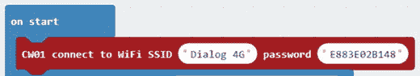 这将使你的 `CW01` 连接到 `Wi-Fi` 网络。 |
| 3 | **连接到物联网平台/设置客户端 ID**： - 将一个 **`CW01` 设置 `MQTT` 客户端 ID** 块添加到 **`on start`** 块中：  **连接到物联网平台/设置 `MQTT` 代理**： - 在 **`set MQTT client`** 块之后，将以下块添加到 **`on start`** 块中： 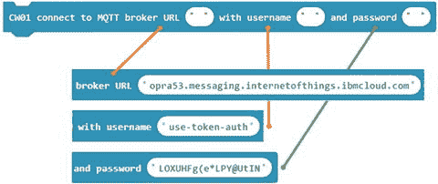 这将使气象站连接到 `MQTT` 代理。**更多详细信息请参见表 9-3。** |
| 4 | 使用 **`forever`** 块。 |
| 5 | 将一个 **`CW01` 发送有效载荷** 块添加到 **`forever`** 块中： 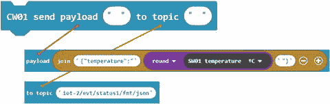 **更多详细信息请参见表 9-3。** |
| 6 | 修改步骤 6 中所示的拼接块，以发送湿度数据：  **`CW01` 发送有效载荷**块的其余部分保持不变。 |
| 7 | 我们还没有将物联网平台设置为对气压数据进行任何操作，因此我们没有地方发送它。如果你已经设置了一个用于显示气压数据的卡片，你应该尝试修改步骤 6 中的代码并将其添加到这里。 |
| | 通过添加一个暂停来完成程序，以控制数据传输的速率：  |

**图 9-21** 显示了完整的 **`MakeCode`** 块程序。

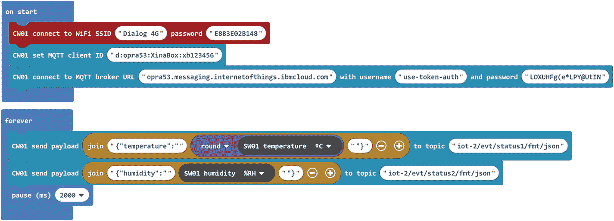
**图 9-21** `Wi-Fi` 气象站的 `MakeCode` 块

完整代码可在我们的**资源网站**上找到。你需要按照**表 9-3** 所述，调整参数以使其适用于你的物联网平台。

## 9.9 为气象站供电并运行

编译代码并将其烧录到你的 `micro:bit` 中。烧录完成后，从 `micro:bit` 上拔下 USB 线缆。我们需要按如下所述的特殊方式为气象站供电：

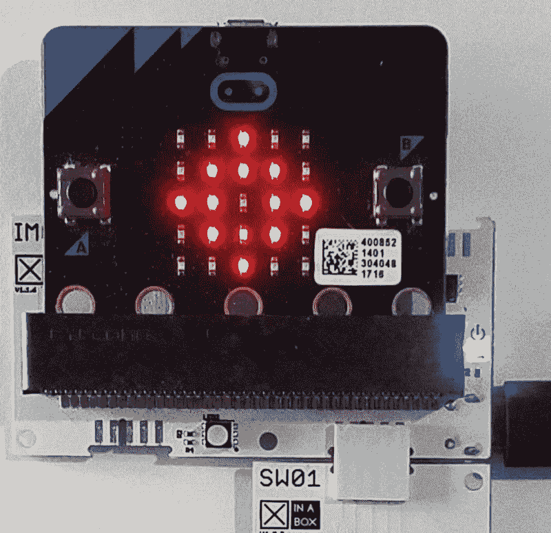
**图 9-24** 气象站正在向 `IBM Watson IoT` 平台发送数据

* 将 `IM01`、`SW01` 和 `CW01` 连接在一起。**暂时不要**连接 `micro:bit`。
* 将 USB 电源线连接到 `IM01`（图 9-22）。等待直到 `CW01` 上显示强烈的蓝光。这通常最多只需几秒钟。

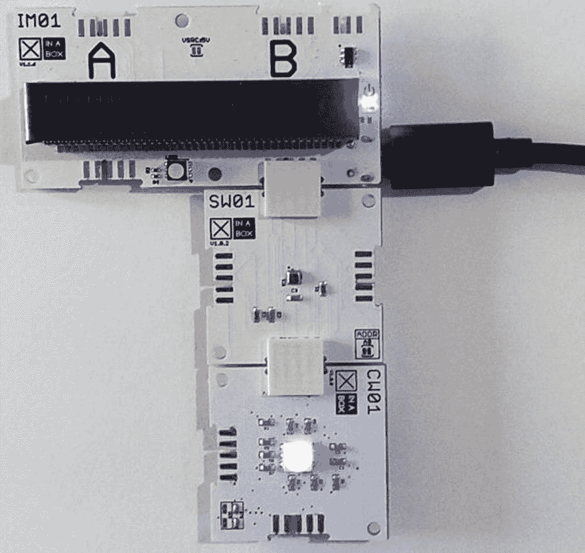
**图 9-22** 供电过程的第二步

* 现在你可以将你的 `micro:bit` 连接到 `IM01`（图 9-23）。启动时，`micro:bit` 应显示所示的图案。这表明 `CW01` 正在尝试连接到 `Wi-Fi` 网络。

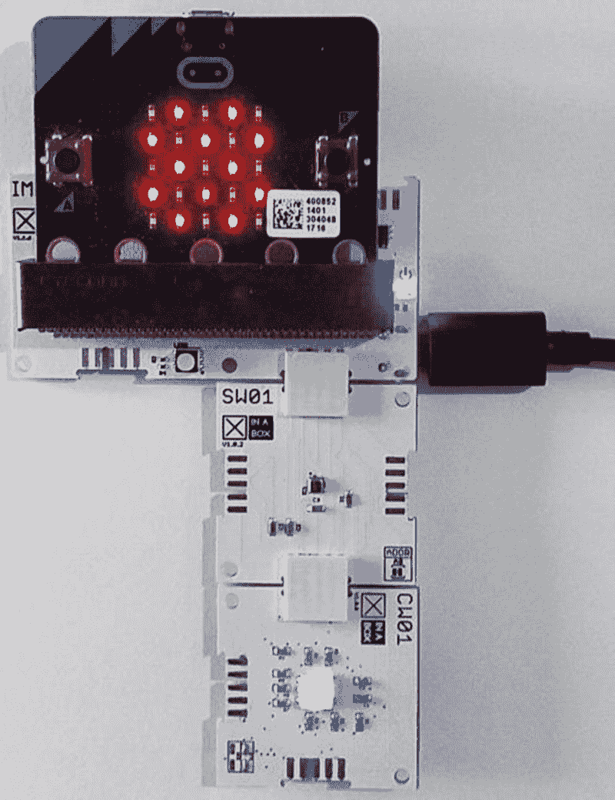
**图 9-23** 供电过程的第三步

* 一旦连接到 `Wi-Fi` 网络，字母 C 会显示在 5X5 LED 矩阵上。
* 接下来，气象站将尝试连接到 `IBM Watson IoT` 平台。LED 矩阵上的菱形图案表示气象站与 `IBM Watson IoT` 云之间的连接处于活动状态。

只要 `micro:bit` 保持通电且菱形图案显示，数据就会持续发送到 IoT 气象服务。下一节将说明如何查看这些数据。

## 9.10 查看数据可视化

一切运行顺畅后，`micro:bit` 气象站应持续向 IoT 平台传输数据。通过查看你在看板 (pin-board) 上设置的可视化内容来确认这一点：

* 点击左侧导航栏中的 **Boards**，然后点击在第 9.7 节中创建的 **Weather** 看板（图 9-25）。

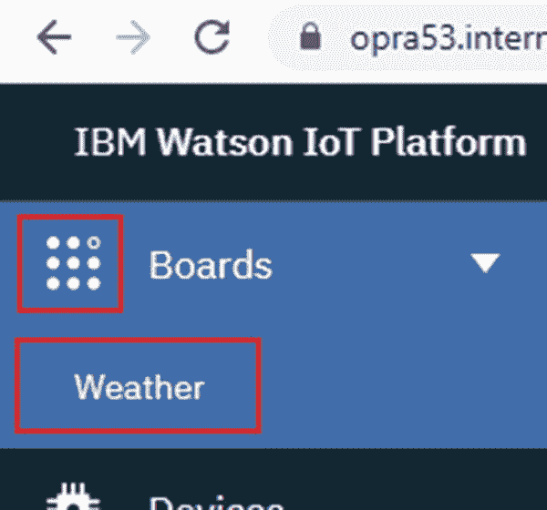
**图 9-25** 访问折线图以查看来自气象站的数据

* 折线图将显示你指定时间范围内的温度和湿度数据（图 9-26）。

> **注意**
> 还可以选择发布看板并将其设置为可公开访问。在 **Board settings** 的 **Members** 选项卡下，有一个 **share as read only with everyone** 选项。勾选此框后，即可通过你可分享的 URL 向公众提供对该看板的访问权限。

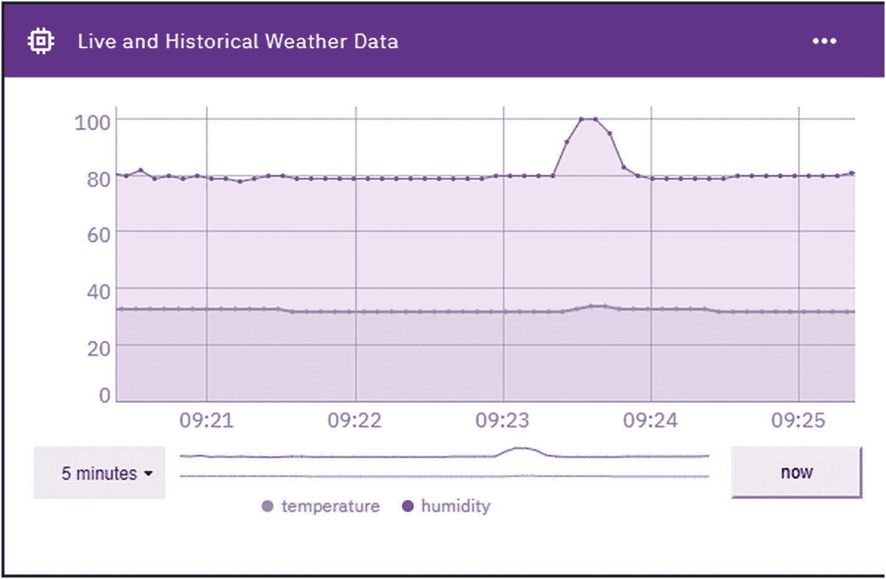
**图 9-26** 我们看板上的一个折线图卡片，显示实时和历史气象数据

## 9.11 总结

如果一切按计划进行，你的气象站已成功连接到 IoT 平台，并且你可以通过 Web 浏览器在看板上查看实时数据。虽然这听起来显而易见，但你将能够从世界上任何可以连接互联网的地方查看这个看板。如果这看起来稀松平常，请记住，在 20 年前这极其困难，甚至就在 10 年，也许 5 年前，你需要广泛而小众的技能组合才能构建类似的东西。

所以，请花一点时间感受成就感：你在本章所完成的任务并不简单，在人类历史长河中，只有极少数人能够做到这一点。更重要的是，我们构建的模型是一个将任何传感器数据发送到云服务的模型。更换不同的传感器相对容易，这极大地扩展了该系统的潜力。此外，我们使用了一个提供丰富可视化工具集的服务，但如果要连接到其他类型的服务，甚至可能是人工智能服务呢？这正是我们将在第 11 章和第 12 章中要做的事情。

但在我们有能力使用人工智能之前，我们需要对它有所了解，这将在第 10 章中讨论。

脚注 1 2