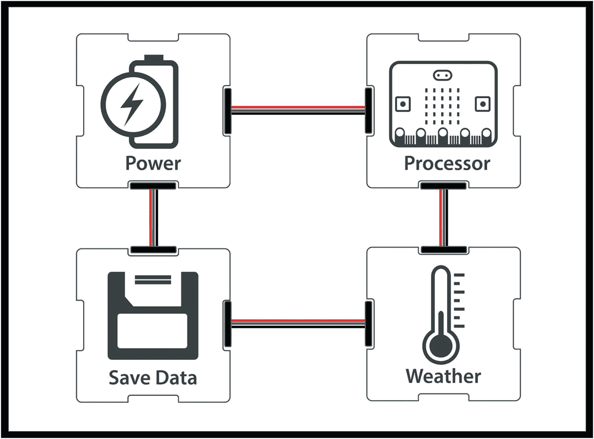
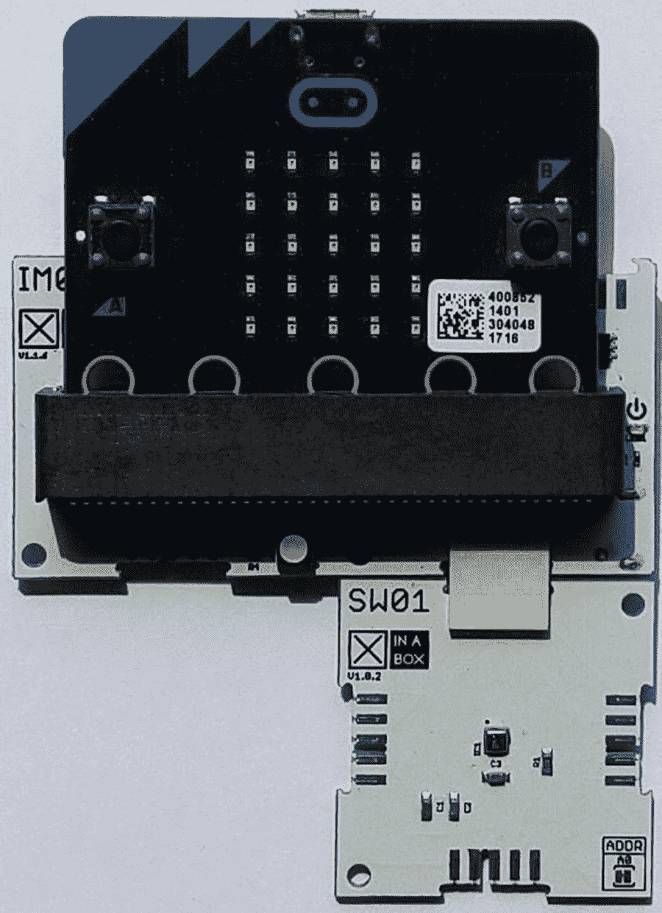
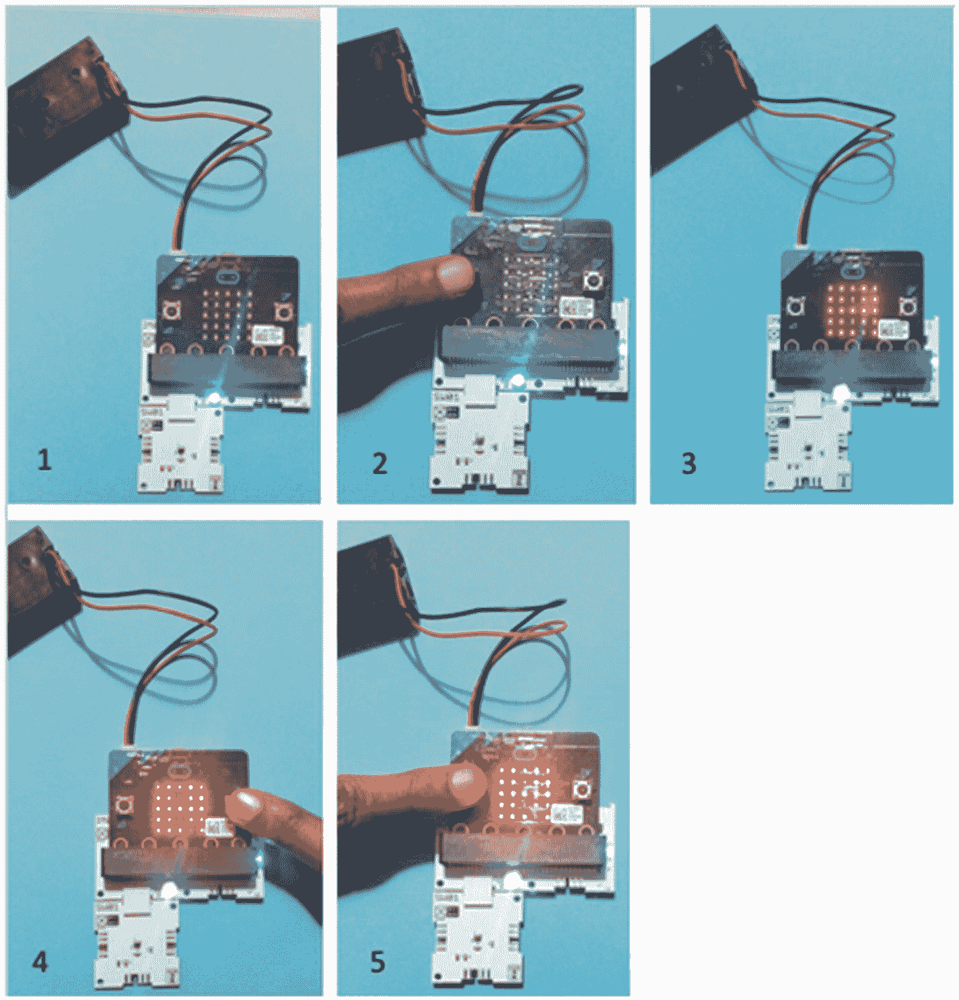
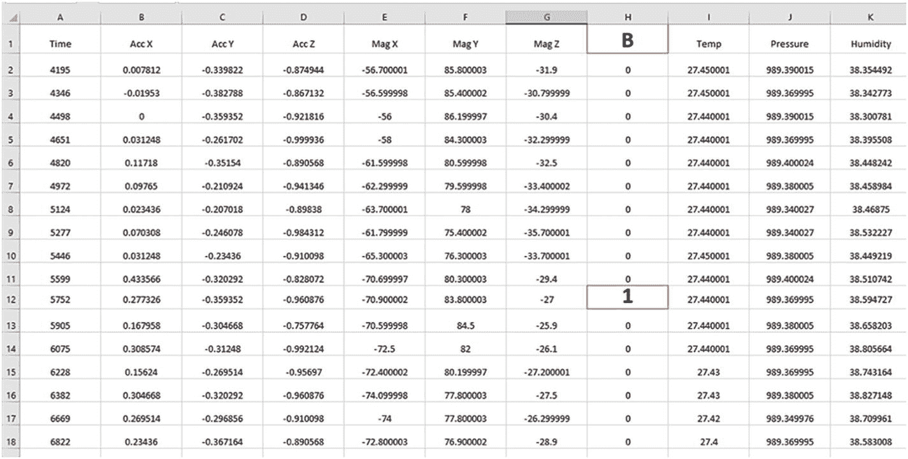

# 10.6 硬件要求

我们的数字仪器需要包含的组件如**图** **10-3** 所示。

图 10-3 数据记录器的核心组件

**表** **10-2** 列出了我们将用于构建数据记录器（或称“目标行为监测仪器”）的具体硬件。

表 10-2 数据记录器的硬件要求

| 所需物品 | 我们使用的物品 | 数量 | 替代方案 |
| --- | --- | --- | --- |
| 微处理器及向其烧录代码的工具 | micro:bit 及用于连接笔记本/台式机的 micro-B USB 线缆 | 1 | Raspberry Pi Arduino XinaBox CS11 |
| 电源 | micro:bit 电池盒 | 1 | Seenov Inc 太阳能电池 |
| 读取天气数据的传感器 | XinaBox SW01 – 高级天气传感器 | 1 | SparkFun Weatherbit |
| 持久化存储器 | 带 microSD 卡的 Xinabox IM01 micro:bit 桥接器 | 1 | 微处理器板载内存 |
| 将所有组件连接起来的工具 | XinaBox IM01 micro:bit 桥接器 | 1 | 面包板、边缘连接器扩展板、鳄鱼夹导线及连接线 |
| xBus 连接器 | 1 |

在使用 microSD 卡之前，请确保已使用 `FAT32` 选项对其进行格式化。如果你不确定如何格式化 SD 卡，我们的**资源网站**上对此过程有详细说明。

格式化完成后，将 microSD 卡插入 `IM01` 背面的插槽中。

**我们使用的物品**一栏中描述的数据记录工具如**图** **10-4** 所示。

图 10-4 组装好的数据记录硬件

## 10.7 软件

我们可以为 micro:bit 编写软件，利用其板载内存来记录我们关注的数据：第 **4** 章描述的代码和技术即可实现此目的。不过，micro:bit 的内存限制会严重制约我们能够收集的数据量。

另外，Raspberry Pi、Arduino 或 XinaBox 的 CS11 核心也能支持所需的数据记录应用。还有一些其他解决方案可用于从 micro:bit 提取数据，例如 Excel Data Streamer。只要你能标记观察到目标行为的时间点，任何用于捕获传感器数据的技术都是可行的。

我们选择使用 micro:bit 和 XinaBox IM01 桥接器组合，因为它非常符合我们的需求，且操作简单。我们使用的代码将记录一系列不同的传感器读数，并将这些数据写入一个 `CSV` 文件。该文件保存在 `IM01` 桥接器上装载的 microSD 卡中。

编码部分并非本章的核心内容：我们不会引入任何新的编程概念，只是应用我们已经涉及的概念（将传感器数据保存到持久化存储器）。所需的软件可以从我们的资源网站下载，该网站还展示了如何使用 `IM01` 在 `MakeCode` 中复现代码：

访问 [`http://xib.one/XB`](http://xib.one/XB) 并搜索 **第 10.7 节**。

## 10.8 使用硬件

硬件构建完成后，即可通电并使用。**图** **10-5** 展示了我们硬件运行中的一些快照。

图 10-5 使用数据记录器记录目标行为出现时的环境条件。(1) 通电。(2) 按下按钮 A 开始记录。(3) 正在记录数据。(4) 按下按钮 B 标记数据。(5) 再次按下按钮 A 停止/恢复记录

按下 micro:bit 上的 `A` 按钮开始记录，并将其放在伸手可及的地方。像往常一样活动，直到你注意到自己表现出目标行为。此时按下 `B` 按钮。

当你按下 `B` 按钮时，你就“标记”了数据：数据文件中的一条记录会被标记为“1”。这一点如**图** **10-6** 所示。

图 10-6 实验中收集的标记数据

在**图** **10-6** 中，`H` 列的标题（标题名 = **B**）被高亮显示。请注意，该列中的第 `12` 行数值为 **1**（同样被高亮显示）。当你按下 micro:bit 上的 `B` 按钮时，数值 `1` 就会被写入此列。这使我们能够识别观察到目标行为的时间点。

继续记录和标记数据，直到你获得多个目标行为实例。我们建议在进入分析阶段之前记录四到六个实例；更多实例会产生更好的结果，但也需要更多的工作。

