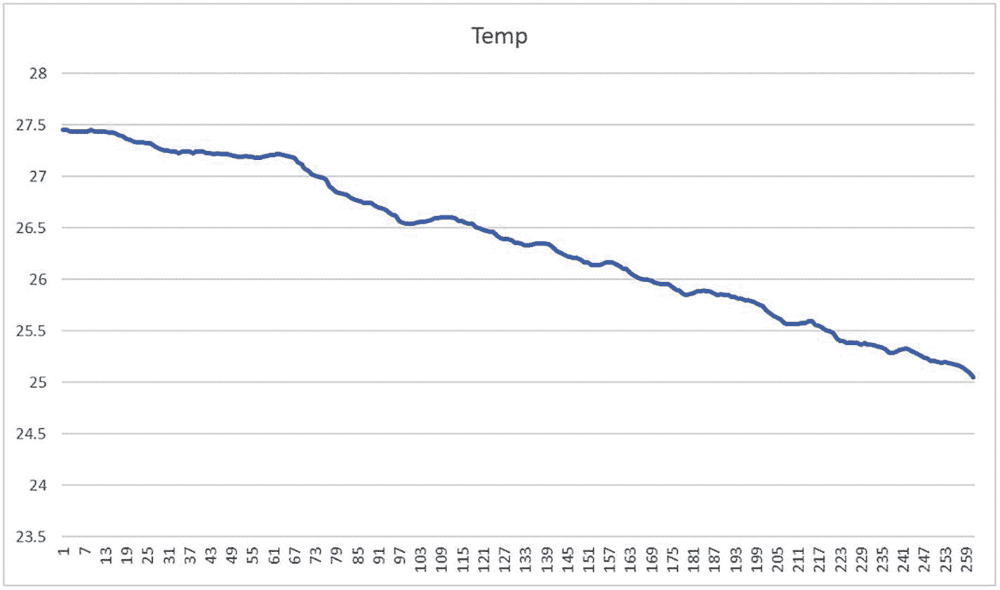
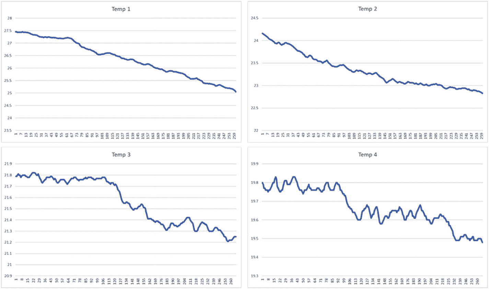

# 10.9 分析数据

收集并下载数据后，下一步就是对其进行分析，看看数据深处是否隐藏着有趣的秘密。

如果你使用了之前推荐的硬件和软件，那么你应该会得到一个带有以下标签的数据集：

- **时间戳**：这是一个整数，表示自 micro:bit 通电以来经过的毫秒数。
- **加速度 X**：x 轴方向的加速度测量值（相对于 micro:bit，由板载加速度计记录）。
- **加速度 Y**：y 轴方向的加速度测量值。
- **加速度 Z**：z 轴方向的加速度测量值。
- **磁力 X**：x 轴方向的磁力测量值（由 micro:bit 板载磁力计记录）。
- **磁力 Y**：y 轴方向的磁力测量值。
- **磁力 Z**：z 轴方向的磁力测量值。
- **B**：标记——该值通常为 0，仅在 B 按钮被点击时为 1。
- **温度**：由 `SW01 xChip` 记录的摄氏温度。
- **气压**：由 `SW01 xChip` 记录的大气压力。
- **湿度**：由 `SW01 xChip` 记录的相对湿度。

标记为 **B** 的字段中的数据告诉我们受试者何时表现出了目标行为。

寻找数据字段与目标行为之间关联性的一个相当简单的方法是使用下述流程绘制折线图：

图 10-7 目标行为发生前的温度数据

- 在数据中找到目标行为发生时对应的点——即 H 列出现数值 1 的位置。
- 选择另一个要查看的数据字段（例如温度）。从当前记录**向上**高亮该字段中的数据（以选择在标记目标行为之前记录的数据）：选择几百条记录。
- 点击**插入/图表/折线图**。创建一个显示高亮数据的折线图。
- 你的图表看起来会类似于图 10-7。

我们在图 10-7 中看到的是温度数据。它显示了在我感到冲动想泡杯咖啡前几分钟的数据。我本可以选取更长时段内更大块的数据，但我选择不这么做：想泡咖啡的冲动通常很突然，所以我想观察一个较短的时间段。请以类似的方式运用你的逻辑来选择要分析的时间段。

就其本身而言，这种可视化几乎没有价值。我们需要查看其他类似的图表，并检查是否存在相似的模式。针对每次目标行为重复生成图表的这个过程。尝试使用相同数量的数据点，并且不要让图表使用重叠的数据。

我生成了四个图表，如图 10-8 所示。

图 10-8 显示目标行为发生前温度变化的四个图表

将这些图表并排放置，有助于我们发现是否存在某种模式：即在目标行为发生前，图表形状的相似之处。

在显示的四个实例中，温度在我感到冲动想泡杯茶之前是持续下降的。这出乎意料：尽管我假设最可能与目标行为相关的度量值是温度，但我确实没想到会看到一种模式。这些数据并不能证明什么，但它表明温度可能在触发我的“咖啡冲动”中发挥了作用。我心中的数据科学家将此结果标记为值得以后更严格调查的内容。

我们分析过程的下一步是对所有不同的度量值重复此过程，看看是否有其他模式出现。我们有九个传感器读数可以选择，因此需要绘制大量图表——最好马上开始！

但是，**不**。在这一点上，我们应用人类智能来指导我们的分析：

加速度有可能成为目标行为的触发因素吗？磁力计读数呢？我的逻辑告诉我，这种可能性要么为零，要么非常接近于零。湿度和/或气压起作用的可能性更大。我判断，花时间创建加速度和磁力计数据的图表并不值得我付出努力，并且我会优先考虑那些更有可能产生结果的度量值。用省下的时间，我会再去泡杯咖啡（天气有点凉了！）。

## 10.10 人类与机器的比较

目前有多种公开可用的人工智能服务，我们将在下一章介绍如何访问其中之一。然而在这个实验中，我们完全是手动完成的。表 10-3 列出了我们进行的若干活动和操作，并说明了在每个实例中人工智能可能能够做什么。

表 10-3 数据分析：比较人类和人工智能可能如何执行此处概述的分析

| 我所做的 | 人工智能会做的 |
| --- | --- |
| 我出于好奇设计了一个实验来探究某事。 | 人工智能会响应某种命令。它们天生没有好奇心。 |
| 我选择先查看温度：感觉它是最可能产生影响的度量值。 | 人工智能会查看所有不同的度量值，然后查看它们之间各种组合。随着时间的推移，它会学会优先考虑那些能更稳定地产生显著结果的度量值。 |
| 我制作了四个图表，它们都关注基于逻辑假设选择的相似时间段。然后我目视检查了我制作的图表。 | 人工智能会使用广泛的模式匹配算法来彻底分析数据，测试各种不同的时间段。只要有足够的时间处理数据，它就能找到任何具有统计显著性的结果。 |
| 我寻找模式。 | 人工智能寻找模式。 |
| 我运用逻辑来减少工作量。我珍惜自己的时间，并排除了我认为无关紧要的度量值。 | 人工智能会利用先前的学习来指导其搜索方式，并且只要有工作需要完成，或者直到被告知停止，它都会继续工作。 |
| 我认为结果很有趣，可能值得进一步调查。 | 人工智能会报告具有一定统计显著性程度的结果。我们可以训练人工智能为一个结果被人类认为有趣的可能性打分。 |
| 我可能会基于直觉和经验做出一些预测。 | 人工智能可能会基于大量先前的类似事件，以及一个经过高度训练和演进的预测模型来做出预测。 |

请注意，表 10-3 中最可能被归类为“智能行为”的活动都列在了“**我所做的**”一栏中。人工智能可以提供很多帮助，但数据科学中真正的智能仍然来自参与流程的人。

然而，人工智能的价值显而易见，它可以执行大量复杂分析，这些分析对人类来说太耗时，并且超出了我们大多数人的技能范围。在下一章中，我们将解锁这种能力，并开始在数据科学工作中使用人工智能。

