# 12. 将边缘设备连接到物联网应用

在上一章中，我们开发了一个将接收温度和湿度数据的物联网应用。这些数据将由机器学习服务处理，并进行预测：是否会下雨？

现在剩下的工作就是构建一个能够将所需数据输入到物联网应用的设备，以及另一个（或可能是同一个）能够接收来自机器学习服务的预测数据并显示它的设备。

## 12.1 选择硬件

本章我们将沿用第 9 章所使用的硬件。

在本书中，我们已多次看到，对于数据科学应用而言，所使用的具体硬件设备仅仅是一个工具：达成目的的手段。真正重要的是成果——即硬件所实现的功能——而任何其他硬件设备都可能带来相同的成果。

这一点在此处尤其相关：我们刚刚花费了大量精力构建了一个物联网应用，而现在将用少得多的时间来构建一个边缘设备。一旦你投入时间搭建好物联网应用，相比之下，更换不同的边缘设备就相对简单了。

可以使用多种不同的边缘设备，包括手机。如果你能在手机上获取温度和湿度数据，就可以通过 `Wi-Fi` 将其发送到物联网应用。更可能的情况是，你想用手机接收数据：例如，当可能下雨时触发一条短信。连接手机超出了本书的范围，但有了合适的工具，它与连接 `micro:bit` 类似。

将边缘设备与物联网应用分离的意义之一在于，物联网应用实际上是一个独立的“产品”。它可能被多家不同的边缘设备制造商使用，甚至是竞争对手。考虑一个记录心率并使用 `AI` 分析数据的心率监测器。第 11 章表明，构建一个支持 `AI`/机器学习、能分析心率数据的物联网应用并非易事。一个能够接收这些数据并生成有用报告的 `AI` 服务，对医疗行业来说可能极具价值，尤其是对那些有兴趣构建使用该服务的边缘设备的人来说。¹⁸ 像我们构建的这种物联网应用本身就是“资产”。

我们将沿用本书始终使用的硬件：一个 `micro:bit` 和天气传感器，并增加 `Wi-Fi` 功能以提供物联网连接。这与我们在第 9 章中使用的组件相同。

## 12.2 边缘设备的作用

边缘设备有两个核心功能：

- 测量并发送天气数据
- 接收并显示预测数据

图 12-1 展示了边缘设备的作用（见项目 1 和 3），以及我们的数据将遵循的线性流程（始于 1，经过 2，终止于 3）。

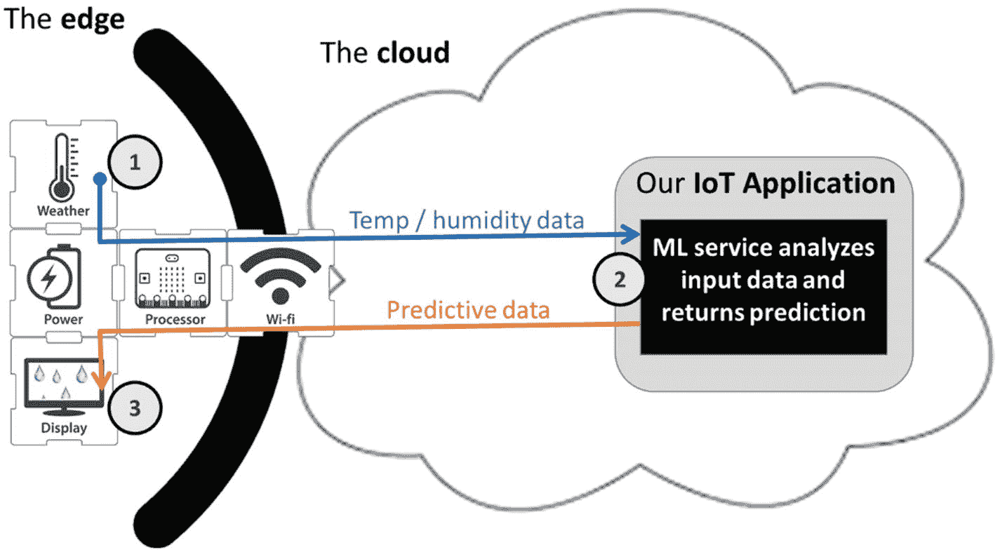
*图 12-1* 数据从边缘设备到物联网应用再返回的流程

参照图 12-1 中的编号：

1.  数据源自我们的边缘设备：
    - 首先我们需要连接到物联网应用。
    - 然后需要测量温度和湿度数据。
    - 这些数据通过 `Wi-Fi` 输出到我们的物联网应用。
2.  物联网应用按照第 11 章所述的工作流程运行。
3.  返回预测数据：
    - 我们的边缘设备连接到物联网应用，并监听来自它的消息。
    - 收到消息后，将其解析成可用的格式。
    - 从消息中提取的预测数据显示在屏幕上。

## 12.3 构建边缘设备

我们将使用的设备与第 9 章描述的完全相同。图 12-2 展示了硬件组件；更多细节请参考第 9 章。请连接手头已有的组件，构建一个近似图 12-2 的设备。

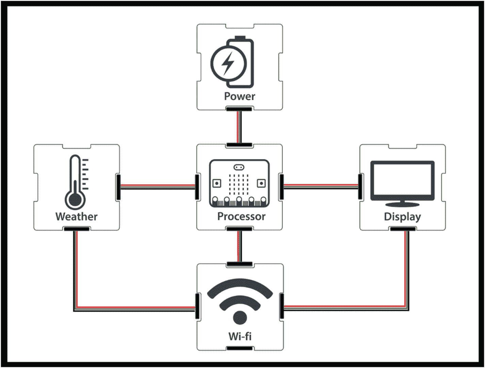
*图 12-2* 边缘设备的硬件组件

## 12.4 边缘设备编程

在我们编写所需的代码使其按期望方式工作之前，硬件设备仅仅是个镇纸。开始编码之前，我们需要确切理解代码需要做什么。

图 12-3 展示了我们将转换为 `MakeCode` 块的自然语言代码。

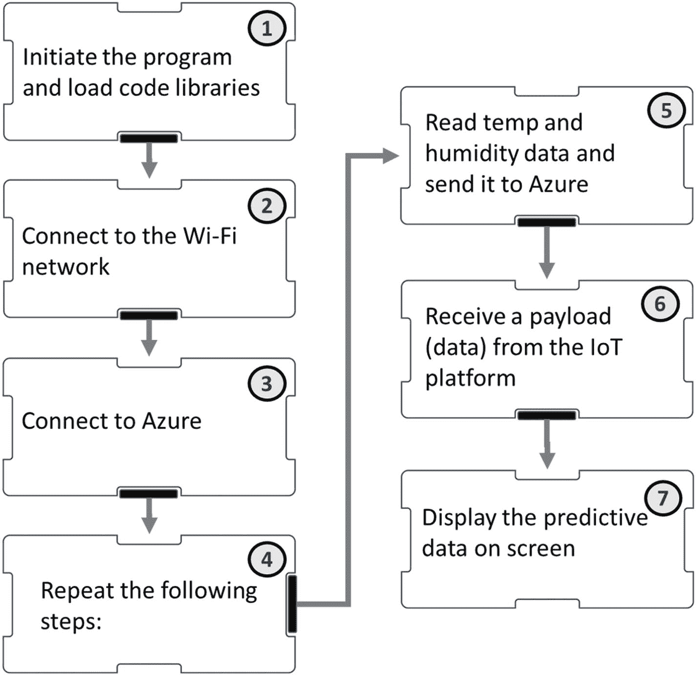
*图 12-3* 边缘设备的自然语言代码

**无代码选项**：无法为此工具提供无代码选项——每个程序都需要更新以包含你的 `Wi-Fi` 凭据和 `Azure` `HTTP` `Post` `URL`。

关于如何找到 `HTTP` `Post` `URL` 的详细信息，请参见 12.7 节“当收到 `HTTP` 请求时”。

代码完整版可在配套网站上获取，供你编辑。

表 12-1 展示了自然语言代码的每一步如何转换为 `MakeCode` 操作或块。

*表 12-1* 使用 `MakeCode` 块开发代码

| 步骤 | MakeCode |
| --- | --- |
| 1 | 开始一个新项目。添加`XinaBox CW01`和`SW01`扩展。 |
| 2 | 在`on start`块内添加`CW01 connect to WiFi`块。输入你的 `Wi-Fi` 网络的 `SSID` 和密码。 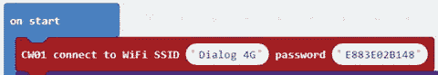 |
| 3 | 添加`CW01 connect to Azure with access endpoint`块。然后复制并粘贴 `HTTP` `POST` `URL`。 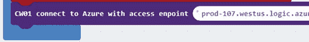 关于找到 `HTTP` `POST` `URL` 的帮助，请参见 12.7 节。在将 `URL` 添加到块时，请确保删除`"https://"`部分。 |
| 4 | 添加一个`forever`块。 |
| 5、6 和 7 | 步骤 5、6 和 7 都由一个单独的代码块处理：将`CW01 update two variables`块添加到`forever`块中。在四个可用输入框中添加以下内容： - **第一个变量**：输入`"temperature"`。 - **第二个变量**：输入`"humidity"`。¹⁹ - **第一个值**：添加`SW01 temperature (C)`块。 - **第二个值**：添加`SW01 humidity (%RH)`块。 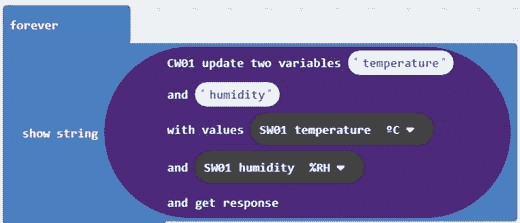 |
| 最后，添加一个`pause`块。延迟时间应至少足够让响应在屏幕上滚动显示。 |  |

图 12-4 展示了完整的代码清单。

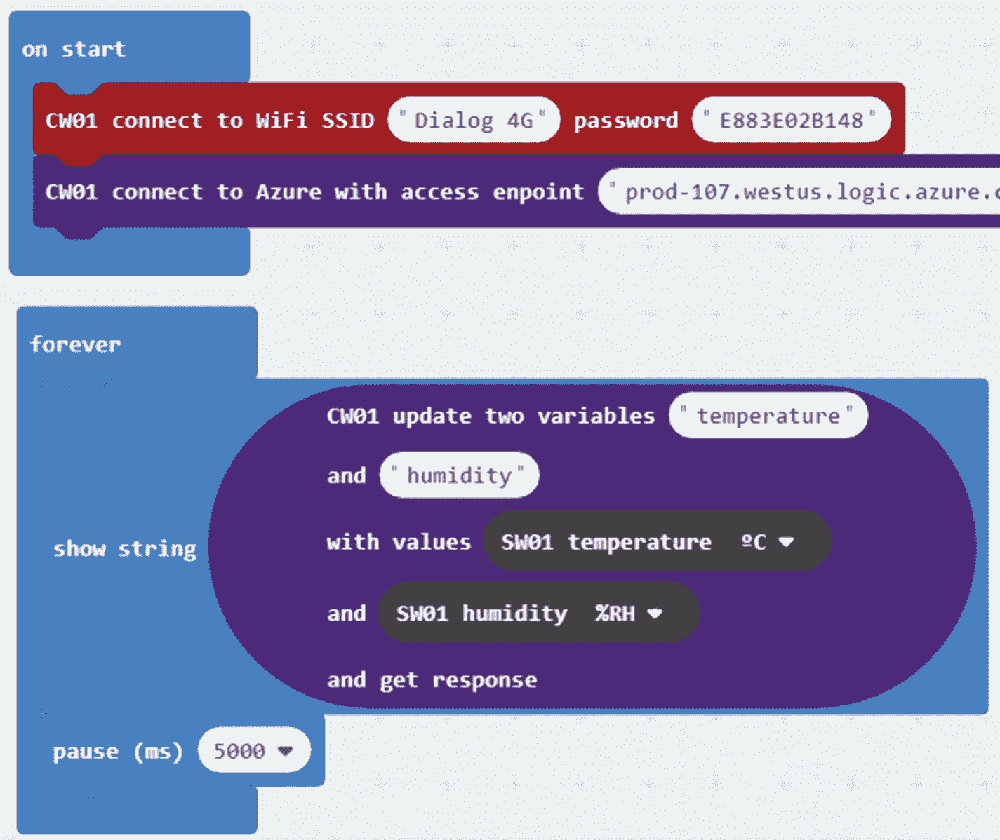
*图 12-4* `micro:bit` 气象站的 `MakeCode` 块

代码完成后，将其烧录到你的 `micro:bit` 上，然后拔掉 `USB` 线。

前面用到的函数（`CW01 update two variables`…）非常专业化：它是专门为将 `BBC micro:bit` 与接受两个变量作为输入并同时返回一个变量作为输出的 `Azure` 机器学习服务集成而构建的。

`CW01` `MakeCode` 扩展还包括通用的 `MQTT` 块（我们在第 9 章中使用过它们），可用于连接任何基于 `MQTT` 的物联网平台。在这种场景下我们无法使用这些块：从 `micro:bit` 连接到 `Azure` 并不容易。

## 12.5 使用边缘设备

在构建并编程好边缘设备后，我们现在只需为其通电并开始使用。

> *必须以特定方式为气象站通电，因此请遵循**第** **9****章****9.9**节所述的步骤*。

**第** **9****章**还列出了仪器在首先连接 `Wi-Fi` 路由器，然后连接目标物联网平台时所经历的阶段。本例略有不同，因为我们也要接收并显示来自物联网平台的数据。如果流程运行正常，你应该看到以下现象：

1.  如果仪器已连接到 `Wi-Fi` 网络，`micro:bit` `LED` 屏幕上将显示字母 `C`。

2.  随后，`micro:bit` 将尝试连接到 `Azure`，并开始向我们的物联网应用发送数据。

3.  当数据成功传输时，屏幕上会显示一个对勾，随后显示降雨预测结果（`"Yes"` 或 `"No"`）。

气象站将持续共享并显示这些数据，直到你将其关闭。

当你第一次看到 `"Yes"` 或 `"No"` 在 `micro:bit` 的 `LED` 上滚动时，你完全有理由感到极大的满足感：你实现了一些在几年前还不可能完成的事情。天气预测应用是机器学习（`ML`）的（非官方）`Hello World!`，**第** **13****章**将详细阐述这个简单的 `ML` 实验为我们解锁了哪些其他更复杂的应用。

## 12.6 改进边缘设备

这个边缘设备尽可能地简单：使用了最少的代码和硬件——仅五个硬件模块和六个代码块。

我们可以通过添加更多组件或使代码更复杂来增强该仪器。利用本书中介绍的技术，你应该能够实现以下一些增强功能：

*   添加一个像样的显示器并打印数据到上面。

*   当按下 `A` 按钮时，显示连接状态。

*   处理预测数据——当预测结果为 `"Yes"` 时执行某种操作，为 `"No"` 时执行另一种操作——为什么不显示一个图形来表示下雨呢？

*   控制数据发送和接收的频率，或者仅在按下 `B` 按钮时发送。

*   你有多个 `Wi-Fi` 网络的凭据吗？使用常量变量并尝试自动连接到任何在范围内的网络。

## 12.7 探究物联网应用的内部机制

看着我们的 `micro:bit` 屏幕上滚动着 `"Yes"` 或 `"No"`，然后望向窗外检查是否在下雨……这种乐趣持续不了多久。当你对此感到厌倦时，趁着边缘设备仍在运行，返回物联网应用，看看里面发生了什么。

打开 **`Azure` 逻辑应用设计器**，并单击设计器工具栏上的 **运行**，以使数据流经你的工作流。加载可能需要一些时间，之后工作流将显示出来。你应该能认出**第** **11****章**中**图** **12-5** 所列出的五个步骤。

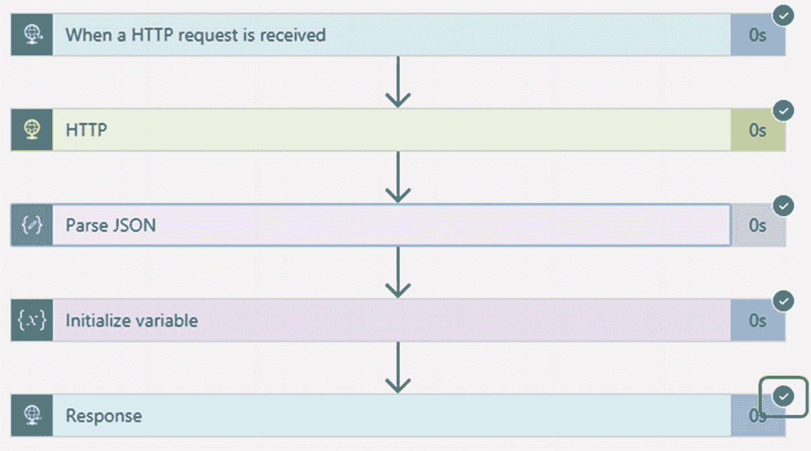
**图 12-5** 手动触发的工作流：`Response` 选项卡上的绿色对勾表示其处于 `RUN` 模式

如果边缘设备仍在运行，你应该已在 `RUN` 模式下打开了工作流：如果它已正确加载，你将看到一个对勾图标（绿色圆圈内的白色对勾）添加到 `Response` 操作的标题栏上。这表示你的逻辑应用已收到确认，即 `Azure` 与 `micro:bit` 之间的数据交易已成功完成。从这里我们可以查看工作流的每个阶段，了解正在发生的事情，并检查正在处理的实时数据。

> **提示：** 如果 `Response` 操作的标题栏上仍然显示一个"**叉号**"图标，请确保边缘设备功能正常，然后反复运行逻辑应用，直到获得"**对勾**"。

我们将查看工作流的一些元素。

### 解析 JSON

当我们创建工作流时，`Parse JSON` 文件已经为我们设置好，其中包含变量名，而非值。现在，由于数据正在流经工作流，我们可以查看 `JSON` 文件包含实时内容时的样子：

*   单击 `Parse JSON` 操作。
*   向下滚动，找到 `OUTPUTS` 部分。
*   单击主体并向下滚动文本框。

**图** **12-6** 显示了已解析的数组，其中包含来自 `micro:bit` 的温度和湿度值，以及来自 `ML` 服务的降雨预测结果。

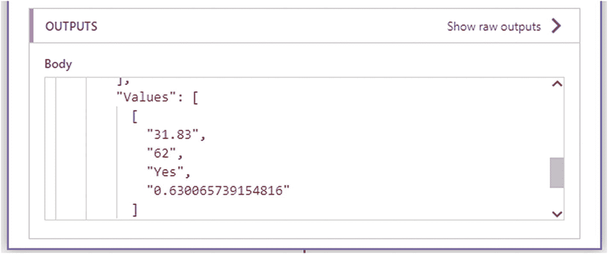
**图 12-6** `Parse JSON` 操作的输出

### 初始化变量

*   单击 `Initialize variable` 操作。

当初次设置工作流时，创建了一个名为 `score` 的变量。这是存储我们预测结果的变量：它是一个字符串，包含 `"Yes"` 或 `"No"`。

**图** **12-7** 显示 `score` 中的结果当前为 `Yes`。

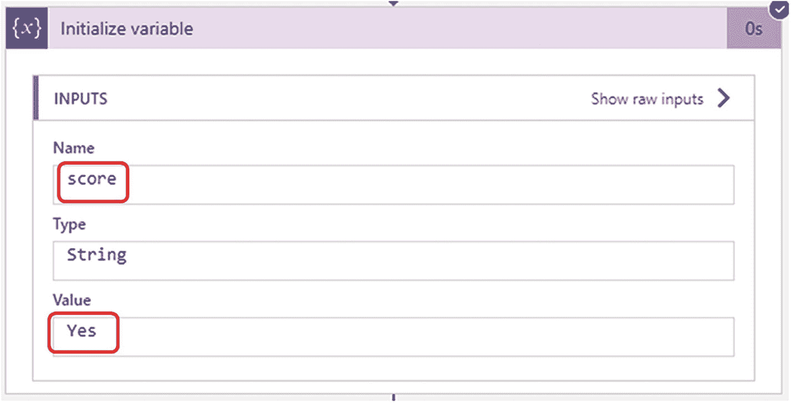
**图 12-7** `Initialize variable` 操作的输出

### 响应

*   单击 `Response` 操作。

`score` 变量（前面讨论过）已被分配到响应消息的 `Body` 中（**图** **12-8**）。这就是我们作为结果传回给 `micro:bit` 的内容。

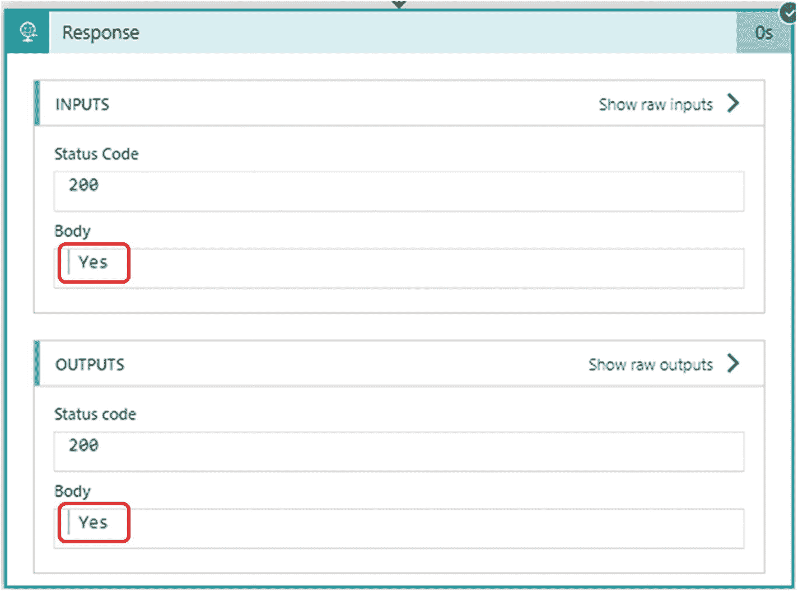
**图 12-8** `Response` 操作的输出

### 当收到 HTTP 请求时

*   单击 `When a HTTP request is received` 操作。

此信息在工作流运行期间不会改变；可以在这里找到 `HTTP` `POST` `URL`（**图** **12-9**）。此参数至关重要，因为它用于 `MakeCode` 块 `CW01 connect to Azure with access endpoint`，以连接到基于 `Azure` 的物联网应用。

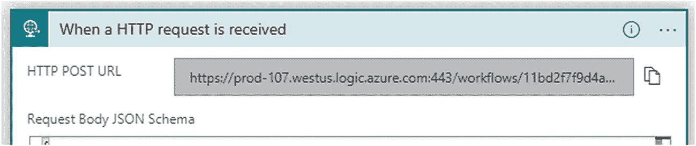
**图 12-9** `When a HTTP request is received` 操作，显示 `HTTP POST URL`

## 12.8 数据分析

在数据科学实验的这个阶段，开始分析我们收集到的数据是很正常的。但是，当机器学习服务使用温度和湿度数据生成我们的预测时，这不已经完成了吗？我们的角色是否被颠覆了：在分析阶段，我们现在是否变得多余了？

答案是响亮的：不！与数据科学流程的大多数领域一样，自动化的出现让我们从重复且费力的任务中解放出来，使我们能够运用我们非人工智能的智慧，专注于那些无法自动化的事情。

在此情况下，我们的分析目光落在了结果上：它们有多智能或有用？我们可以利用结果做些什么来从中提取价值？是否存在任何伦理考量？我们不应只看结果表面：我们的角色是质疑它们，并检查它们是否合乎逻辑、可信且有用。我们应该问，人工智能是否真的在驱动分析，还是它仅仅是一个复杂的算法？

何不将机器学习服务在一段较长时间内的结果记录下来，并添加你自己的数据（例如是否下雨）。然后运用分析技术来看看这些预测的真实有效性如何。机器学习服务做出的预测与实际下雨之间的相关性有多强？

虽然这些问题及其答案会影响我们对我们天气预测数据的信任程度，但该预测的有效性与我们本章所取得的成就相比，只是次要的。能够使用一个机器学习服务意味着能够使用许多个，正如我们将在**第** **13** **章**中讨论的那样。

可能会让一些读者担忧的是，机器学习服务缺乏任何明显的学习方式：如果我们没有提供关于预测准确性的反馈，那么服务如何知道其预测是否准确，又如何从错误中学习呢？

我们的物联网应用中缺少的一个要素是**训练**。当一个机器学习服务首次被建立时，它会经历一个训练阶段，在此期间，人类操作员会提供关于其生成结果准确性的信息。

一个简单的例子是能够区分猫和狗图像的机器学习服务。当机器学习服务最初被设置时，一个人会向它提供被标识为`cat`或`dog`的图像。机器学习会推断出与`cat`或`dog`相关的视觉特征，并开始对提供的新图像进行分类。当机器学习开始区分猫和狗时，人的角色就是通过审查结果并识别正确/错误的结果来训练机器学习。机器学习会持续适应，直到人接受模型的准确性并停止训练它。

我们这里并没有专注于训练：本书的目标是使用机器学习服务进行数据科学工作，而不是学习如何构建/设置机器学习服务或帮助使其更准确。训练机器学习服务很有趣，并且有助于直观理解其工作原理，但作为消费端的机器学习服务并不需要包含训练要素。^(²⁰) 当我们作为消费者使用电子邮件服务时，我们并不期望必须训练它如何发送邮件。同样地，对于现成的机器学习服务（就像我们使用的那个），非专业消费者也希望能够直接使用。构建机器学习服务（包括训练它）的过程，未来可能会有很大比例的使用机器学习服务的人对此知之甚少。

## 12.9 总结

我们的数据科学之旅已接近尾声，在此过程中，我们接触了广泛的技术和技巧，它们都以某种方式对我们的数据科学工作有所帮助。

开发者构建一个可重复使用的模块/函数个人库（即他们的工具包）是非常正常的。当程序员掌握一个新概念时，他们会开发一些代码片段/函数来帮助自己运用它。多年以后，他们可能忘记了该概念的某些方面，但仍然会确切地知道如何使用他们的函数。

你应该将你在本书中成功实现的不同技术视为你工具包的一部分；在构建本章的边缘设备时，我们几乎没做什么全新的工作（除了在`MakeCode`中使用了一些新的模块）：我们只是组合了我们已经开发过的内容。早期关于模块化和可重用性价值的观点，已被我们能够轻松构建所需仪器的事实所隐含地证明了。

你的工具包现在已经达到了一个临界点：具有被用于各种新颖且意想不到的应用的潜力。在下一章也是最后一章中，我们将探讨在合上本书后，我们在本书中积累的工具包如何能对你有所帮助。

**脚注** 1 2 3