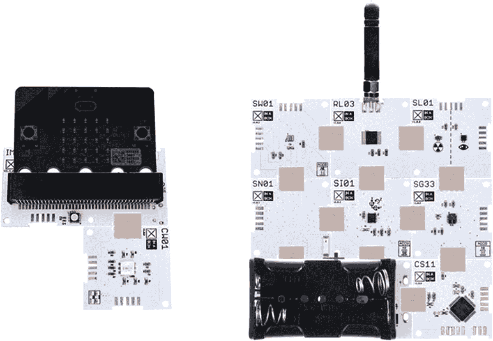
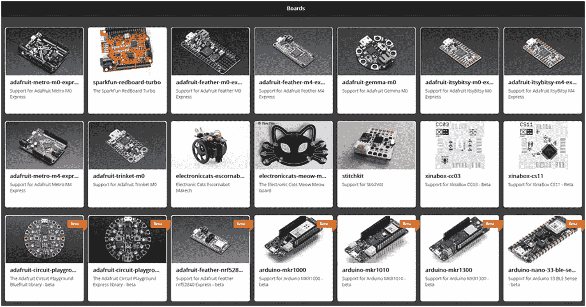
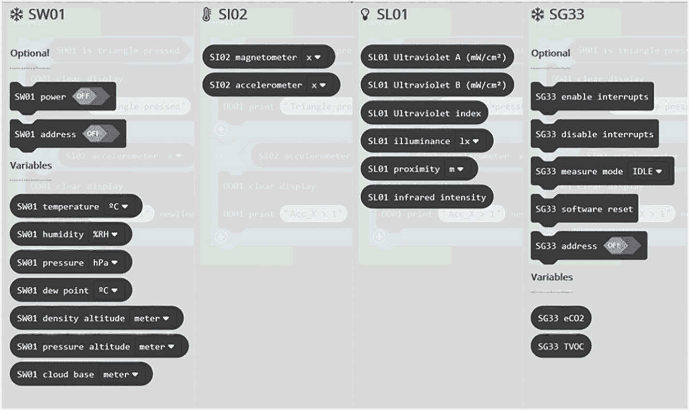

# 13. 巩固我们的所学

在最后一章中，我们将回顾本书所涵盖的内容，并探讨我们学到的技能如何能在不同的情境中应用。旅程即将结束，终点会是什么样子，我们从这里又将去向何方？我们还能用数据科学工具包做些什么？

## 13.1 我是一名数据科学家吗？

恭喜你走到了这里。如果你跟随各章节，完成了所有示例并且一切都理解透彻，那么你就拥有了数据科学的坚实基础，并具备了在实际情境中应用它的能力。

当然，就像学习生物学基础并不能使人成为医生一样，拥有数据科学的坚实基础也不能使人立刻成为数据科学家。本书所概述的信息和技术是一个垫脚石：它们本身就有用，并且可能是成为专业数据科学家的第一步。但什么是`专业数据科学家`？

医生、护士、建筑师、水管工：这些学科需要在正确使用头衔之前获得认证。这涉及学习一套规定的知识体系，并通过某种资格认证过程。目前没有普遍接受的数据科学家认证，没有管理机构，也没有最终考试：任何人都可以自称为数据科学家。

至于你是否是一名数据科学家这个问题：在你的工作或日常生活中，你是否处理数据、处理和分析数据、解释数据并产生可执行的输出？如果是，那么也许你就是。

## 13.2 成为数据科学家

虽然关于何谓数据科学家的松散/非正式定义很有趣，但当公司招聘数据科学家时，他们通常对自己寻找的目标有清晰的认识。这往往是一套与公司现有数据科学实践相关的技能/经验，且常见的招聘广告会要求具备特定技能，例如编码（如`Python`）、`SQL`、统计学和机器学习。

如果你有兴趣进一步探索数据科学，并可能以此谋生，那么有许多学科需要学习，也有众多方向可以探索。了解数据科学领域哪些技能重要的最佳方法之一，就是查看招聘网站。

所需的大部分技能都是可以学习的，如果你发现自己能轻松理解本书中的内容，那么你很可能具备所需的才能。在整个探索过程中有一个主题始终贯穿其中，那就是好奇心所扮演的角色。上文提到的技能固然宝贵，但成就伟大数据科学家的，是其好奇心以及不断提问的动力。直觉也同样备受重视：对正确的事物保持好奇，并能提出正确的问题，这些特质是计算机远无法企及的。请记住，你不需要像计算机一样思考：我们有计算机来替我们做这件事。

## 13.3 破除一些迷思

从数据科学的角度来看，迷思是指那些被人们接受为真实/已被证明的假设/事实，但它们并非基于任何可靠或可验证的数据。^(²¹) 具有讽刺意味的是，像数据科学这样的领域竟然也有自己的一套迷思。迷思的问题在于，它们常常像障碍一样竖立在观望者面前，所以我们来看看几个常见的迷思并尝试打破它们：

**只有数据科学家才做真正的数据科学。**

-   数据科学正是我们在本书中一直在做的事情——运用科学方法来收集、处理数据，并对数据执行各种操作。
-   在专业标准建立之前，数据科学家就是指那些职务头衔中包含“数据科学家”的人。该术语在专业上用于指代流程中的分析环节。负责构建传感器阵列并编写代码的团队成员不会被称作数据科学家。但他们也参与了数据科学：这是一项团队运作，而数据科学家是团队中的一员。

**真正的数据科学家不使用 Excel/电子表格。**

-   新手会过度使用 Excel。
-   专家从不使用 Excel。
-   大师则在适当的时候使用 Excel。

**要成为数据科学家，你必须是一名强大的程序员。**

-   数据科学家会发现自己处于需要编码的情境中。这确实是一项很好的技能。
-   但是当需要编写某些代码时，数据科学家可以利用开发者来替他们编写。
-   关键在于知道要向开发者提出什么需求：代码需要实现哪些结果？任何优秀的开发者都应该能够毫无问题地将构思周密的自然语言代码转换为真正的代码。

**只有大公司和大学才能负担得起数据科学。**

-   即使是预算有限的个人，也有可能进行真正、负担得起且新颖的数据科学实验。
-   鉴于每天产生海量的数据，而且其中大部分都可以免费且轻松地在线获取，有多少引人入胜、开创性且实用的关联性正等待着被发现，或许只需点击几下鼠标就能找到？

**你必须异常聪明才能成为数据科学家。**

-   数据科学是一个智力领域，但任何拥有适当好奇心和动力的人都可以学习所需的技术。
-   当然，非常聪明的人往往在包括数据科学在内的一系列智力领域表现良好。

**市场研究不是真正的数据科学。**

-   特别是在学术界，市场研究常被认为档次较低；有些人可能会说它犯了“堕落”之罪——将利润置于质量之上。
-   市场研究有好有坏，正如学术研究也有好有坏一样。
-   真正的区别在于，我们经常在广告牌上看到糟糕的市场研究，或是在广告中被强行推销。这并不能代表市场研究行业的全貌和潜力。
-   后种族隔离时代南非一项重要的市场研究案例，将有助于说明其更积极的应用。

早在 20 世纪 90 年代，非国大（ANC）的顾问们就曾委托一家位于德班的小型市场研究公司（现已倒闭的 `Research Surveys`），该公司拥有一项名为“转换模型”的创新产品。这是一种调查技术，在衡量不同人群对特定信息的预测行为反应方面出奇地有效。简而言之，这条信息是会煽动对立还是促成团结？

曼德拉先生无疑是他那个时代乃至任何时代最伟大的政治家之一。尽管非国大在全国大选中胜券在握，但他的首要任务之一是确保国内所有不同种族群体都能参与进来，并对将南非转变为“彩虹之国”的进程感到兴奋。

他们委托进行了多次转换模型调查，以评估非国大信息的哪些部分最能引起不同种族群体的共鸣，哪些部分最易引发两极分化。曼德拉先生的民族团结政府在优先处理那些有助于让广大民众保持热情和乐观的事项方面做得非常出色。

## 13.4 举一反三

只要有合适的硬件，利用本书介绍的技术，你就能构建出各种复杂精密的数字仪器，其范围几乎没有限制。我们介绍的大部分技能都可以迁移应用：

**如果你能将一个传感器连接到微处理器：**

图 13-1

采用相同原理构建的两个复杂程度不同的数字仪器

*   无论你使用何种外围系统（`XinaBox`、面包板、`SparkFun`等），只要你成功地将一个传感器连接到微处理器，通常就能应用同样的方法连接其他传感器。如果你选择的外围系统支持广泛的传感器种类，那么你就能连接其中的任一种。

*   只要微处理器支持（大多数都支持），你就可以同时连接多个传感器，构建能够测量多种传感器读数的仪器。

*   请记住，在 2020 年及以后，你不再需要工程学位或烙铁就能构建高质量且坚固耐用的数字仪器。

*   **图** **13-1**展示了两个用`xChips`构建的数字仪器。左侧是我们构建的 Wi-Fi 网关，而右侧的设备可用于高空气球，以记录和传输环境数据。

**如果你能用积木式语言为 micro:bit 编写程序：**

图 13-2

可使用微软`Maker.Makecode`积木式编程语言进行编程的部分开发板

*   那么你就会写代码：你能编程。
*   有大量微处理器支持积木式编程。其中绝大多数在性能上都比 micro:bit 强大数个数量级。使用同样的技术，你也能为它们编程。
*   **图** **13-2**展示了`Maker.Makecode`积木式编程环境。这是微软的一款产品——我们使用的 micro:bit `MakeCode`正是该积木式编程环境的一个“白标”实现。
*   其界面、语法、烧录流程都非常相似——`MakeCode`的用户会感到熟悉。
*   **图** **13-2**展示了部分可以使用积木式编程的开发板。

**如果你能编写程序让微处理器从传感器读取数据：**

图 13-3

用于四种不同传感器的四个`MakeCode`扩展

*   那么你就能编写程序让它从任何传感器读取数据。你知道如何加载库/扩展，而且用于读取传感器数据的积木块其工作方式通常非常相似。为特定传感器找到合适的扩展可能是最棘手的部分：寻找那些能为你所使用的微处理器提供易用（且易查找）`MakeCode`扩展的制造商。

*   从多个传感器读取数据很简单：你应该能够同时从许多传感器组成的阵列中读取数据。

*   **图** **13-3**展示了用于不同类型传感器的四个`MakeCode`扩展。变量的名称会变化，但在每种情况下，传感器的值都会作为一个简单变量（一个数字）返回。范式是相同的。

**如果你能分析温度和湿度数据：**

*   那么你就能运用同样的技巧分析任意两组数据集。
*   你应该能够对此进行扩展：添加其他数据集，尝试不同类型的可视化，寻找相关性，并添加趋势线。

**如果你能连接到物联网平台：**

*   那么你就能从在线平台收发数据，并访问云端的服务。
*   利用在线平台及其可用服务的强大功能，可以为你的数字仪器增加复杂性。

**如果你能处理从物联网平台接收的数据：**

*   那么你就能使用/响应该物联网平台发送的命令或数据。这些命令/数据背后有物联网平台的处理能力支持：其处理能力比你正在使用的单板计算机高出数个数量级。
*   如果你能让物联网平台向远程数字仪器发送数据，那么该物联网平台所连接的人工智能/机器学习服务也可以向其发送数据。

**如果你能将气象站连接到机器学习预测模型：**

*   那么你就能将任何边缘设备连接到任意众多可用的机器学习预测模型上。

就在 20 年前，甚至 10 年前，要掌握一套水平相当的技能，对于一个聪明且有动力的人来说，可能需要花费多年时间。但借助现代技术，你可以更快地获得这些技能，并专注于如何应用它们，专注于技术所能实现的事情，而不是在技术本身上纠结。数据科学是数字技术之上的一个层级，能够像我们在这里所做的那样深入其中，是一种直到最近才成为可能的奢侈：这在大多数读者的有生之年里都发生着。

## 13.5 将所学应用于不同构建

利用上一节概述的技能，你可以构建各种各样的东西，例如：

*   一个带有传感器阵列并连接到物联网平台的仪器
*   它发送数据，这些数据随后被传入机器学习模型
*   机器学习生成预测或关键指标，然后将结果发回（可能发给完全不同的一个或多个设备）
*   同时，一系列真实的电子开关或电机被打开或关闭
*   所有这些信息都输出到一个或多个屏幕上（可能位于不同位置的设备上）
*   并且被写入文件，在物联网平台上备份

虽然这听起来可能很复杂，但它实际上非常通用：它是无数现代发明/小工具的核心架构。有了这个基本模型，你可以构建大量的东西，包括：

*   用于监测教室、卧室或机场候机室空气质量工具。房间内的传感器收集数据，通过 Wi-Fi 发送给机器学习服务，该服务分析数据，并远程控制窗户、百叶窗、风扇、除湿器和空调，以最小的能源成本维持健康环境。
*   睡眠不好？构建一个传感器阵列来监测卧室中的各项因素。收集几周的传感器数据，并加入你的睡眠质量数据。识别出与你睡眠质量相关的传感器读数；然后构建一个能够管理相关因素为你提供最佳环境的仪器。
*   下棋机器人怎么样？或者一个能分拣不同颜色软糖的机器人？又或者一个能采摘成熟草莓的机器人？
*   构建和维护一个受控环境，例如为“异域”宠物建造的饲养箱。
*   像伦敦这样的城市拥有大型防洪闸门，在水位过高时关闭。但关闭闸门需要时间，而且通常成本高昂。将上游的一系列传感器阵列数据和天气预报数据全部输入预测洪水的机器学习模型，可以构建一个非常高效的控制系统。
*   在印度的某些乡村，有野生游荡的大象到访，它们会吃庄稼并造成破坏。分布在村庄周围的一系列传感器阵列和执行器可能能够发出巨大的噪音或强光来驱赶大象。

## 13.6 伦理考量

至此，你已经可以进行各种实验，建造各种新颖且可能产生重大影响的装置。但有哪些东西是不该建造的呢？

显然，任何可能导致人身伤害或刑事损害的东西都不可行：我们都知道存在一条底线。那么，如果有一条区分可行与不可行的界限，这条界限究竟在哪里？

要找到答案，我们需要审视伦理：

"伦理"是什么？许多人会同意，大多数伦理争论的核心原则是：如果你从事的任何活动会对他人产生影响，那么你就要对这种活动给他人带来的任何后果承担某种责任。伦理正是照亮这种责任的光芒。

正如我们在本书中所见，数据科学被用于为决策和政策提供依据，而这些决策和政策以多种不同的方式影响着我们的生活。那么，伦理考量是否必要呢？

数据科学似乎具有科学性、无偏见和公正性：其方法和工具独立于所分析的数据。用于分析温度和湿度数据的相同技术，也同样适用于分析宗教信仰和智商数据：相关系数本身并无主观意见。

对宗教信仰与智商数据的研究无疑会激起激情、愤怒和伤害，并且很容易被操纵（例如，不同的智商测试存在文化偏见）。是否应该实际收集和研究这些数据，这本身是合乎伦理还是不合伦理，我们在此不做判断。但在构思一个想法时，就应考虑实施该想法可能产生的影响；你应当是自己伦理的守护者。

伦理学的领域既迷人又广阔，但我们的篇幅几乎用尽。这里要强调的重点是：数据科学也不例外；好人也可能产出糟糕的科学。

最重要的是要记住，随着人工智能和机器学习的兴起，数据科学中人的成分可能会改变甚至缩减。但恰恰是人类创造了伦理考量的需求，并且需要成为伦理的守护者。最优秀的人工智能/机器学习在同理心和对伦理价值的热情方面，也无法与人类相提并论。当我们把数据科学流程的某些方面交给人工智能/机器学习时，我们必须紧握对这一关键考量的所有权。

那么，在结束之前，请思考一个伦理困境：

吓跑正在觅食的大象是否合适？这对大象会有什么影响？每个回答这个问题的人答案都一样吗？那些生活不受大象影响的人们的意见是否重要？如果我们把这个比喻延伸，用移民群体来替代大象，又会发生什么？

## 13.7 总结

最初，对于这个最终总结，我们的计划是列出本书中涉及的所有零散知识点：让你为自己掌握了一套非常实用且强大的技能而感到欣慰。

然而，作者们想彻底打破第四面墙，以一个不太寻常的笔调来结束：

你好。感谢你为本书投入时间和金钱。

我们于 2019 年 8 月开始写作，那还是新冠疫情前的世界；而当我们完成本书时，已是 2020 年 4 月。自那以来，世界发生了翻天覆地的变化，我们与你一样感到失落和悲伤。

但我们依然想以积极乐观的语气结尾。

这场危机终将过去，而那些留下来的人将从中变得更加强大。当抗击新冠病毒的战争最终取得胜利时，社会必须、也必将记住那些帮助我们渡过难关的英雄们：护士、医生、护工、卡车司机、货架理货员、教师、警察、农民、店主……名单还很长。

这其中也赫然包括数据科学家。

在这场危机的顶峰时期，你很难在看到屏幕时不看到显示感染/存活率的图表，不听到专家谈论预测结果的模型，或不读到关于对全球经济预期影响的文章。数据科学是所有这些努力的核心，为政府被迫每天、甚至每小时做出生死攸关的决策提供依据。自我隔离的策略和实施基于数据科学建模，而新药的研发和测试也将运用数据科学的技术。除了医学，数据科学或许是我们武库中最强大的武器。

我们留给你最后一点思考：与前面描述的那些工作相比，我们在本书中探讨的内容显得渺小且微不足道，然而我们的努力与这些伟大事业共享着相同的本质。那些带领我们渡过这场危机的伟大科学家，在他们数据科学的旅程中，也曾处于你现在所处的阶段。

谢谢，请保重。

脚注¹

## 索引

### A
- `Analog`和`Digital thermometer`
- `Analysis tools`
- `average correlation` 参见 `Correlation coefficients`
- `data quality`
- `experimental design`
- `extremities`
- `introspection`
- `key statistical functions`
- `maximum and minimum values`
- `reporting data`
- `software spreadsheet program`
- `statistical significance`
- `visualization tools`

### B
- `ArduinoIDE` / `mBed`
- `Artificial intelligence (AI/ML)`
- `data analysis charts representation`
- `correlations dataset labels`
- `human intelligence temperature data`
- `data science working definition`
- `environmental factors`
- `hardware data logging requirements`
- `snapshots tagged data collection`
- `*vs.* human intelligent behaviors`
- `IQ test method`
- `Kasparov, Gary`
- `key differences software`

### C
- `Atmospheric (air) pressure`
- `Azure logic apps`
- `basics tab details`
- `deployment confirmation message`
- `resource selection steps`

### D
- `Bluetooth BLE`
- 参见 `Bluetooth Low Energy (BLE)`
- `components microprocessors`
- `Serial Bluetooth Terminal app`
- `wireless communication working process`

### E
- `Bluetooth Low Energy (BLE)`
- `antenna arbitrary data`
- `ArduinoIDE / mBed`
- `micro:bit radio` *参见* `Radio communication`
- `weather station instrument app’s terminal port`
- `built-in radio circuit diagram`
- `hardware requirements`
- `MakeCode` blocks
- `natural language` code
- `sensor data UART configuration`

### F, G
- `Capturing/gathering data`
- `Cloud computing services`
- `Comma-separated values (CSV) file`
- `Correlation coefficients`
- `blue ball ascends / green ball descends`
- `calculating scores`
- `definition guideline` / `score line graph measurement`
- `spreadsheet weather data calculation`

### H
- `Data analysis` *参见* `Analysis tools`
- `charts representation`
- `correlations dataset labels`
- `edge device human intelligence`
- `temperature and pressure scores`
- `visualization`
- `Data science`
- `averages blank data`
- `capturing form capturing/gathering data`
- `data and information definition`
- `experimental design`
- `extraneous variables`
- `extreme values`
- `insights introspection`
- `measuring temperature quality`
- `raw data set temperature`
- `tool working process`
- `validity and reliability`
- `Data scientist definition`
- `digital instruments`
- `ethical arguments inventions/gadgets`
- `IoT platform`
- `loose/informal definition`
- `MakeCode` extensions
- `Maker.MakeCode`
- `micro:bit block code microprocessor`
- `ML predictive model myths`
- `corporations/universities debunk option excel/spreadsheets`
- `hypotheses/facts intellectual fields market research`
- `real data science strong coder sensor data skills`
- `temperature and humidity data`
- `Digital tools`
- `analog thermometer`
- `building tools coding option data sets`
- `hardware requirements`
- `MakeCode` and `Mu (MicroPython)`
- `micro:bit no-code option`
- `sophisticated Toolkit temperature`
- `thermometer` *参见* `Thermometer (digital)`
- `Toolkit selection`

### I, J, K
- `Edge device`
- `core functions`
- `data analysis data flow`
- `hardware components modules and blocks`
- `outcomes requirements`
- `natural language` code
- `peer review process`
- `power and usage`
- `predictive data`
- `Excel Data Streamer app`
- `File system`
- `Firmware`

### L
- `Human *vs.* Artificial intelligence (AI)/ML`
- `Humidity`
- `Hygrometer`
- `IBM’s Deep Blue supercomputer`
- `Internet of Humans (IoH)`
- `Internet of Things (IoT)`
- `anatomy of cloud`
- `collecting data definition`
- `disadvantage edge device` *参见* `Edge device`
- `experimental design gateway device`
- `Internet connection IoH`
- `ML` *参见* `Machine learning (ML)`
- `serial connection transferring data`
- `transmit data Wi-Fi` *参见* `Wireless Fidelity (Wi-Fi)`
- `wireless communication`

### M
- `Large data collection`
- `accessing file experimental design`
- `file storage device hardware requirements`
- `measuring data storage memory limitation`
- `replication (file storage) storage capacity`
- `storing sensor data transferring files`
- `LED data recording`
- `Long Range Wide Area Network (LoRaWAN)`

### N, O
- `Machine learning (ML)` *参见* `Artificial intelligence (AI/ML`
- `Cloud computing services`
- `hub basics tab review/create tab`
- `size and scale tab tags configuration`
- `IoT platform hub requirements`
- `service provider weather prediction` *参见* `Weather prediction model`
- `workflow` *参见* `Workflow`
- `MakeCode` blocks / `MicroPython` code
- `code guidelines communication (with radio)`
- `digital tools large data collection`
- `measuring data points micro:bit thermometer`
- `natural language` code
- `radio communication ratio groups`
- `XinaBox OD01 OLED (SSD1306) micro:bit`
- `analog thermometer BLE code editors`
- `digital thermometer file storage IoT`
- `large data collection microprocessor radio`
- `Microprocessor`

### P, Q
- `Natural language` code
- `air pressure BLE (bluetooth)`
- `digital tools edge device`
- `flashing process full-code option`
- `humidity large data collection`
- `MakeCode` blocks
- `measuring data points no-code option`
- `touching sensor weather station`
- `Pascal / kilopascal`
- `Peer review process`
- `HTTP request Parse JSON file`
- `response action RUN mode`
- `variable initialization`

### R
- `Radio communication`
- `BLE standards components`
- `input/output operation`
- `MicroPython` / `MakeCode` differences
- `input/output MakeCode group networks`
- `nodes data collection MakeCode` blocks
- `natural language` code networks
- `temperature sensor nodes`
- `server/collector display MakeCode` blocks
- `natural language` code
- `OLED screen displays server/collector data collection networks`
- `Reliable data`

### S
- `Sensor data storing CSV file`
- `file space humidity screen grab text editor`
- `Serial Bluetooth Terminal app`
- `Sigfox`
- `Special Interest Group (SIG)`
- `Spreadsheet program`
- `Statistical significance`

### T
- `Thermometer (digital)`
- `ambient temperature BBC micro:bit`
- `circuit/block diagram components data collection microprocessor`

### U
- `UART (USB) cable`

### V
- `Validity data`
- `Visualizations`
- `chart steps data analysis`
- `distinct marker data`
- `empty chart displays max and min values`
- `output recording range`

### W
- `Weather experiments`
- `blank data table`
- `data analysis definition`
- `experimental design measures`
- `objective and subjective data parameters (factors)`
- `station tool circuit/block diagram`
- `hardware requirements LED matrix`
- `natural language` code
- `OLED display sensor data temperature and humidity`
- `upgrade option (OLED display) visualizations`
- `Weather prediction model`
- `AI gallery experiment`
- `API key input modal box`
- `link testing ML Studio`
- `project response result RUN menu option`
- `screenshot URI and API Key details`
- `web service input/score model`
- `Wi-Fi` *参见* `Wireless Fidelity (Wi-Fi)`
- `Wireless communication`
- `Wireless Fidelity (Wi-Fi)`
- `components firmware hardware requirements`
- `IBM Cloud account creation catalog page`
- `dashboard default service IoT Platform service`
- `launch page login page`
- `resource creation steps`
- `MakeCode` blocks
- `natural language` code
- `powering process visualization board creation cards`
- `historical weather data information tab`
- `line chart parameters setup steps`
- `weather station definition`
- `device adding/credentials edge device`
- `objectives policies page security tab/level`
- `Workflow`
- `Azure logic apps logic app testing`
- `ActionResponseSkipped message notification`
- `response actions RUN mode option`
- `Parse JSON passing data (ML service)`
- `actions list designer view`
- `dynamic content pane HTTP action group`
- `temperature and humidity response action steps`
- `variable action initialization`
- `weather station instrument HTTP request schema`
- `text box setup trigger received`

### X, Y, Z
- `XinaBox kit`