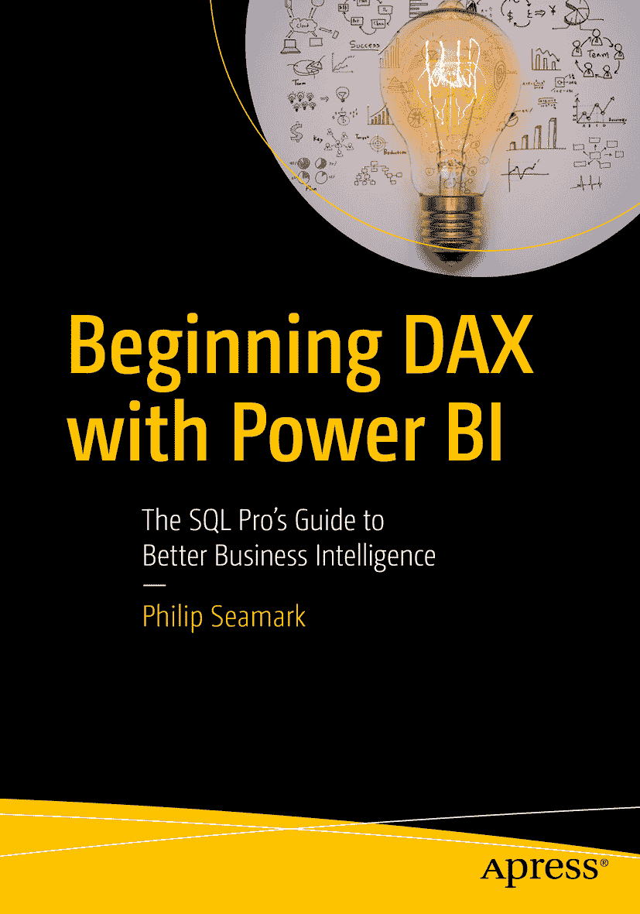

 菲利普·西马克  《从零开始学 Power BI 中的 DAX：SQL 专家如何实现更优商业智能》

本书作者引用的任何源代码或其他补充材料，读者均可通过本书的产品页面在 GitHub 上获取，该页面位于[`www.apress.com/9781484234761`](http://www.apress.com/9781484234761)。如需更详细信息，请访问[`www.apress.com/source-code`](http://www.apress.com/source-code)。

`ISBN 978-1-4842-3476-1` 电子版 `ISBN 978-1-4842-3477-8` [`doi.org/10.1007/978-1-4842-3477-8`](https://doi.org/10.1007/978-1-4842-3477-8) 美国国会图书馆控制编号：2018937896

© 菲利普·西马克 2018

本作品受版权保护。出版商保留所有权利，无论涉及材料的全部或部分，具体包括翻译、重印、使用插图、朗诵、广播、以缩微胶片或任何其他物理方式复制、传输或信息存储与检索、电子改编、计算机软件，或使用目前已知或未来开发的任何相似或不同方法的权利。

本书中可能出现商标名称、标识和图像。对于出现的商标名称、标识或图像，我们仅以编辑方式使用并为商标所有人谋利，无意侵犯商标权，而不在每次出现时使用商标符号。本书中使用商品名称、商标、服务标志及类似术语，即使未作明确标识，也不应理解为对其是否受专有权利保护发表意见。

尽管本书中的建议和信息在出版时被认为是真实准确的，但作者、编辑和出版商均不对可能出现的任何错误或遗漏承担法律责任。出版商对本书所载内容不作任何明示或暗示的担保。

印刷于无酸纸上

由 `Springer Science+Business Media New York` 向全球图书贸易发行，地址：233 Spring Street, 6th Floor, New York, NY 10013。电话：`1-800-SPRINGER`，传真：`(201) 348-4505`，电子邮件：`orders-ny@springer-sbm.com`，或访问 `www.springeronline.com`。`Apress Media, LLC` 是一家加利福尼亚有限责任公司，其唯一成员（所有者）是 `Springer Science + Business Media Finance Inc (SSBM Finance Inc)`。`SSBM Finance Inc` 是一家特拉华州公司。

献给 Grace、Hazel、Emily……当然还有 Rebecca。