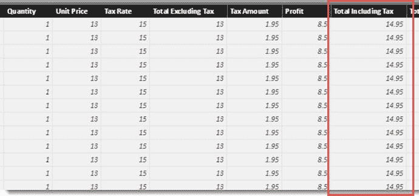
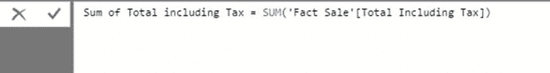

# 1. DAX 简介

本书旨在帮助你学习如何使用 `DAX` 语言，通过 Microsoft Power BI、Excel Power Pivot 和 SSAS 表格模型等工具来提升你的数据建模能力。如果你已经具备扎实的 `T-SQL` 知识，本书将特别有用，不过这并非必需条件。

在本书中，我将使用 `DAX` 来展示并解决各种场景问题，并提供等效的 `T-SQL` 语句，主要作为对比参考，以帮助阐明每个解决方案。我个人有多年使用 `T-SQL` 构建解决方案的背景，我希望能将在学习 `DAX` 的历程中获得的技巧和诀窍，分享给那些拥有类似背景的人。你并不一定要熟悉 `T-SQL` 才能从本书中获得最大收益，因为书中的示例对于不熟悉它的人也同样有用。我发现，有时用多种方式描述同一个答案，有助于更好地理解解决方案。

在本书中，我使用 Power BI Desktop 作为主要的 `DAX` 引擎，大多数示例都使用 `WideWorldImportersDW` 数据库中的数据，该数据库可从微软网站免费下载。此数据库可以还原到 Microsoft SQL Server 2016 或更高版本的实例中。我使用的是 SQL Server 2016 的开发者版。

我建议你下载最新版本的 Power BI Desktop 并将其安装到本地 Windows 电脑上。下载地址为 `powerbi.microsoft.com/desktop`，也可以通过快速互联网搜索找到。该软件可免费安装，能让你在几分钟内加载数据并开始构建基于 `DAX` 的数据模型。

`WideWorldImportersDW` 数据库简洁、组织良好，是学习使用 `DAX` 进行数据建模的理想起点。

本章的目的是涵盖 `DAX` 的高级基础知识，而不深究过多细节。后续章节将对同样的基础知识进行更深入的探讨。

## 什么是 DAX?

数据分析表达式 (`DAX`) 既是一种查询语言，也是一种函数式语言。它最早于 2009 年作为 Microsoft Excel 2010 的一个加载项出现。`DAX` 的主要目标是帮助组织、分析、理解和增强数据，以用于分析和报表制作。

`DAX` 并非一种全功能的编程语言，它不具备你可能期望从其他编程语言中获得的一些流程控制或状态持久化机制。它旨在增强数据建模、报表和分析能力。`DAX` 在不断发展，新的函数会定期加入。

`DAX` 被描述为一种函数式语言，这意味着计算主要使用函数来生成结果。它提供了多种多样的函数，用于处理算术、字符串操作、日期和时间处理等。函数可以嵌套，但你无法创建自己的函数。函数分为以下几类：

*   `DateTime`
*   `Filter`
*   `Info`
*   `Logical`
*   `Mathtrig`
*   `ParentChild`
*   `Statistical`
*   `Text`

`DAX` 中有超过 200 个函数。你编写的每一个计算都会用到其中的一个或多个函数。每个函数都会产生一个输出，有些返回单个值，另一些则返回一个表格。函数使用参数作为输入。函数可以嵌套，因此一个函数的输出可以作为另一个函数的输入。

与 `T-SQL` 不同，`DAX` 中没有用于操作数据模型中数据的 `INSERT`、`UPDATE` 或 `DELETE` 的概念。一旦一个物理表存在于 Power BI、SSAS 表格模型或 Excel PowerPivot 数据模型中，`DAX` 就无法对该表中的数据进行添加、更改或删除操作。只能使用 `DAX` 函数对数据进行筛选或查询。

## 什么是数据模型？

数据模型是数据、计算和格式化规则的集合，这些元素组合在一起，形成一个可用于探索、查询和更好地理解现有数据集的对象。它可以包含来自多个来源的数据。

Power BI Desktop、SSAS 表格模型和 Excel 版 PowerPivot 可以从各种数据源（包括数据库、平面文件）导入数据，也可以直接导入自许多源系统。数据导入后，可以向模型添加计算，以帮助探索和理解数据。

数据被组织并存储在表中。表是二维的，与数据库表有许多共同特征。表有列和行，可以在表之间定义关系，以帮助使用来自多个表的数据进行计算。计算可以是简单的，比如统计一个表的行数，或者对某一列的值求和。考虑周全的计算应能增强你的数据模型，并支持构建报表和执行称为度量值的分析任务的过程。

正是数据和度量值的组合构成了你的数据模型。

Power BI Desktop 的用户界面由三个核心组件组成。首先，报表视图提供了一个画布，让你可以使用图表和其他可视化效果为数据模型创建可视化层。报表视图还允许你通过拖拽和调整报表画布上元素的大小来控制布局。当最终用户访问报表时，他们看到的就是这个画布。

第二个组件是数据视图，它提供查看模型中每个表的原始数据的能力。数据视图一次只能显示一个表的数据，通过在右侧面板的表列表中点击表名来控制。在此视图中可以对列进行排序，但此处的排序不会对报表画布上可视化效果的排序产生任何影响。可以使用报表视图重命名、格式化、删除、隐藏列或定义其数据类型。隐藏的列在报表视图中始终可见，但在报表的字段列表中不会显示。

可以从报表视图和数据视图中添加或更改计算。

Power BI Desktop 用户界面的最后一个组件是关系视图。此部分显示数据模型中的所有表，并允许你添加、更改或删除表之间的关系。

## DAX 数据模型的组成部分

`DAX` 数据建模引擎由六个关键组件构成。

### 数据

构建数据模型的第一步是导入数据。可用的数据源多种多样，一旦导入，它们将以二维表的形式存储。也可以使用非二维的数据源，但这些数据源需要在导入之前或期间转换为二维格式。查询编辑器提供了丰富的函数来帮助进行此类转换。

### 表

表是用于存储和组织数据的对象。表由列组成，这些列包含源数据或 `DAX` 计算的结果。

### 列

每个表可以有一个或多个列。底层数据引擎将同一列的数据存储在其独立的索引中。与 `T-SQL` 不同，`DAX` 按列而非按行存储数据。数据一旦加载到列中，就被视为静态的，无法更改。列也可以称为字段。

### 关系

两个表可以通过模型中定义的关系进行连接。每个表中的一个列用于定义该关系。仅支持一对多和一对一关系。不支持创建多对多关系。在 `DAX` 中，关系最常见的用途是提供筛选，而不是模拟为优化 OLTP 操作而进行的数据标准化。

### 度量值

度量值是一种 `DAX` 计算，它返回一个可以在报表可视化效果中使用，或作为其他度量值计算一部分的单一值。度量值可以简单到像统计一个表的行数或对某一列求和。度量值会对用户交互做出反应和响应，并在报表使用过程中重新计算。度量值可以根据筛选器和切片器选择的更新，返回新的值。

### 层次结构

层次结构是将两个或多个列分组为不同级别，可通过交互式可视化效果和图表进行向上/向下钻取。常见的层次结构可能基于日期数据，创建包含年、月、日的三级层次结构。其他常见层次结构可能使用地理数据（国家、城市、郊区），或反映人力资源或产品数据中组织分组的结构。

## 您的第一个 DAX 计算

导入数据后，可能无需编写 `DAX` 代码。如果数据干净简单且报告需求基础，您可以创建一个无需用户创建计算即可使用的模型。拖拽到报告画布上的数值字段将生成一个数字。

如果您随后将非数值字段拖拽到同一可视化对象中，它会自动假设您希望按非数值字段中的不同值对数值字段进行分组。数值字段的默认聚合方式为 `SUM`。您可以使用可视化对象的属性将其更改为其他聚合类型。其他聚合类型包括 `AVERAGE`、`COUNT`、`MAX`、`MIN` 等。

在此方法中，报告会为您创建一个 `DAX` 计算度量值。这些度量值称为*隐式度量值*。将 `'Fact Sale'[Quantity]` 字段拖拽到画布上会自动为您生成以下 `DAX` 语句：

```
CALCULATE(SUM('Fact Sale'[Quantity]))
```

每当切片器或筛选器发生更改时，此计算都会重新计算，并应显示与报告中任何筛选器设置相关的值。

大多数真实场景至少需要对原始数据进行一些基本的增强处理，这就是添加 `DAX` 计算可以改进模型的地方。当您专门创建计算度量值时，这些度量值称为*显式度量值*。

一些最常见的增强功能包括：提供显示表中记录数的能力，或对列中的值进行求和。

其他增强功能可能包括：使用同一行中其他列的值或模型中其他位置的值创建新列。一个简单的例子是，将诸如 `Price` 和 `Qty` 等列的值相乘，以得出总额的列。一个更复杂的例子可能是在计算中使用其他表中的数据，以提供对该行和该表有意义的数值。

一旦添加了基本的计数或求和计算，就可以添加更复杂的计算，例如提供累计总数、期间比较或排名。

以下是 `DAX` 中三种类型的计算：

*   计算列
*   计算度量值
*   计算表

我们将在本书后面更详细地探讨每种计算，并且我会就如何以及何时选择一种类型而非另一种类型提供提示。

> **注意**：计算表（作为 `DAX` 计算结果的表）只能在 Power BI Desktop 和 SSAS 表格模型使用的 `DAX` 引擎中创建。

### 您的第一个计算

我介绍的第一个示例使用来自 `WideWorldImportersDW` 数据库的数据创建了一个简单的计算度量值（图 1-1）。该数据集有一个名为 `'Fact Sale'` 的表，其中包含一个名为 `[Total Including Tax]` 的列。该计算会生成一个表示使用此列中存储的值进行求和的数值。



*图 1-1：来自 'Fact Sale' 表的数据示例*

在数据视图中查看此表时，我们会看到 `[Total Including Tax]` 列中每一行的未汇总值。需要一个计算度量值来显示代表此列中每一行总和的一个数值。

在 Power BI 中，您可以使用功能区，或在报表视图或数据视图中右键单击表名来创建计算度量值。这会在功能区下方显示一个区域，您可以在其中键入计算的 `DAX` 代码。此计算度量值的文本应为：

```
Sum of Total including Tax = SUM('Fact Sales'[Total Including Tax])
```

这应该看起来如图 1-2 所示。



*图 1-2：第一个计算度量值的 `DAX`。此计算使用 `SUM` 函数，在报告中凡是使用该计算度量值的地方都会返回一个单一数值。当使用不包含其他字段或筛选器的可视化对象将其拖放到报告画布上时，该值应显示为 $198,043,493.45。*

公式的结构可以分解如下：从左侧开始，文本的第一部分设置了计算度量值的名称。在本例中，名称由 `=` 运算符左侧的所有文本决定。此计算度量值的名称是 `[Sum of Total including Tax]`。计算度量值的名称在整个模型中（包括列名）应是唯一的。

此名称就是您在字段列表中看到的度量值显示方式，以及它在某些可视化效果和图表中的显示方式。

> **注意**：为计算度量值和列创建名称时，建议使用单词之间的空格。避免使用下划线字符或完全删除空格的命名约定。尽可能使用自然语言。使用简短且具有描述性的名称。这对于诸如 `Q&A` 等 Power BI 功能尤其有帮助。

`=` 符号将计算名称与计算本身分开。计算度量值只能返回一个单一数值，绝不能返回数值列表或表。在更高级的场景中，可以使用涉及数值分组的步骤，但结果必须是一个单一数值。

`=` 符号之后的所有文本都是该计算度量值的 `DAX` 代码。此计算使用 `SUM` 函数和一个参数，该参数是对列的引用。`SUM` 函数返回的单一数值代表 `[Total Including Tax]` 列中所有行相加的数值。传递给 `SUM` 函数的列的数据类型必须是数值型，不能是文本或日期时间数据类型。

列引用的表示法是*完全限定*的，意味着它同时包含表名和列名。表名用单引号 (`' '`) 括起来。当表名不包含空格时，这是可选的。列名用方括号 (`[ ]`) 括起来。

计算度量值属于单个表，但您可以使用建模选项卡上的 `Home Table` 选项将它们移动到新的宿主表。无论计算度量值位于哪个宿主表上，它们都会产生相同的结果。

> **注意**：在计算中引用其他计算度量值时，切勿在其前面加上表名。但是，在引用列时，应始终包含表名。

### IntelliSense

`IntelliSense` 是一种面向程序员的预测性文本形式。大多数现代编程开发环境都提供某种形式的 `IntelliSense`，以帮助您在编写代码时获得指导。如果您以前没有遇到过，这是一种非常有用的方法，有助于避免语法错误并保持计算格式正确。

`DAX` 也不例外，当您开始键入计算时，您应该注意到会出现关于您接下来可能键入的内容的建议。工具提示会提供函数的简短说明以及所需参数的详细信息。

`IntelliSense` 还可以帮助您确保括号的对称性，尽管如果您没有意识到它在起作用，有时可能会感到困惑。

`IntelliSense` 建议可以采用相关函数、表或可由当前函数使用的列的形式。`IntelliSense` 足够智能，只会提供对当前参数有效的建议。它不会将表提供给只接受列的参数。

就我们的公式而言，当我们键入 `SUM` 函数的第一个括号时，`IntelliSense` 会提供可用列的建议。它不会提供表或计算度量值作为选项，因为 `SUM` 函数仅设计用于处理列。