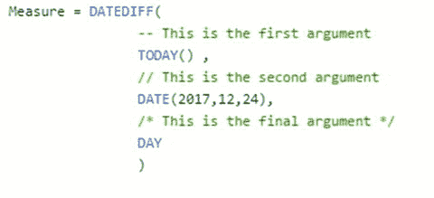
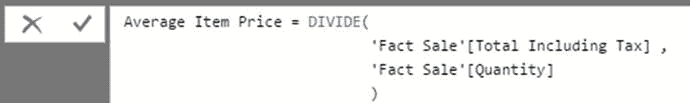
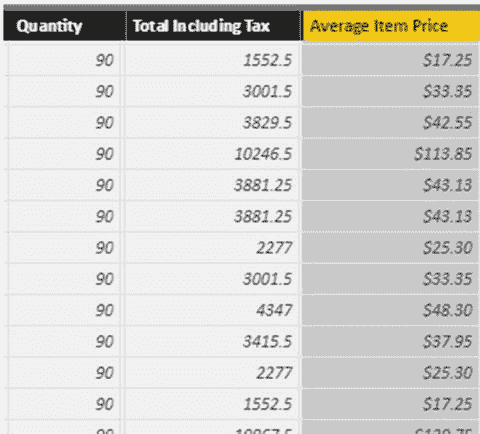
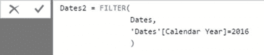
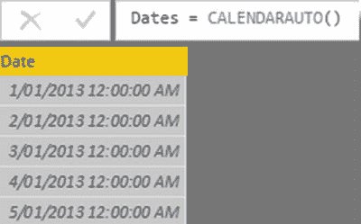

# 格式化

与 T-SQL 和几乎所有编程语言一样，合理使用行间距、回车符和制表符可以极大地提高可读性，更重要的是，有助于理解计算中使用的代码。虽然可以将复杂代码写在一行内构造出一个可工作的计算公式，但这种做法难以维护。单行计算还会导致“括号游戏”的问题。

> **注意**  
> 括号游戏是指你试图在公式中正确配对左/右括号以获得正确结果。若配对失败，则意味着你输了游戏，你的公式将无法正常工作。

一个好的技巧是，在开始编辑计算之前，通过重复按下 `Shift-Enter` 组合键多次，或点击右侧的下箭头，来扩展可视编辑区域。

## 注释

你还可以使用表 1-1 中的任何技术，为任何 DAX 计算添加注释。

**表 1-1** 如何添加注释

| 注释字符 | 效果 |
| --- | --- |
| `//` | 右侧文本在下一次回车前会被 DAX 忽略。 |
| `--` | 右侧文本在下一次回车前会被 DAX 忽略。 |
| `/* */` | 两个星号之间的文本会被 DAX 忽略，且注释可以跨越多行。 |

添加注释的一些示例方式如图 1-3 所示，图中也展示了一个如何通过将 DAX 分散到多行来提高可读性的示例。

通过格式化代码和添加注释，你可以帮助任何后续查看计算的人更轻松地理解函数的逻辑和意图。

**图 1-3** 注释文本样式及换行使用

在 Power BI Desktop 和 SSAS Tabular 中，公式栏的一个不错的替代品是 DAX Studio，这是一款免费且功能丰富的产品，旨在帮助你开发和调试计算。我将在第 8 章中更详细地介绍 DAX Studio。

## 你的第二个 DAX 计算

在第二个示例中，我将创建一个计算列，而不是计算度量值。第 9 章将提供关于何时应考虑使用计算列而不是计算度量值的更详细建议，但简而言之，计算列会在现有表中添加一个新列，该列的值通过 DAX 公式生成。

一个简单的计算可能会使用同一行中其他列的值。此示例使用了 `Fact Sale` 表中的两列来执行一个简单的除法运算，返回一个代表平均单价的值。

要将此计算添加到数据模型中，请在“字段”菜单中选择 `Fact Sale` 表使其高亮显示。然后使用“建模”选项卡上的“新建列”按钮，并输入图 1-4 所示的文本。

**图 1-4** `[Average Item Price]` 的计算列

> **注意**  
> 此公式无需在每个列名前加表名也能工作；但是，强烈建议你在引用列时始终包含表名。这在调试更长的 DAX 查询时，可以更轻松地区分列和度量值。

图 1-4 中的代码向 `Fact Sale` 表添加了一个名为 `[Average Item Price]` 的新列。新列中每个单元格的值（参见图 1-5）是该计算对表中每一行执行一次后的输出结果。

**图 1-5** 新计算列的数据示例

## 你的第三个 DAX 计算

最后一个示例将创建一个计算表。此选项仅在 Power BI Desktop 和 SSAS Tabular 中可用，在 PowerPivot for Excel 2016（或更早版本）中不可用。

你可以使用任何返回表的 DAX 函数创建计算表，或者简单地引用模型中的另一个表。最简单的语法允许你创建另一个 DAX 表的副本。图 1-6 所示的示例创建了一个名为 `Dates2` 的新计算表，它是 `Dates` 表的完整副本。对 `Dates` 表所做的修改（例如添加或修改列）会自动传递到 `Dates2` 表。

**图 1-6** 创建计算表

可以向 `Dates2` 表添加筛选器、度量值、列和关系，而不会影响 `Dates` 表。这样做的妙处在于，因为基表（`Dates`）是从物理数据源读取的，所以 `Dates` 表中数据的任何更改都会反映在 `Dates2` 表中。

若要扩展此示例，使新表仅显示原始表中的某些行，你可以使用 `FILTER` 函数，如图 1-7 所示。

**图 1-7** 使用 `FILTER` 创建的计算表

`Dates2` 计算表的列数仍与 `Dates` 表相同，但它只包含与筛选表达式匹配的行。这使得 `Dates2` 计算表拥有 365 行，代表 2016 日历年中每一天对应的一行。

使用计算表创建汇总表，作为计算度量值的更快替代方案，这很常见。使用计算表生成销售表的聚合版本，可以为任何使用该聚合版本的计算带来可观的性能提升。

### `CALENDARAUTO` 函数

一个无需使用现有表即可生成计算表的便捷 DAX 函数是 `CALENDARAUTO` 函数。此函数返回一个只有一列（名为 `[Date]`）的表。调用时，`CALENDARAUTO` 函数会检查模型中的每个表，查找使用 `Date` 或 `DateTime` 数据类型的列。

使用这些数据类型的所有列中出现的最早和最晚日期值，将用于生成介于最早和最晚值之间的每一天对应的行。这些日期会四舍五入到日历年的开始和结束。

日期表对于数据模型来说是无价的，尤其是当你添加了旨在准确显示期间比较和运行总计的度量值时。有几个 DAX 函数可以让你向模型添加时间智能逻辑。这些函数通常依赖于一个具有连续日期且能正常工作的日期表。在 `WideWorldImportersDW` 数据集中，`Fact Sale` 表中没有 `[Invoice Date Key]` 落在星期日的行。这可能会给某些处理期间比较逻辑的函数带来问题。当非日期表数据中出现日期空缺时，日期/日历表有助于使计算更可靠地运行。

**图 1-8** `CALENDARAUTO` 函数的示例输出

一旦你使用 `CALENDARAUTO` 函数创建了如图 1-8 所示的计算表，就可以开始向其添加计算列和度量值。你也可以开始创建与模型中其他表的一对多关系。

