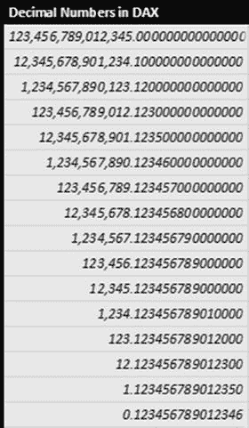
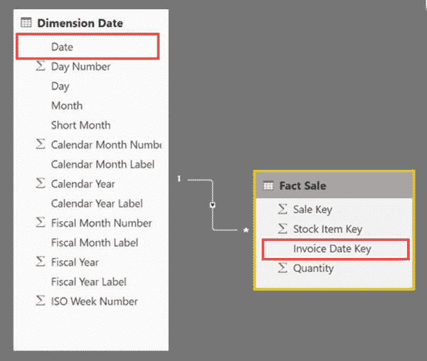

# 数据类型

在 DAX 中，可以为单个列定义数据类型。不同的数据类型在表 1-2 中暂时列出，并分为三大类，`True/False`（布尔值）除外。

-   文本
-   数值
-   日期时间

通过选择最佳数据类型，你可以帮助减小模型的大小，并在刷新数据和使用报表时提高性能。

导入新数据时，数据建模引擎会猜测每列应使用哪种数据类型。这值得检查，因为可能有机会进行调整，以确保为每列使用了适当的数据类型。

另一个需要注意的因素是，尽管你的数据源在创建模型时可能生成数值数据，但在未来的某个时间点，它可能会开始包含非数值数据，这将在数据刷新期间导致错误。当数据源几乎不提供最佳数据类型的建议时（例如 CSV 格式），这种情况更可能发生。

**表 1-2** DAX 中的数据类型

| 数据类型 | 存储方式 | 有效值 |
| --- | --- | --- |
| 整数 | 64 位整数 | 介于 –9,223,372,036,854,755,808 和 +9,223,372,036,854,755,808 之间的有符号整数。 |
| 小数 | 64 位实数 | 介于 –1.79E + 308 和 –2.23E –308 之间的实数和十进制数的混合。只有 15 位有效数字能返回精确结果。超出此范围的值计算并返回近似结果。 |
| 定点小数/货币 | 64 位实数 | 与小数相同，但固定为四位小数。 |
| 日期/时间 | 64 位双精度浮点数 | 公元 100 年 1 月 1 日至公元 9999 年 12 月 31 日。 |
| True/False | | |
| 文本 | Unicode（每个字符两个字节） | 最大字符串长度为 268,435,456 个 Unicode 字符。 |

## 整数数据类型

顾名思义，`整数`数据类型允许你以正整数或负整数的形式存储和操作数据。任何小数部分都会被移除，使用整数值进行的算术运算会返回整数，而非其他数据类型的值。

```
VAR 整数 A = 3
VAR 整数 B = 2
RETURN DIVIDE( 整数 A, 整数 B ) // 将存储为 1.5
```

**注意**  
执行除法计算时，请使用 `DIVIDE` 函数而不是 `/` 运算符。使用 `DIVIDE (3, 2)` 而不是 `3 / 2`。这可以更优雅地处理除零错误的情况。

## 小数和定点小数数据类型

小数数的每个值使用 64 位存储，可以表示范围广泛的值，这些值要么具有较大的整数部分和较小的小数部分，要么相反。

你可以使用此数据类型存储极大或极小的数字，然后执行计算。但是，在使用此数据类型时，要注意对于极大的值，结果可能不精确（非精确）。

以下练习显示了存储但不显示的值，只显示前 15 位有效数字。

### 实数的计算

第一个示例使用以下代码创建一个计算度量：

```
度量 1 = 100000000000000000 + 50
```

在此代码中，1 后面跟了 17 个零，计算结果返回值为 100000000000000000。请注意，尽管加上了值 50，但结果并未改变。我知道大量的零可能让你眼花，但我向你保证，确实有 17 个零。

现在创建第二个计算度量，它引用第一个度量，如下所示：

```
度量 2 = [度量 1] + 50
```

这将返回 100000000000000100——一个 1，14 个零，一个 1，然后再跟两个零。

如果你的数字有较大的整数部分，如图 1-9 中顶行所示，DAX 允许小数部分有较少的精度。小数点两侧的总最大位数为 15 位。

整数部分优先，因此如果你有一个具有 12 位整数和 12 位小数的值，DAX 将自动将小数四舍五入到 3 位。



**图 1-9** 数据格式

`定点小数`（或`货币`）使用`小数`数据类型，但其小数部分固定为 4 位。当你处理货币或金钱数据时，应优先选择此数据类型。使用此数据类型执行的算术运算应为财务报告产生可接受的结果，特别是在舍入和截断方面。

## 日期和日期时间

在处理基于日期的数据时，有两种基于日期的数据类型可供选择。`Date` 和 `DateTime` 之间的区别，顾名思义，在于 `DateTime` 可以表示包含小时、分钟、秒和毫秒的值，而 `Date` 则不能。

可以比较和匹配同为 `Date` 和 `DateTime` 的值，但是，只有午夜时刻的 `DateTime` 值才能匹配同一天的 `Date` 值。当用户在表之间创建关系时，如果关系的一端使用 `Date` 数据类型，而另一端使用 `DateTime`，这有时会难倒缺乏经验的用户。如果使用 `DateTime` 的表有一个像 `'2018-01-01 10:30:00'` 这样的值，它将永远无法在使用 `Date` 数据类型的表中找到匹配的记录。且不会抛出任何错误。

如果你需要在 DAX 中生成一个特定的日期，可以使用 `DATE` 函数，它接受三个参数（年、月、日）。`DATE( 2018, 5, 1)` 返回一个代表 2018 年 5 月 1 日的日期。

### 时间

你可以使用 `Time` 数据类型来表示一天中的特定时间点。这些值可以是“下午 2:37”或“上午 10:30”，并且可以相加或组合以进行基于时间的计算。

```
TIME(1,0,0) + "03:00:00"
```

上述计算显示了两种不同表示法的时间值相加。它是在一个代表凌晨 3 点的值上加 1 小时。结果是凌晨 4 点。

使用 `Time` 数据类型的值仍然存储为完整的 `DateTime`，并使用 1899 年 12 月 30 日作为年、月、日部分。使用 `Time` 的函数通常会忽略年、月、日。

## 运算符

以下是 DAX 中的四组运算符：

-   算术
-   比较
-   连接
-   逻辑

DAX 中没有位运算符。位运算可以通过函数而不是运算符来执行。

### 算术运算符

表 1-3 显示了 DAX 中可用的算术运算符。

**表 1-3** DAX 算术运算符

| 运算符 | 作用 | 示例 |
| --- | --- | --- |
| + | 加法 | `2 + 2 = 4` |
| – | 减法 | `10 – 4 = 6` |
| * | 乘法 | `4 * 5 = 20` |
| / | 除法 | `8 / 2 = 4` |
| ^ | 乘方 | `2 ^ 4 = 16` |

### 比较运算符

表 1-4 中的运算符在用于比较两个值时返回 true 或 false。运算符两侧的值可以是文本、数值或日期时间。

**表 1-4** DAX 比较运算符

| 运算符 | 作用 | 示例 |
| --- | --- | --- |
| = | 等于 | `Sales[数量] = 10` |
| < | 小于 | `Sales[数量] < 10` |
| > | 大于 | `Sales[价格] > 20` |
| <= | 小于或等于 | `Dates[日期] <= TODAY ()` |
| >= | 大于或等于 | `[总计] >= 200` |
| <> | 不等于 | `[动物] <> "猫"` |

如果你将一个数字与一个文本值进行比较，例如 `1 = "1"`，会收到一个错误。在这种情况下，你可以使用 `FORMAT` 函数将数字 1 转换为字符串，或者使用 `VALUE` 函数将 `"1"` 值转换为数字。

### 连接运算符

用于连接文本值的运算符如下所示（表 1-5）。

**表 1-5** DAX 连接运算符

| 运算符 | 作用 | 示例 |
| --- | --- | --- |
| & | 连接值 | `"ABC" & "DEF" = "ABCDEF"` |
| | | `1 & 2 = "12"` |

在 `"1 & 2"` 的示例中，两个值都被隐式转换为文本，输出是一个文本值。


### 逻辑运算符

表 1-6 展示了 `DAX` 中的逻辑运算符。

**表 1-6**  
DAX 逻辑运算符

| 运算符 | 功能 | 示例 |
| --- | --- | --- |
| `&&` | 逻辑与 | `(1=1) && (2=2) = true` `((1=1) && (2=3) = false` |
| `||` | 逻辑或 | `(1=1) || (2=2) = true` `(1=1) || (2=3) = true` `(1=2) || (2=3) = false` |
| `IN` | 逻辑或 | `Location[Country] IN ("UK","USA","Canada")` |

### 运算符优先级

确定了正确的运算符后，还需要考虑运算符的应用顺序。表 1-7 展示了 `DAX` 中运算符的优先级顺序。

**表 1-7**  
运算符优先级

| 运算符 | 功能 |
| --- | --- |
| `^` | 乘方 |
| `–` | 符号（正或负） |
| `*` `/` | 乘法和除法 |
| `!` | 非 |
| `+` `–` | 加法和减法 |
| `&` | 连接 |
| `=` `<` `>` `<=` `>=` `<>` | 比较 |

如有必要，可以使用括号覆盖运算符优先级，如表 1-8 中的示例所示。在第二行的示例中，加法在乘法之前执行，产生了与第一行不同的结果。在底部行的示例中，括号使符号运算符优先于乘方运算符。

**表 1-8**  
运算符优先级示例

| 计算 | 结果 |
| --- | --- |
| `2 * 3 + 4` | `10` |
| `2 * (3 + 4)` | `14` |
| `–2 ^ 2` | `–4` |
| `(–2) ^ 2` | `4` |

`DAX` 会尽可能尝试将运算符两边的数据类型隐式转换为相同类型。但这并非在所有情况下都能保证。例如，`1 + "2"`会导致错误，而 `1 & "2"` 则会生成文本值 `"12"`。

## 关系

关系是 `DAX` 中的规则，用于定义两个表如何相互关联。创建关系主要有两个原因：一是允许在一个表上所做的筛选选择通过关系自动筛选另一个表的行；二是允许计算使用不同表中行的值，并理解行应如何连接。

### 关系类型

关系可以定义为一对多或一对一，但始终使用关系中每个表的单个列。当在两个表之间添加关系时，关系一侧所涉及的列必须具有唯一值。如果在数据加载或刷新过程中检测到重复数据，将发生错误，提示你无法在两个列之间创建关系，因为这些列必须具有唯一值。

#### 用于筛选的关系

`WideWorldImportersDW` 数据集包含多个事实表，每个事实表都有一个或多个基于日期的列。该数据集还包含一个名为 `Dimension.Date` 的表，该表包含从 2013 年 1 月 1 日到 2016 年 12 月 31 日之间每天对应的行。该日期表包含 14 个用于分组和筛选的列。

将这些表导入模型后，可以在表对之间添加关系，使得基于报表的筛选器能够对一侧的表进行任何选择，并向下流动以筛选相关表中的行。

筛选器仅沿一个方向跨关系流动。对关系多侧表中列所做的筛选选择不会筛除一侧表中的行。筛选器可以通过多组关系向下流动，但方向始终是从一侧到多侧。

这意味着，如果将日期表中的任何字段添加到报表视觉对象或筛选器，使用这些视觉对象或筛选器所做的任何选择都会传播到相关表，并触发度量值使用新的筛选器设置重新计算。

图 1-10 显示了 `'Dimension Date'` 表和 `'Fact Sale'` 表之间的关系。`'Dimension Date'`（一侧）使用的列是 `[Date]`，而 `'Fact Sale'`（多侧）使用的列是 `[Invoice Date Key]`。这两列均使用 `Date` 数据类型。

有了这种关系，将 `[Calendar Year]` 列从 `'Dimension Date'` 拖到报表画布上，并将其转换为切片器视觉对象。切片器显示该列中的不同值，即 `2013`、`2014`、`2015` 和 `2016`。选择其中一个或多个值会向下流动并应用于任何相关表。如果在切片器中选择了 `2014`，则基于相关表中列的视觉对象所使用的计算会自动重新计算，并生成考虑更新后的 `'Dimension Date'` 表筛选条件的新值。



**图 1-10**  
`'Dimension Date'` 与 `'Fact Sale'` 之间的关系

`Power BI Desktop` 具有一项功能，可以在向模型添加新表时自动检测关系。如果新表包含一个列，该列与另一个表中的列共享相同的名称和数据类型，则可能会自动为你添加关系。这可能很有帮助，但始终建议仔细检查已为你添加了哪些关系，以及这些关系是否确实有用。

我从好友马特·阿林顿那里学到的一个好技巧是，在`关系视图`中组织表，使位于一侧的表位于多侧表的上方。这有助于在视觉上强化筛选器在关系中向下渗透的特性。当数据模型中有很多表时，这会变得困难，但对于较小的模型，这是一个非常值得应用的技巧。

#### 用于计算的关系

利用关系的另一种方式是通过 `DAX` 函数 `RELATED` 和 `RELATEDTABLE`。这些函数允许计算使用来自不同但相关表中行的数据。这意味着，你可以向一个表添加计算列，该列显示使用父表或子表中数据的值。`RELATED` 函数允许计算从多侧向上深入到一侧表中的数据，而 `RELATEDTABLE` 则允许一侧的计算访问多侧表中的数据。

一对表可以定义多个关系，但一次只能将一个关系标记为活动关系。筛选器和计算默认使用活动关系。非活动关系可以在计算中使用，但需要使用 `USERELATIONSHIP` 筛选函数专门引用它们。

尽管可以让表或关系镜像 `OLTP`（联机事务处理）结构，但更好的做法是研究和学习一些 `BI` 方法论，例如使用星型模式来组织数据。当表中的行数增长到很大值时，这一点尤其有用。

还可以在两个表之间定义多个关系，并控制交叉筛选方向。这些概念将在关于 `DAX` 关系的章节（第 5 章）中更详细地介绍。


