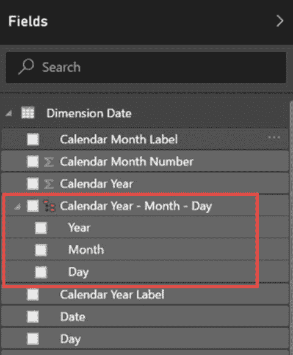

# 层次结构

层次结构将表中的两个或多个列组合成基于级别的分组。可以通过将字段拖放到同一表中的另一个字段上来将其添加到模型中。这会在字段列表中创建一个新条目，并带有一个特殊图标以表明它是一个层次结构。代表层次结构中级别的字段会略微缩进显示，并且可以通过拖放重新排序。

您可以重命名层次结构以及各个级别。重命名这些内容不会影响用作层次结构源列的列。

在图 1-11 的示例中，`[Calendar Month Label]` 字段被拖放到 `[Calendar Year]` 字段上，从而创建了一个新的层次结构。然后，这两个级别以及该层次结构被重命名，使每个名称更短。最后，通过将 `[Day]` 字段拖放到层次结构名称上，向该层次结构添加了第三个级别。这会将此字段作为新的第三级别添加进来。可以通过将各个级别在列表中向上或向下拖放来重新排序。

图 1-11

“维度日期”表中的层次结构

并非所有的 Power BI 视觉对象都能理解层次结构，但大多数原生视觉对象允许在 X 轴或 Y 轴上使用层次结构来提供向下钻取功能。通过将多个单独的字段拖拽到同一个轴字段上，您也可以获得相同的体验，但这样重命名和自定义各级别的能力会较弱。

