# 2. 变量

本章探讨如何使用 DAX 变量使计算更易于理解，并且在某些情况下，使其执行更快。变量用于存储 DAX 表达式的结果。这些变量可以简单到只是分配一个硬编码的值，也可以是复杂 DAX 方程的结果。

您可以在任何类型的 DAX 计算中使用变量，包括计算列、度量和表。变量没有严格的数据类型，可以表示 DAX 中的任何类型的对象。变量会自动采用被赋值对象的类型。您必须使用 `RETURN` 语句来关闭一个变量作用域层。您可以在同一作用域层内声明多个变量，并且使用单个 `RETURN` 语句即可使用它们。当您在表达式中的任何位置使用嵌套变量时，它们可以初始化一个新的作用域层，但当您使用 `RETURN` 语句时，所有作用域层都将结束。

这是在 DAX 表达式中创建和使用变量的基本结构：

```
VAR 变量名 = 表达式
RETURN 表达式
```

变量只能赋值一次，不能重新赋值。以下代码会产生错误：

```
VAR myVar = 1
myVar = myVar + 1
```

以下示例显示了使用多个 DAX 变量的公式的基本结构：

```
VAR myVar1 = 1
VAR myVar2 = myVar1 + 2
RETURN myVar2 * 2
```

## 变量结构

关键字 `VAR` 表示正在声明一个新变量。其后跟变量名称。您不能使用空格，也不能像在 DAX 其他位置那样使用方括号或撇号来包含变量名以允许使用空格。变量名的另一个限制是您不能使用表名或 DAX 关键字的名称。

最后，在 `=` 运算符之后是一个 DAX 表达式。

```
VAR myVar1 = 1
VAR myVar2 = myVar1 + 2
```

此示例的第一行将数值 1 分配给名为 `myVar1` 的变量。然后在下一行的表达式中使用 `myVar1` 变量为名为 `myVar2` 的变量赋值。此时，因为表达式 (1 + 2) 的缘故，变量 `myVar2` 的值为 3。

```
RETURN myVar2 * 2
```

`RETURN` 关键字必须用于输出结果，并且也可以使用表达式。在这种情况下，结果是整数 6。在每层变量作用域内，`RETURN` 关键字只能使用一次。

`RETURN` 关键字用于返回当前作用域中任何变量的值。这在调试包含多个变量的计算时非常有用。它不必返回该系列中的最后一个变量。

在 DAX 中使用变量的一个主要好处是代码可读性。在许多情况下，您可以通过添加变量来简化复杂的 DAX 公式。以下示例展示了一个未格式化的、未使用变量的 DAX 表达式。

```
Table =
NATURALINNERJOIN(
'Sales',
TOPN(
10,
SUMMARIZECOLUMNS(
'Sales'[Product],
"Sum of Revenue", SUM('Sales'[Total])
),
[Sum of Revenue],
DESC))
```

在以下代码中，DAX 表达式被格式化并重写以使用变量。它产生与上述代码相同的结果。

```
Table =
VAR InnerGroup =
SUMMARIZECOLUMNS(
-- 分组依据 --
'Sales'[Product],
-- 聚合列 --
"Sum of Revenue", SUM('Sales'[Total])
)
VAR Top10Products =
TOPN(
10,
InnerGroup,
[Sum of Revenue],
DESC
)
RETURN
NATURALINNERJOIN(
'Sales',
Top10Products
)
```

虽然这个例子更长，但将代码分解成更小的步骤并对其进行格式化，使其更容易阅读和理解其逻辑。

### 对文本使用变量

变量既可以存储文本数据，也可以存储数值数据。变量继承其被赋值表达式的类型。此示例连接 `textVar1` 和 `textVar2` 中的文本，产生一个新值，即 “Hello World”。

```
My Measure =
VAR textVar1 = "Hello "
VAR textVar2 = "World"
RETURN CONCATENATE(textVar1,textVar2)
```

您可以将此技术与其他 DAX 函数结合使用，创建动态的基于文本的度量，这些度量可能会根据当前的筛选上下文而变化。考虑以下计算度量：

```
Sales Text =
VAR SalesQty = SUM('Fact Sale'[Quantity])
VAR Text1 = "This month we sold "
VAR Text2 = " Items"
VAR Result = IF(
SalesQty > 0,
-- THEN 部分 --
Text1 & SalesQty & Text2,
-- ELSE 部分 --
"No sales this month"
)
RETURN Result
```

在这里，您将 DAX `SUM` 表达式分配给 `SalesQty` 变量。稍后在 `IF` 函数中使用它来测试是否存在销售，以确定输出消息。注意在 `IF` 函数中使用注释来帮助澄清哪些代码用于更新 `Result` 变量。

这也展示了如何使用变量来提高性能。`SalesQty` 变量可能在 `IF` 函数中被使用了两次。如果这个公式在不使用变量的情况下编写，`IF` 函数将对底层列进行两次调用，因此需要更长时间才能得出相同的结果。

另一个使用基于文本变量的类似函数是生成问候语的计算度量。使用清单 2-1 中的代码创建计算度量，测试当前时间并将一天中的小时存储在 `CurrentHour` 变量中。然后在 `SWITCH` 函数中使用该变量生成适当的文本并存储在 `GreetingText` 变量中。随后将其与其他文本组合，生成一个可以在报告中用作动态问候语的度量。

```
Greeting =
VAR CurrentHour = HOUR(NOW())
VAR GreetingText =
SWITCH(
TRUE(),
CurrentHour<12,"Morning",
CurrentHour<17,"Afternoon",
"Evening"
)
RETURN
"Good " & GreetingText & ", " & USERNAME()
```

清单 2-1
生成问候语计算度量

### 在计算列中使用变量

在计算列中使用变量时，变量会自动访问同一行中任何列的值。当你在赋值过程中使用 `'表名'[列名]` 这种表示法时，假定使用的值来自同一行。

此示例使用变量来创建一个新列，该列将不同的位置值合并到新列中的单个文本中。这种类型的列对于某些尝试使用基于文本的地址数据进行绘图的视觉对象很有用。

在这种情况下，计算列的 DAX 表达式可能如下所示：

```
City and Country =
VAR city = 'Dimension City'[City]
VAR country = 'Dimension City'[Country]
RETURN
city & ", " & country
```

在这段代码中，你声明了两个变量：`city` 和 `country`。这些变量继承的数据类型是文本，并在 `RETURN` 语句中使用 `&` 运算符将它们连接起来。添加计算列后的输出示例如图 2-1 所示。

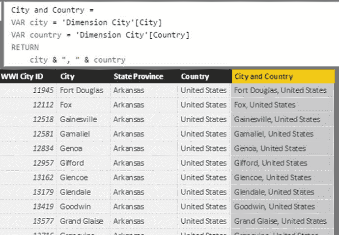

图 2-1

使用变量的新计算列的示例输出

上述代码的结果是向表中添加了一个名为 `[City and Country]` 的新列。每一行的值都是使用同一行中其他值连接文本的结果。这与你在 Excel 表中创建新列，或者在 SQL 的 `SELECT` 语句中基于同一行的其他值创建新列时的预期类似。

在计算列中使用变量时，最终的 `RETURN` 语句必须返回单个值。它不能返回列或表。

### 在计算度量值中使用变量

你可以使用变量使计算度量值中的计算更易读，并且在某些情况下，提高执行速度。

计算度量值中使用的变量与计算列中使用的变量之间的一个区别是，计算度量值中的变量不像计算列那样与各个行有关系。这意味着计算度量值中使用的变量不能被赋予基于列的值。

使用与上一节相同的 DAX 代码，一个名为 `[City and Country]` 的新计算度量值会遇到类似这样的错误：

```
A single value for column 'City' in table 'Dimension City' cannot be determined
```

这更多地体现了计算度量值和计算列之间的本质区别，这将在第 9 章中介绍。因此，现在让我们创建一个使用变量且可工作的计算度量值。

假设你有一个报表需求，需要了解有多少销售额的 `[Total Including Tax]` 值大于或等于 100 美元。

使用变量将此需求编写为计算度量值的一种方式如清单 2-2 所示。

```
Total Sales > $100 =
VAR SalesAbove100 =
FILTER(
-- 过滤表 --
'Fact Sale',
-- 过滤条件 --
'Fact Sale'[Total Including Tax]>=100
)
RETURN COUNTROWS(SalesAbove100)
```

清单 2-2
使用变量将代码编写为计算度量值

在这个计算度量值中，使用了一个名为 `SalesAbove100` 的变量来分配 `FILTER` 函数的输出。`FILTER` 函数返回一个表，该表不能用作 `RETURN` 函数的最终输出，因为你定义的是一个计算度量值，而计算度量值必须返回单个值。

`RETURN` 语句使用 `COUNTROWS` 函数，根据作为参数传递给它的表返回单个值。此计算度量值展示了如何使用 `COUNTROWS` 函数处理存储在变量中的表表达式，并且该表表达式不限于模型中的物理表。

### 在计算表中使用变量

你还可以在 DAX 计算中使用变量来创建新的计算表。当你创建新表作为现有表的汇总或聚合版本，且需要进行额外的处理或操作时，你可能会发现这很有用。

此技术可以提高某些报表页面的性能，但它会影响加载数据所需的时间以及数据模型的整体内存占用。

清单 2-3 中的示例使用变量来帮助创建一个表，该表显示基于 `[Total Including Tax]` 列金额，`'Fact Sale'` 表中的前十名客户。

```
Sales Summary =
VAR SalesTableWithCustKey =
FILTER(
-- 过滤表 --
'Fact Sale',
-- 过滤条件 --
'Fact Sale'[Customer Key]>0
)
VAR SalesTableGrouped =
SUMMARIZE(
-- 要汇总的表 --
SalesTableWithCustKey,
-- 要分组的列 --
'Fact Sale'[Customer Key],
-- 聚合列名称和表达式 --
"Total Spend",SUM('Fact Sale'[Total Including Tax])
)
VAR SummaryTableFiltered =
TOPN(
-- 要返回的行数 --
10,
-- 要过滤的表 --
SalesTableGrouped,
-- 排序依据表达式 --
[Total Spend]
)
RETURN SummaryTableFiltered
清单 2-3
使用变量创建表
```

DAX 计算中的第一个变量是 `SalesTableWithCustKey`，它被分配了 `FILTER` 函数的输出，该函数用于删除 `[Customer Key]` 为零的数据行。

`SalesTableGrouped` 变量被分配了一个表，该表是 `SUMMARIZE` 函数的输出。`SUMMARIZE` 函数接收 `SalesTableWithCustKey` 变量，并按 `[Customer Key]` 列进行分组。添加了一个名为 `[Total Spend]` 的新列，该列计算属于每个 `[Customer Key]` 的所有行的 `SUM` 值，将其归为一个值。

最后，`SummaryTableFiltered` 变量被分配了 `TOPN` 过滤函数的输出，该函数将包含所有客户的表过滤为仅显示前十名的表。该变量最终被返回给计算表（图 2-2）。

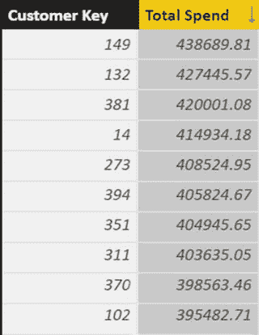

图 2-2 ‘Sales Summary’ 计算表的示例输出

与计算列和计算度量值示例不同，当你使用计算表时，可以将一个计算表返回给数据模型。

与前面清单 2-3 中的 DAX 匹配的、使用与变量相对应的 `#表名` 的等效 T-SQL 如清单 2-4 所示。

```
SELECT
*
INTO #SalesTableWithCustKey
FROM Fact.Sale
WHERE
[Customer Key] > 0
SELECT
[Customer Key],
SUM([Total Including Tax]) AS [Total Spend]
INTO #SalesTableGrouped
FROM #SalesTableWithCustKey
GROUP BY
[Customer Key]
SELECT TOP 10
*
INTO #SummaryTableFiltered
FROM #SalesTableGrouped
ORDER BY
[Total Spend] DESC
SELECT * FROM #SummaryTableFiltered
清单 2-4
与 DAX 变量匹配的等效 T-SQL
```

### 使用变量进行调试

SQL 存储过程中常用的一种技术是创建一系列临时表，这些表是前一个表的精炼版本。你可以在 DAX 中以等效的方式使用变量，这使得跟踪和调试数据处理过程更加容易。

最终的 `RETURN` 语句不一定总是返回最近的变量。输出任何变量以便你可以目视检查该变量包含的值是非常有用的。这是一种手动调试的形式。

## 嵌套变量

变量可以嵌套使用，在同一计算中可存在多层变量作用域。

每一层变量作用域以 `VAR` 语句开始，并以对应的 `RETURN` 语句结束，且只能引用同一层级或更高层级中声明的其他变量。

清单 2-5 是一个简单示例，展示了一个返回值为 30 的计算度量。该计算中使用了两个变量作用域层。

```
嵌套度量 =
VAR Level1a = 10
VAR Level1b =
VAR level2a = Level1a
VAR Leval2b = level2a * 3
RETURN Leval2b
RETURN Level1b
清单 2-5
计算度量示例
```

第一个 `VAR` 语句开启了最外层的变量作用域。高亮显示的代码展示了内部变量作用域的起始与结束，并通过返回一个单一值将其赋给 `Level1b` 变量。

内部作用域中的代码可以访问外部作用域中已创建的变量，这一点通过 `Level2a` 变量被赋值为与 `Level1a` 相同的值得以体现。反之则不行。`Level2a` 的值应为 10。`Level2b` 的值应为 30。

清单 2-6 展示了一个稍复杂的版本，其中包含多层嵌套。

```
嵌套度量 2 =
VAR Level1a = 10
VAR Level1b =
VAR level2a = 20
VAR level2b =
VAR Leve3a = Level2a + Level1a
RETURN Level1a
RETURN level2b
VAR Level1c =
VAR Level4a =  Level1b * 5
RETURN Level4a
RETURN Level1c
清单 2-6
具有多层嵌套的复杂版本
```

该计算度量返回值为 50。在 `Level1b` 变量下方共有三个嵌套层。最内层可以访问所有更高层级中声明的变量。最内层并未返回在同层级中声明的变量。

在 `Level1c` 变量下方开启的作用域层，无法访问在为 `Level1b` 赋值的表达式期间，所开启（并关闭）的那些层中声明的任何变量。

### 嵌套变量（复杂）

清单 2-7 并未使用硬编码值来演示变量嵌套，而是展示了如何在其他类型的计算中使用变量。

```
演示表 =
VAR Level1 =
SUMMARIZE(
    FILTER(
        'Fact Sale',
        [Quantity] >
            VAR Level2 = DAY(TODAY())
            RETURN IF(
                Level2 > 10,
                -- 则 --
                20,
                -- 否则 --

)
    ),
    -- 分组依据列 --
    [City],
    -- 聚合列 --
    "数量总和", sum('Fact Sale'[Quantity])
)
RETURN
    TOPN(
        VAR Level2 = 5
        RETURN Level2,
        Level1,
        [City]
    )
清单 2-7
在其他类型计算中使用变量的示例
```

该计算表使用嵌套变量来帮助控制 `FILTER` 函数的筛选表达式中所用的参数。`Level2` 变量可根据月份中的具体日期被赋予不同的值。如果当前月份日期在 1 到 10 之间，则该作用域层返回值为 30，否则返回值为 20，用于筛选表达式。

另一个嵌套作用域层安全地使用了之前出现过的相同名称，并被赋予硬编码值 5，作为参数返回给 `TOPN` 函数，该函数同时还将 `Level1` 变量作为参数。

这并不是最有用的计算，但它确实展示了如何在较长的计算过程中使用变量。

## 3. 上下文

有人说，一旦你掌握了 DAX 中上下文的概念，你就掌握了 DAX。这句话基本正确，如果你确实掌握了上下文，那么你在学习曲线上已经走了很远。

上下文起初可能看起来有点令人生畏，但一旦你理解了不同类型上下文对计算的影响，希望 DAX 会开始变得更有意义。上下文是 DAX 如何对计算中使用的表应用筛选层的方式，从而使它们为每个值返回相关的结果。

大多数上下文是自动的，但有些上下文允许你控制传递给 DAX 计算的底层数据。本章主要使用数据透视表来描述不同类型上下的顺序和影响。其他视觉对象和图表应用上下文逻辑的方式与数据透视表相同，但我认为数据透视表在展示效果方面做得很好。

DAX 中有两种类型的上下文：筛选上下文和行上下文。取决于你的计算，其中一种或两种可以同时应用，从而影响 DAX 计算的结果。

上下文是应用于计算的筛选层，通常动态地生成特定于数据透视表或视觉对象中每个值的结果，包括行和列总计。

## 筛选上下文

筛选上下文是一组基于列的筛选器，它们会动态地应用于每次 DAX 计算的基础数据。将数据透视表中的每个值单元格视为独立的计算是有帮助的。每个值单元格将其度量值视为一个函数，并将相关的筛选器传递给该函数以应用于计算。

将筛选上下文视为一个容器也可能有所帮助。该容器可以为空，也可以包含一个或多个列筛选规则。列筛选规则只是指定表中给定列中的哪些行在布尔测试中返回 true。

尽管本章中的示例大多是单列筛选器，但您不应假设筛选上下文中的所有筛选器都是单列筛选器。通常，筛选上下文中的每个筛选器都是一个可以包含多列的表。这一点很重要，因为双列筛选器会在这两列之间建立关联。例如，包含两行的筛选器 `{ (2016, US), (2017, UK) }` 与两个独立的列筛选器 `{ 2016, 2017 }` 和 `{ US, UK }` 是不同的。

每次计算执行时，都会先访问数据模型中每个表的每一行，但在执行核心计算之前，会建立一个筛选上下文，以确定为该特定执行最相关的一组列筛选器。一旦筛选上下文确定，上下文中的列筛选规则就会应用于数据，并且像 `SUM` 这样的计算将仅使用它们被编码指定的列中剩余的数据来执行。计算完成后，筛选上下文即被销毁，不会被任何其他进程使用。

基于列的筛选器可以隐式地添加到筛选上下文中，也就是说，它们会因为同一视觉对象中的另一个字段（如行标题或列标题）而自动添加到筛选上下文中。它们也可以通过视觉对象外部的筛选器（如切片器选择或其他报表、页面或视觉对象筛选器）添加到筛选上下文中。

基于列的筛选器也可以显式地添加到筛选上下文中，或从中移除。这就是基于筛选器的规则被添加到 DAX 计算中的方式。

与 T-SQL 不同，在 T-SQL 中，您必须编写特定代码，在 `SELECT` 语句中使用 `JOIN`、`WHERE`、`GROUP BY` 和 `HAVING` 子句进行筛选和聚合，而 DAX 可以动态地为每次计算构建谓词条件。

让我们从一个非常基本的 DAX 度量值开始，它使用 `SUM` 函数返回一个值，该值表示单个列中所有值的总和。

```
Sales Qty = SUM('Fact Sale'[Quantity])
```

此计算度量值返回一个数字，该数字表示 `'Fact Sale'` 表中 `[Quantity]` 列中每个值的总和。将此计算度量值放到报表上合适的视觉对象中，且不应用任何其他字段或筛选器，使用 `WideWorldImportersDW` 数据集时，应显示值为 8,950,628。

在此示例中，报表上显示的单个值代表该计算度量值的一次执行。`[Sales Qty]` 计算度量值使用了传递给 `'Fact Sale'[Quantity]` 列引用的 `SUM` 函数，这意味着它将 `[Quantity]` 列中每一行的每个值相加得出一个值。它可以访问 `[Quantity]` 列中的每个值，因为筛选上下文中没有基于列的筛选器。

以下是与此 DAX 等价的 T-SQL 语句：

```
SELECT
SUM(Quantity) AS [Sales Qty]
FROM Fact.Sale;
```

### 隐式筛选上下文

当计算度量值被添加到数据透视表中，并使用来 `'Fact Sale'`（或与 `'Fact Sale'` 相关的表）的其他字段作为行和列时，我们不会在每个单元格中看到重复的 8,950,628 这个值；相反，我们会看到其他值，这些值表示根据行列标题的交集点进行筛选后的计算结果（图 3-1）。

这就是筛选上下文对计算度量值的影响。DAX 会为数据透视表中的 20 个单元格中的每一个，隐式地向筛选上下文添加一组基于列的筛选器，并且每个值单元格中都会显示不同的结果。该数据透视表使用了简单的 `[Sales Qty]` 计算，其中不包含任何用于指示如何分组或聚合 `[Quantity]` 列以生成每个值的 DAX 代码。

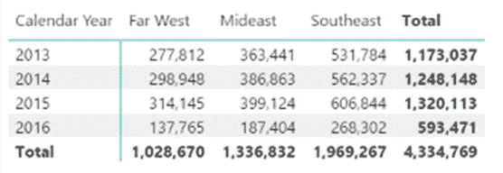

图 3-1 数据透视表中的 `[Sales Qty]` 计算度量值

考虑图 3-1，它使用了 `[Sales Qty]` 计算度量值。该数据透视表有五列和四行。数据集中有四个日历年份，这就是为什么您会看到五行（包括底部的总计行）。在此示例中，销售区域已被筛选为仅显示数据中实际十个销售区域中的三个。最右边的一列是每行的总计。

每个单元格中的值都不同，并且没有一个是与总计值 8,950,628 相同的。该数据透视表中计算度量值的每次执行都使用一个唯一的筛选上下文。

DAX 表达式是一个简单的 `SUM` 计算，并且没有提及任何按日历年份、销售区域或任何其他分组指令进行的筛选。那么，为什么左上角的单元格中的值是 277,812，而紧邻其下方的单元格中的值是 298,948 呢？

这就是 DAX 中筛选上下文的作用。数据透视表有 20 个需要计算的值单元格，因此 DAX 引擎会执行 20 次独立的逻辑计算，数据透视表中的每个单元格对应一次逻辑计算。这包括确定每行和每列总计值所需的计算。

为了在左上角的单元格中生成 277,812 这个值，计算度量值首先可以访问 `'Fact Sale'[Quantity]` 列中的每个值。此计算的筛选上下文开始为空，但有两个列筛选器集隐式添加到了其中。其中一个列筛选器是 `[Calendar Year]` 字段中的行必须具有值 2013；另一个列筛选器是 `[Sales Territory]` 列中的行必须具有值 "Far West"。

筛选上下文中的所有筛选器都基于逻辑 AND 运算，因此只有 `'Fact Sale'[Quantity]` 列中能够同时满足两个条件的行才会被传递给 `SUM` 函数。

生成此单元格值的 T-SQL 等价写法，如同将清单 3-1 中的 `INNER JOIN` 和 `WHERE` 子句添加到 T-SQL 语句中一样。

```
SELECT
SUM([Quantity]) AS [Sales Qty]
FROM FACT.Sale AS S
INNER JOIN Dimension.City AS C
ON C.[City Key] = S.[City Key]
INNER JOIN Dimension.Date AS D
ON D.Date = S.[Invoice Date Key]
WHERE
C.[Sales Territory] = 'Far West'
AND D.[Calendar Year] = 2013
清单 3-1
图 3-1 中左上角单元格生成值的 `[Sales Qty]` 计算度量值（含筛选器）的 T-SQL 语句
```

T-SQL 中的 `WHERE` 子句类似于筛选上下文。`WHERE` 子句中的两个语句分别代表了隐式添加到筛选上下文中的每个列筛选器。

好的，作为高级文档工程师和翻译员，我将遵循您提供的注意事项和示例，将给定的英文文本翻译成中文。

现在，我们来看看 DAX 引擎是如何计算第一列第二行 (298,948) 的值的。此计算的筛选上下文同样始于空，但隐式地添加了两组列筛选器。一个列筛选器是，`[Calendar Year]` 字段中的行现在必须为 2014 年；另一个列筛选器是，`[Sales Territory]` 列中的行必须为“Far West”。清单 3-2 显示了这个单元格计算所对应的等效 T-SQL。

```
SELECT
SUM([Quantity]) AS [Sales Qty]
FROM FACT.Sale AS S
INNER JOIN Dimension.City AS C
ON C.[City Key] = S.[City Key]
INNER JOIN Dimension.Date AS D
ON D.Date = S.[Invoice Date Key]
WHERE
C.[Sales Territory] = 'Far West'
AND D.[Calendar Year] = 2014
清单 3-2
具有不同筛选上下文的 [Sales Qty] 计算度量值的 T-SQL
```

清单 3-1 和清单 3-2 中的 T-SQL 语句之间唯一的区别是最终的谓词，它指定了 `D.[Calendar Year]` 的值现在是 2014 年，而非 2013 年。每个单元格都有自己的筛选上下文，每个筛选上下文又有自己的一组列筛选器。

这一过程会以任意顺序不断重复，因为数据透视表中的任何单元格都不依赖于另一个单元格的输出。

让我们跳到第一列的最后一行，看看 DAX 引擎是如何为第一列的总计计算得出 1,028,670 这个值的。DAX 不会保留同列中先前计算的累计值。从逻辑上讲，引擎会从头开始，得出一个独立于数据透视表中其他 19 个单元格计算的总计值。

DAX 再次以空的筛选上下文开始，但在这种情况下，只有一个列筛选器被隐式地添加到筛选上下文中。这次，列筛选器要求 `[Sales Territory]` 列的值必须为“Far West”。此筛选上下文限制了传递给 `SUM` 函数的 `'Fact Sales'[Quantity]` 列中的行。与前面的两个示例相比，此案例中传递的行更多。

清单 3-3 显示了此单元格的 T-SQL 代码。

# 筛选上下文

## 基本查询示例

这是生成图 3-1 第一列总计值的基本 DAX 查询对应的 T-SQL：

```sql
SELECT
SUM([Quantity]) AS [Sales Qty]
FROM FACT.Sale AS S
INNER JOIN Dimension.City AS C
ON C.[City Key] = S.[City Key]
WHERE
C.[Sales Territory] = 'Far West'
```

这与前面示例的区别在于，您不再需要与 `Dimension.Date` 表进行内连接，并且 `WHERE` 子句中少了一个谓词，因此没有对日期表进行筛选。

在更复杂的场景中，您可以利用这一点，为总计单元格指定一个与按日历年筛选的单元格所使用的计算完全不同的计算。事实上，可以使用函数指示 DAX 为您想要的任何单元格返回完全不同的计算，从而实现多维数据模型中可用的类 `SCOPE` 行为。

### 使用 `SELECTEDVALUE` 覆盖输出

清单 3-4 中的计算度量值应用了一个测试，以查看筛选上下文中是否存在任何列筛选规则，要求 `'Dimension Date'[Calendar Year]` 必须匹配 2014。如果存在，则绕过 `SUM` 函数，返回文本值“overridden”。

```dax
Sum of Quantity =
IF(
    SELECTEDVALUE('Dimension Date'[Calendar Year])=2014,
    -- THEN --
    "overridden",
    -- ELSE --
    FORMAT(
        SUM('Fact Sale'[Quantity]),"#,000"
    )
)
```

任何使用 `[Sum of Quantity]` 计算度量值且其筛选上下文中包含 `[Calendar Year]` = 2014 列筛选器的单元格，现在将返回“overridden”文本，而不是执行 `SUM` 函数（图 3-2）。

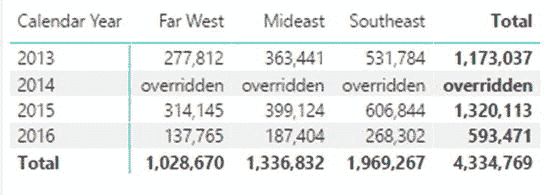
**图 3-2** `[Sum of Quantity]` 计算度量值的输出

请注意，行总计仍然产生与之前相同的总计值，并未因 2014 年行的缺失值而减少。这是因为行总计的计算具有独立的筛选上下文，并且仍可以使用属于 `[Calendar Year]` = 2014 的数据。

列筛选器除了来自视觉对象的行标题和列标题之外，还可以从其他来源隐式地添加到筛选上下文中。它们可以由外部来源驱动，例如在切片器或其他视觉对象上进行的选择，也可以是由特定的报表、页面或视觉对象筛选规则驱动。

如果报表级别的筛选器指定了 `'Dimension City'[Country]` 字段必须为“United States”，此列筛选规则将隐式地添加到报表中所有计算度量值执行的筛选上下文中。

## 另一个示例

让我们来看一个使用更简单数据集的筛选上下文示例。请考虑表 3-1 中的数据集。

**表 3-1** 用于演示筛选上下文的数据集

| 人员     | 宠物 | 值   |
|----------|------|------|
| 安德鲁   | 猫   | 10   |
| 安德鲁   | 狗   | 20   |
| 安德鲁   | 狗   | 30   |
| 布拉德利 | 猫   | 40   |
| 布拉德利 | 猫   | 50   |
| 布拉德利 | 狗   | 60   |
| 查尔斯   | 猫   | 70   |
| 查尔斯   | 鸟   | 80   |
| 查尔斯   | 狗   | 90   |

在数据透视表中使用表 3-1 的数据将产生如图 3-3 所示的结果。

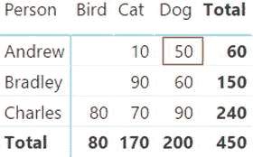
**图 3-3** 在数据透视表中使用的表 3-1 数据集

以下是用于在数据透视表中生成这些值的计算度量：

```dax
Sum of Value = SUM( Table1[Value] )
```

让我们逐步讲解一个筛选上下文的示例。首先，以数据最顶行中高亮显示的单元格（图 3-3）为例，该单元格显示值为 50。这是与“安德鲁”和“狗”交叉处的值。

计算从一个不包含任何列筛选器的空筛选上下文开始。如果筛选上下文保持这种状态，`SUM` 函数就可以访问表 3-1 中 `[Value]` 列的每一行，并输出 450。

该计算度量位于一个数据透视表中，该表在行标题 `[Person]` 上有一个字段，在列标题 `[Pet]` 上有一个字段，因此在计算执行 `SUM` 函数之前，会向筛选上下文添加两个基于列的筛选器。第一个基于列的筛选器是 `Table1[Person]` 必须为“安德鲁”（参见图 3-4）。这意味着筛选上下文现在有了一个基于列的筛选规则。

**表 3-2** 对 `[Person]` 列应用筛选后的表 3-1 数据集

| 人员   | 宠物 | 值   |
|--------|------|------|
| 安德鲁 | 猫   | 10   |
| 安德鲁 | 狗   | 20   |
| 安德鲁 | 狗   | 30   |

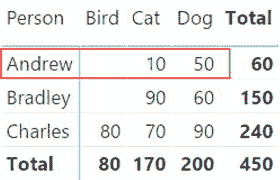
**图 3-4** 显示“安德鲁”的隐式列筛选规则

筛选上下文对数据的影响是，`[Value]` 列现在已缩减为仅三行数据，如表 3-2 所示，如果保持这种状态，`SUM` 函数将返回 60。

要添加到筛选上下文的第二个基于列的筛选器是 `Table1[Pet]` 必须为“狗”。这意味着筛选上下文现在有两个基于列的筛选规则（参见图 3-5）。这会将 `Value` 列中的行减少到仅两行（表 3-3）。

**表 3-3** 对 `[Person]` 和 `[Pet]` 列应用筛选后的表 3-1 数据集

| 人员   | 宠物 | 值   |
|--------|------|------|
| 安德鲁 | 狗   | 20   |
| 安德鲁 | 狗   | 30   |

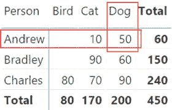
**图 3-5** 显示“安德鲁”和“狗”的隐式列筛选规则

筛选上下文已完成，`SUM` 函数现在可以累加 `[Value]` 列中的所有值。结果得到值 50，即先前在图 3-3 中高亮显示的数字。

通过 DAX 计算中的代码，也可以向筛选上下文添加或从中移除基于列的筛选器。这被称为显式筛选上下文，我们接下来将讨论它。

### 显式筛选上下文

显式筛选上下文指计算中专门向筛选上下文添加或从中移除列筛选规则的代码。显式筛选上下文在隐式上下文和行上下文之后应用，允许你以行上下文和查询上下文无法做到的方式自定义，有时甚至完全覆盖度量的默认行为。你可以使用像 `FILTER` 这样的 DAX 函数来应用筛选上下文。

有几个函数允许你控制最终暴露给计算的数据，从而影响结果。这些函数，如 `ALL`、`ALLEXCEPT` 和 `ALLSELECTED`，将在专门讨论筛选函数的第 6 章中介绍。你可以使用它们来应用或忽略任何已经存在的组合外部筛选器，从而对 DAX 表达式使用的数据进行精细控制。

让我们从一个使用 `WorldWideImportersDW` 数据的简单示例开始。我们创建一个计算，显示 `[Quantity]` 的 `SUM`，但仅限于颜色为红色的库存商品。

你可以通过两种方式来实现。你可以创建一个计算列或一个计算度量。两者表现出不同的行为，你将在此处看到。

计算列的 DAX 可能如下所示：

```dax
Filter on Red as Column = CALCULATE(
    SUM('Fact Sale'[Quantity]),
    'Dimension Stock Item'[Color]="Red"
)
```

而计算度量的 DAX 可能如下所示：

```dax
Filter on Red as Measure = CALCULATE(
    SUM('Fact Sale'[Quantity]),
    'Dimension Stock Item'[Color] = "Red"
)
```

除了计算的名称和类型之外，两者使用的表达式是相同的。然而，这些计算的行为并不相同，这是由于上下文不同所致。

这两个计算都是在 `'Fact Sale'` 表上创建的，并在另一个表的列上指定了筛选条件。之所以可行，是因为你在数据模型中定义了 `'Fact Sale'` 表和 `'Dimension Stock Item'` 表之间的关系。

这两个计算都通过 `CALCULATE` 函数调用筛选函数，这是应用筛选的最简单方法之一。

这两个计算都被添加到一个数据透视表中（图 3-6），同时还有一个未筛选的隐式度量，用于显示数量列的总和。

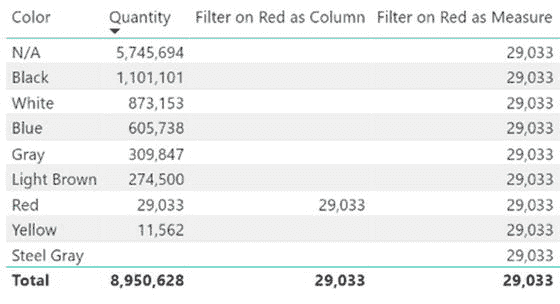
**图 3-6** 使用 `[Filter on Red as Column]` 和 `[Filter on Red as Measure]` 显示输出的数据透视表

# DAX计算与上下文详解

第一列名为`Quantity`，是来自`'Fact Sale'`表的`[Quantity]`字段。这不是我们的计算之一；而是添加到数据透视表中以提供基线值作为两个计算参考的字段。

由于此列使用数值数据类型，因此默认的`SUM`汇总行为被隐式应用于这些结果，并且应用于这些结果的唯一上下文是来自数据透视表行和列标题的查询上下文。

生成此行为不需要 DAX。数据模型的一个列属性允许你为数值列定义默认汇总方式。如果未定义默认值，数据模型会假定`SUM`是默认行为。

数据透视表中的下一列是使用名为`[Filter on Red as Column]`的计算列的隐式度量，该列仅在行标题为“Red”的行上显示一个值。最后一列是`[Filter on Red as Measure]`列，该列重复显示值 29,033，包括在最后一行，这是一个未按颜色筛选的“总计”行。

## 计算列

我们来看看`[Filter on Red as Column]`这个计算列发生了什么。在这个例子中，我们使用了`CALCULATE`函数。我们使用这个函数的一个显式筛选表达式来指定一个规则，即`'Dimension Stock Item'[Color]`必须为“Red”。

`SUM`函数不理解行上下文，因此`CALCULATE`函数会自动将行上下文转换为筛选上下文，这使得`SUM`函数能够访问其所需的数据来完成计算。请参阅本章末尾的“上下文转换”，其中对此进行了更详细的解释。

该计算在数据被读取到数据模型时进行评估，并且对于`'Fact Sales'`表中的每一行，都会计算该计算，并将结果作为新列的值返回。`'Dimension Stock Item'[Color]`必须为“Red”的显式规则会在每次执行计算时被添加到筛选上下文中。

`'Fact Sales'`表有 228,265 行，因此逻辑上，这个计算会被计算 228,265 次，每次计算只能访问其当前行或相关行的信息。

筛选上下文中没有添加或删除其他任何内容，因此，如果`'Fact Sales'`表中的某一行恰好是红色的库存项，则该计算返回`[Quantity]`列的`SUM`，否则返回空白。

`SUM`函数需要一个传递给它的列来生成一个值。在所有 228,265 行的每一次计算中，`SUM`函数都使用一个由筛选上下文筛选过的`'Fact Sale'[Quantity]`列。

一旦计算列被添加到模型中，数据就会在“数据视图”中可见。这表明只有部分行在`[Filter on Red as Column]`列中有值。这些行属于颜色为“Red”的库存项。该数据集中的大多数行都将具有空白值。

在图 3-7 中，两行高亮显示的行在最后一列显示了值，而其他行则显示空白单元格。这是该计算列被计算的唯一一次，这也解释了为什么当该列被添加到数据透视表时，表中显示的结果仅针对行标题为“Red”的数据。

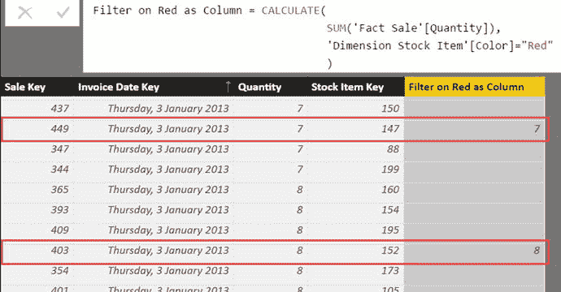

**图 3-7** 包含新`[Filter on Red as Column]`计算列的`'Fact Sale'`表示例

> **注意：** 在使用`CALCULATE`函数的计算列上设置默认汇总无效。`CALCULATE`函数中使用的表达式决定了每个单元格（包括总计）的结果。

`[Filter on Red as Column]`计算列仅应用了一个非常基本的筛选。DAX 中提供了一系列筛选函数，允许您设置更复杂的筛选行为，我将在后续章节中介绍这一点。

当您将该计算列拖到数据透视表时，会生成一个隐式计算度量，并由数据透视表使用。

## 计算度量

让我们看一下图 3-8 中数据透视表的最后一列，该列使用了`[Filter on Red as Measure]`计算度量。现在，它在行标题为“Red”以外的值的行上返回了值，并且最底部的行返回的值与列中上方的值相同。您可能期望最后一列中显示的值至少是该列值的总计。

尽管用于计算度量和计算列的公式完全相同，但区别在于上下文。当计算列被计算时，每个单独的计算都具有行上下文，并且在逻辑上被计算 228,625 次。

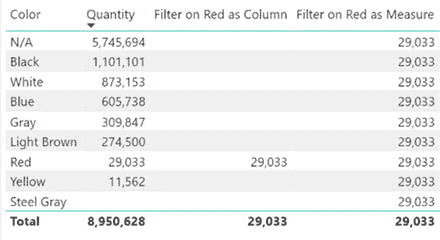

**图 3-8** 使用`[Filter on Red as Column]`和`[Filter on Red as Measure]`显示输出的数据透视表

对于此视觉对象，计算度量仅计算了十次：数据透视表中每个具有行标题的单元格一次（九种不同的颜色），以及底部总计行一次。当计算度量被评估时，没有行上下文。每次计算都从一个空的筛选上下文开始。

DAX 是如何得出每次执行此计算度量时值为 29,033 的呢？

对于前九行，每次执行都会向空的筛选上下文中添加一个基于列隐式筛选的规则。此隐式筛选规则来自表中的第一列，并规定`'Dimension Stock Item'[Color]`列中的值必须与相应行标题的值匹配。

然而，该计算度量中也使用相同的列编码了一个显式列筛选规则。这会替换隐式筛选规则，这意味着筛选上下文在该列上仍然有一个单列筛选规则，但现在使用的是显式定义的规则。

底部行的计算没有向其筛选上下文中添加基于列的隐式规则，但在运行其`SUM`函数之前，它仍然向其筛选上下文中添加了显式列筛选。因此，它返回的值与其上方的值相同。

一旦筛选上下文最终确定，它就会包含一个针对`'Dimension Stock Item'[Color]`列的单列筛选规则。`SUM`函数现在使用`[Quantity]`列中存留的值返回 29,033。当这对数据透视表列中的每个单元格重复执行时，即使对于总计行，您都会得到相同的结果。

这看起来可能有些奇怪，但希望它有助于您理解筛选上下文是如何影响核心计算的。

如果您感兴趣，清单 3-5 显示了我们的计算度量对应的 T-SQL 等价代码。

```sql
SELECT
SUM ( F.[Quantity] ) AS [Filter on Red as Measure]
FROM FACT.Sale AS F
LEFT OUTER JOIN Dimension.[Stock Item] AS D
ON F.[Stock Item Key]=D.[Stock Item Key]
WHERE
D.[Color] = 'Red';
```

**清单 3-5** DAX 计算度量的 T-SQL 版本

如果您将此 T-SQL 查询运行十次（每个单元格一次），每次都会得到相同的 29,033 结果。

清单 3-5 中的 T-SQL 使用了`LEFT OUTER JOIN`。这也是 DAX 在此特定情况下会使用的联接类型。请注意，根据筛选器和 DAX 的不同，有时这可能是`INNER JOIN`。

## 硬编码示例

筛选上下文的另一个示例是对计算列和计算度量都进行硬编码以返回值 1。

考虑以下两个计算。第一个是计算列，第二个是计算度量：

```dax
Hardcoded Calculated Column = 1
Hardcoded Calculated Measure = 1
```

当我们将这两个计算添加到同一个数据透视表时，会得到图 3-9 所示的结果。

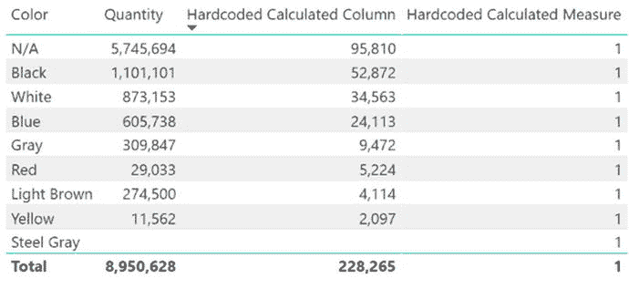

**图 3-9** 使用硬编码值显示计算的数据透视表

正如预期，计算列执行了 228,265 次，并为每一行返回值 1。当添加到数据透视表时，会使用默认的`SUM`汇总行为生成一个隐式计算度量。此隐式度量的筛选上下文从数据透视表的第一列接收到一个列筛选规则。这是一种生成`ROWCOUNT`度量的迂回方式。

硬编码计算度量需要为十个单元格生成值，因此逻辑上，它会计算这个简单的计算十次。结果如图所示，每个单元格（包括总计）中都出现了硬编码值 1。

# 行上下文

行上下文在创建计算列或在迭代器函数内执行代码时生效。正如计算度量值对数据透视表或报表视觉对象中的每个单元格执行逻辑计算一样，计算列也会执行逻辑计算，以生成计算列中每一行的值。如果你向一个包含 250 行的表添加计算列，则该计算将被执行 250 次。每次执行都拥有略微不同的行上下文。

计算列和计算度量值的一个关键区别在于计算发生的时间点。计算列在其创建或修改时，以及数据被物理加载或刷新到数据模型之后进行计算；而计算度量值则会在任何可能影响其值的筛选器发生变化时重新计算。

行上下文允许计算快速访问当前表中同一行的值，或通过关系访问相关表行中可能存在的值。

使用 WideWorldImportersDW 数据集（图 3-10）的一个简单行上下文示例是，创建一个计算列，该列返回基于`[Unit Price]`和`[Quantity]`列相乘的结果。

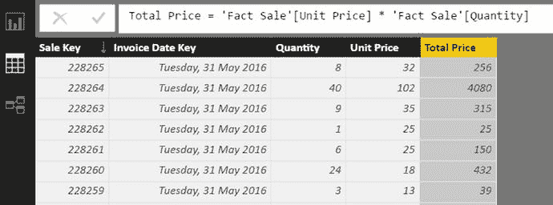

图 3-10 包含新计算列的 `'Fact Sale'` 示例

图 3-10 显示了一个名为`[Total Price]`的新计算列，该列在其计算中使用来自同一行的`[Unit Price]`和`[Quantity]`列来生成每个结果。

图 3-10 中的第一行在`[Total Price]`列中生成了值 256，这是 8 * 32 的结果。

数据一旦被加载或刷新，该值便无法更改。如果你有大量计算列和许多行，数据加载/刷新所需的时间会更长。向模型添加计算列的另一个影响是需要额外的内存来存储计算结果。任何使用计算列数据的附加计算都将这些值视为由外部数据源提供。

如果你的数据模型中定义了关系，你可以使用`RELATED`函数从其他表访问列，以便在计算列的公式中使用。

一个示例是向 `'Fact Sale'` 表添加一个计算列，该列根据 `'Fact Sale'` 表中的数量信息估算每行的重量，并将其与 `'Dimension Stock Item'` 表中的 `[Typical Weight Per Unit]` 列相结合。该计算列的公式使用两个表中的数据来生成结果。

图 3-11 突出显示了每个表中 `[Stock Item Key]` 列之间的关系。

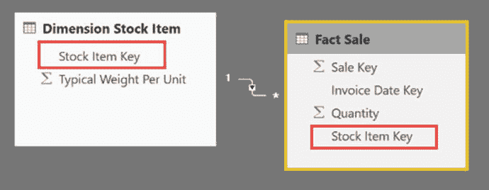

图 3-11：'Dimension Stock Item' 和 'Fact Sale' 之间的关系视图

当以下计算列被添加到 `'Fact Sale'` 表时，它演示了行上下文：

```
Estimated Weight =
'Fact Sale'[Quantity] *
RELATED(
'Dimension Stock Item'[Typical Weight Per Unit]
)
```

你可以在图 3-12 的数据视图中看到新的计算列。

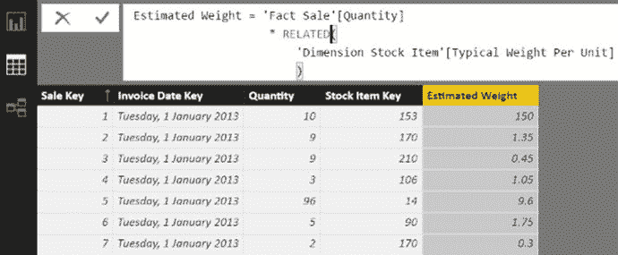

图 3-12：包含新计算列的 'Fact Sale' 示例输出

只有在使用 `RELATED` 函数后，IntelliSense 才会建议 `'Dimension Stock Item'` 表中的列。数据模型中的关系有助于控制 IntelliSense 提供的对象。

此计算的 T-SQL 等效操作是为每一行执行以下命令，尽管 `S.[Stock Item Key]` 会被硬编码为关系中定义的列的值：

```
SELECT TOP 1
S.[Quantity] * D.[Typical Weight Per Unit] AS [Estimated Weight]
FROM FACT.Sale AS S
LEFT OUTER JOIN Dimension.[Stock Item] AS D
ON D.[Stock Item Key] = S.[Stock Item Key]
```

**注意**

计算列无法使用当前行 +/-1 指令访问当前行上方或下方的数据。

虽然此说明并不完全正确，但它并不像你在其他语言中可能遇到的那样直接。你可以在使用显式 DAX 函数（如`FILTER`）的计算中访问表中其他行的数据，我将在第 6 章中将其作为更高级的案例进行介绍。

假设加载表时没有排序的概念，因此无法保证上下行的顺序。一旦一行被读取并分解以填充数据加载过程中的各种列索引，该行就会被丢弃。

在需要时，逻辑上重建行是可能的，但这可能会在计算上非常昂贵，特别是当表有很多列时。

## 迭代器

多个 DAX 函数基于列索引中存储的信息重建行。这些被称为迭代器，或 X 函数，因为这些函数通常以字母 X 作为函数名的最后一个字符。以下是一些迭代器函数：

- `AVERAGEX`：计算在表上评估的一组表达式的平均值（算术平均数）。
- `COUNTAX`：计算对表的每一行评估表达式所产生的值的数量。
- `COUNTX`：计算对表的每一行评估表达式所产生的值的数量。
- `GEOMEANX`：返回表中表达式值的几何平均值。
- `MAXX`：返回对表的每一行评估表达式所产生的最大数值。
- `MEDIANX`：返回表中表达式值的第 50 个百分位数。
- `MINX`：返回对表的每一行评估表达式所产生的最小数值。
- `PRODUCTX`：返回表中表达式值的乘积。
- `RANKX`：返回在当前上下文中评估的表达式在指定表每行的值列表中的排名。
- `SUMX`：返回对表中每一行评估的表达式的总和。
- `FILTER`：返回经过筛选的表。

迭代器是对于传递给函数的任何表中的每一行处理一次的函数。处理过程可以是一个计算，或者对于 `FILTER` 而言，它应用一组布尔规则来筛选其使用的表，从而返回一个筛选后的表。

迭代器可以嵌套多次。每个迭代器实例都保持自己的一组行上下文。嵌套迭代器中的表达式可以访问来自外部迭代器的行上下文中的值。这些通常被描述为等同于你在其他语言中可能看到的内层和外层循环：

```
foreach (row outer in TableA)
{
    foreach (row inner in TableB)
    {
        return expression;
    }
}
```

迭代器允许你解决使用`SUM`、`COUNT`或`AVERAGE`等函数难以解决的复杂数据问题，但它们可能会增加 CPU 处理负载。

**注意**

`SUM`/`COUNT`/`AVERAGE` 只是 `SUMX`/`COUNTX`/`AVERAGEX` 的语法糖。对于单列的情况，使用 `SUM('Table'[Column])` 相比于 `SUMX('Table', [Column])` 并无性能优势。

### DAX 中数据的存储方式

理解 DAX 上下文的另一种方式是考虑底层引擎在导入数据后如何存储数据。以这种方式看待上下文，或许能帮助你理解不同类型的上下文对你的计算施加的顺序和影响。

你的源数据通常以行或行批次的形式存储。每一行可能包含许多列、字段或属性。当你将数据导入 DAX 模型时，数据源会被逐行读取到数据模型中。

表 3-4 是一个基于美国人口普查局美国人口估计的示例数据集。此处使用的原始数据集仅包含九行数据，且未经聚合。

**表 3-4** 美国人口估计

| 美国州名 | 年龄段 | 2015 年人口 | 2016 年人口 |
| --- | --- | --- | --- |
| 加利福尼亚 | 25 岁以下 | 25,947,866 | 25,748,276 |
| 加利福尼亚 | 50 岁以下 | 26,922,326 | 27,188,676 |
| 加利福尼亚 | 50 岁及以上 | 24,805,956 | 25,245,954 |
| 佛罗里达 | 25 岁以下 | 11,676,422 | 11,729,046 |
| 佛罗里达 | 50 岁以下 | 12,627,122 | 12,853,344 |
| 佛罗里达 | 50 岁及以上 | 16,049,448 | 16,501,676 |
| 得克萨斯 | 25 岁以下 | 19,885,656 | 20,033,802 |
| 得克萨斯 | 50 岁以下 | 18,700,892 | 19,046,066 |
| 得克萨斯 | 50 岁及以上 | 16,036,504 | 16,412,550 |

当这个数据集被导入 DAX 时，导入引擎会逐行读取并处理数据。添加到此数据集的计算列将确定 2015 年与 2016 年人口之间的差异：

```
Population Difference = 'Population by Age'[2016 Population] - 'Population by Age'[2015 Population]
```

导入第一行时，可以轻松计算该计算列，因为引擎可以访问该行中的每一个值，包括公式中使用的`[2016 Population]`列和`[2015 Population]`列。计算得到的单一值结果随后会存储在该行的新列中。

该计算未使用任何筛选语句，因此筛选上下文为空。每一行都是独立读取的，因此你无法访问任何其他行中的任何信息（除非通过与其他表的数据模型关系）。

### 列索引

导入过程的下一步是将每一列分解为其自身的数据结构。DAX 为`[US State]`列中的每个值维护一个独立的存储结构，为`[Age Band]`列维护一个单独的数据结构，依此类推。我将这些数据结构称为列索引。数据模型对每个列索引应用了多种类型的压缩算法，我在此不详述，但关键点是每个列索引都保留了足够的信息，以使其能够理解每个值所属的原始行号。

正如我提到的，列索引包含对原始行号的引用，因此，虽然引擎在运行时有可能将行重新拼接起来，但这在性能方面是一项昂贵的操作。DAX 引擎可以使用几个列索引非常快速地计算大多数计算，而无需重建大量完整行。

让我们看一个示例，了解 DAX 如何使用列索引生成结果。假设你想创建一个数据透视表，该表使用九行人口估计数据，并重点关注按`[Age Band]`细分的`[2015 Population]`。数据透视表将如图 3-13 所示。顶部的值 57,509,944 已被高亮显示；它是原来属于加利福尼亚、佛罗里达和得克萨斯的三行底层数据的合计总和。

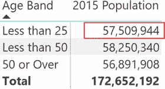

**图 3-13** 使用 `[2015 Population]` 计算度量值的数据透视表

计算度量值的公式很简单。以下是将其创建为显式度量值的 DAX 代码：

```
2015 Population = SUM('Population by Age'[2015 Population])
```

向 `SUM` 函数传递了对 `[2015 Population]` 列的引用。生效的筛选上下文是，`SUM` 只应考虑 `[Age Band]` 值为“Less than 25”（25 岁以下）的行。

在 `SUM` 函数开始之前，引擎首先需要扫描 `[Age Band]` 列索引，以获取其所有值为“Less than 25”的原始行号。这些行号很可能已排序并分组在一起，因此扫描会快速返回一个行号列表，在本例中为第 1、4 和 7 行（表 3-5）。下一步是允许 `SUM` 函数继续执行，但仅针对具有这三个行号的值。

**表 3-5** 按 `[Age Band]` 筛选后 `SUM` 函数使用的行

| 行号 | 年龄段 | 行号 | 2015 年人口 |
| --- | --- | --- | --- |
| 1 | 25 岁以下 | 1 | 25,947,866 |
| 4 | 25 岁以下 | 4 | 11,676,422 |
| 7 | 25 岁以下 | 7 | 19,885,656 |

一旦你获得了第 1、4、7 行的 `[2015 Population]` 值，引擎就可以将值 57,509,944 返回到相应的单元格中（图 3-14）。

对于第二行，重复此过程，但在本例中，从 `[Age Band]` 列索引中检索到的“Less than 50”（50 岁以下）的行号为第 2、5 和 8 行。

然后，计算会确定“50 or Over”（50 岁及以上）值需要第 3、6 和 9 行。

对于最后一行，无需扫描 `[Age Band]` 列索引，因此 `[2015 Population]` 列中的所有值都会被传递给 `SUM` 函数，用于输出 172,652,192。

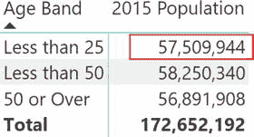

**图 3-14** 使用 `[2015 Population]` 计算度量值的数据透视表

总之，为了计算除了总计行之外的所有数字，引擎只需要访问两个列索引，无需更多。它不需要扫描或读取 `[US State]` 或 `[2016 Population]` 的列索引。最后一行返回的值可以通过仅读取 `[2015 Population]` 来确定。唯一生效的上下文是查询上下文。

底层查询引擎可能会以更高效的方式处理这些步骤，但如果你思考引擎为生成每个单元格的最终值在逻辑上需要什么，这或许有助于理解这三种上下文的影响。

### 上下文转换

有时，你需要将行上下文转换为筛选上下文。这是因为某些 DAX 函数无法识别行上下文。

本章前面的行上下文示例使用了以下公式：

```
Estimated Weight =
'Fact Sale'[Quantity] *
RELATED(
'Dimension Stock Item'[Typical Weight Per Unit]
)
```

此计算未使用 `SUM` 或 `AVERAGE` 等 DAX 函数，因此可以计算出有意义且符合预期的结果。

让我们看看当使用无法识别行上下文的 DAX 函数时会发生什么。为此，请在 `'Fact Sale'` 表中添加以下两个计算列：

```
New Quantity Column 1 = SUM ( 'Fact Sale'[Quantity] )
New Quantity Column 2 = CALCULATE( SUM( 'Fact Sale'[Quantity] ) )
```

两个计算列都使用了 `SUM` 函数，并且引用了相同的列。唯一的区别是，第二个计算列在 `SUM` 函数外层使用了 `CALCULATE` 函数。结果如图 3-15 右侧两列所示。

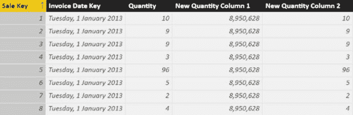

**图 3-15** 显示新计算列的 `'Fact Sale'` 表示例

对于 `[New Quantity Column 1]` 列，可以看到该列每一行的值都重复着 8,950,628。此计算版本每次执行时，筛选上下文都是空的，因此 `SUM` 函数可以访问 `'Fact Sale'[Quantity]` 列中的每一行。

`[New Quantity Column 2]` 列产生了不同的结果，这突显了上下文转换的效果。`CALCULATE` 函数知道自己被用在计算列中，因此它将每一行现有的行上下文转换为基于列的筛选规则，然后将其添加到筛选上下文中。这一次，每次执行 `SUM` 函数时，使用的都是经过高度筛选的 `'Fact Sale'[Quantity]` 列版本。

上下文转换只能将行上下文转换为筛选上下文。上下文永远不会反向转换。

# 4. 汇总与聚合

在数据建模中，一个常见的需求是生成现有表的汇总版本。本章探讨 DAX 中可用的一些选项。

你可能有多种理由考虑在数据模型中添加汇总表。如果使用得当，汇总表可以极大地提高性能。一个由数百万行交易记录组成、每天有数千行数据的大表，非常适合创建一个可能每天只有一行的汇总表。指标可以在聚合时计算并存储为列，以提供大部分原本需要对原始数据进行的相同报告。只要你只需要按天、月或年进行绘图，使用此类汇总表的可视化对象会快得多。

需要注意的是，当你创建这样的汇总表时，将无法对汇总表中未包含的任何聚合级别进行交叉筛选。但通过一些思考和规划，你可以优化 Power BI 报表，为最终用户提供更好的体验。

汇总表的其他用途可能有助于理解数据集中的某些行为特征；例如，客户首次和/或最后一次购买的时间，可以通过在购买日期列上使用 `MIN` 和 `MAX` 函数来获取。你可以将生成的汇总表连接回原始表，作为一种根据每个客户可能不同的首次/最后一次购买日期动态筛选记录的巧妙方法。你还可以使用汇总表，通过分组和排序结合的方式，找出销售额排名前十的产品。

以下是能够创建汇总表的主要 DAX 函数：

- `SUMMARIZE`
- `SUMMARIZECOLUMNS`
- `GROUPBY`

本章将更详细地介绍这些函数，并涵盖它们之间的差异，同时给出在不同情况下如何选择使用的建议。对于小型数据集上的简单示例，它们实际上可以互换使用。然而，对于使用较大数据集的更复杂场景，选择正确的函数可以产生显著差异。

这些汇总函数都返回一个新表作为输出。它们经常被用作部分计算表表达式中的主函数，以及计算度量内部复杂工作逻辑的一部分。

这些函数的相似之处在于，你可以指定用于分组依据的列。如果未指定列，则函数只返回一个单行表。如果使用一列进行分组，则行数反映该列中唯一值的总数。随着添加更多列，行数可能会增加，但并不总是如此。向已按日历天分组的汇总函数添加日历月列，并不会在最终输出中增加任何行。

只要关系定义得当，用于分组的列可以跨多个表存在。这些通常是“上游”表，也可以称为 DAX 关系中“一端”的表。

我将使用同一个示例来演示每个汇总函数。这些示例都使用 WideWorldImportersDW 数据集，并在包含 228,265 行的 `'Fact Sale'` 表上创建汇总，按 `[State Province]` 和 `[Calendar Month]` 列进行分组。每个汇总表中都添加了一个聚合列，该列对 `'Fact Sale'[Quantity]` 列进行求和。

列表 4-1 显示了与此对应的 T-SQL 语句：

```
SELECT
[Date].[Calendar Month Label],
[City].[State Province],
SUM(Sale.Quantity) AS [Sum of Qty]
FROM [Fact].[Sale] AS [Sale]
INNER JOIN [Dimension].[Date] AS [Date]
ON [Date].[Date] = Sale.[Delivery Date Key]
INNER JOIN [Dimension].[City] AS [City]
ON [City].[City Key] = Sale.[City Key]
GROUP BY
[Date].[Calendar Month Label],
[City].[State Province]
```

**列表 4-1** T-SQL 基线示例

由此产生的表包含 2,008 行，相比于近 25 万行的原始表，比例达到了 111:1，或者说，新表的大小不到原始表的 1%。

在报表中使用此汇总表的任何可视化对象，生成值时所需的工作量都更少。如果报表仅按 `[Calendar Month Label]` 或 `[State Province]` 字段进行筛选，那么这是件好事。但是，如果你需要表示其他级别的筛选，那么请考虑修改此汇总表或创建额外的汇总表。

# `SUMMARIZE` 函数

我们首先来看 `SUMMARIZE` 函数。该函数的调用语法如下：

```
SUMMARIZE (<table>, <groupBy_columnName> [, <groupBy_columnName>]..., [<name>, <expression>]...)
```

第一个必填参数是 `<table>` 的值。这可以是模型中任何现有表的名称，其中可以包括其他计算表。它也可以是一个返回表的函数，或存储在变量中的表表达式。你只能提供一个表。

**注意：** 不能在同一语句中对另一个 `SUMMARIZE` 函数的输出使用聚合函数。如果需要进行多层聚合，需要使用 `GROUPBY` 函数，否则应创建两个表语句。

第二个参数可以是第一个参数所指定表中的任何列名，也可以是数据模型中已定义关系的任何表中的列。你可以继续将列引用作为第三、第四和第五个参数（以此类推）传递。DAX 引擎足够智能，能够根据传递给函数的值的类型判断该做什么。只要你继续传递表列，函数就会知道这些是你想要分组的列。

如果你不想传递任何列引用，也可以不传。如果你的意图只是将基表分组为单行，你可以在第一个参数之后立即开始提供 `<name>` 和 `<expression>` 对。

一旦你停止传递表列，就可以开始向函数添加参数对。这些参数对以文本值和 DAX 表达式的形式存在。`<name>` 值是用于设置列名的文本。你需要将文本用双引号括起来。这对参数中的另一个是 `<expression>` 值，它是一个有效的 DAX 计算。这是汇总表的聚合部分。此示例使用单个 `<name>`/`<expression>` 参数对，但与 `<groupBy_columnName>` 参数一样，只要参数符合 `<name>`/`<expression>` 的格式，就可以传递更多参数。

清单 4-2 中的示例已按便于理解的方式进行了格式化。

```
使用 SUMMARIZE 的汇总表 =
SUMMARIZE(
-- 要汇总的表 --
'Fact Sale',
-- 用于分组的列 --
'Dimension Date'[Calendar Month Label],
'Dimension City'[State Province],
-- 聚合列 --
"数量之和",SUM('Fact Sale'[Quantity])
)
```

**清单 4-2** – 使用 `SUMMARIZE` 函数的 DAX 示例

让我们将此示例中的参数映射回语法规范，以便你了解函数的工作原理（表 4-1）。

**表 4-1** – `SUMMARIZE` 函数的语法映射

| 语法 | 示例 |
| --- | --- |
| `<table>` | `'Fact Sale'` |
| `<groupBy_columnName1>` | `'Dimension Date'[Calendar Month Label]` |
| `<groupBy_columnName2>` | `'Dimension City'[State Province]` |
| `<name1>`, `<expression1>` | `"数量之和"` , `SUM('Fact Sale'[Quantity])` |

`SUMMARIZE` 函数返回一个新表，该表在外观上与数据模型中的任何其他表无异。你可以将此表用于视觉对象和筛选器，并可以将其与其他表建立关联。你可以添加计算列和计算度量值。现在，你还可以使用 `SUMMARIZE` 函数输出所创建的表作为基表来创建计算表，以便在附加数据上创建第二层聚合。

图 4-1 的结果中左上角行有一个空白值。这意味着 `'Fact Sale'` 表中有些记录在 `[Delivery Date Key]` 列中没有值，或者此列中的某些值在 `'Dimension Date'[Date]` 列中不存在。这些记录会保留在结果集中，在此图中你可以看到原始 `Quantity` 列的 SUM 值累加到 790。

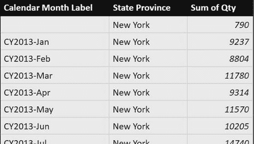

**图 4-1** – 使用 `SUMMARIZE` 函数的示例输出

更好地了解无日期行的一种方法是通过 `<name>`/`<expression>` 对向汇总表添加一个额外的聚合列，如下所示：

```
"行计数", COUNTROWS('Fact Sale')
```

这将在计算表中添加第四列，该列显示每个分组的行数，可能提供关于不匹配可能影响多少条记录的额外信息。

或者，你可以使用 `FILTER` 函数生成一个计算表，显示 `'Fact Sale'[Invoice Date Key]` 列中所有在 `'Dimension Date'[Date]` 列中没有对应值的值。其代码可能如下所示：

```
缺失数据表 =
FILTER(
'Fact Sale',
ISBLANK(
RELATED('Dimension Date'[Date])
)
)
```

这将在模型中生成一个新的计算表，它是 `'Fact Sale'` 的筛选副本，并且仅包含在 `'Dimension Date'` 表中没有匹配行的行。

这个有用的调试技术的结果是，`'Fact Sale'` 中有 284 条记录在 `[Delivery Date Key]` 列中具有空白值。这些可能代表尚未交付的近期销售。

这提供了一个等效于 T-SQL `LEFT JOIN` 查询的 DAX 方法，用于识别左表中没有右查询匹配值/行的值/行。

一旦数据问题调查工作完成，就可以删除这个已创建的计算表。

## 关系

此示例没有为 `SUMMARIZE` 函数提供任何关于如何将 `'Fact Sale'` 表与 `'Dimension Date'` 和 `'Dimension City'` 表连接的信息，但该函数仍然能够使用跨越三个表的列按我们想要的方式准确地对数据进行分组。在 T-SQL 语句中，我们使用 `ON` 和 `WHERE` 子句提供如何连接表的提示，而 DAX 引擎使用关系机制在查询时确定如何连接表。

在本例中，数据模型在 `'Fact Sales'` 表和 `'Dimension Date'` 表之间定义了现有关系。此关系指定 `'Fact Sale'` 表中的 `[Delivery Date Key]` 列与 `'Dimension Date'` 表中的 `[Date]` 列相关联。

此计算中涉及的另一个关系是 `'Fact Sale'` 表与 `'Dimension City'` 表之间使用两侧的 `[City Key]` 列建立的关系。`SUMMARIZE` 函数会自动使用活动关系来构建所需的查询。

在 DAX 中，可以在相同的两个表之间定义多个关系。任何时候只能有一个关系是活动的，而哪个关系是活动的决策需要由数据模型的作者手动设置。默认使用的是活动关系，在本例中，该关系使用 `[Invoice Date Key]` 列将 `'Fact Sale'` 表与 `'Dimension Date'` 表连接起来。

### 替代关系

如果你想使用相同的列创建汇总表，但希望基于不同的日期列（例如 `[Invoice Date Key]`）来聚合 `Fact Sale` 数据，你可以手动编辑 `Fact Sales` 和 `Dimension Date` 之间的现有关系，以指定合适的关系作为活动关系；或者，你可以用另一种方式编写计算表公式，以利用替代关系。请记住，在 DAX 中，当你编写涉及多个表的公式时，标记为 `Active` 的关系是默认使用的活动关系。

清单 4-3 展示了如果你想使用某个非活动关系时，计算表的样子。你的数据模型中，在 `Fact Sale[Invoice Date Key]` 和 `Dimension Date[Date]` 之间存在一个非活动关系。

```
Summary Table using SUMMARIZE =
CALCULATETABLE(
SUMMARIZE(
-- 要汇总的表
'Fact Sale',
-- 要分组的列
'Dimension Date'[Calendar Month Label],
'Dimension City'[State Province],
-- 聚合列
"Sum of Qty",SUM('Fact Sale'[Quantity])
),
USERELATIONSHIP(
'Fact Sale'[Invoice Date Key],
'Dimension Date'[Date])
)
清单 4-3
使用 USERELATIONSHIP 函数的 SUMMARIZE
```

这里，你将原始的 DAX 表达式封装在 `CALCULATETABLE` 函数中。这允许使用一个筛选函数。第一个参数与你之前使用的计算中的参数相同。`CALCULATETABLE` 函数的第二个参数是 `USERELATIONSHIP` 筛选函数，它指示 DAX 引擎使用 `[Invoice Date Key]` 列连接 `Fact Sale` 和 `Dimension Date`。

此查询的结果显示了相同的三列，但这一次，`[Sum of Qty]` 列的结果代表的是发票日期而非交货日期。这种方法确实依赖于存在一条关系，即使是非活动关系。如果 `Fact Sale` 和 `Dimension Date` 之间没有通过 `[Invoice Date Key]` 建立关系，则计算表不会被加载到表中。

以某种方式将这点融入到新计算表的名称中可能会很有用，这有助于最终用户理解数据是如何被聚合的。

## 带筛选条件的 SUMMARIZE

在清单 4-4 中，我们通过将筛选条件合并到计算表的逻辑中，来扩展这个示例。

添加一个筛选条件，将用于汇总表的底层数据限制为特定的销售区域。另一个增强功能是在输出中添加一列，该列执行一个基本计算以表示平均数量。

```
Summary Table using SUMMARIZE (Southwest) =
SUMMARIZE(
-- 要汇总的表
FILTER('Fact Sale',RELATED('Dimension City'[Sales Territory]) = "Southwest"),
-- 要分组的列
'Dimension Date'[Calendar Month Label],
'Dimension City'[State Province],
-- 聚合列
"Sum of Qty",SUM('Fact Sale'[Quantity]),
"Average Qty", DIVIDE(
SUM('Fact Sale'[Quantity]),
COUNTROWS('Fact Sale')
)
)
清单 4-4
使用筛选条件的 SUMMARIZE 函数
```

为了将筛选条件纳入计算，第一个参数中使用的 `Fact Sale` 表被包装在 `FILTER` 函数中。`FILTER` 函数使用 `RELATED` 函数对 `Dimension City[Sales Territory]` 列应用一个硬编码的筛选条件。另一个增强功能是为聚合列添加了额外的 `<名称>` / `<表达式>`，这展示了如何在一个表达式中使用多个聚合函数（`SUM` 和 `COUNTROWS`）来获得稍微复杂的结果。

另一种合并显式筛选谓词的方法是使用 `CALCULATETABLE` 函数，如清单 4-5 所示。

```
Summary Table using SUMMARIZE (Southwest) =
CALCULATETABLE(
SUMMARIZE(
-- 要汇总的表
'Fact Sale',
-- 要分组的列 --
'Dimension Date'[Calendar Month Label],
'Dimension City'[State Province],
-- 聚合列 --
"Sum of Qty",SUM('Fact Sale'[Quantity]),
"Average Qty", DIVIDE(
SUM('Fact Sale'[Quantity]),
COUNTROWS('Fact Sale')
)
),
'Dimension City'[Sales Territory] = "Southwest"
)
清单 4-5
使用 CALCULATETABLE 进行筛选的 SUMMARIZE
```

为了将筛选条件纳入此计算，使用了 `CALCULATETABLE` 函数。第一个参数是我们在清单 4-4 中使用的 `SUMMARIZE` 函数。传递给 `CALCULATETABLE` 函数的第二个参数是一个基本的筛选语句。这个筛选条件意味着计算仅使用与此谓词匹配的数据；这很像在 T-SQL 查询的 `WHERE` 子句中包含类似语句。

## SUMMARIZECOLUMNS 函数

你可以在 DAX 中用来聚合表的另一个函数是 `SUMMARIZECOLUMNS` 函数。这个较新的函数在语法上稍微有些不同。其语法如下：

```
SUMMARIZECOLUMNS(
...,
...,
, ...
)
```

就像使用 `SUMMARIZE` 函数一样，你可以向此函数传递动态数量的参数。如果第一个参数是对列的引用，`SUMMARIZECOLUMNS` 函数会理解这是你想要分组的列。如果你继续传递列引用，该函数会将其视为额外的分组指令。

一旦你传递了一个 `FILTER` 函数（或字符串值），该函数就会理解这些引用是用于对聚合应用筛选条件，或者是开始添加将作为 DAX 表达式（如 `SUM`、`COUNT`、`MIN` 等）结果的列。

使用此语法，使用 `SUMMARIZECOLUMNS` 创建场景的 DAX 如清单 4-6 所示。

```
Summary Table using SUMMARIZECOLUMNS =
SUMMARIZECOLUMNS(
-- 要分组的列
'Dimension Date'[Calendar Month Label],
'Dimension City'[State Province],
-- 聚合列
"Sum of Qty",SUM('Fact Sale'[Quantity])
)
清单 4-6
使用 SUMMARIZECOLUMNS 的 DAX 示例
```

本示例中的 `SUMMARIZECOLUMNS` 函数与清单 4-4 中的 `SUMMARIZE` 示例之间的区别在于 `SUMMARIZE` 函数中缺少了第一个参数。此函数无需传递基础表；然而，结果却是相同的。该函数还可以使用来自不同但相关表的列进行分组。DAX 引擎可以使用 `Fact Sales` 表与两个维度表之间的活动关系来返回所需的结果。

### 带筛选条件的 SUMMARIZECOLUMNS

`SUMMARIZE` 与 `SUMMARIZECOLUMNS` 之间的另一个区别在于，后者可以将筛选条件作为参数之一。使用相同的要求，清单 4-7 进行了汇总和聚合，但只针对 `[Sales Territory]` 为 “SouthWest” 的数据。

```
Summary Table using SUMMARIZECOLUMNS (Southwest) =
SUMMARIZECOLUMNS(
-- 要分组的列 --
'Dimension Date'[Calendar Month Label],
'Dimension City'[State Province],
-- 筛选条件 --
FILTER(
ALL(
'Dimension City'[Sales Territory]),
'Dimension City'[Sales Territory] = "Southwest"
),
-- 聚合列
"Sum of Qty",SUM('Fact Sale'[Quantity])
)
清单 4-7
使用筛选条件的 SUMMARIZECOLUMNS 函数
```

该计算产生了与使用 `SUMMARIZE` 函数的示例（清单 4-4）相同的 164 行结果；但是，无需再使用 `CALCULATETABLE` 函数作为纳入筛选条件的手段。如果你愿意，仍然可以将 `SUMMARIZE` 函数包装在 `CALCULATETABLE` 函数内，并且如果你使用的是 `WideWorldImportersDW` 数据集提供的数据，那么在查询运行时间方面，各种方法之间差异极小。

在底层，`SUMMARIZETABLE` 函数执行的步骤似乎比 `SUMMARIZE` 函数要少；我们将在第 8 章中更详细地探讨这种类型的分析。

# GROUPBY 函数

最后一个要介绍的聚合函数是 `GROUPBY` 函数，其语法如下：

```
GROUPBY(<Table>, <GroupBy_ColumnName1>, ..., <Expression1>, ...)
```

`GROUPBY` 在语法上类似于 `SUMMARIZE` 函数，同样地，一旦你提供单个表引用作为第一个参数，就可以传递任意数量的列引用，让 `GROUPBY` 函数知道哪些列定义汇总的层级。

`GROUPBY` 与 `SUMMARIZE` 和 `SUMMARIZECOLUMNS` 的不同之处在于作为 `<expression>` 参数一部分传递给函数的代码。`GROUPBY` 仅适用于 DAX 迭代器函数，因此它使用 `SUMX` 而非 `SUM`，使用 `AVERAGEX` 而非 `AVERAGE`。这使得 `GROUPBY` 函数在特定场景下非常有用。

如果你想要一个计算表使用 `GROUPBY` 函数生成与 `SUMMARIZE` 和 `SUMMARIZECOLUMNS` 示例相同的输出，可以编写如清单 4-8 所示的代码。

```
Summary Table using GROUPBY =
GROUPBY(
-- 要分组的表 --
'Fact Sale',
-- 用于分组依据的列 --
'Dimension Date'[Calendar Month Label],
'Dimension City'[State Province],
-- 聚合列 --
"Sum of Qty",SUMX( CURRENTGROUP(),'Fact Sale'[Quantity] )
)
Listing 4-8
使用 GROUPBY 函数的 DAX 示例
```

这段代码在最后一行添加聚合列之前，与 `SUMMARIZE` 几乎相同。这里的 DAX 表达式使用了 `SUMX` 函数而不是 `SUM` 函数。`SUMX` 函数通常需要将表引用作为第一个参数传递，但此处传递的是 `CURRENTGROUP` 函数。当 `GROUPBY` 函数被引入 DAX 时，它附带了一个名为 `CURRENTGROUP()` 的辅助函数，可用于代替原始表。

## CURRENTGROUP() 函数

DAX 迭代器函数通常需要将表引用作为第一个参数传递。然而，当像此处这样在 `GROUPBY` 函数内部使用时，`SUMX` 函数必须传递 `CURRENTGROUP()` 函数；任何其他值都会产生错误。

可以将 `CURRENTGROUP()` 函数的位置理解为映射回作为 `GROUPBY` 函数第一个参数传递的表。在本例中，传递的表是 `'Fact Sale'`，因此 `SUMX` 函数实际上是处理来自 `'Fact Sale'` 表的行。

前面清单 4-8 中的查询与之前使用 `SUMMARIZE` 和 `SUMMARIZECOLUMNS` 的示例生成相同的输出；然而，在速度测试中并排运行这三个 DAX 函数的结果如表 4-2 所示。

**表 4-2**
使用汇总函数的示例的执行时间（毫秒）

| DAX 函数 | 平均时间（毫秒） |
| --- | --- |
| `SUMMARIZE` | 40 |
| `SUMMARIZECOLUMNS` | 35 |
| `GROUPBY` | 130 |

这些结果基于相同的输入和输出，通过这个非常简单的示例可以看出，`SUMMARIZECOLUMNS` 比 `SUMMARIZE` 略快，而 `GROUPBY` 则慢得多。

这表明，对于小型和简单的操作，这三种函数实际上可以互换使用，你不太需要担心哪个最好用。然而，你可能会更倾向于使用 `SUMMARIZE` 或 `SUMMARIZECOLUMNS`，仅仅因为它们的语法稍简单，并且你无需处理迭代器/`CURRENTGROUP` 的要求。

你可能会疑惑，既然 `GROUPBY` 速度更慢且语法更复杂，它到底有什么用途。

我重点介绍的两个用途是它的迭代器功能以及在同一操作中执行多重分组的能力。

## GROUPBY 迭代器

由于 `GROUPBY` 函数使用 DAX 迭代器函数（如 `SUMX`、`AVERAGEX`、`MINX` 等），它可以解锁这些函数相对于标准聚合函数的优势，让你能够执行涉及同其他行数据的计算。

一个演示此用途的示例是扩展聚合，使其成为涉及多列的计算。此版本将 `[Quantity]` 和 `[Unit Price]` 值相乘，生成 `[Total Price]` 的值，然后可以对这些值求和。

修改后的代码如清单 4-9 所示。

```
Summary Table using GROUPBY =
GROUPBY(
-- 要分组的表 --
'Fact Sale',
-- 用于分组依据的列 --
'Dimension Date'[Calendar Month Label],
'Dimension City'[State Province],
-- 聚合列 --
"Sum of Total Price",SUMX(
CURRENTGROUP(),
'Fact Sale'[Quantity] * 'Fact Sale'[Unit Price])
)
Listing 4-9
在 GROUPBY 函数内部使用的 SUMX 函数
```

无需太多改动，该函数现在就能生成一个结果，允许你对每行中的多列求和。唯一的改动是在代码的最后一行。`<name>` 值已更改为显示“Sum of Total Price”。这对计算没有影响，只是良好的代码管理习惯。主要改动在 `SUMX` 函数内部；现在你可以编写包含同一行中多列的 DAX 表达式——在此例中，`'Fact Sale'[Quantity] * 'Fact Sale'[Unit Price]` 被添加到 `<expression>` 中。因此，通过一个对计算的微小改动，你可以解锁一些有趣的场景，并且在这种情况下，对整体查询时间的影响几乎可以忽略不计。

`SUMMARIZE` 和 `SUMMARIZECOLUMNS` 也可以使用迭代器函数对同一行中的多列进行计算。使用 `SUMMARIZECOLUMNS` 的等效计算如清单 4-10 所示。

```
Summary Table using SUMMARIZECOLUMNS and SUMX =
SUMMARIZECOLUMNS(
-- 用于分组依据的列 --
'Dimension Date'[Calendar Month Label],
'Dimension City'[State Province],
-- 聚合列 --
"Sum of Total Price",SUMX(
'Fact Sale',
'Fact Sale'[Quantity] * 'Fact Sale'[Unit Price])
)
Listing 4-10
在 SUMMARIZECOLUMNS 中使用 SUMX 函数的示例
```

**注意**
请警惕一个常见误区：认为 `SUMX(col1 * col2)` 等同于 `SUM(col1) * SUM(col2)`。这两者会产生截然不同的结果。这是互联网帮助论坛上，尤其是关于小计/总计行问题中常见的困惑来源。

这个示例可以进一步扩展，在同一计算中使用相关表中的列。如果 `'Dimension City'` 表有一个名为 `[Weighting]` 的列，其中包含每个城市的乘数，那么只要 `'Fact Sale'` 表和 `'Dimension City'` 表之间存在有效且活跃的关系，你就可以将 `SUMX` 函数扩展为如下形式：

```
SUMX(
CURRENTGROUP(),
'Fact Sale'[Quantity] * 'Fact Sale'[Unit Price] * RELATED('Dimension City'[Weighting])
)
```

注意，这里使用了 `RELATED` 函数，以便在计算中查找并使用 `[Weighting]` 列的值。

好的，作为高级文档工程师和翻译员，我将遵循您的注意事项和示例，将给定的英文文本翻译成中文。

### GROUPBY 双重聚合

`GROUPBY` 的另一个特性是能够在单个语句中执行多层聚合。为了初步了解这一点，让我们使用表 4-3 中的数据集。

表 4-3

用于演示双重分组简单数据集

| 类别 | 值 |
| --- | --- |
| A | 1 |
| A | 2 |
| A | 3 |
| B | 4 |
| B | 5 |
| C | 6 |
| C | 7 |

面临的挑战是，获取表 4-3 中的数据，找到每个类别的最高值，然后将这些值相加，为该表生成单个输出。结果应为 3 + 5 + 7 = 15，因为类别 A 的最大值是 3，类别 B 的最大值是 5，类别 C 的最大值是 7。这涉及两层聚合。第一层是找到一个组的 `MAX` 值，第二层是对 `MAX` 操作的结果进行 `SUM` 求和。

`SUMMARIZE`、`SUMMARIZECOLUMNS` 和 `GROUPBY` 函数都能轻松完成需求的第一部分，即为每个类别生成一个包含最大值的三行聚合表。

下一步就难倒了 `SUMMARIZE` 和 `SUMMARIZECOLUMNS` 函数，因为无法在同一个语句中对这些函数进行分层或嵌套，而使用 `GROUPBY` 则可以。

使用 `GROUPBY` 满足此需求的计算如代码清单 4-11 所示。

```
Table =
GROUPBY (
GROUPBY (
'table1',
Table1[Category],
"My Max", MAXX ( CURRENTGROUP (), 'Table1'[Value] )
)
"Sum of Max values", SUMX ( CURRENTGROUP (), [My Max] )
)
代码清单 4-11
使用两层汇总的计算表
```

此计算中包含两个 `GROUPBY` 语句。我将第一个 `GROUPBY` 称为外部 `GROUPBY`，而代码清单 4-11 中突出显示的第二个 `GROUPBY` 称为内部 `GROUPBY`。

在此示例中，首先计算内部 `GROUPBY`，它返回一个表作为输出。外部 `GROUPBY` 将此输出作为第一个参数，用于对数据集执行第二层聚合。

`CURRENTGROUP()` 函数在此计算中出现了两次，这个双重分组示例能更清晰地说明此函数的行为。每个 `CURRENTGROUP()` 实例都与一个相关的 `GROUPBY` 函数配对。突出显示部分中的 `CURRENTGROUP()` 与 `MAXX` 迭代函数一起使用，作为对 `'Table1'` 的引用；而最后一行中的 `CURRENTGROUP()` 函数则是作为对内部 `GROUPBY` 函数输出的引用。

本示例本可以使用 `SUMMARIZE` 或 `SUMMARIZECOLUMNS` 函数来代替内部的 `GROUPBY`，但只有 `GROUPBY` 才能用作外层汇总。

在这个例子中，最好使用 `SUMMARIZE` 或 `SUMMARIZECOLUMNS` 作为内层汇总，因为这样可以满足需求，而无需使用迭代函数。

在计算中引入变量也有助于提高代码的可读性；代码清单 4-12 展示了其中一种写法。

```
Table =
VAR myInnerGroup =
SUMMARIZECOLUMNS (
Table1[Category],
"My Max",
MAX ('table1'[Value])
)
RETURN
GROUPBY(
myInnerGroup,
"Sum of max values",
SUMX (
CURRENTGROUP (), [My Max]
)
)
代码清单 4-12
使用两层汇总的计算表的改进版本
```

当你将基于迭代器的函数的强大功能与 `GROUPBY` 的多层分组能力相结合时，很快就会发现，尽管在某些场景下可能需要额外的时间，但它在处理更复杂的场景时是一个非常实用的汇总函数。

## 带筛选条件的 `GROUPBY`

与之前的函数一样，我们来看看如何将筛选条件应用于 `GROUPBY` 函数。与 `SUMMARIZECOLUMNS` 不同，`GROUPBY` 的参数签名中没有专门用于传递筛选条件的位置。代码清单 4-13 展示了一对示例中的第一个，该示例将主示例限制在 `'Dimension City'[Sales Territory] = "Southwest"` 的条件下。

```
GROUPBY(
-- 要分组的表 --
FILTER('Fact Sale',RELATED('Dimension City'[Sales Territory])="Southwest"),
-- 分组依据的列 --
'Dimension Date'[Calendar Month Label],
'Dimension City'[State Province],
-- 聚合列 --
"Sum of Qty",SUMX(CURRENTGROUP(),'Fact Sale'[Quantity])
)
代码清单 4-13
使用筛选条件的 GROUPBY 函数
```

代码清单 4-13 使用 `FILTER` 函数作为 `GROUPBY` 函数的第一个参数。`FILTER` 函数返回一个表，这就是它能够代替特定表使用的原因。

代码清单 4-14 展示了一种使用 `CALCULATETABLE` 函数的替代写法。

```
CALCULATETABLE(
GROUPBY(
-- 要分组的表 --
'Fact Sale',
-- 分组依据的列 --
'Dimension Date'[Calendar Month Label],
'Dimension City'[State Province],
-- 聚合列 --
"Sum of Qty",SUMX(CURRENTGROUP(),'Fact Sale'[Quantity])
),
FILTER('Dimension City',[Sales Territory]="Southwest")
)
代码清单 4-14
使用 CALCULATETABLE 对 GROUPBY 进行筛选的示例
```

这里，筛选条件应用于 `GROUPBY` 函数外部，并作为 `CALCULATETABLE` 的一个参数。这与第一个示例略有不同，它不需要使用 `RELATED` 函数来使跨表筛选器生效。两个查询产生相同的输出，并且在 WideWorldImportersDW 所使用的数据量下，两种方法在性能上几乎没有区别，这主要是由于所使用的聚合函数本身很简单。

注意：这两个示例都对物理表使用了 `GROUPBY`。在使用物理表时，您应该优先考虑使用 `SUMMARIZE` 和 `SUMMARIZECOLUMNS`。此处提供的示例旨在演示，在需要时，如何将筛选条件应用于 `GROUPBY` 函数。

## 小计与合计行

这些汇总函数的稍高级用法是能够以分类小计和总计的形式向输出结果中注入额外的行。在 Microsoft Power BI 中编写 DAX 计算时，这通常不是必需的要求，因为 Power BI 在生成视觉对象背后的动态 DAX 时，会利用这些函数来生成合计。

如果你正使用 SQL Server Management Studio (SSMS)、DAX Studio、SQL Server Reporting Services (SSRS) 或其他客户端工具，通过 `SUMMARIZE` 函数编写 DAX 语句，则可以添加 `ROLLUP`、`ROLLUPGROUP` 和 `ISSUBTOTAL` 函数来向输出结果注入额外的行和信息。这些查询在 Power BI 中也能使用，但你可能需要对其进行筛选，以免与 Power BI 可能添加的额外代码发生混淆。

我们沿用之前示例中的同一张表，这里再次展示，并新增了一个名为 `Sub Category` 的列。这次，你将按 `Category` 和/或 `Sub Category` 对数据进行分组，并显示 `Value` 列的总和。此外，你还会在输出结果中包含分类小计行和总计行。

**表 4-4**：用于演示双重分组的简单数据集

| Category | Sub Category | Value |
| --- | --- | --- |
| A | A1 | 1 |
| A | A1 | 2 |
| A | A2 | 3 |
| B | B1 | 4 |
| B | B2 | 5 |
| C | C1 | 6 |
| C | C2 | 7 |

此示例使用 `SUMMARIZE` 函数按 `Category` 列对数据进行分组，并包含一条指令，用于向输出结果添加一个额外的行，以承载总计数值。

该查询的第一个版本如下：

```
SUMMARIZE (
table1,
ROLLUP ( 'table1'[Category]),
"Sum of Value", SUM ( 'table1'[Value] )
)
```

此计算的输出结果如表 4-5 所示。

**表 4-5**：`SUMMARIZE` 函数的输出

| [Category] | [Sum of Value] |
| --- | --- |
| A | 6 |
| B | 9 |
| C | 13 |
|   | 28 |

底部的行在 `Category` 列中没有值，并显示了其他行的总和值。这是因计算中加入了 `ROLLUP` 函数而添加的额外行。

最后一行显示的值受该列使用的聚合函数影响，在此例中为 `SUM`。添加两个分别使用 `MAX` 和 `AVERAGE` 聚合函数的列，有助于展示 `ROLLUP` 行的行为（列表 4-15）及输出（表 4-6）。

**表 4-6**：使用 `ROLLUP` 的 `SUMMARIZE` 函数输出

| [Category] | [Sum of Value] | [Max of Value] | [Average of Value] |
| --- | --- | --- | --- |
| A | 6 | 3 | 2.0 |
| B | 9 | 5 | 4.5 |
| C | 13 | 7 | 6.5 |
|   | 28 | 7 | 4.0 |

```
SUMMARIZE (
table1,
ROLLUP ( 'table1'[Category]),
"Sum of Value", SUM ( 'table1'[Value] ),
"Max of Value", MAX ( 'table1'[Value] ),
"Average of Value", FIXED ( AVERAGE ( 'table1'[Value] ), 1 )
)
```

`[Max of Value]` 列底部单元格中的值 7 并非 `SUM` 函数的结果；它继承了该列表达式中使用的默认聚合行为。在此例中，它显示的是底层 `'Table1'[Value]` 列中的最高值。

`[Average of Value]` 列底部行的值表明：`ROLLUP` 函数是对原始数据进行聚合运算，而非对其上方显示三个数值求平均值。如果它是平均值的平均值，该数值应为 4.3。

表达式中包裹 `AVERAGE` 函数的 `FIXED` 函数指定了输出结果应显示为指定的小数位数。此示例使用了一位小数。

### `ISSUBTOTAL` 函数

您可以在计算中添加一个列，以帮助识别通过 `ROLLUP` 函数添加了哪些行。为此，请将 `ISSUBTOTAL` 函数添加到聚合列的表达式，如下所示：

```
SUMMARIZE (
table1,
ROLLUP ( 'table1'[Category]),
"Sum of Value", SUM ( 'table1'[Value] ),
"Is Category Subtotal", ISSUBTOTAL('table1'[Category])
)
```

该计算的输出见表 4-7。

**表 4-7** 使用 `ISSUBTOTAL` 的 `SUMMARIZE` 函数输出

| [Category] | [Sum of Value] | [Is Category Subtotal] |
| --- | --- | --- |
| A | 6 | False |
| B | 9 | False |
| C | 13 | False |
| | 28 | True |

此计算现在包含一个包含 `true`/`false` 值的列，有助于识别由于 `ROLLUP` 函数而添加到输出中的行。在此示例中，如表 4-7 所示，只有最底部的行在该列中携带值为 `true`。

当使用 `ROLLUP` 向 `SUMMARIZE` 函数引入额外的分组层时，`ISSUBTOTAL` 函数变得更加有用。清单 4-16 使用 `SUMMARIZE` 函数创建了一个按两列分组的汇总表（表 4-8）。

**表 4-8** 使用额外 `ROLLUP` 参数的 `SUMMARIZE` 输出

| [Category] | [Sub Category] | [Sum of Value] | [Is Cat Sub Total] | [Is Sub Cat Subtotal] |
| --- | --- | --- | --- | --- |
| A | A1 | 3 | False | False |
| A | A2 | 3 | False | False |
| B | B1 | 4 | False | False |
| B | B2 | 5 | False | False |
| C | C1 | 6 | False | False |
| C | C2 | 7 | False | False |
| A | | 6 | False | True |
| B | | 9 | False | True |
| C | | 13 | False | True |
| | | 28 | True | True |

```
SUMMARIZE (
table1,
ROLLUP ( 'table1'[Category], 'table1'[Sub Category] ),
"Sum of Value", SUM ( 'table1'[Value] ),

"Is Cat SubTotal", ISSUBTOTAL('table1'[Category]),
"Is Sub Cat SubTotal", ISSUBTOTAL('table1'[Sub Category])
)
清单 4-16
使用额外 ROLLUP 参数的 SUMMARIZE
```

在此，您向 `ROLLUP` 函数引入了一个额外参数，该参数告知 `SUMMARIZE` 函数现在按两列而不是一列进行分组。这添加了一个 `[Sub Category]` 列，同时还添加了 `Category` 分组上的三个额外小计行。

通过使用 `ISSUBTOTAL` 函数在 `[Sub Category]` 列的表达式上添加了一个名为 `[Is Sub Cat Subtotal]` 的额外聚合列，以显示 `true` 或 `false` 值。如果此列中的值为 `false`，则该行不是 `[Sub Category]` 列的小计行。如果值为 `true`，则表示该行是为提供小计值而添加的。

`[Category]` 的每个小计行具有以下特征：
- `[Category]` 列填充有值。
- `[Sub Category]` 列为空。
- `[Sum of Value]` 列携带该类别基础行的默认聚合结果。
- `[Is Cat Subtotal]` 列为 `false`。
- `[Is Sub Cat Subtotal]` 列为 `true`。

输出的最后一行恰好是总计行。它具有与 `[Category]` 小计行相同的特征，但以下除外：
- `[Category]` 列为空。
- `[Is Cat Subtotal]` 列为 `true`。

这表明，通过结合使用 `ROLLUP` 和 `ISSUBTOTAL`，您可以使用附加信息增强输出，这在某些场景中可能很有用。当将 `SUMMARIZE` 与 `ROLLUPGROUP` 函数一起使用时，您可以添加额外的功能，与 `ROLLUP` 结合使用时，可以合并小计，从而实现对最终输出的更精细控制。

`ROLLUP` 和 `ISSUBTOTAL` 函数仅设计用于与 `SUMMARIZE` 函数一起使用。当您向输出添加行以显示总计时，`SUMMARIZECOLUMNS` 函数使用一组单独的函数。要强调的主要函数是 `ROLLUPADDISSUBTOTAL` 函数，它被设计用于 `SUMMARIZECOLUMNS`。

清单 4-17 使用 `SUMMARIZECOLUMNS` 产生与清单 4-16 相同的输出。

```
SUMMARIZECOLUMNS (
ROLLUPADDISSUBTOTAL (
Table1[Category], "Is Cat Sub Total",
Table1[Sub Category], "Is Sub Cat SubTotal"
),
"Sum of Value", SUM ( Table1[Value] )
)
清单 4-17
将 SUMMARIZECOLUMNS 与 ROLLUPADDISSUBTOTAL 一起使用
```

请注意，即使获得相同数量的行和列，其语法也比 `SUMMARIZE` 更简单。此外，`ROLLUPADDISSUBTOTAL` 可以多次使用，并结合 `ROLLUPGROUP` 函数，以提供对小计和小计分组的丰富控制。

## 联接

### DAX 中的联接

本章探讨了在不必然使用关系机制的情况下，在计算中利用和合并不同表数据的选项。

计算中经常使用多个表的数据。大多数场景可以通过数据模型中定义的标准表关系自动涵盖，但并非所有情况都如此。如果需要更高的灵活性，可以使用多个支持联接表的 DAX 函数。如果您习惯编写 T-SQL 查询，其中一些函数会为您提供熟悉的体验。本章我重点介绍相似之处和不同之处。

以下是涵盖的函数：
- `GENERATE` 和 `CROSSJOIN`
- `NATURALINNERJOIN`
- `NATURALLEFTOUTERJOIN`
- `UNION`
- `LOOKUPVALUE`

#### 标准关系

如果您的数据模型包含多个表，则可以使用标准的 DAX 关系机制定义表之间基于规则的链接。DAX 关系是两个表之间的链接，定义了关系应如何工作的规则。计算会自动利用这些预定义的关系，这可以在编写大多数计算时简化所需的代码量。

标准的 DAX 关系机制存在一些局限性，在某些场景下无法生效。

关系必须符合以下规则：
- 关系只能是**一对一**或**一对多**。
- 每个表只能使用单列。
- 匹配条件必须是 `=` 运算符的精确匹配，不能基于其他运算符，例如 `>`、`>=`、`<` 或 `<=` 等。
- 不能使用自联接。两个表必须是不同的表。

##### 关系只能是一对一或一对多

这意味着，对于关系涉及的至少一个表，用于关系的列中，表的每一行都必须包含唯一值。这被称为“关系中的一端表”。

表中多行存在的相同值被视为重复值，并会产生错误。这是未来数据加载时需要留意的一点。成功创建的关系可确认当前数据集符合要求。然而，未来的数据加载可能会引入重复数据，从而在刷新期间产生错误。

一对多关系的一个常见示例是维度表和事实表之间的关系，例如 `Dimension Date` 和 `Fact Sale`。日期表每天包含一行，在 `[Date]` 列中具有唯一值。这满足了关系一端表的要求，而 `Fact Sale` 表可能有多行，在关系使用的列中包含相同的日期。

这是数据建模中的常见模式。事实（或事件）表通常与维度（或查找）表定义关系。事实表可能对同一日期、客户或地点包含多行，而单独的表中每个日期、客户或地点只包含一行。这些表通常位于任何关系的一端。

你也可以将关系的一端表视为筛选表。这些表是报告中用作切片器和筛选器基础的理想选择。在这些切片器上所做的选择会通过关系传播到多端连接的任何相关表，并适当地筛选事实数据。这种方法非常适合分析和报告，这种模式通常被描述为对数据应用星型架构。维度表可以与多个事实表建立关系。这允许筛选选择应用于模型中数据的大部分区域。

筛选器仅沿着从一端表到多端表的方向应用。这意味着使用 `Fact Sale` 表中列的切片器不会自动应用于使用 `Dimension Date` 表中数据的计算。

一对一关系与一对多关系的不同之处在于，每个表中涉及的列必须具有唯一值。这种关系有效地创建了一个单一的逻辑表，或者在 T-SQL 中，是对两个表进行全外连接。

##### 每个表只能使用单个列

无法使用每个表多于一列来定义关系。如果你在数据中遇到需要强制使用多列数据建立关系的情况，可以创建一个新列，将这些列连接成一个单一值，然后用于关系，只要新列仍然满足用于一端的任何表具有唯一值的规则即可。

使用这种方法时，要小心避免来自两个不同值的组合产生相同结果，从而导致键冲突。组合值 `AB` 和 `CDE` 会产生与组合 `ABC` 和 `DE` 相同的结果。在这种情况下，使用不常见的分隔符应能降低键冲突的风险，例如，`AB` 和 `#` 及 `CDE` 现在会与 `ABC` 和 `#` 及 `DE` 不同。

##### 匹配条件必须是精确匹配

关系中所涉及表之间使用的默认运算符是 `=` 运算符。这意味着，要匹配行，关系仅配对两个表中涉及列的值完全匹配的行。当你处理看起来相似的值时，这可能会成为一个陷阱。

可以在关系一侧使用 `Date` 数据类型列的表，而在另一侧使用 `DateTime` 数据类型的表之间创建一对多（或一对一）关系。只有在使用 `DateTime` 数据类型的列中表示午夜的值才可能匹配使用 `Date` 数据类型的列中的值。当你有两个表的数据看起来应该匹配，但尽管没有出现错误，视觉对象显示的数据却比你预期少时，这可能会令人困惑。

在这种情况下，考虑将使用 `DateTime` 数据类型的表列转换为使用 `Date` 类型。如果时间部分很重要，你可以使用第二个仅包含时间部分的列来满足大多数报告需求。

另一种常见的解决方案是创建一个仅包含日期部分的计算列，然后使用该计算列创建关系。

这种行为适用于大多数场景，但有时你可能希望使用不止 `=` 运算符在表之间创建匹配。有时，当你需要连接跨越一系列值的行时，使用 `>=` 或 `<=` 运算符会很有用。一个示例可能是，对于表中的每一行，你需要在另一个表中找到处于第一行某个时间段内（例如前 14 天）的行。

### 不能使用自连接

你无法创建从一个表连接到自身的表关系。这种关系对于表示层次结构（例如包含员工数据的表中的员工/经理场景）非常有用。

员工和经理可以作为同一表中的不同行存在，使用 `EmployeeID` 和 `ManagerID` 等列中的值来帮助连接这两行。DAX 中提供了 `PATH` 和 `PATHITEM` 函数，有助于在计算列内提供这些数据结构的扁平化视图。

有人曾向我描述这种关系为猪耳朵关系。并非因为它被认为是一种混乱的数据建模技术，而是因为你在任何表关系图中绘制线条/箭头的方式。当围绕代表表的方框顶角绘制时，箭头看起来像一只耳朵。

其他自连接关系可能有助于在比较场景中查找表中特定行之前或之后的行。

## 如何在无关系的情况下联接表

现在你已经了解了内置关系机制的一些限制，让我们探索 DAX 中提供的一些函数，以帮助我们在标准关系无法处理的情况下进行工作。

### `CROSSJOIN` 和 `GENERATE` 函数

我最喜欢且最常用的连接表函数可能是 `GENERATE` 和 `CROSSJOIN` 函数。当您将它们与 DAX `FILTER` 函数结合使用时，它们具有类似 T-SQL 中 `INNER JOIN` 的感觉和表现行为。

#### `CROSSJOIN`

`CROSSJOIN` 函数的基本语法如下。

```
CROSSJOIN ( <Table1>, <Table2> [, <TableN>]... )
```

最少需要传递两个表，但你可以添加额外的表。结果会产生笛卡尔效应，其中第一个表中的每一行都与第二个表中的每一行匹配。然后，前两个表连接后的每一行再与第三个表中的每一行匹配。这可以快速生成一个包含许多行的表输出。

`CROSSJOIN` 函数的输出是一个表。如果你使用的是支持使用计算表的 DAX 版本，则可以将此表用作计算表，或者在 DAX 计算中用作表表达式。

如果第一个参数中使用的表有 10 行，第二个表也有 10 行，则未筛选的输出是 100 行。如果另一个表也有 10 行，那么未筛选的输出现在就是 1000 行。这相当于以下 T-SQL 语句：

```
SELECT
*
FROM TableA
CROSS JOIN TableB
```

或者对于阅读本书的老派人士：

```
SELECT * FROM TableA, TableB
```

这些 T-SQL 语句产生相同的结果。两者都没有 `WHERE` 子句来将最终输出的行数缩小到 `TableA` 的行数 × `TableB` 的行数。

#### `GENERATE`

`GENERATE`的基础语法如下：

```
GENERATE ( <Table1>, <Table2> )
```

这与`CROSSJOIN`不同之处在于，`GENERATE`只能使用两个表，否则输出的是作为参数传递的表的完整笛卡尔积。这两个参数必须是不同的表。

**注意**

当你计划使用`FILTER`函数时，请使用`GENERATE`，而不是`CROSSJOIN`。

让我使用以下两个不相关的表（`表 5-1` 和 `5-2`）来演示`GENERATE`函数的行为。

**`表 5-2`**

要用作`TableB`的数据集

| Make | Model | Year | Index |
| --- | --- | --- | --- |
| Toyota | Corolla | 2018 | 100 |
| Toyota | Corolla | 2018 | 200 |
| Hyundai | Elantra | 2019 | 300 |
| Hyundai | Elantra | 2019 | 400 |
| Ford | Focus | 2018 | 500 |
| Ford | Focus | 2019 | 600 |

**`表 5-1`**

要用作`TableA`的数据集

| ID | Make | Model | Value |
| --- | --- | --- | --- |
| 1 | Toyota | Corolla | 10 |
| 2 | Hyundai | Elantra | 20 |
| 3 | Ford | Focus | 30 |

让我们从一个简单的查询开始。一个用于显示`GENERATE`函数结果总行数的计算度量如下所示：

```
My Count of Rows =
COUNTROWS(
    GENERATE('TableA','TableB')
)
```

这将返回值 18，这是 `TableA` 的三行乘以 `TableB` 的六行得到的结果。

可以更新此计算以对`[Make]`列应用连接条件，如`清单 5-1`所示。

```
My Count of Rows =
COUNTROWS(
    GENERATE(
        'TableA',
        FILTER(
            'TableB',
            'TableA'[Make] = 'TableB'[Make]
        )
    )
)
**清单 5-1**
在计算度量中使用带有筛选条件的`GENERATE`
```

`GENERATE`函数现在使用`FILTER`函数作为第二个参数，该参数应用了连接条件。这相当于在 T-SQL 语句的`ON`或`WHERE`子句中提供谓词的 DAX 版本。筛选表达式指定仅返回 `TableA` 和 `TableB` 之间在`[Make]`列中具有匹配值的行。此计算度量的结果是 6。

这也可以通过标准的 DAX 关系来实现。现在，我们在匹配要求中包含第二列`[Model]`，以及一个附加条件——`Year`列中的值应早于 2019。

带有附加筛选条件的新计算如`清单 5-2`所示。

```
My Count of Rows =
COUNTROWS(
    GENERATE(
        'TableA',
        FILTER(
            'TableB',
            'TableA'[Make] = 'TableB'[Make] &&
            'TableA'[Model] = 'TableB'[Model] &&
            'TableB'[Year] < 2019
        )
    )
)
**清单 5-2**
在`GENERATE`函数中使用附加筛选条件
```

`FILTER`函数允许的规则比使用标准 DAX 关系时更为复杂。对于示例数据，此计算度量的结果应为 3。在这个数据集中，我本可以使用`'TableB'[Year] = 2018`来得到相同的结果，但我想强调能够使用除`=`之外的运算符作为匹配条件的能力。

也可以使用关系和以下计算度量生成相同的输出：

```
My Count of Rows =
CALCULATE(
    COUNTROWS('TableA'),
    'TableB'[Year] < 2019
)
```

#### 唯一列名

到目前为止，使用`GENERATE`的示例都能正常工作，是因为它们将输出传递给了`COUNTROWS`函数，该函数仅返回行数的计数。

如果你打算将`GENERATE`函数的输出用作计算表，你很快就会遇到列名的问题。在 DAX 中，物理表和虚拟表中的列名必须是唯一的。`GENERATE`函数的输出包含传递给该函数的所有表中的所有列。不可避免地，其中一些表具有相同的列名。

如果你尝试创建以下计算表：

```
My Table = GENERATE('TableA','TableB')
```

你会遇到类似“名为 [Make] 的列在‘Table’表中已存在”的错误。在此示例中，该错误指的是`[Make]`列的冲突，但也存在两个表中都有的`[Model]`列的问题。

在 T-SQL 中，你使用查询中的`SELECT`子句来控制返回的列名和列数。在 DAX 中，你可以使用`SELECTCOLUMNS`函数来提供类似的功能。该函数的主要用途是允许你从一个表中部分选择某些列，但这里有用的一个附带功能是，它还允许你在此过程中重命名或别名化列。

使用`SELECTCOLUMNS`函数，你可以重命名任一表中的`[Make]`和`[Model]`列，或者，因为你使用的是`=`运算符，你可以选择简单地从其中一个表中删除这些列，因为它们的值应该匹配，你只需要看到一个即可。

`清单 5-3` 和 `5-4` 展示了两个使用`SELECTCOLUMNS`函数来返回无错误结果的示例。

```
My Table =
GENERATE(
    'TableA',
    SELECTCOLUMNS(
        'TableB',
        "My Make", [Make],
        "My Model", [Model],
        "Year", [Year],
        "Index", [Index]
    )
)
**清单 5-3**
将`SELECTCOLUMNS`与`GENERATE`一起使用
```

# DAX中的GENERATE与SELECTCOLUMNS函数应用

在第一个示例中，`GENERATE`函数的第二个参数不再是简单的`'TableB'`，而是被`SELECTCOLUMNS`函数包裹了。该函数根据你传递给它的规则输出一个表格。在第一种情况下，你指示`SELECTCOLUMNS`使用`'TableB'`并返回四个定义为`<名称>/<表达式>`对的列。这就是你如何重命名列以避免在`GENERATE`函数的输出中出现错误的方法。

第二个示例简单地省略了这些列以获得更简洁的效果，并返回一个显示18行的表，这是两个表的完整笛卡尔积。

一个更现实的需求可能是将此与之前的示例结合起来，为在`[Make]`和`[Model]`上匹配且年份在2019之前的行返回一个具有唯一列名的计算表。

其DAX代码如清单5-5所示。

```dax
My Table =
FILTER(
    GENERATE(
        'TableA',
        SELECTCOLUMNS(
            'TableB',
            "My Make", [Make],
            "My Model", [Model],
            "Year", [Year],
            "Index", [Index]
        )
    ),
    [Make] = [My Make] &&
    [Model] = [My Model] &&
    [Year] < 2019
)
```

### `清单 5-5`
组合使用`GENERATE`、`FILTER`和`SELECTCOLUMNS`

这里，`GENERATE`被`FILTER`函数包裹，以允许计算定义在表之间匹配行时使用的规则。内部的`SELECTCOLUMNS`必须为`'TableB'`中的`[Make]`和`[Model]`列返回别名，以便外部的`FILTER`函数能够处理该表。

这突出了一个事实：筛选并非发生在连接过程中，而是发生在`GENERATE`函数输出的单个表上。

此DAX语句（包括对`'TableB'`中列的重命名）的T-SQL等效代码如清单5-6所示。

```sql
SELECT
A.[ID],
A.[Make],
A.[Model],
A.[Value],
B.[Make] AS [My Make],
B.[Model] AS [My Model],
B.[Year],
B.[Index]
FROM TableA AS A
INNER JOIN TableB AS B
ON  A.Make = B.Make
AND A.Model = B.Model
AND B.Year < 2019
```

### `列表 5-6：` DAX示例的T-SQL等效写法

上述DAX和T-SQL语句的输出结果如表5-3所示。

### `表 5-3：` DAX和T-SQL示例的输出结果

| ID | Make    | Model   | Value | My Make | My Model | Year | Index |
|----|---------|---------|-------|---------|----------|------|-------|
| 1  | Toyota  | Corolla | 10    | Toyota  | Corolla  | 2018 | 100   |
| 2  | Hyundai | Elantra | 20    | Hyundai | Elantra  | 2018 | 300   |
| 3  | Ford    | Focus   | 30    | Ford    | Focus    | 2018 | 500   |

为了移除`FILTER`函数所需的冗余列`[My Make]`和`[My Model]`，您可以通过用另一个`SELECTCOLUMNS`语句包裹整个表达式来修改计算。列表5-7展示了使用变量增强可读性的实现方式。

```dax
My Table =
VAR ModifiedTableB =
SELECTCOLUMNS(
'TableB',
"My Make", [Make],
"My Model", [Model],
"Year", [Year],
"Index", [Index]
)
VAR FilteredGENERATE =
FILTER(
GENERATE( 'TableA', ModifiedTableB ),
[Make] = [My Make] &&
[Model] = [My Model] &&
[Year] < 2019
)
RETURN
SELECTCOLUMNS(
FilteredGENERATE,
"ID",[ID],
"Make",[Make],
"Model",[Model],
"Year",[Year],
"Index",[Index]
)
```

### `列表 5-7：` 移除多余列的增强版示例

该计算在最终的`RETURN`步骤中引入了一个`SELECTCOLUMNS`函数，通过将`[My Make]`和`[My Model]`列从`<名称>/<表达式>`配对中排除，从而有效地舍弃了这些列。

如有需要，您可以在`SELECTCOLUMNS`函数中使用比简单引用列名更复杂的表达式。

## 使用 `GENERATE` 进行行扩展

利用`GENERATE`/`FILTER`函数的另一种方式是扩展现有表中的行数，以解决可视化问题。

互联网论坛上经常出现的一个话题是：如何将一个包含混合起始/结束日期的实体表进行处理，并绘制出各实体在起止日期之间任意时刻的活跃数量。

考虑一下表5-4中酒店客房占用率的数据集。该表中日期格式为YYYY-MM-DD。

### `表 5-4：` 用作占用率表的数据集

| ID | Room | Check In   | Check Out  |
|----|------|------------|------------|
| 1  | 101  | 2019-01-01 | 2019-01-02 |
| 2  | 102  | 2019-01-03 | 2019-01-04 |
| 3  | 103  | 2019-01-02 | 2019-01-05 |
| 4  | 101  | 2019-01-02 | 2019-01-05 |

为了创建一个显示每晚有多少房间被占用的可视化图表，一种解决方案是将原始表中的数据扩展，使其包含代表每个房间/每晚组合的行。对于ID为4的占用记录，该房间被占用了三个晚上（从1月2日到1月4日），因此，如果该表中有三行ID为4的数据（而非原始表中的单行），那么将其绘制在可视化图表上的任务将更加容易。

如果模型中有一个日期或日历表，每一行代表一天，且包含示例中涉及的日期，那么您可以使用它来帮助创建所需的行。列表5-8使用动态创建的表作为替代方案。

```dax
Table for Visual =
SELECTCOLUMNS(
FILTER(
GENERATE(
'Occupancies',
CALENDAR("2019-01-01","2019-01-05")
),
[Date] >= [Check In] &&
[Date] < [Check out]
),
"ID", [ID],
"Room", [Room],
"Date", [Date]
)
```

### `列表 5-8：` 将 `GENERATE` 与 `CALENDAR` 函数结合使用

该代码返回表5-5中的三列数据集。

### `表 5-5：` 列表5-8中代码的输出结果

| ID | Room | Date       |
|----|------|------------|
| 1  | 101  | 2019-01-01 |
| 3  | 103  | 2019-01-02 |
| 4  | 101  | 2019-01-02 |
| 2  | 102  | 2019-01-03 |
| 3  | 103  | 2019-01-03 |
| 4  | 101  | 2019-01-03 |
| 3  | 103  | 2019-01-04 |
| 4  | 101  | 2019-01-04 |

如您所见，原始占用率表中ID为4的行现在在新计算表中出现了三次。这正是您想要的行为，当使用功能区图表进行绘制时，可视化图表能够绘制原始`[Check In]`和`[Check Out]`日期之外的其他日期的数值（图5-1）。

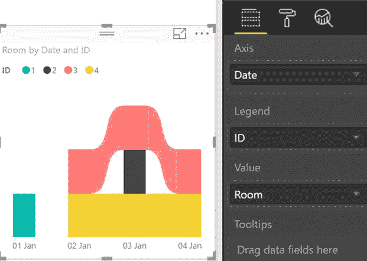

### `图 5-1：` 使用功能区图表可视化图表绘制的列表5-8的输出结果

您可以将此技术应用于表示员工并包含入职/离职日期的表，或任何包含多行重叠起始/结束值的数据集。

# DAX GENERATE 函数详解与示例

在深入拆解各个组成部分之前，我们先来看看等效的 T-SQL 语句是什么样的（列表 5-9）。

```sql
SELECT
Occupancy.[ID],
Occupancy.[Room],
Dates.[Date]
FROM Occupancy AS O
INNER JOIN Dates AS D
ON  D.[Date] >= O.[Check In]
AND D.[Date] < O.[Check Out]
```

**列表 5-9：** 与列表 5-8 中代码等效的 T-SQL 语句

现在回到 DAX 计算，让我们拆解一下，看看每个部分的作用。首先从传递给 `GENERATE` 函数的参数开始。第一个参数很简单，您只需传递您的 `'Occupancies'` 表即可。第二个参数是 DAX 函数 `CALENDAR`。这个便捷的函数会生成一个单列表，包含传递给它的两个日期参数之间的所有日期。

```dax
GENERATE(
'Occupancies',
CALENDAR("2019-01-01","2019-01-05")
),
```

在本例中，两个参数分别是 `"2019-01-01"` 和 `"2019-01-05"`，代表 2019 年 1 月 1 日至 2019 年 1 月 5 日之间的值。这会产生一个包含五行且仅有一列（名为 `[Date]`）的表。您可以使用 `SELECTCOLUMNS` 重命名此列，但在此例中，`GENERATE` 函数中不存在列名冲突，因此您可以保持原样。
您可以使用更大范围的日期，但这样做只会可能让计算生成数据的时间稍长，而这些数据在后续计算中最终会被忽略，因此不会影响计算结果。
此时，`GENERATE` 函数的输出是一个包含 20 行的表。这是将 `'Occupancies'` 表中的 4 行与 `CALENDAR` 函数的表表达式输出中的所有 5 行匹配后得到的笛卡尔积。
接着，这些数据被包裹在 `FILTER` 函数中（列表 5-10），该函数指定了涉及多个列的规则，以帮助决定保留哪些行、舍弃哪些行。对于当前需求，不需要超出每个占用期范围的日期，但如果您想显示房间何时为空，这些数据可能会很有趣。

```dax
FILTER(
GENERATE(
'Occupancies',
CALENDAR("2019-01-01","2019-01-05")
),
[Date] >= [Check In] &&
[Date] < [Check out]
),
```

**列表 5-10：** 来自列表 5-8 的 `FILTER` 部分

筛选函数将 `GENERATE` 函数的表表达式输出作为其第一个参数。然后应用筛选规则，帮助将数据集缩减到只需的行。
此示例凸显了使用 `GENERATE` 函数相比标准表关系的另一个优势。`FILTER` 函数使用了除 `=` 以外的运算符（即 `>=` 和 `<` 运算符），以实现对每个占用期内的行范围进行匹配。
最后，`FILTER` 函数被包裹在 `SELECTCOLUMNS` 函数内部，以控制和命名返回给计算表的各列。

## 使用数字表复制行

`GENERATE` 表助力复制行的另一种类似用途是与包含数字的表进行联接。数字表是一种通用工具表，其中包含单列连续数字，从零开始，一直到对数据模型有意义的某个值。
假设您想要扩展表 5-6，为每一行生成副本，副本数量由 `Factor`（因子）列中的值控制。

**表 5-6** 用作 Table1 表的数据集

| Item（项目） | Factor（因子） |
| --- | --- |
| A | 1 |
| B | 2 |
| C | 3 |

清单 5-11 展示了用于扩展此数据的 DAX 计算表。

```dax
New Table =
ADDCOLUMNS(
    FILTER(
        GENERATE(
            'Table1',
            GENERATESERIES(1,3)
        )
        ,[Factor] <= [Value]
    ),
    "New Col", [Factor] * [Value]
)
```

**清单 5-11** 使用 `GENERATESERIES` 创建行

这将生成表 5-7 中的输出。

**表 5-7** 清单 5-11 代码的输出

| Item（项目） | Factor（因子） | Value（值） | New Col（新列） |
| --- | --- | --- | --- |
| A | 1 | 1 | 1 |
| B | 2 | 1 | 2 |
| B | 2 | 2 | 4 |
| C | 3 | 1 | 3 |
| C | 3 | 2 | 6 |
| C | 3 | 3 | 9 |

要分解此计算，请从内部的 `GENERATE` 函数开始。这与之前的占用示例类似，区别仅在于没有传递 `CALENDAR` 函数，而是使用了 `GENERATESERIES` 函数。此函数生成一个包含一系列整数的单行表。这是 `GENERATESERIES` 的语法：

```dax
GENERATESERIES (<start>, <end> [, <step>])
```

第一个和第二个参数控制数字范围的起始值和结束值。此示例创建了一个仅包含三行的表。第三个参数是可选的，如果未提供（如此示例所示），则默认为 `1`。`GENERATESERIES` 函数本质上是在创建一个动态数字表。
`GENERATESERIES` 于 2017 年 10 月引入，目前并非在所有 DAX 环境中都可用。要在早期版本的 DAX 中复现此功能，请按如下方式使用 `CALENDAR` 函数：

```dax
GENERATE(
    'Table1',
    SELECTCOLUMNS(CALENDAR(1,3),"Value",INT([Date]))
)
```

`GENERATE` 函数输出的表表达式将传递到 `FILTER` 函数，该函数随后应用规则 `[Factor] <= [Value]` 来确定要返回哪些行。
最后，`ADDCOLUMNS` 函数作为 `SELECTCOLUMNS` 的替代方案。在此示例中，您无需处理 `GENERATE` 函数的任何列名冲突，因此可以使用 `ADDCOLUMNS` 将新列附加到所有现有的输出中。此示例还使用了一个涉及多值计算的表达式，以演示如何根据需要纳入更有意义的计算。

## 使用 `GENERATE` 进行自联接

最后一个示例使用 `GENERATE` 执行自联接，并使用一个简化的 `Sales` 表，该表显示客户进行购买的日期。对于每次购买，这里的需求是了解该客户自上次购买以来已经过了多长时间。
该示例使用表 5-8 中的数据集。

**表 5-8** 用作销售表的数据集

| Customer（客户） | Purchase Date（购买日期） |
| --- | --- |
| 1 | 2019-01-01 |
| 1 | 2019-01-07 |
| 1 | 2019-01-21 |
| 1 | 2019-01-25 |
| 2 | 2019-01-05 |
| 2 | 2019-01-12 |
| 2 | 2019-01-17 |
| 2 | 2019-01-22 |

计算表如清单 5-12 所示。

```dax
New Table =
VAR SelfJoin =
    FILTER(
        GENERATE(
            'Sales',
            SELECTCOLUMNS(
                'Sales',
                "xCustomer",[Customer],
                "xPurchase Date",[Purchase Date]
            )
        ),
        [xPurchase Date] < [Purchase Date] &&
        [Customer] = [xCustomer]
    )
VAR LastPurchases =
    GROUPBY(
        SelfJoin,
        Sales[Customer],
        Sales[Purchase Date],
        "Last Purchase",MAXX(
            CURRENTGROUP(),
            [xPurchase Date]
        )
    )
RETURN
    ADDCOLUMNS(
        NATURALLEFTOUTERJOIN('Sales',  LastPurchases),
        "Days since last purchase",
        VAR DaysSince = INT([Purchase Date] - [Last Purchase])
        RETURN IF (
            NOT ISBLANK([Last Purchase]),
            DaysSince
        )
    )
```

**清单 5-12** 使用自联接查找上次购买的计算表

此计算的输出是表 5-9，它显示了原始表（表 5-8）以及两个新列。新列显示了客户上次购买的日期以及一个表示自该次购买以来所经过天数的值。

**表 5-9** 显示清单 5-12 代码输出的数据集

| Customer（客户） | Purchase Date（购买日期） | Last Purchase（上次购买） | Days Since Purchase（距上次购买天数） |
| --- | --- | --- | --- |
| 1 | 2019-01-01 |  |  |
| 1 | 2019-01-07 | 2019-01-01 | 6 |
| 1 | 2019-01-21 | 2019-01-07 | 14 |
| 1 | 2019-01-25 | 2019-01-21 | 4 |
| 2 | 2019-01-05 |  |  |
| 2 | 2019-01-12 | 2019-01-05 | 7 |
| 2 | 2019-01-17 | 2019-01-12 | 5 |
| 2 | 2019-01-22 | 2019-01-17 | 5 |

您可以在各种计算度量中使用 `[Days Since Purchase]`（距上次购买天数）列，以帮助您了解客户行为，例如购买之间的平均时间以及购买之间的最小和最大时间间隔。

# 计算分解说明

要理解此计算，您可以轻松地将清单 5-12 中的代码分解为三个部分，由两个变量声明和最终的 `RETURN`（返回）语句组成。

## 第一个变量

第一个变量的目标是创建一个表表达式，该表达式将八行 `Sales` 表中的每一行与其自身进行联接，匹配所有行，但应用一个筛选器以匹配 `CustomerID`（客户 ID）以及任何之前的购买。

该 `VAR`（变量）语句对应的 T-SQL 等效代码如清单 5-13 所示。

```sql
SELECT
    L.Customer,
    L.[Purchase Date],
    R.Customer AS [xCustomer],
    R.[Purchase Date] AS [xPurchase Date]
INTO #SelfJoin
FROM Sales AS L
INNER JOIN Sales AS R
    ON  R.Customer = L.Customer
    AND R.[Purchase Date] < L.[Purchase Date]
```

**清单 5-13** 清单 5-12 中第一个变量的 T-SQL 等效代码

这会产生一个 12 行的结果，对于某些交易，会找到多个匹配项，因为在此阶段，查询是在查找所有先前的购买。每位客户的第一次购买缺失，因为没有先前的购买记录。此查询的模式与清单 5-7 类似，因为它在联接条件中使用了多列，使用了除 `=` 之外的运算符，最后还使用了 `SELECTCOLUMNS` 来重命名列以避免列名冲突。

至此，最终的 `RETURN` 语句可以简单地返回 `SelfJoin` 变量，以便检查数据的正确性。该变量产生的表表达式并非最终输出，而是为下一个变量准备数据的步骤。

## 第二个变量

`VAR LastPurchases` 语句将 `SelfJoin` 变量汇总为每行对应一个 `[Customer]` 和 `[Purchase Date]` 组合。新增了一个名为“Last Purchase”的聚合列，用于查找 `[xPurchase Date]` 列中的最新值。这标识了上一次购买所需的日期。

由于意图是汇总一个表表达式，而非物理表，因此无法使用 `SUMMARIZE` 或 `SUMMARIZECOLUMNS` 函数。但是，可以使用 `GROUPBY`，并将 `SelfJoin` 变量作为其第一个参数。第二个和第三个参数指定了要分组的列。最后一个参数是一个 DAX 表达式，使用 `MAXX` 迭代器函数为每个组合查找最新值。`CURRENTGROUP()` 函数用于帮助 `MAXX` 函数利用 `SelfJoin` 变量中存储的表表达式。

此时的结果是一个包含六行的表（表 5-10）。这并非最终结果，也不包含每位客户首次购买的任何信息。此结果集需要加回到原始数据中，这将在下一步中完成。

**表 5-10** 来自清单 5-12 的第一个变量的数据集输出

| Customer | Purchase Date | Last Purchase |
| --- | --- | --- |
| 1 | 2019-01-07 | 2019-01-01 |
| 1 | 2019-01-21 | 2019-01-07 |
| 1 | 2019-01-25 | 2019-01-21 |
| 2 | 2019-01-12 | 2019-01-05 |
| 2 | 2019-01-17 | 2019-01-12 |
| 2 | 2019-01-22 | 2019-01-17 |

该语句对应的 T-SQL 等效代码如清单 5-14 所示。

```sql
SELECT
[Customer],
[Purchase Date],
MAX([xPurchase Date]) AS [Last Purchase]
INTO #LastPurchases
FROM #SelfJoin
GROUP BY
[Customer],
[Purchase Date]
```

**清单 5-14** 来自清单 5-12 的第二个变量的 T-SQL 等效代码

## 最后一步

最后一步是获取存储在 `LastPurchases` 变量中的表表达式，并将其与原始表连接。这需要是一个外部半连接，以便保留代表每位客户初始购买的记录。

意图是将原始 `Sales` 表中的每一行与 `LastPurchases` 表表达式中的行进行匹配，当 `[Customer]` 和 `[Purchase Date]` 列都匹配时进行连接。`Sales` 表中无法与 `LastPurchases` 表表达式中的任何行匹配的记录需要被保留。

`GENERATE` 函数不易在表之间提供“左连接”功能。可以通过使用涉及 `FILTER` 和更多 `GROUPBY` 函数的多步骤方法迂回实现，或者使用 `NATURALLEFTOUTERJOIN` 函数来获得所需的结果。

在最终的 `RETURN` 语句中，向 `NATURALLEFTOUTERJOIN` 传递了两个表。第一个是原始的八行 `Sales` 表。第二个是存储在 `LastPurchases` 变量中的六行表表达式。该函数会检查两个表中的所有列，并自动匹配任何具有相同名称和数据类型，以及相同沿袭（稍后详细介绍）的列。

```dax
NATURALLEFTOUTERJOIN('Sales',  LastPurchases)
```

在此示例中，传递给 `NATURALLEFTOUTERJOIN` 的 `Sales` 表和 `LastPurchases` 表都具有 `[Customer]` 和 `[Purchase Date]` 列，并且这些列共享相同的数据类型。这将返回一个三列表（表 5-11），该表仍需填补一个需求。

**表 5-11** 来自清单 5-12 的 `NATURALLEFTOUTERJOIN` 的输出

| Customer | Purchase Date | Last Purchase |
| --- | --- | --- |
| 1 | 2019-01-01 |  |
| 1 | 2019-01-07 | 2019-01-01 |
| 1 | 2019-01-21 | 2019-01-07 |
| 1 | 2019-01-25 | 2019-01-21 |
| 2 | 2019-01-05 |  |
| 2 | 2019-01-12 | 2019-01-05 |
| 2 | 2019-01-17 | 2019-01-12 |
| 2 | 2019-01-22 | 2019-01-17 |

最后的需求是拥有一个列，该列包含一个数字，用于显示每位客户每次购买距离上一次购买过去的天数。这可以通过用 `ADDCOLUMNS` 函数包裹 `NATURALLEFTOUTERJOIN` 函数来实现（清单 5-15）。

```dax
RETURN
ADDCOLUMNS(
NATURALLEFTOUTERJOIN('Sales',  LastPurchases),
"Days since last purchase",
VAR DaysSince = INT([Purchase Date] - [Last Purchase])
RETURN IF (
NOT ISBLANK([Last Purchase]),
DaysSince
)
)
```

**清单 5-15** 来自清单 5-12 的最终 `RETURN` 语句

## 最终输出

`ADDCOLUMNS` 函数向 `NATURALLEFTOUTERJOIN` 函数的输出追加一列。`"Days since last purchase"` 参数为新列提供了名称，而最后一个以嵌套 `VAR` 语句开头的参数则是一个 DAX 表达式，用于返回 `[Purchase Date]` 和 `[Last Purchase]` 列之间的差值。

使用 `INT` 函数将减法得出的日期时间输出转换为整数。只要 `[Last Purchase]` 值始终等于或早于 `[Purchase Date]` 列中的值，此时也可以使用 `DATEDIFF` 函数。

此计算为除客户首次购买之外的每一行返回了预期值。对于这些行，它返回了诸如 43,466 和 43,470 之类的值，这可能会影响此列在后续计算中的使用。

为了解决这些过大的数字，使用`IF`函数测试`[Last Purchase]`列是否包含值。如果没有值，则返回空白，否则返回显示购买日期差值的值。

作为参考，最终`RETURN`语句的 T-SQL 等效代码如清单 5-16 所示。

```sql
SELECT
L.Customer,
L.[Purchase Date],
R.[Last Purchase],
DATEDIFF(DAY,R.[Last Purchase],L.[Purchase Date]) AS [Days since last purchase]
FROM #Sales AS L
LEFT OUTER JOIN #LastPurchases AS R
ON  L.Customer = R.Customer
AND L.[Purchase Date] = R.[Purchase Date]
```

**清单 5-16**
来自清单 5-12 的最终 `RETURN` 语句的 T-SQL 等效代码

清单 5-17 展示了一个更简单的计算表替代版本，它会产生相同的结果，但无需使用自连接技术。

```dax
New Table =
ADDCOLUMNS(
    ADDCOLUMNS(
        'Sales',
        "Last Purchase", MAXX(
            FILTER(
                'Sales',
                [Customer] = EARLIER([Customer]) &&
                [Purchase Date] < EARLIER([Purchase Date])
            ),
            [Purchase Date]
        )
    ),
    "Days since last purchase", IF(
        NOT ISBLANK([Last Purchase]),
        DATEDIFF([Last Purchase], [Purchase Date],DAY)
    )
)
```

**清单 5-17**
清单 5-12 的更简单替代方案

## `NATURALINNERJOIN` 和 `NATURALLEFTOUTERJOIN`

`NATURALINNERJOIN`函数允许你使用以下语法连接两个表：

```
NATURALINNERJOIN ( <leftTable>, <rightTable> )
```

此函数将第一个表中的每一行与第二个表中在共享相同列名和数据类型的任何列上具有匹配值的每一行进行匹配。

如果任一表中的行无法与另一个表中的行匹配，则该行会从结果中删除。额外要求是，两个表必须源自同一物理源表。这被称为具有相同的沿袭。

一旦找到匹配行，匹配中使用的列会返回一次，同时返回左表和右表中未参与匹配的任何其他列。

`NATURALLEFTOUTERJOIN`函数具有相同的两参数要求，不同之处在于它保留了作为第一个参数传入的表中在第二个参数传入的表中找不到匹配行的那些行。

顾名思义，这些函数类似于 T-SQL 中的`INNER JOIN`和`LEFT OUTER JOIN`语句。

### 沿袭 (Lineage)

`NATURALINNERJOIN` 和 `NATURALLEFTOUTERJOIN` 函数存在沿袭要求，这往往限制了它们可能适用的场景数量。

在 `WideWorldImportersDW` 数据集中，“`Fact Sale`” 表包含一个名为 “`[City Key]`” 的列，其数据类型为整数。“`Dimension City`” 表具有同名的列，且数据类型相同，但由于它们是不同的表，以下 DAX 代码会产生错误。

```dax
New Table = NATURALINNERJOIN('Fact Sale','Dimension City')
```

像之前对 `GENERATE` 所做的那样，用 `FILTER` 包裹 `NATURALINNERJOIN` 无法绕过此错误。`NATURALLEFTOUTERJOIN` 也是如此。这些函数最常见的用途类似于前一个示例，即查找历史购买记录，如清单 5-17 所示。

通常，在涉及变量的多语句 DAX 计算中，会使用单个表作为起点。从源表中生成一个或多个表表达式，并存储到变量中。这些表表达式可以被汇总或筛选，以处理源数据，然后重新连接到原始表。在这种情况下，DAX 引擎知道，即使你正在处理的列可能已被聚合或多次重命名，它仍然可以将值追溯到参与联接的同一个源表。

解决此限制的一种方法是使用 `SELECTCOLUMNS` 函数。表 5-12 和 5-13 对此进行了演示。

**表 5-13**
用作表 2 的数据集

| ID | Value2 |
| --- | --- |
| C | 3 |
| D | 4 |
| E | 5 |
| F | 6 |

**表 5-12**
用作表 1 的数据集

| ID | Value1 |
| --- | --- |
| A | 1 |
| B | 2 |
| C | 3 |
| D | 4 |

以下用于联接这些表的计算会失败并报错。

```dax
New Table = NATURALINNERJOIN('Table1','Table2')
```

尽管该计算满足两个要求（每个表中有一个列使用相同的名称和数据类型），但依然报错。`NATURALLEFTOUTERJOIN` 会产生相同的错误。要解决此问题，请使用 `SELECTCOLUMNS`，如清单 5-18 所示。表 5-14 显示了此代码的输出。

**表 5-14**
清单 5-18 中代码的输出

| ID | Value1 | Value2 |
| --- | --- | --- |
| C | 3 | 3 |
| D | 4 | 4 |

```dax
New Table =
VAR LeftTable  =
    SELECTCOLUMNS(
        'Table1',
        "ID",[ID] & "",
        "Value1",[Value1]
    )
VAR RightTable =
    SELECTCOLUMNS(
        'Table2',
        "ID",[ID] & "",
        "Value2",[Value2]
    )
RETURN
NATURALINNERJOIN(
    LeftTable,
    RightTable
)
```

**清单 5-18**
使用 `NATURALINNERJOIN` 的计算表

这里可以采取的方法是将一个空文本值追加到你打算用于 `NATURALINNERJOIN` 函数联接的每一列的列名上。同样的技术也适用于 `NATURALLEFTOUTERJOIN`，并可以匹配多个具有相同名称和数据类型的列。这些函数存在沿袭要求可能有很好的理由，尤其是在处理较大数据集时的性能方面，因此在使用此技术时请注意这一点。

使用 `NATURALLEFTOUTERJOIN` 的相同查询的输出如表 5-15 所示。

**表 5-15**
使用 `NATURALLEFTOUTERJOIN` 的清单 5-18 代码的输出

| ID | Value1 | Value2 |
| --- | --- | --- |
| A | 1 |   |
| B | 2 |   |
| C | 3 | 3 |
| D | 4 | 4 |

### `UNION`

到目前为止介绍的联接函数允许表水平联接。如果你需要垂直联接两个或多个表，可以使用 `UNION` 函数。其工作方式与 T-SQL 中的 `UNION ALL` 相同。`UNION` 的语法如下：

```
UNION ( <table_expression1>, <table_expression2> [, ...])
```

该函数要求传入的每个表具有相同数量的列，否则会产生错误。`SELECTCOLUMNS` 和 `ADDCOLUMNS` 是很有用的函数，可以帮助你将表调整为具有相同数量的列，以便 `UNION` 正常工作。

`UNION` 的一个有效用例是与 `NATURALLEFTOUTERJOIN` 结合使用，处理缺少数据的基础表。你可以使用 `NATURALLEFTOUTERJOIN` 来帮助识别数据缺口，然后生成一个包含填充值的表，并使用 `UNION` 函数将其垂直联接到基础表，从而得到一个更完整的表。

如果在前一个示例中使用 `UNION` 函数处理表 1 和表 2 的数据集（见表 5-12 和 5-13），输出如表 5-16 所示。

**表 5-16**
表 1 和表 2 的 `UNION` 输出

| ID | Value1 |
| --- | --- |
| A | 1 |
| B | 2 |
| C | 3 |
| D | 4 |
| C | 3 |
| D | 4 |
| E | 5 |
| F | 6 |

请注意，来自表 1 和表 2 中相同的行仍然作为单独的行返回，并且你无法在 `UNION` 期间执行类似 `DISTINCT` 的 T-SQL 操作。如果你想要去除重复行，可以用 `DISTINCT` 函数包裹 `UNION`：

```dax
Table =
DISTINCT(
    UNION('Table1', 'Table2')
)
```

列的匹配顺序取决于它们在各表中传递给 `UNION` 函数时的出现顺序。如果被联接的列之间存在数据类型差异，DAX 引擎会回退到能够承载两种数据的数据类型；例如，如果整数列与文本列对齐，则结果列的数据类型将为文本。

也可以将表与其自身进行联合，作为快速将源表数据量翻倍或增至三倍的一种技术。以下代码返回一个行数三倍于 `Table1` 的表。

# `LOOKUPVALUE`

本章介绍的最后一个函数对于 Excel 的高级用户来说可能比 T-SQL 用户更熟悉。该函数与其说是连接表的工具，不如说是一个允许你从其他表中检索值而无需使用 DAX 关系的函数。

`LOOKUPVALUE` 的语法如下：

```
LOOKUPVALUE ( <resultColumnName>, <searchColumnName>, <searchValue> 
[, <searchColumnName>, <searchValue>]...)
```

第一个参数指定函数要返回的值。当你在计算列中使用它时，这个值最终会显示在新列中。该列可以是任何表中的任何列，包括你正在添加计算列的表。

第二和第三个参数是 `<searchColumnName>` / `<searchValue>` 对。`<searchColumnName>` 参数需要是与第一个参数来自同一个表的列。`<searchValue>` 可以是一个用于搜索值的列，也可以是一个硬编码的值。

该函数需要返回单个结果，因此如果找到多个不同的值，`LOOKUPVALUE` 函数会生成错误。`LOOKUPVALUE` 的一个常见用法是在通常位于一对多关系中“多”方的表与用于在“一”方表中搜索值的 `LOOKUPTABLE` 之间进行查找。

一个使用 WideWorldImportersDW 数据的示例是：向 `Fact Sale` 表添加一个列，该列携带从 `Dimension City` 表找到的值。这不需要在这些表之间定义关系。

清单 5-19 添加了一个显示每次销售的 `[Continent]` 的列。

```
New Column =
LOOKUPVALUE(
-- 要返回至此新列的值 --
'Dimension City'[Continent],
-- 要搜索的列 --
'Dimension City'[City Key],
-- 要搜索的列中的值 --
'Fact Sale'[City Key]
)
Listing 5-19
使用 LOOKUPVALUE 函数的计算列
```

第一个参数 `'Dimension City'[Continent]` 指定了用于查找值的列，该值最终会返回到新的计算列。

用于返回 `[Continent]` 值的行由接下来的两个参数决定。`'Dimension City'[City Key]` 告诉 `LOOKUPVALUE` 这是你要在查找行时使用的列，而 `'Fact Sale'[City Key]` 告诉 `LOOKUPVALUE` 要查找的确切值。在本例中，使用了 `Fact Sale` 表中 `[City Key]` 列的值。

`<searchValue>` 参数可以是硬编码值，也可以是计算结果。如果是硬编码值，意味着新列的每一行都具有相同的值。

可以向 `LOOKUPVALUE` 函数传递额外的 `<searchColumnName>` 和 `<searchValue>` 条件集，这可能会比标准关系提供更大的灵活性。然而，在大型数据集上，除了要确保 `LOOKUPVALUE` 函数为每次搜索返回单个值之外，这种做法可能效率较低。

# 6. 筛选

## 隐式筛选

在现代报表解决方案中，筛选数据是不可避免的。如今，你需要创建一个仅对表中每一行进行计数或执行简单计算的报表，这种情况已经很少见了。

Power BI 等交互式工具的众多优秀特性之一，就是它们能够对底层数据交互式地应用筛选。如果你在报表页面的可视化对象上点击，其他可视化对象会动态地做出反应，向你显示代表刚刚所做选择的新值。

这大多是由于底层数据模型中的规则而自动发生的隐式筛选。从切片器、筛选器或可视化对象中进行选择，不仅会筛选数据来源的表，还会沿关系向下传播到与你刚刚筛选的表定义了关系的其他表，并且不仅限于直接相关的表，还会传播到跨代的表，只要它们位于一对多关系的“多”方即可。

只要关系的交叉筛选属性设置为“双向”，筛选器就可以从“多”方传播到“一”方的表。

对于简单的示例，你可以通过将数据导入数据模型并创建适当的关系来满足需求。你可以在报表中使用隐式度量，这意味着你可以无需编写任何代码就能生成有用的报表。

为了帮助你理解，让我们以 WideWorldImportersDW 为例，聚焦三个表，逐步了解如何使用标准关系进行筛选，然后看看如何使用 DAX 提供的一些筛选函数来获得额外的控制和灵活性。

这三个表是 `Dimension Date`、`Dimension Stock Item` 和 `Fact Sale`，它们之间的关系如图 6-1 所示，已在数据模型中定义。`Dimension Date` 与 `Fact Sale` 具有一对多关系，其中 `Dimension Date` 表在“一”方。`Fact Sale` 表上用于关系的列是 `[Invoice Date Key]`，而 `Dimension Date` 表中使用的列是 `[Date]`。这两个列都使用 `Date` 数据类型。

`Dimension Stock Item` 表与 `Fact Sale` 表也具有一对多关系，每个表都使用 `[Stock Item Key]` 作为关系列。

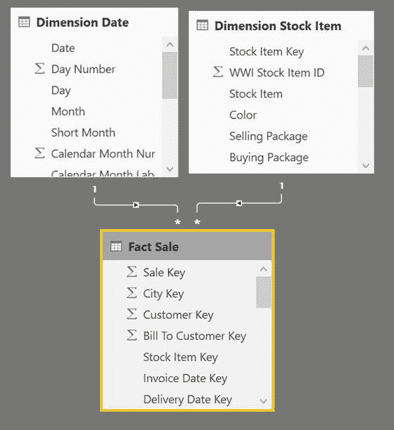

图 6-1

模型中三个表之间的关系

> **提示**：在关系视图中，尝试将一对多关系中“一”方的表放在“多”方表的上方。这有助于在视觉上强化筛选器的级联效应。在“一”方表中选择一列会筛选“多”方表中的行，但反之则不然。

这是用于分析和报表的数据建模中的常见模式。“一”方的表通常是一个项目列表，你可以根据“多”方表中的行对其进行切片和切块。正如表名所示，这些表通常被称为维度表。

维度表通常每个实体有一行，代表可分组的最低细节级别。代表最低粒度的列应该是唯一的，并且包含出现在相关“多”方表中的值。

“多”方表可以在关系列中包含多个具有相同值的行。这些表通常被称为事实表。希望你的 `Fact Sale` 表对于任何给定日期都有许多行。同样，“多”方表可能没有与“一”方列匹配的行，这也是完全正常的。如果周末或假日没有交易，则可能没有这些日期的行，在设计数据模型时请务必记住这一点。

事实表通常表示操作、事件或交易，并且通常包含时间维度。一个帮助判断数据是应构建为事实表还是维度表的好经验法则是：如果你希望随时间对数据进行计数、求和或显示趋势，则应考虑使用事实表。而如果数据是你想要进行切片和切块分析的对象，那么它可能是作为维度表的合适候选。

在 `WideWorldImportersDW` 数据集中，`Dimension Date` 表的最低粒度是具体某一天，不包含代表小时、分钟或秒的列或行。

`Dimension Date` 表中的其他列允许你以有用的方式对日期进行分组，例如按日历月分组。这些附加列不必是唯一的，并且可以根据你组织的报表要求进行自定义。

此数据集中的 `Dimension Date` 表允许将行按日历和财务范围（例如月份和年份）进行分组。其他列提供了替代格式，例如 `[Short Month]`（一月、二月、三月...）和 `[Month]` 列（一月、二月、三月...）。

在报表的任何部分使用了 `Dimension Date` 表中的任何列，都会通过关系中使用的列自动将过滤信息发送到相关的 `Fact Sale` 表。你无需在切片器、筛选器或视觉对象的轴区域中仅使用关系中定义的列。

从一个非常简单的报表需求开始：显示按发票日期统计的销售数量，我们可以将以下计算度量值添加到数据模型中：

```
Count of Sales = COUNTROWS('Fact Sale')
```

当使用表格视觉对象将此度量值放到报表画布上时，它会显示值为 `228,265`。这恰好与 `Fact Sale` 表中的行数相同。在计算此值时未进行任何筛选；`COUNTROWS` 函数只是对 `Fact Sale` 表进行了一次遍历，计算了每一行。

如果将 `Fact Sale` 表中的 `[Invoice Date Key]` 字段添加到同一个视觉对象中——请注意，这是来自 `Fact Sale` 表的字段，而不是 `Dimension Date` 表——你应该会看到如图 6-2 所示的结果。

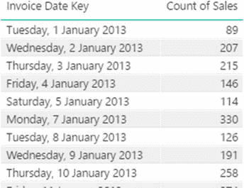

图 6-2

使用 `[Invoice Date Key]` 和隐式度量值的表格视觉对象示例

图 6-2 显示了一个包含 `1,069` 行结果集的前几行。`[Count of Sales]` 列中的每个单元格实际上都执行了计算度量值，但现在应用了一个隐式筛选上下文（也称为查询上下文）。

这意味着 `Count of Sales` 列顶行中的值 `89` 实际上执行了以下计算：

```
Count of Sales = COUNTROWS(
FILTER('Fact Sale',
'Fact Sale'[Invoice Date Key]=DATE(2013,1,1)
)
)
```

`DAX` 引擎已动态地将一个筛选条件应用于原始计算，该条件特定于该单元格。

> **注意**：请记住，报表中显示的每个值都是其自身唯一计算的结果，并不依赖于其他计算的顺序或输出。这包括总计和小计。

`2013 年 1 月 2 日，星期三`的行返回了`Count of Sales`度量值的值`207`。这是`DAX`对原始计算应用了一个略有不同的自动筛选器的结果。在这种情况下，应用的筛选器相当于要求计算引擎统计`Fact Sales`表中满足`[Invoice Date Key]`表的值必须等于`2013 年 1 月 2 日`这一条件的所有行。

第一个示例使用了`Fact Sale`表中的`[Invoice Date Key]`。现在让我们改用相关表中的`[Date]`列，并观察会发生什么（图 6-3）。

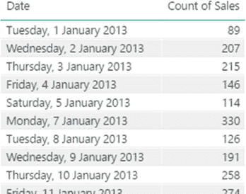

**图 6-3**  
使用`Dimension Date`表中的`[Date]`列的表格视觉对象示例

计算结果相同，只是这次我们使用了不同表中的列。`DAX`引擎自动对`Count of Sales`列中的每个计算应用筛选器（但本例中的最底部总计除外）。区别在于，筛选是在`Dimension Date`表中进行的，然后通过一对多关系向下传递，并应用于`Fact Sale`表中的数据。

为了生成顶行的值`89`，`DAX`引擎知道你希望筛选与`2013 年 1 月 1 日`相关联的数据行。`[Date]`列在`Dimension Date`表中是唯一的，并且也是在`Dimension Date`和`Fact Sale`之间的活动关系中指定的列。

需要使用关系中的信息，是因为你正在使用两个表中的列来生成计算度量值的值。因此，`DAX`引擎会在`Fact Sale`表的`[Invoice Date Key]`列中找到与`Dimension Date`表的`[Date]`列中被筛选值完全匹配的每一行。正是这些行被`[Count of Sales]`计算度量值用来生成相关单元格的值。

此时一个好问题是：既然使用`Dimension Date`表中的列与使用实际`Fact Sales`表中的`[Invoice Date Key]`列产生的结果相同，为什么还要使用前者呢？使用同一表中的列来筛选计算中使用的数据行不是更高效吗？

使用相关表中的筛选器的一些优势包括：

*   **维度表可用于筛选多个事实类型的表**。本示例仅包含一个事实表。如果你的报表视觉对象还使用了来自其他事实表的数据，例如`Fact Purchase`或`Fact Order`，这些表很可能与同一个`Dimension Date`表存在关系。任何基于`Dimension Date`表中的列的切片器或筛选器都会自动通过多个一对多关系向下传播，并应用于使用每个相关事实表中列的计算。
*   **维度表允许你包含以有意义的方式对行进行分组的列**。`Date`表每天包含唯一的一行。`[Calendar Year]`列可以为`Dimension Date`表中值介于`2019 年 1 月 1 日`和`2019 年 12 月 31 日`之间的所有`365`行携带值`"2019"`。同样，`Dimension Date`表中的列可以携带有助于识别和筛选特定月份、季度、工作日、假日、特定事件等行的值。将这些“有用的分组列”存储在一个表中，可以构建更高效且更易于维护的数据模型。
*   **维度表通常保证每个实体对应一行，并且不易出现事实表中可能出现的间隙和重复**。在我使用的简单案例中，没有`2013 年 1 月 6 日（星期日）`的数据。这很可能反映了该组织的运作方式。通过使用`Dimension Date`表中的`[Date]`列，你可以在某些计算中利用所有日期均保证可用的优势——尤其是时间智能`DAX`函数，这些函数旨在假定所使用的列不包含间隙。

在图 6-4 中，两个视觉对象都使用了`Dimension Date`表的`[Date]`列，而不是`Fact Sale`表的`[Invoice Date Key]`列。两者都清楚地显示`1 月 6 日`没有数据行。如果你在行标题或轴中使用`[Invoice Date Key]`列，这个间隙可能会很重要，但也很容易被忽略。

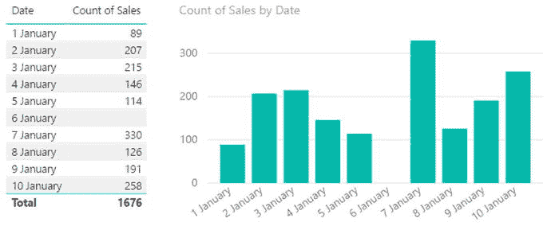

**图 6-4**  
使用`[Date]`列的表格和柱状图视觉对象，显示某天无数据的间隙

好的，作为高级文档工程师和翻译员，我将遵循您的注意事项和示例，将给定的英文文本翻译成中文。

让我们回到最初的例子，再做一次微调。不在可视化对象中使用 `[Date]` 列，而是使用 `Dimension Date` 表中的另一列以及 `[Count of Rows]` 计算度量。请记住，`[Date]` 列保证是唯一的，因为它被用作一对多关系中“一”方的列，因此对于到目前为止示例中的每一行，只有一个值通过该关系传递到 `Fact` 表，作为筛选上下文的一部分。

这一次，我们在可视化对象中使用 `Dimension Dates` 表中的 `[Calendar Year]` 列。这应该会产生如图 6-5 所示的结果。

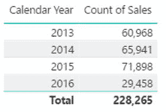

图 6-5

使用 `[Calendar Year]` 字段和隐式度量的表可视化对象

图 6-5 显示了由 `[Count of Sales]` 计算度量生成的五个值。其中四个值被 `[Calendar Year]` 列筛选，而底部的值 228,265 不受任何筛选的影响。顶行的结果 60,968 首先对 `Dimension Date` 表应用一个筛选器，查找 `[Calendar Year]` 列值为 2013 的所有行。这将精确找到 365 行，DAX 引擎随后使用这些行查找每个关联的 `[Date]` 值。这组 `[Date]` 值通过一对多关系向下筛选到 `Fact Sale` 表，以帮助确定计算度量可以使用哪些行。

`[Count of Sales]` 计算度量中使用的 DAX 仅提到了 `Fact Sale` 表，该表被传递给 `COUNTROWS` 函数。计算中没有提到特定的列、如何进行匹配或数据模型中其他表的任何信息。所有这些筛选都是隐式发生的，仅需借助两个表之间预定义的关系。DAX 提供了一个 `FILTER` 函数，但不需要它来满足此要求。

## 显式筛选

前面示例图 6-5 中的所有筛选都用于隐式筛选，这意味着计算本身没有使用 DAX 筛选函数。这允许创建基本报表，但不可避免地，你需要更复杂的筛选逻辑来满足更复杂的报表需求。

DAX 提供了几个筛选函数，本节将介绍使用这些函数的一些常见且有用的示例。DAX 中的筛选函数不仅允许您为计算的隐式筛选提供额外的筛选层，而且还允许您专门覆盖当前的筛选上下文，从而使您的计算能够使用它们原本可能无法访问的行中的数据。

### `FILTER` 函数

我们介绍的第一个筛选函数是 `FILTER` 函数。该函数的语法如下：

```
FILTER ( <Table>, <FilterExpression> )
```

第一个参数是对希望应用筛选的表的引用。第二个参数必须是一个有效的 DAX 表达式，其结果为布尔值 true 或 false，该表达式将逻辑地应用于用作第一个参数的表的每一行。`FILTER` 函数的输出是一个表。当您在嵌套在其他 DAX 函数中使用 `FILTER` 函数时，了解这一点很重要。它可以用作任何接受表作为引用的函数的参数。

沿用 `[Count of Sales]` 度量，让我们添加一个带有简单表达式的 `FILTER` 函数，看看计算会发生什么。

考虑清单 6-1 中的计算度量。

```
Count of Sales (10 or more) =
COUNTROWS(
    FILTER(
        'Fact Sale',
        'Fact Sale'[Quantity] > 10
    )
)
```

清单 6-1
将 `FILTER` 函数与 `COUNTROWS` 一起使用

这与之前计算的区别在于，此版本使用 `FILTER` 函数代替了原始的 `Fact Sale` 表引用。此更改的结果如图 6-6 所示。

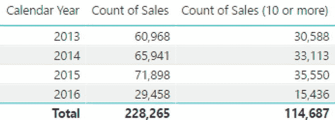

图 6-6

将 `[Count of Sales (10 or more)]` 度量添加到表可视化对象

新的计算度量作为第三列添加到表可视化对象中。要理解顶行的值 30,588 是如何得出的，让我们看看发生了什么。在此示例中，有两层筛选在起作用。第一层是隐式筛选（查询上下文），由 `[Calendar Year]` 列驱动。第二层是清单 6-1 中 `FILTER` 函数对 `'Fact Sale'[Quantity]` 列使用的显式规则。

隐式筛选上下文将 `COUNTROWS` 函数可见的行数限制为 60,968 行。然后，对于这些行中的每一行，都会应用一个布尔测试，以确定 `[Quantity]` 列的值是否大于 10。此测试有效地丢弃了其余 60,968 行中所有值低于 11 的行。结果是从 `FILTER` 函数返回给 `COUNTROWS` 函数的一个 DAX 表，该表恰好有 30,588 行需要计数。

需要记住的关键点是筛选是按顺序、分层应用的，而不是单个操作。这在为更复杂的报表需求创建 DAX 时提供了额外的灵活性。

你可以扩展用作筛选表达式的 DAX，以包含更具体的要求，如清单 6-2 所示。

```
Count of Sales (10 or more) =
COUNTROWS(
    FILTER(
        'Fact Sale',
        'Fact Sale'[Quantity] >= 10
            && RELATED('Dimension Stock Item'[Size]) = "M"
    )
)
```

清单 6-2
使用来自相关表的筛选条件的计算度量

此示例应用了一条额外的规则，进一步限制了`Fact Sale`表中的行数，该规则使用了由于在可视化对象中使用了`[Calendar Year]`列而从`Dimension Date`表传递下来的隐式筛选（查询上下文）。然后，除了仅考虑值为 10 或更高的行的原始显式筛选要求之外，还添加了一条额外的规则，该规则将筛选应用于另一个相关表。由于`Dimension Stock Item`和`Fact Sales`之间存在关系，因此也应用此筛选要求来最终限制来自`Fact Sales`表的行数，这些行最终被传递给`COUNTROWS`函数进行计数。

结果，图 6-7 中第三列的计算度量值现在更小了。

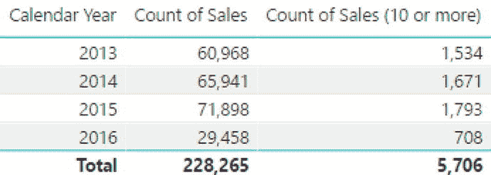

图 6-7

使用清单 6-2 代码的输出

以这种方式使用`FILTER`函数，您可以对任何生效的隐式筛选（查询上下文）应用额外的限制。这意味着您可以创建一些在计算中硬编码了规则的计算，但仍然可以在许多可视化对象中使用这些度量，每个可视化对象都有自己的隐式筛选上下文，这些上下文可以与显式筛选结合，以生成有用的动态结果。

### 覆盖筛选器

到目前为止，筛选过程一直都是累加的，这意味着不同的筛选层只是在计算的不同阶段丢弃某些行。在 DAX 中，有一些筛选函数提供了覆盖隐式筛选层所应用筛选的能力。接下来我们将要查看的就是允许实现此功能的函数：

- `CALCULATE` 和 `CALCULATETABLE`
- `ALL`
- `ALLEXCEPT`
- `ALLSELECTED`

在几种场景下，这些函数会非常有用。例如，它们能够进行期间比较、运行总计和百分比计算等。在这些场景的每一种中，计算都可能需要访问那些已被隐式筛选器忽略的行中存储的值。

### 占总计百分比

从占总计百分比度量值开始，你可以使用按年份统计行数的例子来演示如何覆盖隐式筛选上下文。默认情况下，可视化对象中使用的任何计算的度量值都会受到自动筛选层的影响，该筛选层由同一可视化对象中使用的其他列驱动。

```
Count of Sales = COUNTROWS('Fact Sale')
```

当`[Count of Sales]`度量值与`‘Dimension Date’[Calendar Year]`列被用于同一可视化对象时，它会受到一层隐式筛选的影响，这意味着`COUNTROWS`函数只能考虑`‘Fact Sales’`表中实际行的一部分。

如果需要了解每年占总体的比例，你需要一种方法来指示 DAX 引擎忽略隐式筛选上下文。DAX 提供了`CALCULATE`和`CALCULATETABLE`来帮助管理这一点。

图 6-8 使用以下计算度量值演示了这一点：

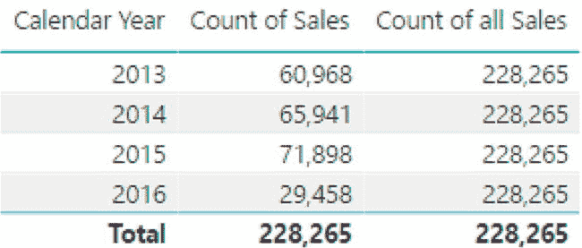

图 6-8

使用`ALL`函数的输出

```
Count of all Sales = CALCULATE(
COUNTROWS('Fact Sale'),
ALL('Fact Sale')
)
```

我们来分解一下，并更详细地解释该计算。

首先，内部的`COUNTROWS`函数与`[Count of Sales]`计算度量值中使用的函数相同。它计算`‘Fact Sale’`表中所有可见行的数量。这通常是查询上下文筛选后的表版本。在此例中，`COUNTROWS`函数被包裹在`CALCULATE`函数内部。

`CALCULATE`函数的语法如下：

```
CALCUALTE ( <表达式>, <筛选器 1>, <筛选器 2> ... )
```

该函数在附加参数提供的筛选器上下文中执行第一个参数提供的表达式。正如`CALCULATE`函数的语法所表明的，可以有任意数量的筛选表达式。在`[Count of all Sales]`示例中，传递给`CALCULATE`函数的参数是`ALL`函数。此处使用`ALL`函数的效果是移除任何可能作用于`‘Fact Sale’`表上的隐式筛选上下文，该表正是`ALL`函数参数所指定的表。

**注意**：以这种方式使用`CALCULATE`和`ALL`会移除所有筛选上下文，包括你可能在别处使用的任何硬编码显式筛选规则，例如报表、页面或可视化对象筛选器。

现在，我们可以编写一个计算，将`[Count of Sales]`与`[Count of all Sales]`结合起来，生成一个显示每行占总计百分比的值。此计算的输出如图 6-9 所示。

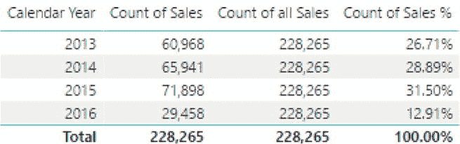

图 6-9

带有额外计算度量值的输出

```
Count of Sales % =
DIVIDE(
[Count of Sales],
[Count of all Sales]
)
```

在图 6-9 的这个例子中，传递给`ALL`函数的表是`‘Fact Sales’`。该函数移除了`‘Fact Sales’`表中的任何隐式筛选上下文，该上下文是由`‘Dimension Date’[Calendar Year]`列生成的查询上下文。如果用`‘Dimension Date’`表代替`‘Fact Sale’`表，则筛选上下文会从`‘Dimension Date’`表中移除。这种细微的变化最终并不会改变此示例中使用的可视化对象的值。

整体筛选的最终效果仍然是向`COUNTROWS`函数传递相同的行。性能上可能有些微差异，但我们将在第 8 章讲解优化 DAX 时探讨这一点。

如果你向表格可视化对象添加一些额外的列，这将演示当你在带有计算度量值的`ALL`函数中指定使用哪个表时所产生的差异。

考虑列表 6-3 和 6-4 中的两个计算度量值。

```
Count of all (Dim Date) Sales =
CALCULATE(
COUNTROWS('Fact Sale'),
ALL('Dimension Date')
)
```

列表 6-3
使用`ALL`函数并指定`'Dimension Date'`表的计算度量值

```
Count of all (Fact Sales) Sales =
CALCULATE(
COUNTROWS('Fact Sale'),
ALL('Fact Sale')
)
```

列表 6-4
使用`ALL`函数并指定`'Fact Sale'`表的计算度量值

这些计算度量值之间的唯一区别在于`ALL`函数中使用的表。当你在仅包含`‘Dimension Date’[Calendar Year]`列的可视化对象中使用它们时，它们会通过两条独立的路径得到相同的结果。但是，如果你引入一个来自`‘Dimension Date’`之外的其他表的筛选器，你就会看到差异。这个例子（如图 6-10 所示）使用了`‘Fact Sale’[Package]`列，该列中所有行都只包含以下四个值之一：Bag、Each、Packet 或 Pair。

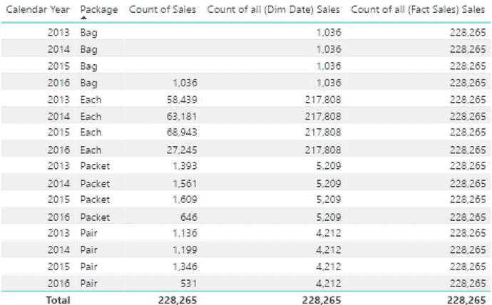

图 6-10

使用列表 6-3 和 6-4 代码的输出

对于图 6-10 中第三、四、五列的每个单元格/计算，计算度量值都始于与当前行相关的自动筛选上下文。`[Count of Sales]`度量值没有移除任何隐式筛选上下文，因此其值反映了`‘Fact Sale’`表中恰好与`[Calendar Year]`和`[Package]`列匹配的行数。

然而，对于`[Count of all (Dim Date) Sales]`计算度量值，唯一被移除的筛选上下文是存在于`‘Dimension Date’`表上的任何上下文，而非应用于`‘Fact Sale’`表的任何筛选上下文。这就解释了为什么你会看到`[Package]`值为 Bag 的行与`[Package]`值为其他值的行之间存在不同的数值。

这里发生的情况是，由`[Calendar Year]`列驱动的隐式筛选器被移除了，而由`[Package]`列驱动的隐式筛选器则未被移除。

对于 `[Count of all (Fact Sales) Sales]` 计算度量值，`ALL` 函数清除了 `'Fact Sales'` 表中的所有隐式筛选器，这包括从相关表传递下来的任何隐式筛选器；因此，`COUNTROWS` 函数现在可以使用 `'Fact Sale'` 表中的每一行来生成一个数值。

隐式筛选上下文不仅由同一可视化对象中使用的其他列驱动，还可以由当前可视化对象外部的筛选器驱动。这些筛选器可以表现为同一报表上切片器的选择，或其他非基于 DAX 的外部筛选器设置。

### 显式筛选器

那些用于移除隐式筛选上下文的功能对显式筛选器无效。这意味着，如果你在计算度量中使用了特定的筛选规则，那么下游计算将无法移除该筛选条件。

请思考清单 6-5 和 6-6 中的两个计算度量。

```
销售量计数（10 及以上） =
COUNTROWS(
FILTER(
'Fact Sale',
'Fact Sale'[数量] >= 10
)
)
清单 6-5
对[数量]列应用筛选器的计算度量
```

```
所有（显式）销售计数 =
CALCULATE(
[销售量计数（10 及以上）],
ALL('Fact Sale')
)
清单 6-6
展示清单 6-5 中计算度量与 ALL 函数结合效果的计算度量
```

当该计算用于表格可视化时，你将得到如图 6-11 所示的输出。

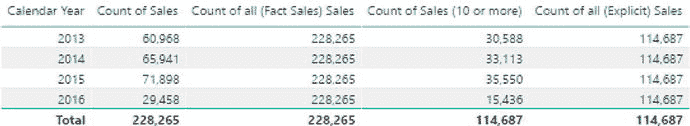

**图 6-11** 使用清单 6-5 和 6-6 中代码的输出

在图 6-11 中，第四列使用了 `[所有（显式）销售计数]` 计算度量。每个单元格中的值是隐式筛选上下文和显式筛选混合作用的结果。值 30,588 表示来自 `'Fact Sales'` 表且属于隐式筛选上下文 `[日历年份]` 2013 的行数，同时额外限制只统计 `'Fact Sale'[数量]` 大于等于 10 的行。最终会得到五个不同的值，包括底部的合计行。

然而，对于最后一列的 `[所有（显式）销售计数]` 计算度量，它使用了 `ALL` 函数来指定应移除 `'Fact Sale'` 表上可能存在的所有隐式筛选上下文。结果是相同的值 114,687，因为对 `[日历年份]` 的隐式筛选被 `ALL` 函数移除了。这表明查询上下文已被 `ALL` 函数移除，而上游的 `'Fact Sale'[数量] >=10` 筛选条件仍然保留。

也许 `ALL` 函数更贴切的名称是 `REMOVEALLIMPLICITFILTERS`（移除所有隐式筛选器），这更能体现该函数的目的。我在本章中一直使用“隐式”这个词。关键在于，尽管它能有效移除所有继承的筛选器，但显式筛选器（像这里用于将结果限制在 `[数量]` 大于等于 10 的行的筛选条件）不会受到影响。

### ALL 函数

上一节介绍了强大的 `ALL` 函数。现在我们更深入地看看这个函数。其语法如下：

```
ALL ( <表> | <列> [, <列> ...] )
```

`<表>` 和第一个 `<列>` 之间的 `|` 符号代表“或”。这意味着第一个参数可以是表，也可以是列。如果第一个参数是表，则不能使用第二个参数。这种情况下，指定表上的所有隐式筛选上下文都会被移除，实际上就是返回表中的所有行。如果使用列作为第一个参数，那么只要所有列都来自同一个表，就可以使用第二、第三个参数。

上一节中 `[所有（显式）销售计数]` 计算度量更高效的使用方式如下：

```
所有（显式）销售计数 =
CALCULATE(
[销售量计数（10 及以上）],
ALL('维度日期'[日历年份])
)
```

此计算度量的改动在于，`ALL` 函数现在使用列而非表作为参数。更重要的是，传递给 `ALL` 函数的列正是驱动隐式筛选的列。此更新版本产生的值与使用 `'Fact Sales'` 表作为参数的版本相同。

在此示例中，如果 `ALL` 函数使用任何其他列，每个单元格将产生不同的值。为这两个版本的计算度量生成的查询计划相同，因此将 `<表>` 替换为 `<列>` 在此处不会影响性能。在其他情况下，将 `<表>` 替换为 `<列>` 可能会带来更快的性能。

#### ALLEXCEPT 函数

另一个能够覆盖隐式筛选器的 DAX 函数是 `ALLEXCEPT` 函数。在清除筛选器的方式上，它与 `ALL` 函数类似，但使用此函数时，参数用于指定哪些筛选器保留隐式筛选。

以下是 `ALLEXCEPT` 函数的语法：

```
ALLEXCEPT ( <表>, <列> [, <列> ...] )
```

使用 `ALLEXCEPT` 时，至少需要同时传递一个表和一个列。还可以使用一个或多个列作为额外参数。当用于列数众多的表时，此函数是 `ALL` 函数的一个便捷替代方案。

如果你有一个包含 30 列的表，并且某个计算需要清除其中 28 列的隐式筛选器，使用 `ALL` 函数需要传递 28 个参数。然而，使用 `ALLEXCEPT` 函数只需传递 3 个列即可。

请思考表 6-1。

**表 6-1** 用作 `Table1` 表的数据集

| ColumnA | ColumnB | ColumnC | ColumnD | ColumnE |
| --- | --- | --- | --- | --- |
| A | 苹果 | 澳大利亚 | 田径 | 10 |
| B | 香蕉 | 巴西 | 田径 | 15 |
| C | 樱桃 | 加拿大 | 板球 | 30 |

清单 6-7 和 6-8 中的计算度量具有相同的净效果。

```
ALL 度量 =
CALCULATE(
SUM('Table1'[ColumnE]),
ALL(
Table1[ColumnA],
Table1[ColumnB],
Table1[ColumnC]
)
)
清单 6-7
使用包含特定列的 ALL 函数的计算度量
```

```
ALLEXEPT 度量 =
CALCULATE(
SUM('Table1'[ColumnE]),
ALLEXCEPT(
Table1,
Table1[ColumnD]
)
)
清单 6-8
使用包含特定列的 ALLEXCEPT 函数的计算度量
```

将两个计算度量添加到表格可视化后的结果如图 6-12 所示。

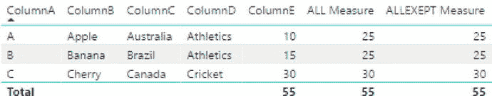

**图 6-12** 使用清单 6-7 和 6-8 中代码的输出

图 6-12 中右侧的两列显示了两个版本计算度量的输出。在每种情况下，由前三列生成的隐式筛选器都被清除，只留下来自 `ColumnD` 的隐式筛选器被 `CALCULATE` 内部的 `SUM` 函数考虑。

这同样表明，你可以对数据中的子类别执行百分比计算。通过这种方式使用 `ALL` 或 `ALLEXCEPT` 函数，你可以生成一个值，显示按 `ColumnD` 分组的 `ColumnE` 值的总和。然后，你就可以在计算中使用该值，以显示在 `ColumnD` 为“田径”的每一行中，“巴西”所占 `ColumnE` 的比例。

清单 6-9 中的计算度量返回一个代表子类别百分比的值。结果如图 6-13 所示。

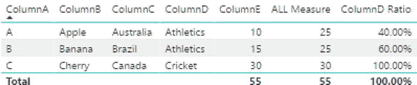

**图 6-13** 清单 6-9 中代码格式化百分比后的输出

```
ColumnD 比率 =
DIVIDE(
SUM('Table1'[ColumnE]),
[ALL 度量],

)
清单 6-9
整合了清单 6-7 中计算度量的计算度量
```

### ALLSELECTED 函数

本节要探讨的最后一个函数是 `ALLSELECTED` 函数。与 `ALL` 和 `ALLEXCEPT` 类似，此函数的目的是移除当前计算中的隐式或继承筛选，从而允许访问那些原本不可用的数据行。`ALLSELECTED` 与前面几个函数的区别在于，`ALLSELECTED` 仅移除在同一查询内部生成的隐式筛选器。

这一点在 Power BI 中尤其有用，因为视觉对象上的每个值都可能受到来自多个位置的筛选器影响。这些值可以通过硬编码的 DAX 进行显式筛选，也可以通过同一视觉对象中的其他字段（如列标题、行标题或轴上使用的字段）进行隐式筛选。最后，筛选器还可以从当前视觉对象外部的选择中继承而来。正是由于能够区分当前视觉对象中字段生成的隐式筛选器与外部筛选器，`ALLSELECTED` 才显得最为有用。

为了更好地掌握如何结合 WideWorldImportersDW 数据使用所有这些函数，请参考代码清单 6-10、6-11 和 6-12。

```
Sum of Quantity = SUM('Fact Sale'[Quantity])
代码清单 6-10
使用 SUM 的计算度量值
```

```
ALL Quantity =
CALCULATE(
SUM('Fact Sale'[Quantity]),
ALL('Fact Sale')
)
代码清单 6-11
使用 ALL 函数管理筛选上下文的计算度量值
```

```
ALLSELECTED Quantity =
CALCULATE(
SUM('Fact Sale'[Quantity]),
ALLSELECTED('Fact Sale')
)
代码清单 6-12
使用 ALLSELECTED 函数管理筛选上下文的计算度量值
```

当这些度量值与 `'Dimension Date'[Calendar Year]` 列一起用于表格视觉对象时，将得到图 6-14 所示的结果。

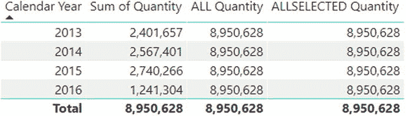

图 6-14
使用代码清单 6-10、6-11 和 6-12 代码的输出结果

`[ALL Quantity]` 列和 `[ALLSELECTED Quantity]` 列中的值并无差异。这里假设没有使用其他视觉对象或外部筛选器来生成此结果。`ALL` 和 `ALLSELECTED` 函数都在移除由 `[Calendar Year]` 列驱动的隐式筛选。

然而，当向报表添加一个外部筛选器（例如，对相关表中的某个字段使用切片器）时，您可以看到这些值会如何变化（图 6-15）。

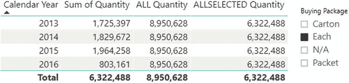

图 6-15
在切片器筛选条件下，使用代码清单 6-10、6-11 和 6-12 代码的输出结果

在此案例中，添加了一个使用 `'Dimension Stock Item'[Buying Package]` 字段且已选择 `Each` 的切片器。三个计算度量值现在对这个外部筛选器产生了不同的响应。

`[Quantity]` 计算度量值现在对 `Quantity` 字段进行求和，并且它继承了两层隐含的筛选上下文。第一行数值 1,725,397 首先受到 `[Calendar Year]` 列筛选 `'Fact Sale'` 表中与 2013 年相关行的影响，而第二层来自切片器的筛选则设置为 `Each`。这两层筛选共同作用，使得 `SUM` 函数仅使用同时满足这两个条件的行。该计算度量值未覆盖任何筛选器。

`[ALL Quantity]` 计算度量值使用 `ALL` 函数移除计算中任何隐含的筛选上下文。这会移除由 `[Calendar Year]` 字段驱动的内部层筛选，以及由切片器驱动的外部隐式筛选层。最终结果是，包括总计行在内的每个单元格都具有相同的值。这一数值恰好也是 `'Fact Sale'[Quantity]` 列的总和。

`[ALLSELECTED Quantity]` 计算度量值现在显示的数值与 `[ALL Quantity]` 列不同。这是因为 `ALLSELECTED` 函数移除了由 `[Calendar Year]` 列驱动的内部筛选层，但并未移除来自切片器的任何筛选。如果现在对切片器进行不同的选择，`[ALLSELECTED Quantity]` 度量值会更新为新的数值，而 `[ALL Quantity]` 度量值则保持不变。

此示例中的三个计算度量值可以作为基础，用于创建其他能够以有趣方式突出显示数据的度量值。它们在你的报表中可能都很有用。希望这些示例能够展示不同筛选函数的意图和使用方法。使用这些函数，可以精确地定位到非常细粒度的行选择，从而提供极大的灵活性。

#### 运行总计

从计算中移除隐式筛选器的能力，在生成运行总计时也非常有用。要创建一个显示 `'Fact Sale'[Quantity]` 列运行总计的度量值，可以从一个核心的 DAX 表达式开始，如下所示：

```
SUM('Fact Sale'[Quantity])
```

挑战在于，当你在可视化对象中使用此表达式时，计算只会考虑 `'Fact Sale'[Quantity]` 列中受其他字段隐式筛选的值。如果查询中还使用了 `'Dimension Date'[Calendar Year]` 字段，则该计算的结果会正确显示每个特定日历年的 `SUM`，但无法访问其他年份的数据以提供运行总计的效果。此时，`ALL`、`ALLEXCEPT` 和 `ALLSELECTED` 函数就能派上用场。

要查看使用 `WideWorldImportersDW` 数据的运行总计演示，请考虑清单 6-13 和 6-14 中的以下度量值。

```
Sum of Quantity = SUM('Fact Sale'[Quantity])
清单 6-13
使用 SUM 的度量值
```

```
Running Total =
CALCULATE(
    SUM('Fact Sale'[Quantity]),
    FILTER(
        ALL('Dimension Date'[Calendar Year]),
        MAX('Dimension Date'[Calendar Year]) >= 'Dimension Date'[Calendar Year])
)
清单 6-14
使用 FILTER 函数生成运行总计的度量值
```

当这些计算度量值添加到同时使用了 `'Dimension Date'[Calendar Year]` 列的可视化对象中时，会产生图 6-16 所示的结果。

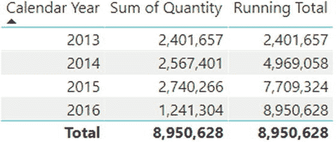

图 6-16

清单 6-13 和 6-14 中代码的输出

`[Sum of Quantity]` 列中的值均显示，在由 `[Calendar Year]` 列驱动相关隐式筛选器的情况下执行计算的结果。该列底部的值 8,950,628 没有隐式筛选上下文，因此它会对 `'Fact Sale'` 表中的每一行进行计算。

对于 `[Running Total]` 计算，`SUM` 函数被包裹在 `CALCULATE` 函数内部，该函数允许定义额外的筛选指令，在此例中，是目标性地移除某些隐式筛选。对于 2014 年的结果 4,969,058，`SUM` 函数需要访问与 2013 年相关的行。

`FILTER` 函数的第一个参数使用 `ALL` 函数移除 `[Calendar Year]` 列上的任何隐式筛选。这将使 `SUM` 函数能够访问 `'Fact Sale'` 表中的每一行。如果只进行到这一步，你会在每个单元格中看到重复的值 8,950,628。

`FILTER` 函数的第二个参数指定了 `MAX('Dimension Date'[Calendar Year]) >= 'Dimension Date'[Calendar Year]`，这定义了一个筛选规则，该规则将 `'Fact Sale'` 表中的行减少到仅满足此布尔条件的行。对于表格可视化对象中的第一行，这意味着仅包含与 2013 年相关的行。对于第二行，则包含所有与 2013 年和 2014 年相关的行。这就是提供运行总计效果的神奇之处。

`[Running Total]` 列中的每个单元格都是一个独立的计算，不依赖或使用可视化对象中任何先前计算的输出。这些计算可以按任意顺序执行，并且只会考虑贯穿了多个筛选层的行。

由于 `xVelocity` 引擎基于内存和列的特性，DAX 可以非常快速地执行这些计算，因此基于单元格的独立计算所提供的额外灵活性通常超过了读取重复的弊端。如果你正在基于大量计算构建运行总计，请牢记这一点。在此示例中，`[Running Total]` 计算执行了五次。

如果在度量值和可视化对象中都使用 `'Dimension Date'[Date]` 列代替 `'Dimension Date'[Calendar Year]`，那么该度量值会执行 1,462 次（`[Date]` 级别每一行执行一次，再加上总计的一次）。与 2013 年 1 月 1 日相关的行中的任何值，都会被这 1,462 次执行中的每一次所使用。

##### ALLSELECTED 在运行总计中的应用

此前在清单 6-14 中展示的 `[Running Total]` 度量值使用了 `ALL` 函数来移除由 `'Dimension Date'[Calendar Year]` 列驱动的任何隐式筛选器。当以这种方式使用时，可视化对象外部使用的、基于除 `'Dimension Date'[Calendar Year]` 之外其他列的其他切片器和筛选器会传递到 `SUM` 计算中。这意味着它们会从 `[Calendar Year]` 列中第一条记录开始提供运行总计，但这些行也应用了一个与切片器选择相关的额外筛选器。

唯一的例外是，如果切片器或外部筛选器是基于 `'Dimension Date'[Calendar Year]` 列的。在这种情况下，如果切片器筛选为 2015 年，产生的值仍然是 7,709,324。`SUM` 仍会考虑所有与 2013 年和 2014 年相关的行。

如果将计算改为使用 `ALLSELECTED` 函数代替 `ALL` 函数，那么任何基于 `'Dimension Date'[Calendar Year]` 的切片器或外部筛选器现在只会考虑与切片器中选择项相关的行。

这可以通过清单 6-15、6-16 和 6-17 中的三个度量值来演示。

```
Sum of Quantity = SUM('Fact Sale'[Quantity])
清单 6-15
使用 SUM 的度量值
```

# 计算列与 `EARLIER` 函数

在编写计算列时，`EARLIER` 函数是一个非常实用的工具。该函数在逻辑上等同于 T-SQL 中的自联接，允许计算访问当前行之外的其他行数据，这包括相关表中的行数据。该函数的名称并未清晰阐明其运作方式；或许换一个名称会更有助于理解。

为了了解该函数的使用方法，请在 `Fact Sale` 表中添加一个计算列。该列的值应显示每位客户每笔交易的上一次交易日期。然后，您可以以此计算为基础，确定自上次购买以来的天数，进而计算平均值并绘制随时间变化的趋势图，从而帮助您了解客户访问频率的变化。

DAX 计算列如代码清单 6-25 所示。

```
Last Purchase Date =
CALCULATE(
LASTDATE('Fact Sale'[Invoice Date Key]),
FILTER(
'Fact Sale',
'Fact Sale'[Customer Key] = EARLIER('Fact Sale'[Customer Key])
&& 'Fact Sale'[Invoice Date Key] < EARLIER('Fact Sale'[Invoice Date Key])
)
)
```

将此计算添加到 `Fact Sale` 表后，新列将为每一行显示该特定客户上一次开具发票的日期。

对应的 T-SQL 代码如代码清单 6-26 所示。

```
SELECT
[Current].[Sale Key],
[Current].[Customer Key],
[Current].[Invoice Date Key],
MAX([EARLIER].[Invoice Date Key]) AS [Last Purchase Date]
FROM Fact.Sale AS [Current]
LEFT JOIN FACT.Sale AS [EARLIER]
ON  [Earlier].[Customer Key] = [Current].[Customer Key]
AND [Earlier].[Invoice Date Key] < [Current].[Invoice Date Key]
WHERE
[Current].[Customer Key] = 10
GROUP BY
[Current].[Sale Key],
[Current].[Customer Key],
[Current].[Invoice Date Key]
```

为了让 `Fact Sale` 表中的每一行都能找到正确的上次购买日期值，它需要访问其所在行本身并未包含的信息。它需要一种方法来查看表中的其他行。`EARLIER` 函数实现了一种逻辑自联接形式，当与 `FILTER` 函数结合使用时，允许计算找到相关行。

在这个例子中，`Fact Sale` 表中的一个单一行首先从自联接表中找出所有 `[Customer Key]` 匹配的行。这包括了那些 `[Invoice Date Key]` 晚于当前行值的行。随后，应用额外的筛选条件，限制外部 `[Invoice Date Key]` 的行，使其值小于当前行的 `[Invoice Date Key]` 值。

这样操作仍可能产生多个值，因此表达式中使用了 `LASTDATE` 函数来选取恰好是剩余日期中最旧的单个日期。在本例中，您也可以使用 `MAX` 函数来替代 `LASTDATE`。

此计算列为表中的每一行生成一个相关值。由于它是一个计算列而非计算度量值，因此无法通过报表切片器或筛选器进行更改。

`EARLIER` 函数的名称暗示它可能提供基于顺序查找前一行记录的功能。但实际情况并非如此，或许像 `OUTERTABLE` 这样的名称会更有意义。

变量提供了 `EARLIER` 函数的另一种表示方式。代码清单 6-27 中的计算列使用 `VAR` 代替 `EARLIER` 完成了相同的任务。

```
Running Total ALL =
CALCULATE(
    SUM('Fact Sale'[Quantity]),
    FILTER(
        ALL('Dimension Date'[Calendar Year]),
        MAX('Dimension Date'[Calendar Year]) >= 'Dimension Date'[Calendar Year])
)
```

清单 6-16
使用 ALL 函数管理筛选上下文的运行总计度量值

```
Running Total ALLSELECTED =
CALCULATE(
    SUM('Fact Sale'[Quantity]),
    FILTER(
        ALLSELECTED('Dimension Date'[Calendar Year]),
        MAX('Dimension Date'[Calendar Year]) >= 'Dimension Date'[Calendar Year])
)
```

清单 6-17
使用 ALLSELECTED 函数管理筛选上下文的运行总计度量值

图 6-17 显示了使用 `'Dimension Date'[Calendar Year]` 列对切片器进行选择后的结果。在此示例中，对切片器进行了 2015 年和 2016 年两项选择。

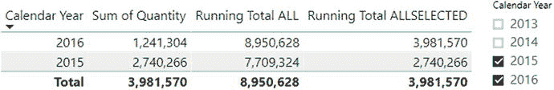

图 6-17
清单 6-15、6-16 和 6-17 中代码的输出，并带有切片器的两项选择筛选

这两个运行总计度量值之间的区别在于它们各自对切片器的反应方式。使用 `ALL` 的版本会移除 `'Dimension Date'[Calendar Year]` 列上的所有筛选，无论筛选来源如何，而使用 `ALLSELECTED` 的版本则保留切片器的筛选上下文。这意味着使用 `ALLSELECTED` 的计算无法访问 `'Fact Sale'` 表中与 2013 年或 2014 年相关的行，因此运行总计从 2015 年而非 2013 年开始。

两种方法都可能满足你的报表需求。有时你需要使用一种方法，其他时候则需要另一种。这个示例希望展示如何利用不同的筛选器函数来实现你的需求。

## 重置累计总计

累计总计度量的一种细微变化，是提供子类别中某个值的累计总计，该总计会在类别之间重置。例如，可以使用 `Dimension Date` 表来演示这一点，其中类别是 `Calendar Year`（日历年），子类别是 `Calendar Month`（日历月）。

首先向 `Dimension Date` 表添加以下计算列：

```
Calendar Month = STARTOFMONTH('Dimension Date'[Date])
```

这会生成一个新列，该列的值显示每个相关月份的第一天。

`[Running Total ALL]` 计算度量（不同之处已高亮显示）的修改版本如列表 6-18 所示。

```
Running Total ALL =
CALCULATE(
SUM('Fact Sale'[Quantity]),
FILTER(
ALL(
'Dimension Date'[Calendar Month],
'Dimension Date'[Calendar Year]
),
MAX('Dimension Date'[Calendar Month]) >= 'Dimension Date'[Calendar Month] &&
MAX('Dimension Date'[Calendar Year]) = 'Dimension Date'[Calendar Year])
)
```

**列表 6-18** 每年重置的累计总计计算度量

当在矩阵视觉对象中与 `'Dimension Date'[Calendar Year]` 列以及新的 `'Dimension Date'[Calendar Month]` 列一起使用时，该计算度量会生成图 6-18 所示的结果。

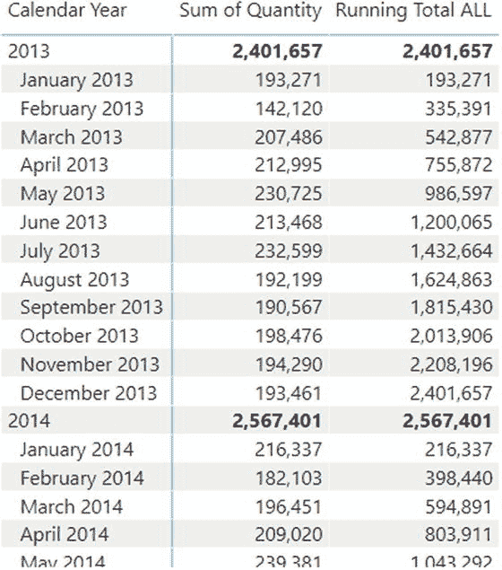

**图 6-18** 使用列表 6-18 中的代码生成的输出。累计总计在 2014 年重置。

在此计算中，`FILTER` 函数使用更复杂的规则来确定应移除或应用哪些筛选器，从而决定 `SUM` 函数可以考虑哪些行。

`ALL` 函数移除来自 `[Calendar Year]` 和 `[Calendar Month]` 列的任何隐含筛选。此时，`SUM` 计算为 `[Running Total ALL]` 列中的每个单元格返回值 `8,950,628`。

然而，`FILTER` 函数中的规则正在应用额外的筛选。根据这些规则，需要满足两个条件。

第一个条件是，`Fact Sale` 表中与每个 `'Dimension Date'[Calendar Month]` 相关的行必须与行标题中的 `Calendar Month` 相同，或更早（更早）。这是产生累计总计效果的条件。

这是一种容易混淆的表示法。看似有两个引用指向同一个 `'Dimension Date'[Calendar Month]` 对象。但它们并非同一个对象。一个引用的是查询上下文中的 `'Dimension Date'` 版本，而另一个引用的是筛选上下文中使用的 `'Dimension Date'` 版本。

`>=` 运算符左侧包裹在 `MAX` 函数中的 `'Dimension Date'[Calendar Month]` 引用的是查询上下文。`MAX` 函数确保比较中只使用一个值。

`>=` 运算符右侧的 `'Dimension Date'[Calendar Month]` 引用的是筛选上下文。正是这些记录，包括 `Fact Sale` 中的下游行，被使用并传递给 `SUM` 函数。

筛选表达式中的另一个条件是，仅指定 `Fact Sale` 中与 `'Dimension Date'[Calendar Year]` 建立关系且匹配 `Calendar Year` 行标题值的行。这部分代码用于重置累计总计。

这个需求也可以使用以下计算度量来实现：

```
Running Total YTD =
TOTALYTD(
[Sum of Quantity],
'Dimension Date'[Date]
)
```

`TOTALYTD` 函数为每个 `Calendar Month` 提供累计总计，并且每年重置一次。虽然这更简单，但它仅设计用于基于日期的列，并且对累计总计的灵活性要求较低。`[Running Total ALL]` 版本使用了一种可以应用于不同类型数据的模式，并且对何时重置累计总计（如果需要重置的话）的规则有更多控制。

## 作为排名的累计总计（计算列）

累计总计模式的另一种用途是为数据集提供排名，输出的是列而非度量。此计算列提供了一个版本，根据总销售额为客户建立从 `1` 到 `403` 的排名（列表 6-19）。该计算依赖于 `Dimension Customer` 表和 `Fact Sale` 表之间存在的**一对多**关系。

```
Customer Rank Column =
RANKX(
'Dimension Customer',
CALCULATE(
SUM('Fact Sale'[Total Excluding Tax])
)
)
```

**列表 6-19** 在关系上使用 `RANKX` 的计算列

关于此 DAX 语句值得指出一个有趣特性，即 `CALCULATE` 的使用。这是必需的，用于将当前行上下文转换为筛选上下文，以便 `SUM` 函数能够利用关系正确为每一行生成正确的值。如果移除 `CALCULATE` 语句，`SUM` 函数只会重复返回相同的值。返回的值是 `Fact Sale` 表中所有行的总和。

此计算仅在数据刷新到模型时进行计算，因为它是一个计算列。筛选器和切片器对返回的数字没有影响。

为了帮助理解 DAX 公式的方法，请查看等价的 T-SQL 代码（列表 6-20）。

```
WITH Ranking (
[Customer Key],
[Total Excluding Tax]
)
AS
(
SELECT
D.[Customer Key],
SUM(F.[Total Excluding Tax]) AS [Total Excluding Tax]
FROM Dimension.Customer AS D
INNER JOIN Fact.Sale AS F
ON F.[Customer Key] = D.[Customer Key]
GROUP BY
D.[Customer Key]
)
SELECT
L.[Customer Key],
COUNT(*) AS [Final Ranking]
FROM Ranking AS L
INNER JOIN Ranking AS R
ON L.[Total Excluding Tax] <= R.[Total Excluding Tax]
GROUP BY
L.[Customer Key]
ORDER BY
COUNT(*)
```

**列表 6-20** 列表 6-19 中 DAX 代码的 T-SQL 等价物

最终的 SELECT 语句对 `INNER JOIN` 操作中的谓词执行自联接，过滤掉 `[Total Excluding Tax]` 值更高的行。您可以通过计算 `INNER JOIN` 之后的行数来获得排名。使用 T-SQL 可以通过其他方式实现这一点，但这个版本有助于您理解 DAX 公式所采用的方法。

`FILTER` 函数采用了类似于 T-SQL 自联接的方法，您可以通过使用不同的筛选规则来定制它，以满足不同的需求。

## 时段比较

一个常见需求是将某一时段的值与前一时段进行比较。这便于进一步计算变化百分比等指标。例如，在特定月份显示某个度量值的同时，旁边展示上个月（或去年同月）该度量值的数值。

在查看清单 6-21 至 6-24 中的四个计算度量时，我们可以考虑与上个月进行比较的示例。

```
Using Filter =
CALCULATE(
[Sum of Quantity],
FILTER(
ALL('Dimension Date'[Calendar Month]),
MAX('Dimension Date'[Calendar Month]) = EDATE('Dimension Date'[Calendar Month],1)
)
)
```

清单 6-21
使用 ALL 函数管理筛选上下文的时段比较计算度量

```
Using Parallel Period =
CALCULATE(
[Sum of Quantity],
PARALLELPERIOD('Dimension Date'[Date],-1,MONTH)
)
```

清单 6-22
使用 PARALLELPERIOD 的时段比较计算度量

```
Using Date Add =
CALCULATE(
[Sum of Quantity],
DATEADD('Dimension Date'[Date],-1,MONTH)
)
```

清单 6-23
使用 DATEADD 的时段比较计算度量

```
Using Previous Month =
CALCULATE(
[Sum of Quantity],
PREVIOUSMONTH('Dimension Date'[Date])
)
```

清单 6-24
使用 PREVIOUSMONTH 的时段比较计算度量

这四个计算度量都产生相同的结果，您可以在图 6-19 的右侧列中看到。

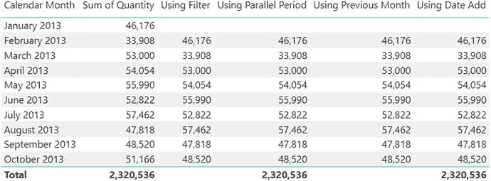

图 6-19
清单 6-21 至 6-24 中代码的输出结果

对于 2013 年 2 月这一行，四个计算度量均返回 46,176 这个值，这恰好是 2013 年 1 月 `[Sum of Quantity]` 的值。除了其中两个度量在 `[Total]` 列中也提供数值外，它们都会对外部切片器和筛选器做出响应。

`[Using Filter]` 度量编写最为复杂，但它为自定义筛选规则提供了最大的灵活性。在此实例中，可以轻松添加和应用额外的显式筛选层级。您还可以配置 `[Using Filter]` 度量，使其始终查看特定月份，而非相对月份。

`[Using Parallel Period]` 和 `[Using Date Add]` 版本利用了无需 `ALL` 或 `ALLSELECTED` 函数即可访问上下文之外数据的函数。这些函数还提供了根据其他时间段进行定制的灵活性。例如，需求可能是始终将当前月份与始终早两个月或十二个月的月份进行比较。`PARALLELPERIOD` 和 `DATEADD` 函数都支持将 `QUARTER` 和 `YEAR` 作为返回选项。您还可以对间隔使用正数和负数。

最后，`[Using Previous Month]` 度量在这四个度量中格式最为简单，但灵活性也最低。

在本例中，四个计算度量均在 `Fact Sale` 表的某一列上计算表达式，但使用 `Dimension Date` 表中的列来确定日期时段。它们遵循这两个表之间活动关系确定的规则，在此例中基于 `Fact Sale[Invoice Date key]`。如果计算应使用 `Fact Sale` 中的不同列进行分组，则可以将 `USERELATIONSHIP` 作为附加参数添加到 `CALCULATE` 函数中。这使得可视化图表能够按照您的需求，显示按交付日期表示的度量值。

`Dimension Date[Date]` 列在每个计算度量中也都出现。该列存在于一个确保日期连续的表中。某些基于时间智能的度量依赖于此才能正常工作。如果使用了 `Fact Sale` 中的日期列，可能会产生最初不易察觉的意外结果。

我将在第 8 章中分析这些度量的个别性能明细。

# 7. 日期

大多数数据模型都包含日期或时间元素。我不记得上次处理不涉及任何日期值的数据模型是什么时候了。

业务数据总是包含记录时间点的交易表。有时一行数据可能包含多个`DateTime`字段，用于表示与该交易相关的不同操作。以客户订单为例，可能有值来显示原始订单的时间点、取货日期、交货日期和开票日期。下游的报表需求可能需要根据这些`DateTime`值对数据进行分组，以提供与不同业务部门相关的视角。

传感器日志数据可能包含标识传感器的字段、显示读数时间点的字段（可能精确到微秒），以及读数本身的值。

其他类型的数据通常至少有一个组件会记录一个`DateTime`值，该值代表与该行或批次中其他数据相关的时间点。

为了进行报表和分析，数据模型通常需要通过以下三类问题来组织原始数据：
-   已发生的事件：例如，“我们从哪里来？”
-   当前状态：例如，“我们现在在哪里？”
-   未来趋势：例如，“我们要向何处去？”

要回答每个问题，都需要能够按日期或时间组织数据。第一个问题有助于展示历史上已发生的事实和事件的值。这可以揭示某个指标在历史上起伏的模式。例如，近期数据可能呈上升或下降趋势。或者，在按时间对数据进行分组、排序和绘制图表时，可能会出现循环或季节性趋势，这非常有用。能够将历史数据按时间桶进行分组和排序，能大大简化对已发生事件的理解过程。

在短期规划中，展示数据的当前状态可能非常有用。了解账户当前可用资金、当前库存商品数量、或车辆/物品的当前位置，可以为您制定短期计划提供有价值的见解。

最后，能够预测未来时间点的可能值，可以满足另一类报表需求。利用预测数据来帮助精确调整和优化未来的员工及库存水平，可以为组织节省宝贵的时间和资源。这些信息可以带来整体效率的提升。

这三个需求都以某种形式依赖于日期和时间数据。将数据按时间顺序组织到桶和组中，可以使创建有用报表的任务变得容易得多。

## 日期

在 DAX 中，术语 `Date` 通常指单个日期或日期分组，不包含小时、分钟或秒的详细信息。即使底层数据包含表示小时、分钟或秒的值，`Date` 也可能表示不包含时、分、秒的值。然后可以将日期组织成多种分组类型。明显的分组有日历年或月、财政年或月。其他有用的分组可以包括周、星期几、月或年的第几天。有许多分组日期的方法。有些方法常见于不同类型的数据，而另一些方法则可能高度特定于您的组织。

使用最低粒度为`Date`的数据可以生成大量有意义的报表。即使原始数据恰好包含交易发生时间点精确到秒的信息，剥离时、分、秒来显示每日、每月或每年的销售数量，通常也比表示更精细细节的报表更有用。

## 时间

在数据建模中，`Time` 通常指包含小时、分钟和秒（有时是毫秒）值的时间点。这个值可能包含也可能不包含年、月、日的值。有时，一个像`10:37 am`这样的`Time`值可以完全有意义，而不管它属于哪一天。这个值可以细分为`10 am`或上午（或上午晚些时候）等分组，数据可以聚合起来用于展示或比较。

# 日期/日历表

对于大多数数据模型而言，一个有用的数据结构是包含一个覆盖了连续日期范围的数据行集。这种表通常被称为日期表或日历表。有时这些表涵盖的时间范围非常广。在其他变体中，该表的最早日期可能仅对应数据模型中最早出现的日期。这些表也可能包含表示未来较远日期的行。

日期表的一个关键特征是每一天都由单独一行表示。任何一天都不应有重复行，更重要的是，数据中不应存在缺口。因此，对于表中最早和最晚日期之间的每一天，都应由表中单独一行来表示。

时间表具有与日期表相似的特征。首先，它们有一行来表示最低的粒度级别，从最低值开始到最高值结束。对于时间表而言，决定其最低粒度取决于你的报表需求。时间表的最低粒度可以是小时、分钟（或更小）。如果以分钟为单位，则表应有 1440 行，分别表示午夜 12:00 到晚上 11:59 之间的每一分钟。如果最低粒度恰巧是小时，则只需要 24 行。

在数据模型中创建日期表（或时间表）与其他表之间的关系时，应将日期表放在关系的一端。关系中涉及的列必须具有唯一性，且可以是任何数据类型。理想情况下，相关表中的对应列应具有相同的数据类型，并且其值必须能在日期表的列中找到精确匹配项。日期表中存在相关表中没有匹配行的记录是完全可以的，但如果反过来（相关表中的数据在日期表中找不到匹配），就会出现问题。

> **注意**  
> 如果日期表中用于关系的列不包含小时、分钟或秒，而相关表中的对应列却包含这些信息，则许多行可能无法匹配。在这种情况下，使用日期表中字段作为轴的视觉对象将报告低于预期的值。由于不会生成错误，因此这可能导致容易被忽略的问题。

对于日期表，我通常更喜欢使用日期数据类型的列，但像 `20190101` 这样的整数值同样适用。关键在于确保关系中所涉及的每一列的值使用相同的数据格式。

日期表可以同时与多个表建立关系。这使得使用日期表创建切片器（或筛选器）进行选择后，该选择会传播到所有相关表。

在一个模型中，日期表与另一个表之间可以创建多个关系。如前所述，销售表可能包含表示订单各个阶段的列。同一行中的订单日期、交货日期和发票日期可能具有不同的值。图 7-1 显示了 `'Dimension Date'` 和 `'Fact Sale'` 之间的两个关系。两个表之间的实线表示活动关系。使用表中数据的计算默认会使用此关系。如果某个计算需要使用非活动关系中的规则，则可以在计算中使用 `USERELATIONSHIP` 函数。

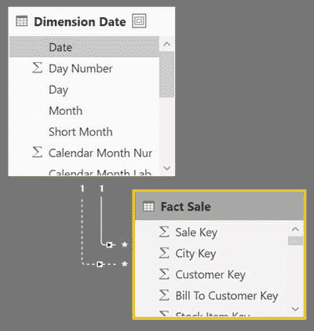

*图 7-1 — `'Dimension Date'` 与 `'Fact Sale'` 之间的关系*

在该图中，`'Dimension Date'` 和 `'Fact Sale'` 之间的活动关系基于 `[Invoice Date Key]`，而非活动关系则使用 `[Delivery Date Key]`。

清单 7-1 和 7-2 中显示的计算展示了如何使用这些关系。`[Count of Invoice Rows]` 计算度量只包含关于 `'Fact Sale'` 数据的表达式。当此度量用于包含 `'Dimension Date'` 字段的视觉对象时，查询上下文将根据 `[Invoice Date Key]` 自动筛选 `'Fact Sale'` 中的行组。

`[Count of Delivery Rows]` 度量使用 `USERELATIONSHIP` 来覆盖默认行为，以生成一个可用于绘制在给定 `'Dimension Date'` 值组中进行交付的行数的值。

```
Count of Invoice Rows =
COUNTROWS('Fact Sale')
```

*清单 7-1 — 使用 `COUNTROWS` 的计算度量*

```
Count of Delivery Rows =
CALCULATE(
    COUNTROWS('Fact Sale'),
    USERELATIONSHIP(
        'Dimension Date'[Date],
        'Fact Sale'[Delivery Date Key]
    )
)
```

*清单 7-2 — 在非活动关系上使用 `USERELATIONSHIP` 的计算度量*

图 7-2 显示了 WideWorldImportersDW 数据集前六个月中这两个计算度量的结果。

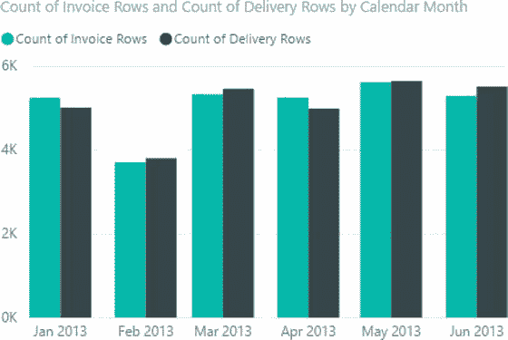

*图 7-2 — 使用清单 7-1 和 7-2 代码的簇状柱形图视觉对象*

数据模型中有多个日期表是完全正常的，这允许你在报表中使用多个日期范围。某些计算可以使用基于一个日期表的切片器所做的选择，而其他计算可以生成考虑基于另一个日期表的切片器所做选择的值。这些情况不常见，但你可以用它们来解决更棘手的报表场景。

日期表的最低要求是拥有一个表示日期的单列。通常，日期表中的附加列允许对日期进行分组和排序。常见的分组包括年、季度和月。一些日期表有数十个附加列以适应各种日期分组。

在本章后面，我将向你展示如何使用 `DAX` 函数生成日期表而无需使用外部数据。通常情况下，组织会有外部数据集，你可以将其导入数据模型，这些数据集已包含有用的行和列。查询编辑器也为你提供了为日期表生成数据的能力，你可以根据需要对其进行自定义。

## 自动日期表

Power BI Desktop 中有一个功能，可以自动为你的模型创建隐藏的 `Date` 表。如果启用此功能，Power BI 会为每个表中使用 `Date`/`DateTime` 数据类型（且尚未参与关系的一端）的每一列创建一个隐藏的 `Date` 表。如果你的模型有五个 `Date`/`DateTime` 列，Power BI Desktop 就会向模型添加五个隐藏的 `Date` 表。这些隐藏表的目的是帮助为你的模型提供自动化的时间智能层。

如果你向模型导入一个数据表，且该表中有一列使用了 `Date` 数据类型，Power BI 会添加一个包含七列（表 7-1）的表，该表填充了足够的日期以覆盖导入表中的数据，并四舍五入到每年的开始和结束日期。

**表 7-1**
Power BI 自动创建的日期表的结构和示例数据

| Date | Year | MonthNo | Month | QuarterNo | Quarter | Day |
| --- | --- | --- | --- | --- | --- | --- |
| 2019-01-01 | 2019 | 1 | January | 1 | Qtr 1 | 1 |
| 2019-01-03 | 2019 | 1 | January | 1 | Qtr 1 | 2 |
| 2019-01-03 | 2019 | 1 | January | 1 | Qtr 1 | 3 |
| … | … | … | … | … | … | … |

这个表的结构可以作为你设计任何 `Date` 表的一个良好起始模板。第一列是唯一的，并用于关系。其他列仅提供分组值。在 Power BI 中，默认情况下，如果将表中的 `Date` 字段拖放到可视化对象上，你可以选择使用基于此自动表的层次结构，或者仅使用实际表中的值。

此表能让你快速按年、季度、月或月的第几天进行切片和切块。

如果你能熟练使用 `Date` 表，并且有自己的高质量数据集可供使用，你可以在选项和设置中关闭此功能。

### 快速度量

2017 年，Power BI 引入了一项名为快速度量的功能。此功能允许报表作者通过对话框快速创建计算度量，而无需手动编写 `DAX`。这些度量涵盖各种常见场景，例如年初至今的总额和滚动平均值。然而，在撰写本文时，快速度量仅使用自动提供的 `Date` 表中的数据，而不能用于你自己 `Date` 表中的列。一旦创建了快速度量并获得了计算模式，如果你需要，可以修改并调整它以使用其他 `Date` 表。

如果你检查由快速度量功能创建的计算度量的 `DAX` 代码，可能会注意到用于引用自动 `Date` 表中列的语法略有不同。作为快速度量创建的年初至今计算度量中的核心表达式可能如下所示：

```
TOTALYTD(
    SUM('Table1'[Quantity]),
    'Table1'[My Date Col].[Date]
)
```

上述代码中突出显示的部分展示了一种特殊语法，该语法仅适用于 Power BI 提供的自动 `Date` 表。此语法包含三部分。第一部分是 `'Table1'`，它是对正在使用的表的引用。第二部分是 `[My Date Col]`，它是对要从 `Table1` 使用的列的引用。第三部分是 `[Date]` 列引用。这是自动 `Date` 表中列的名称。此列中的值将供 `SUM` 表达式使用，而不是 `[My Date Col]` 列中的值，后者可能存在间隙或其他基于日期的错误。

### 按列排序

自动 `Date` 表的结构凸显了在处理 `Date` 表时你可能遇到的另一个常见问题。这涉及基于文本的列的默认排序顺序。默认情况下，Power BI 按字母顺序对基于文本的列进行排序。自动表有两列基于文本的列：`[Month]` 和 `[Quarter]`。如果在可视化对象中使用这两列中的任何一列，其值都会按字母顺序排序。对于 `[Month]` 列，像 April、August 和 December 这样的值会排在开头，而 November、October 和 September 则排在末尾。

以下是使用默认排序顺序的日历月份列表：

```
April
August
December
February
January
July
June
March
May
November
October
September
```

然而，你极有可能需要特意以这种方式组织数据。要覆盖此行为，请使用 **按列排序** 功能，该功能允许使用另一列来对某一列进行排序。通常，指定的列是数值型的，但并非必须如此。在 `Date` 表中，一种常见模式是，对于表中的每个基于文本的列，都存在一个数值等效列，完全用于对该文本列进行排序。用于排序的数值列可以被多个列使用。例如，你可以使用 `[MonthNo]` 来排序 `[Long Month Description]` 以及 `[Sort Month Description]`。你还可以隐藏 `[MonthNo]` 列以帮助整理模型。

**按列排序** 功能并不仅限于对日期进行排序；你还可以使用它来按照对可视化对象有意义的方式排列诸如 Low、Medium 和 High 等值。它不仅对可视化对象中使用的值的顺序进行排序，还控制这些值在图例和筛选器/切片器中出现的顺序。你还可以使用它来控制类别在堆积柱形图的柱形中出现的顺序。

这是一个有用的功能，但它要求 `[Sort By]` 列中的值与正在排序的列中的值具有多对一的匹配关系。对于 `[Month]` 列中值为 `[January]` 的每一行，在 `[Sort By]` 列中使用的任何值中只能出现一个不同的值。在这种情况下，每个“January”的值都将是 1。

### 在使用月份时包含年份

在规划 `Date` 表时，请考虑在任何月份标签或标识符中包含年份信息，尤其是当数据集涵盖超过一年的时间时。与其将日期 2019 年 1 月 1 日转换为值 `[January]`，不如使用 `[January 2019]`。否则，计算可能会将此日期关联的数据与其他年份的一月数据合并在一起。

对于月份的数值版本，一个好的格式是使用 `YYYYMM`。这可以将相同月份但不同年份的数据分隔开，同时也提供了一个良好的排序列。使用两个大写字母 `M` 会为一月到九月的月份添加前导零。

## 时间智能

在 `DAX` 中构建数据模型时，常会使用到一个术语：时间智能。它本质上指的是将计算/度量与时间元素相结合的概念。它不仅能让你将数据按时间段进行分组和组织，还能让你理解每个时间段在时间顺序上与其他分组之间的关系。在设计与报表和分析相关的数据模型时，诸如显示相关时间段之间的比较或构建截至当前日期的度量等报表需求十分常见。

按年、月、日等类别分组的数据，与按非时间维度分组的数据具有相似的特征。计数、求和、平均值等计算对基于时间的分组与对非基于时间的分组同样有意义。然而，基于时间的分组与基于非时间维度（如尺寸、颜色、重量等）的分组之间的一个关键区别在于，基于时间的计算通常需要反映并展示模型中数据相对于其他数据在时间上的关系。

进一步来看，按产品颜色（红、绿、黄、蓝）进行切片后的计数、求和及其他计算，彼此之间通常没有强关联。你可以按任意顺序在图表上展示它们，并且可以像比较绿色和黄色一样，毫无障碍地比较红色和蓝色的值。

然而，对于日期来说，你更可能需要将 2019 年 1 月、2019 年 2 月、2019 年 3 月和 2019 年 4 月这些类别按顺序排列以便比较。生成 2019 年 2 月数据的计算，更有可能与基于前一个月的数据计算进行比较。虽然也可以像处理基于颜色的类别那样，按任意顺序组织 `DateTime` 类别，但这通常不是普遍需求。

基于时间的报告的另一个额外元素是：展示没有数据的时间段可能与展示有数据的时间段同样重要。当你使用没有红色值的数据按颜色分组时，在图表轴上省略红色占位符是很常见的。然而，如果某一天或某个日期段没有数据，你可能仍然需要通过确保该时间段在轴上有一个占位符来表示这一事实。

`DAX` 提供了一系列时间智能函数，这些函数能够识别时间顺序关系以及它们之间的关联。你可以将这些函数添加到你的计算中，通过最少的 `DAX` 代码来处理常见的时间相关任务。

## 年初至今

如果你需要显示从每个日历年开始到当前时间的度量累积值，有几种方法可以编写此类计算。一种方法是创建一个使用`CALCULATE`和`ALL`或`ALLSELECTED`来清除隐式筛选器的计算度量；这使得`SUM`能够访问当前查询上下文之外的数据，从而生成自年初以来的值。

另一种选择是使用满足此需求的计算，你可以通过时间智能函数来构建。使用`TOTALYTD`函数，你可以向数据模型添加一个计算度量（列表7-3），该度量表示你的表达式在一个日历年的累积值。图7-3展示了此计算的输出。

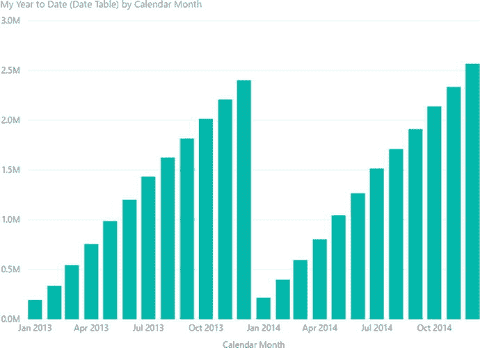

图 7-3 列表7-3中代码在每个日历年重置的输出

```
My Year to Date (Date Table) =
TOTALYTD (
SUM('Fact Sale'[Quantity]),
'Dimension Date'[Date]
)
```

列表7-3 使用`TOTALYTD`的年初至今计算度量

图7-3中的图表显示了在两年期间内每个日历月的柱状图。每个计算值都包含当前月份以及自该日历年起始月份以来所有月份的总和。累积值每年重置。

该函数仅需要两个参数。第一个参数是用于计算的表达式。此计算中的`SUM`函数使用了`'Fact Sale'[Quantity]`列中的数据。你也可以使用另一个计算度量来代替DAX表达式。

第二个参数需要引用一个日期列。

此示例并未使用与传递给`SUM`函数的列来自同一表的日期列；而是使用了来自符合经典日期表规则（每天一行，无间隙或重叠）的表格中的值。在这种情况下，数据会自动按`[Invoice Date Key]`分组，因为这是用于活动关系的列。要覆盖默认关系，可以传递一个额外的筛选条件。这可能采用使用`USERELATIONSHIP`或另一个你希望在DAX表达式之上应用的显式筛选器的形式，以提供额外的灵活性。

这里不需要`CALCULATE`函数，也未使用任何清除隐式筛选器的函数。`TOTALYTD`函数会自动覆盖筛选上下文，从而允许`SUM`函数查看生成累积值所需的所有数据。

当此计算度量用于使用`'Dimension Date'`表中其他字段的视觉对象时，该度量不仅会显示每个时间点适当的累积值，还会在每年重置为零。计算代码中没有任何指示函数如何对数据进行排序的指令。这是自动处理的，因为这是一个时间智能函数。

**注意**
始终注意视觉对象轴上使用的任何日期字段来自哪个表。使用来自不同表的日期列会影响传递给你的计算度量的隐式筛选器，因此可以帮助你获得正确（或错误）的结果。

如果你想使用此函数，但需要从一月以外的月份开始累积数据，你可以添加一个可选参数。这使得该函数对于非每年1月1日开始的财年期间非常有用。如果你的组织有一个在每年6月最后一天结束的财年，将值`"6/30"`作为第三个参数添加。这告诉函数使用第6个月的第30天来重置累积度量。

```
My Year to Date (Date Table) =
TOTALYTD (
SUM('Fact Sale'[Quantity]),
'Dimension Date'[Date],
"6/30"
)
```

一些与`TOTALYTD`类似的函数包括`TOTALMTD`和`TOTALQTD`。这些函数允许你添加计算，以帮助你为数据模型提供月初至今和季度初至今的总计。

# 周期比较

你可以使用其他时间智能函数来简化周期比较的计算。在报表中，显示紧邻上个月同一指标的值，或者将去年同月的数据与当月数据并排展示，通常非常有用。这些比较还可以进一步扩展为显示差值——例如，本月相比上月增长2%，或相比去年同期下降5%。

与`TOTALYTD`示例类似，可以构建一个使用`CALCULATE`函数配合显式筛选规则的周期比较计算，但使用时间智能函数能让这个任务更简单。

清单7-4中的计算度量值生成了一个显示上个月表达式结果的值。

```
上月数量 =
CALCULATE(
[数量合计],
PREVIOUSMONTH('日期维度'[日期])
)
```

清单7-4 使用PREVIOUSMONTH计算上月度量值

该计算度量值将`PREVIOUSMONTH`函数作为筛选器传递给`CALCULATE`函数，以控制`[数量合计]`度量值所使用的数据。`PREVIOUSMONTH`函数返回一个日期表，该表包含上个月每一天的日期值列表。该函数能自动处理连续月份天数不同所带来的特殊问题。

现在，你可以添加一个简单的计算度量值（清单7-5）来显示当前月与上个月之间的百分比差异。

```
数量与上月差异百分比 =
DIVIDE(
[数量合计] - [上月数量],
[上月数量]
)
```

清单7-5 结合清单7-4代码的百分比差异计算度量值

图7-4展示了将这些度量值添加到Power BI表格视觉对象后的效果，该表格使用了`'日期维度'`表中的`日历月`字段。

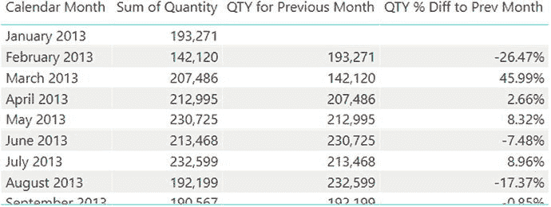

**图 7-4** 清单7-4和7-5中代码的输出结果

`[数量合计]`列显示的是该行对应日历月的值。`[上月数量]`列是使用`PREVIOUSMONTH`函数计算得到的值，而`[数量与上月差异百分比]`列则以百分比形式显示了变化情况。

`[数量与上月差异百分比]`计算可以使用变量将两个步骤的逻辑合并为一个，如清单7-6所示。

```
VAR 上月 =
CALCULATE(
[数量合计],
PREVIOUSMONTH('日期维度'[日期])
)
RETURN
DIVIDE(
[数量合计] - 上月,
上月
)
```

清单7-6 使用变量简化后的清单7-4和7-5

此版本将使用`PREVIOUSMONTH`作为筛选器的`CALCULATE`函数的结果存储在`上月`变量中，然后在最终的`RETURN`语句中多次使用该变量。多次使用同一变量的输出有助于提升性能。

以下是其他一些可以与`CALCULATE`结合作为筛选器使用的时间智能函数：

*   `PREVIOUSDAY` / `NEXTDAY`
*   `PREVIOUSQUARTER` / `NEXTQUARTER`
*   `PREVIOUSYEAR` / `NEXTYEAR`
*   `SAMEPERIODLASTYEAR`

上述每个函数都会返回一个日期表，可用作`CALCULATE`函数的筛选器参数。将`PREVIOUSMONTH`替换为`SAMEPERIODLASTYEAR`，可以得到被筛选为去年同月表达式的结果。

`DATEADD`和`PARALLELPERIOD`函数也返回一个日期表，可用作`CALCULATE`函数中的筛选器。与`PREVIOUSMONTH`等函数相比，它们提供了更大的灵活性，可以配置为向前或向后跳跃多个步骤，以满足其他报表需求。

清单7-7和7-8中的计算使用`DATEADD`和`PARALLELPERIOD`函数，基于三个月前的数据生成结果。这两个函数具有相同的参数签名。

```
数量 (前 3 个月) =
CALCULATE(
SUM('事实销售'[数量]),
PARALLELPERIOD(
'日期维度'[日期],
-3,
月)
)
```

清单7-7 使用PARALLELPERIOD回溯三个月的计算度量值

```
数量 (前 3 个月) =
CALCULATE(
SUM('事实销售'[数量]),
DATEADD(
'日期维度'[日期],
-3,
月)
)
```

清单7-8 使用DATEADD回溯三个月的计算度量值

# 移动平均值

另一个常见需求是展示使用当前值相关时间段内数据的计算，例如过去n天、周或月的滚动总和/平均值。这些度量有助于更平滑地查看趋势，并可以消除由更细粒度时间段产生的一些波动干扰。

要使这些类型的度量有效，计算需要将默认的筛选上下文替换为一个新的筛选器，该筛选器最终由核心DAX表达式使用。目标是创建一个包含计算所需时间段内所有日期的表。

在DAX中有多种方法可以实现这一点。以下是创建计算度量的一些建议，该度量显示`Fact Sale`[Quantity]每日总和的滚动平均值。

第一个版本是清单7-9，它回溯了七天。

```
最近 7 天平均数量（日期表）=
VAR DateFilter =
DATESINPERIOD(
'Dimension Date'[Date],
MAX('Dimension Date'[Date]),
-7,
DAY
)
VAR RollingSUM =
CALCULATE(
[数量总和],
DateFilter
)
RETURN
DIVIDE( RollingSUM, COUNTROWS( DateFilter) )
```

清单7-9 回溯七天的滚动平均计算度量

`DateFilter`变量使用`DATESINPERIOD`函数创建一个包含当前日期及前七天的表。`MAX`函数有助于从可能包含多天的日期中（取决于计算执行时的上下文）选取单个日期。

如果该计算被用于一个在轴、行或列标题上使用`'Dimension Date'[Date]`的视觉对象，`MAX`函数只需从单个日期中选取。然而，如果该计算被用于一个在轴、行或列标题上使用`'Dimension Date'[Calendar Month]`的视觉对象，那么每个月将包含多天。`MAX`函数简单地选取其中一个日期，在本例中，是每个日历月的最后一天。您可以在此处使用其他函数，例如`MIN`、`LASTDATE`和`FIRSTDATE`来代替`MAX`。

此计算中`DATESINPERIOD`返回的表应始终包含不超过七行。

下一步是对`Fact Sale`表中经过`DateFilter`变量中日期筛选的数据进行求和。最后，`RETURN`语句使用`DIVIDE`函数输出最终值。`COUNTROWS`函数使用`DateFilter`变量中的行数，以确保开始的前六天返回适当的平均值，而不是简单地除以七。然而，`COUNTROWS`函数不考虑没有值的日期。前面的版本只是将七天时间段内看到的所有数据求和，然后除以七。在这个数据集中，星期日没有生成发票，因此更理想的方法可能是将时间段内的数量总和除以有数据的天数。

上一个示例的最终`RETURN`语句可以通过添加一个步骤来筛选没有数据的日期，从而得到增强（清单 7-10）。

```
RETURN
DIVIDE(
RollingSUM,
COUNTROWS(
FILTER(DateFilter,
[数量总和]>0)
)
)
清单 7-10
对清单 7-9 中的代码使用 FILTER 函数更新后的 RETURN 语句
```

或者您可以使用`AVERAGEX`函数来实现相同的效果（清单 7-11）。

```
最近 7 天平均数量（日期表）=
VAR DateFilter =
DATESINPERIOD(
'Dimension Date'[Date],
MAX('Dimension Date'[Date]),
-7,
DAY
)
RETURN
AVERAGEX(
DateFilter,
[数量总和]
)
清单 7-11
使用 AVERAGEX 函数的清单 7-9 替代版本
```

在这种情况下，`AVERAGEX`函数是一个迭代器，因此`DateFilter`变量作为第一个参数传递。请记住，此变量仅包含一个只有七行的单列日期表。`AVERAGEX`函数会考虑某些天没有数据的情况，并且仅将总和除以适合底层数据的除数。

此方法的另一种变体使用`DATESBETWEEN`函数来生成一个日期列表，用于覆盖计算（清单 7-12）。

```
最近 7 天平均数量（日期表）=
VAR DateFilter =
DATESBETWEEN(
'Dimension Date'[Date],
LASTDATE('Dimension Date'[Date])-6,
LASTDATE('Dimension Date'[Date])
)
RETURN
AVERAGEX(
DateFilter,
[数量总和]
)
清单 7-12
使用 DATESBETWEEN 函数的清单 7-11 替代版本
```

`DATESBETWEEN`函数与`DATESINPERIOD`的不同之处在于，它使用两个固定日期来确定日期范围，而不是使用一个日期和相对偏移量。`DATESINPERIOD`函数的优势在于可以指定诸如年、季度、月以及日等偏移周期。

## 创建你自己的表

在数据模型中拥有一个专用的、集中式的日期表，不仅有助于跨多个表统一进行数据筛选和分组，还能帮助提供一组稳定的日期供时间智能函数使用。

有多种方法可以向数据模型添加日期表。您可以从现有数据源导入日期数据，该数据源应包含覆盖模型中所有数据日期范围内的、每天一行的数据；或者您可以使用查询编辑器或DAX生成自己的日期表。

本节将向您展示如何使用DAX函数从头开始构建日期表，而无需依赖外部数据源。您不需要拥有支持计算表的DAX版本。

起点是一个能够生成具有适当行数的表的DAX函数。有助于此的两个函数是`CALENDAR`和`CALENDARAUTO`。两者都生成一个单列表，其中包含连续的日期序列。

### CALENDAR

当您知道模型所需的日期范围的开始和结束日期时，可以使用`CALENDAR`函数。

此函数的语法是：

```
CALENDAR ( <StartDate>, <EndDate> )
```

以下是使用此函数的一些建议变体：

```
日期 = CALENDAR("2016-01-01", "2019-12-31" )
日期 = CALENDAR(DATE(2016,1,1), TODAY())
日期 = CALENDAR(
FIRSTDATE('Fact Sale'[Invoice Date Key]),
LASTDATE('Fact Sale'[Invoice Date Key])
)
日期 = CALENDAR(
STARTOFYEAR( 'Fact Sale'[Invoice Date Key] ),
ENDOFYEAR( 'Fact Sale'[Invoice Date Key] )
)
```

每个语句的输出都是一个名为`[Date]`的单列表，您可以将其作为使用额外DAX表达式添加列的基础。

### CALENDARAUTO

`CALENDAR`函数的一个便捷替代是`CALENDARAUTO`。`CALENDARAUTO`函数不需要参数。为了生成其自己的开始和结束日期，它会查找数据模型中现有表中使用Date或DateTime数据类型的列。如果找到，它会找出最新和最旧的值，然后将其舍入到每个日历年的开始和结束。

任何使用`CALENDARAUTO`的计算都会在每次数据刷新时重新执行，因此，如果新数据到达您的数据模型并超出了现有日期边界，则使用此函数的表中的行将自动添加。

### 扩展日期表

我通常向日期表添加的首批列提供了按日历月进行筛选和细分的能力。你可以使用`ADDCOLUMNS`函数来添加这些列，该函数会向基表添加列，每列以一对参数的形式指定，包括新列的名称以及用于生成该列每行值的DAX表达式（列表 7-13）。

```
Dates =
VAR BaseTable = CALENDAR("2016-01-01",TODAY())
RETURN
ADDCOLUMNS(
BaseTable,
"MonthID", FORMAT([Date],"YYYYMM"),
"Calendar Month", FORMAT([Date],"MMMM YY")
)
列表 7-13
使用 ADDCOLUMNS 在 CALENDAR 基础上构建的计算表
```

我们将这个计算表命名为`Dates`。`CALENDAR`函数用于生成一个单列表，该表包含从2016年1月1日开始到当前日期的连续日期序列，并赋值给`BaseTable`变量。这张表每天会增加一行。

使用`ADDCOLUMNS`函数添加了名为`MonthID`和`Calendar Month`的两列。添加`MonthID`列是为了使基于文本的`Calendar Month`列能够按时间顺序排序。这两列都使用了`FORMAT`函数，将存储在`[Date]`列中的内部日期值转换为每列所需的格式。

`FORMAT`函数可将数字或日期转换为文本值。字符、符号和其他文本可以作为转换的一部分添加进去。`FORMAT`函数可与格式字符串规则配合使用，以帮助强制指定要显示的小数位数。

`FORMAT`还可以使用预定义或自定义的格式规则将日期值转换为文本。在此例中，添加到`Dates`表的两列都选择了自定义字符串。大写字母`M`表示对应的月份。两个`M`字符返回一个带有前导零的两位数。一月份的日期返回`"01"`，而十二月份的日期返回`"12"`。大写字母`Y`表示年份部分。四个`Y`字符表示应生成包含世纪的完整年份文本。两个`Y`字符返回年份中最低的两位有效数字，因此1918年和2018年都返回`"18"`。

用于`MonthID`列的`FORMAT`函数使用了格式字符串`"YYYYMM"`。当将此格式字符串应用于诸如2019年1月5日这样的日期时，输出为`"201901"`。2019年7月4日的输出为`"201907"`。该列中的文本数据现在按日期进行了时间排序。这意味着`"202008"`总是出现在`"199910"`之后，因此你可以使用此列来控制`Calendar Month`列的排序顺序。

用于`Calendar Month`列的`FORMAT`函数使用的格式字符串是`"MMMM YY"`。四个大写字母`M`字符表示应使用完整的月份名称。格式字符串中使用的空格字符也会传递到最终输出中。此处也可以使用连字符、其他破折号或分隔符。最后，使用两个大写字母`Y`字符来确保不同年份的数据不会混在一起。此函数对于2019年1月5日的输出将是`"January 19"`，而对于2019年7月4日的输出将是`"July 19"`。

**注意**
当使用文本来表示日历月份时，最好添加额外的文本来唯一地标识年份。否则，你可能会在同一个计算中有将2019年1月数据与2020年1月数据合并的风险。

# 计算表列设计

一旦计算表被添加到模型中，就可以将 `Calendar Month` 列设置为使用 `MonthID` 作为其排序列。你可以隐藏 `MonthID` 列，并在此表与模型中的其他表之间创建关系。

`MonthID` 列的另一种版本是使用 `DateTime` 值，而不是使用整数数据类型（列表 7-14）。当 `DateTime` 字段用于 Power BI 中许多视觉对象的轴时，标签会动态缩放，因此无需滚动。这也允许该列在其他计算中使用基于日期的函数。列表 7-14 中所示的代码确保 "Calendar Month" 列的每个值对于 `MonthID` 列仍然只有唯一的行值。"Month" 列的 `[Date]` 值通过使用 `DATE`、`YEAR` 和 `MONTH` 函数转换为每个月的第一天。

```
RETURN
ADDCOLUMNS(
BaseTable,
"Month", DATE(YEAR([Date]),MONTH([Date]),1),
"Calendar Month", FORMAT([Date],"MMMM YY")
)
列表 7-14
在列表 7-13 的代码中使用 [Date] 值代替文本
```

### 添加年份

要添加一个表示日历年的列，请使用 `ADDCOLUMNS` 函数的参数（列表 7-15）。

```
RETURN
ADDCOLUMNS(
BaseTable,
"Month", DATE(YEAR([Date]),MONTH([Date]),1),
"Calendar Month", FORMAT([Date],"MMMM YY"),
"Year", FORMAT( [Date], "YYYY" )
)
列表 7-15
向计算表添加年份列
```

这将添加一个名为 "Year" 的文本列，该列已按时间顺序排序，因此不需要再生成其他列来解决排序问题。我曾遇到一个有趣的需求，即强制对年份进行反向排序。这是为了控制当该列的值用作矩阵的列标题时它们的显示顺序。需求是让较晚的年份显示在左侧，而较早的年份显示在右侧。为了解决这个问题，你可以向模型添加以下辅助列：

```
"YearSortID-", 0 - YEAR( [Date] )
```

这会生成年份的负值版本，这意味着当 `Year` 列按此列排序时，顺序会被翻转，因此 2019 年出现在 2020 年之后。

### 会计年度

要添加一个承载会计年度值的列，一种方法是将列表 7-16 中的表达式添加到 `ADDCOLUMNS` 语句中。

```
"Fiscal Year",
VAR FY_Month_Starts = 6
RETURN YEAR([Date]) - IF(
MONTH([Date]) < FY_Month_Starts,
-- 然后给年份加 1 --
1,
-- 否则保持不变 --
0  )
列表 7-16
向 ADDCOLUMNS 函数添加名为“Fiscal Year”的列的名称和表达式
```

该语句创建了一个名为 "Fiscal Year" 的列。该表达式声明了一个名为 `FY_Month_Starts` 的变量，其被赋值为介于 2 到 12 之间的整数。从六月开始的会计年度将使用 6。`RETURN` 语句从当前日历年的值开始，然后根据 `IF` 语句中的逻辑减去一年。

对于 6 月 1 日之后的日期，此计算输出的会计年度值与日历年度值相同。1 月 1 日至 5 月底之间的日期将自动保留上一年的值。

要创建一个基于会计日历显示月份编号的列，你可以添加列表 7-17 中的计算。

```
"Fiscal Month No",
VAR FY_Month_Starts = 6
RETURN MOD(
MONTH([Date]) - FY_Month_Starts,

)+1
列表 7-17
向 ADDCOLUMNS 函数添加名为“Fiscal Month No”的列的名称和表达式
```

赋值给 `FY_Month_Starts` 变量的值代表用作起点的日历月编号。此计算得出，6 月为 1，7 月为 2，8 月为 3，依此类推，直到 5 月为 12。

### 距今天数

在任何日期表中，一个实用的列是包含一个正数或负数的列，用以显示每一行距离当前日期的天数。该列可用于提供相对且动态的基于日期的筛选器。推荐的计算公式如下：

```
"距今天数", INT( [日期] - TODAY() )
```

对于 `[日期]` 列中值与当天匹配的行，此列的值为 0。未来日期的行具有正值，而过去日期的行则具有负值。

要使用此列强制显示最近 14 天的数据动态视图，请将此字段添加到报表、页面或视觉对象筛选器中，并设置一条高级规则，规定其仅显示 –14 到 0 之间的值。设置完成后，可保留筛选器设置，而报表将始终显示最近的 14 天数据。

### 每周存储桶

周数可能是操作起来比较棘手的列，而且它们通常与月份和年份等其他基于日期的分组配合不佳。周数常常跨越月或年存储桶的边界，因此通常需要与其他类型的日期分组隔离使用。

尽管如此，周数仍然是在模型中组织日期的一种有用方式。一个有效的方法是使用代表每周第一天或最后一天的值来对每七天进行分组。`WEEKDAY` 函数有助于实现这一点，因为它会根据每个 `[日期]` 是星期几，为其分配一个介于 1 和 7 之间的值。用于周起始列的计算公式可能如下所示：

```
"周日起始周", [日期] -  ( WEEKDAY( [日期] ) -1 )
```

默认情况下，`WEEKDAY` 函数假定一周从星期日开始，因此它会为恰好是星期日的任何日期分配值 1，星期一为 2，星期二为 3，依此类推，直到星期六被分配 7。然后，计算将每个值减 1，使其变为基于零的索引。接着，从 `[日期]` 中减去这个新值，从而将所有日期对齐到它们之后的最近一个星期日。

以下是以星期一而非星期日为基准的周起始列的计算公式：

```
"周一起始周", [日期] -  WEEKDAY( [日期], 3 )
```

`WEEKDAY` 函数现在有了第二个参数，指示该函数返回一个介于 0 和 6 之间的值，其中星期一是 0，星期二是 1，星期三是 2，依此类推，直到星期日是 6。此输出已经是基于零的，因此您不再需要从结果中减 1。

稍微复杂一点的情况是，周需要以星期日或星期一以外的某一天作为起始或结束。在这种情况下，您可以添加代码清单 7-18 中的代码。

```
"周三起始周",
VAR 我的工作日 = WEEKDAY( [日期], 3 )
VAR 偏移量 = 2 – 0=周一, 1=周二, 2=周三, 3=周四, 4=周五 5=周六, 6=周日
RETURN [日期] – MOD( 我的工作日 – 偏移量, 7 )
代码清单 7-18
向 ADDCOLUMNS 函数添加名为“周三起始周”的列的名称和表达式
```

您可以配置此表达式，使任何一天都可以成为一周的起始日。赋给 `偏移量` 变量的值控制使用哪一天。在此例中，它被设置为 2，这意味着周三是每周的起始日。对于星期六，您需要将 `偏移量` 变量设置为 5。

一旦这些日期时间列到位，您就可以添加额外的列来计算距离某个里程碑的周数。当前日期再次成为很好的计算里程碑，因此显示“距今天数”的列可能如下所示：

```
"距今天数",
DIVIDE(
INT(
([日期] -  WEEKDAY([日期],3)) - TODAY()
),
7)
```

此计算包含了“周一起始周”列中使用的相同逻辑，但它进一步计算了该周起始日期与当前日期（`TODAY`）之间的实际天数。然后，计算将结果除以七，以提供一个基于零的索引，其中过去日期显示负数，未来日期显示正数。

### 是否为工作日

有两个有助于表示工作日的列：一个简单的列，仅显示 1 或 0 值，反映特定行是否为工作日；另一个列则显示距离某个时间点（例如当前日期）的工作日数。

第一个示例（代码清单 7-19）假设星期一至星期五应标记为 1 以表示工作日，而星期六和星期日则应标记为 0 以表示周末日期。如果您打算将周末显示为 1，工作日显示为 0，则可以反转此设置。

```
"是否为工作日",
IF(  -- 基于零的索引，周一为 0，小于 5
WEEKDAY( [日期], 3 ) < 5,
-- 则 --
1,
-- 否则 --

)
代码清单 7-19
向 ADDCOLUMNS 函数添加名为“是否为工作日”的列的名称和表达式
```

当使用可选的第二个参数 3 时，`WEEKDAY` 函数会为每个 `[日期]` 返回一个介于 0 和 6 之间的值。星期一 = 0，星期二 = 1，依此类推，直到星期日 = 6。`IF` 语句简单地测试 `WEEKDAY` 函数的输出并分配相应的值。

第二个有用的列（代码清单 7-20）是显示自某个特定时间点以来的工作日数的列。此示例使用当前日期作为计算起点，并每天动态更新。

```
自今天起的工作日数 =
VAR 列日期 = '日期表'[日期]
RETURN
IF( 列日期 = 列日期 &&  '日期表'[日期]  TODAY()
)
)+0
代码清单 7-20
显示距当前日期工作日数的计算列。

此计算只能添加到现有的物理日期表中。它不能作为创建表语句中 `ADDCOLUMN` 函数的一部分添加，因为 `ALL` 函数依赖于一个必须已经存在的表。

该计算还依赖于表上已经存在一个名为 `[是否为工作日]` 的列。我在前面的“是否为工作日”部分提供了一个建议版本。计算将 `'日期表'` 列的值存储在一个名为 `列日期` 的变量中。该变量一次只能是一个值。然后 `IF` 语句决定应使用两个 `CALCULATE` 语句中的哪一个。第一个用于处理所有早于当前日期的行，而第二个 `CALCULATE` 应用略微不同的逻辑来计算晚于当前日期的行的值。每行只运行两个 `CALCULATE` 函数中的一个。

你可以将此压缩为一个单独的 `CALCULATE` 语句，但我以这种方式呈现是为了向你展示一般方法。两个 `CALCULATE` 语句都使用 `ALL` 函数来解锁正在计算的特定行之外的其他行。然后，`SUM` 函数可以利用更广泛的行中的数据来产生结果。

这些计算未考虑公共假日，因为假日可能因地区甚至年份而异。处理公共假日的一种建议方法是维护一个单独的表，该表为每个假日实例包含一行。这可以手动维护，也可以从各种本地数据集获取。然后，您可以在计算中使用此表的数据，以帮助确定实际日期表中的某行是否落在公共假日。

### 星期几名称

您可以使用 `FORMAT` 函数来显示一个仅包含星期几名称的列。使用 `ADDCOLUMNS` 添加此列的 DAX 代码如下：

```
"星期几名称", FORMAT([日期],"DDDD")
```

这里在格式字符串中使用了四个大写字母 D，以指定应显示完整的星期几名称，例如“Monday”或“Tuesday”。使用三个大写字母 D 会返回缩写版本，例如“Mon”或“Tue”。

### 自行构建日期表——总结

仅需使用 `DAX`，就能轻松为你的模型生成一张 `Date` 日期表。你可以结合使用以下建议，为你的数据模型构建一张合适的日期表。这些示例的目的是让你了解如何着手创建列，然后根据你所在组织的需求进行微调。

### 优化日期

来自源系统的原始数据通常会携带代表特定日期和时间点的数值。在处理传感器、物联网或事务性数据集时，这种情况相当常见。这些数据可能包含一个显示年、月、日、时、分、秒的字段。使用此类数据时，一个很好的实践是将该值拆分为两个或多个列。

其中一列应仅为 `Date`，因此需要将其截断，仅显示年、月、日。第二列（如果你确实需要的话）可以携带一个时间版本。时间可以截断为 0 到 23 之间的一个数字以代表一天中的小时，或者可以是一个 0 到 1,440 之间的数字，代表事件发生当天的具体分钟数。

这么做的原因是为了优化数据模型的速度。当 `DAX` 引擎导入数据时，它会将数据表拆分成单独的列。然后，每列中的数据会被压缩为唯一值。如果你的原始数据中有一个字段携带精确到秒（或微秒）的 `DateTime` 字段，那么该列的唯一性会非常高，因此压缩效果不佳。

如果你的原始数据来自一个每秒产生五次读数的物联网传感器，并且你将这些数据“原样”导入模型，那么每年可能会产生 1.5768 亿个无法压缩的唯一值（每秒 5 次读数 * 60 秒 * 60 分钟 * 24 小时 * 365 天 = 157,680,000）。

如果相同的传感器数据被拆分成两列，一列用于 `Date` 组件，另一列用于显示一天中的分钟值，那么 `Date` 列将只有 365 个唯一值，而代表分钟的列则只有 1,440 个唯一值。这种方法意味着原始数据在导入时可以高度压缩，同时仍然可以使用这个更小、更快的数据模型执行相同的计算。