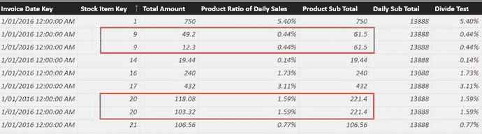
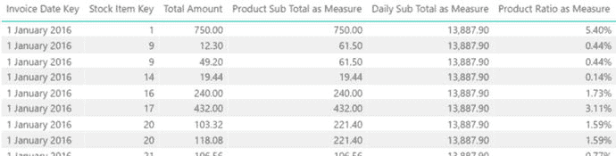
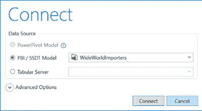
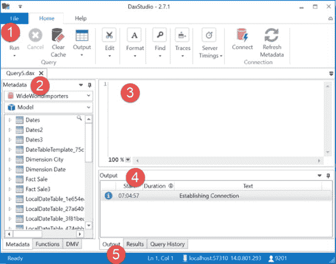
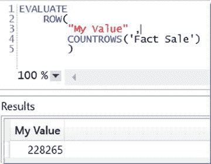
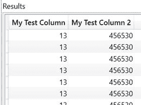
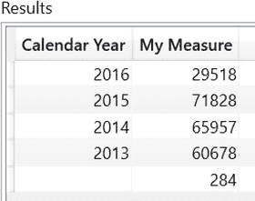
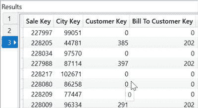
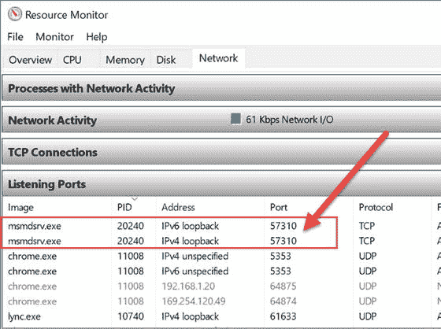
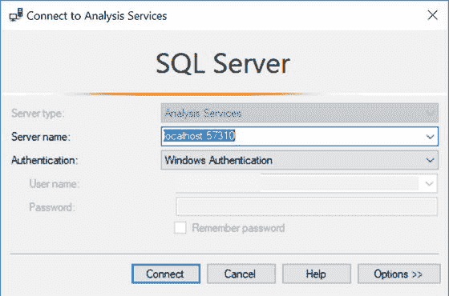

# 调试与优化

## DAX 中的调试

在任何编程语言中，一个很好的问题是：“我该如何调试代码？” 有些语言拥有成熟的工具，允许程序员在应用程序运行时逐步执行代码。这些调试工具通常允许你在不同点暂停，以检查各种有用的属性和值，从而使你对逻辑的实际执行过程有更清晰的了解。这并不总是你预期的路径，但至少能够调试可以帮助你识别需要改进的代码段。

不幸的是，`DAX` 并没有如此成熟的调试工具，但幸运的是，它也没有像简单应用程序中可能出现的那种程度的逻辑路径。`DAX` 中的计算通常是单行语句，简单到就像只向函数传递一个参数。

对以下计算度量进行单步调试可能不会提供太多有用信息，但输出结果可以快速生成，足以帮助你理解结果背后的原因。

```dax
Count of Table = COUNTROWS( 'Table' )
```

鉴于计算度量可能在报告页面内被执行多次，因此很难隔离特定实例的执行，以了解在该情况下哪些筛选上下文可能起作用或不起作用。

话虽如此，虽然你不能开始调试或逐步运行代码，但在构建计算时，你可以对代码应用几种手动技术。这就是我所说的老派调试法。

基本原则是将计算分解成独立的、更小的版本，并利用每个较小计算的输出来帮助理解生成的值。通过将逻辑简化为更小、更基础的步骤，你可以检查每个值，看看哪些符合你的预期，哪些可能不同。将这些基础步骤追溯到第一次产生意外结果的地方，应该是找出代码中哪个方面需要注意的最快方法。

如果你的计算产生了意外结果，请复制一份并将核心表达式更改为更简单的形式，例如 `COUNTROWS` 函数。这样做通常可以帮助你计算出有多少行被纳入该计算的考虑范围。

对于一个由多个嵌套函数组成的棘手计算列，请创建一些作为每个函数子集的临时列。

为了举例说明，请看代码清单 8-1 中的计算列；该计算显示了每天每个产品的百分比比率。

```dax
Product Ratio of Daily Sales =
DIVIDE (
    CALCULATE (
        SUM('Fact Sale'[Total Amount]),
        ALL('Fact Sale'),
        'Fact Sale'[Invoice Date Key]=EARLIER('Fact Sale'[Invoice Date Key]),
        'Fact Sale'[Stock Item Key]=EARLIER('Fact Sale'[Stock Item Key])
    )
    ,
    CALCULATE (
        SUM('Fact Sale'[Total Amount]),
        ALL('Fact Sale'),
        'Fact Sale'[Invoice Date Key]=EARLIER('Fact Sale'[Invoice Date Key])
    )
)
```

此语句中的第一个 `CALCULATE` 试图确定每天特定产品的总价值。由于同一天同一产品可能存在其他交易，因此计算需要检查同一表中是否还有其他行具有相同的 `[Stock Item Key]` 和 `[Invoice Date Key]`。如果找不到，并且该产品每天只有一笔交易，则该值应与 `[Total Amount]` 列中的值完全匹配。如果找到了其他具有相同 `[Stock Item Key]` 和 `[Invoice Date Key]` 的行，则 `SUM` 函数应为所有合并交易生成正确的值，然后将该值分配给该产品的每个实例。

我们只能看到作为整个计算列最终输出返回的数字。诸如由第一个 `CALCULATE` 函数生成的中间值则会丢失。

第二个 `CALCULATE` 试图得出每天的销售总额。这个每日总额与第一个值一起使用，以得出每个产品/天组合的百分比。同样，按照编写的计算方式，你看不到这些中间值。我们如何才能确保 `DIVIDE` 计算中使用的值就是你认为应该的值呢？

分解这个计算最容易的方法是为每个 `CALCULATE` 函数创建一个独立的可观察实体。这可以采取几个新计算列的形式，或者你也可以使用变量，并通过 `RETURN` 语句控制返回哪个变量。

### 使用列进行调试

采用计算列方法，你可以在清单 8-2、8-3 和 8-4 中添加三个计算列。

```dax
Product Sub Total =
CALCULATE (
    SUM('Fact Sale'[Total Amount]),
    ALL('Fact Sale'),
    'Fact Sale'[Invoice Date Key]=EARLIER('Fact Sale'[Invoice Date Key]),
    'Fact Sale'[Stock Item Key]=EARLIER('Fact Sale'[Stock Item Key])
)
```
*清单 8-2 显示子类别合计的计算列*

```dax
Daily Sub Total =
CALCULATE (
    SUM('Fact Sale'[Total Amount]),
    ALL('Fact Sale'),
    'Fact Sale'[Invoice Date Key]=EARLIER('Fact Sale'[Invoice Date Key])
)
```
*清单 8-3 显示整体合计的计算列*

```dax
Divide Test =
DIVIDE(
    'Fact Sale'[Product Sub Total],
    'Fact Sale'[Daily Sub Total]
)
```
*清单 8-4 结合清单 8-2 和 8-3 的计算列*

在这些清单中，清单 8-1 中的两个 `CALCULATE` 函数已被分离到各自的计算列中，而第三个计算列则使用了结合其他计算列的 `DIVIDE` 函数。你可以在“数据”视图中通过可视化检查来进行这种形式的调试。除了原始版本的计算列之外，你还可以使用这三个新的计算列。

图 8-1 展示了包含这三个新“调试”列的表的一个样本。该表已过滤为仅显示 2016 年 1 月 1 日的数据，并按 `[Stock Item Key]` 列排序。



*图 8-1 清单 8-2、8-3 和 8-4 中代码的输出*

第一行的 `[Product Sub Total]` 值为 750，似乎与 `[Total Amount]` 列相匹配。`[Stock Item Key]` = 1 只有一行，因此看起来没问题。接下来的两行已用框突出显示。这表明当天 `[Stock Item Key]` = 9 发生了两笔交易。单独的 49.2 和 12.3 合计为 61.5。这就是 `[Product Sub Total]` 列中两行重复的值，这正是期望的结果。仍需测试的数字是 13,888，该值在 `[Daily Sub Total]` 列的每一行中重复。

测试此值的一种方法是，首先创建一个使用 `[Total Amount]` 列的 `SUM` 的计算度量，然后在设置了与测试数据相同日期的筛选器的视觉对象中使用该计算。如果源系统是 SQL 数据库，另一种选择是编写查询来帮助核对此值。理想情况下，`T-SQL` 查询应保持简单，否则测试可能会因 `T-SQL` 语句中的错误而受到影响，因此应避免联接，并在任何 `WHERE` 子句中仅使用最简单的 `SUM` 和 `COUNT` 函数及最少的代码。

### 使用变量进行调试

上述方法的一种替代方案是利用变量。目标是在实际可行的情况下，将计算分解为更小的代码块。将相同的代码拆分到变量中，可能看起来像清单 8-5 所示。

```dax
Product Ratio of Daily Sales =
VAR InvoiceDateKeyCol = 'Fact Sale'[Invoice Date Key]
VAR StockItemKeyCol = 'Fact Sale'[Stock Item Key]
VAR ProductSubTotal =
    CALCULATE (
        SUM('Fact Sale'[Total Amount]),
        ALL('Fact Sale'),
        'Fact Sale'[Invoice Date Key]=InvoiceDateKeyCol,
        'Fact Sale'[Stock Item Key]=StockItemKeyCol
    )
VAR DailySubTotal =
    CALCULATE (
        SUM('Fact Sale'[Total Amount]),
        ALL('Fact Sale'),
        'Fact Sale'[Invoice Date Key]=InvoiceDateKeyCol
    )
VAR ReturnValue =
    DIVIDE (
        ProductSubTotal,
        DailySubTotal
    )
RETURN  ProductSubTotal
```
*清单 8-5 使用 `RETURN` 控制最终输出变量的计算度量*

在图 8-5 中，我修改了原始的计算度量，使其使用变量来存储代码的各个部分。除了代码现在更具可读性之外，最终的 `RETURN` 语句不必返回最后声明的变量。

此处的 `RETURN` 语句返回的是 `ProductSubTotal`，而非 `ReturnValue` 变量。这意味着，当执行此计算列后，在“数据”视图中此列显示的数字代表第一个 `CALCULATE` 函数的输出，而不是最终 `DIVIDE` 语句的输出。

当这些值被检查并确认符合预期后，你可以更新最终的 `RETURN` 语句，使其返回 `DailySubTotal` 变量。当确认该值正确后，你可以将 `RETURN` 语句设置为使用 `ReturnValue` 列。

这种方法的一个缺点是，在任何时候只能返回一个变量。然而，如果前面使用的某个计算列产生的值可能对其他几个计算有用，你可以采取混合方法。你可以使用 `[Daily Sub Total]` 列来创建类似的“百分比”类计算，这些计算可能涉及表中的其他列。

### 调试计算度量

就计算度量而言，其原理是相同的。清单 8-6 中的计算度量通过单一计算满足了每日销售中相同产品占比的需求。

```dax
Product Ratio of Daily Sales as Measure =
DIVIDE (
    CALCULATE (
        SUM('Fact Sale'[Total Amount]),
        FILTER(
            ALLSELECTED('Fact Sale'),
            'Fact Sale'[Invoice Date Key]=MAX('Fact Sale'[Invoice Date Key]) &&
            'Fact Sale'[Stock Item Key]=MAX('Fact Sale'[Stock Item Key])
        )
    )
    ,
    CALCULATE (
        SUM('Fact Sale'[Total Amount]),
        FILTER(
            ALLSELECTED('Fact Sale'),
            'Fact Sale'[Invoice Date Key]=MAX('Fact Sale'[Invoice Date Key])
        )
    )
)
```
*清单 8-6 待调试的计算度量*

清单 8-7、8-8 和 8-9 展示了如何通过将此 `DAX` 拆分为三个独立的计算度量来进行调试。

```dax
Product Sub Total as Measure =
CALCULATE (
    SUM('Fact Sale'[Total Amount]),
    FILTER(
        ALLSELECTED('Fact Sale'),
        'Fact Sale'[Invoice Date Key]=MAX('Fact Sale'[Invoice Date Key]) &&
        'Fact Sale'[Stock Item Key]=MAX('Fact Sale'[Stock Item Key])
    )
)
```
*清单 8-7 显示子类别总计的计算度量*

```dax
Daily Sub Total as Measure =
CALCULATE (
    SUM('Fact Sale'[Total Amount]),
    FILTER(
        ALLSELECTED('Fact Sale'),
        'Fact Sale'[Invoice Date Key]=MAX('Fact Sale'[Invoice Date Key])
    )
)
```
*清单 8-8 显示总体总计的计算度量*

```dax
Product Ratio as Measure =
DIVIDE(
    [Product Sub Total as Measure],
    [Daily Sub Total as Measure]
)
```
*清单 8-9 合并清单 8-7 和 8-8 的计算列*

由于这些是计算度量，您需要将它们添加到某个视觉对象中，例如图 8-2 中的表格视觉对象，以便检查这些值。在该图中，`[Invoice Date Key]`、`[Stock Item Key]` 和 `[Total Amount]` 列被添加到了同一个视觉对象中，以便为计算度量提供一些查询上下文。



*图 8-2 清单 8-7、8-8 和 8-9 中代码的输出*

图 8-2 中的最后三列显示了每个计算度量的结果。您可以使用此格式来帮助核对 `[Total Amount]` 的值。其中 `[Stock Item Key]` = 9 的行，其 `[Product Sub Total as Measure]` 值加起来是正确的。

将计算保留为单个语句，但使用 `RETURN` 语句控制返回哪个变量，同样有效。拆分成独立的计算度量的好处是，您可以在其他计算中使用每个度量。然而，当您试图跟踪使用了多个计算度量的代码时，这会导致一定程度的代码碎片化。

计算度量产生意外结果的一个常见原因是筛选不正确。随着计算度量复杂性的增加，特别是那些混合了清除或应用数据筛选层的度量，这意味着核心表达式使用的数据与您预期的不符。

有时，当像本章前面的清单 8-6 那样将每个组件分解成更小的块时，问题就会变得显而易见。如果这仍然无法解释某个值为何与您的预期不同，那么在核心表达式中使用替代函数可能有助于阐明问题。

复制您的计算度量，并将 `SUM ('Fact Sale'[Total Amount])` 替换为 `COUNTROWS ('Fact Sale')`，有时足以帮助识别与筛选相关的问题。否则，将其替换为其他表达式以显示某列的最小值或最大值，例如 `MAX ('Fact Sale'[Invoice Date Key])`，可能足以帮助澄清任何与筛选相关的问题。

手动调试时，一些可能有用的附加函数如下：

- `HASONEFILTER`：当指定列有且只有一个直接筛选值时，返回真。
- `HASONEVALUE`：当指定列在交叉筛选后只有一个值时，返回真。
- `ISCROSSFILTERED`：当指定的表或列被交叉筛选时，返回真。
- `ISFILTERED`：当指定列上有直接筛选器时，返回真。

这些函数产生真/假输出，当您将它们添加到新的计算度量并添加到您正在用于调试的同一个表格视觉对象时，它们会很有用。这些函数提供了关于引擎正在应用的筛选级别的有用信息。当您确信代码按预期运行时，可以移除这些临时的计算度量。

最后一个技巧是使用空白报表页进行调试，并从仅包括您需要的数据开始。如果您试图在一个包含其他视觉对象和筛选器的繁忙报表页上调试度量，则可能很难隔离问题。一旦计算按预期工作，您可以删除或隐藏用于调试的报表页。

### 外部工具

无论您是在 `Power BI`、`Excel` 还是 `SSAS` 中编写 `DAX` 计算，都有几个有用的工具可以帮助您生成更好的计算。本章我们将介绍以下三个工具：

- `DAX Studio`
- `SSMS`（SQL Server Management Studio）
- `SQL Server Profiler`

这些工具都是免费的，如果您已经在使用 Microsoft SQL Server 数据库，您可能已经安装了 `SSMS` 和 `SSMS Profiler`。本节将向您介绍如何上手，并重点说明每个工具的有用之处。

### DAX Studio

第一个值得关注的是备受推荐的`DAX Studio`，它自称是处理`DAX`查询的终极工具。你可以在`daxstudio.org`找到`DAX Studio`的文档，包括下载链接。

下载并安装`DAX Studio`后，你可以连接到由以下引擎托管的数据模型：
- Excel 中的 PowerPivot
- Power BI Desktop
- Azure Analysis Services
- Azure Analysis Services 表格模型

这意味着，如果你打开了一个已加载数据模型的`Power BI Desktop`副本，就可以打开`DAX Studio`并创建与该模型的连接，然后开始发出查询。

打开`DAX Studio`时遇到的第一个对话框会询问你要连接到哪个数据模型（图 8-3）。如果你打开了多个`Power BI Desktop`副本，可以从下拉列表中选择要连接的那个。



图 8-3 `DAX Studio`中的连接对话框

连接到模型后，应用程序的外观应如图 8-4 所示。
1. 顶部的功能区包含许多可用于编辑和优化`DAX`的功能；你可以隐藏它以获得更多编写`DAX`的空间。
2. 元数据面板允许你浏览模型的结构。你可以将表和列拖拽到查询编辑器中，从而避免输入较长的对象名称。此面板列出了所有`DAX`函数以及一些有趣的 DMV（动态管理视图）查询。
3. 查询编辑器是你编写和编辑`DAX`查询的地方。它具有完整的 IntelliSense 功能，可以在你输入时建议函数、表、列和度量值。
4. 输出栏由多个选项卡组成，其中包含有关已运行查询的信息。“结果”选项卡显示查询的输出。你可以启用其他选项卡来查看查询计划和内部服务器计时信息。
5. 底部的状态栏显示有关当前连接的信息。



图 8-4 `DAX Studio`的主屏幕

连接到数据模型后，你就可以开始在查询编辑器中编写`DAX`。准备好运行查询时，单击功能区上的运行按钮或按`F5`。只要查询没有错误，你就可以在输出面板的“结果”选项卡中看到输出结果。功能区上有一个选项可以将结果输出到文件，这是手动从数据模型中提取数据的一种便捷方式。

> **注意**：在`DAX Studio`中运行的每个`DAX`查询都必须以关键字`EVALUATE`开头，并且必须输出一个表。

从计算度量值中提取代码并在`DAX Studio`中运行会产生错误。以下两条语句都无法运行：

```
My Measure = COUNTROWS('Fact Sale')
COUNTROWS('Fact Sale')
```

即使在两条语句前面加上`EVALUATE`关键字也会产生错误，因为`COUNTROWS`函数的输出不是一个表。

```
EVALUATE
COUNTROWS('Fact Sale')
```

要使使用`COUNTROWS`函数的此类查询正常工作，需要将其包装在一个可以输出为表的函数中，比如`ROW`。

```
EVALUATE
ROW(
"My Value",
COUNTROWS('Fact Sale')
)
```

该语句在输出面板的“结果”选项卡中产生以下结果（图 8-5）。



图 8-5 `DAX Studio`中的简单查询及其结果

在`DAX Studio`中最简单的查询之一是使用`EVALUATE`加上模型中的表名。

```
EVALUATE
'Dimension Date'
```

这相当于`SELECT * FROM [Dimension Date]`，并显示`Dimension Date`表中的每一行和每一列。要减少输出中的行数，你可以对表使用筛选函数。

```
EVALUATE
FILTER(
'Dimension Date',
'Dimension Date'[Calendar Year]=2016
)
```

好的，作为一名高级文档工程师和翻译员，我将遵循您提供的注意事项和示例，将给定的英文文本翻译成中文。

前面的计算返回了`‘Dimension Date’`表中的所有列，但仅返回属于`[Calendar Year] = 2016`的行。

下面的计算等同于 `SELECT TOP 10 * FROM [Dimension Date] ORDER BY [Date] Desc`：

```
EVALUATE
TOPN(
10,
'Dimension Date',
'Dimension Date'[Date],
DESC
)
```

如果你想开发和测试计算列的外观，可以使用如下语法：

```
EVALUATE
SELECTCOLUMNS(
'Fact Sale',
"My Test Column",
'Fact Sale'[Unit Price] * 'Fact Sale'[Quantity]
)
```

此示例中使用的 `SELECTCOLUMNS` 函数意味着输出只包含一列；但是，它会生成与`‘Fact Sale’`表行数相同的行。你可以根据需要添加其他列，或者，如果查看基表中的所有列（包括你的附加计算）更有用，那么使用 `ADDCOLUMNS` 函数可能更好（列表 8-10）。

```
EVALUATE
VAR DoubleMe = 2
RETURN
SELECTCOLUMNS(
'Fact Sale',
"My Test Column",
'Fact Sale'[Unit Price] * 'Fact Sale'[Quantity],
"My Test Column 2",
VAR X = COUNTROWS('Fact Sale') * DoubleMe
RETURN X
)
```
列表 8-10 使用嵌套变量添加额外列的 DAX 查询

扩展逻辑以包含更多列的方法如列表 8-10 所示。这也演示了如何在查询之前和查询内部使用变量。图 8-6 显示了列表 8-10 的结果。



图 8-6 列表 8-10 中代码的输出

一个有助于测试计算度量值的选项是使用 `DEFINE MEASURE` 语句，将度量的 DAX 逻辑与 `EVALUATE` 查询分开。

列表 8-11 创建了一个新的计算度量值，该度量值仅存在于该查询范围内，并且数据模型的其他使用者不可见。

```
DEFINE MEASURE
'FACT Sale'[My test measure] = COUNTROWS('Fact Sale')
EVALUATE
SUMMARIZECOLUMNS(
'Dimension Date'[Calendar Year],
"Column Name here",
[My test measure]
)
ORDER BY
'Dimension Date'[Calendar Year] DESC
```
列表 8-11 使用 DEFINE MEASURE 创建查询范围计算度量值的 DAX 查询

`DEFINE MEASURE` 语句创建了一个可以添加多个度量值的区域。每个度量值必须在 DAX 表达式前加上完整的 `‘tablename’[measure name] =` 表示法。表达式中使用的代码与直接在数据模型中创建计算度量值时使用的代码相同。度量值名称必须包含表名。

然后可以在 `EVALUATE` 查询中使用该度量值，运行后结果将显示在“结果”选项卡中（图 8-7）。如果代码中有错误，语法错误消息会出现在“结果”面板的“输出”选项卡中。



图 8-7 使用 `DEFINE MEASURE` 的列表 8-11 的输出

在 DAX Studio 这类客户端工具中运行查询的另一个要素是，你可以向查询添加 `ORDER BY` 语句；列表 8-11 中也展示了这一点。

这些是在 DAX Studio 中运行查询的基础知识。其他功能对于优化查询非常有用，我们将在本章稍后部分更详细地介绍这些功能。

除了拥有更大的查询编辑器区域和一系列在编辑较长的 DAX 查询时非常有用的工具之外，你还可以将查询保存并存储为单独的文件。这样做可以帮助你备份并为单个查询提供源代码管理。

格式化查询（`F6`）功能允许你通过在关键位置添加制表符和回车符来整理查询，从而帮助提高查询的可读性。

你可以同时运行多个查询，如下所示：

```
DEFINE MEASURE 'Fact Sale'[Right Now] = FORMAT(NOW(),"hh:mm:ss.ms")
EVALUATE
ROW("Q1",[Right Now])
EVALUATE
ROW("Q3",[Right Now])
EVALUATE
SAMPLE(10000,'Fact Sale','Fact Sale'[Invoice Date Key])
```

当你运行此查询时，它会向“结果”面板返回三个数据集。

你可以通过单击编号的垂直选项卡来查看每个 `EVALUATE` 语句的结果。该批次中第三个也是最后一个 `EVALUATE` 查询的结果如图 8-8 所示。请注意，其中两个查询使用了 `DEFINE MEASURE` 部分中的计算度量值。最后一个查询使用 `SAMPLE` 函数对`‘Fact Sale’`表中的 1,000 行执行随机筛选。



图 8-8 同时运行三个查询的最后一个结果集

### SSMS（SQL Server Management Studio）

另一个有助于开发和调试 DAX 计算的工具是 Microsoft SSMS。如果你正在使用 Microsoft SQL 数据库，你可能已经拥有此工具。如果没有，快速搜索互联网会引导你找到 Microsoft 网站上的正确下载位置。这是一个较大的下载文件，因为它包含了用于处理整个 Microsoft SQL 产品套件（而不仅仅是 DAX 模型）的功能。

与 DAX Studio 一样，你可以使用 SSMS 连接到 DAX 数据模型，例如 Power BI Desktop 和 SSAS 表格模型。但是，要连接到 Power BI Desktop，你需要知道你本地机器上要连接的实例所使用的端口号。每次打开 Power BI Desktop 时，此端口号都会更改。连接后，DAX Studio 会在状态栏上以 `localhost:nnnn` 格式显示端口号，其中 `nnnn` 是端口号。因此，如果你有 DAX Studio，并且还想使用 SSMS 连接到你的模型，你可以将其作为快速识别所需端口号的方法。

> **注意**：你可以通过导航到桌面可执行文件所在的文件夹并从控制台运行以下命令，在特定端口上启动 Power BI Desktop：

```
PBIDesktop /diagnosticsport:XXXX
```

另一种查找当前端口号的方法是通过操作系统的资源监视器（图 8-9）（或类似工具）；查找使用 `msmdsrv.exe` 可执行文件正在侦听的网络端口。如果你只打开了一个 Power BI Desktop 实例，这会更简单。



图 8-9 使用 Windows 10 资源监视器查找 Power BI Desktop 的侦听端口

在这种情况下，资源监视器显示端口号 `57310` 是 `msmdsrv.exe` 正在侦听的端口，因此在使用图 8-10 中的属性从 SSMS 进行连接时，你可以使用它。



图 8-10 用于连接到 Power BI Desktop 的 SSMS 连接对话框示例

服务器类型需要设置为 `Analysis Services`。这可能不是此属性的默认值。

连接后，DAX 查询必须符合与你在 DAX Studio 中使用的相同要求。这些要求包括每个查询都需要使用 `EVALUATE` 关键字，并且所有结果都应为 DAX 表。

除此之外，SSMS 还提供了 IntelliSense 和许多其他功能来帮助你构建 DAX 计算。本章中用于演示 DAX Studio 的所有查询示例，除了在同一批次中使用多个 `EVALUATE` 语句外，都可以在 SSMS 中工作。

### 其他客户端工具

一旦知道了要查询的 DAX 引擎的服务器和端口号，就可以使用任何能够连接到 SSAS 表格模型实例的工具。你甚至可以将 Power BI Desktop 连接到另一个 Power BI Desktop 实例。这对于开发 DAX 查询可能并非特别有用，但这样做可以通过发出 DMV 查询，并利用 Power BI 中出色的可视化图表阵列来绘制结果，从而帮助优化你的数据模型。

## 优化

优化是一个广泛且可能涉及高级知识的主题——事实上，它足以独立成书。在本节中，我将尝试介绍一些可用于提升模型性能的实用技巧。我将建议分为两部分。第一部分是关于优化数据模型，第二部分则重点介绍优化 DAX 查询，并涵盖如何利用 DAX Studio 和 SSMS 等工具来提升性能。

### 优化数据模型

让我们从移除未使用的数据开始。

#### 移除未使用的数据

第一个建议是确保只在模型中包含所需的数据。模型越大，需要执行的计算工作就越多，而多余的数据，即使未用于任何计算，仍可能对模型的压缩和性能产生不利影响。

尽管在数据探索阶段，从源系统的各个表中导入所有行和列可能最初很有用，但请确保在将报表发布到生产环境之前，留出时间审查并从数据模型中移除未使用的列和行。

位于未使用列中的高度唯一的数据可能会对 DAX 引擎用于存储数据的压缩产生负面影响。针对此类未使用数据的目标列通常是 `IDENTITY` 或自动编号列，这些列在 OLTP 源系统中很有用，但在 OLAP 数据模型中通常价值不大。除非你需要在报表中显示这些列的值，否则移除它们可以显著减小数据模型的大小。

你可以使用名为 `Power BI Helper` 的免费工具来帮助识别模型中未被使用的列。你应该从数据模型中移除它标记出的任何列，并且仅在报表需要时才将它们添加回来。你可以从 `http://radacad.com/power-bi-helper` 下载 `Power BI Helper`。

如果你熟悉使用 DMV，那么使用 `DAX Studio` 或 `SSMS` 对你的数据模型执行以下 DMV 查询（排序后），可以让你深入了解模型中哪些对象（列）占用了最多内存。

```
Select * from $System.discover_object_memory_usage
```

这些列是值得检查是否能移除掉的。

移除未使用的列是一种技巧，但同时也要考虑导入到模型中的行数。如果数据模型只需要支持特定的时间范围，那么请考虑只导入覆盖所需时段的数据。

同时，考虑在导入过程中压缩数据。如果来自源系统的数据集每天有很多行，例如在一些物联网传感器数据中可能看到的情况，那么在导入之前或期间对数据进行分组。也许可以通过使用已预汇总至每天一行的数据来满足报表需求，该行同时还包含已压缩行的 `COUNT`、`MIN`、`MAX` 和 `AVERAGE` 值。

这些建议有助于减小数据模型的整体大小。如果你使用 Power BI Desktop 模型尝试这些建议，请记下更改前后保存的 PBIX 文件大小。我曾见过实例，文件大小从超过 800 MB 减少到不到 40 MB，且没有破坏报表中的任何视觉对象。这主要是结合了对数据模型执行建议的 DMV 查询、识别占用内存最多的列对象并将其从模型中移除的结果。在这个案例中，被移除的大部分列是位于拥有数亿行数据的表中的 `IDENTITY` 列。

> `注意`
> 在模型中隐藏列不会影响性能。请从数据导入逻辑中移除未使用的列。

#### 创建汇总表

另一种旨在不增加模型整体大小的方法是，在模型内部创建额外的汇总表。你可以在 DAX 中生成这些表，也可以将其作为查询编辑器中导入过程的一部分。

如果你有一个包含许多行的大表，并且需要保留其原始形式以满足某些报表需求，请考虑创建可用于无需下钻到原始表最细粒度细节的视觉对象和计算中的汇总表。

以 WideWorldImportersDW 数据集中的 `'Fact Sale'` 表为例。该表包含 228,265 行数据，记录了每笔销售的详细信息。

按日历月和客户对此数据集中的该表创建汇总版本，可将行数减少到 5,239 行。这样的汇总表可以支持任何需要此粒度级别的视觉对象或计算，而其大小仅为原始表的 1/50。当你使用拥有数亿行数据的表创建报表时，使用此方法带来的性能提升会更加显著。

你可以从一个大型表创建数十个汇总表，以实现高度定制化的性能调优。在这种情况下，我建议采用良好的命名约定来帮助跟踪。

##### 预计算数据

对于不需要动态计算的度量值，请考虑使用计算列而不是计算度量值。一个例子可能是根据大型表中的数据确定最佳客户或销售人员的排名度量值。这类计算可以以计算度量值或计算列的形式执行。但是，如果你不需要动态地重新计算该度量值以响应切片器或筛选器选择的变化，那么根据数据大小，使用计算列可能会提升模型的性能。

##### 拆分唯一列

如果数据集中有一列包含高度唯一的值，例如包含从年到毫秒详细信息的 `DateTime` 列，或者 `IDENTITY` 或自动编号列，那么请考虑将其拆分为多个列。

`DateTime` 的例子很简单，可以将其整齐地拆分为一个承载日期值的列，以及其他承载小时、分钟或秒值的列。如果你不需要报告比“天”更细的粒度级别，那么请将这些信息从数据模型中完全移除。

寻找其他可以拆分列的机会，特别是当数据可能具有多重含义时。这些可能包括代表汽车品牌和型号的值，或者包含对报表无用的详细级别（例如郊区或街道）的地址数据。

##### 简化表结构

DAX 数据模型可以使用与源系统表结构镜像的表结构来提供精确的计算。这包括跨越表关系集多个层级的计算。但是，如果你扁平化数据表结构以减少每次计算需要使用的表关系数量，模型性能可能会快得多。

一个好的遵循模式是将数据组织成事实表和维度表。这通常被称为星型模式，并且已被证明在报表和分析工作负载中表现良好。