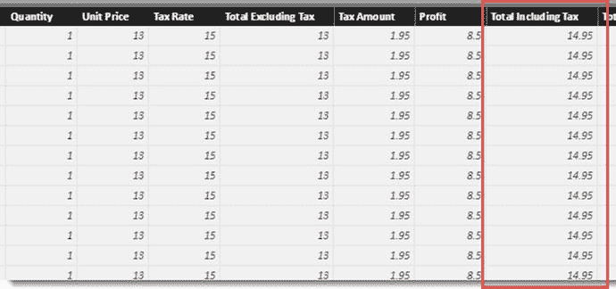
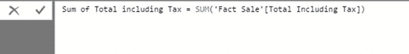
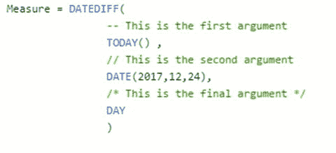
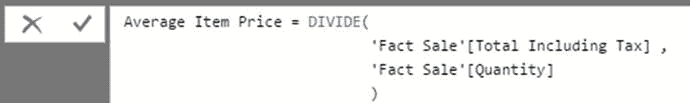
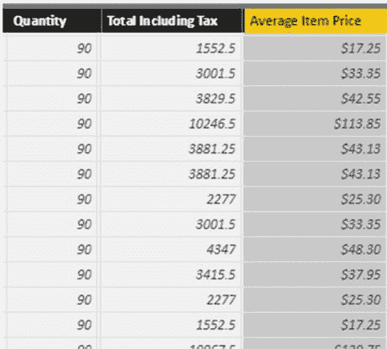
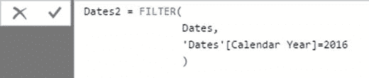
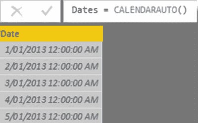
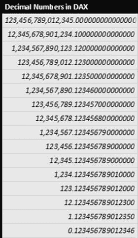
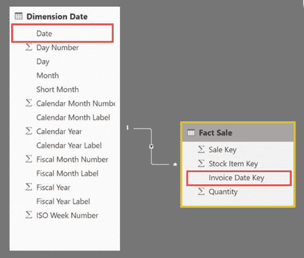
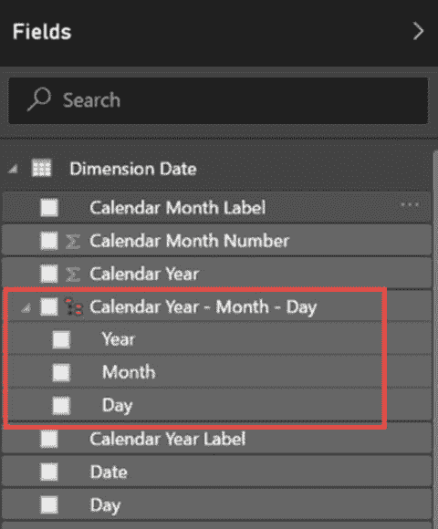

# 1. DAX 简介

本书旨在帮助你学习如何使用 `DAX` 语言，通过 Microsoft Power BI、Excel Power Pivot 和 SSAS 表格模型等工具来提升你的数据建模能力。如果你已经具备扎实的 `T-SQL` 知识，本书将特别有用，不过这并非必需条件。

在本书中，我将使用 `DAX` 来展示并解决各种场景问题，并提供等效的 `T-SQL` 语句，主要作为对比参考，以帮助阐明每个解决方案。我个人有多年使用 `T-SQL` 构建解决方案的背景，我希望能将在学习 `DAX` 的历程中获得的技巧和诀窍，分享给那些拥有类似背景的人。你并不一定要熟悉 `T-SQL` 才能从本书中获得最大收益，因为书中的示例对于不熟悉它的人也同样有用。我发现，有时用多种方式描述同一个答案，有助于更好地理解解决方案。

在本书中，我使用 Power BI Desktop 作为主要的 `DAX` 引擎，大多数示例都使用 `WideWorldImportersDW` 数据库中的数据，该数据库可从微软网站免费下载。此数据库可以还原到 Microsoft SQL Server 2016 或更高版本的实例中。我使用的是 SQL Server 2016 的开发者版。

我建议你下载最新版本的 Power BI Desktop 并将其安装到本地 Windows 电脑上。下载地址为 `powerbi.microsoft.com/desktop`，也可以通过快速互联网搜索找到。该软件可免费安装，能让你在几分钟内加载数据并开始构建基于 `DAX` 的数据模型。

`WideWorldImportersDW` 数据库简洁、组织良好，是学习使用 `DAX` 进行数据建模的理想起点。

本章的目的是涵盖 `DAX` 的高级基础知识，而不深究过多细节。后续章节将对同样的基础知识进行更深入的探讨。

## 什么是 DAX?

数据分析表达式 (`DAX`) 既是一种查询语言，也是一种函数式语言。它最早于 2009 年作为 Microsoft Excel 2010 的一个加载项出现。`DAX` 的主要目标是帮助组织、分析、理解和增强数据，以用于分析和报表制作。

`DAX` 并非一种全功能的编程语言，它不具备你可能期望从其他编程语言中获得的一些流程控制或状态持久化机制。它旨在增强数据建模、报表和分析能力。`DAX` 在不断发展，新的函数会定期加入。

`DAX` 被描述为一种函数式语言，这意味着计算主要使用函数来生成结果。它提供了多种多样的函数，用于处理算术、字符串操作、日期和时间处理等。函数可以嵌套，但你无法创建自己的函数。函数分为以下几类：

*   `DateTime`
*   `Filter`
*   `Info`
*   `Logical`
*   `Mathtrig`
*   `ParentChild`
*   `Statistical`
*   `Text`

`DAX` 中有超过 200 个函数。你编写的每一个计算都会用到其中的一个或多个函数。每个函数都会产生一个输出，有些返回单个值，另一些则返回一个表格。函数使用参数作为输入。函数可以嵌套，因此一个函数的输出可以作为另一个函数的输入。

与 `T-SQL` 不同，`DAX` 中没有用于操作数据模型中数据的 `INSERT`、`UPDATE` 或 `DELETE` 的概念。一旦一个物理表存在于 Power BI、SSAS 表格模型或 Excel PowerPivot 数据模型中，`DAX` 就无法对该表中的数据进行添加、更改或删除操作。只能使用 `DAX` 函数对数据进行筛选或查询。

## 什么是数据模型？

数据模型是数据、计算和格式化规则的集合，这些元素组合在一起，形成一个可用于探索、查询和更好地理解现有数据集的对象。它可以包含来自多个来源的数据。

Power BI Desktop、SSAS 表格模型和 Excel 版 PowerPivot 可以从各种数据源（包括数据库、平面文件）导入数据，也可以直接导入自许多源系统。数据导入后，可以向模型添加计算，以帮助探索和理解数据。

数据被组织并存储在表中。表是二维的，与数据库表有许多共同特征。表有列和行，可以在表之间定义关系，以帮助使用来自多个表的数据进行计算。计算可以是简单的，比如统计一个表的行数，或者对某一列的值求和。考虑周全的计算应能增强你的数据模型，并支持构建报表和执行称为度量值的分析任务的过程。

正是数据和度量值的组合构成了你的数据模型。

Power BI Desktop 的用户界面由三个核心组件组成。首先，报表视图提供了一个画布，让你可以使用图表和其他可视化效果为数据模型创建可视化层。报表视图还允许你通过拖拽和调整报表画布上元素的大小来控制布局。当最终用户访问报表时，他们看到的就是这个画布。

第二个组件是数据视图，它提供查看模型中每个表的原始数据的能力。数据视图一次只能显示一个表的数据，通过在右侧面板的表列表中点击表名来控制。在此视图中可以对列进行排序，但此处的排序不会对报表画布上可视化效果的排序产生任何影响。可以使用报表视图重命名、格式化、删除、隐藏列或定义其数据类型。隐藏的列在报表视图中始终可见，但在报表的字段列表中不会显示。

可以从报表视图和数据视图中添加或更改计算。

Power BI Desktop 用户界面的最后一个组件是关系视图。此部分显示数据模型中的所有表，并允许你添加、更改或删除表之间的关系。

## DAX 数据模型的组成部分

`DAX` 数据建模引擎由六个关键组件构成。

### 数据

构建数据模型的第一步是导入数据。可用的数据源多种多样，一旦导入，它们将以二维表的形式存储。也可以使用非二维的数据源，但这些数据源需要在导入之前或期间转换为二维格式。查询编辑器提供了丰富的函数来帮助进行此类转换。

### 表

表是用于存储和组织数据的对象。表由列组成，这些列包含源数据或 `DAX` 计算的结果。

### 列

每个表可以有一个或多个列。底层数据引擎将同一列的数据存储在其独立的索引中。与 `T-SQL` 不同，`DAX` 按列而非按行存储数据。数据一旦加载到列中，就被视为静态的，无法更改。列也可以称为字段。

### 关系

两个表可以通过模型中定义的关系进行连接。每个表中的一个列用于定义该关系。仅支持一对多和一对一关系。不支持创建多对多关系。在 `DAX` 中，关系最常见的用途是提供筛选，而不是模拟为优化 OLTP 操作而进行的数据标准化。

### 度量值

度量值是一种 `DAX` 计算，它返回一个可以在报表可视化效果中使用，或作为其他度量值计算一部分的单一值。度量值可以简单到像统计一个表的行数或对某一列求和。度量值会对用户交互做出反应和响应，并在报表使用过程中重新计算。度量值可以根据筛选器和切片器选择的更新，返回新的值。

### 层次结构

层次结构是将两个或多个列分组为不同级别，可通过交互式可视化效果和图表进行向上/向下钻取。常见的层次结构可能基于日期数据，创建包含年、月、日的三级层次结构。其他常见层次结构可能使用地理数据（国家、城市、郊区），或反映人力资源或产品数据中组织分组的结构。

## 您的第一个 DAX 计算

导入数据后，可能无需编写 `DAX` 代码。如果数据干净简单且报告需求基础，您可以创建一个无需用户创建计算即可使用的模型。拖拽到报告画布上的数值字段将生成一个数字。

如果您随后将非数值字段拖拽到同一可视化对象中，它会自动假设您希望按非数值字段中的不同值对数值字段进行分组。数值字段的默认聚合方式为 `SUM`。您可以使用可视化对象的属性将其更改为其他聚合类型。其他聚合类型包括 `AVERAGE`、`COUNT`、`MAX`、`MIN` 等。

在此方法中，报告会为您创建一个 `DAX` 计算度量值。这些度量值称为*隐式度量值*。将 `'Fact Sale'[Quantity]` 字段拖拽到画布上会自动为您生成以下 `DAX` 语句：

```
CALCULATE(SUM('Fact Sale'[Quantity]))
```

每当切片器或筛选器发生更改时，此计算都会重新计算，并应显示与报告中任何筛选器设置相关的值。

大多数真实场景至少需要对原始数据进行一些基本的增强处理，这就是添加 `DAX` 计算可以改进模型的地方。当您专门创建计算度量值时，这些度量值称为*显式度量值*。

一些最常见的增强功能包括：提供显示表中记录数的能力，或对列中的值进行求和。

其他增强功能可能包括：使用同一行中其他列的值或模型中其他位置的值创建新列。一个简单的例子是，将诸如 `Price` 和 `Qty` 等列的值相乘，以得出总额的列。一个更复杂的例子可能是在计算中使用其他表中的数据，以提供对该行和该表有意义的数值。

一旦添加了基本的计数或求和计算，就可以添加更复杂的计算，例如提供累计总数、期间比较或排名。

以下是 `DAX` 中三种类型的计算：

*   计算列
*   计算度量值
*   计算表

我们将在本书后面更详细地探讨每种计算，并且我会就如何以及何时选择一种类型而非另一种类型提供提示。

> **注意**：计算表（作为 `DAX` 计算结果的表）只能在 Power BI Desktop 和 SSAS 表格模型使用的 `DAX` 引擎中创建。

### 您的第一个计算

我介绍的第一个示例使用来自 `WideWorldImportersDW` 数据库的数据创建了一个简单的计算度量值（图 1-1）。该数据集有一个名为 `'Fact Sale'` 的表，其中包含一个名为 `[Total Including Tax]` 的列。该计算会生成一个表示使用此列中存储的值进行求和的数值。



*图 1-1：来自 'Fact Sale' 表的数据示例*

在数据视图中查看此表时，我们会看到 `[Total Including Tax]` 列中每一行的未汇总值。需要一个计算度量值来显示代表此列中每一行总和的一个数值。

在 Power BI 中，您可以使用功能区，或在报表视图或数据视图中右键单击表名来创建计算度量值。这会在功能区下方显示一个区域，您可以在其中键入计算的 `DAX` 代码。此计算度量值的文本应为：

```
Sum of Total including Tax = SUM('Fact Sales'[Total Including Tax])
```

这应该看起来如图 1-2 所示。



*图 1-2：第一个计算度量值的 `DAX`。此计算使用 `SUM` 函数，在报告中凡是使用该计算度量值的地方都会返回一个单一数值。当使用不包含其他字段或筛选器的可视化对象将其拖放到报告画布上时，该值应显示为 $198,043,493.45。*

公式的结构可以分解如下：从左侧开始，文本的第一部分设置了计算度量值的名称。在本例中，名称由 `=` 运算符左侧的所有文本决定。此计算度量值的名称是 `[Sum of Total including Tax]`。计算度量值的名称在整个模型中（包括列名）应是唯一的。

此名称就是您在字段列表中看到的度量值显示方式，以及它在某些可视化效果和图表中的显示方式。

> **注意**：为计算度量值和列创建名称时，建议使用单词之间的空格。避免使用下划线字符或完全删除空格的命名约定。尽可能使用自然语言。使用简短且具有描述性的名称。这对于诸如 `Q&A` 等 Power BI 功能尤其有帮助。

`=` 符号将计算名称与计算本身分开。计算度量值只能返回一个单一数值，绝不能返回数值列表或表。在更高级的场景中，可以使用涉及数值分组的步骤，但结果必须是一个单一数值。

`=` 符号之后的所有文本都是该计算度量值的 `DAX` 代码。此计算使用 `SUM` 函数和一个参数，该参数是对列的引用。`SUM` 函数返回的单一数值代表 `[Total Including Tax]` 列中所有行相加的数值。传递给 `SUM` 函数的列的数据类型必须是数值型，不能是文本或日期时间数据类型。

列引用的表示法是*完全限定*的，意味着它同时包含表名和列名。表名用单引号 (`' '`) 括起来。当表名不包含空格时，这是可选的。列名用方括号 (`[ ]`) 括起来。

计算度量值属于单个表，但您可以使用建模选项卡上的 `Home Table` 选项将它们移动到新的宿主表。无论计算度量值位于哪个宿主表上，它们都会产生相同的结果。

> **注意**：在计算中引用其他计算度量值时，切勿在其前面加上表名。但是，在引用列时，应始终包含表名。

### IntelliSense

`IntelliSense` 是一种面向程序员的预测性文本形式。大多数现代编程开发环境都提供某种形式的 `IntelliSense`，以帮助您在编写代码时获得指导。如果您以前没有遇到过，这是一种非常有用的方法，有助于避免语法错误并保持计算格式正确。

`DAX` 也不例外，当您开始键入计算时，您应该注意到会出现关于您接下来可能键入的内容的建议。工具提示会提供函数的简短说明以及所需参数的详细信息。

`IntelliSense` 还可以帮助您确保括号的对称性，尽管如果您没有意识到它在起作用，有时可能会感到困惑。

`IntelliSense` 建议可以采用相关函数、表或可由当前函数使用的列的形式。`IntelliSense` 足够智能，只会提供对当前参数有效的建议。它不会将表提供给只接受列的参数。

就我们的公式而言，当我们键入 `SUM` 函数的第一个括号时，`IntelliSense` 会提供可用列的建议。它不会提供表或计算度量值作为选项，因为 `SUM` 函数仅设计用于处理列。

# 格式化

与`T-SQL`和几乎所有编程语言一样，合理使用行间距、回车符和制表符可以极大地提高可读性，更重要的是，有助于理解计算中使用的代码。虽然可以将复杂代码写在一行内构造出一个可工作的计算公式，但这种做法难以维护。单行计算还会导致“括号游戏”的问题。

> **注意**
> 括号游戏是指你试图在公式中正确配对左/右括号以获得正确结果。若配对失败，则意味着你输了游戏，你的公式将无法正常工作。

一个好的技巧是，在开始编辑计算之前，通过重复按下`Shift-Enter`组合键多次，或点击右侧的下箭头，来扩展可视编辑区域。

## 注释

你还可以使用表 1-1 中的任何技术，为任何`DAX`计算添加注释。

**表 1-1** 如何添加注释

| 注释字符 | 效果 |
| --- | --- |
| `//` | 右侧文本在下一次回车前会被`DAX`忽略。 |
| `--` | 右侧文本在下一次回车前会被`DAX`忽略。 |
| `/* */` | 两个星号之间的文本会被`DAX`忽略，且注释可以跨越多行。 |

添加注释的一些示例方式如图 1-3 所示，图中也展示了一个如何通过将`DAX`分散到多行来提高可读性的示例。

通过格式化代码和添加注释，你可以帮助任何后续查看计算的人更轻松地理解函数的逻辑和意图。



**图 1-3** 注释文本样式及换行使用

在`Power BI Desktop`和`SSAS Tabular`中，公式栏的一个不错的替代品是`DAX Studio`，这是一款免费且功能丰富的产品，旨在帮助你开发和调试计算。我将在第 8 章中更详细地介绍`DAX Studio`。

## 你的第二个 DAX 计算

在第二个示例中，我将创建一个计算列，而不是计算度量值。第 9 章将提供关于何时应考虑使用计算列而不是计算度量值的更详细建议，但简而言之，计算列会在现有表中添加一个新列，该列的值通过`DAX`公式生成。

一个简单的计算可能会使用同一行中其他列的值。此示例使用了`Fact Sale`表中的两列来执行一个简单的除法运算，返回一个代表平均单价的值。

要将此计算添加到数据模型中，请在“字段”菜单中选择`Fact Sale`表使其高亮显示。然后使用“建模”选项卡上的“新建列”按钮，并输入图 1-4 所示的文本。



**图 1-4** `[Average Item Price]`的计算列

> **注意**
> 此公式无需在每个列名前加表名也能工作；但是，强烈建议你在引用列时始终包含表名。这在调试更长的`DAX`查询时，可以更轻松地区分列和度量值。

图 1-4 中的代码向`Fact Sale`表添加了一个名为`[Average Item Price]`的新列。新列中每个单元格的值（参见图 1-5）是该计算对表中每一行执行一次后的输出结果。



**图 1-5** 新计算列的数据示例

## 你的第三个 DAX 计算

最后一个示例将创建一个计算表。此选项仅在`Power BI Desktop`和`SSAS Tabular`中可用，在`PowerPivot for Excel 2016`（或更早版本）中不可用。

你可以使用任何返回表的`DAX`函数创建计算表，或者简单地引用模型中的另一个表。最简单的语法允许你创建另一个`DAX`表的副本。图 1-6 所示的示例创建了一个名为`Dates2`的新计算表，它是`Dates`表的完整副本。对`Dates`表所做的修改（例如添加或修改列）会自动传递到`Dates2`表。


**图 1-6** 创建计算表

可以向`Dates2`表添加筛选器、度量值、列和关系，而不会影响`Dates`表。这样做的妙处在于，因为基表（`Dates`）是从物理数据源读取的，所以`Dates`表中数据的任何更改都会反映在`Dates2`表中。

若要扩展此示例，使新表仅显示原始表中的某些行，你可以使用`FILTER`函数，如图 1-7 所示。



**图 1-7** 使用`FILTER`创建的计算表

`Dates2`计算表的列数仍与`Dates`表相同，但它只包含与筛选表达式匹配的行。这使得`Dates2`计算表拥有 365 行，代表 2016 日历年中每一天对应的一行。

使用计算表创建汇总表，作为计算度量值的更快替代方案，这很常见。使用计算表生成销售表的聚合版本，可以为任何使用该聚合版本的计算带来可观的性能提升。

### `CALENDARAUTO`函数

一个无需使用现有表即可生成计算表的便捷`DAX`函数是`CALENDARAUTO`函数。此函数返回一个只有一列（名为`[Date]`）的表。调用时，`CALENDARAUTO`函数会检查模型中的每个表，查找使用`Date`或`DateTime`数据类型的列。

使用这些数据类型的所有列中出现的最早和最晚日期值，将用于生成介于最早和最晚值之间的每一天对应的行。这些日期会四舍五入到日历年的开始和结束。

日期表对于数据模型来说是无价的，尤其是当你添加了旨在准确显示期间比较和运行总计的度量值时。有几个`DAX`函数可以让你向模型添加时间智能逻辑。这些函数通常依赖于一个具有连续日期且能正常工作的日期表。在`WideWorldImportersDW`数据集中，`Fact Sale`表中没有`[Invoice Date Key]`落在星期日的行。这可能会给某些处理期间比较逻辑的函数带来问题。当非日期表数据中出现日期空缺时，日期/日历表有助于使计算更可靠地运行。



**图 1-8** `CALENDARAUTO`函数的示例输出

一旦你使用`CALENDARAUTO`函数创建了如图 1-8 所示的计算表，就可以开始向其添加计算列和度量值。你也可以开始创建与模型中其他表的一对多关系。

# 数据类型

在 DAX 中，可以为单个列定义数据类型。不同的数据类型在表 1-2 中暂时列出，并分为三大类，`True/False`（布尔值）除外。
- 文本
- 数值
- 日期时间

通过选择最佳数据类型，你可以帮助减小模型的大小，并在刷新数据和使用报表时提高性能。

导入新数据时，数据建模引擎会猜测每列应使用哪种数据类型。这值得检查，因为可能有机会进行调整，以确保为每列使用了适当的数据类型。

另一个需要注意的因素是，尽管你的数据源在创建模型时可能生成数值数据，但在未来的某个时间点，它可能会开始包含非数值数据，这将在数据刷新期间导致错误。当数据源几乎不提供最佳数据类型的建议时（例如 CSV 格式），这种情况更可能发生。

**表 1-2** DAX 中的数据类型

| 数据类型 | 存储方式 | 有效值 |
| --- | --- | --- |
| `整数` | 64 位整数 | 介于 –9,223,372,036,854,755,808 和 +9,223,372,036,854,755,808 之间的有符号整数。 |
| `小数` | 64 位实数 | 介于 –1.79E + 308 和 –2.23E –308 之间的实数和十进制数的混合。只有 15 位有效数字能返回精确结果。超出此范围的值计算并返回近似结果。 |
| `定点小数`/`货币` | 64 位实数 | 与 `小数` 相同，但固定为四位小数。 |
| `日期`/`时间` | 64 位双精度浮点数 | 公元 100 年 1 月 1 日至公元 9999 年 12 月 31 日。 |
| `True/False` | | |
| `文本` | Unicode（每个字符两个字节） | 最大字符串长度为 268,435,456 个 Unicode 字符。 |

## 整数数据类型

顾名思义，`整数`数据类型允许你以正整数或负整数的形式存储和操作数据。任何小数部分都会被移除，使用整数值进行的算术运算会返回整数，而非其他数据类型的值。

```
VAR 整数 A = 3
VAR 整数 B = 2
RETURN DIVIDE( 整数 A, 整数 B ) // 将存储为 1.5
```

**注意**
执行除法计算时，请使用 `DIVIDE` 函数而不是 `/` 运算符。使用 `DIVIDE (3, 2)` 而不是 `3 / 2`。这可以更优雅地处理除零错误的情况。

## 小数和定点小数数据类型

`小数`数的每个值使用 64 位存储，可以表示范围广泛的值，这些值要么具有较大的整数部分和较小的小数部分，要么相反。

你可以使用此数据类型存储极大或极小的数字，然后执行计算。但是，在使用此数据类型时，要注意对于极大的值，结果可能不精确（非精确）。

以下练习显示了存储但不显示的值，只显示前 15 位有效数字。

### 实数的计算

第一个示例使用以下代码创建一个计算度量：

```
度量 1 = 100000000000000000 + 50
```

在此代码中，1 后面跟了 17 个零，计算结果返回值为 100000000000000000。请注意，尽管加上了值 50，但结果并未改变。我知道大量的零可能让你眼花，但我向你保证，确实有 17 个零。

现在创建第二个计算度量，它引用第一个度量，如下所示：

```
度量 2 = [度量 1] + 50
```

这将返回 100000000000000100——一个 1，14 个零，一个 1，然后再跟两个零。

如果你的数字有较大的整数部分，如图 1-9 中顶行所示，DAX 允许小数部分有较少的精度。小数点两侧的总最大位数为 15 位。

整数部分优先，因此如果你有一个具有 12 位整数和 12 位小数的值，DAX 将自动将小数四舍五入到 3 位。



**图 1-9** 数据格式

`定点小数`（或`货币`）使用`小数`数据类型，但其小数部分固定为 4 位。当你处理货币或金钱数据时，应优先选择此数据类型。使用此数据类型执行的算术运算应为财务报告产生可接受的结果，特别是在舍入和截断方面。

## 日期和日期时间

在处理基于日期的数据时，有两种基于日期的数据类型可供选择。`Date` 和 `DateTime` 之间的区别，顾名思义，在于 `DateTime` 可以表示包含小时、分钟、秒和毫秒的值，而 `Date` 则不能。

可以比较和匹配同为 `Date` 和 `DateTime` 的值，但是，只有午夜时刻的 `DateTime` 值才能匹配同一天的 `Date` 值。当用户在表之间创建关系时，如果关系的一端使用 `Date` 数据类型，而另一端使用 `DateTime`，这有时会难倒缺乏经验的用户。如果使用 `DateTime` 的表有一个像 `'2018-01-01 10:30:00'` 这样的值，它将永远无法在使用 `Date` 数据类型的表中找到匹配的记录。且不会抛出任何错误。

如果你需要在 DAX 中生成一个特定的日期，可以使用 `DATE` 函数，它接受三个参数（年、月、日）。`DATE( 2018, 5, 1)` 返回一个代表 2018 年 5 月 1 日的日期。

### 时间

你可以使用 `Time` 数据类型来表示一天中的特定时间点。这些值可以是“下午 2:37”或“上午 10:30”，并且可以相加或组合以进行基于时间的计算。

```
TIME(1,0,0) + "03:00:00"
```

上述计算显示了两种不同表示法的时间值相加。它是在一个代表凌晨 3 点的值上加 1 小时。结果是凌晨 4 点。

使用 `Time` 数据类型的值仍然存储为完整的 `DateTime`，并使用 1899 年 12 月 30 日作为年、月、日部分。使用 `Time` 的函数通常会忽略年、月、日。

## 运算符

以下是 DAX 中的四组运算符：
- 算术
- 比较
- 连接
- 逻辑

DAX 中没有位运算符。位运算可以通过函数而不是运算符来执行。

### 算术运算符

表 1-3 显示了 DAX 中可用的算术运算符。

**表 1-3** DAX 算术运算符

| 运算符 | 作用 | 示例 |
| --- | --- | --- |
| `+` | 加法 | `2 + 2 = 4` |
| `–` | 减法 | `10 – 4 = 6` |
| `*` | 乘法 | `4 * 5 = 20` |
| `/` | 除法 | `8 / 2 = 4` |
| `^` | 乘方 | `2 ^ 4 = 16` |

### 比较运算符

表 1-4 中的运算符在用于比较两个值时返回 true 或 false。运算符两侧的值可以是文本、数值或日期时间。

**表 1-4** DAX 比较运算符

| 运算符 | 作用 | 示例 |
| --- | --- | --- |
| `=` | 等于 | `Sales[数量] = 10` |
| `<` | 小于 | `Sales[数量] < 10` |
| `>` | 大于 | `Sales[价格] > 20` |
| `<=` | 小于或等于 | `Dates[日期] <= TODAY ()` |
| `>=` | 大于或等于 | `[总计] >= 200` |
| `<>` | 不等于 | `[动物] <> "猫"` |

如果你将一个数字与一个文本值进行比较，例如 `1 = "1"`，会收到一个错误。在这种情况下，你可以使用 `FORMAT` 函数将数字 1 转换为字符串，或者使用 `VALUE` 函数将 `"1"` 值转换为数字。

### 连接运算符

用于连接文本值的运算符如下所示（表 1-5）。

**表 1-5** DAX 连接运算符

| 运算符 | 作用 | 示例 |
| --- | --- | --- |
| `&` | 连接值 | `"ABC" & "DEF" = "ABCDEF"` |
| | | `1 & 2 = "12"` |

在 `"1 & 2"` 的示例中，两个值都被隐式转换为文本，输出是一个文本值。

### 逻辑运算符

表 1-6 展示了 `DAX` 中的逻辑运算符。

**表 1-6** DAX 逻辑运算符

| 运算符 | 功能 | 示例 |
| --- | --- | --- |
| `&&` | 逻辑与 | `(1=1) && (2=2) = true` `((1=1) && (2=3) = false` |
| `\|\|` | 逻辑或 | `(1=1) \|\| (2=2) = true` `(1=1) \|\| (2=3) = true` `(1=2) \|\| (2=3) = false` |
| `IN` | 逻辑或 | `Location[Country] IN ("UK","USA","Canada")` |

### 运算符优先级

确定了正确的运算符后，还需要考虑运算符的应用顺序。表 1-7 展示了 `DAX` 中运算符的优先级顺序。

**表 1-7** 运算符优先级

| 运算符 | 功能 |
| --- | --- |
| `^` | 乘方 |
| `–` | 符号（正或负） |
| `*` `/` | 乘法和除法 |
| `!` | 非 |
| `+` `–` | 加法和减法 |
| `&` | 连接 |
| `=` `<` `>` `<=` `>=` `<>` | 比较 |

如有必要，可以使用括号覆盖运算符优先级，如表 1-8 中的示例所示。在第二行的示例中，加法在乘法之前执行，产生了与第一行不同的结果。在底部行的示例中，括号使符号运算符优先于乘方运算符。

**表 1-8** 运算符优先级示例

| 计算 | 结果 |
| --- | --- |
| `2 * 3 + 4` | `10` |
| `2 * (3 + 4)` | `14` |
| `–2 ^ 2` | `–4` |
| `(–2) ^ 2` | `4` |

`DAX` 会尽可能尝试将运算符两边的数据类型隐式转换为相同类型。但这并非在所有情况下都能保证。例如，`1 + "2"`会导致错误，而 `1 & "2"` 则会生成文本值 `"12"`。

## 关系

关系是 `DAX` 中的规则，用于定义两个表如何相互关联。创建关系主要有两个原因：一是允许在一个表上所做的筛选选择通过关系自动筛选另一个表的行；二是允许计算使用不同表中行的值，并理解行应如何连接。

### 关系类型

关系可以定义为一对多或一对一，但始终使用关系中每个表的单个列。当在两个表之间添加关系时，关系一侧所涉及的列必须具有唯一值。如果在数据加载或刷新过程中检测到重复数据，将发生错误，提示你无法在两个列之间创建关系，因为这些列必须具有唯一值。

#### 用于筛选的关系

`WideWorldImportersDW` 数据集包含多个事实表，每个事实表都有一个或多个基于日期的列。该数据集还包含一个名为 `Dimension.Date` 的表，该表包含从 2013 年 1 月 1 日到 2016 年 12 月 31 日之间每天对应的行。该日期表包含 14 个用于分组和筛选的列。

将这些表导入模型后，可以在表对之间添加关系，使得基于报表的筛选器能够对一侧的表进行任何选择，并向下流动以筛选相关表中的行。

筛选器仅沿一个方向跨关系流动。对关系多侧表中列所做的筛选选择不会筛除一侧表中的行。筛选器可以通过多组关系向下流动，但方向始终是从一侧到多侧。

这意味着，如果将日期表中的任何字段添加到报表视觉对象或筛选器，使用这些视觉对象或筛选器所做的任何选择都会传播到相关表，并触发度量值使用新的筛选器设置重新计算。

图 1-10 显示了 `'Dimension Date'` 表和 `'Fact Sale'` 表之间的关系。`'Dimension Date'`（一侧）使用的列是 `[Date]`，而 `'Fact Sale'`（多侧）使用的列是 `[Invoice Date Key]`。这两列均使用 `Date` 数据类型。

有了这种关系，将 `[Calendar Year]` 列从 `'Dimension Date'` 拖到报表画布上，并将其转换为切片器视觉对象。切片器显示该列中的不同值，即 `2013`、`2014`、`2015` 和 `2016`。选择其中一个或多个值会向下流动并应用于任何相关表。如果在切片器中选择了 `2014`，则基于相关表中列的视觉对象所使用的计算会自动重新计算，并生成考虑更新后的 `'Dimension Date'` 表筛选条件的新值。



**图 1-10** `'Dimension Date'` 与 `'Fact Sale'` 之间的关系

`Power BI Desktop` 具有一项功能，可以在向模型添加新表时自动检测关系。如果新表包含一个列，该列与另一个表中的列共享相同的名称和数据类型，则可能会自动为你添加关系。这可能很有帮助，但始终建议仔细检查已为你添加了哪些关系，以及这些关系是否确实有用。

我从好友马特·阿林顿那里学到的一个好技巧是，在`关系视图`中组织表，使位于一侧的表位于多侧表的上方。这有助于在视觉上强化筛选器在关系中向下渗透的特性。当数据模型中有很多表时，这会变得困难，但对于较小的模型，这是一个非常值得应用的技巧。

#### 用于计算的关系

利用关系的另一种方式是通过 `DAX` 函数 `RELATED` 和 `RELATEDTABLE`。这些函数允许计算使用来自不同但相关表中行的数据。这意味着，你可以向一个表添加计算列，该列显示使用父表或子表中数据的值。`RELATED` 函数允许计算从多侧向上深入到一侧表中的数据，而 `RELATEDTABLE` 则允许一侧的计算访问多侧表中的数据。

一对表可以定义多个关系，但一次只能将一个关系标记为活动关系。筛选器和计算默认使用活动关系。非活动关系可以在计算中使用，但需要使用 `USERELATIONSHIP` 筛选函数专门引用它们。

尽管可以让表或关系镜像 `OLTP`（联机事务处理）结构，但更好的做法是研究和学习一些 `BI` 方法论，例如使用星型模式来组织数据。当表中的行数增长到很大值时，这一点尤其有用。

还可以在两个表之间定义多个关系，并控制交叉筛选方向。这些概念将在关于 `DAX` 关系的章节（第 5 章）中更详细地介绍。

# 层次结构

层次结构将表中的两个或多个列组合成基于级别的分组。可以通过将字段拖放到同一表中的另一个字段上来将其添加到模型中。这会在字段列表中创建一个新条目，并带有一个特殊图标以表明它是一个层次结构。代表层次结构中级别的字段会略微缩进显示，并且可以通过拖放重新排序。

您可以重命名层次结构以及各个级别。重命名这些内容不会影响用作层次结构源列的列。

在图 1-11 的示例中，`[Calendar Month Label]` 字段被拖放到 `[Calendar Year]` 字段上，从而创建了一个新的层次结构。然后，这两个级别以及该层次结构被重命名，使每个名称更短。最后，通过将 `[Day]` 字段拖放到层次结构名称上，向该层次结构添加了第三个级别。这会将此字段作为新的第三级别添加进来。可以通过将各个级别在列表中向上或向下拖放来重新排序。



图 1-11 “维度日期”表中的层次结构

并非所有的 Power BI 视觉对象都能理解层次结构，但大多数原生视觉对象允许在 X 轴或 Y 轴上使用层次结构来提供向下钻取功能。通过将多个单独的字段拖拽到同一个轴字段上，您也可以获得相同的体验，但这样重命名和自定义各级别的能力会较弱。

