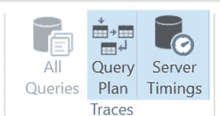
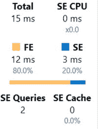

# 优化 DAX 查询

编写查询并得到相同结果的方式有很多种。五个人可能会产生五种不同的方法，每种方法都有独特的性能特征。在本节中，我将介绍一些使 DAX 计算更高效的有用技巧和技术。其中一些足以帮助你解决可能遇到的性能问题。其他解决方案则是对 DAX 计算的改进和对底层数据结构的增强。

在本节中，我还将向你展示如何使用诸如 `DAX Studio` 和 `SQL Server Profiler` 等工具来帮助你优化 DAX 查询。

## 存储引擎 vs. 公式引擎

DAX 查询在运行计算时会使用两个引擎：存储引擎（SE）和公式引擎（FE）。

存储引擎是两者中较快的，其主要目标是从内存数据存储中检索计算查询所需的所有数据。存储引擎是多线程的，因此它可以并行完成多个操作。存储引擎在检索数据时可以执行简单的计算，但这些计算不能依赖于作为同一查询一部分可能并行发生的任何其他存储引擎任务。

存储引擎活动的结果可以存储在缓存中，以帮助加速后续查询。当同一个视觉对象多次执行度量值以为每个数据点生成一个值时，这种缓存可以在帮助加速视觉对象中使用的所有计算方面发挥作用。

公式引擎是单线程的，能够处理更复杂的逻辑，包括计算步骤的顺序对结果有影响的计算。公式引擎活动的结果不会被缓存，因此每次都必须重新计算。

当查询被传递给 DAX 引擎时，存储引擎首先开始检索相关数据，然后公式引擎完成后续工作。

优化慢速 DAX 查询的一个好方法是尝试了解查询的哪些组件由存储引擎完成，哪些由公式引擎完成；然后看看是否可以将公式引擎处理的某些工作转移到存储引擎。

快速了解你的查询有多少使用了存储引擎而不是公式引擎的方法是通过使用 `DAX Studio`。功能区上有一个选项（图 8-11）可以启用服务器计时信息以及查询计划。

图 8-11  `DAX Studio` 功能区上用于打开额外调试选项的选项

启用这些选项后，在 `DAX Studio` 中运行的任何单个查询现在都会生成额外的信息，显示引擎完成查询所花费的时间。这也显示了整体时间中有多少是由存储引擎而不是公式引擎使用的细分情况（图 8-12）。

图 8-12 在 `DAX Studio` 中运行的查询的服务器计时输出示例

图 8-12 显示了一个查询示例，该查询总共耗时 15 毫秒完成。前 3 毫秒由存储引擎花费，它运行了两个并行进程来收集所需的所有数据。当存储引擎完成后，公式引擎接管，并需要 12 毫秒来完成查询。公式引擎在此查询中活跃了 80%，而存储引擎并未从存储引擎缓存中受益。

此信息并未解释你的 DAX 查询的哪些部分由存储引擎处理，哪些由公式引擎处理，但它确实为你提供了一个基准，用于了解同一查询的其他版本的行为。

进行优化时，每次运行查询的更新版本时清除缓存非常重要。如果不这样做，你可能会认为你的新版本更好，因为总时间更快，而实际上它可能是在利用先前查询的缓存数据。在 `DAX Studio` 中，可以通过设置 `运行` 按钮上的一个选项来每次清除缓存，从而轻松做到这一点。

要了解查询的哪些组件由存储引擎或公式引擎处理，你需要深入分析通过对服务器进行跟踪而生成的查询计划。就像你可以在 Microsoft SQL 服务器上运行跟踪来分析 T-SQL 查询一样，SSAS 引擎也能提供同样的能力来捕获显示各个查询不同子组件的事件。因为 Power BI Desktop 使用 SSAS 引擎，你可以使用诸如 `SQL Server Profiler` 之类的工具，在运行查询时捕获有趣的事件，以精确显示 DAX 引擎是如何完成该查询任务的。某些事件显示为由存储引擎完成的活动，而其他事件则显示为属于公式引擎的活动。

这是一个相当高级的话题，因此除了在本章后面向你展示如何在 DAX 查询上运行跟踪，并告诉你正是这些底层的跟踪数据被 `DAX Studio` 用来获取服务器计时信息之外，我不会深入探讨。`DAX Studio` 会在一个`查询计划`选项卡中显示查询所使用的物理和逻辑查询计划，以及由底层跟踪生成的伪 T-SQL 代码，以显示每个存储引擎子查询的工作。

