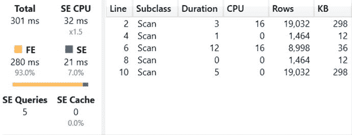
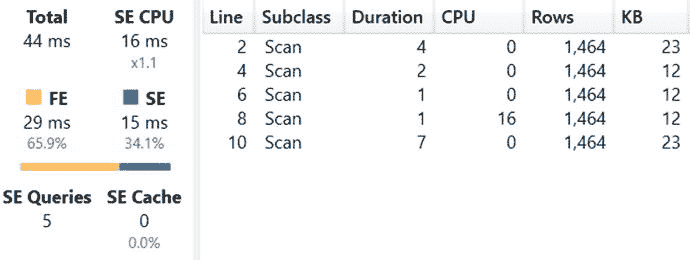
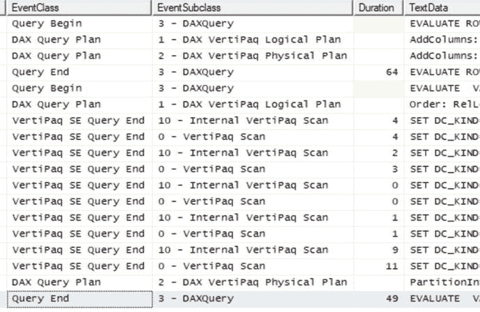
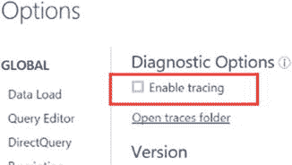

# 尽早且恰当地应用筛选

如果你要手写一本词典中所有以字母 X 开头的单词列表，一种方法是先列出词典中从 A 到 Z 的所有单词，然后划掉所有不以 X 开头的单词。或者，你和五个朋友每人拿一本相同的词典，从不同页面开始抄写以字母 X 开头的单词。第二种方法要快得多，因为所需的工作量更少，而且由大家分担。

你可以将同样的方法应用于 DAX 计算。在不影响结果的前提下，筛选应用得越早，对计算总耗时的影响就越大。

清单 8-12 和 8-13 中的两个 DAX 计算很好地证明了这一点。两种计算返回的结果相同。第一个查询显示了一个数量列的总和以及一个年初至今的计算值。数据被筛选为特定的销售区域和一年中的月份。

```
EVALUATE
FILTER(
SUMMARIZE(
'Fact Sale',
'Dimension Date'[Date],
'Dimension Date'[Calendar Month Number],
'Dimension City'[Sales Territory],
"SUM Qty", SUM('Fact Sale'[Quantity]),
"YTD Qty", TOTALYTD(SUM('Fact Sale'[Quantity]),'Dimension Date'[Date])
)
,
'Dimension City' [Sales Territory] = "Southeast"
&& 'Dimension Date'[Calendar Month Number] =11
)
ORDER BY
'Dimension Date'[Date]
清单 8-12
在 SUMMARIZE 之后使用 FILTER 的 DAX 查询
```

此查询生成 77 行，并在 DAX Studio 的“服务器计时”窗口中输出图 8-13 所示的结果。



图 8-13
使用 DAX Studio 对清单 8-12 中代码的服务器计时输出

该查询总共耗时 301 毫秒，其中相当一部分时间花费在公式引擎上。此查询在冷缓存上执行了多次，此时间具有代表性。

清单 8-13 展示了另一个生成相同输出的查询。

```
EVALUATE
VAR PreFilteredTable =
CALCULATETABLE(
SUMMARIZE(
'Fact Sale',
'Dimension Date'[Date],
'Dimension Date'[Calendar Month Number],
'Dimension City'[Sales Territory]
),
'Dimension City'[Sales Territory] = "Southeast",
'Dimension Date'[Calendar Month Number] =11
)
RETURN
ADDCOLUMNS(
PreFilteredTable,
"SUM Qty", CALCULATE(SUM('Fact Sale'[Quantity])),
"YTD Qty", TOTALYTD(SUM('Fact Sale'[Quantity]),'Dimension Date'[Date])
)
ORDER BY
'Dimension Date'[Date]
清单 8-13
清单 8-12 的替代版本，在逻辑处理中更早应用筛选
```

此版本也生成 77 行，其“服务器计时”窗口的输出如图 8-14 所示。



图 8-14
使用 DAX Studio 对清单 8-13 中更快速代码的服务器计时输出

更新后的版本总共耗时 44 毫秒。两个版本都使用了五个存储引擎查询来检索数据，但在更新后的查询中，筛选是在结果传递给`SUM`和`TOTALYTD`函数之前进行的。存储引擎向公式引擎返回了更小的数据块。所有存储引擎查询返回的行数均未超过 1,464 行，而之前的查询中，存储引擎向公式引擎传递了超过 19,000 行的结果以供额外处理。

希望这个例子能向你展示如何利用 DAX Studio 中一些非常有用的信息。你无需对每个查询都执行此过程，但将较慢的计算分离出来，在 DAX Studio 中进行调优和优化，是高效利用时间的方法。

关于 DAX 中筛选器（尤其是筛选函数的使用）的另一个有用提示是，这些函数（例如`ALL`函数）通常可以对表或列进行操作。如果你能通过使用特定列而不是整个表来实现相同的结果，你可能会获得一些性能提升。传递整个表可能导致不必要的工作，特别是在仅传递表的一列就能实现相同结果的情况下。

## SQL Server Profiler

要使用 Profiler 运行跟踪，请直接启动 Profiler 或通过 SSMS 启动。使用你的 DAX 引擎正在侦听的服务器名称连接到 Analysis Services 实例。如果你要连接到 Power BI Desktop 实例，你需要知道该实例正在使用的端口号。这个端口号在你每次停止并启动 Power BI Desktop 时都会发生变化。DAX Studio 会在状态栏显示正在使用的端口号，否则，你可以使用进程监控工具（如资源监视器或 Windows Sysinternals 版本的 Process Explorer）获取此信息。

以下是一些可以为每次跟踪启用的有用事件：

- `Query Begin`
- `DAX Query Plan`
- `Query Subcube`
- `VertiPaq SE Query End`

启动跟踪，然后运行你的 DAX 查询，然后在你可以查看结果的位置停止或暂停跟踪。

图 8-15 中的图表显示了当 Profiler 用于跟踪先前查询的第二个版本时捕获的事件。单击跟踪窗口中的各个行可以获得更多详细信息。



图 8-15
使用 Profiler 对清单 8-12 中代码的输出示例

也可以在 Power BI Desktop 中通过打开诊断设置下的“启用跟踪”选项来启用跟踪（图 8-16）。这将创建`*.trc`文件，你可以使用 Profiler 打开并分析这些文件。`*.trc`文件存储在同一设置窗口中显示的文件夹内。



图 8-16
Power BI Desktop 设置中允许生成跟踪文件的选项

通常有很多选项可以帮助你的查询运行得更快。有些涉及你修改数据模型本身，而其他一些则可以通过更改 DAX 计算来实现。总的来说，如果你记住使用存储引擎进行计算是好的，并且数据模型最好是小型且简单，那么你最终很可能会得到一个经过良好优化的模型（并让最终用户满意）。

请记住也要有效利用在线资料。DAX 自 2009 年以来就已存在，并且有一个庞大的用户社区，他们分享处理常见问题的有趣方法。