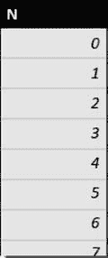
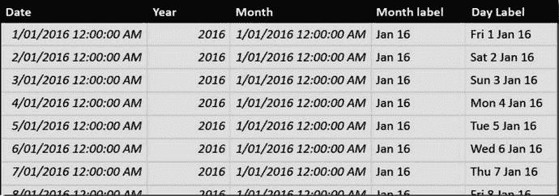

# 创建数字表

第一步是创建一个数字表，本例中是一个单列表，包含从 0 到 1000 的连续数字序列。你将能够使用此实用表，通过基于范围的条件（例如当此表中的值小于 5 时）连接到其他表。在本练习中，数字表用于将表中的单一行扩展为多行。

创建数字表有几种方法。在 `GENERATESERIES` 函数可用之前，创建此类表的唯一方法是利用 `CALENDAR` 函数。并非所有版本的 DAX 都有 `GENERATESERIES` 函数。DAX 中的日期存储为整数值，因此你可以使用 `CALENDAR` 函数生成日期行，然后再将其转换回整数值。在 Power BI Desktop 中，1899 年 12 月 30 日存储为 0。值 1 对应 1899 年 12 月 31 日，值 2 对应 1900 年 1 月 1 日。有趣的是，值-1 对应 1899 年 12 月 29 日，因此如果你需要用 DAX 表示 17 世纪的数据，也可以做到，但需要使用接近-100,000 的数字。

以下是使用 `CALENDAR` 函数创建数字计算表的方法（见图 9-1）：

```
Numbers =
SELECTCOLUMNS(
CALENDAR(0,1000),
"N", INT ( [Date] )
)
```

若要使用 `GENERATESERIES` 函数达到相同的结果，创建计算表的代码如下：

```
Numbers =
SELECTCOLUMNS(
GENERATESERIES( 0,1000 ),
"N", [Value]
)
```

两个示例都生成了一个包含 1001 行、名为 `Numbers` 的表，其中包含一个名为 `N` 的列。两个示例中都使用了 `SELECTCOLUMNS` 函数将列重命名为 `N`。在使用了 `CALENDAR` 函数的示例中，`INT` 函数用于将日期输出转换为其底层数字。



图 9-1

`Numbers` 表的一个示例

## 添加日期表

下一步是向数据模型中添加一个日期表。你可以使用列表 9-1 中的 DAX 代码来生成此表。

```
Dates =
VAR BaseTable =
CALENDAR (  DATE(2016, 1, 1), TODAY () )
VAR AddYears =
ADDCOLUMNS (
BaseTable,
"Year", YEAR ( [Date] )
)
VAR AddMonths =
ADDCOLUMNS (
AddYears,
"Month", DATE(YEAR([Date]),MONTH([Date]),1),
"Month label", FORMAT ( [Date], "MMM YY" )
)
VAR AddDay =
ADDCOLUMNS (
AddMonths,
"Day Label", FORMAT ( [Date], "DDD d MMM YY" )
)
RETURN
AddDay
列表 9-1
用于创建简单日期表的计算表
```

此语句以 `CALENDAR` 函数的单列输出开始，并将其分配给 `BaseTable` 变量。虚拟表每天一行，从 2016 年 1 月 1 日开始，一直持续到当前日期。

你可以使用额外的变量在整个计算过程中逐步添加列。在这段代码中，`AddYears` 变量获取由 `BaseTable` 变量表示的表，并使用 `YEAR` 函数从 `[Date]` 列中提取值，从而追加一个名为“Year”的列。

`AddMonths` 变量使用 `ADDCOLUMNS` 追加两个额外的列。这些列允许将行分组到日历月份中。“Month”列使用 `DateTime` 数据类型，并将每个日期值转换回其对应月份的第一天。“Month label”列使用 `FORMAT` 函数将日期转换为文本。格式字符串 `MMM YY` 表示诸如 2018 年 7 月 4 日等日期会被转换为“Jul 18”这样的文本值。你需要将“Month label”列的 `Sort by Column` 属性设置为使用“Month”列，否则在可视化项中使用时，该列中的值将按字母顺序显示。

最后的 `AddDay` 变量使用 `ADDCOLUMNS` 函数添加一个名为“Day Label”的列。该列使用 `FORMAT` 函数，通过格式字符串 `"DDD d MMM YY"` 将每行中的日期转换为文本值。此格式字符串将 2018 年 7 月 4 日转换为“Wed 4 Jul 18”。此基于文本的列需要将其 `Sort by Column` 属性设置为 `"Date"` 列，以确保在可视化项中使用时能进行合理的排序。图 9-2 显示了日期表生成的前几行。



图 9-2

列表 9-1 创建的日期表的示例输出


