# 创建销售表

接下来需要创建的表是销售表。目标是生成一个展示一段时间内销售情况的表格，可用于构建销售报告。本节将介绍所需的每个步骤，展示 DAX 代码并解释其含义。

首要任务是每天生成随机数量的销售记录。相关 DAX 代码如代码清单 9-2 所示。

```
Sales =
VAR FirstTable =
SELECTCOLUMNS(
FILTER (
GENERATE (
Dates,
Numbers
),
[N] < RANDBETWEEN ( 2, 7 )
),
"Date",[Date])
代码清单 9-2
用于创建销售表的计算表代码片段
```

此语句的输出是一个包含单列日期的表。每个日期会出现 2 到 6 次，这实际上创建了可用于添加其他列的占位行。`CROSSJOIN` 和 `FILTER` 函数用于合并之前创建的日期表和数字表。如果不使用 `FILTER` 函数，`CROSSJOIN` 会将日期表中的每一行与数字表中的所有 1001 行进行匹配。真实的销售表不太可能每天恰好有 1001 笔销售，因此 `FILTER` 函数使用 `RANDBETWEEN` 函数来生成每天更随机的销售数量。在此例中，每天会有 2 到 7 笔销售交易。

你可以将下限设置为零，这样某些天就没有销售记录；也可以通过增加上限的方式生成更大的销售数据集。

你可以使用 `SELECTCOLUMNS` 函数，确保只从日期表和数字表中提取所需的列传递到输出结果中，该结果在代码清单 9-2 中被赋值为 `FirstTable` 这个虚拟表。

下一个任务是添加一个名为“产品”（Product）的列（代码清单 9-3），该列包含表示所售产品对应的值。

```
VAR AddProduct =
ADDCOLUMNS (
FirstTable,
"Product",
VAR myMake =
RANDBETWEEN ( 65, 90 )
VAR myModel =
FORMAT ( RANDBETWEEN ( 1, 5 ), "-#" )
RETURN
REPT ( UNICHAR ( myMake ), 3 ) & myModel
)
代码清单 9-3
为代码清单 9-2 添加产品列
```

这段代码首先将 `FirstTable` 变量作为 `ADDCOLUMNS` 函数的输入。一个名为 `Make` 的嵌套变量开始了一个新的变量作用域级别。这个作用域与 `FirstTable` 和 `AddProduct` 变量所使用的层级是分开的，`RETURN` 函数用于将一个单一值作为 `ADDCOLUMNS` 函数的第三个参数返回。不使用嵌套变量也能达到相同效果，但可读性会变差。

`myMake` 变量使用 `RANDBETWEEN` 函数生成一个介于 65 到 90 之间的随机数。之所以使用这些数字，是因为它们对应 ASCII 表中大写字母的范围。65 代表字母“A”，66 代表“B”，依次类推到 90，代表大写字母“Z”。这个随机数被存储在 `myMake` 变量中。

`myModel` 变量使用 `RANDBETWEEN` 函数生成一个介于 1 到 5 之间的随机数。然后使用 `FORMAT` 函数并配合格式字符串 `"-#"` 将其转换为文本。格式字符串中的连字符被保留，而井号占位符告诉 `FORMAT` 函数数字应该放在哪里。这样就会生成类似 `"-1"` 或 `"-5"` 的字符串。

最终的 `RETURN` 语句将 `myMake` 和 `myModel` 变量连接起来，生成一个看起来像产品代码的文本值。首先使用 `UNICHAR` 函数将存储在 `myMake` 中的数字转换为介于 `A` 和 `Z` 之间的大写字母。然后使用 `REPT` 函数将 `UNICHAR` 函数的输出重复三次。这样就将值 `"A"` 变成了 `"AAA"`，再与 `myMake` 变量中的文本结合，就会产生诸如 `"AAA-4"` 或 `"DDD-1"` 这样的结果。

此时，计算表的输出结果如图 9-3 所示。

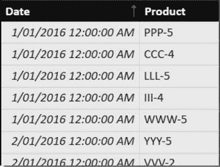

**图 9-3**  
包含代码清单 9-3 的销售表输出示例

`UNICHAR` 是一个很棒的函数，你可以用它向报告中添加 KPI 指示器（例如趋势箭头或表情符号图片）来强调某个要点。

接下来添加的列代表销售数量（代码清单 9-4）。它通过将 `AddProduct` 变量作为 `ADDCOLUMNS` 函数的第一个参数，在现有代码基础上进行扩展。

```
VAR AddQuantity =
ADDCOLUMNS (
AddProduct,
"Qty",
VAR Q = RANDBETWEEN ( 1, 1000 )
RETURN 5 - INT ( LOG ( Q, 4 ) )
)
代码清单 9-4
为销售表添加数量列
```

`ADDCOLUMNS` 函数附加了一个名为“Qty”的单列。一个嵌套变量作用域从此处第三个参数开始。其目的不仅是生成一个介于 1 到 5 之间的随机数，还要确保随机值的分布不均匀。在真实的销售表中，大多数交易的数量很可能是 1。其次是数量为 2 的交易，并且随着数量的增加，购买次数会减少。

这里使用的 `LOG` 函数为 1 到 5 的数量应用了对数分布。当将此代码添加到计算表语句中，并使用 `Qty` 列中每个值的计数在可视化图表上绘制时（图 9-4），可以看出大多数交易都是单数量交易。数量为 2 的交易数量几乎是数量为 1 的一半，而数量为 3 的交易数量则锐减超过一半。

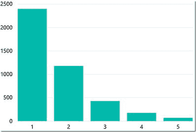

**图 9-4**  
显示数量值分布的图表

这就是计算所期望达到的效果，你可以根据需要进一步调整。

到目前为止，使用上述代码生成的销售计算表输出类似于图 9-5。

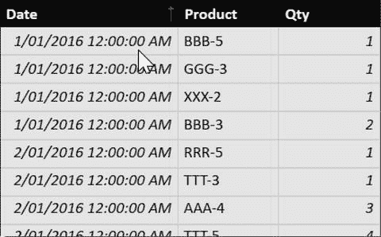

**图 9-5**  
包含数量列的销售表示例

接下来添加的列是价格列。该列的代码如代码清单 9-5 所示。

```
VAR AddPrice =
ADDCOLUMNS (
AddQuantity,
"Price", DIVIDE (
RANDBETWEEN ( 1, 1e5 ),
100 )
)
代码清单 9-5
为销售表添加价格列
```

`ADDCOLUMNS` 函数在存储在 `AddQuantity` 变量中的表里附加了一列。新列名为“Price”，该公式使用 `RANDBETWEEN` 函数生成一个介于 1 到 100,000 之间的数字。`1e5` 这种表示法表明可以使用科学计数法。`1e5` 是 `1 × 10⁵`（即 `1 × 10` 的 5 次方）的简写，等于 100,000。

生成这个随机数后，使用 `DIVIDE` 函数将其转换为一个小于等于 1000 且保留两位小数的值。`DIVIDE` 函数的一个特点是它能比 `/` 运算符更好地处理“除以零”错误；然而，`/` 运算符性能更好，在不存在“除以零”错误风险的情况下应优先使用。示例如下：

```
RANDBETWEEN( 1, 1e5) / 100
```

在代码清单 9-5 中，并没有尝试让不同产品代码的价格保持一致。如果在测试中，产品之间价格一致很重要，你可以将此处生成随机价格的逻辑移到一个产品计算表中，并通过关系将其添加到销售表中。

最后需要添加的列是结合了 `[Price]` 和 `[Qty]` 的 `[Total]` 列。这表明新列可以使用源自同一代码先前部分的值。

代码清单 9-6 是创建销售计算表的完整代码。


```dax
Sales =
VAR FirstTable =
    SELECTCOLUMNS(
        FILTER (
            GENERATE (
                Dates,
                Numbers
            ),
            [N] < RANDBETWEEN ( 2, 7 )
        ),
        "Date",[Date])
VAR AddPRoduct =
    ADDCOLUMNS (
        FirstTable,
        "Product",
        VAR Make =
            RANDBETWEEN ( 65, 90 )
        VAR myModel =
            FORMAT ( RANDBETWEEN ( 1, 5 ), "-#" )
        RETURN
            REPT ( UNICHAR ( MAke ), 3 ) & myModel
    )
VAR AddQuantity =
    ADDCOLUMNS (
        AddPRoduct,
        "Qty",
        VAR Q = RANDBETWEEN ( 1, 1000 )
        RETURN 5 - INT ( LOG ( Q, 4 ) )
    )
VAR AddPrice =
    ADDCOLUMNS (
        AddQuantity,
        "Price", DIVIDE (
            RANDBETWEEN ( 1, 1e5 ),
            100 )
    )
VAR AddTotal =
    ADDCOLUMNS ( AddPrice, "Total", [Price] * [Qty] )
RETURN
    AddTotal
```

**图 9-6** 展示了使用此代码生成的表示例。

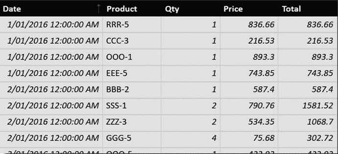

**图 9-6** —— 销售表（包含 `Total` 列）的示例输出

该表现在有五列，并且可能包含数亿行。你可以通过用于生成数字表的计算以及在 `FirstTable` 变量中使用的 `FILTER` 条件来控制行数。请记住，你对任意计算表中的任何部分所做的每次更改，都会导致模型中的每个表重新计算数据。这每次都会生成新值，但如果将其配置为生成极其庞大的数据集，则可能需要很长时间来计算。

现在可以使用每张表中的 `[Date]` 列将销售表与日期表关联起来。

## 优化销售表

数据模型现在包含一张详细的销售表，其中的行代表单个交易。该表可能会变得非常庞大。销售表中同一天可能会出现多行包含相同产品的情况。如果生成销售表的代码被特意设置为生成一个非常大的表，这种情况就更有可能发生。当使用数据集中的表来构建报表时，并非所有报表视觉对象都需要使用较大表中最精细的详细信息级别。

例如，如果你的视觉对象只需要按天显示 `Qty` 列的总和，并且从不按产品区分，那么使用销售表可能是一种效率很低的做法。

另一种方法是生成一个按天分组的销售表汇总版本，但无法按产品进行深入分析和细分。

用于生成此类计算表的代码如**清单 9-7** 所示。

```dax
Daily Summary =
SUMMARIZECOLUMNS(
    'Sales'[Date],
    "Sum of Items Sold", SUM('Sales'[Qty]),
    "Sum of Revenue", SUM('Sales'[Total])
)
```

这将创建一个三列表，将每个 `'Sales'[Date]` 的多行数据汇总为一行，同时使用 `SUM` 函数为每一行生成一个值，以提供 `Qty` 和 `Total` 列的聚合总计。

使用此表的视觉对象将比使用销售表的视觉对象更快，尤其是当销售表最终包含大量行时。

创建此类汇总表的一个缺点是，它们会增加整个数据模型的内存占用，并使数据刷新过程耗时更长。另一个明显的缺点是，任何使用汇总表的视觉对象都只能按该表的粒度进行细分，在本例中，粒度是 `[Date]` 而非 `[Product]`。

如果你的报表交互响应慢，并且没有使用汇总表，那么此策略非常值得考虑。

## 计算列与计算度量值

刚接触 DAX 数据建模的人（以及一些并非新手的人）经常问的一个问题是：“什么时候该用计算度量值，什么时候该用计算列？” 这是一个合理的问题。由于它们的使用场景可能有重叠，因此可能会造成混淆。在报表中，通过计算列和计算度量值可以显示相同的值。

计算列和计算度量值的主要区别在于计算的执行时间点以及计算结果的存储方式。

### 计算列

对于计算列，计算所用的 DAX 表达式仅在表的数据刷新时执行。该表达式会对表中的每一行计算一次，计算生成的单个值会作为该行在该列中的值存储起来，并且无法更改。这就好像计算列生成的值本来就存在于用于导入数据的源数据中一样。

将计算列视为数据加载过程的一部分。这些计算在数据加载过程的最后步骤之一中执行，并且不涉及任何用户交互。

在大型数据集上使用复杂的计算列会使数据刷新耗时更长。但是，如果数据模型配置为在凌晨每天刷新一次，那么这对报表用户的影响应该很小。

计算列生成的值会物理存储在数据模型中，这意味着向非常大的表中添加列可能会对数据模型的内存大小产生显著影响。

计算列是基于行的，这意味着如果所有所需信息都包含在同一行中，它们可以快速执行计算。尽管如此，计算仍然可以使用当前行之外的其他行中的数据。


### 计算度量值

使用计算度量值时，每次页面加载或用户更改筛选器或切片器选择时，DAX 表达式都可能被执行。计算度量值中包含的 DAX 表达式会为报告中每个使用它的值执行一次。如果计算度量值用于表或矩阵视觉对象，则它会为网格中所有使用该度量值来显示值的单元格执行相应次数。当度量值用于一个系列中具有 100 个点的折线图视觉对象时，它会为每个点执行 100 次，每次执行都有略微不同的筛选上下文。

计算度量值是动态的，并能对用户交互做出响应。它们会频繁且快速地重新计算，但不会在数据模型中存储输出，因此对数据模型的物理大小没有影响。增加数据模型中计算度量值的数量，不会影响模型在静止状态下的速度或大小。

计算度量值能够快速处理跨多行单列的计算，但你也可以通过使用迭代器，以支持基于行数据处理的方式来编写它们。

为了更好地理解计算列和计算度量值之间的区别，我们来看一下如何使用这两种选项来处理一个报告需求。在清单 9-8 中，需求是在刚刚创建的、来自清单 9-7 的计算表上，展示`'每日汇总'[收入总和]`列的累计总和。

```
计算收入列 =
CALCULATE(
    SUM('每日汇总'[收入总和]),
    FILTER(
        ALL('每日汇总'),
        '每日汇总'[日期]<=EARLIER('每日汇总'[日期])
    )
)
清单 9-8
将作为计算列的累计总和添加到清单 9-7 的计算表中
```

该计算会依据`'每日汇总'`表中的行数执行相应次数。`FILTER`函数使得每次执行`SUM`函数时，可以使用不同的值集。针对最早日期（2016 年 1 月 1 日）所在行的执行，只会向`SUM`函数提供一个值。针对 2012 年 1 月 2 日所在行的`SUM`表达式的执行，则使用两个值。这两次执行可以按任意顺序进行，并且仍然产生相同的结果。

一旦添加了计算列，数据模型就会变大。在这种情况下，新列中的所有值都是唯一的，因此数据压缩率非常低。

现在考虑相同的计算，但作为计算度量值（清单 9-9）。

```
计算收入度量值 =
CALCULATE(
    SUM('每日汇总'[收入总和]),
    FILTER(
        ALLSELECTED('每日汇总'[日期]),
        '每日汇总'[日期]<=MAX('每日汇总'[日期])
    )
)
清单 9-9
将作为计算度量值的累计总和添加到清单 9-7 的计算表中
```

在这种情况下，将计算度量值添加到模型并不会执行代码。计算度量值会保持休眠状态，直到它在视觉对象中被使用。一旦计算度量值在视觉对象中被使用，它就会为视觉对象需要生成的每个值执行一次。通常，这对应于轴、行或列标题中的项目数。

计算度量值和计算列的语法非常相似。两者都使用`CALCULATE`函数以及针对`[收入总和]`列的相同核心`SUM`表达式。两者都应用指令来告知 DAX 引擎`SUM`函数可以使用哪些数据。

最后，当两者与`'每日汇总'[日期]`字段一起添加到表视觉对象时，结果如图 9-7 所示。

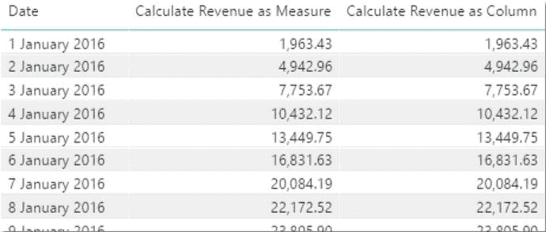
图 9-7

来自清单 9-8 和 9-9 的代码输出

这两个列为表中的每一行产生了相同的结果。`[计算收入列]`直接从内存中的列检索数据，无需进行 DAX 计算。而 `[计算收入度量值]` 列的每个单元格都会运行度量值中的代码，每次执行度量值时，查询上下文都略有不同。在这种情况下，查询上下文来自对每个`[日期]`进行筛选的行标题。

如果你使用 DAX Studio 分析这两种方法，就会开始看到它们在整体性能上的差异。

第一个测试使用计算列，以查看模型为生成视觉对象值所需的工作量。每次运行时清除缓存的选项已启用，查看服务器计时和查询计划的选项也已启用（清单 9-10）。

```
EVALUATE
SELECTCOLUMNS(
    '每日汇总'
    , "日期", '每日汇总'[日期]
    , "计算收入列", '每日汇总'[计算收入列]
) ORDER BY [日期]
清单 9-10
使用 DAX Studio 测试清单 9-8 性能的 DAX 查询
```

在冷缓存上运行此计算十次，平均总执行时间约为 12 毫秒。如图 9-8 所示，大部分输出时间（通常为 90%）消耗在公式引擎中，只有极小部分消耗在存储引擎中。

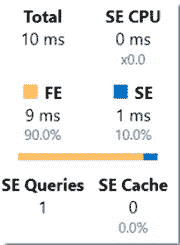
图 9-8

来自清单 9-10 的代码的服务器计时输出

清单 9-11 展示了使用计算度量值而非计算列的相同测试。再次使用 DAX Studio 来捕获在冷缓存上执行查询的服务器计时。

```
EVALUATE
SELECTCOLUMNS(
    '每日汇总'
    , "日期", '每日汇总'[日期]
    , "计算收入度量值", [计算收入度量值]
) ORDER BY [日期]
清单 9-11
使用 DAX Studio 测试清单 9-9 性能的 DAX 查询

此代码产生相同的输出，只是使用了计算度量值而非计算列。多次运行此查询后，平均查询时间约为 1.4 秒（1400 毫秒），其中通常有 99% 的时间消耗在公式引擎中（图 9-9）。

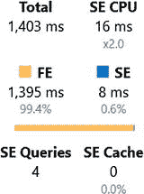
图 9-9

来自清单 9-11 的代码的服务器计时输出

虽然这比较慢，但也在意料之中。计算列的优势在于它是预先计算好的。计算列最初生成列数据所花费的时间，与我们在此处看到的计算度量值所花的时间大致相同。

让我们来看看这两个计算，并从灵活性方面进行比较。在`'日期'`表和`'每日汇总'`表之间添加关系后，在同一个报告页面中添加一个使用`'日期'[年份]`列的切片器。当此切片器设置为 2017 年时，可以通过两个视觉对象观察到图 9-10 中的结果。

首先，表视觉对象显示，计算度量值现在显示的值与计算列不同。原因是计算度量值每次新执行所生成的值，其筛选上下文与之前不同。计算度量值内的`SUM`表达式不再考虑属于 2016 年和 2018 年的行。这种额外筛选的效果意味着值已被重置，现在仅从 2017 年初开始累计。

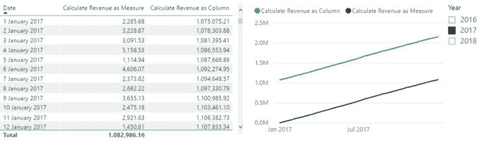
图 9-10

表和折线图视觉对象显示了将切片器设置为 2017 年时，来自清单 9-8 和 9-9 的结果


该列只是输出与之前相同的预计算值。除了切片器阻止可视化图表绘制 2017 年以外的日期值外，没有任何变化。

那么，让我们重新审视本节开头提出的问题：“何时应使用计算列与计算度量值？”

如果你希望获得最快的计算结果，并且很少需要以不同方式对数据进行切片和切块，那么计算列是一个不错的选择。如果你希望值能够对用户交互做出响应和反应，那么计算度量值是一个不错的选择。

如果你遇到交互式报告的速度和性能问题，最佳着手点通常是检查计算度量值中使用的代码，而不是计算列中的代码。

### 显示销量前十产品的所有销售额

为了扩展已构建的数据，让我们看几个示例，了解如何使用不同技术构建一些额外的汇总表。第一个示例创建一个包含所有销售记录、但仅显示收入前十产品的表格。第一步是确定哪些产品应被视为前十产品。然后，使用此列表创建一个新表，该表包含针对这些产品筛选的所有销售数据。

计算表的 DAX 代码如列表 9-12 所示。

```
All Sales for Top 10 Products =
VAR InnerGroup =
SUMMARIZECOLUMNS(
-- 按...分组 --
'Sales'[Product],
-- 聚合列 --
"Sum of Revenue", SUM('Sales'[Total])
)
VAR Top10PRoducts =
TOPN(
10,
InnerGroup,
[Sum of Revenue],
DESC
)
RETURN
NATURALINNERJOIN (
'Sales',
Top10PRoducts
)
列表 9-12
显示前十产品销售额的计算表
```

此计算中的第一个变量使用`SUMMARIZECOLUMNS`函数创建一个按`Sales`[Product] 列聚合的表表达式。这会生成一个未排序的工作表，每个产品一行。每个产品在 `"Sum of Revenue"` 列中都有一个值，显示历史总销售额的聚合值。这可能是一个优化过滤条件的机会，使其仅考虑相对于当前期间而言较近的日期范围——例如，你可以修改它，使其仅考虑过去三个月的销售额。

第二步使用 `TOPN` 函数，当按 `[Sum of Revenue]` 降序排序时，从 `InnerGroup` 表表达式中识别并返回前十行。`TOPN` 函数是一个过滤器函数，因此它返回一个表，该表具有与 `InnerGroup` 变量相同数量的列，并赋值给 `Top10Products` 变量，但在此例中仅包含十行。

你可以调整此函数，利用排序后的表来查找顶部或底部的不同数量产品。要查找销量最少的产品，只需将排序参数从 `DESC` 改为 `ASC`。

使用 `TOPN` 函数的替代方法是向 `InnerGroup` 变量添加一个排名列，然后利用排名列中的值来过滤该表。你可以使用列表 9-13 中的 DAX 示例作为替代方案。图 9-11 显示了此列表的输出。

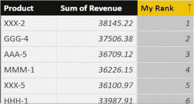

图 9-11

使用列表 9-13 中添加的排名列，列表 9-12 中代码的示例输出

```
VAR AddRankColumn =
ADDCOLUMNS(
InnerGroup,
"My Rank",RANKX( InnerGroup, [Sum of Revenue] )
)
VAR Top10PRoducts =
FILTER(
AddRankColumn,
[My Rank]<=10
)
列表 9-13
可在列表 9-12 中替换 TOPN 函数的替代 DAX 代码
```

添加像图 9-11 中这样的排名列，而非使用 `TOPN` 函数，其优势在于你可以将数据用于其他计算，例如比较不同时期的排名。例如，你可以创建两个工作表，分别显示连续时期内产品的聚合销售额及其排名。然后，你可以生成一个过滤后的表，来显示在两个时期之间排名提升（或下降）的产品。

此变体在`AddRankColumn`表表达式上使用`FILTER`函数。如果要识别排名最低的项目，`RANKX`函数接受一个可选参数来对数据进行降序（`DESC`）或升序（`ASC`）排序。这使得`FILTER`函数能够使用`<=10`谓词来查找销售额最低的产品。

至此，两个版本都生成了一个仅包含十行的表表达式，这些行应代表销量最好的产品。

最后一步是返回原始销售数据的副本，该副本仅针对`Top10Products`变量中包含的产品进行过滤。`NATURALINNERJOIN`函数非常适合于此目的，最终的`RETURN`语句执行了相当于 T-SQL 中`INNER JOIN`的操作，连接了`'Sales'`表和`Top10Products`变量中包含的表表达式。

`NATURALINNERJOIN`函数会自动使用两个表中存在的、具有相同名称、数据类型和沿袭的列来创建联接条件。联接可以使用多个列，但在此例中，只有`[Product]`列满足所有三个要求。因为`Top10Products`变量中的`[Product]`列可以追溯到其来源（`Sales`表），所以它满足沿袭要求。

`CALCULATETABLE`函数可以替代`NATURALINNERJOIN`使用。这两个函数的参数签名相同。`NATURALINNERJOIN`在公式引擎中执行，而`CALCULATETABLE('Sales', Top10Products)`则将过滤操作推送到存储引擎。

联接中使用的两个表中除`[Product]`之外的列都会被保留。可以使用`SELECTCOLUMNS`函数，通过删除或重命名不需要的列来控制返回哪些列。

最终表的示例应类似于图 9-12。

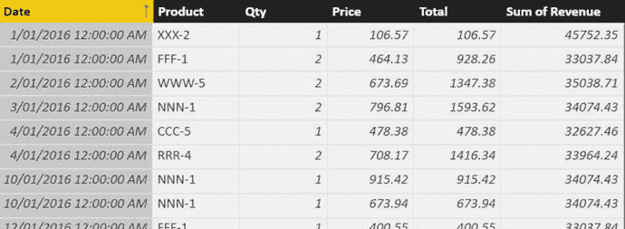

图 9-12

列表 9-12 中计算表的示例输出

这些列中的值均基于随机数，因此重要的是表结构应与你的版本匹配，而非具体的数值。

每次刷新数据模型时，都会重建此计算表。构建完成后，它会为你提供一个更小、更快的表，供只需要处理最畅销产品的可视化图表使用。当`Sales`表中的行数变得非常大时，这尤其有用。


### 双重分组

更复杂的场景可能需要使用多个工作表对数据执行两层或更多层的汇总，以生成新的汇总表。

假设有一个需求，要求显示一个汇总表，该表的每一行对应销售表中的每个产品，并包含每个产品最佳十天的平均值。这里的挑战在于，每个产品的最佳十天所对应的日期是不同的。一旦确定了每个产品的最佳十天，就可以计算出平均值。

以下技术将用于实现这一需求：

-   `SUMMARIZECOLUMNS`
-   `GENERATE`
-   `GROUPBY` 和 `CURRENTGROUP`
-   `MAXX` 迭代函数
-   一种推导`RANK`的有趣技术

第一步是创建一个工作表（清单 9-14），用作每个产品每日销售的汇总。原始数据可能包含同一产品在同一天的多笔交易。这将是执行的第一层汇总。

```
VAR InnerGroup =
SUMMARIZECOLUMNS(
-- 分组依据 --
'Sales'[Product],
'Sales'[Date],
-- 聚合列 --
"Daily Revenue", SUM('Sales'[Total])
)
清单 9-14
清单 9-6 中销售表的汇总计算表
```

`InnerGroup` 变量存储了一个三列表，显示了每个产品在其有销售记录的每一天的日销售额。下一步是识别哪些日期恰好是每个产品的最佳十天。这通常需要为 `[Daily Revenue]` 列应用一个特定于产品的排名值。`RANKX` 迭代器提供了一种方法，可以在此时向表中添加一列，该列对表中的每一行相对于其他行进行排名。但这里需要的是能够获得一列来对每个产品的每日销售进行排名。

一种方法是对计算应用清单 9-15 中的三个步骤。

```
VAR CopyOfSummaryTable =
SELECTCOLUMNS(
InnerGroup,
"ProductA",[Product],
"DateA",[Date],
"Daily RevenueA",[Daily Revenue],
"RowCounter", 1
)
VAR CrossJoinTables =
FILTER(
GENERATE( CopyOfSummaryTable, InnerGroup ),
[Product] = [ProductA] &&
[Daily Revenue]<=[Daily RevenueA]
)
VAR ProductByDateRanking =
GROUPBY(
CrossJoinTables,
[Product],
[Date],
"Daily Revenue", MAXX(
CURRENTGROUP(),
[Daily Revenue]
),
"Rank",      SUMX(
CURRENTGROUP(),
[RowCounter]
)
)
清单 9-15
清单 9-14 中代码的附加 DAX
```

在这段代码中，`CopyOfSummaryTable` 变量用于存储 `InnerGroup` 变量的副本。使用 `SELECTCOLUMNS` 重命名了 `[Product]`、`[Date]` 和 `[Daily Revenue]` 列，以避免在下一步将此表版本与 `InnerGroup` 表连接时发生列名冲突。这些列被简单地重命名，并在末尾附加了字符“A”。

在此步骤中还添加了一个名为 `[RowCounter]` 的新列，其硬编码值为 `1`。该列将为排名计算提供基础。对于同一产品具有更高 `[Daily Revenue]` 值的每一行，该行都会被复制。复制完成后，对 `[RowCounter]` 执行 `SUM` 操作会生成一个表示排名的值。

下一步是在 `InnerGroup` 和 `CrossJoinTables` 表变量之间执行笛卡尔连接。`FILTER` 函数确保只有 `InnerGroup` 中与 `CopyOfSummaryTable` 中 `[Product]` 值相同的行才被匹配。`[Daily Revenue] <= [Daily RevenueA]` 逻辑允许匹配 `CopyOfSummaryTable` 变量中与 `InnerGroup` 变量中 `[Daily Revenue]` 值相同或更高的行。

对于 `InnerGroup` 表变量中的任何给定产品，恰好具有该产品最高 `[Daily Revenue]` 值的行在 `CopyOfSummaryTable` 中只能找到一个匹配行（即它自身）。同一产品中具有次高值的 `InnerGroup` 行会找到两个匹配行，依此类推，直到来自 `InnerGroup` 的、同一产品中具有最低值的行是唯一不匹配的行。然后，该行会与 `CopyOfSummaryTable` 中同一产品的所有其他行匹配，这意味着对 `[RowCounter]` 列执行 `SUM` 会返回一个具有最高数值（最低排名）的结果。

本节的最后一步是将上一步的笛卡尔输出重新分组成每个产品和日期对应一行的形式。`SUMMARIZE` 和 `SUMMARIZECOLUMNS` 函数都不能用于存储在变量中的表表达式。这两个函数都只能作用于物理表。幸运的是，可以使用 `GROUPBY` 函数，但聚合表达式必须使用迭代函数。这会根据 `[Product]` 和 `[Date]` 对 `CrossJoinTables` 变量进行分组，创建一个汇总表。

DAX 中不存在 `COUNTROWSX` 迭代函数；如果存在，它可以用来计算每个 `[Product]` 和 `[Date]` 所属的行数，以便在汇总时提供排名值。在这种情况下，第一步引入的 `[RowCounter]` 列允许通过对此列中硬编码的值执行 `SUMX` 来采用等效方法。

如果该列中没有 `BLANK` 值，另一种方法是直接使用 `COUNTAX(CURRENTGROUP(), [Column])`，从而避免引入每行值都为 `1` 的列。

在 `MAXX` 和 `SUMX` 函数中使用的 `CURRENTGROUP()` 函数是对 `GROUPBY` 函数中用作第一个参数的表的引用。

这里使用 `MAXX` 函数是为了将每天的日销售总额存储在 `[Daily Revenue]` 列中。这有助于将相同值的重复实例缩减为每个产品/日期的一个实例。此值并不反映单笔交易的最大值，而是代表该产品每天的总销售额。这一步不执行聚合；相反，它有助于将日销售数据保留到下一步。

`ProductByDateRanking` 变量的输出类似于图 9-13。

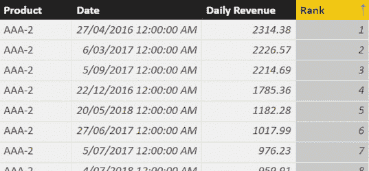

图 9-13

清单 9-14 和 9-15 中代码的样本输出（按排名排序）

按产品和排名排序后，每日收入数据如预期显示。注意每行的日期是跳跃的。每个产品构成不同排名位置的日期都不同。

此表包含产品有销售记录的每一天对应的排名值。下一步是过滤这些数据，只保留每个产品排名前十的行。清单 9-16 展示了 `FILTER` 函数的这种直接用法。

```
VAR TopTenDaysPerPRoduct =
FILTER(
ProductByDateRanking,
[Rank]<=10
)
清单 9-16
清单 9-15 中代码的附加步骤
```

现在你拥有了一组仅涵盖每个产品最佳十天的数据。满足初始要求的最后一步是计算每个产品 `[Daily Sales]` 的平均值。再次提醒，这里不能使用 `SUMMARIZE` 和 `SUMMARIZECOLUMNS`，因为它们不能处理存储在变量中的表表达式。因此，最后一步（清单 9-17）使用 `GROUPBY` 函数来计算平均值。

```
RETURN OuterGroup =
GROUPBY(
TopTenDaysPerProduct,
-- 分组依据 --
[Product],
-- 聚合列 --
"Average of Top 10 Best Days",
AVERAGEX(
CURRENTGROUP(), [Daily Revenue]
)
)
清单 9-17
添加到清单 9-16 中代码的最终 RETURN 语句
```


现在，该步骤使用 `TopTenDaysPerProduct` 变量将上一步骤中的工作数据聚合为每个产品仅保留一行。所有产品都将在此表中对应一行。接着，`AVERAGEX` 迭代函数与 `CURRENTGROUP()` 函数结合使用，对每个产品的 `[Daily Revenue]` 数据求平均值。

最终输出是一个两列的表（图 9-14），满足了这一特殊报告需求。我选择这个场景并非因为它是一个你常遇到的常见问题，而是因为它展示了你在 DAX 中可用于处理额外复杂程度场景的各种技巧。

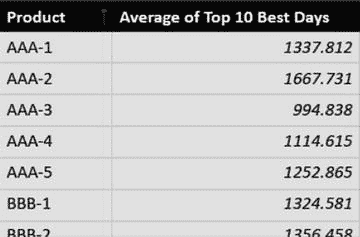

图 9-14

列表 9-14–9-17 内的累积代码示例 索引 A `ADDCOLUMNS` 函数 算术运算符 B 括号游戏 C 计算列 计算度量  事实销售表 完整限定 `SUM` 函数 计算表 `CALCULATE` 函数 `CALENDARAUTO` 函数 比较运算符 串联运算符 容器 上下文 已定义筛选 参见筛选上下文 `COUNTROWS` 函数 `CROSSJOIN` 函数 `CURRENTGROUP()` 函数 D 数据分析表达式 (DAX) 计算列 计算度量 计算表 注释 已定义函数 关系 参见关系 数据模型 `ADDCOLUMNS` 函数 添加年份 自动日期表 `CALENDAR` 函数 组件 列 数据层次结构 度量 关系 表 已定义 日期/日历表 DateTime 字段 距离今天的天数 会计年度 `FORMAT` 函数 MonthID 列 优化日期 期间比较计算 时间点值 快速度量 滚动平均 按列排序 时间 时间智能 工作日名称 每周桶 工作日 年初至今 数据类型 对实数进行计算 类别 基于日期 在 DAX 中 十进制和定点十进制数 时间 整数 日期表 DAX Studio 应用程序 计算列 计算度量 最佳十个产品 将收入计算为列 `CALCULATETABLE` 函数 ‘Dates’ 和 ‘Daily Summary’ 表 DAX 查询测试 `FILTER` 函数 InnerGroup 表表达式 迭代器 `NATURALINNERJOIN` 函数 `SELECTCOLUMNS` 函数 服务器计时输出 `SUMMARIZECOLUMNS` 函数 表和折线图 表/矩阵可视化 `TOPN` 函数 客户端工具 列索引 连接对话框 `COUNTROWS` 函数 数据模型 日期表 `DEFINE MEASURE` 语句 双重分组 `AVERAGEX` 迭代函数 `CopyOfSummaryTable` 变量 `COUNTROWSX` 迭代函数 `CURRENTGROUP()` 函数 `InnerGroup` 变量 `MAXX` 函数 `ProductByDateRanking` 变量 `RANKX` 迭代器 `RETURN` 语句 `SUMMARIZECOLUMNS` 函数 摘要计算表 `TopTenDaysPerProduct` 变量 `EVALUATE` 关键字 格式化查询 (F6) 嵌套变量 数字表 优化 销售 Power BI Desktop 销售表 `SELECTCOLUMNS` 函数 存储数据 美国人口普查局 调试计算度量 客户端工具 列方法 DAX 变量 十进制数 数据类型 `Dimension.Date` 层次结构 关系，事实销售表和 E 显式筛选 `ALLEXCEPT` 函数 `ALL` 函数 `ALLSELECTED` 函数 列和 `EARLIER` 函数 ‘Fact Sale’ 表 筛选函数 筛选器和计算表 测量 覆盖筛选 百分比总计 期间比较 运行总计 `ALLSELECTED` 计算度量 排名 重置 表可视化 显式度量 F 筛选上下文 计算列 计算度量 列筛选器 容器 已定义 效果 显式 硬编码 迭代器 覆盖 输出 行上下文 更简单的数据集 过渡 T-SQL 基本 DAX 查询的计算度量 `FILTER` 函数 公式引擎 (FE) G `GENERATE` 函数 筛选行为 数字表 `ADDCOLUMNS` 函数 数据集 `GENERATESERIES` 输出 入住率，酒店客房 参见酒店客房入住率 查询 移除，不需要的列 销售表 数据集 查找最后购买 `NATURALLEFTOUTERJOIN` 输出 `RETURN` 语句 `SelfJoin` 变量 T-SQL 等价物 `SELECTCOLUMNS` 函数 语法 T-SQL 等价物 `GROUPBY` 函数 `CALCULATETABLE` `CURRENTGROUP()` 函数 双重聚合 筛选 `SUMX` 函数 语法 H 层次结构 酒店客房入住率 `CALENDAR` 函数 数据集 `FILTER` 函数 入住率表 输出 带状图 T-SQL 等价物 I 隐式筛选 优点 销售计数 交叉筛选属性 DAX 引擎 ‘Dimension Date’ 表 ‘Dimension Stock Item’ 表 维度表 ‘Fact Sale’ 表 跨代表 Power BI 查询上下文 WideWorldImportersDW 数据集 隐式度量 IntelliSense `ISSUBTOTAL` 函数 迭代器 J, K 连接表 `CROSSJOIN` `GENERATE` 参见 GENERATE 函数 `LOOKUPVALUE` `NATURALINNERJOIN` 函数 `NATURALLEFTOUTERJOIN` 函数 `UNION` 函数 L, M 逻辑运算符 `LOOKUPVALUE` 函数 N `NATURALINNERJOIN` 函数 `NATURALLEFTOUTERJOIN` 函数 嵌套变量 计算度量 复杂 已定义 多层级 数字表 `ADDCOLUMNS` 函数 数据集 `GENERATESERIES` 输出 O 运算符 算术 比较 串联 逻辑 优先级 优化 维度表 事实表 筛选 预计算数据 移除未使用数据 SE vs. FE 简化表结构 拆分唯一列 SSMS 事件探查器 摘要表 P Pigs-Ear 关系 Power BI Desktop 数据视图 关系 关系视图 报表视图 Q 快速度量 R `RANDBETWEEN` 函数 实数 关系 活动 已定义 用于筛选的筛选器表 连接表而不使用 每表一列 一对多关系 = 运算符 Pigs-Ear 规则 表在一侧 类型 `RETURN` 关键字 `ROLLUP` 函数 行上下文 S 销售表 数据集 `NATURALLEFTOUTERJOIN` 输出 购买 `RETURN` 语句 `SelfJoin` 变量 T-SQL 等价物 `SELECTCOLUMNS` 函数 SQL Server Management Studio (SSMS) 存储引擎 (SE) `SUMMARIZE` 函数 摘要表 创建 `GROUPBY` 函数 `CALCULATETABLE` `CURRENTGROUP()` 函数 双重聚合 筛选 `SUMX` 函数 语法 时间（毫秒） `SUMMARIZECOLUMNS` 函数 `SUMMARIZE` 函数 替代方案 关系 计算表 筛选 `ISSUBTOTAL` 函数 输出 关系 `ROLLUP` 函数 示例输出 子类别列 语法 T-SQL 等价语句 `SUMX` 函数的用途 T 时间数据类型 U `UNION` 函数 V 变量 基本结构 计算列 计算度量 计算表 调试 已定义 等价 T-SQL 以匹配 DAX 错误代码 多个 DAX 变量 嵌套 参见嵌套变量 其他类型的计算 `RETURN` 关键字 结构 `VAR` 关键字 与文本一起使用 W 整数数据类型 WideWorldImportersDW 数据集 X, Y, Z X 函数 (参见迭代器)
