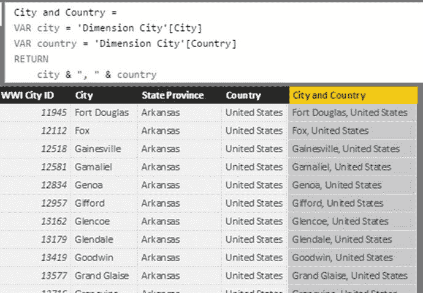
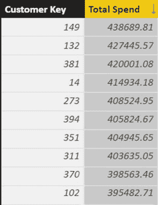

# 2. 变量

本章探讨如何使用 DAX 变量使计算更易于理解，并且在某些情况下，使其执行更快。变量用于存储 DAX 表达式的结果。这些变量可以简单到只是分配一个硬编码的值，也可以是复杂 DAX 方程的结果。

您可以在任何类型的 DAX 计算中使用变量，包括计算列、度量和表。变量没有严格的数据类型，可以表示 DAX 中的任何类型的对象。变量会自动采用被赋值对象的类型。您必须使用 `RETURN` 语句来关闭一个变量作用域层。您可以在同一作用域层内声明多个变量，并且使用单个 `RETURN` 语句即可使用它们。当您在表达式中的任何位置使用嵌套变量时，它们可以初始化一个新的作用域层，但当您使用 `RETURN` 语句时，所有作用域层都将结束。

这是在 DAX 表达式中创建和使用变量的基本结构：

```
VAR 变量名 = 表达式
RETURN 表达式
```

变量只能赋值一次，不能重新赋值。以下代码会产生错误：

```
VAR myVar = 1
myVar = myVar + 1
```

以下示例显示了使用多个 DAX 变量的公式的基本结构：

```
VAR myVar1 = 1
VAR myVar2 = myVar1 + 2
RETURN myVar2 * 2
```

## 变量结构

关键字 `VAR` 表示正在声明一个新变量。其后跟变量名称。您不能使用空格，也不能像在 DAX 其他位置那样使用方括号或撇号来包含变量名以允许使用空格。变量名的另一个限制是您不能使用表名或 DAX 关键字的名称。

最后，在 `=` 运算符之后是一个 DAX 表达式。

```
VAR myVar1 = 1
VAR myVar2 = myVar1 + 2
```

此示例的第一行将数值 1 分配给名为 `myVar1` 的变量。然后在下一行的表达式中使用 `myVar1` 变量为名为 `myVar2` 的变量赋值。此时，因为表达式 (1 + 2) 的缘故，变量 `myVar2` 的值为 3。

```
RETURN myVar2 * 2
```

`RETURN` 关键字必须用于输出结果，并且也可以使用表达式。在这种情况下，结果是整数 6。在每层变量作用域内，`RETURN` 关键字只能使用一次。

`RETURN` 关键字用于返回当前作用域中任何变量的值。这在调试包含多个变量的计算时非常有用。它不必返回该系列中的最后一个变量。

在 DAX 中使用变量的一个主要好处是代码可读性。在许多情况下，您可以通过添加变量来简化复杂的 DAX 公式。以下示例展示了一个未格式化的、未使用变量的 DAX 表达式。

```
Table =
NATURALINNERJOIN(
'Sales',
TOPN(
10,
SUMMARIZECOLUMNS(
'Sales'[Product],
"Sum of Revenue", SUM('Sales'[Total])
),
[Sum of Revenue],
DESC))
```

在以下代码中，DAX 表达式被格式化并重写以使用变量。它产生与上述代码相同的结果。

```
Table =
VAR InnerGroup =
SUMMARIZECOLUMNS(
-- 分组依据 --
'Sales'[Product],
-- 聚合列 --
"Sum of Revenue", SUM('Sales'[Total])
)
VAR Top10Products =
TOPN(
10,
InnerGroup,
[Sum of Revenue],
DESC
)
RETURN
NATURALINNERJOIN(
'Sales',
Top10Products
)
```

虽然这个例子更长，但将代码分解成更小的步骤并对其进行格式化，使其更容易阅读和理解其逻辑。

### 对文本使用变量

变量既可以存储文本数据，也可以存储数值数据。变量继承其被赋值表达式的类型。此示例连接 `textVar1` 和 `textVar2` 中的文本，产生一个新值，即 “Hello World”。

```
My Measure =
VAR textVar1 = "Hello "
VAR textVar2 = "World"
RETURN CONCATENATE(textVar1,textVar2)
```

您可以将此技术与其他 DAX 函数结合使用，创建动态的基于文本的度量，这些度量可能会根据当前的筛选上下文而变化。考虑以下计算度量：

```
Sales Text =
VAR SalesQty = SUM('Fact Sale'[Quantity])
VAR Text1 = "This month we sold "
VAR Text2 = " Items"
VAR Result = IF(
SalesQty > 0,
-- THEN 部分 --
Text1 & SalesQty & Text2,
-- ELSE 部分 --
"No sales this month"
)
RETURN Result
```

在这里，您将 DAX `SUM` 表达式分配给 `SalesQty` 变量。稍后在 `IF` 函数中使用它来测试是否存在销售，以确定输出消息。注意在 `IF` 函数中使用注释来帮助澄清哪些代码用于更新 `Result` 变量。

这也展示了如何使用变量来提高性能。`SalesQty` 变量可能在 `IF` 函数中被使用了两次。如果这个公式在不使用变量的情况下编写，`IF` 函数将对底层列进行两次调用，因此需要更长时间才能得出相同的结果。

另一个使用基于文本变量的类似函数是生成问候语的计算度量。使用清单 2-1 中的代码创建计算度量，测试当前时间并将一天中的小时存储在 `CurrentHour` 变量中。然后在 `SWITCH` 函数中使用该变量生成适当的文本并存储在 `GreetingText` 变量中。随后将其与其他文本组合，生成一个可以在报告中用作动态问候语的度量。

```
Greeting =
VAR CurrentHour = HOUR(NOW())
VAR GreetingText =
SWITCH(
TRUE(),
CurrentHour<12,"Morning",
CurrentHour<17,"Afternoon",
"Evening"
)
RETURN
"Good " & GreetingText & ", " & USERNAME()
```

清单 2-1
生成问候语计算度量

### 在计算列中使用变量

在计算列中使用变量时，变量会自动访问同一行中任何列的值。当你在赋值过程中使用 `'表名'[列名]` 这种表示法时，假定使用的值来自同一行。

此示例使用变量来创建一个新列，该列将不同的位置值合并到新列中的单个文本中。这种类型的列对于某些尝试使用基于文本的地址数据进行绘图的视觉对象很有用。

在这种情况下，计算列的 DAX 表达式可能如下所示：

```
City and Country =
VAR city = 'Dimension City'[City]
VAR country = 'Dimension City'[Country]
RETURN
city & ", " & country
```

在这段代码中，你声明了两个变量：`city` 和 `country`。这些变量继承的数据类型是文本，并在 `RETURN` 语句中使用 `&` 运算符将它们连接起来。添加计算列后的输出示例如图 2-1 所示。



图 2-1

使用变量的新计算列的示例输出

上述代码的结果是向表中添加了一个名为 `[City and Country]` 的新列。每一行的值都是使用同一行中其他值连接文本的结果。这与你在 Excel 表中创建新列，或者在 SQL 的 `SELECT` 语句中基于同一行的其他值创建新列时的预期类似。

在计算列中使用变量时，最终的 `RETURN` 语句必须返回单个值。它不能返回列或表。

### 在计算度量值中使用变量

你可以使用变量使计算度量值中的计算更易读，并且在某些情况下，提高执行速度。

计算度量值中使用的变量与计算列中使用的变量之间的一个区别是，计算度量值中的变量不像计算列那样与各个行有关系。这意味着计算度量值中使用的变量不能被赋予基于列的值。

使用与上一节相同的 DAX 代码，一个名为 `[City and Country]` 的新计算度量值会遇到类似这样的错误：

```
A single value for column 'City' in table 'Dimension City' cannot be determined
```

这更多地体现了计算度量值和计算列之间的本质区别，这将在第 9 章中介绍。因此，现在让我们创建一个使用变量且可工作的计算度量值。

假设你有一个报表需求，需要了解有多少销售额的 `[Total Including Tax]` 值大于或等于 100 美元。

使用变量将此需求编写为计算度量值的一种方式如清单 2-2 所示。

```
Total Sales > $100 =
VAR SalesAbove100 =
FILTER(
-- 过滤表 --
'Fact Sale',
-- 过滤条件 --
'Fact Sale'[Total Including Tax]>=100
)
RETURN COUNTROWS(SalesAbove100)
```

清单 2-2
使用变量将代码编写为计算度量值

在这个计算度量值中，使用了一个名为 `SalesAbove100` 的变量来分配 `FILTER` 函数的输出。`FILTER` 函数返回一个表，该表不能用作 `RETURN` 函数的最终输出，因为你定义的是一个计算度量值，而计算度量值必须返回单个值。

`RETURN` 语句使用 `COUNTROWS` 函数，根据作为参数传递给它的表返回单个值。此计算度量值展示了如何使用 `COUNTROWS` 函数处理存储在变量中的表表达式，并且该表表达式不限于模型中的物理表。

### 在计算表中使用变量

你还可以在 DAX 计算中使用变量来创建新的计算表。当你创建新表作为现有表的汇总或聚合版本，且需要进行额外的处理或操作时，你可能会发现这很有用。

此技术可以提高某些报表页面的性能，但它会影响加载数据所需的时间以及数据模型的整体内存占用。

清单 2-3 中的示例使用变量来帮助创建一个表，该表显示基于 `[Total Including Tax]` 列金额，`'Fact Sale'` 表中的前十名客户。

```
Sales Summary =
VAR SalesTableWithCustKey =
FILTER(
-- 过滤表 --
'Fact Sale',
-- 过滤条件 --
'Fact Sale'[Customer Key]>0
)
VAR SalesTableGrouped =
SUMMARIZE(
-- 要汇总的表 --
SalesTableWithCustKey,
-- 要分组的列 --
'Fact Sale'[Customer Key],
-- 聚合列名称和表达式 --
"Total Spend",SUM('Fact Sale'[Total Including Tax])
)
VAR SummaryTableFiltered =
TOPN(
-- 要返回的行数 --
10,
-- 要过滤的表 --
SalesTableGrouped,
-- 排序依据表达式 --
[Total Spend]
)
RETURN SummaryTableFiltered
清单 2-3
使用变量创建表
```

DAX 计算中的第一个变量是 `SalesTableWithCustKey`，它被分配了 `FILTER` 函数的输出，该函数用于删除 `[Customer Key]` 为零的数据行。

`SalesTableGrouped` 变量被分配了一个表，该表是 `SUMMARIZE` 函数的输出。`SUMMARIZE` 函数接收 `SalesTableWithCustKey` 变量，并按 `[Customer Key]` 列进行分组。添加了一个名为 `[Total Spend]` 的新列，该列计算属于每个 `[Customer Key]` 的所有行的 `SUM` 值，将其归为一个值。

最后，`SummaryTableFiltered` 变量被分配了 `TOPN` 过滤函数的输出，该函数将包含所有客户的表过滤为仅显示前十名的表。该变量最终被返回给计算表（图 2-2）。



图 2-2 ‘Sales Summary’ 计算表的示例输出

与计算列和计算度量值示例不同，当你使用计算表时，可以将一个计算表返回给数据模型。

与前面清单 2-3 中的 DAX 匹配的、使用与变量相对应的 `#表名` 的等效 T-SQL 如清单 2-4 所示。

```
SELECT
*
INTO #SalesTableWithCustKey
FROM Fact.Sale
WHERE
[Customer Key] > 0
SELECT
[Customer Key],
SUM([Total Including Tax]) AS [Total Spend]
INTO #SalesTableGrouped
FROM #SalesTableWithCustKey
GROUP BY
[Customer Key]
SELECT TOP 10
*
INTO #SummaryTableFiltered
FROM #SalesTableGrouped
ORDER BY
[Total Spend] DESC
SELECT * FROM #SummaryTableFiltered
清单 2-4
与 DAX 变量匹配的等效 T-SQL
```

### 使用变量进行调试

SQL 存储过程中常用的一种技术是创建一系列临时表，这些表是前一个表的精炼版本。你可以在 DAX 中以等效的方式使用变量，这使得跟踪和调试数据处理过程更加容易。

最终的 `RETURN` 语句不一定总是返回最近的变量。输出任何变量以便你可以目视检查该变量包含的值是非常有用的。这是一种手动调试的形式。

## 嵌套变量

变量可以嵌套使用，在同一计算中可存在多层变量作用域。

每一层变量作用域以 `VAR` 语句开始，并以对应的 `RETURN` 语句结束，且只能引用同一层级或更高层级中声明的其他变量。

清单 2-5 是一个简单示例，展示了一个返回值为 30 的计算度量。该计算中使用了两个变量作用域层。

```
嵌套度量 =
VAR Level1a = 10
VAR Level1b =
VAR level2a = Level1a
VAR Leval2b = level2a * 3
RETURN Leval2b
RETURN Level1b
清单 2-5
计算度量示例
```

第一个 `VAR` 语句开启了最外层的变量作用域。高亮显示的代码展示了内部变量作用域的起始与结束，并通过返回一个单一值将其赋给 `Level1b` 变量。

内部作用域中的代码可以访问外部作用域中已创建的变量，这一点通过 `Level2a` 变量被赋值为与 `Level1a` 相同的值得以体现。反之则不行。`Level2a` 的值应为 10。`Level2b` 的值应为 30。

清单 2-6 展示了一个稍复杂的版本，其中包含多层嵌套。

```
嵌套度量 2 =
VAR Level1a = 10
VAR Level1b =
VAR level2a = 20
VAR level2b =
VAR Leve3a = Level2a + Level1a
RETURN Level1a
RETURN level2b
VAR Level1c =
VAR Level4a =  Level1b * 5
RETURN Level4a
RETURN Level1c
清单 2-6
具有多层嵌套的复杂版本
```

该计算度量返回值为 50。在 `Level1b` 变量下方共有三个嵌套层。最内层可以访问所有更高层级中声明的变量。最内层并未返回在同层级中声明的变量。

在 `Level1c` 变量下方开启的作用域层，无法访问在为 `Level1b` 赋值的表达式期间，所开启（并关闭）的那些层中声明的任何变量。

### 嵌套变量（复杂）

清单 2-7 并未使用硬编码值来演示变量嵌套，而是展示了如何在其他类型的计算中使用变量。

```
演示表 =
VAR Level1 =
SUMMARIZE(
    FILTER(
        'Fact Sale',
        [Quantity] >
            VAR Level2 = DAY(TODAY())
            RETURN IF(
                Level2 > 10,
                -- 则 --
                20,
                -- 否则 --

)
    ),
    -- 分组依据列 --
    [City],
    -- 聚合列 --
    "数量总和", sum('Fact Sale'[Quantity])
)
RETURN
    TOPN(
        VAR Level2 = 5
        RETURN Level2,
        Level1,
        [City]
    )
清单 2-7
在其他类型计算中使用变量的示例
```

该计算表使用嵌套变量来帮助控制 `FILTER` 函数的筛选表达式中所用的参数。`Level2` 变量可根据月份中的具体日期被赋予不同的值。如果当前月份日期在 1 到 10 之间，则该作用域层返回值为 30，否则返回值为 20，用于筛选表达式。

另一个嵌套作用域层安全地使用了之前出现过的相同名称，并被赋予硬编码值 5，作为参数返回给 `TOPN` 函数，该函数同时还将 `Level1` 变量作为参数。

这并不是最有用的计算，但它确实展示了如何在较长的计算过程中使用变量。

