## 3. 上下文

有人说，一旦你掌握了 DAX 中上下文的概念，你就掌握了 DAX。这句话基本正确，如果你确实掌握了上下文，那么你在学习曲线上已经走了很远。

上下文起初可能看起来有点令人生畏，但一旦你理解了不同类型上下文对计算的影响，希望 DAX 会开始变得更有意义。上下文是 DAX 如何对计算中使用的表应用筛选层的方式，从而使它们为每个值返回相关的结果。

大多数上下文是自动的，但有些上下文允许你控制传递给 DAX 计算的底层数据。本章主要使用数据透视表来描述不同类型上下的顺序和影响。其他视觉对象和图表应用上下文逻辑的方式与数据透视表相同，但我认为数据透视表在展示效果方面做得很好。

DAX 中有两种类型的上下文：筛选上下文和行上下文。取决于你的计算，其中一种或两种可以同时应用，从而影响 DAX 计算的结果。

上下文是应用于计算的筛选层，通常动态地生成特定于数据透视表或视觉对象中每个值的结果，包括行和列总计。

## 筛选上下文

筛选上下文是一组基于列的筛选器，它们会动态地应用于每次 DAX 计算的基础数据。将数据透视表中的每个值单元格视为独立的计算是有帮助的。每个值单元格将其度量值视为一个函数，并将相关的筛选器传递给该函数以应用于计算。

将筛选上下文视为一个容器也可能有所帮助。该容器可以为空，也可以包含一个或多个列筛选规则。列筛选规则只是指定表中给定列中的哪些行在布尔测试中返回 true。

尽管本章中的示例大多是单列筛选器，但您不应假设筛选上下文中的所有筛选器都是单列筛选器。通常，筛选上下文中的每个筛选器都是一个可以包含多列的表。这一点很重要，因为双列筛选器会在这两列之间建立关联。例如，包含两行的筛选器 `{ (2016, US), (2017, UK) }` 与两个独立的列筛选器 `{ 2016, 2017 }` 和 `{ US, UK }` 是不同的。

每次计算执行时，都会先访问数据模型中每个表的每一行，但在执行核心计算之前，会建立一个筛选上下文，以确定为该特定执行最相关的一组列筛选器。一旦筛选上下文确定，上下文中的列筛选规则就会应用于数据，并且像 `SUM` 这样的计算将仅使用它们被编码指定的列中剩余的数据来执行。计算完成后，筛选上下文即被销毁，不会被任何其他进程使用。

基于列的筛选器可以隐式地添加到筛选上下文中，也就是说，它们会因为同一视觉对象中的另一个字段（如行标题或列标题）而自动添加到筛选上下文中。它们也可以通过视觉对象外部的筛选器（如切片器选择或其他报表、页面或视觉对象筛选器）添加到筛选上下文中。

基于列的筛选器也可以显式地添加到筛选上下文中，或从中移除。这就是基于筛选器的规则被添加到 DAX 计算中的方式。

与 T-SQL 不同，在 T-SQL 中，您必须编写特定代码，在 `SELECT` 语句中使用 `JOIN`、`WHERE`、`GROUP BY` 和 `HAVING` 子句进行筛选和聚合，而 DAX 可以动态地为每次计算构建谓词条件。

让我们从一个非常基本的 DAX 度量值开始，它使用 `SUM` 函数返回一个值，该值表示单个列中所有值的总和。

```
Sales Qty = SUM('Fact Sale'[Quantity])
```

此计算度量值返回一个数字，该数字表示 `'Fact Sale'` 表中 `[Quantity]` 列中每个值的总和。将此计算度量值放到报表上合适的视觉对象中，且不应用任何其他字段或筛选器，使用 `WideWorldImportersDW` 数据集时，应显示值为 8,950,628。

在此示例中，报表上显示的单个值代表该计算度量值的一次执行。`[Sales Qty]` 计算度量值使用了传递给 `'Fact Sale'[Quantity]` 列引用的 `SUM` 函数，这意味着它将 `[Quantity]` 列中每一行的每个值相加得出一个值。它可以访问 `[Quantity]` 列中的每个值，因为筛选上下文中没有基于列的筛选器。

以下是与此 DAX 等价的 T-SQL 语句：

```
SELECT
SUM(Quantity) AS [Sales Qty]
FROM Fact.Sale;
```

### 隐式筛选上下文

当计算度量值被添加到数据透视表中，并使用来 `'Fact Sale'`（或与 `'Fact Sale'` 相关的表）的其他字段作为行和列时，我们不会在每个单元格中看到重复的 8,950,628 这个值；相反，我们会看到其他值，这些值表示根据行列标题的交集点进行筛选后的计算结果（图 3-1）。

这就是筛选上下文对计算度量值的影响。DAX 会为数据透视表中的 20 个单元格中的每一个，隐式地向筛选上下文添加一组基于列的筛选器，并且每个值单元格中都会显示不同的结果。该数据透视表使用了简单的 `[Sales Qty]` 计算，其中不包含任何用于指示如何分组或聚合 `[Quantity]` 列以生成每个值的 DAX 代码。

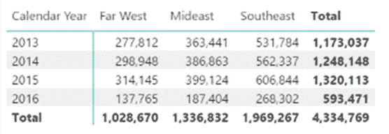

图 3-1 数据透视表中的 `[Sales Qty]` 计算度量值

考虑图 3-1，它使用了 `[Sales Qty]` 计算度量值。该数据透视表有五列和四行。数据集中有四个日历年份，这就是为什么您会看到五行（包括底部的总计行）。在此示例中，销售区域已被筛选为仅显示数据中实际十个销售区域中的三个。最右边的一列是每行的总计。

每个单元格中的值都不同，并且没有一个是与总计值 8,950,628 相同的。该数据透视表中计算度量值的每次执行都使用一个唯一的筛选上下文。

DAX 表达式是一个简单的 `SUM` 计算，并且没有提及任何按日历年份、销售区域或任何其他分组指令进行的筛选。那么，为什么左上角的单元格中的值是 277,812，而紧邻其下方的单元格中的值是 298,948 呢？

这就是 DAX 中筛选上下文的作用。数据透视表有 20 个需要计算的值单元格，因此 DAX 引擎会执行 20 次独立的逻辑计算，数据透视表中的每个单元格对应一次逻辑计算。这包括确定每行和每列总计值所需的计算。

为了在左上角的单元格中生成 277,812 这个值，计算度量值首先可以访问 `'Fact Sale'[Quantity]` 列中的每个值。此计算的筛选上下文开始为空，但有两个列筛选器集隐式添加到了其中。其中一个列筛选器是 `[Calendar Year]` 字段中的行必须具有值 2013；另一个列筛选器是 `[Sales Territory]` 列中的行必须具有值 "Far West"。

筛选上下文中的所有筛选器都基于逻辑 AND 运算，因此只有 `'Fact Sale'[Quantity]` 列中能够同时满足两个条件的行才会被传递给 `SUM` 函数。

生成此单元格值的 T-SQL 等价写法，如同将清单 3-1 中的 `INNER JOIN` 和 `WHERE` 子句添加到 T-SQL 语句中一样。

```
SELECT
SUM([Quantity]) AS [Sales Qty]
FROM FACT.Sale AS S
INNER JOIN Dimension.City AS C
ON C.[City Key] = S.[City Key]
INNER JOIN Dimension.Date AS D
ON D.Date = S.[Invoice Date Key]
WHERE
C.[Sales Territory] = 'Far West'
AND D.[Calendar Year] = 2013
清单 3-1
图 3-1 中左上角单元格生成值的 `[Sales Qty]` 计算度量值（含筛选器）的 T-SQL 语句
```

T-SQL 中的 `WHERE` 子句类似于筛选上下文。`WHERE` 子句中的两个语句分别代表了隐式添加到筛选上下文中的每个列筛选器。

好的，作为高级文档工程师和翻译员，我将遵循您提供的注意事项和示例，将给定的英文文本翻译成中文。

现在，我们来看看 DAX 引擎是如何计算第一列第二行 (298,948) 的值的。此计算的筛选上下文同样始于空，但隐式地添加了两组列筛选器。一个列筛选器是，`[Calendar Year]` 字段中的行现在必须为 2014 年；另一个列筛选器是，`[Sales Territory]` 列中的行必须为“Far West”。清单 3-2 显示了这个单元格计算所对应的等效 T-SQL。

```
SELECT
SUM([Quantity]) AS [Sales Qty]
FROM FACT.Sale AS S
INNER JOIN Dimension.City AS C
ON C.[City Key] = S.[City Key]
INNER JOIN Dimension.Date AS D
ON D.Date = S.[Invoice Date Key]
WHERE
C.[Sales Territory] = 'Far West'
AND D.[Calendar Year] = 2014
清单 3-2
具有不同筛选上下文的 [Sales Qty] 计算度量值的 T-SQL
```

清单 3-1 和清单 3-2 中的 T-SQL 语句之间唯一的区别是最终的谓词，它指定了 `D.[Calendar Year]` 的值现在是 2014 年，而非 2013 年。每个单元格都有自己的筛选上下文，每个筛选上下文又有自己的一组列筛选器。

这一过程会以任意顺序不断重复，因为数据透视表中的任何单元格都不依赖于另一个单元格的输出。

让我们跳到第一列的最后一行，看看 DAX 引擎是如何为第一列的总计计算得出 1,028,670 这个值的。DAX 不会保留同列中先前计算的累计值。从逻辑上讲，引擎会从头开始，得出一个独立于数据透视表中其他 19 个单元格计算的总计值。

DAX 再次以空的筛选上下文开始，但在这种情况下，只有一个列筛选器被隐式地添加到筛选上下文中。这次，列筛选器要求 `[Sales Territory]` 列的值必须为“Far West”。此筛选上下文限制了传递给 `SUM` 函数的 `'Fact Sales'[Quantity]` 列中的行。与前面的两个示例相比，此案例中传递的行更多。

清单 3-3 显示了此单元格的 T-SQL 代码。

# 筛选上下文

## 基本查询示例

这是生成图 3-1 第一列总计值的基本 DAX 查询对应的 T-SQL：

```sql
SELECT
SUM([Quantity]) AS [Sales Qty]
FROM FACT.Sale AS S
INNER JOIN Dimension.City AS C
ON C.[City Key] = S.[City Key]
WHERE
C.[Sales Territory] = 'Far West'
```

这与前面示例的区别在于，您不再需要与 `Dimension.Date` 表进行内连接，并且 `WHERE` 子句中少了一个谓词，因此没有对日期表进行筛选。

在更复杂的场景中，您可以利用这一点，为总计单元格指定一个与按日历年筛选的单元格所使用的计算完全不同的计算。事实上，可以使用函数指示 DAX 为您想要的任何单元格返回完全不同的计算，从而实现多维数据模型中可用的类 `SCOPE` 行为。

### 使用 `SELECTEDVALUE` 覆盖输出

清单 3-4 中的计算度量值应用了一个测试，以查看筛选上下文中是否存在任何列筛选规则，要求 `'Dimension Date'[Calendar Year]` 必须匹配 2014。如果存在，则绕过 `SUM` 函数，返回文本值“overridden”。

```dax
Sum of Quantity =
IF(
    SELECTEDVALUE('Dimension Date'[Calendar Year])=2014,
    -- THEN --
    "overridden",
    -- ELSE --
    FORMAT(
        SUM('Fact Sale'[Quantity]),"#,000"
    )
)
```

任何使用 `[Sum of Quantity]` 计算度量值且其筛选上下文中包含 `[Calendar Year]` = 2014 列筛选器的单元格，现在将返回“overridden”文本，而不是执行 `SUM` 函数（图 3-2）。

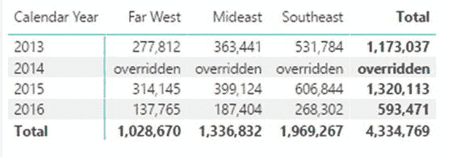
**图 3-2** `[Sum of Quantity]` 计算度量值的输出

请注意，行总计仍然产生与之前相同的总计值，并未因 2014 年行的缺失值而减少。这是因为行总计的计算具有独立的筛选上下文，并且仍可以使用属于 `[Calendar Year]` = 2014 的数据。

列筛选器除了来自视觉对象的行标题和列标题之外，还可以从其他来源隐式地添加到筛选上下文中。它们可以由外部来源驱动，例如在切片器或其他视觉对象上进行的选择，也可以是由特定的报表、页面或视觉对象筛选规则驱动。

如果报表级别的筛选器指定了 `'Dimension City'[Country]` 字段必须为“United States”，此列筛选规则将隐式地添加到报表中所有计算度量值执行的筛选上下文中。

## 另一个示例

让我们来看一个使用更简单数据集的筛选上下文示例。请考虑表 3-1 中的数据集。

**表 3-1** 用于演示筛选上下文的数据集

| 人员     | 宠物 | 值   |
|----------|------|------|
| 安德鲁   | 猫   | 10   |
| 安德鲁   | 狗   | 20   |
| 安德鲁   | 狗   | 30   |
| 布拉德利 | 猫   | 40   |
| 布拉德利 | 猫   | 50   |
| 布拉德利 | 狗   | 60   |
| 查尔斯   | 猫   | 70   |
| 查尔斯   | 鸟   | 80   |
| 查尔斯   | 狗   | 90   |

在数据透视表中使用表 3-1 的数据将产生如图 3-3 所示的结果。

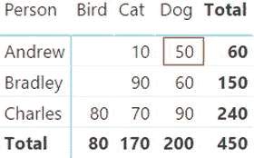
**图 3-3** 在数据透视表中使用的表 3-1 数据集

以下是用于在数据透视表中生成这些值的计算度量：

```dax
Sum of Value = SUM( Table1[Value] )
```

让我们逐步讲解一个筛选上下文的示例。首先，以数据最顶行中高亮显示的单元格（图 3-3）为例，该单元格显示值为 50。这是与“安德鲁”和“狗”交叉处的值。

计算从一个不包含任何列筛选器的空筛选上下文开始。如果筛选上下文保持这种状态，`SUM` 函数就可以访问表 3-1 中 `[Value]` 列的每一行，并输出 450。

该计算度量位于一个数据透视表中，该表在行标题 `[Person]` 上有一个字段，在列标题 `[Pet]` 上有一个字段，因此在计算执行 `SUM` 函数之前，会向筛选上下文添加两个基于列的筛选器。第一个基于列的筛选器是 `Table1[Person]` 必须为“安德鲁”（参见图 3-4）。这意味着筛选上下文现在有了一个基于列的筛选规则。

**表 3-2** 对 `[Person]` 列应用筛选后的表 3-1 数据集

| 人员   | 宠物 | 值   |
|--------|------|------|
| 安德鲁 | 猫   | 10   |
| 安德鲁 | 狗   | 20   |
| 安德鲁 | 狗   | 30   |

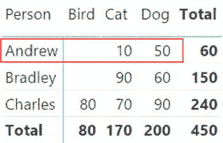
**图 3-4** 显示“安德鲁”的隐式列筛选规则

筛选上下文对数据的影响是，`[Value]` 列现在已缩减为仅三行数据，如表 3-2 所示，如果保持这种状态，`SUM` 函数将返回 60。

要添加到筛选上下文的第二个基于列的筛选器是 `Table1[Pet]` 必须为“狗”。这意味着筛选上下文现在有两个基于列的筛选规则（参见图 3-5）。这会将 `Value` 列中的行减少到仅两行（表 3-3）。

**表 3-3** 对 `[Person]` 和 `[Pet]` 列应用筛选后的表 3-1 数据集

| 人员   | 宠物 | 值   |
|--------|------|------|
| 安德鲁 | 狗   | 20   |
| 安德鲁 | 狗   | 30   |

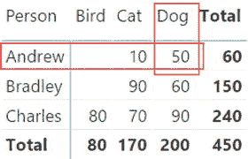
**图 3-5** 显示“安德鲁”和“狗”的隐式列筛选规则

筛选上下文已完成，`SUM` 函数现在可以累加 `[Value]` 列中的所有值。结果得到值 50，即先前在图 3-3 中高亮显示的数字。

通过 DAX 计算中的代码，也可以向筛选上下文添加或从中移除基于列的筛选器。这被称为显式筛选上下文，我们接下来将讨论它。

### 显式筛选上下文

显式筛选上下文指计算中专门向筛选上下文添加或从中移除列筛选规则的代码。显式筛选上下文在隐式上下文和行上下文之后应用，允许你以行上下文和查询上下文无法做到的方式自定义，有时甚至完全覆盖度量的默认行为。你可以使用像 `FILTER` 这样的 DAX 函数来应用筛选上下文。

有几个函数允许你控制最终暴露给计算的数据，从而影响结果。这些函数，如 `ALL`、`ALLEXCEPT` 和 `ALLSELECTED`，将在专门讨论筛选函数的第 6 章中介绍。你可以使用它们来应用或忽略任何已经存在的组合外部筛选器，从而对 DAX 表达式使用的数据进行精细控制。

让我们从一个使用 `WorldWideImportersDW` 数据的简单示例开始。我们创建一个计算，显示 `[Quantity]` 的 `SUM`，但仅限于颜色为红色的库存商品。

你可以通过两种方式来实现。你可以创建一个计算列或一个计算度量。两者表现出不同的行为，你将在此处看到。

计算列的 DAX 可能如下所示：

```dax
Filter on Red as Column = CALCULATE(
    SUM('Fact Sale'[Quantity]),
    'Dimension Stock Item'[Color]="Red"
)
```

而计算度量的 DAX 可能如下所示：

```dax
Filter on Red as Measure = CALCULATE(
    SUM('Fact Sale'[Quantity]),
    'Dimension Stock Item'[Color] = "Red"
)
```

除了计算的名称和类型之外，两者使用的表达式是相同的。然而，这些计算的行为并不相同，这是由于上下文不同所致。

这两个计算都是在 `'Fact Sale'` 表上创建的，并在另一个表的列上指定了筛选条件。之所以可行，是因为你在数据模型中定义了 `'Fact Sale'` 表和 `'Dimension Stock Item'` 表之间的关系。

这两个计算都通过 `CALCULATE` 函数调用筛选函数，这是应用筛选的最简单方法之一。

这两个计算都被添加到一个数据透视表中（图 3-6），同时还有一个未筛选的隐式度量，用于显示数量列的总和。

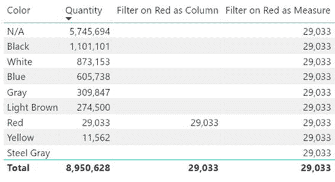
**图 3-6** 使用 `[Filter on Red as Column]` 和 `[Filter on Red as Measure]` 显示输出的数据透视表

# DAX计算与上下文详解

第一列名为`Quantity`，是来自`'Fact Sale'`表的`[Quantity]`字段。这不是我们的计算之一；而是添加到数据透视表中以提供基线值作为两个计算参考的字段。

由于此列使用数值数据类型，因此默认的`SUM`汇总行为被隐式应用于这些结果，并且应用于这些结果的唯一上下文是来自数据透视表行和列标题的查询上下文。

生成此行为不需要 DAX。数据模型的一个列属性允许你为数值列定义默认汇总方式。如果未定义默认值，数据模型会假定`SUM`是默认行为。

数据透视表中的下一列是使用名为`[Filter on Red as Column]`的计算列的隐式度量，该列仅在行标题为“Red”的行上显示一个值。最后一列是`[Filter on Red as Measure]`列，该列重复显示值 29,033，包括在最后一行，这是一个未按颜色筛选的“总计”行。

## 计算列

我们来看看`[Filter on Red as Column]`这个计算列发生了什么。在这个例子中，我们使用了`CALCULATE`函数。我们使用这个函数的一个显式筛选表达式来指定一个规则，即`'Dimension Stock Item'[Color]`必须为“Red”。

`SUM`函数不理解行上下文，因此`CALCULATE`函数会自动将行上下文转换为筛选上下文，这使得`SUM`函数能够访问其所需的数据来完成计算。请参阅本章末尾的“上下文转换”，其中对此进行了更详细的解释。

该计算在数据被读取到数据模型时进行评估，并且对于`'Fact Sales'`表中的每一行，都会计算该计算，并将结果作为新列的值返回。`'Dimension Stock Item'[Color]`必须为“Red”的显式规则会在每次执行计算时被添加到筛选上下文中。

`'Fact Sales'`表有 228,265 行，因此逻辑上，这个计算会被计算 228,265 次，每次计算只能访问其当前行或相关行的信息。

筛选上下文中没有添加或删除其他任何内容，因此，如果`'Fact Sales'`表中的某一行恰好是红色的库存项，则该计算返回`[Quantity]`列的`SUM`，否则返回空白。

`SUM`函数需要一个传递给它的列来生成一个值。在所有 228,265 行的每一次计算中，`SUM`函数都使用一个由筛选上下文筛选过的`'Fact Sale'[Quantity]`列。

一旦计算列被添加到模型中，数据就会在“数据视图”中可见。这表明只有部分行在`[Filter on Red as Column]`列中有值。这些行属于颜色为“Red”的库存项。该数据集中的大多数行都将具有空白值。

在图 3-7 中，两行高亮显示的行在最后一列显示了值，而其他行则显示空白单元格。这是该计算列被计算的唯一一次，这也解释了为什么当该列被添加到数据透视表时，表中显示的结果仅针对行标题为“Red”的数据。

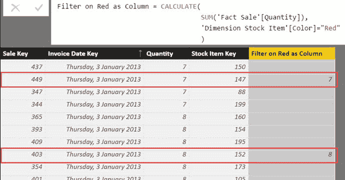

**图 3-7** 包含新`[Filter on Red as Column]`计算列的`'Fact Sale'`表示例

> **注意：** 在使用`CALCULATE`函数的计算列上设置默认汇总无效。`CALCULATE`函数中使用的表达式决定了每个单元格（包括总计）的结果。

`[Filter on Red as Column]`计算列仅应用了一个非常基本的筛选。DAX 中提供了一系列筛选函数，允许您设置更复杂的筛选行为，我将在后续章节中介绍这一点。

当您将该计算列拖到数据透视表时，会生成一个隐式计算度量，并由数据透视表使用。

## 计算度量

让我们看一下图 3-8 中数据透视表的最后一列，该列使用了`[Filter on Red as Measure]`计算度量。现在，它在行标题为“Red”以外的值的行上返回了值，并且最底部的行返回的值与列中上方的值相同。您可能期望最后一列中显示的值至少是该列值的总计。

尽管用于计算度量和计算列的公式完全相同，但区别在于上下文。当计算列被计算时，每个单独的计算都具有行上下文，并且在逻辑上被计算 228,625 次。

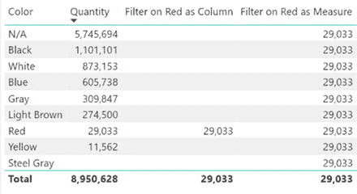

**图 3-8** 使用`[Filter on Red as Column]`和`[Filter on Red as Measure]`显示输出的数据透视表

对于此视觉对象，计算度量仅计算了十次：数据透视表中每个具有行标题的单元格一次（九种不同的颜色），以及底部总计行一次。当计算度量被评估时，没有行上下文。每次计算都从一个空的筛选上下文开始。

DAX 是如何得出每次执行此计算度量时值为 29,033 的呢？

对于前九行，每次执行都会向空的筛选上下文中添加一个基于列隐式筛选的规则。此隐式筛选规则来自表中的第一列，并规定`'Dimension Stock Item'[Color]`列中的值必须与相应行标题的值匹配。

然而，该计算度量中也使用相同的列编码了一个显式列筛选规则。这会替换隐式筛选规则，这意味着筛选上下文在该列上仍然有一个单列筛选规则，但现在使用的是显式定义的规则。

底部行的计算没有向其筛选上下文中添加基于列的隐式规则，但在运行其`SUM`函数之前，它仍然向其筛选上下文中添加了显式列筛选。因此，它返回的值与其上方的值相同。

一旦筛选上下文最终确定，它就会包含一个针对`'Dimension Stock Item'[Color]`列的单列筛选规则。`SUM`函数现在使用`[Quantity]`列中存留的值返回 29,033。当这对数据透视表列中的每个单元格重复执行时，即使对于总计行，您都会得到相同的结果。

这看起来可能有些奇怪，但希望它有助于您理解筛选上下文是如何影响核心计算的。

如果您感兴趣，清单 3-5 显示了我们的计算度量对应的 T-SQL 等价代码。

```sql
SELECT
SUM ( F.[Quantity] ) AS [Filter on Red as Measure]
FROM FACT.Sale AS F
LEFT OUTER JOIN Dimension.[Stock Item] AS D
ON F.[Stock Item Key]=D.[Stock Item Key]
WHERE
D.[Color] = 'Red';
```

**清单 3-5** DAX 计算度量的 T-SQL 版本

如果您将此 T-SQL 查询运行十次（每个单元格一次），每次都会得到相同的 29,033 结果。

清单 3-5 中的 T-SQL 使用了`LEFT OUTER JOIN`。这也是 DAX 在此特定情况下会使用的联接类型。请注意，根据筛选器和 DAX 的不同，有时这可能是`INNER JOIN`。

## 硬编码示例

筛选上下文的另一个示例是对计算列和计算度量都进行硬编码以返回值 1。

考虑以下两个计算。第一个是计算列，第二个是计算度量：

```dax
Hardcoded Calculated Column = 1
Hardcoded Calculated Measure = 1
```

当我们将这两个计算添加到同一个数据透视表时，会得到图 3-9 所示的结果。

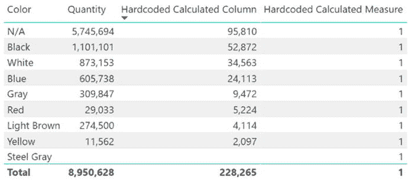

**图 3-9** 使用硬编码值显示计算的数据透视表

正如预期，计算列执行了 228,265 次，并为每一行返回值 1。当添加到数据透视表时，会使用默认的`SUM`汇总行为生成一个隐式计算度量。此隐式度量的筛选上下文从数据透视表的第一列接收到一个列筛选规则。这是一种生成`ROWCOUNT`度量的迂回方式。

硬编码计算度量需要为十个单元格生成值，因此逻辑上，它会计算这个简单的计算十次。结果如图所示，每个单元格（包括总计）中都出现了硬编码值 1。

# 行上下文

行上下文在创建计算列或在迭代器函数内执行代码时生效。正如计算度量值对数据透视表或报表视觉对象中的每个单元格执行逻辑计算一样，计算列也会执行逻辑计算，以生成计算列中每一行的值。如果你向一个包含 250 行的表添加计算列，则该计算将被执行 250 次。每次执行都拥有略微不同的行上下文。

计算列和计算度量值的一个关键区别在于计算发生的时间点。计算列在其创建或修改时，以及数据被物理加载或刷新到数据模型之后进行计算；而计算度量值则会在任何可能影响其值的筛选器发生变化时重新计算。

行上下文允许计算快速访问当前表中同一行的值，或通过关系访问相关表行中可能存在的值。

使用 WideWorldImportersDW 数据集（图 3-10）的一个简单行上下文示例是，创建一个计算列，该列返回基于`[Unit Price]`和`[Quantity]`列相乘的结果。

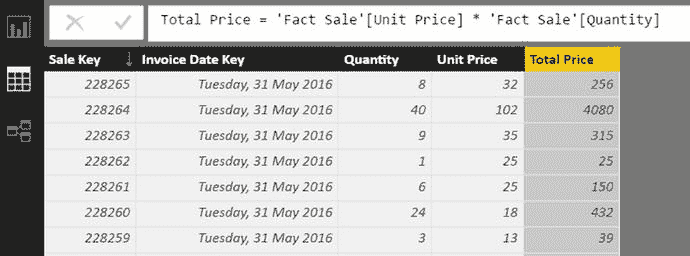

图 3-10 包含新计算列的 `'Fact Sale'` 示例

图 3-10 显示了一个名为`[Total Price]`的新计算列，该列在其计算中使用来自同一行的`[Unit Price]`和`[Quantity]`列来生成每个结果。

图 3-10 中的第一行在`[Total Price]`列中生成了值 256，这是 8 * 32 的结果。

数据一旦被加载或刷新，该值便无法更改。如果你有大量计算列和许多行，数据加载/刷新所需的时间会更长。向模型添加计算列的另一个影响是需要额外的内存来存储计算结果。任何使用计算列数据的附加计算都将这些值视为由外部数据源提供。

如果你的数据模型中定义了关系，你可以使用`RELATED`函数从其他表访问列，以便在计算列的公式中使用。

一个示例是向 `'Fact Sale'` 表添加一个计算列，该列根据 `'Fact Sale'` 表中的数量信息估算每行的重量，并将其与 `'Dimension Stock Item'` 表中的 `[Typical Weight Per Unit]` 列相结合。该计算列的公式使用两个表中的数据来生成结果。

图 3-11 突出显示了每个表中 `[Stock Item Key]` 列之间的关系。

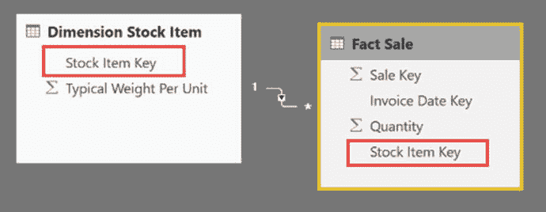

图 3-11：'Dimension Stock Item' 和 'Fact Sale' 之间的关系视图

当以下计算列被添加到 `'Fact Sale'` 表时，它演示了行上下文：

```
Estimated Weight =
'Fact Sale'[Quantity] *
RELATED(
'Dimension Stock Item'[Typical Weight Per Unit]
)
```

你可以在图 3-12 的数据视图中看到新的计算列。

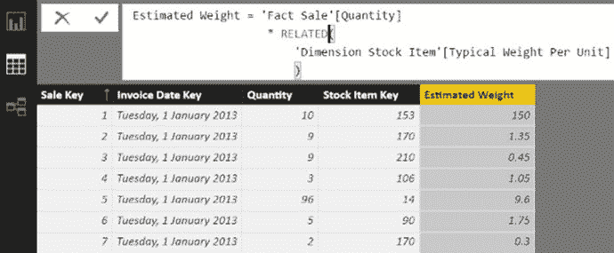

图 3-12：包含新计算列的 'Fact Sale' 示例输出

只有在使用 `RELATED` 函数后，IntelliSense 才会建议 `'Dimension Stock Item'` 表中的列。数据模型中的关系有助于控制 IntelliSense 提供的对象。

此计算的 T-SQL 等效操作是为每一行执行以下命令，尽管 `S.[Stock Item Key]` 会被硬编码为关系中定义的列的值：

```
SELECT TOP 1
S.[Quantity] * D.[Typical Weight Per Unit] AS [Estimated Weight]
FROM FACT.Sale AS S
LEFT OUTER JOIN Dimension.[Stock Item] AS D
ON D.[Stock Item Key] = S.[Stock Item Key]
```

**注意**

计算列无法使用当前行 +/-1 指令访问当前行上方或下方的数据。

虽然此说明并不完全正确，但它并不像你在其他语言中可能遇到的那样直接。你可以在使用显式 DAX 函数（如`FILTER`）的计算中访问表中其他行的数据，我将在第 6 章中将其作为更高级的案例进行介绍。

假设加载表时没有排序的概念，因此无法保证上下行的顺序。一旦一行被读取并分解以填充数据加载过程中的各种列索引，该行就会被丢弃。

在需要时，逻辑上重建行是可能的，但这可能会在计算上非常昂贵，特别是当表有很多列时。

## 迭代器

多个 DAX 函数基于列索引中存储的信息重建行。这些被称为迭代器，或 X 函数，因为这些函数通常以字母 X 作为函数名的最后一个字符。以下是一些迭代器函数：

- `AVERAGEX`：计算在表上评估的一组表达式的平均值（算术平均数）。
- `COUNTAX`：计算对表的每一行评估表达式所产生的值的数量。
- `COUNTX`：计算对表的每一行评估表达式所产生的值的数量。
- `GEOMEANX`：返回表中表达式值的几何平均值。
- `MAXX`：返回对表的每一行评估表达式所产生的最大数值。
- `MEDIANX`：返回表中表达式值的第 50 个百分位数。
- `MINX`：返回对表的每一行评估表达式所产生的最小数值。
- `PRODUCTX`：返回表中表达式值的乘积。
- `RANKX`：返回在当前上下文中评估的表达式在指定表每行的值列表中的排名。
- `SUMX`：返回对表中每一行评估的表达式的总和。
- `FILTER`：返回经过筛选的表。

迭代器是对于传递给函数的任何表中的每一行处理一次的函数。处理过程可以是一个计算，或者对于 `FILTER` 而言，它应用一组布尔规则来筛选其使用的表，从而返回一个筛选后的表。

迭代器可以嵌套多次。每个迭代器实例都保持自己的一组行上下文。嵌套迭代器中的表达式可以访问来自外部迭代器的行上下文中的值。这些通常被描述为等同于你在其他语言中可能看到的内层和外层循环：

```
foreach (row outer in TableA)
{
    foreach (row inner in TableB)
    {
        return expression;
    }
}
```

迭代器允许你解决使用`SUM`、`COUNT`或`AVERAGE`等函数难以解决的复杂数据问题，但它们可能会增加 CPU 处理负载。

**注意**

`SUM`/`COUNT`/`AVERAGE` 只是 `SUMX`/`COUNTX`/`AVERAGEX` 的语法糖。对于单列的情况，使用 `SUM('Table'[Column])` 相比于 `SUMX('Table', [Column])` 并无性能优势。

### DAX 中数据的存储方式

理解 DAX 上下文的另一种方式是考虑底层引擎在导入数据后如何存储数据。以这种方式看待上下文，或许能帮助你理解不同类型的上下文对你的计算施加的顺序和影响。

你的源数据通常以行或行批次的形式存储。每一行可能包含许多列、字段或属性。当你将数据导入 DAX 模型时，数据源会被逐行读取到数据模型中。

表 3-4 是一个基于美国人口普查局美国人口估计的示例数据集。此处使用的原始数据集仅包含九行数据，且未经聚合。

**表 3-4** 美国人口估计

| 美国州名 | 年龄段 | 2015 年人口 | 2016 年人口 |
| --- | --- | --- | --- |
| 加利福尼亚 | 25 岁以下 | 25,947,866 | 25,748,276 |
| 加利福尼亚 | 50 岁以下 | 26,922,326 | 27,188,676 |
| 加利福尼亚 | 50 岁及以上 | 24,805,956 | 25,245,954 |
| 佛罗里达 | 25 岁以下 | 11,676,422 | 11,729,046 |
| 佛罗里达 | 50 岁以下 | 12,627,122 | 12,853,344 |
| 佛罗里达 | 50 岁及以上 | 16,049,448 | 16,501,676 |
| 得克萨斯 | 25 岁以下 | 19,885,656 | 20,033,802 |
| 得克萨斯 | 50 岁以下 | 18,700,892 | 19,046,066 |
| 得克萨斯 | 50 岁及以上 | 16,036,504 | 16,412,550 |

当这个数据集被导入 DAX 时，导入引擎会逐行读取并处理数据。添加到此数据集的计算列将确定 2015 年与 2016 年人口之间的差异：

```
Population Difference = 'Population by Age'[2016 Population] - 'Population by Age'[2015 Population]
```

导入第一行时，可以轻松计算该计算列，因为引擎可以访问该行中的每一个值，包括公式中使用的`[2016 Population]`列和`[2015 Population]`列。计算得到的单一值结果随后会存储在该行的新列中。

该计算未使用任何筛选语句，因此筛选上下文为空。每一行都是独立读取的，因此你无法访问任何其他行中的任何信息（除非通过与其他表的数据模型关系）。

### 列索引

导入过程的下一步是将每一列分解为其自身的数据结构。DAX 为`[US State]`列中的每个值维护一个独立的存储结构，为`[Age Band]`列维护一个单独的数据结构，依此类推。我将这些数据结构称为列索引。数据模型对每个列索引应用了多种类型的压缩算法，我在此不详述，但关键点是每个列索引都保留了足够的信息，以使其能够理解每个值所属的原始行号。

正如我提到的，列索引包含对原始行号的引用，因此，虽然引擎在运行时有可能将行重新拼接起来，但这在性能方面是一项昂贵的操作。DAX 引擎可以使用几个列索引非常快速地计算大多数计算，而无需重建大量完整行。

让我们看一个示例，了解 DAX 如何使用列索引生成结果。假设你想创建一个数据透视表，该表使用九行人口估计数据，并重点关注按`[Age Band]`细分的`[2015 Population]`。数据透视表将如图 3-13 所示。顶部的值 57,509,944 已被高亮显示；它是原来属于加利福尼亚、佛罗里达和得克萨斯的三行底层数据的合计总和。

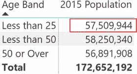

**图 3-13** 使用 `[2015 Population]` 计算度量值的数据透视表

计算度量值的公式很简单。以下是将其创建为显式度量值的 DAX 代码：

```
2015 Population = SUM('Population by Age'[2015 Population])
```

向 `SUM` 函数传递了对 `[2015 Population]` 列的引用。生效的筛选上下文是，`SUM` 只应考虑 `[Age Band]` 值为“Less than 25”（25 岁以下）的行。

在 `SUM` 函数开始之前，引擎首先需要扫描 `[Age Band]` 列索引，以获取其所有值为“Less than 25”的原始行号。这些行号很可能已排序并分组在一起，因此扫描会快速返回一个行号列表，在本例中为第 1、4 和 7 行（表 3-5）。下一步是允许 `SUM` 函数继续执行，但仅针对具有这三个行号的值。

**表 3-5** 按 `[Age Band]` 筛选后 `SUM` 函数使用的行

| 行号 | 年龄段 | 行号 | 2015 年人口 |
| --- | --- | --- | --- |
| 1 | 25 岁以下 | 1 | 25,947,866 |
| 4 | 25 岁以下 | 4 | 11,676,422 |
| 7 | 25 岁以下 | 7 | 19,885,656 |

一旦你获得了第 1、4、7 行的 `[2015 Population]` 值，引擎就可以将值 57,509,944 返回到相应的单元格中（图 3-14）。

对于第二行，重复此过程，但在本例中，从 `[Age Band]` 列索引中检索到的“Less than 50”（50 岁以下）的行号为第 2、5 和 8 行。

然后，计算会确定“50 or Over”（50 岁及以上）值需要第 3、6 和 9 行。

对于最后一行，无需扫描 `[Age Band]` 列索引，因此 `[2015 Population]` 列中的所有值都会被传递给 `SUM` 函数，用于输出 172,652,192。

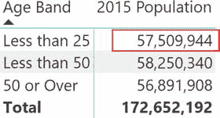

**图 3-14** 使用 `[2015 Population]` 计算度量值的数据透视表

总之，为了计算除了总计行之外的所有数字，引擎只需要访问两个列索引，无需更多。它不需要扫描或读取 `[US State]` 或 `[2016 Population]` 的列索引。最后一行返回的值可以通过仅读取 `[2015 Population]` 来确定。唯一生效的上下文是查询上下文。

底层查询引擎可能会以更高效的方式处理这些步骤，但如果你思考引擎为生成每个单元格的最终值在逻辑上需要什么，这或许有助于理解这三种上下文的影响。

### 上下文转换

有时，你需要将行上下文转换为筛选上下文。这是因为某些 DAX 函数无法识别行上下文。

本章前面的行上下文示例使用了以下公式：

```
Estimated Weight =
'Fact Sale'[Quantity] *
RELATED(
'Dimension Stock Item'[Typical Weight Per Unit]
)
```

此计算未使用 `SUM` 或 `AVERAGE` 等 DAX 函数，因此可以计算出有意义且符合预期的结果。

让我们看看当使用无法识别行上下文的 DAX 函数时会发生什么。为此，请在 `'Fact Sale'` 表中添加以下两个计算列：

```
New Quantity Column 1 = SUM ( 'Fact Sale'[Quantity] )
New Quantity Column 2 = CALCULATE( SUM( 'Fact Sale'[Quantity] ) )
```

两个计算列都使用了 `SUM` 函数，并且引用了相同的列。唯一的区别是，第二个计算列在 `SUM` 函数外层使用了 `CALCULATE` 函数。结果如图 3-15 右侧两列所示。

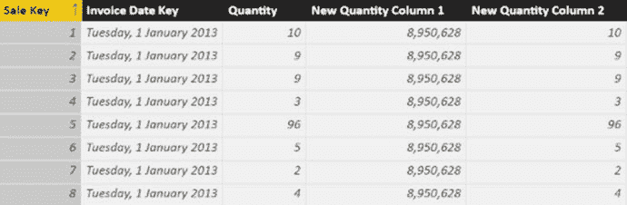

**图 3-15** 显示新计算列的 `'Fact Sale'` 表示例

对于 `[New Quantity Column 1]` 列，可以看到该列每一行的值都重复着 8,950,628。此计算版本每次执行时，筛选上下文都是空的，因此 `SUM` 函数可以访问 `'Fact Sale'[Quantity]` 列中的每一行。

`[New Quantity Column 2]` 列产生了不同的结果，这突显了上下文转换的效果。`CALCULATE` 函数知道自己被用在计算列中，因此它将每一行现有的行上下文转换为基于列的筛选规则，然后将其添加到筛选上下文中。这一次，每次执行 `SUM` 函数时，使用的都是经过高度筛选的 `'Fact Sale'[Quantity]` 列版本。

上下文转换只能将行上下文转换为筛选上下文。上下文永远不会反向转换。

