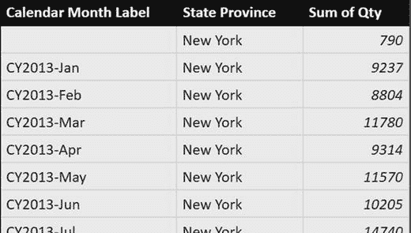

# 4. 汇总与聚合

在数据建模中，一个常见的需求是生成现有表的汇总版本。本章探讨 DAX 中可用的一些选项。

你可能有多种理由考虑在数据模型中添加汇总表。如果使用得当，汇总表可以极大地提高性能。一个由数百万行交易记录组成、每天有数千行数据的大表，非常适合创建一个可能每天只有一行的汇总表。指标可以在聚合时计算并存储为列，以提供大部分原本需要对原始数据进行的相同报告。只要你只需要按天、月或年进行绘图，使用此类汇总表的可视化对象会快得多。

需要注意的是，当你创建这样的汇总表时，将无法对汇总表中未包含的任何聚合级别进行交叉筛选。但通过一些思考和规划，你可以优化 Power BI 报表，为最终用户提供更好的体验。

汇总表的其他用途可能有助于理解数据集中的某些行为特征；例如，客户首次和/或最后一次购买的时间，可以通过在购买日期列上使用 `MIN` 和 `MAX` 函数来获取。你可以将生成的汇总表连接回原始表，作为一种根据每个客户可能不同的首次/最后一次购买日期动态筛选记录的巧妙方法。你还可以使用汇总表，通过分组和排序结合的方式，找出销售额排名前十的产品。

以下是能够创建汇总表的主要 DAX 函数：

- `SUMMARIZE`
- `SUMMARIZECOLUMNS`
- `GROUPBY`

本章将更详细地介绍这些函数，并涵盖它们之间的差异，同时给出在不同情况下如何选择使用的建议。对于小型数据集上的简单示例，它们实际上可以互换使用。然而，对于使用较大数据集的更复杂场景，选择正确的函数可以产生显著差异。

这些汇总函数都返回一个新表作为输出。它们经常被用作部分计算表表达式中的主函数，以及计算度量内部复杂工作逻辑的一部分。

这些函数的相似之处在于，你可以指定用于分组依据的列。如果未指定列，则函数只返回一个单行表。如果使用一列进行分组，则行数反映该列中唯一值的总数。随着添加更多列，行数可能会增加，但并不总是如此。向已按日历天分组的汇总函数添加日历月列，并不会在最终输出中增加任何行。

只要关系定义得当，用于分组的列可以跨多个表存在。这些通常是“上游”表，也可以称为 DAX 关系中“一端”的表。

我将使用同一个示例来演示每个汇总函数。这些示例都使用 WideWorldImportersDW 数据集，并在包含 228,265 行的 `'Fact Sale'` 表上创建汇总，按 `[State Province]` 和 `[Calendar Month]` 列进行分组。每个汇总表中都添加了一个聚合列，该列对 `'Fact Sale'[Quantity]` 列进行求和。

列表 4-1 显示了与此对应的 T-SQL 语句：

```
SELECT
[Date].[Calendar Month Label],
[City].[State Province],
SUM(Sale.Quantity) AS [Sum of Qty]
FROM [Fact].[Sale] AS [Sale]
INNER JOIN [Dimension].[Date] AS [Date]
ON [Date].[Date] = Sale.[Delivery Date Key]
INNER JOIN [Dimension].[City] AS [City]
ON [City].[City Key] = Sale.[City Key]
GROUP BY
[Date].[Calendar Month Label],
[City].[State Province]
```

**列表 4-1** T-SQL 基线示例

由此产生的表包含 2,008 行，相比于近 25 万行的原始表，比例达到了 111:1，或者说，新表的大小不到原始表的 1%。

在报表中使用此汇总表的任何可视化对象，生成值时所需的工作量都更少。如果报表仅按 `[Calendar Month Label]` 或 `[State Province]` 字段进行筛选，那么这是件好事。但是，如果你需要表示其他级别的筛选，那么请考虑修改此汇总表或创建额外的汇总表。

# `SUMMARIZE` 函数

我们首先来看 `SUMMARIZE` 函数。该函数的调用语法如下：

```
SUMMARIZE (<table>, <groupBy_columnName> [, <groupBy_columnName>]..., [<name>, <expression>]...)
```

第一个必填参数是 `<table>` 的值。这可以是模型中任何现有表的名称，其中可以包括其他计算表。它也可以是一个返回表的函数，或存储在变量中的表表达式。你只能提供一个表。

**注意：** 不能在同一语句中对另一个 `SUMMARIZE` 函数的输出使用聚合函数。如果需要进行多层聚合，需要使用 `GROUPBY` 函数，否则应创建两个表语句。

第二个参数可以是第一个参数所指定表中的任何列名，也可以是数据模型中已定义关系的任何表中的列。你可以继续将列引用作为第三、第四和第五个参数（以此类推）传递。DAX 引擎足够智能，能够根据传递给函数的值的类型判断该做什么。只要你继续传递表列，函数就会知道这些是你想要分组的列。

如果你不想传递任何列引用，也可以不传。如果你的意图只是将基表分组为单行，你可以在第一个参数之后立即开始提供 `<name>` 和 `<expression>` 对。

一旦你停止传递表列，就可以开始向函数添加参数对。这些参数对以文本值和 DAX 表达式的形式存在。`<name>` 值是用于设置列名的文本。你需要将文本用双引号括起来。这对参数中的另一个是 `<expression>` 值，它是一个有效的 DAX 计算。这是汇总表的聚合部分。此示例使用单个 `<name>`/`<expression>` 参数对，但与 `<groupBy_columnName>` 参数一样，只要参数符合 `<name>`/`<expression>` 的格式，就可以传递更多参数。

清单 4-2 中的示例已按便于理解的方式进行了格式化。

```
使用 SUMMARIZE 的汇总表 =
SUMMARIZE(
-- 要汇总的表 --
'Fact Sale',
-- 用于分组的列 --
'Dimension Date'[Calendar Month Label],
'Dimension City'[State Province],
-- 聚合列 --
"数量之和",SUM('Fact Sale'[Quantity])
)
```

**清单 4-2** – 使用 `SUMMARIZE` 函数的 DAX 示例

让我们将此示例中的参数映射回语法规范，以便你了解函数的工作原理（表 4-1）。

**表 4-1** – `SUMMARIZE` 函数的语法映射

| 语法 | 示例 |
| --- | --- |
| `<table>` | `'Fact Sale'` |
| `<groupBy_columnName1>` | `'Dimension Date'[Calendar Month Label]` |
| `<groupBy_columnName2>` | `'Dimension City'[State Province]` |
| `<name1>`, `<expression1>` | `"数量之和"` , `SUM('Fact Sale'[Quantity])` |

`SUMMARIZE` 函数返回一个新表，该表在外观上与数据模型中的任何其他表无异。你可以将此表用于视觉对象和筛选器，并可以将其与其他表建立关联。你可以添加计算列和计算度量值。现在，你还可以使用 `SUMMARIZE` 函数输出所创建的表作为基表来创建计算表，以便在附加数据上创建第二层聚合。

图 4-1 的结果中左上角行有一个空白值。这意味着 `'Fact Sale'` 表中有些记录在 `[Delivery Date Key]` 列中没有值，或者此列中的某些值在 `'Dimension Date'[Date]` 列中不存在。这些记录会保留在结果集中，在此图中你可以看到原始 `Quantity` 列的 SUM 值累加到 790。



**图 4-1** – 使用 `SUMMARIZE` 函数的示例输出

更好地了解无日期行的一种方法是通过 `<name>`/`<expression>` 对向汇总表添加一个额外的聚合列，如下所示：

```
"行计数", COUNTROWS('Fact Sale')
```

这将在计算表中添加第四列，该列显示每个分组的行数，可能提供关于不匹配可能影响多少条记录的额外信息。

或者，你可以使用 `FILTER` 函数生成一个计算表，显示 `'Fact Sale'[Invoice Date Key]` 列中所有在 `'Dimension Date'[Date]` 列中没有对应值的值。其代码可能如下所示：

```
缺失数据表 =
FILTER(
'Fact Sale',
ISBLANK(
RELATED('Dimension Date'[Date])
)
)
```

这将在模型中生成一个新的计算表，它是 `'Fact Sale'` 的筛选副本，并且仅包含在 `'Dimension Date'` 表中没有匹配行的行。

这个有用的调试技术的结果是，`'Fact Sale'` 中有 284 条记录在 `[Delivery Date Key]` 列中具有空白值。这些可能代表尚未交付的近期销售。

这提供了一个等效于 T-SQL `LEFT JOIN` 查询的 DAX 方法，用于识别左表中没有右查询匹配值/行的值/行。

一旦数据问题调查工作完成，就可以删除这个已创建的计算表。

## 关系

此示例没有为 `SUMMARIZE` 函数提供任何关于如何将 `'Fact Sale'` 表与 `'Dimension Date'` 和 `'Dimension City'` 表连接的信息，但该函数仍然能够使用跨越三个表的列按我们想要的方式准确地对数据进行分组。在 T-SQL 语句中，我们使用 `ON` 和 `WHERE` 子句提供如何连接表的提示，而 DAX 引擎使用关系机制在查询时确定如何连接表。

在本例中，数据模型在 `'Fact Sales'` 表和 `'Dimension Date'` 表之间定义了现有关系。此关系指定 `'Fact Sale'` 表中的 `[Delivery Date Key]` 列与 `'Dimension Date'` 表中的 `[Date]` 列相关联。

此计算中涉及的另一个关系是 `'Fact Sale'` 表与 `'Dimension City'` 表之间使用两侧的 `[City Key]` 列建立的关系。`SUMMARIZE` 函数会自动使用活动关系来构建所需的查询。

在 DAX 中，可以在相同的两个表之间定义多个关系。任何时候只能有一个关系是活动的，而哪个关系是活动的决策需要由数据模型的作者手动设置。默认使用的是活动关系，在本例中，该关系使用 `[Invoice Date Key]` 列将 `'Fact Sale'` 表与 `'Dimension Date'` 表连接起来。

### 替代关系

如果你想使用相同的列创建汇总表，但希望基于不同的日期列（例如 `[Invoice Date Key]`）来聚合 `Fact Sale` 数据，你可以手动编辑 `Fact Sales` 和 `Dimension Date` 之间的现有关系，以指定合适的关系作为活动关系；或者，你可以用另一种方式编写计算表公式，以利用替代关系。请记住，在 DAX 中，当你编写涉及多个表的公式时，标记为 `Active` 的关系是默认使用的活动关系。

清单 4-3 展示了如果你想使用某个非活动关系时，计算表的样子。你的数据模型中，在 `Fact Sale[Invoice Date Key]` 和 `Dimension Date[Date]` 之间存在一个非活动关系。

```
Summary Table using SUMMARIZE =
CALCULATETABLE(
SUMMARIZE(
-- 要汇总的表
'Fact Sale',
-- 要分组的列
'Dimension Date'[Calendar Month Label],
'Dimension City'[State Province],
-- 聚合列
"Sum of Qty",SUM('Fact Sale'[Quantity])
),
USERELATIONSHIP(
'Fact Sale'[Invoice Date Key],
'Dimension Date'[Date])
)
清单 4-3
使用 USERELATIONSHIP 函数的 SUMMARIZE
```

这里，你将原始的 DAX 表达式封装在 `CALCULATETABLE` 函数中。这允许使用一个筛选函数。第一个参数与你之前使用的计算中的参数相同。`CALCULATETABLE` 函数的第二个参数是 `USERELATIONSHIP` 筛选函数，它指示 DAX 引擎使用 `[Invoice Date Key]` 列连接 `Fact Sale` 和 `Dimension Date`。

此查询的结果显示了相同的三列，但这一次，`[Sum of Qty]` 列的结果代表的是发票日期而非交货日期。这种方法确实依赖于存在一条关系，即使是非活动关系。如果 `Fact Sale` 和 `Dimension Date` 之间没有通过 `[Invoice Date Key]` 建立关系，则计算表不会被加载到表中。

以某种方式将这点融入到新计算表的名称中可能会很有用，这有助于最终用户理解数据是如何被聚合的。

## 带筛选条件的 SUMMARIZE

在清单 4-4 中，我们通过将筛选条件合并到计算表的逻辑中，来扩展这个示例。

添加一个筛选条件，将用于汇总表的底层数据限制为特定的销售区域。另一个增强功能是在输出中添加一列，该列执行一个基本计算以表示平均数量。

```
Summary Table using SUMMARIZE (Southwest) =
SUMMARIZE(
-- 要汇总的表
FILTER('Fact Sale',RELATED('Dimension City'[Sales Territory]) = "Southwest"),
-- 要分组的列
'Dimension Date'[Calendar Month Label],
'Dimension City'[State Province],
-- 聚合列
"Sum of Qty",SUM('Fact Sale'[Quantity]),
"Average Qty", DIVIDE(
SUM('Fact Sale'[Quantity]),
COUNTROWS('Fact Sale')
)
)
清单 4-4
使用筛选条件的 SUMMARIZE 函数
```

为了将筛选条件纳入计算，第一个参数中使用的 `Fact Sale` 表被包装在 `FILTER` 函数中。`FILTER` 函数使用 `RELATED` 函数对 `Dimension City[Sales Territory]` 列应用一个硬编码的筛选条件。另一个增强功能是为聚合列添加了额外的 `<名称>` / `<表达式>`，这展示了如何在一个表达式中使用多个聚合函数（`SUM` 和 `COUNTROWS`）来获得稍微复杂的结果。

另一种合并显式筛选谓词的方法是使用 `CALCULATETABLE` 函数，如清单 4-5 所示。

```
Summary Table using SUMMARIZE (Southwest) =
CALCULATETABLE(
SUMMARIZE(
-- 要汇总的表
'Fact Sale',
-- 要分组的列 --
'Dimension Date'[Calendar Month Label],
'Dimension City'[State Province],
-- 聚合列 --
"Sum of Qty",SUM('Fact Sale'[Quantity]),
"Average Qty", DIVIDE(
SUM('Fact Sale'[Quantity]),
COUNTROWS('Fact Sale')
)
),
'Dimension City'[Sales Territory] = "Southwest"
)
清单 4-5
使用 CALCULATETABLE 进行筛选的 SUMMARIZE
```

为了将筛选条件纳入此计算，使用了 `CALCULATETABLE` 函数。第一个参数是我们在清单 4-4 中使用的 `SUMMARIZE` 函数。传递给 `CALCULATETABLE` 函数的第二个参数是一个基本的筛选语句。这个筛选条件意味着计算仅使用与此谓词匹配的数据；这很像在 T-SQL 查询的 `WHERE` 子句中包含类似语句。

## SUMMARIZECOLUMNS 函数

你可以在 DAX 中用来聚合表的另一个函数是 `SUMMARIZECOLUMNS` 函数。这个较新的函数在语法上稍微有些不同。其语法如下：

```
SUMMARIZECOLUMNS(
...,
...,
, ...
)
```

就像使用 `SUMMARIZE` 函数一样，你可以向此函数传递动态数量的参数。如果第一个参数是对列的引用，`SUMMARIZECOLUMNS` 函数会理解这是你想要分组的列。如果你继续传递列引用，该函数会将其视为额外的分组指令。

一旦你传递了一个 `FILTER` 函数（或字符串值），该函数就会理解这些引用是用于对聚合应用筛选条件，或者是开始添加将作为 DAX 表达式（如 `SUM`、`COUNT`、`MIN` 等）结果的列。

使用此语法，使用 `SUMMARIZECOLUMNS` 创建场景的 DAX 如清单 4-6 所示。

```
Summary Table using SUMMARIZECOLUMNS =
SUMMARIZECOLUMNS(
-- 要分组的列
'Dimension Date'[Calendar Month Label],
'Dimension City'[State Province],
-- 聚合列
"Sum of Qty",SUM('Fact Sale'[Quantity])
)
清单 4-6
使用 SUMMARIZECOLUMNS 的 DAX 示例
```

本示例中的 `SUMMARIZECOLUMNS` 函数与清单 4-4 中的 `SUMMARIZE` 示例之间的区别在于 `SUMMARIZE` 函数中缺少了第一个参数。此函数无需传递基础表；然而，结果却是相同的。该函数还可以使用来自不同但相关表的列进行分组。DAX 引擎可以使用 `Fact Sales` 表与两个维度表之间的活动关系来返回所需的结果。

### 带筛选条件的 SUMMARIZECOLUMNS

`SUMMARIZE` 与 `SUMMARIZECOLUMNS` 之间的另一个区别在于，后者可以将筛选条件作为参数之一。使用相同的要求，清单 4-7 进行了汇总和聚合，但只针对 `[Sales Territory]` 为 “SouthWest” 的数据。

```
Summary Table using SUMMARIZECOLUMNS (Southwest) =
SUMMARIZECOLUMNS(
-- 要分组的列 --
'Dimension Date'[Calendar Month Label],
'Dimension City'[State Province],
-- 筛选条件 --
FILTER(
ALL(
'Dimension City'[Sales Territory]),
'Dimension City'[Sales Territory] = "Southwest"
),
-- 聚合列
"Sum of Qty",SUM('Fact Sale'[Quantity])
)
清单 4-7
使用筛选条件的 SUMMARIZECOLUMNS 函数
```

该计算产生了与使用 `SUMMARIZE` 函数的示例（清单 4-4）相同的 164 行结果；但是，无需再使用 `CALCULATETABLE` 函数作为纳入筛选条件的手段。如果你愿意，仍然可以将 `SUMMARIZE` 函数包装在 `CALCULATETABLE` 函数内，并且如果你使用的是 `WideWorldImportersDW` 数据集提供的数据，那么在查询运行时间方面，各种方法之间差异极小。

在底层，`SUMMARIZETABLE` 函数执行的步骤似乎比 `SUMMARIZE` 函数要少；我们将在第 8 章中更详细地探讨这种类型的分析。

# GROUPBY 函数

最后一个要介绍的聚合函数是 `GROUPBY` 函数，其语法如下：

```
GROUPBY(<Table>, <GroupBy_ColumnName1>, ..., <Expression1>, ...)
```

`GROUPBY` 在语法上类似于 `SUMMARIZE` 函数，同样地，一旦你提供单个表引用作为第一个参数，就可以传递任意数量的列引用，让 `GROUPBY` 函数知道哪些列定义汇总的层级。

`GROUPBY` 与 `SUMMARIZE` 和 `SUMMARIZECOLUMNS` 的不同之处在于作为 `<expression>` 参数一部分传递给函数的代码。`GROUPBY` 仅适用于 DAX 迭代器函数，因此它使用 `SUMX` 而非 `SUM`，使用 `AVERAGEX` 而非 `AVERAGE`。这使得 `GROUPBY` 函数在特定场景下非常有用。

如果你想要一个计算表使用 `GROUPBY` 函数生成与 `SUMMARIZE` 和 `SUMMARIZECOLUMNS` 示例相同的输出，可以编写如清单 4-8 所示的代码。

```
Summary Table using GROUPBY =
GROUPBY(
-- 要分组的表 --
'Fact Sale',
-- 用于分组依据的列 --
'Dimension Date'[Calendar Month Label],
'Dimension City'[State Province],
-- 聚合列 --
"Sum of Qty",SUMX( CURRENTGROUP(),'Fact Sale'[Quantity] )
)
Listing 4-8
使用 GROUPBY 函数的 DAX 示例
```

这段代码在最后一行添加聚合列之前，与 `SUMMARIZE` 几乎相同。这里的 DAX 表达式使用了 `SUMX` 函数而不是 `SUM` 函数。`SUMX` 函数通常需要将表引用作为第一个参数传递，但此处传递的是 `CURRENTGROUP` 函数。当 `GROUPBY` 函数被引入 DAX 时，它附带了一个名为 `CURRENTGROUP()` 的辅助函数，可用于代替原始表。

## CURRENTGROUP() 函数

DAX 迭代器函数通常需要将表引用作为第一个参数传递。然而，当像此处这样在 `GROUPBY` 函数内部使用时，`SUMX` 函数必须传递 `CURRENTGROUP()` 函数；任何其他值都会产生错误。

可以将 `CURRENTGROUP()` 函数的位置理解为映射回作为 `GROUPBY` 函数第一个参数传递的表。在本例中，传递的表是 `'Fact Sale'`，因此 `SUMX` 函数实际上是处理来自 `'Fact Sale'` 表的行。

前面清单 4-8 中的查询与之前使用 `SUMMARIZE` 和 `SUMMARIZECOLUMNS` 的示例生成相同的输出；然而，在速度测试中并排运行这三个 DAX 函数的结果如表 4-2 所示。

**表 4-2**
使用汇总函数的示例的执行时间（毫秒）

| DAX 函数 | 平均时间（毫秒） |
| --- | --- |
| `SUMMARIZE` | 40 |
| `SUMMARIZECOLUMNS` | 35 |
| `GROUPBY` | 130 |

这些结果基于相同的输入和输出，通过这个非常简单的示例可以看出，`SUMMARIZECOLUMNS` 比 `SUMMARIZE` 略快，而 `GROUPBY` 则慢得多。

这表明，对于小型和简单的操作，这三种函数实际上可以互换使用，你不太需要担心哪个最好用。然而，你可能会更倾向于使用 `SUMMARIZE` 或 `SUMMARIZECOLUMNS`，仅仅因为它们的语法稍简单，并且你无需处理迭代器/`CURRENTGROUP` 的要求。

你可能会疑惑，既然 `GROUPBY` 速度更慢且语法更复杂，它到底有什么用途。

我重点介绍的两个用途是它的迭代器功能以及在同一操作中执行多重分组的能力。

## GROUPBY 迭代器

由于 `GROUPBY` 函数使用 DAX 迭代器函数（如 `SUMX`、`AVERAGEX`、`MINX` 等），它可以解锁这些函数相对于标准聚合函数的优势，让你能够执行涉及同其他行数据的计算。

一个演示此用途的示例是扩展聚合，使其成为涉及多列的计算。此版本将 `[Quantity]` 和 `[Unit Price]` 值相乘，生成 `[Total Price]` 的值，然后可以对这些值求和。

修改后的代码如清单 4-9 所示。

```
Summary Table using GROUPBY =
GROUPBY(
-- 要分组的表 --
'Fact Sale',
-- 用于分组依据的列 --
'Dimension Date'[Calendar Month Label],
'Dimension City'[State Province],
-- 聚合列 --
"Sum of Total Price",SUMX(
CURRENTGROUP(),
'Fact Sale'[Quantity] * 'Fact Sale'[Unit Price])
)
Listing 4-9
在 GROUPBY 函数内部使用的 SUMX 函数
```

无需太多改动，该函数现在就能生成一个结果，允许你对每行中的多列求和。唯一的改动是在代码的最后一行。`<name>` 值已更改为显示“Sum of Total Price”。这对计算没有影响，只是良好的代码管理习惯。主要改动在 `SUMX` 函数内部；现在你可以编写包含同一行中多列的 DAX 表达式——在此例中，`'Fact Sale'[Quantity] * 'Fact Sale'[Unit Price]` 被添加到 `<expression>` 中。因此，通过一个对计算的微小改动，你可以解锁一些有趣的场景，并且在这种情况下，对整体查询时间的影响几乎可以忽略不计。

`SUMMARIZE` 和 `SUMMARIZECOLUMNS` 也可以使用迭代器函数对同一行中的多列进行计算。使用 `SUMMARIZECOLUMNS` 的等效计算如清单 4-10 所示。

```
Summary Table using SUMMARIZECOLUMNS and SUMX =
SUMMARIZECOLUMNS(
-- 用于分组依据的列 --
'Dimension Date'[Calendar Month Label],
'Dimension City'[State Province],
-- 聚合列 --
"Sum of Total Price",SUMX(
'Fact Sale',
'Fact Sale'[Quantity] * 'Fact Sale'[Unit Price])
)
Listing 4-10
在 SUMMARIZECOLUMNS 中使用 SUMX 函数的示例
```

**注意**
请警惕一个常见误区：认为 `SUMX(col1 * col2)` 等同于 `SUM(col1) * SUM(col2)`。这两者会产生截然不同的结果。这是互联网帮助论坛上，尤其是关于小计/总计行问题中常见的困惑来源。

这个示例可以进一步扩展，在同一计算中使用相关表中的列。如果 `'Dimension City'` 表有一个名为 `[Weighting]` 的列，其中包含每个城市的乘数，那么只要 `'Fact Sale'` 表和 `'Dimension City'` 表之间存在有效且活跃的关系，你就可以将 `SUMX` 函数扩展为如下形式：

```
SUMX(
CURRENTGROUP(),
'Fact Sale'[Quantity] * 'Fact Sale'[Unit Price] * RELATED('Dimension City'[Weighting])
)
```

注意，这里使用了 `RELATED` 函数，以便在计算中查找并使用 `[Weighting]` 列的值。

好的，作为高级文档工程师和翻译员，我将遵循您的注意事项和示例，将给定的英文文本翻译成中文。

### GROUPBY 双重聚合

`GROUPBY` 的另一个特性是能够在单个语句中执行多层聚合。为了初步了解这一点，让我们使用表 4-3 中的数据集。

表 4-3

用于演示双重分组简单数据集

| 类别 | 值 |
| --- | --- |
| A | 1 |
| A | 2 |
| A | 3 |
| B | 4 |
| B | 5 |
| C | 6 |
| C | 7 |

面临的挑战是，获取表 4-3 中的数据，找到每个类别的最高值，然后将这些值相加，为该表生成单个输出。结果应为 3 + 5 + 7 = 15，因为类别 A 的最大值是 3，类别 B 的最大值是 5，类别 C 的最大值是 7。这涉及两层聚合。第一层是找到一个组的 `MAX` 值，第二层是对 `MAX` 操作的结果进行 `SUM` 求和。

`SUMMARIZE`、`SUMMARIZECOLUMNS` 和 `GROUPBY` 函数都能轻松完成需求的第一部分，即为每个类别生成一个包含最大值的三行聚合表。

下一步就难倒了 `SUMMARIZE` 和 `SUMMARIZECOLUMNS` 函数，因为无法在同一个语句中对这些函数进行分层或嵌套，而使用 `GROUPBY` 则可以。

使用 `GROUPBY` 满足此需求的计算如代码清单 4-11 所示。

```
Table =
GROUPBY (
GROUPBY (
'table1',
Table1[Category],
"My Max", MAXX ( CURRENTGROUP (), 'Table1'[Value] )
)
"Sum of Max values", SUMX ( CURRENTGROUP (), [My Max] )
)
代码清单 4-11
使用两层汇总的计算表
```

此计算中包含两个 `GROUPBY` 语句。我将第一个 `GROUPBY` 称为外部 `GROUPBY`，而代码清单 4-11 中突出显示的第二个 `GROUPBY` 称为内部 `GROUPBY`。

在此示例中，首先计算内部 `GROUPBY`，它返回一个表作为输出。外部 `GROUPBY` 将此输出作为第一个参数，用于对数据集执行第二层聚合。

`CURRENTGROUP()` 函数在此计算中出现了两次，这个双重分组示例能更清晰地说明此函数的行为。每个 `CURRENTGROUP()` 实例都与一个相关的 `GROUPBY` 函数配对。突出显示部分中的 `CURRENTGROUP()` 与 `MAXX` 迭代函数一起使用，作为对 `'Table1'` 的引用；而最后一行中的 `CURRENTGROUP()` 函数则是作为对内部 `GROUPBY` 函数输出的引用。

本示例本可以使用 `SUMMARIZE` 或 `SUMMARIZECOLUMNS` 函数来代替内部的 `GROUPBY`，但只有 `GROUPBY` 才能用作外层汇总。

在这个例子中，最好使用 `SUMMARIZE` 或 `SUMMARIZECOLUMNS` 作为内层汇总，因为这样可以满足需求，而无需使用迭代函数。

在计算中引入变量也有助于提高代码的可读性；代码清单 4-12 展示了其中一种写法。

```
Table =
VAR myInnerGroup =
SUMMARIZECOLUMNS (
Table1[Category],
"My Max",
MAX ('table1'[Value])
)
RETURN
GROUPBY(
myInnerGroup,
"Sum of max values",
SUMX (
CURRENTGROUP (), [My Max]
)
)
代码清单 4-12
使用两层汇总的计算表的改进版本
```

当你将基于迭代器的函数的强大功能与 `GROUPBY` 的多层分组能力相结合时，很快就会发现，尽管在某些场景下可能需要额外的时间，但它在处理更复杂的场景时是一个非常实用的汇总函数。

## 带筛选条件的 `GROUPBY`

与之前的函数一样，我们来看看如何将筛选条件应用于 `GROUPBY` 函数。与 `SUMMARIZECOLUMNS` 不同，`GROUPBY` 的参数签名中没有专门用于传递筛选条件的位置。代码清单 4-13 展示了一对示例中的第一个，该示例将主示例限制在 `'Dimension City'[Sales Territory] = "Southwest"` 的条件下。

```
GROUPBY(
-- 要分组的表 --
FILTER('Fact Sale',RELATED('Dimension City'[Sales Territory])="Southwest"),
-- 分组依据的列 --
'Dimension Date'[Calendar Month Label],
'Dimension City'[State Province],
-- 聚合列 --
"Sum of Qty",SUMX(CURRENTGROUP(),'Fact Sale'[Quantity])
)
代码清单 4-13
使用筛选条件的 GROUPBY 函数
```

代码清单 4-13 使用 `FILTER` 函数作为 `GROUPBY` 函数的第一个参数。`FILTER` 函数返回一个表，这就是它能够代替特定表使用的原因。

代码清单 4-14 展示了一种使用 `CALCULATETABLE` 函数的替代写法。

```
CALCULATETABLE(
GROUPBY(
-- 要分组的表 --
'Fact Sale',
-- 分组依据的列 --
'Dimension Date'[Calendar Month Label],
'Dimension City'[State Province],
-- 聚合列 --
"Sum of Qty",SUMX(CURRENTGROUP(),'Fact Sale'[Quantity])
),
FILTER('Dimension City',[Sales Territory]="Southwest")
)
代码清单 4-14
使用 CALCULATETABLE 对 GROUPBY 进行筛选的示例
```

这里，筛选条件应用于 `GROUPBY` 函数外部，并作为 `CALCULATETABLE` 的一个参数。这与第一个示例略有不同，它不需要使用 `RELATED` 函数来使跨表筛选器生效。两个查询产生相同的输出，并且在 WideWorldImportersDW 所使用的数据量下，两种方法在性能上几乎没有区别，这主要是由于所使用的聚合函数本身很简单。

注意：这两个示例都对物理表使用了 `GROUPBY`。在使用物理表时，您应该优先考虑使用 `SUMMARIZE` 和 `SUMMARIZECOLUMNS`。此处提供的示例旨在演示，在需要时，如何将筛选条件应用于 `GROUPBY` 函数。

## 小计与合计行

这些汇总函数的稍高级用法是能够以分类小计和总计的形式向输出结果中注入额外的行。在 Microsoft Power BI 中编写 DAX 计算时，这通常不是必需的要求，因为 Power BI 在生成视觉对象背后的动态 DAX 时，会利用这些函数来生成合计。

如果你正使用 SQL Server Management Studio (SSMS)、DAX Studio、SQL Server Reporting Services (SSRS) 或其他客户端工具，通过 `SUMMARIZE` 函数编写 DAX 语句，则可以添加 `ROLLUP`、`ROLLUPGROUP` 和 `ISSUBTOTAL` 函数来向输出结果注入额外的行和信息。这些查询在 Power BI 中也能使用，但你可能需要对其进行筛选，以免与 Power BI 可能添加的额外代码发生混淆。

我们沿用之前示例中的同一张表，这里再次展示，并新增了一个名为 `Sub Category` 的列。这次，你将按 `Category` 和/或 `Sub Category` 对数据进行分组，并显示 `Value` 列的总和。此外，你还会在输出结果中包含分类小计行和总计行。

**表 4-4**：用于演示双重分组的简单数据集

| Category | Sub Category | Value |
| --- | --- | --- |
| A | A1 | 1 |
| A | A1 | 2 |
| A | A2 | 3 |
| B | B1 | 4 |
| B | B2 | 5 |
| C | C1 | 6 |
| C | C2 | 7 |

此示例使用 `SUMMARIZE` 函数按 `Category` 列对数据进行分组，并包含一条指令，用于向输出结果添加一个额外的行，以承载总计数值。

该查询的第一个版本如下：

```
SUMMARIZE (
table1,
ROLLUP ( 'table1'[Category]),
"Sum of Value", SUM ( 'table1'[Value] )
)
```

此计算的输出结果如表 4-5 所示。

**表 4-5**：`SUMMARIZE` 函数的输出

| [Category] | [Sum of Value] |
| --- | --- |
| A | 6 |
| B | 9 |
| C | 13 |
|   | 28 |

底部的行在 `Category` 列中没有值，并显示了其他行的总和值。这是因计算中加入了 `ROLLUP` 函数而添加的额外行。

最后一行显示的值受该列使用的聚合函数影响，在此例中为 `SUM`。添加两个分别使用 `MAX` 和 `AVERAGE` 聚合函数的列，有助于展示 `ROLLUP` 行的行为（列表 4-15）及输出（表 4-6）。

**表 4-6**：使用 `ROLLUP` 的 `SUMMARIZE` 函数输出

| [Category] | [Sum of Value] | [Max of Value] | [Average of Value] |
| --- | --- | --- | --- |
| A | 6 | 3 | 2.0 |
| B | 9 | 5 | 4.5 |
| C | 13 | 7 | 6.5 |
|   | 28 | 7 | 4.0 |

```
SUMMARIZE (
table1,
ROLLUP ( 'table1'[Category]),
"Sum of Value", SUM ( 'table1'[Value] ),
"Max of Value", MAX ( 'table1'[Value] ),
"Average of Value", FIXED ( AVERAGE ( 'table1'[Value] ), 1 )
)
```

`[Max of Value]` 列底部单元格中的值 7 并非 `SUM` 函数的结果；它继承了该列表达式中使用的默认聚合行为。在此例中，它显示的是底层 `'Table1'[Value]` 列中的最高值。

`[Average of Value]` 列底部行的值表明：`ROLLUP` 函数是对原始数据进行聚合运算，而非对其上方显示三个数值求平均值。如果它是平均值的平均值，该数值应为 4.3。

表达式中包裹 `AVERAGE` 函数的 `FIXED` 函数指定了输出结果应显示为指定的小数位数。此示例使用了一位小数。

### `ISSUBTOTAL` 函数

您可以在计算中添加一个列，以帮助识别通过 `ROLLUP` 函数添加了哪些行。为此，请将 `ISSUBTOTAL` 函数添加到聚合列的表达式，如下所示：

```
SUMMARIZE (
table1,
ROLLUP ( 'table1'[Category]),
"Sum of Value", SUM ( 'table1'[Value] ),
"Is Category Subtotal", ISSUBTOTAL('table1'[Category])
)
```

该计算的输出见表 4-7。

**表 4-7** 使用 `ISSUBTOTAL` 的 `SUMMARIZE` 函数输出

| [Category] | [Sum of Value] | [Is Category Subtotal] |
| --- | --- | --- |
| A | 6 | False |
| B | 9 | False |
| C | 13 | False |
| | 28 | True |

此计算现在包含一个包含 `true`/`false` 值的列，有助于识别由于 `ROLLUP` 函数而添加到输出中的行。在此示例中，如表 4-7 所示，只有最底部的行在该列中携带值为 `true`。

当使用 `ROLLUP` 向 `SUMMARIZE` 函数引入额外的分组层时，`ISSUBTOTAL` 函数变得更加有用。清单 4-16 使用 `SUMMARIZE` 函数创建了一个按两列分组的汇总表（表 4-8）。

**表 4-8** 使用额外 `ROLLUP` 参数的 `SUMMARIZE` 输出

| [Category] | [Sub Category] | [Sum of Value] | [Is Cat Sub Total] | [Is Sub Cat Subtotal] |
| --- | --- | --- | --- | --- |
| A | A1 | 3 | False | False |
| A | A2 | 3 | False | False |
| B | B1 | 4 | False | False |
| B | B2 | 5 | False | False |
| C | C1 | 6 | False | False |
| C | C2 | 7 | False | False |
| A | | 6 | False | True |
| B | | 9 | False | True |
| C | | 13 | False | True |
| | | 28 | True | True |

```
SUMMARIZE (
table1,
ROLLUP ( 'table1'[Category], 'table1'[Sub Category] ),
"Sum of Value", SUM ( 'table1'[Value] ),

"Is Cat SubTotal", ISSUBTOTAL('table1'[Category]),
"Is Sub Cat SubTotal", ISSUBTOTAL('table1'[Sub Category])
)
清单 4-16
使用额外 ROLLUP 参数的 SUMMARIZE
```

在此，您向 `ROLLUP` 函数引入了一个额外参数，该参数告知 `SUMMARIZE` 函数现在按两列而不是一列进行分组。这添加了一个 `[Sub Category]` 列，同时还添加了 `Category` 分组上的三个额外小计行。

通过使用 `ISSUBTOTAL` 函数在 `[Sub Category]` 列的表达式上添加了一个名为 `[Is Sub Cat Subtotal]` 的额外聚合列，以显示 `true` 或 `false` 值。如果此列中的值为 `false`，则该行不是 `[Sub Category]` 列的小计行。如果值为 `true`，则表示该行是为提供小计值而添加的。

`[Category]` 的每个小计行具有以下特征：
- `[Category]` 列填充有值。
- `[Sub Category]` 列为空。
- `[Sum of Value]` 列携带该类别基础行的默认聚合结果。
- `[Is Cat Subtotal]` 列为 `false`。
- `[Is Sub Cat Subtotal]` 列为 `true`。

输出的最后一行恰好是总计行。它具有与 `[Category]` 小计行相同的特征，但以下除外：
- `[Category]` 列为空。
- `[Is Cat Subtotal]` 列为 `true`。

这表明，通过结合使用 `ROLLUP` 和 `ISSUBTOTAL`，您可以使用附加信息增强输出，这在某些场景中可能很有用。当将 `SUMMARIZE` 与 `ROLLUPGROUP` 函数一起使用时，您可以添加额外的功能，与 `ROLLUP` 结合使用时，可以合并小计，从而实现对最终输出的更精细控制。

`ROLLUP` 和 `ISSUBTOTAL` 函数仅设计用于与 `SUMMARIZE` 函数一起使用。当您向输出添加行以显示总计时，`SUMMARIZECOLUMNS` 函数使用一组单独的函数。要强调的主要函数是 `ROLLUPADDISSUBTOTAL` 函数，它被设计用于 `SUMMARIZECOLUMNS`。

清单 4-17 使用 `SUMMARIZECOLUMNS` 产生与清单 4-16 相同的输出。

```
SUMMARIZECOLUMNS (
ROLLUPADDISSUBTOTAL (
Table1[Category], "Is Cat Sub Total",
Table1[Sub Category], "Is Sub Cat SubTotal"
),
"Sum of Value", SUM ( Table1[Value] )
)
清单 4-17
将 SUMMARIZECOLUMNS 与 ROLLUPADDISSUBTOTAL 一起使用
```

请注意，即使获得相同数量的行和列，其语法也比 `SUMMARIZE` 更简单。此外，`ROLLUPADDISSUBTOTAL` 可以多次使用，并结合 `ROLLUPGROUP` 函数，以提供对小计和小计分组的丰富控制。

