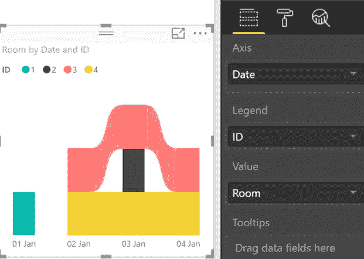

# 5. 联接

### DAX 中的联接

本章探讨了在不必然使用关系机制的情况下，在计算中利用和合并不同表数据的选项。

计算中经常使用多个表的数据。大多数场景可以通过数据模型中定义的标准表关系自动涵盖，但并非所有情况都如此。如果需要更高的灵活性，可以使用多个支持联接表的 DAX 函数。如果您习惯编写 T-SQL 查询，其中一些函数会为您提供熟悉的体验。本章我重点介绍相似之处和不同之处。

以下是涵盖的函数：
- `GENERATE` 和 `CROSSJOIN`
- `NATURALINNERJOIN`
- `NATURALLEFTOUTERJOIN`
- `UNION`
- `LOOKUPVALUE`

#### 标准关系

如果您的数据模型包含多个表，则可以使用标准的 DAX 关系机制定义表之间基于规则的链接。DAX 关系是两个表之间的链接，定义了关系应如何工作的规则。计算会自动利用这些预定义的关系，这可以在编写大多数计算时简化所需的代码量。

标准的 DAX 关系机制存在一些局限性，在某些场景下无法生效。

关系必须符合以下规则：
- 关系只能是**一对一**或**一对多**。
- 每个表只能使用单列。
- 匹配条件必须是 `=` 运算符的精确匹配，不能基于其他运算符，例如 `>`、`>=`、`<` 或 `<=` 等。
- 不能使用自联接。两个表必须是不同的表。

##### 关系只能是一对一或一对多

这意味着，对于关系涉及的至少一个表，用于关系的列中，表的每一行都必须包含唯一值。这被称为“关系中的一端表”。

表中多行存在的相同值被视为重复值，并会产生错误。这是未来数据加载时需要留意的一点。成功创建的关系可确认当前数据集符合要求。然而，未来的数据加载可能会引入重复数据，从而在刷新期间产生错误。

一对多关系的一个常见示例是维度表和事实表之间的关系，例如 `Dimension Date` 和 `Fact Sale`。日期表每天包含一行，在 `[Date]` 列中具有唯一值。这满足了关系一端表的要求，而 `Fact Sale` 表可能有多行，在关系使用的列中包含相同的日期。

这是数据建模中的常见模式。事实（或事件）表通常与维度（或查找）表定义关系。事实表可能对同一日期、客户或地点包含多行，而单独的表中每个日期、客户或地点只包含一行。这些表通常位于任何关系的一端。

你也可以将关系的一端表视为筛选表。这些表是报告中用作切片器和筛选器基础的理想选择。在这些切片器上所做的选择会通过关系传播到多端连接的任何相关表，并适当地筛选事实数据。这种方法非常适合分析和报告，这种模式通常被描述为对数据应用星型架构。维度表可以与多个事实表建立关系。这允许筛选选择应用于模型中数据的大部分区域。

筛选器仅沿着从一端表到多端表的方向应用。这意味着使用 `Fact Sale` 表中列的切片器不会自动应用于使用 `Dimension Date` 表中数据的计算。

一对一关系与一对多关系的不同之处在于，每个表中涉及的列必须具有唯一值。这种关系有效地创建了一个单一的逻辑表，或者在 T-SQL 中，是对两个表进行全外连接。

##### 每个表只能使用单个列

无法使用每个表多于一列来定义关系。如果你在数据中遇到需要强制使用多列数据建立关系的情况，可以创建一个新列，将这些列连接成一个单一值，然后用于关系，只要新列仍然满足用于一端的任何表具有唯一值的规则即可。

使用这种方法时，要小心避免来自两个不同值的组合产生相同结果，从而导致键冲突。组合值 `AB` 和 `CDE` 会产生与组合 `ABC` 和 `DE` 相同的结果。在这种情况下，使用不常见的分隔符应能降低键冲突的风险，例如，`AB` 和 `#` 及 `CDE` 现在会与 `ABC` 和 `#` 及 `DE` 不同。

##### 匹配条件必须是精确匹配

关系中所涉及表之间使用的默认运算符是 `=` 运算符。这意味着，要匹配行，关系仅配对两个表中涉及列的值完全匹配的行。当你处理看起来相似的值时，这可能会成为一个陷阱。

可以在关系一侧使用 `Date` 数据类型列的表，而在另一侧使用 `DateTime` 数据类型的表之间创建一对多（或一对一）关系。只有在使用 `DateTime` 数据类型的列中表示午夜的值才可能匹配使用 `Date` 数据类型的列中的值。当你有两个表的数据看起来应该匹配，但尽管没有出现错误，视觉对象显示的数据却比你预期少时，这可能会令人困惑。

在这种情况下，考虑将使用 `DateTime` 数据类型的表列转换为使用 `Date` 类型。如果时间部分很重要，你可以使用第二个仅包含时间部分的列来满足大多数报告需求。

另一种常见的解决方案是创建一个仅包含日期部分的计算列，然后使用该计算列创建关系。

这种行为适用于大多数场景，但有时你可能希望使用不止 `=` 运算符在表之间创建匹配。有时，当你需要连接跨越一系列值的行时，使用 `>=` 或 `<=` 运算符会很有用。一个示例可能是，对于表中的每一行，你需要在另一个表中找到处于第一行某个时间段内（例如前 14 天）的行。

### 不能使用自连接

你无法创建从一个表连接到自身的表关系。这种关系对于表示层次结构（例如包含员工数据的表中的员工/经理场景）非常有用。

员工和经理可以作为同一表中的不同行存在，使用 `EmployeeID` 和 `ManagerID` 等列中的值来帮助连接这两行。DAX 中提供了 `PATH` 和 `PATHITEM` 函数，有助于在计算列内提供这些数据结构的扁平化视图。

有人曾向我描述这种关系为猪耳朵关系。并非因为它被认为是一种混乱的数据建模技术，而是因为你在任何表关系图中绘制线条/箭头的方式。当围绕代表表的方框顶角绘制时，箭头看起来像一只耳朵。

其他自连接关系可能有助于在比较场景中查找表中特定行之前或之后的行。

## 如何在无关系的情况下联接表

现在你已经了解了内置关系机制的一些限制，让我们探索 DAX 中提供的一些函数，以帮助我们在标准关系无法处理的情况下进行工作。

### `CROSSJOIN` 和 `GENERATE` 函数

我最喜欢且最常用的连接表函数可能是 `GENERATE` 和 `CROSSJOIN` 函数。当您将它们与 DAX `FILTER` 函数结合使用时，它们具有类似 T-SQL 中 `INNER JOIN` 的感觉和表现行为。

#### `CROSSJOIN`

`CROSSJOIN` 函数的基本语法如下。

```
CROSSJOIN ( <Table1>, <Table2> [, <TableN>]... )
```

最少需要传递两个表，但你可以添加额外的表。结果会产生笛卡尔效应，其中第一个表中的每一行都与第二个表中的每一行匹配。然后，前两个表连接后的每一行再与第三个表中的每一行匹配。这可以快速生成一个包含许多行的表输出。

`CROSSJOIN` 函数的输出是一个表。如果你使用的是支持使用计算表的 DAX 版本，则可以将此表用作计算表，或者在 DAX 计算中用作表表达式。

如果第一个参数中使用的表有 10 行，第二个表也有 10 行，则未筛选的输出是 100 行。如果另一个表也有 10 行，那么未筛选的输出现在就是 1000 行。这相当于以下 T-SQL 语句：

```
SELECT
*
FROM TableA
CROSS JOIN TableB
```

或者对于阅读本书的老派人士：

```
SELECT * FROM TableA, TableB
```

这些 T-SQL 语句产生相同的结果。两者都没有 `WHERE` 子句来将最终输出的行数缩小到 `TableA` 的行数 × `TableB` 的行数。

#### `GENERATE`

`GENERATE`的基础语法如下：

```
GENERATE ( <Table1>, <Table2> )
```

这与`CROSSJOIN`不同之处在于，`GENERATE`只能使用两个表，否则输出的是作为参数传递的表的完整笛卡尔积。这两个参数必须是不同的表。

**注意**

当你计划使用`FILTER`函数时，请使用`GENERATE`，而不是`CROSSJOIN`。

让我使用以下两个不相关的表（`表 5-1` 和 `5-2`）来演示`GENERATE`函数的行为。

**`表 5-2`**

要用作`TableB`的数据集

| Make | Model | Year | Index |
| --- | --- | --- | --- |
| Toyota | Corolla | 2018 | 100 |
| Toyota | Corolla | 2018 | 200 |
| Hyundai | Elantra | 2019 | 300 |
| Hyundai | Elantra | 2019 | 400 |
| Ford | Focus | 2018 | 500 |
| Ford | Focus | 2019 | 600 |

**`表 5-1`**

要用作`TableA`的数据集

| ID | Make | Model | Value |
| --- | --- | --- | --- |
| 1 | Toyota | Corolla | 10 |
| 2 | Hyundai | Elantra | 20 |
| 3 | Ford | Focus | 30 |

让我们从一个简单的查询开始。一个用于显示`GENERATE`函数结果总行数的计算度量如下所示：

```
My Count of Rows =
COUNTROWS(
    GENERATE('TableA','TableB')
)
```

这将返回值 18，这是 `TableA` 的三行乘以 `TableB` 的六行得到的结果。

可以更新此计算以对`[Make]`列应用连接条件，如`清单 5-1`所示。

```
My Count of Rows =
COUNTROWS(
    GENERATE(
        'TableA',
        FILTER(
            'TableB',
            'TableA'[Make] = 'TableB'[Make]
        )
    )
)
**清单 5-1**
在计算度量中使用带有筛选条件的`GENERATE`
```

`GENERATE`函数现在使用`FILTER`函数作为第二个参数，该参数应用了连接条件。这相当于在 T-SQL 语句的`ON`或`WHERE`子句中提供谓词的 DAX 版本。筛选表达式指定仅返回 `TableA` 和 `TableB` 之间在`[Make]`列中具有匹配值的行。此计算度量的结果是 6。

这也可以通过标准的 DAX 关系来实现。现在，我们在匹配要求中包含第二列`[Model]`，以及一个附加条件——`Year`列中的值应早于 2019。

带有附加筛选条件的新计算如`清单 5-2`所示。

```
My Count of Rows =
COUNTROWS(
    GENERATE(
        'TableA',
        FILTER(
            'TableB',
            'TableA'[Make] = 'TableB'[Make] &&
            'TableA'[Model] = 'TableB'[Model] &&
            'TableB'[Year] < 2019
        )
    )
)
**清单 5-2**
在`GENERATE`函数中使用附加筛选条件
```

`FILTER`函数允许的规则比使用标准 DAX 关系时更为复杂。对于示例数据，此计算度量的结果应为 3。在这个数据集中，我本可以使用`'TableB'[Year] = 2018`来得到相同的结果，但我想强调能够使用除`=`之外的运算符作为匹配条件的能力。

也可以使用关系和以下计算度量生成相同的输出：

```
My Count of Rows =
CALCULATE(
    COUNTROWS('TableA'),
    'TableB'[Year] < 2019
)
```

#### 唯一列名

到目前为止，使用`GENERATE`的示例都能正常工作，是因为它们将输出传递给了`COUNTROWS`函数，该函数仅返回行数的计数。

如果你打算将`GENERATE`函数的输出用作计算表，你很快就会遇到列名的问题。在 DAX 中，物理表和虚拟表中的列名必须是唯一的。`GENERATE`函数的输出包含传递给该函数的所有表中的所有列。不可避免地，其中一些表具有相同的列名。

如果你尝试创建以下计算表：

```
My Table = GENERATE('TableA','TableB')
```

你会遇到类似“名为 [Make] 的列在‘Table’表中已存在”的错误。在此示例中，该错误指的是`[Make]`列的冲突，但也存在两个表中都有的`[Model]`列的问题。

在 T-SQL 中，你使用查询中的`SELECT`子句来控制返回的列名和列数。在 DAX 中，你可以使用`SELECTCOLUMNS`函数来提供类似的功能。该函数的主要用途是允许你从一个表中部分选择某些列，但这里有用的一个附带功能是，它还允许你在此过程中重命名或别名化列。

使用`SELECTCOLUMNS`函数，你可以重命名任一表中的`[Make]`和`[Model]`列，或者，因为你使用的是`=`运算符，你可以选择简单地从其中一个表中删除这些列，因为它们的值应该匹配，你只需要看到一个即可。

`清单 5-3` 和 `5-4` 展示了两个使用`SELECTCOLUMNS`函数来返回无错误结果的示例。

```
My Table =
GENERATE(
    'TableA',
    SELECTCOLUMNS(
        'TableB',
        "My Make", [Make],
        "My Model", [Model],
        "Year", [Year],
        "Index", [Index]
    )
)
**清单 5-3**
将`SELECTCOLUMNS`与`GENERATE`一起使用
```

# DAX中的GENERATE与SELECTCOLUMNS函数应用

在第一个示例中，`GENERATE`函数的第二个参数不再是简单的`'TableB'`，而是被`SELECTCOLUMNS`函数包裹了。该函数根据你传递给它的规则输出一个表格。在第一种情况下，你指示`SELECTCOLUMNS`使用`'TableB'`并返回四个定义为`<名称>/<表达式>`对的列。这就是你如何重命名列以避免在`GENERATE`函数的输出中出现错误的方法。

第二个示例简单地省略了这些列以获得更简洁的效果，并返回一个显示18行的表，这是两个表的完整笛卡尔积。

一个更现实的需求可能是将此与之前的示例结合起来，为在`[Make]`和`[Model]`上匹配且年份在2019之前的行返回一个具有唯一列名的计算表。

其DAX代码如清单5-5所示。

```dax
My Table =
FILTER(
    GENERATE(
        'TableA',
        SELECTCOLUMNS(
            'TableB',
            "My Make", [Make],
            "My Model", [Model],
            "Year", [Year],
            "Index", [Index]
        )
    ),
    [Make] = [My Make] &&
    [Model] = [My Model] &&
    [Year] < 2019
)
```

### `清单 5-5`
组合使用`GENERATE`、`FILTER`和`SELECTCOLUMNS`

这里，`GENERATE`被`FILTER`函数包裹，以允许计算定义在表之间匹配行时使用的规则。内部的`SELECTCOLUMNS`必须为`'TableB'`中的`[Make]`和`[Model]`列返回别名，以便外部的`FILTER`函数能够处理该表。

这突出了一个事实：筛选并非发生在连接过程中，而是发生在`GENERATE`函数输出的单个表上。

此DAX语句（包括对`'TableB'`中列的重命名）的T-SQL等效代码如清单5-6所示。

```sql
SELECT
A.[ID],
A.[Make],
A.[Model],
A.[Value],
B.[Make] AS [My Make],
B.[Model] AS [My Model],
B.[Year],
B.[Index]
FROM TableA AS A
INNER JOIN TableB AS B
ON  A.Make = B.Make
AND A.Model = B.Model
AND B.Year < 2019
```

### `列表 5-6：` DAX示例的T-SQL等效写法

上述DAX和T-SQL语句的输出结果如表5-3所示。

### `表 5-3：` DAX和T-SQL示例的输出结果

| ID | Make    | Model   | Value | My Make | My Model | Year | Index |
|----|---------|---------|-------|---------|----------|------|-------|
| 1  | Toyota  | Corolla | 10    | Toyota  | Corolla  | 2018 | 100   |
| 2  | Hyundai | Elantra | 20    | Hyundai | Elantra  | 2018 | 300   |
| 3  | Ford    | Focus   | 30    | Ford    | Focus    | 2018 | 500   |

为了移除`FILTER`函数所需的冗余列`[My Make]`和`[My Model]`，您可以通过用另一个`SELECTCOLUMNS`语句包裹整个表达式来修改计算。列表5-7展示了使用变量增强可读性的实现方式。

```dax
My Table =
VAR ModifiedTableB =
SELECTCOLUMNS(
'TableB',
"My Make", [Make],
"My Model", [Model],
"Year", [Year],
"Index", [Index]
)
VAR FilteredGENERATE =
FILTER(
GENERATE( 'TableA', ModifiedTableB ),
[Make] = [My Make] &&
[Model] = [My Model] &&
[Year] < 2019
)
RETURN
SELECTCOLUMNS(
FilteredGENERATE,
"ID",[ID],
"Make",[Make],
"Model",[Model],
"Year",[Year],
"Index",[Index]
)
```

### `列表 5-7：` 移除多余列的增强版示例

该计算在最终的`RETURN`步骤中引入了一个`SELECTCOLUMNS`函数，通过将`[My Make]`和`[My Model]`列从`<名称>/<表达式>`配对中排除，从而有效地舍弃了这些列。

如有需要，您可以在`SELECTCOLUMNS`函数中使用比简单引用列名更复杂的表达式。

## 使用 `GENERATE` 进行行扩展

利用`GENERATE`/`FILTER`函数的另一种方式是扩展现有表中的行数，以解决可视化问题。

互联网论坛上经常出现的一个话题是：如何将一个包含混合起始/结束日期的实体表进行处理，并绘制出各实体在起止日期之间任意时刻的活跃数量。

考虑一下表5-4中酒店客房占用率的数据集。该表中日期格式为YYYY-MM-DD。

### `表 5-4：` 用作占用率表的数据集

| ID | Room | Check In   | Check Out  |
|----|------|------------|------------|
| 1  | 101  | 2019-01-01 | 2019-01-02 |
| 2  | 102  | 2019-01-03 | 2019-01-04 |
| 3  | 103  | 2019-01-02 | 2019-01-05 |
| 4  | 101  | 2019-01-02 | 2019-01-05 |

为了创建一个显示每晚有多少房间被占用的可视化图表，一种解决方案是将原始表中的数据扩展，使其包含代表每个房间/每晚组合的行。对于ID为4的占用记录，该房间被占用了三个晚上（从1月2日到1月4日），因此，如果该表中有三行ID为4的数据（而非原始表中的单行），那么将其绘制在可视化图表上的任务将更加容易。

如果模型中有一个日期或日历表，每一行代表一天，且包含示例中涉及的日期，那么您可以使用它来帮助创建所需的行。列表5-8使用动态创建的表作为替代方案。

```dax
Table for Visual =
SELECTCOLUMNS(
FILTER(
GENERATE(
'Occupancies',
CALENDAR("2019-01-01","2019-01-05")
),
[Date] >= [Check In] &&
[Date] < [Check out]
),
"ID", [ID],
"Room", [Room],
"Date", [Date]
)
```

### `列表 5-8：` 将 `GENERATE` 与 `CALENDAR` 函数结合使用

该代码返回表5-5中的三列数据集。

### `表 5-5：` 列表5-8中代码的输出结果

| ID | Room | Date       |
|----|------|------------|
| 1  | 101  | 2019-01-01 |
| 3  | 103  | 2019-01-02 |
| 4  | 101  | 2019-01-02 |
| 2  | 102  | 2019-01-03 |
| 3  | 103  | 2019-01-03 |
| 4  | 101  | 2019-01-03 |
| 3  | 103  | 2019-01-04 |
| 4  | 101  | 2019-01-04 |

如您所见，原始占用率表中ID为4的行现在在新计算表中出现了三次。这正是您想要的行为，当使用功能区图表进行绘制时，可视化图表能够绘制原始`[Check In]`和`[Check Out]`日期之外的其他日期的数值（图5-1）。



### `图 5-1：` 使用功能区图表可视化图表绘制的列表5-8的输出结果

您可以将此技术应用于表示员工并包含入职/离职日期的表，或任何包含多行重叠起始/结束值的数据集。

# DAX GENERATE 函数详解与示例

在深入拆解各个组成部分之前，我们先来看看等效的 T-SQL 语句是什么样的（列表 5-9）。

```sql
SELECT
Occupancy.[ID],
Occupancy.[Room],
Dates.[Date]
FROM Occupancy AS O
INNER JOIN Dates AS D
ON  D.[Date] >= O.[Check In]
AND D.[Date] < O.[Check Out]
```

**列表 5-9：** 与列表 5-8 中代码等效的 T-SQL 语句

现在回到 DAX 计算，让我们拆解一下，看看每个部分的作用。首先从传递给 `GENERATE` 函数的参数开始。第一个参数很简单，您只需传递您的 `'Occupancies'` 表即可。第二个参数是 DAX 函数 `CALENDAR`。这个便捷的函数会生成一个单列表，包含传递给它的两个日期参数之间的所有日期。

```dax
GENERATE(
'Occupancies',
CALENDAR("2019-01-01","2019-01-05")
),
```

在本例中，两个参数分别是 `"2019-01-01"` 和 `"2019-01-05"`，代表 2019 年 1 月 1 日至 2019 年 1 月 5 日之间的值。这会产生一个包含五行且仅有一列（名为 `[Date]`）的表。您可以使用 `SELECTCOLUMNS` 重命名此列，但在此例中，`GENERATE` 函数中不存在列名冲突，因此您可以保持原样。
您可以使用更大范围的日期，但这样做只会可能让计算生成数据的时间稍长，而这些数据在后续计算中最终会被忽略，因此不会影响计算结果。
此时，`GENERATE` 函数的输出是一个包含 20 行的表。这是将 `'Occupancies'` 表中的 4 行与 `CALENDAR` 函数的表表达式输出中的所有 5 行匹配后得到的笛卡尔积。
接着，这些数据被包裹在 `FILTER` 函数中（列表 5-10），该函数指定了涉及多个列的规则，以帮助决定保留哪些行、舍弃哪些行。对于当前需求，不需要超出每个占用期范围的日期，但如果您想显示房间何时为空，这些数据可能会很有趣。

```dax
FILTER(
GENERATE(
'Occupancies',
CALENDAR("2019-01-01","2019-01-05")
),
[Date] >= [Check In] &&
[Date] < [Check out]
),
```

**列表 5-10：** 来自列表 5-8 的 `FILTER` 部分

筛选函数将 `GENERATE` 函数的表表达式输出作为其第一个参数。然后应用筛选规则，帮助将数据集缩减到只需的行。
此示例凸显了使用 `GENERATE` 函数相比标准表关系的另一个优势。`FILTER` 函数使用了除 `=` 以外的运算符（即 `>=` 和 `<` 运算符），以实现对每个占用期内的行范围进行匹配。
最后，`FILTER` 函数被包裹在 `SELECTCOLUMNS` 函数内部，以控制和命名返回给计算表的各列。

## 使用数字表复制行

`GENERATE` 表助力复制行的另一种类似用途是与包含数字的表进行联接。数字表是一种通用工具表，其中包含单列连续数字，从零开始，一直到对数据模型有意义的某个值。
假设您想要扩展表 5-6，为每一行生成副本，副本数量由 `Factor`（因子）列中的值控制。

**表 5-6** 用作 Table1 表的数据集

| Item（项目） | Factor（因子） |
| --- | --- |
| A | 1 |
| B | 2 |
| C | 3 |

清单 5-11 展示了用于扩展此数据的 DAX 计算表。

```dax
New Table =
ADDCOLUMNS(
    FILTER(
        GENERATE(
            'Table1',
            GENERATESERIES(1,3)
        )
        ,[Factor] <= [Value]
    ),
    "New Col", [Factor] * [Value]
)
```

**清单 5-11** 使用 `GENERATESERIES` 创建行

这将生成表 5-7 中的输出。

**表 5-7** 清单 5-11 代码的输出

| Item（项目） | Factor（因子） | Value（值） | New Col（新列） |
| --- | --- | --- | --- |
| A | 1 | 1 | 1 |
| B | 2 | 1 | 2 |
| B | 2 | 2 | 4 |
| C | 3 | 1 | 3 |
| C | 3 | 2 | 6 |
| C | 3 | 3 | 9 |

要分解此计算，请从内部的 `GENERATE` 函数开始。这与之前的占用示例类似，区别仅在于没有传递 `CALENDAR` 函数，而是使用了 `GENERATESERIES` 函数。此函数生成一个包含一系列整数的单行表。这是 `GENERATESERIES` 的语法：

```dax
GENERATESERIES (<start>, <end> [, <step>])
```

第一个和第二个参数控制数字范围的起始值和结束值。此示例创建了一个仅包含三行的表。第三个参数是可选的，如果未提供（如此示例所示），则默认为 `1`。`GENERATESERIES` 函数本质上是在创建一个动态数字表。
`GENERATESERIES` 于 2017 年 10 月引入，目前并非在所有 DAX 环境中都可用。要在早期版本的 DAX 中复现此功能，请按如下方式使用 `CALENDAR` 函数：

```dax
GENERATE(
    'Table1',
    SELECTCOLUMNS(CALENDAR(1,3),"Value",INT([Date]))
)
```

`GENERATE` 函数输出的表表达式将传递到 `FILTER` 函数，该函数随后应用规则 `[Factor] <= [Value]` 来确定要返回哪些行。
最后，`ADDCOLUMNS` 函数作为 `SELECTCOLUMNS` 的替代方案。在此示例中，您无需处理 `GENERATE` 函数的任何列名冲突，因此可以使用 `ADDCOLUMNS` 将新列附加到所有现有的输出中。此示例还使用了一个涉及多值计算的表达式，以演示如何根据需要纳入更有意义的计算。

## 使用 `GENERATE` 进行自联接

最后一个示例使用 `GENERATE` 执行自联接，并使用一个简化的 `Sales` 表，该表显示客户进行购买的日期。对于每次购买，这里的需求是了解该客户自上次购买以来已经过了多长时间。
该示例使用表 5-8 中的数据集。

**表 5-8** 用作销售表的数据集

| Customer（客户） | Purchase Date（购买日期） |
| --- | --- |
| 1 | 2019-01-01 |
| 1 | 2019-01-07 |
| 1 | 2019-01-21 |
| 1 | 2019-01-25 |
| 2 | 2019-01-05 |
| 2 | 2019-01-12 |
| 2 | 2019-01-17 |
| 2 | 2019-01-22 |

计算表如清单 5-12 所示。

```dax
New Table =
VAR SelfJoin =
    FILTER(
        GENERATE(
            'Sales',
            SELECTCOLUMNS(
                'Sales',
                "xCustomer",[Customer],
                "xPurchase Date",[Purchase Date]
            )
        ),
        [xPurchase Date] < [Purchase Date] &&
        [Customer] = [xCustomer]
    )
VAR LastPurchases =
    GROUPBY(
        SelfJoin,
        Sales[Customer],
        Sales[Purchase Date],
        "Last Purchase",MAXX(
            CURRENTGROUP(),
            [xPurchase Date]
        )
    )
RETURN
    ADDCOLUMNS(
        NATURALLEFTOUTERJOIN('Sales',  LastPurchases),
        "Days since last purchase",
        VAR DaysSince = INT([Purchase Date] - [Last Purchase])
        RETURN IF (
            NOT ISBLANK([Last Purchase]),
            DaysSince
        )
    )
```

**清单 5-12** 使用自联接查找上次购买的计算表

此计算的输出是表 5-9，它显示了原始表（表 5-8）以及两个新列。新列显示了客户上次购买的日期以及一个表示自该次购买以来所经过天数的值。

**表 5-9** 显示清单 5-12 代码输出的数据集

| Customer（客户） | Purchase Date（购买日期） | Last Purchase（上次购买） | Days Since Purchase（距上次购买天数） |
| --- | --- | --- | --- |
| 1 | 2019-01-01 |  |  |
| 1 | 2019-01-07 | 2019-01-01 | 6 |
| 1 | 2019-01-21 | 2019-01-07 | 14 |
| 1 | 2019-01-25 | 2019-01-21 | 4 |
| 2 | 2019-01-05 |  |  |
| 2 | 2019-01-12 | 2019-01-05 | 7 |
| 2 | 2019-01-17 | 2019-01-12 | 5 |
| 2 | 2019-01-22 | 2019-01-17 | 5 |

您可以在各种计算度量中使用 `[Days Since Purchase]`（距上次购买天数）列，以帮助您了解客户行为，例如购买之间的平均时间以及购买之间的最小和最大时间间隔。

# 计算分解说明

要理解此计算，您可以轻松地将清单 5-12 中的代码分解为三个部分，由两个变量声明和最终的 `RETURN`（返回）语句组成。

## 第一个变量

第一个变量的目标是创建一个表表达式，该表达式将八行 `Sales` 表中的每一行与其自身进行联接，匹配所有行，但应用一个筛选器以匹配 `CustomerID`（客户 ID）以及任何之前的购买。

该 `VAR`（变量）语句对应的 T-SQL 等效代码如清单 5-13 所示。

```sql
SELECT
    L.Customer,
    L.[Purchase Date],
    R.Customer AS [xCustomer],
    R.[Purchase Date] AS [xPurchase Date]
INTO #SelfJoin
FROM Sales AS L
INNER JOIN Sales AS R
    ON  R.Customer = L.Customer
    AND R.[Purchase Date] < L.[Purchase Date]
```

**清单 5-13** 清单 5-12 中第一个变量的 T-SQL 等效代码

这会产生一个 12 行的结果，对于某些交易，会找到多个匹配项，因为在此阶段，查询是在查找所有先前的购买。每位客户的第一次购买缺失，因为没有先前的购买记录。此查询的模式与清单 5-7 类似，因为它在联接条件中使用了多列，使用了除 `=` 之外的运算符，最后还使用了 `SELECTCOLUMNS` 来重命名列以避免列名冲突。

至此，最终的 `RETURN` 语句可以简单地返回 `SelfJoin` 变量，以便检查数据的正确性。该变量产生的表表达式并非最终输出，而是为下一个变量准备数据的步骤。

## 第二个变量

`VAR LastPurchases` 语句将 `SelfJoin` 变量汇总为每行对应一个 `[Customer]` 和 `[Purchase Date]` 组合。新增了一个名为“Last Purchase”的聚合列，用于查找 `[xPurchase Date]` 列中的最新值。这标识了上一次购买所需的日期。

由于意图是汇总一个表表达式，而非物理表，因此无法使用 `SUMMARIZE` 或 `SUMMARIZECOLUMNS` 函数。但是，可以使用 `GROUPBY`，并将 `SelfJoin` 变量作为其第一个参数。第二个和第三个参数指定了要分组的列。最后一个参数是一个 DAX 表达式，使用 `MAXX` 迭代器函数为每个组合查找最新值。`CURRENTGROUP()` 函数用于帮助 `MAXX` 函数利用 `SelfJoin` 变量中存储的表表达式。

此时的结果是一个包含六行的表（表 5-10）。这并非最终结果，也不包含每位客户首次购买的任何信息。此结果集需要加回到原始数据中，这将在下一步中完成。

**表 5-10** 来自清单 5-12 的第一个变量的数据集输出

| Customer | Purchase Date | Last Purchase |
| --- | --- | --- |
| 1 | 2019-01-07 | 2019-01-01 |
| 1 | 2019-01-21 | 2019-01-07 |
| 1 | 2019-01-25 | 2019-01-21 |
| 2 | 2019-01-12 | 2019-01-05 |
| 2 | 2019-01-17 | 2019-01-12 |
| 2 | 2019-01-22 | 2019-01-17 |

该语句对应的 T-SQL 等效代码如清单 5-14 所示。

```sql
SELECT
[Customer],
[Purchase Date],
MAX([xPurchase Date]) AS [Last Purchase]
INTO #LastPurchases
FROM #SelfJoin
GROUP BY
[Customer],
[Purchase Date]
```

**清单 5-14** 来自清单 5-12 的第二个变量的 T-SQL 等效代码

## 最后一步

最后一步是获取存储在 `LastPurchases` 变量中的表表达式，并将其与原始表连接。这需要是一个外部半连接，以便保留代表每位客户初始购买的记录。

意图是将原始 `Sales` 表中的每一行与 `LastPurchases` 表表达式中的行进行匹配，当 `[Customer]` 和 `[Purchase Date]` 列都匹配时进行连接。`Sales` 表中无法与 `LastPurchases` 表表达式中的任何行匹配的记录需要被保留。

`GENERATE` 函数不易在表之间提供“左连接”功能。可以通过使用涉及 `FILTER` 和更多 `GROUPBY` 函数的多步骤方法迂回实现，或者使用 `NATURALLEFTOUTERJOIN` 函数来获得所需的结果。

在最终的 `RETURN` 语句中，向 `NATURALLEFTOUTERJOIN` 传递了两个表。第一个是原始的八行 `Sales` 表。第二个是存储在 `LastPurchases` 变量中的六行表表达式。该函数会检查两个表中的所有列，并自动匹配任何具有相同名称和数据类型，以及相同沿袭（稍后详细介绍）的列。

```dax
NATURALLEFTOUTERJOIN('Sales',  LastPurchases)
```

在此示例中，传递给 `NATURALLEFTOUTERJOIN` 的 `Sales` 表和 `LastPurchases` 表都具有 `[Customer]` 和 `[Purchase Date]` 列，并且这些列共享相同的数据类型。这将返回一个三列表（表 5-11），该表仍需填补一个需求。

**表 5-11** 来自清单 5-12 的 `NATURALLEFTOUTERJOIN` 的输出

| Customer | Purchase Date | Last Purchase |
| --- | --- | --- |
| 1 | 2019-01-01 |  |
| 1 | 2019-01-07 | 2019-01-01 |
| 1 | 2019-01-21 | 2019-01-07 |
| 1 | 2019-01-25 | 2019-01-21 |
| 2 | 2019-01-05 |  |
| 2 | 2019-01-12 | 2019-01-05 |
| 2 | 2019-01-17 | 2019-01-12 |
| 2 | 2019-01-22 | 2019-01-17 |

最后的需求是拥有一个列，该列包含一个数字，用于显示每位客户每次购买距离上一次购买过去的天数。这可以通过用 `ADDCOLUMNS` 函数包裹 `NATURALLEFTOUTERJOIN` 函数来实现（清单 5-15）。

```dax
RETURN
ADDCOLUMNS(
NATURALLEFTOUTERJOIN('Sales',  LastPurchases),
"Days since last purchase",
VAR DaysSince = INT([Purchase Date] - [Last Purchase])
RETURN IF (
NOT ISBLANK([Last Purchase]),
DaysSince
)
)
```

**清单 5-15** 来自清单 5-12 的最终 `RETURN` 语句

## 最终输出

`ADDCOLUMNS` 函数向 `NATURALLEFTOUTERJOIN` 函数的输出追加一列。`"Days since last purchase"` 参数为新列提供了名称，而最后一个以嵌套 `VAR` 语句开头的参数则是一个 DAX 表达式，用于返回 `[Purchase Date]` 和 `[Last Purchase]` 列之间的差值。

使用 `INT` 函数将减法得出的日期时间输出转换为整数。只要 `[Last Purchase]` 值始终等于或早于 `[Purchase Date]` 列中的值，此时也可以使用 `DATEDIFF` 函数。

此计算为除客户首次购买之外的每一行返回了预期值。对于这些行，它返回了诸如 43,466 和 43,470 之类的值，这可能会影响此列在后续计算中的使用。

为了解决这些过大的数字，使用`IF`函数测试`[Last Purchase]`列是否包含值。如果没有值，则返回空白，否则返回显示购买日期差值的值。

作为参考，最终`RETURN`语句的 T-SQL 等效代码如清单 5-16 所示。

```sql
SELECT
L.Customer,
L.[Purchase Date],
R.[Last Purchase],
DATEDIFF(DAY,R.[Last Purchase],L.[Purchase Date]) AS [Days since last purchase]
FROM #Sales AS L
LEFT OUTER JOIN #LastPurchases AS R
ON  L.Customer = R.Customer
AND L.[Purchase Date] = R.[Purchase Date]
```

**清单 5-16**
来自清单 5-12 的最终 `RETURN` 语句的 T-SQL 等效代码

清单 5-17 展示了一个更简单的计算表替代版本，它会产生相同的结果，但无需使用自连接技术。

```dax
New Table =
ADDCOLUMNS(
    ADDCOLUMNS(
        'Sales',
        "Last Purchase", MAXX(
            FILTER(
                'Sales',
                [Customer] = EARLIER([Customer]) &&
                [Purchase Date] < EARLIER([Purchase Date])
            ),
            [Purchase Date]
        )
    ),
    "Days since last purchase", IF(
        NOT ISBLANK([Last Purchase]),
        DATEDIFF([Last Purchase], [Purchase Date],DAY)
    )
)
```

**清单 5-17**
清单 5-12 的更简单替代方案

## `NATURALINNERJOIN` 和 `NATURALLEFTOUTERJOIN`

`NATURALINNERJOIN`函数允许你使用以下语法连接两个表：

```
NATURALINNERJOIN ( <leftTable>, <rightTable> )
```

此函数将第一个表中的每一行与第二个表中在共享相同列名和数据类型的任何列上具有匹配值的每一行进行匹配。

如果任一表中的行无法与另一个表中的行匹配，则该行会从结果中删除。额外要求是，两个表必须源自同一物理源表。这被称为具有相同的沿袭。

一旦找到匹配行，匹配中使用的列会返回一次，同时返回左表和右表中未参与匹配的任何其他列。

`NATURALLEFTOUTERJOIN`函数具有相同的两参数要求，不同之处在于它保留了作为第一个参数传入的表中在第二个参数传入的表中找不到匹配行的那些行。

顾名思义，这些函数类似于 T-SQL 中的`INNER JOIN`和`LEFT OUTER JOIN`语句。

### 沿袭 (Lineage)

`NATURALINNERJOIN` 和 `NATURALLEFTOUTERJOIN` 函数存在沿袭要求，这往往限制了它们可能适用的场景数量。

在 `WideWorldImportersDW` 数据集中，“`Fact Sale`” 表包含一个名为 “`[City Key]`” 的列，其数据类型为整数。“`Dimension City`” 表具有同名的列，且数据类型相同，但由于它们是不同的表，以下 DAX 代码会产生错误。

```dax
New Table = NATURALINNERJOIN('Fact Sale','Dimension City')
```

像之前对 `GENERATE` 所做的那样，用 `FILTER` 包裹 `NATURALINNERJOIN` 无法绕过此错误。`NATURALLEFTOUTERJOIN` 也是如此。这些函数最常见的用途类似于前一个示例，即查找历史购买记录，如清单 5-17 所示。

通常，在涉及变量的多语句 DAX 计算中，会使用单个表作为起点。从源表中生成一个或多个表表达式，并存储到变量中。这些表表达式可以被汇总或筛选，以处理源数据，然后重新连接到原始表。在这种情况下，DAX 引擎知道，即使你正在处理的列可能已被聚合或多次重命名，它仍然可以将值追溯到参与联接的同一个源表。

解决此限制的一种方法是使用 `SELECTCOLUMNS` 函数。表 5-12 和 5-13 对此进行了演示。

**表 5-13**
用作表 2 的数据集

| ID | Value2 |
| --- | --- |
| C | 3 |
| D | 4 |
| E | 5 |
| F | 6 |

**表 5-12**
用作表 1 的数据集

| ID | Value1 |
| --- | --- |
| A | 1 |
| B | 2 |
| C | 3 |
| D | 4 |

以下用于联接这些表的计算会失败并报错。

```dax
New Table = NATURALINNERJOIN('Table1','Table2')
```

尽管该计算满足两个要求（每个表中有一个列使用相同的名称和数据类型），但依然报错。`NATURALLEFTOUTERJOIN` 会产生相同的错误。要解决此问题，请使用 `SELECTCOLUMNS`，如清单 5-18 所示。表 5-14 显示了此代码的输出。

**表 5-14**
清单 5-18 中代码的输出

| ID | Value1 | Value2 |
| --- | --- | --- |
| C | 3 | 3 |
| D | 4 | 4 |

```dax
New Table =
VAR LeftTable  =
    SELECTCOLUMNS(
        'Table1',
        "ID",[ID] & "",
        "Value1",[Value1]
    )
VAR RightTable =
    SELECTCOLUMNS(
        'Table2',
        "ID",[ID] & "",
        "Value2",[Value2]
    )
RETURN
NATURALINNERJOIN(
    LeftTable,
    RightTable
)
```

**清单 5-18**
使用 `NATURALINNERJOIN` 的计算表

这里可以采取的方法是将一个空文本值追加到你打算用于 `NATURALINNERJOIN` 函数联接的每一列的列名上。同样的技术也适用于 `NATURALLEFTOUTERJOIN`，并可以匹配多个具有相同名称和数据类型的列。这些函数存在沿袭要求可能有很好的理由，尤其是在处理较大数据集时的性能方面，因此在使用此技术时请注意这一点。

使用 `NATURALLEFTOUTERJOIN` 的相同查询的输出如表 5-15 所示。

**表 5-15**
使用 `NATURALLEFTOUTERJOIN` 的清单 5-18 代码的输出

| ID | Value1 | Value2 |
| --- | --- | --- |
| A | 1 |   |
| B | 2 |   |
| C | 3 | 3 |
| D | 4 | 4 |

### `UNION`

到目前为止介绍的联接函数允许表水平联接。如果你需要垂直联接两个或多个表，可以使用 `UNION` 函数。其工作方式与 T-SQL 中的 `UNION ALL` 相同。`UNION` 的语法如下：

```
UNION ( <table_expression1>, <table_expression2> [, ...])
```

该函数要求传入的每个表具有相同数量的列，否则会产生错误。`SELECTCOLUMNS` 和 `ADDCOLUMNS` 是很有用的函数，可以帮助你将表调整为具有相同数量的列，以便 `UNION` 正常工作。

`UNION` 的一个有效用例是与 `NATURALLEFTOUTERJOIN` 结合使用，处理缺少数据的基础表。你可以使用 `NATURALLEFTOUTERJOIN` 来帮助识别数据缺口，然后生成一个包含填充值的表，并使用 `UNION` 函数将其垂直联接到基础表，从而得到一个更完整的表。

如果在前一个示例中使用 `UNION` 函数处理表 1 和表 2 的数据集（见表 5-12 和 5-13），输出如表 5-16 所示。

**表 5-16**
表 1 和表 2 的 `UNION` 输出

| ID | Value1 |
| --- | --- |
| A | 1 |
| B | 2 |
| C | 3 |
| D | 4 |
| C | 3 |
| D | 4 |
| E | 5 |
| F | 6 |

请注意，来自表 1 和表 2 中相同的行仍然作为单独的行返回，并且你无法在 `UNION` 期间执行类似 `DISTINCT` 的 T-SQL 操作。如果你想要去除重复行，可以用 `DISTINCT` 函数包裹 `UNION`：

```dax
Table =
DISTINCT(
    UNION('Table1', 'Table2')
)
```

列的匹配顺序取决于它们在各表中传递给 `UNION` 函数时的出现顺序。如果被联接的列之间存在数据类型差异，DAX 引擎会回退到能够承载两种数据的数据类型；例如，如果整数列与文本列对齐，则结果列的数据类型将为文本。

也可以将表与其自身进行联合，作为快速将源表数据量翻倍或增至三倍的一种技术。以下代码返回一个行数三倍于 `Table1` 的表。

# `LOOKUPVALUE`

本章介绍的最后一个函数对于 Excel 的高级用户来说可能比 T-SQL 用户更熟悉。该函数与其说是连接表的工具，不如说是一个允许你从其他表中检索值而无需使用 DAX 关系的函数。

`LOOKUPVALUE` 的语法如下：

```
LOOKUPVALUE ( <resultColumnName>, <searchColumnName>, <searchValue> 
[, <searchColumnName>, <searchValue>]...)
```

第一个参数指定函数要返回的值。当你在计算列中使用它时，这个值最终会显示在新列中。该列可以是任何表中的任何列，包括你正在添加计算列的表。

第二和第三个参数是 `<searchColumnName>` / `<searchValue>` 对。`<searchColumnName>` 参数需要是与第一个参数来自同一个表的列。`<searchValue>` 可以是一个用于搜索值的列，也可以是一个硬编码的值。

该函数需要返回单个结果，因此如果找到多个不同的值，`LOOKUPVALUE` 函数会生成错误。`LOOKUPVALUE` 的一个常见用法是在通常位于一对多关系中“多”方的表与用于在“一”方表中搜索值的 `LOOKUPTABLE` 之间进行查找。

一个使用 WideWorldImportersDW 数据的示例是：向 `Fact Sale` 表添加一个列，该列携带从 `Dimension City` 表找到的值。这不需要在这些表之间定义关系。

清单 5-19 添加了一个显示每次销售的 `[Continent]` 的列。

```
New Column =
LOOKUPVALUE(
-- 要返回至此新列的值 --
'Dimension City'[Continent],
-- 要搜索的列 --
'Dimension City'[City Key],
-- 要搜索的列中的值 --
'Fact Sale'[City Key]
)
Listing 5-19
使用 LOOKUPVALUE 函数的计算列
```

第一个参数 `'Dimension City'[Continent]` 指定了用于查找值的列，该值最终会返回到新的计算列。

用于返回 `[Continent]` 值的行由接下来的两个参数决定。`'Dimension City'[City Key]` 告诉 `LOOKUPVALUE` 这是你要在查找行时使用的列，而 `'Fact Sale'[City Key]` 告诉 `LOOKUPVALUE` 要查找的确切值。在本例中，使用了 `Fact Sale` 表中 `[City Key]` 列的值。

`<searchValue>` 参数可以是硬编码值，也可以是计算结果。如果是硬编码值，意味着新列的每一行都具有相同的值。

可以向 `LOOKUPVALUE` 函数传递额外的 `<searchColumnName>` 和 `<searchValue>` 条件集，这可能会比标准关系提供更大的灵活性。然而，在大型数据集上，除了要确保 `LOOKUPVALUE` 函数为每次搜索返回单个值之外，这种做法可能效率较低。

